# Cursor 官方给小白的 12 条使用建议

> 来源：[https://aigcreative.feishu.cn/docx/Lrr5dKKm9o8hGjxZnFRcziw2nyH](https://aigcreative.feishu.cn/docx/Lrr5dKKm9o8hGjxZnFRcziw2nyH)

> 链接: https://mp.weixin.qq.com/s/alUeM-GG9Inlw2cghwy7ag

> 👸号：和平本记

这是 cursor 的设计主管在 X 上发布的 cursor 使用建议

地址：

https://x.com/ryolu_/status/1914384195138511142

访问不了的可以直接看下面的截图

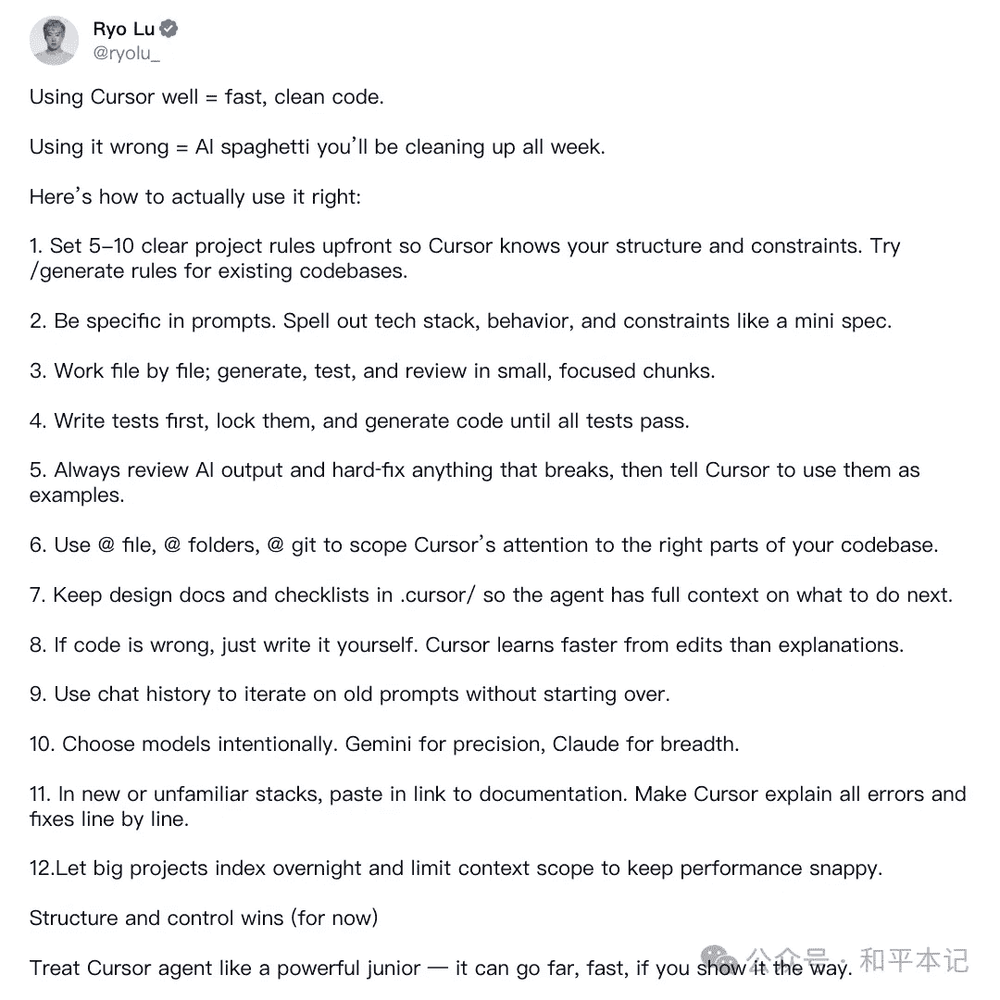

## 第一条，提前编写 cursor rules

> Set 5-10 clear project rules upfront so Cursor knows your structure and constraints. Try /generate rules for existing codebases.

> 

> 提前设定 5-10 条清晰的项目规则，这样 Cursor 就能了解你的结构和限制。尝试使用/generate 规则来处理现有代码库。

提前写好 cursor rules ，如果是新项目， 在项目开始之前你就要把 cursor rules 编写好，就像给 Cursor 一份“项目章程”。这样做可以从一开始就引导 AI 生成更符合项目需求的代码，减少后续的修改工作。

如果说你用 cursor 打开的是一个已有的项目代码时，可以使用 /generate rules 让 Cursor 尝试从现有代码中推断这些规则。

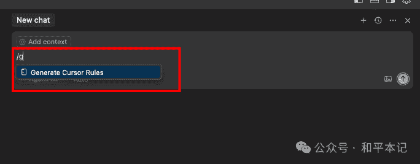

使用这个命令之后 cursor 就会基于你的项目为你定制一些具体的规则，这一步的作用就是给 AI 设定明确的编码规范和项目约束。

比如让 cursor 知道你的代码风格（缩进、命名约定）、禁止使用的库、特定的设计模式、错误处理方式等。

## **第二条，提示词要具体**

> Be specific in prompts. Spell out tech stack, behavior, and constraints like a mini spec.

> 

> 提示词要具体，详细列出技术栈、行为和限制，就像一个迷你规范一样。

**模糊的指令会导致模糊**的输出，我们在给 cursor 任务指令的时候， 要尽可能清晰、具体。

不要只说“创建一个登录页面”，而要说“使用 React、Tailwind CSS 和 Firebase Auth 创建一个登录页面，包含邮箱和密码输入框，一个登录按钮，以及忘记密码链接。登录成功后跳转到 /dashboard ，失败则显示错误信息。”

这就像给开发者写一个小型需求文档 (mini spec)，当你给 cursor 一个指令的时候，你要想想假如他是一个人类开发者，他能不能听的明白。

**一个小技巧：**

可以在 Ask 模式下，把我们说的自然语言转换成结构化的提示词

然后再切换到 Agent 模式，把刚才得到的结构化提示词粘贴进去

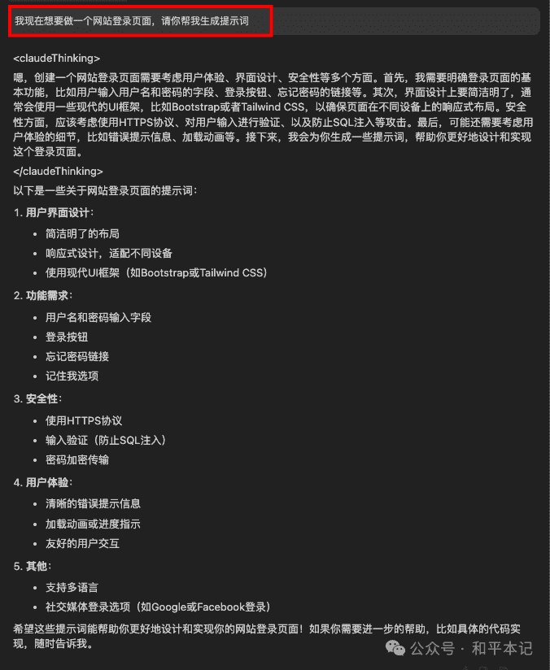

所以我们尽量要把提示词的详细具体，你的提示词越接近一个清晰的需求文档，Cursor 生成的代码就越接近你的期望。明确技术栈（如 Python Django, React, Vue.js）、期望行为（用户操作流程、功能逻辑）和任何限制条件（如性能要求、特定库版本）。

## **第三条，处理维度尽量小**

> Work file by file; generate, test, and review in small, focused chunks

> 

> 直译：按照单个文件维度一个一个去处理，用小而集中的模块为单位进行生成、测试和审查

> 

> 意译：按照单个文件维度推进工作，将代码生成、测试验证和审查环节都控制在专注的小功能模块范围内，确保每个环节的质量可控。

我们在使用 cursor 的时候，不要试图让 Cursor 一次性生成整个应用程序或一个非常复杂的功能。而是要把任务分解成更小的、可管理的部分，最好是逐个文件或逐个小模块进行。每生成一小部分代码，就立即进行测试和审查。

我们可以采用增量开发的方式。例如，先让 Cursor 生成一个数据模型，审查通过后，再让它生成相关的 API 接口，再到前端组件。这种小步快跑、及时反馈的方式更容易控制代码质量，也更容易定位和修复问题。

## **第四条，测试驱动开发**

> Write tests first, lock them, and generate code until all tests pass.

> 

> 直译：先编写测试用例并锁定，随后生成代码直至全部测试通过。

> 

> 意译：遵循测试驱动开发(TDD)原则：首先明确需求并编写自动化测试用例，将这些测试用例作为验收标准锁定后，再通过迭代编码持续满足测试要求，最终确保所有测试用例100%通过。

这是测试驱动开发 (TDD) 的理念在 AI 辅助编程中的应用。先编写单元测试来定义代码应该如何工作（即“锁定”期望的行为），然后让 Cursor 生成实现这些功能的代码，直到所有测试都通过。

比如说你想实现一个功能，那你一开始就可以让 AI 帮你想一些测试场景，然后把测试用例作为验收标准，让 cursor 去生成代码，最后生成的代码要保证所有的测试用例都能通过。这样的话，cursor 就有一个非常明确的目标，当所有测试用例都通过时，AI 生成代码的正确性也会大大提高，也可以显著减少手动调试和验证的时间。

## **第五条，人工审查并提供范例**

> Always review AI output and hard‑fix anything that breaks, then tell Cursor to use them as examples.

> 

> 直译：始终审查AI生成内容，对发现的问题进行人工修复，并将修正后的案例作为示例提供给Cursor。

> 

> 意译：建立AI代码质量闭环机制：1) 系统审查Cursor生成的代码 2) 对发现的问题进行人工修正并记录 3) 将修正后的标准案例记录到文档中或者 Project Ruels 中 4) 引导Cursor学习优化

Cursor 生成的代码可能会出现幻觉或者不符合你的意图，这个时候人工审查就至关重要了，当你发现问题并手动修正后，关键还要让 Cursor 从你的修正中学习，将这些修正作为后续代码生成的“正面教材”。

你纠正 cursor 错误之后，要明确告诉它：“下次遇到类似情况，请参考我刚才的修改。” 这样可以逐步提升 Cursor 在你特定项目中的表现，使其越来越懂你的偏好和项目需求。

**案例：**

我现在让 cursor 帮我创建一个 index.html 页面，它创建出来的 h1 标签一般都这么写，但是我觉得这么写不符合我的要求，我希望的 h1 标签是「欢迎来到 hepingfly的网站」

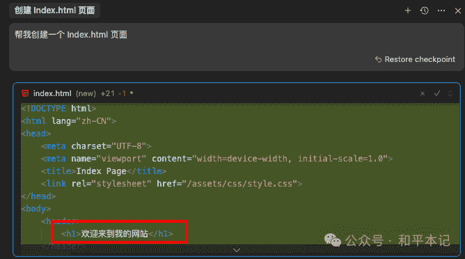

那么我就可以把这个生成 index.html 的规则写在 Project Rules 中

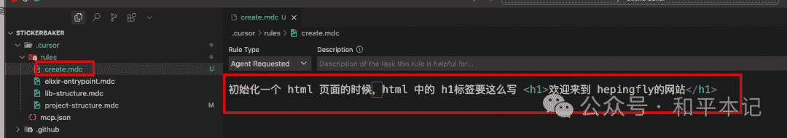

现在我再让 cursor 生成一个 index2.html 页面，你会发现它的 h1 标签内容就是「欢迎来到 hepingfly的网站」

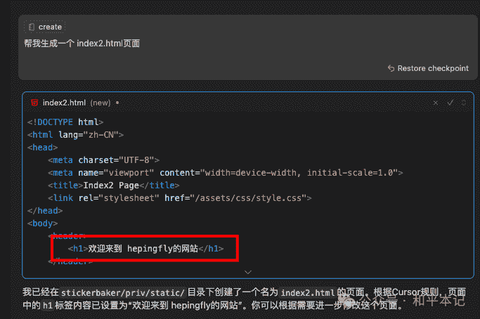

如果说你希望这个规则不仅在当前项目中使用，在以后所有的项目中都使用这个规则的话，你就可以把这个 Project Rules 升级一下，升级成 User Rules

以后只要你打开 cursor ，它就会应用这个规则

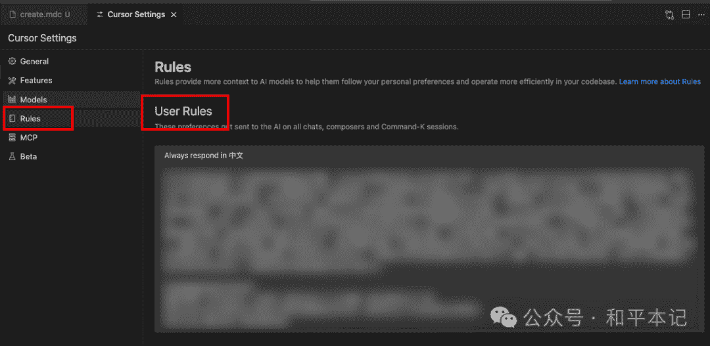

## **第六条，限定上下文**

> Use @ file, @ folders, @ git to scope Cursor’s attention to the right parts of your codebase.

> 

> 通过@file（文件）、@folders（目录）、@git（版本库）指令限定Cursor的代码关注范围

通过 @ 符号 cursor 提供了很多种限定上下文的方式，比如说文件、文件夹、git 提交记录等等

有了限定范围之后， cursor 生成的内容也会更加的精准

简单来说 @ 符号来引用项目中的特定文件、文件夹或 Git 历史记录，cursor 会将其注意力集中在相关的上下文上，这样就避免了 AI 在整个庞大的代码库中漫无目的地搜索，提高了响应速度和相关性。

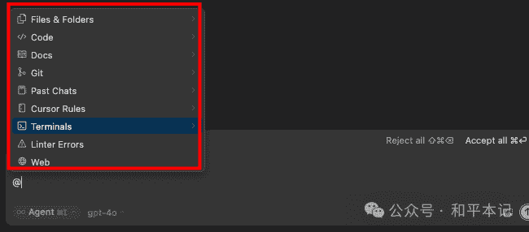

## 第七条，擅用 .cursor目录

> Keep design docs and checklists in .cursor/ so the agent has full context on what to do next.

> 

> 把设计文档和检查清单放在 .cursor 目录下，这样 agent 就能有足够的上下文来知道下一步该做什么

这一条其实就是让你把相关的需求文档和设计文档放在 .cursor 目录下，有点类似于 Project Rules，但是 Rules 中主要是去做一些限制，而我们的需求文档和设计文档是告诉 cursor 应该干什么，开发什么内容，有哪些功能需要开发

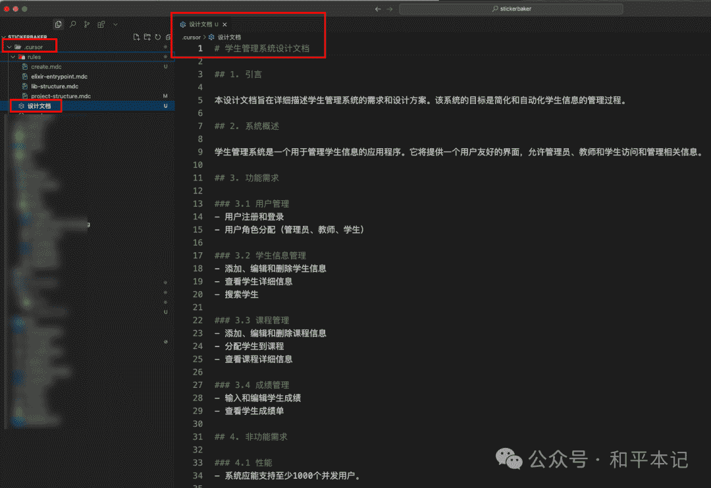

这里需要注意的是，不要一次性让 cursor 把你列的清单全部都开发完，而是要一个一个的去完成，然后一个一个的去做阶段性的测试，测试完成给 cursor 反馈，然后再继续下一个任务。

在 cursor 早期版本我们可能是通过建立一个 readme 文档去存储这些需求和设计文档，然后执行的时候去引用 readme 文档，但是现在 cursor 升级版本了，你只要把相关的文档放在 .cursor 目录下，它每次执行的时候就都能读到。

**这一点总结一下就是：**

**1） **.cursor/ 文件夹是 Cursor 用来存储项目特定配置和上下文信息的地方。将设计文档、需求列表、API 规范、架构图等重要信息放在这里，可以让 Cursor 在工作时拥有更全面的背景知识，从而更好地理解任务的上下文和目标。

**2） **我们可以把 .cursor/ 目录看作是给 AI 助手的“工作台”或“参考资料库”。任何能帮助人类开发者理解项目的信息，同样也能帮助 Cursor，包括需求文档、设计规范、TODO 列表等。

## **第八条，AI 不行自己上**

> If code is wrong, just write it yourself. Cursor learns faster from edits than explanations.

> 

> 如果代码错的太离谱，请自己写。Cursor从代码修改中学习的速度远快于文字解释。

有的时候你会发现 cursor 改代码，它怎么改都改不好，这个时候就需要你亲自上场了，自己手动去改代码。这样的效率或许远比你用文字跟 cursor 沟通怎么改来的高效。

有的代码问题，你甚至一眼就知道问题所在，但是 cursor 就是改不好，所以与其花费大量时间尝试用自然语言向 Cursor 解释如何修正一段错误的代码，不如直接自己动手修改。

而且 Cursor 通过分析你修改前后的代码差异 (diff)，能更直接、更有效地学习到正确的做法。

cursor 会学习你的经验，这是静默的。这就是为什么说，你 cursor 用的越多，cursor 就会越懂你

**案例：**

比如说在 Java 开发中，我们使用 Restful 风格的 API 的时候，它其实是有四种请求方法的， GET POST PUT DELETE

但是我们国内开发的话，一般常用的就是 GET 和 POST

你用 cursor 生成 Controller 的时候，它一开始会按照标准写法， GET POST PUT DELETE 这四种

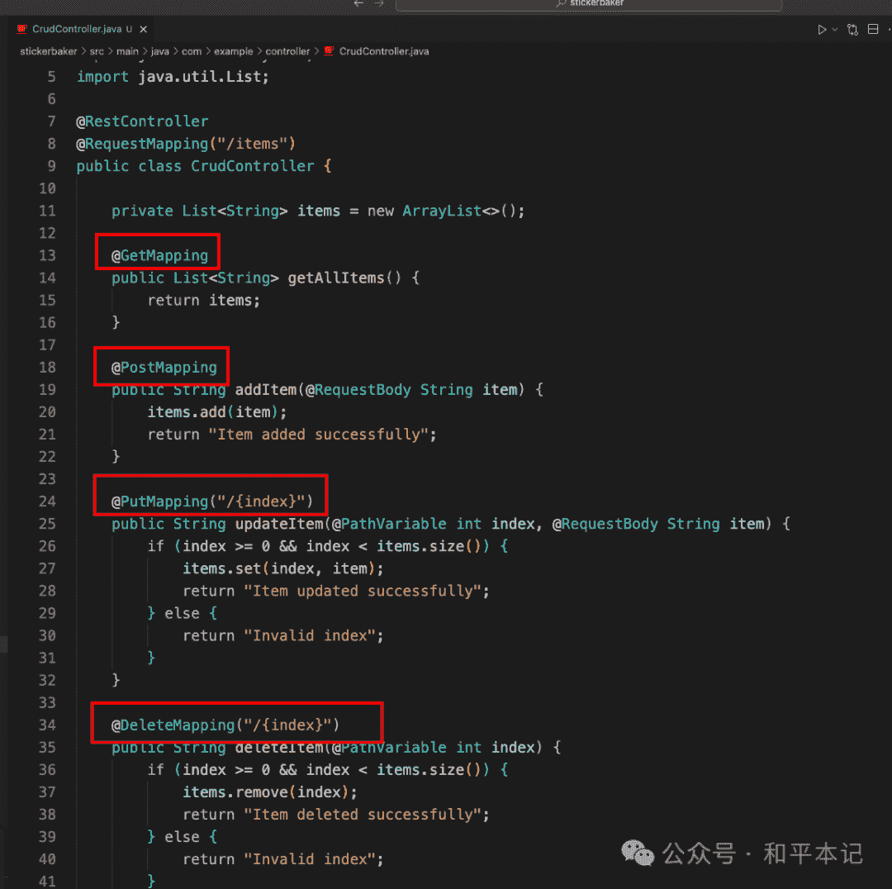

但是如果你把 PUT 和 DELETE 都改成 POST 的时候，下一次 cursor 再生成 Controller 代码的时候，它就会学习你的方式，入乡随俗，只生成 POST 形式

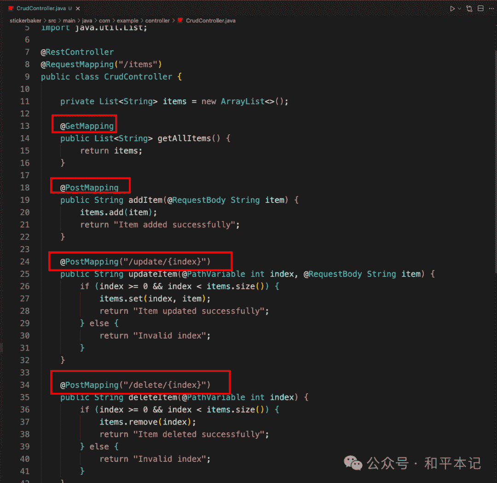

## **第九条，擅用聊天记录**

> Use chat history to iterate on old prompts without starting over.

> 

> 使用聊天记录去迭代历史提示词，而不用从头开始

Cursor 在项目级别会保留你所有的历史对话，通过 「Show Chat History」可以查看当前项目下的所有历史对话

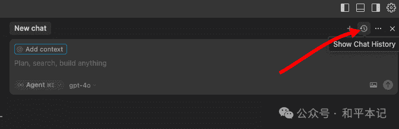

我们在开发一个功能模块的时候，去新建一个对话，这样你的所有改动都是可以回溯的，而且 cursor 的聊天对话是可以重命名的，你完全可以把对话重命名成你对应需求模块的名字。

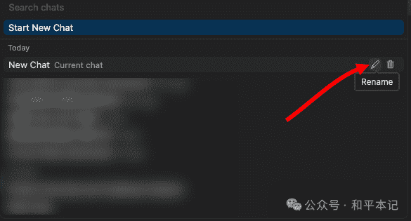

因为 cursor 的聊天界面保存了所有对话历史，所以如果一个提示词生成的结果不完全满意，你不需要从头开始写一个新的提示词，可以在现有对话的基础上进行迭代，要求 AI 改进或修改之前的输出。

你可以说：“在刚才生成的代码基础上，增加一个 XX 功能” 或者 “你刚才的建议不错，但是请把 XX 部分修改成 YY”。这样可以节省时间，并保持上下文的连贯性。

## **第十条，根据需求选择模型**

> Choose models intentionally. Gemini for precision, Claude for breadth.

> 

> 根据需求审慎选择模型：追求精度选用Gemini，需要广泛覆盖则用Claude。

也就是说我们需要了解不同模型的特性和适用场景，根据需求选择不同的模型。一般我们写代码会用 Claude 和Gemini，但是在需求讨论的时候可以尝试别的模型，比如 GPT 和 DeepSeek

## **第十一条，提供详细文档**

> In new or unfamiliar stacks, paste in link to documentation. Make Cursor explain all errors and fixes line by line.

> 

> 在接触新或不熟悉的技术栈时，请粘贴官方文档链接，并要求 Cursor 逐行解释所有错误及其修复方案。

当你使用一个新的编程语言、框架或库时，你和 Cursor 可能都对其不够熟悉。此时，提供官方文档的链接可以极大地帮助 Cursor 理解相关的 API、用法和最佳实践。

也就是说在使用新框架或者你不熟悉的技术栈的时候，可以把相关文档粘贴进 cursor 里面，这样可以大大增加 cursor 的理解程度。

**案例：**

比如说我们现在使用 node.js

但是你对它又不熟悉，这个时候就可以把 node.js 的官方文档粘贴进 cursor 里面

https://nodejs.org/docs/latest/api/

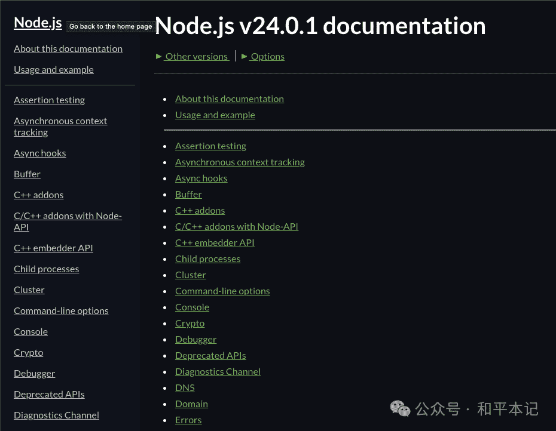

具体粘贴的位置

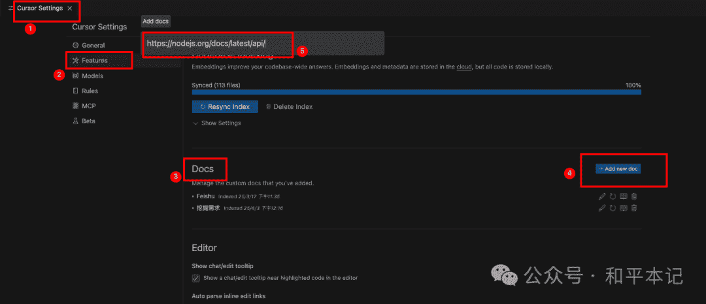

后续用的时候，可以手动刷新一下，让这个文档维持在一个最新的状态，防止官方文档修改了，但是你拉取了还是老版本的文档

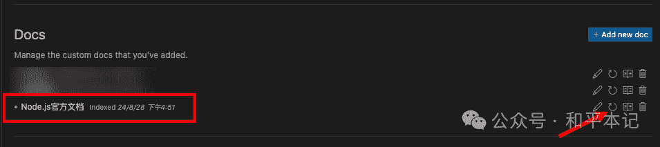

## **第十二条，构建索引**

> Let big projects index overnight and limit context scope to keep performance snappy.

> 

> 对大型项目启用后台自动索引构建；限制上下文检索范围以确保响应迅捷。

对于一些大型项目，如果你想使用 cursor 来辅助开发的话，先索引，再动工。不要 cursor 还没索引完，你立马就开始开发了。

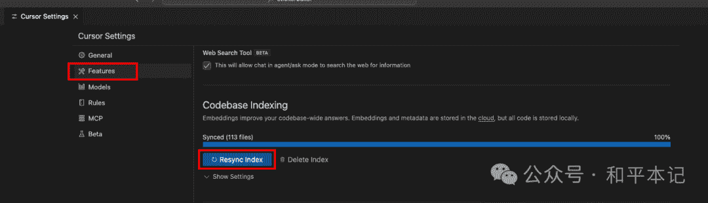

对于大型代码库来说，Cursor 需要一些时间来建立索引，这样才能够快速理解和导航代码。如果这个索引时间相对较长，你可以让这个索引过程在非工作时间（如夜间）进行。

同时，在日常使用中，通过 @ 符号等方式限制 Cursor 的上下文范围，避免它在整个大型项目中搜索，从而保持其响应速度。

<https://aigcreative.feishu.cn/sync/K4Gvd9vUQsy9Oubwqaeclu0Fnbg>

# 知识库动态