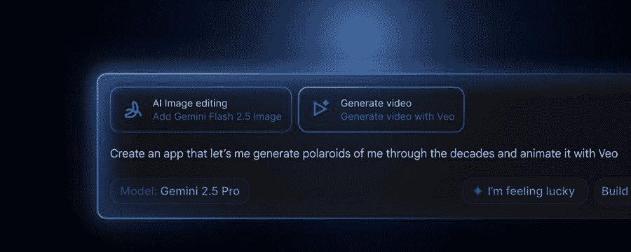
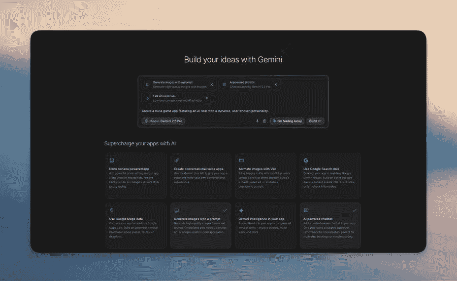
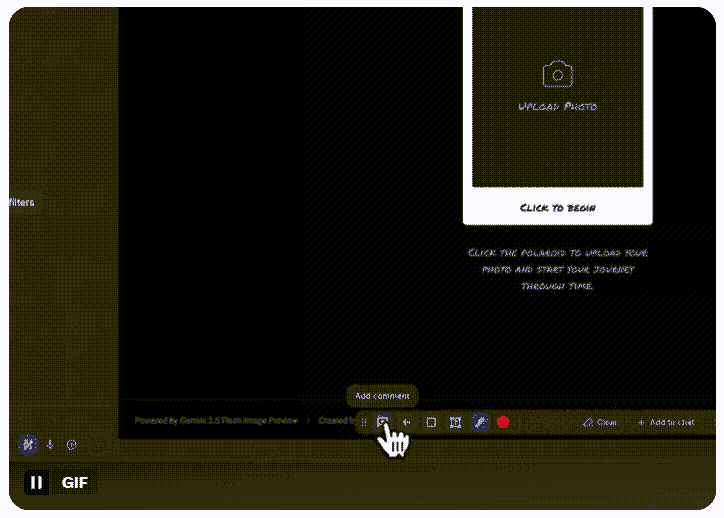
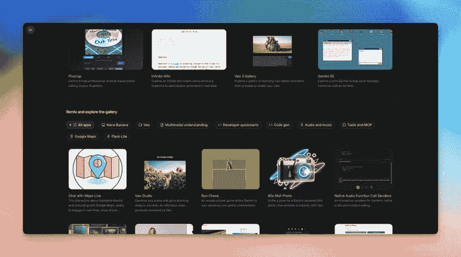
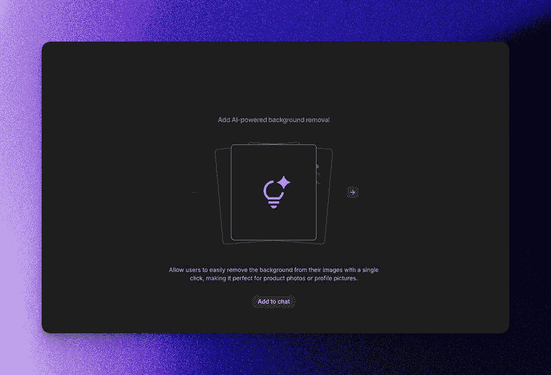

# 20251117-我试了谷歌AI Studio全新的Vibe Coding，离“人人都是开发者”又近了一大步

> 来源：[https://aigcreative.feishu.cn/docx/U7budFdTpodhVpxoD1XccUP6njB](https://aigcreative.feishu.cn/docx/U7budFdTpodhVpxoD1XccUP6njB)

大家好。

今天聊了AI编程、Vibe Coding、零代码开发平台。

聊这个之前，我想先说说很多人（包括我）都遇到的一个尴尬情况。

不知道你有没有过这种时候，脑子里突然冒出个挺好的 App 创意？

比如，我想做个小工具，能帮我把网上看到的零散菜谱，自动整理成带配料表的标准格式；或者，一个能自动识别我拍的照片，然后用 AI 给我打个分的工具。

想法挺好的，对吧？

但真要动手做，就麻烦了。我得去申请这个 AI 模型的 API Key，那个图片识别的 API Key，可能还得弄个数据库... 光是把这些不同服务缝合在一起，研究它们各自的文档，处理各种配置，一两天就过去了。

很多时候，那个好点子，就在这个缝合的过程中，被我放弃了。我只是想实现个功能，但大部分时间都花在了搭管子上。

所以，这个 “Vibe Coding” 到底想干嘛？

简单说，Google AI Studio 这次的更新，就是想帮你把搭管子的活儿给干了。

它想让你从一个有想法的人，直接跳到看成品的阶段，中间最烦人的那段，它用 AI 帮你做。

这个新的 AI Studio，核心是用了最新的 Gemini 模型。

它的逻辑很简单：你不用太操心 API 和 SDK 了，你就用大白话告诉它，你想要个什么样的应用？

比如，我就试着跟它说：“我想做个应用，能让我传一张照片，然后帮我把它变成各种奇幻风格，比如赛博朋克或者精灵风。”

换在以前，我得自己去想：

1.  需要一个上传照片的界面 (前端UI)

1.  需要一个 AI 图像生成模型

1.  需要一些风格提示词

1.  需要把这几样东西连起来 (后端逻辑)

现在 AI Studio 呢？我把那句话输进去，它自己就开始分析了。它会自动理解，哦，你需要图像处理能力，还需要图像生成模型，行，我帮你把这些轮子找来，给你组装好。

几分钟后，一个能跑的 Web App 雏形就真的出来了。而我，一行代码都还没碰过。

这就**是它说**的 “from prompt to working AI app in minutes” (从点子到能跑的应用，几分钟搞定)。它不是简单地生成代码片段，它是真的帮你把多模态的能力给融合到了一起。

比如你的点子需要用到视频 (Veo)、需要用到搜索 (Google Search)，它都能理解，然后自动帮你连上。这种感觉，就是你只负责出“Vibe”（感觉、想法），它负责“Coding”（实现）。

# **一个让我觉得“有点意思”的功能**

说**实话，光**是“一句话生成 App” 还不够让我觉得它有多特别。真正让我觉得“这东西好像有点意思”的，是它的标注模式 (Annotation Mode)。

App 雏形是出来了，但通常都比较简陋，对吧？布局、颜色、字体，可能都不太对。

以前怎么办？得去翻代码，找到那个 CSS，改 background-color，调 margin，保存，刷新... 很琐碎。

**现在 A**I Studio 搞的这个标注模式，就方便多了。

我就在生成的 App 界面上，直接用鼠标框住一个**按钮，旁边弹出一个**对话框，我就打字说：“把这个按钮改成蓝色”。

很快，它不仅改了颜色，连相关的代码都自动更新了。

我再框住一张图片，说：“**让这张图从左边滑入，加个动画**”。

它也理解了，给我加上了效果。

这种体验... 感觉不太像在写代码，更像是在跟我的 App “对话”。我就像个产品经理，指着屏幕说“这里改一下”，“那里动一下”，然后 AI 就帮你去执行了。

这种修改界面的方式很直观，它把修改 UI 这种凭“感觉”的活儿，真的还给了“感觉”。你不需要懂什么 CSS 语法，你只需要懂“好看”就行了。

# **它是不是只是个“玩具”？**

我知道，很多人可能会觉得，这种“低代码”平台，最后都是玩具，做点小 Demo 还行，真要干活儿还是得自己写。

我开始也这么想。但谷歌这次加了几个小细节，让我觉得他们是想做得更实用一些。

首先，那个 App Gallery (应用库) 不再只是摆设，更像个灵感库。你卡壳了，可以去逛逛，看看别人用 Gemini 玩出了什么，直接拿过来改成你自己的。

甚至，在 App 生成的等待时间里，屏幕上还会不断闪过 Gemini 帮你“头脑风暴”的各种新点子，把等待时间也用上了。

最关键的是这个：**它没把路堵死**。

这种平台，最怕的就是免费额度用完就停了。AI Studio 提供了免费额度，但如果你用光了，它允许你添加自己的 API Key。

这一点很重要。

这意味着，AI Studio 不想只做个“新手村”。它希望你从一个“体验者”平滑地过渡到一个“开发者”。你用免费额度验证了你的“Vibe”，觉得这事儿可行，那好，换上你自己的 Key，这事儿就可以继续深入下去了，有潜力变成一个真正的产品。

# **聊到最后**

Vibe Coding 这个词，可能还是有点花哨。但它背后的方向，我感觉是挺实在的。

它不是要“取代”程序员。复杂的系统架构、底层的算法优化，这些还是得靠专业开发者。

它的真正意义，是把“**实现创意的门槛**”给大大降低了。

以前，你和你的“好点子”之间，可能隔着 API 文档、编程语法、环境配置这些障碍。

现在，谷歌想做的，是尽量把这些障碍给搬走。让你和你的“点子”之间，距离变得更近，可能只隔着一句“我想要...”

这能释放多大的创造力呢？

那些懂市场但不懂代码的产品经理，懂审美但不懂前端的设计师，或者就是你我这种时常有点小点子的普通用户... 现在都可以更方便地去尝试把自己的“Vibe”（想法）变成现实了。

**我们评判一个工具好不**好，不只看它多强，也要看它能让多少人开始动手创造。

从这个角度看，Google AI Studio 这次，还挺有意思的。

<https://aigcreative.feishu.cn/sync/K4Gvd9vUQsy9Oubwqaeclu0Fnbg>

# 知识库动态