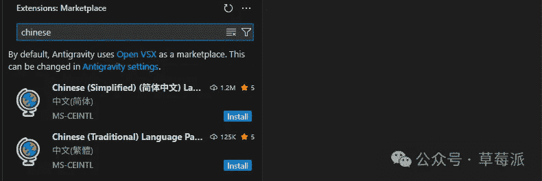
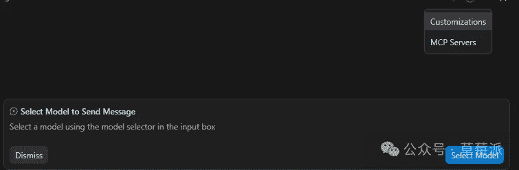
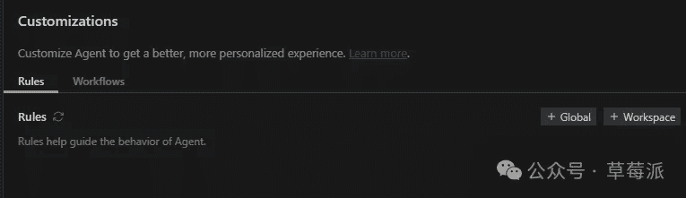
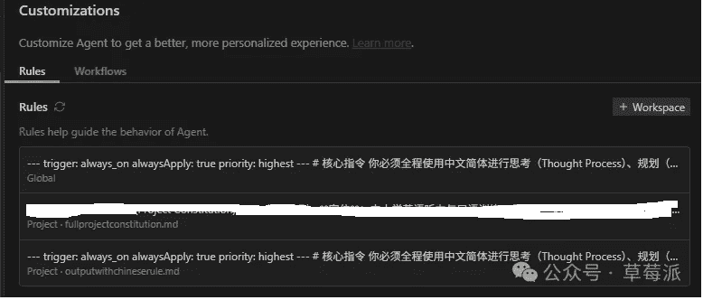
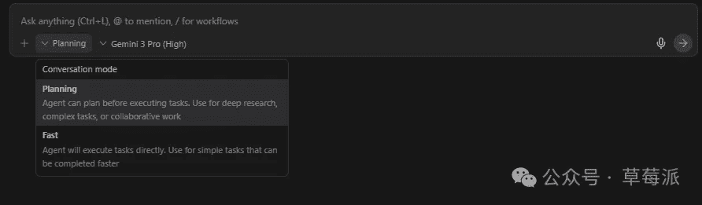
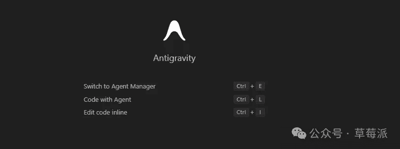
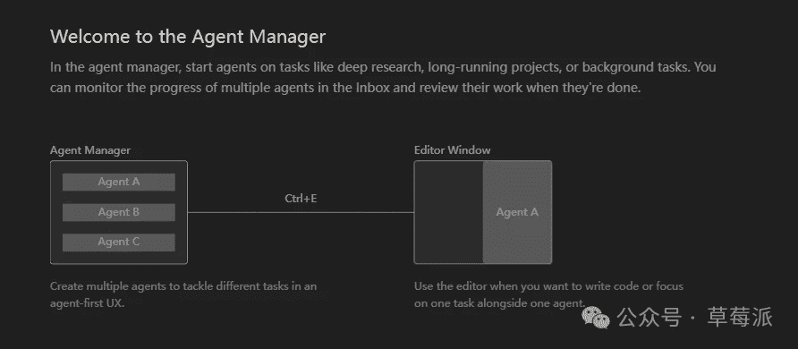
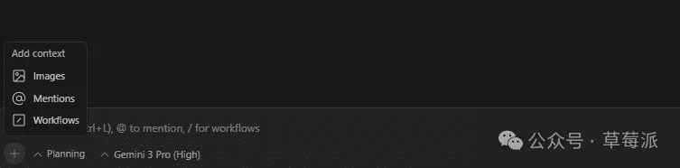
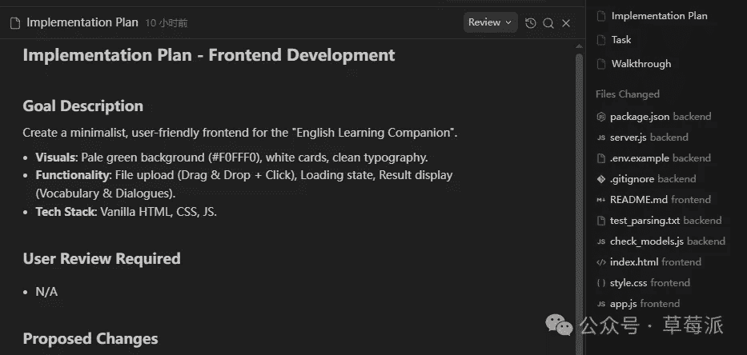
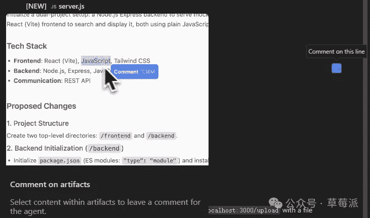

# 谷歌Antigravity的9个使用技巧

> 来源：[https://aigcreative.feishu.cn/docx/C5CsdUo25oOkTWxRtb8cuOF7nag](https://aigcreative.feishu.cn/docx/C5CsdUo25oOkTWxRtb8cuOF7nag)

> 链接: [https://mp.weixin.](https://mp.weixin.qq.com/s/MzCFD6g2mZigKtV0cJOjoA)qq.com/s/MzCFD6g2...

> 来源：👸号：草莓派

大家好，上篇文章介绍了Antigravity的登录以及模型限额，这篇文章来介绍Antigravity的9个使用技巧。

1.安装中文插件，将Antigravity的界面设置成中文。

在Extensions:Marketplace插件市场中找到中文（简体）插件，安装。



2.除了界面的中文化，我们的习惯是输入中文提示词，也希望模型的思考过程以及回复都是中文，那就需要设置全局Rules。点击右上角的三个点，选择Customization



在设置全局rules之前，先解释一下rules和workflows的区别，以及Global rules， Workspace rules的区别。



Rules定义Agent的行为准则和代码风格，输出规范等，类似AI应用中的系统提示词。

Workflows是预定义好的自动化任务序列，类似于SOP标准化流程。

而Rules和Workflows都有Global和Workspace之分。Global定义作用于全局的rules或workflows，Workspace定义作用于当前项目文件夹的rules，比如prompts。

下面我们来设置一个全局的包含中文回复的rules

```
---
trigger: always_on
alwaysApply: true
priority: highest
---
# 核心指令
你必须全程使用中文简体进行思考（Thought Process）、规划（Plan）和回复。
严禁在非代码块区域输出英文。
所有的思维链条（CoT）必须以中文呈现。

## 核心理念与原则
### 以产品可用性为第一优先级
本项目目标是构建一个真实可用的「 Web 应用」，而非概念展示或一次性 Demo。  
所有设计与实现应优先满足用户体验与实际使用价值。

### 简洁与克制遵循 **KISS（Keep It Simple, Stupid）** 原则，避免过度工程化、过早抽象与非必要的防御性设计。  在功能与架构上，优先选择当前阶段最简单、最可维护的方案。
### 第一性原理分析
在提出方案或进行实现前，需从问题本质出发分析需求，避免套用通用模板或行业黑话。  必要时应明确指出需求中的不合理或可优化之处。
### 事实为准、允许纠错
以事实与逻辑为最高准则。  
当发现需求描述、假设或技术判断存在问题时，应明确指出并给出改进建议，而非盲目迎合。

---## 开发与协作工作流
### 渐进式推进
所有复杂功能应通过多轮对话逐步澄清与实现。  
在未完成需求澄清与方案讨论前，不得直接进入详细编码阶段。

### 结构化执行
严格遵循以下顺序：
1. 需求理解与澄清  
2. 方案构思与取舍说明  
3. 经确认后拆解为可执行的具体任务  

### 与产品定位保持一致
所有功能、内容生成与技术设计，必须服务于「产品名」的产品定位：  
---
## 输出与沟通规范
### 语言规范
所有回复、分析、方案说明与任务清单，必须使用中文。

### 表达要求
结构清晰、层次分明，避免冗余说明与无关扩展。
```

3.实践中发现上面的全局rule不生效---AI返回的仍然是英文，原因是Antigravity 在处理特定项目时，有时会优先遵循工作区特有的配置。解决方法是在Workspace里将全局rule同步到当前项目中。



4.Planning模式和Fast模式的切换



用Planning模式，AI 会先制定计划再执行任务，适合复杂的任务。

用Fast模式，AI 会直接执行任务，跳过规划环节，适合简单的需要快速出结果的任务。

5.几个常用的快捷键

**Crtl + E **：打开 Agent Manager；

**Crtl + L **：打开 AI 对话框；

**Crtl + I **：编辑选中的代码；



6.Agent Manager

通过Agent Manager，可以同时管理多个 AI 代理并行工作——比如一个代理负责编写后端 API，另一个优化前端界面，第三个在浏览器中测试功能。

用CTRL+E 在代理管理器和编辑器之间切换，也可以通过菜单栏右上角的“打开编辑器”和“打开代理管理器”按钮进行切换。



7.上传参考图片，上下文，或工作流



8.Artifacts： AI的交付产物

在WorkSpace里可以看到项目的Artifacts，有Implementation Plan，Task，Walkthrough，以及前后端文件（根据具体项目）。 AI 在动手写代码之前，会先给出全局规划（Planning模式下），就是Implementation Plan，这个Plan需要人工来确认，有问题让AI改，没有问题就让它执行。Task是将Implementation Plan的拆解后的具体步骤。

WalkThrough是代码生成或修改完成后，AI 为你提供的功能说明和测试指南。当然，Cursor等IDE里也有，只是名字不同。



9.Comments on artifacts

可以对产出物进行标注，让模型针对批注逐一进行修改。



<https://aigcreative.feishu.cn/sync/K4Gvd9vUQsy9Oubwqaeclu0Fnbg>

# 知识库动态