# Gemini CLI提高生产力的7个实用技巧

> 来源：[https://aigcreative.feishu.cn/docx/ZGqxdzAbMoB76xxzuz6c4T0enAe](https://aigcreative.feishu.cn/docx/ZGqxdzAbMoB76xxzuz6c4T0enAe)

## 引言

Google推出的Gemini CLI正迅速成为开发者工具箱中的核心利器。它远不止一个简单的终端AI助手，更是一个能够全面优化现代开发者工作流的生产力引擎。无论你是在编写代码、管理代码仓库，还是在组织项目文件，Gemini CLI都能将AI的强大能力直接集成到你的命令行界面中。

然而，许多开发者可能仍停留在使用其基础的问答或代码生成功能上。本文旨在揭示Gemini CLI七个鲜为人知但功能强大的高级技巧。掌握这些技巧，你将能解决从自动化繁琐任务到快速理解复杂系统等一系列挑战，其价值在于将你的开发效率提升到一个全新的水平，让日常的终端操作充满未来感。

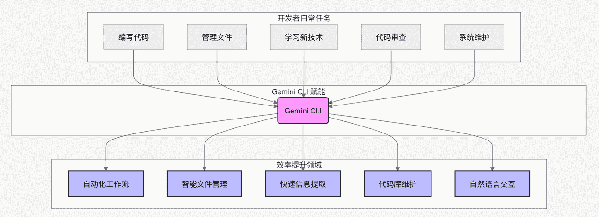

Gemini CLI使用场景汇总

## 技巧一：基于内容智能重命名图片

在UI/UX项目、数据集管理或内容管理系统（CMS）的开发流程中，我们常常会处理大量的图片资源。如果你的项目文件夹里堆满了像 IMG_1234.jpg 或 截图 2025-06-25.png 这样缺乏描述性的文件名，不仅难以管理，还会影响协作效率。

Gemini CLI提供了一个绝佳的解决方案：它可以扫描图片的实际内容，并自动为其生成富有描述性的、有意义的文件名。

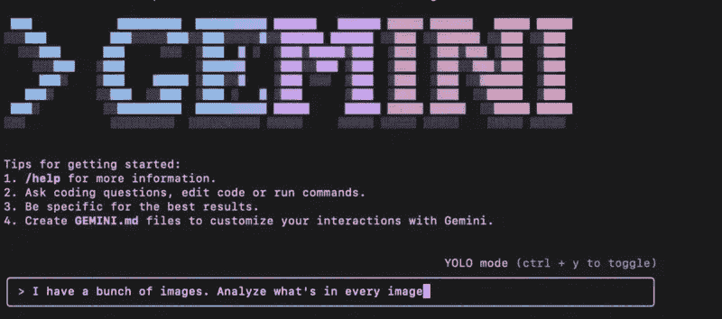

Gemini CLI 识别图片内容并准备重命名

无论是登录界面的截图、数据图表，还是产品照片，Gemini都能准确识别并应用一个相关的标签。如下图所示，原本混乱的截图文件名被清晰地重命名为 login-screen.png、chart-visualization.png 等。这一功能极大地简化了资产管理流程。

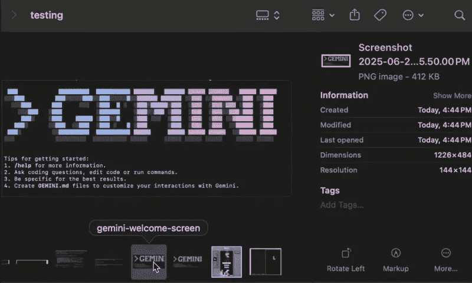

Gemini CLI 智能重命名图片后的效果

## 技巧二：将YouTube教程转换为Shell命令

学习新技术时，开发者经常需要观看YouTube上的教程视频。传统方式是边看视频边暂停，然后在终端手动输入复杂的命令，这个过程不仅繁琐，还容易出错。

Gemini CLI彻底改变了这种学习模式。你只需将YouTube教程的链接提供给它，它就能分析视频内容，并自动提取出所有关键的Shell命令或带注释的操作笔记。

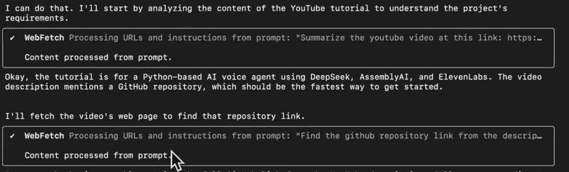

使用Gemini CLI将YouTube视频转换为可执行命令

几秒钟之内，你就能得到一份清晰的教程大纲，其中包含所有命令、相关解释，甚至还有可选的依赖项或环境设置步骤。这对于快速搭建本地开发环境、部署机器学习管道或跟随编码演示来说，是一个颠覆性的效率提升工具。

## 技巧三：自动分析并关闭GitHub垃圾PR

对于开源项目的维护者而言，处理大量低质量或垃圾信息的拉取请求（Pull Requests, PRs）是一项耗时且枯燥的工作。

Gemini CLI可以与[GitHub CLI](https://zhida.zhihu.com/search?content_id=259844321&content_type=Article&match_order=1&q=GitHub+CLI&zhida_source=entity)无缝集成，自动化这个繁琐的流程。它可以扫描所有开放的PR，智能识别那些缺乏有意义代码差异（diffs）或描述不清晰的提交，然后自动关闭它们，并附上一段礼貌且有用的反馈信息。

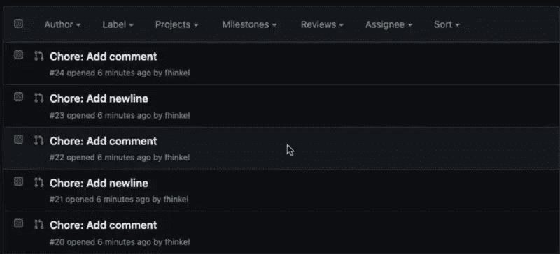

Gemini CLI 扫描GitHub仓库中的PR

这个功能不仅为维护者节省了大量宝贵时间，还确保了贡献者看到的是一个干净、相关的活动列表，从而减少了手动筛选带来的心智负担。

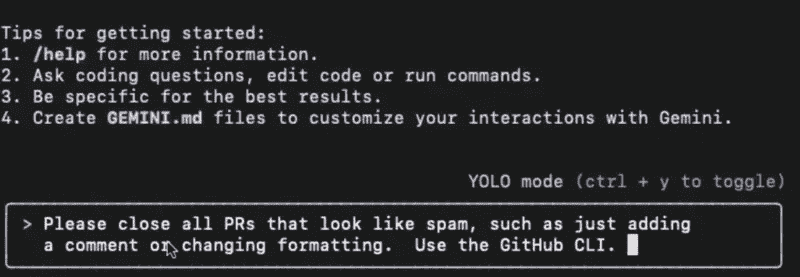

Gemini CLI 识别出垃圾PR

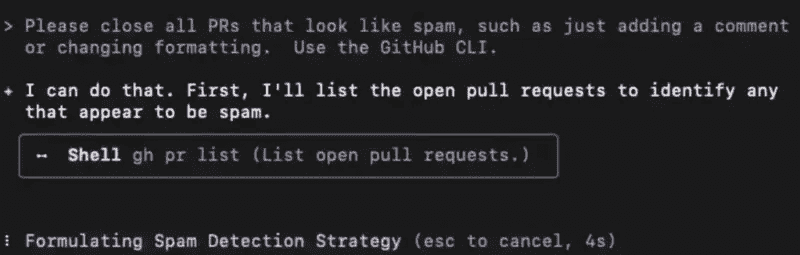

Gemini CLI 自动关闭PR并提供反馈

下面是这个自动化流程的简化图示：

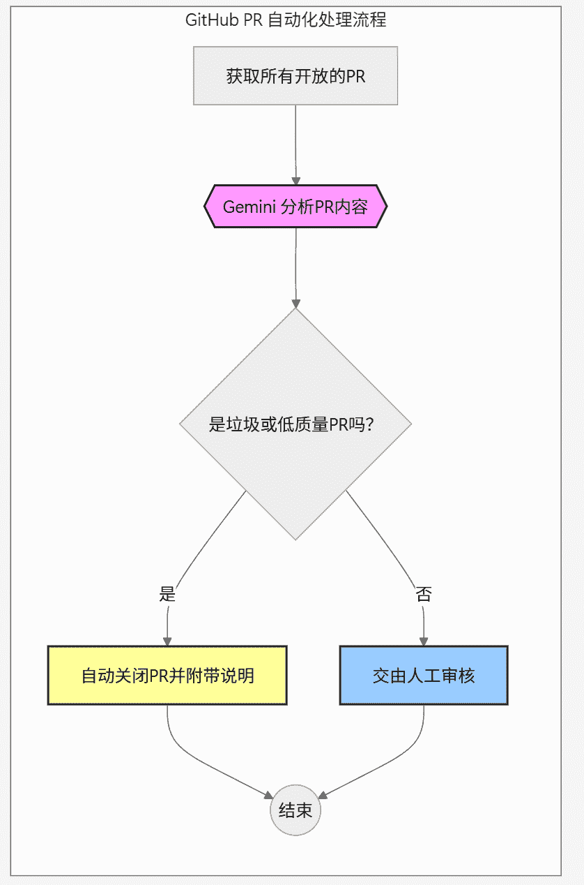

## 技巧四：使用/mcp命令链实现多步工作流

Gemini CLI的强大之处不仅在于处理单个任务，更在于能够编排复杂的多步工作流。通过使用 /mcp（multi-chain prompts）命令，你可以定义一系列环环相扣的任务，让它们按顺序自动执行。

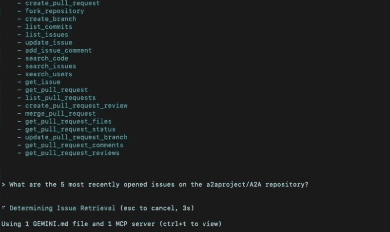

使用/mcp命令定义多步工作流

例如，你可以编写一个提示，让Gemini CLI一次性完成以下所有操作：

+   生成后端API代码

+   为生成的代码编写对应的测试用例

+   创建[OpenAPI](https://zhida.zhihu.com/search?content_id=259844321&content_type=Article&match_order=1&q=OpenAPI&zhida_source=entity)（Swagger）文档

+   将所有生成的文件推送到一个新的GitHub分支

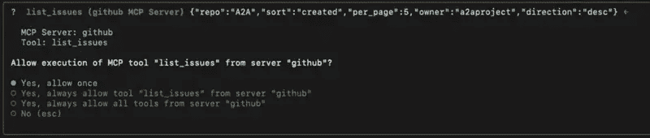

Gemini CLI 执行多步工作流的结果

这种能力对于快速搭建微服务、生成内容管道或处理任何重复性的开发流程都极为高效，能确保每一步都精准无误。

```
flowchart TD
    subgraph &quot;/mcp 多步工作流示例&quot;
        A[&quot;Start: 执行 /mcp 命令&quot;] --&gt; B[&quot;Step 1: 生成后端代码&quot;];
        B --&gt; C[&quot;Step 2: 编写单元测试&quot;];
        C --&gt; D[&quot;Step 3: 创建OpenAPI文档&quot;];
        D --&gt; E[&quot;Step 4: 推送到GitHub&quot;];
        E --&gt; F[&quot;End: 工作流完成&quot;];
    end

    style A fill:#9f9,stroke:#333,stroke-width:2px
    style F fill:#f99,stroke:#333,stroke-width:2px
```

## 技巧五：通过/tools命令发现隐藏功能

Gemini CLI内置了数十种实用的工具，但这些工具并不会在默认界面中全部展示出来。通过执行 /tool[s 命令，你可以](https://zhida.zhihu.com/search?content_id=259844321&content_type=Article&match_order=1&q=Docker%E8%AF%8A%E6%96%AD&zhida_source=entity)解锁一个隐藏的工具箱，其中包含了从日志分析器、正则表达式构建器到Docker诊断和代码审查等各种实用程序。


执行/tools命令以显示所有可用工具

你无需记住每一个具体的命令，只需运行 /tools，选择你需要的工具，然后让Gemini来处理剩下的工作。这就像是开启了一个由AI驱动的开发者实用工具库，随时为你服务。


从工具列表中选择并使用特定工具

## 技巧六：借助Shell模式与终端自然语言交互

对于初学者或需要频繁在文档和终端间切换的开发者来说，记住所有精确的Shell命令是一件头疼的事。Gemini的Shell模式允许你用自然语言与操作系统进行交互。

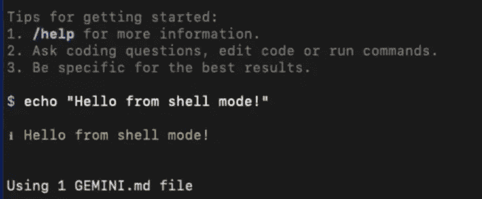

在Shell模式下使用自然语言查询命令

你不再需要去搜索“如何终止在3000端口上运行的进程”，而是可以直接向Gemini提问。它会将你的自然语言查询翻译成可执行的Shell命令，在获得你的许可后运行，并在出现问题时提供上下文解释。这极大地降低了终端操作的门槛，减少了心智负担。

## 技巧七：解释代码并自动生成架构图

当你接手一个新项目或需要为现有系统编写文档时，快速理解代码库的结构是一个巨大的挑战。Gemini CLI能够分析代码并返回一份详细的解释，更进一步，它还能生成可视化的架构图。

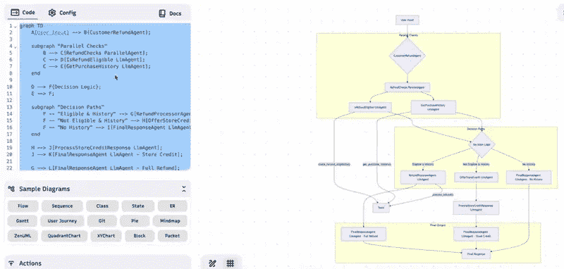

Gemini CLI 分析代码并生成架构图

无论你面对的是Python脚本、Node.js应用还是复杂的多服务部署，Gemini都能分析其结构，并以图表形式清晰地展示各个组件之间的连接关系。这个功能对于新成员入职培训、系统交接文档编写或调试不熟悉的代码库来说，具有不可估量的价值。

## 总结

本文介绍的七个技巧并非花哨的噱头，而是能够切实改变开发方式的变革性功能。Gemini CLI正在演变为我们与开发环境交互的新层次，而不仅仅是一个提升生产力的工具。

如果你至今只用过Gemini CLI进行简单的提问或代码生成，强烈建议你深入探索这些高级特性。自动化、上下文感知能力与终端级访问权限的结合，将赋予你前所未有的开发能力。Gemini CLI不是遥远的未来，它就是现在，并且已经强大得令人惊叹。

<https://aigcreative.feishu.cn/sync/K4Gvd9vUQsy9Oubwqaeclu0Fnbg>

# 知识库动态