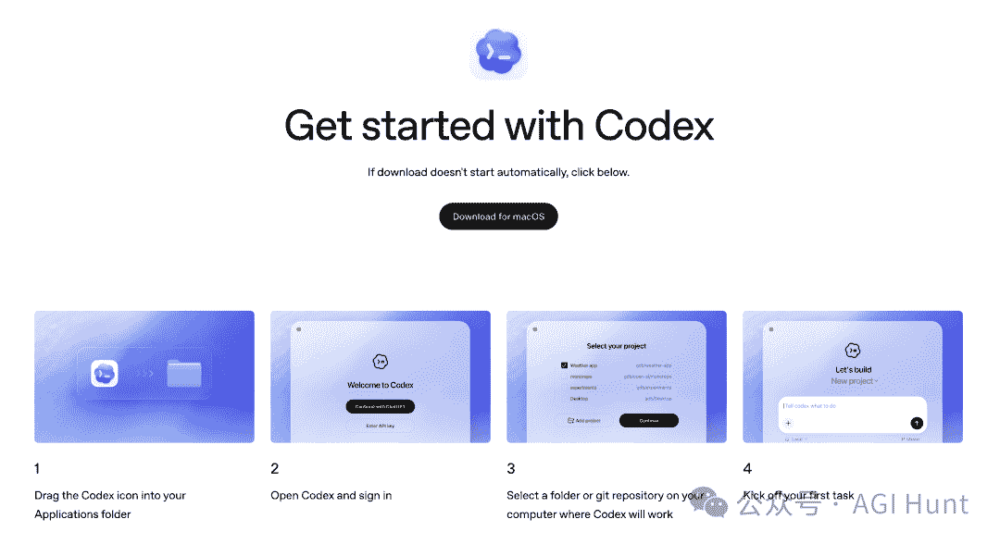
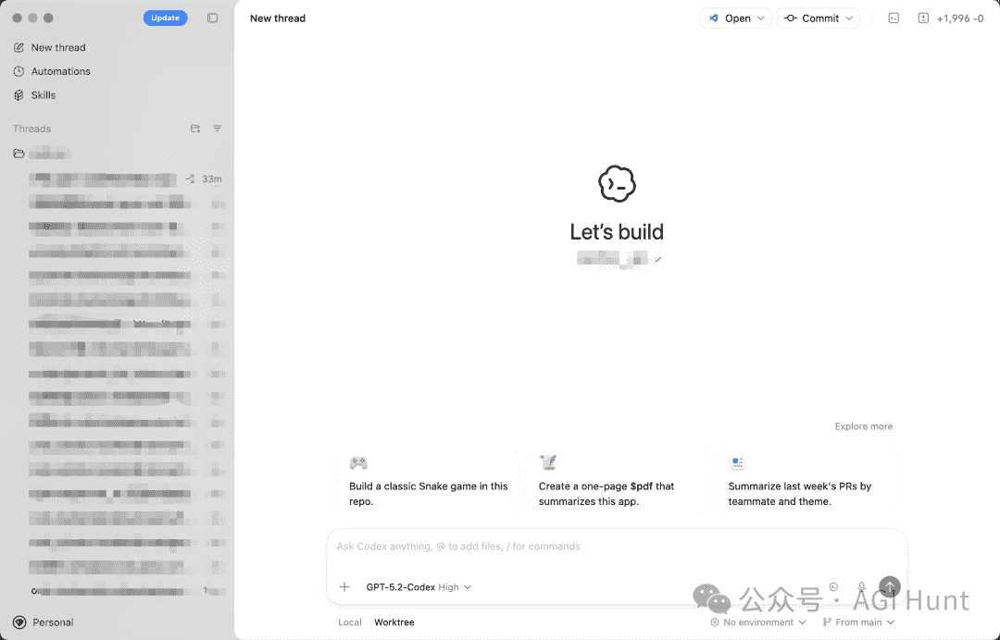
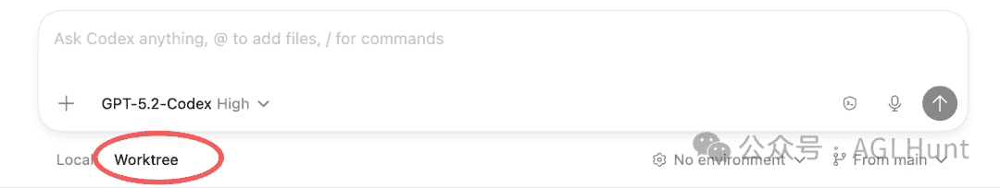
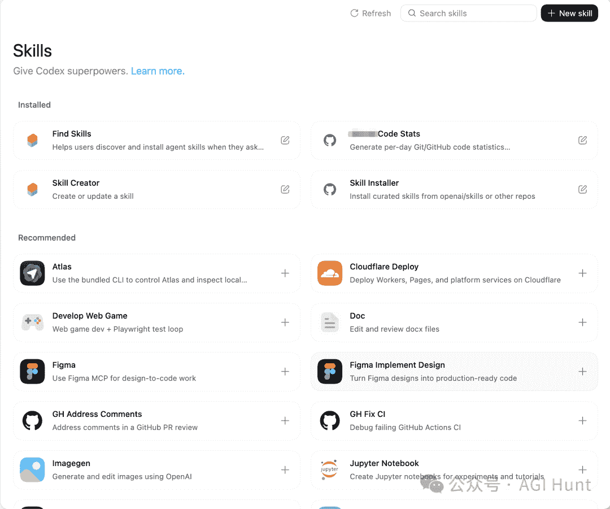
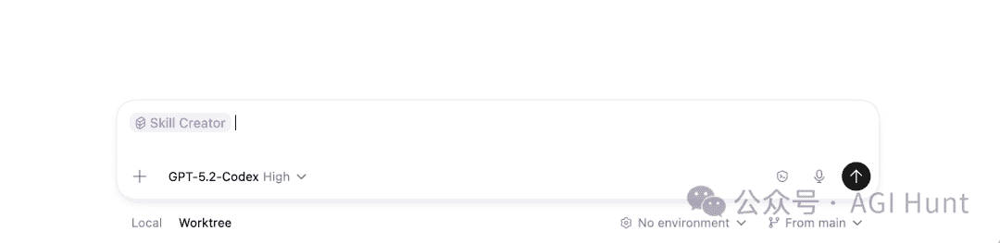
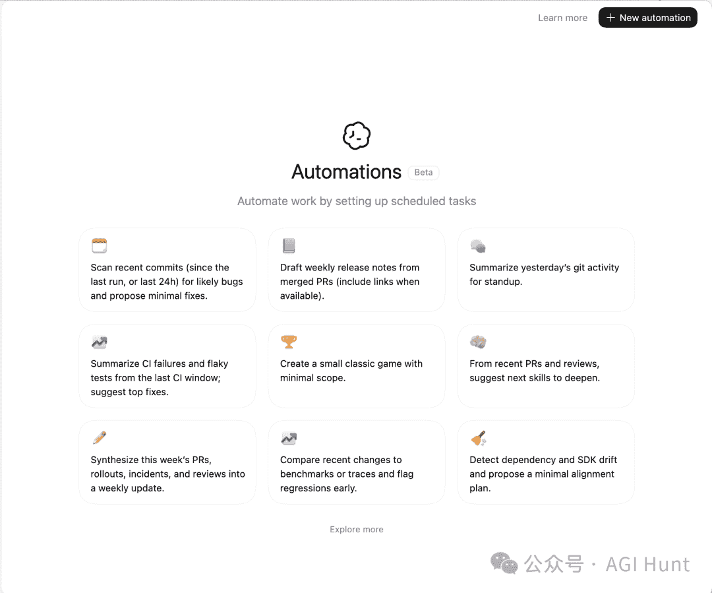
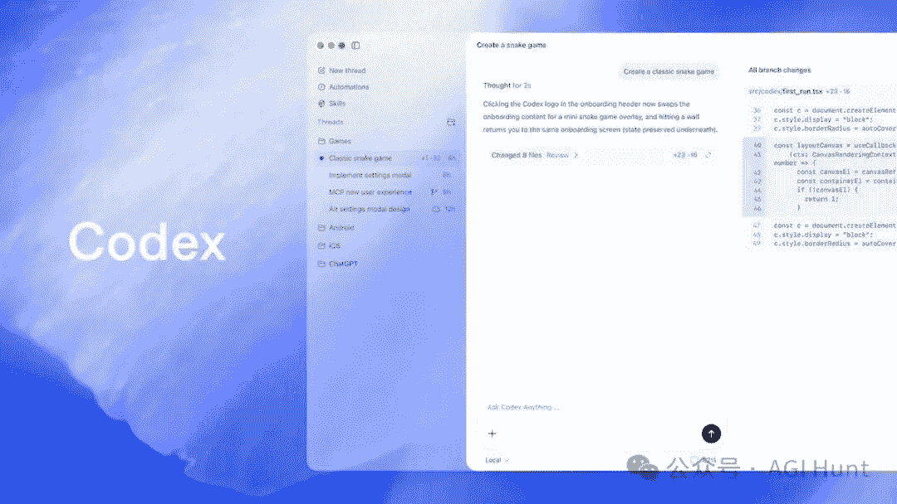
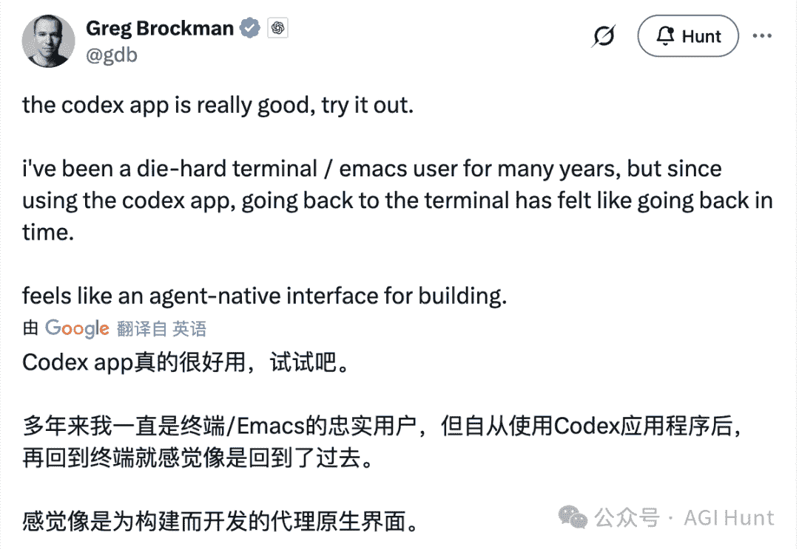

# Codex 独立 App 来了，这是一个新东西

> 来源：[https://aigcreative.feishu.cn/docx/TbvKdc0Y4oi0t5xJgGhcXQ4knOg](https://aigcreative.feishu.cn/docx/TbvKdc0Y4oi0t5xJgGhcXQ4knOg)

> 链接: [https://mp.weixin.](https://mp.weixin.qq.com/s/_bKy7yd_PLqCCkMVoRnv-g)qq.com/s/_bKy7yd_...

> 来源：👸号：AGI Hunt

刚刚，OpenAI 把 Codex 做成了一个独立的桌面应用， 这次，真的有点不一样。

这次并非「换个壳重新包装一下」就扔出来了，而是，它可能真的会改变了我们用 AI Coding 的方式。

许多读者应该会知道，我一直用 Claude Code > Codex，一是习惯了在 CLI 里工作，二是它快，三是它生态好。

比如这个关于 OpenClaw 的视频，就是我用 Claude Code 做的：

Close

**观看更多**

更多

退出全屏

切换到横屏模式

🎦 Click to play video

Video Details

而在 Cowork 出来之后我也试了试，但说实话没用太多，因为那不是我的主业，我还是更喜欢终端里效率起飞的感觉，甚至我还做了一些 worktree 相关的工具来辅助并行开发。

但这次打开 Codex App 之后，我承认， Worktree 这块它做得实在太好了 。

好到什么程度呢？

我觉得接下来很长一段时间，我可能真会把不少工作切过来了。

虽然 Codex 比 Claude Code 慢，但它 开 worktree 非常方便能更好地并行 ——这点在实际干活时，也算是用并发来弥补单次速度的不足了。

好了，说回 Codex App 本身。

## 指挥中心

OpenAI 称： Codex App 不是又一个 IDE。

OpenAI 管它叫「 Agent 的指挥中心 」（command center for agents）。

Close

**观看更多**

更多

退出全屏

切换到横屏模式

🎦 Click to play video

Video Details

自从去年 4 月 Codex 上线以来，开发者和 Agent 的关系一直在变。

最早是「结对编程」，即你和一个 Agent 肩并肩写代码。后来模型能力上来了，GPT-5 在去年 8 月是一个大跳跃，12 月的 GPT-5.2 又是一个，开发者开始把整个功能、整个任务直接甩给 Agent 去做。

OpenAI 的 Codex 产品负责人 Alexander Embiricos 称：

> 以前人们在 IDE 里写小段代码。现在开发者不再和模型紧密结对了，他们开始 委派整个功能模块 。

Sam Altman 自己也说，最近他做了一个相当大的项目， 全程没打开过传统 IDE 。

而问题在于，当你同时指挥 5 个、10 个 Agent 并行干活的时候，现有的 IDE 和终端根本不是为这种场景设计的。你不可能开 10 个终端窗口来回切换，那会疯掉的。

所以 Codex App 来了。

打开之后长这样：

左侧是项目下的所有线程列表，可以看到我之前在 CLI 里发起的那些任务全都在这里了。

我们可以看到：Codex App 和 Codex Cli 的 消息是完全互通的 。

中间是对话和工作区，底部可以切换 Local 和 Worktree 两种模式，还能选模型（默认是 GPT-5.2-Codex High）和执行环境。

右上角直接就是 Open、Commit 的操作按钮和 diff 统计。

整个界面很干净，没有多余的东西，UI 上还是挺舒服的。

## Worktree：多 Agent 不打架

这是我最喜欢的功能，也是 Codex 的重点功能。

**在 Codex App** 中，每个 Agent 以 线程（Thread） 的形式运行，按项目分组。你可以在不同任务之间无缝切换，不会丢失上下文。你可以在线程里直接查看 Agent 的改动、在 diff 上留评论、甚至直接在编辑器里手动改。

但真正让我觉得「这是个新东西」的，是内置的 Git Worktree 支持 。

这个怎么理解呢？

多个 Agent 可以在同一个仓库上同时工作， 彼此完全隔离 。每个 Agent 都在一份独立的代码副本上操作，你可以自由探索不同的方案路径，完全不用担心它们会互相踩脚。

Agent 在后台跑着，你该干嘛干嘛。

它做完了？你可以 checkout 它的改动到本地。

它还在做？不影响你本地的 git 状态，继续做就好。

你甚至可以为每个线程定义 Worktree 的 setup 脚本 和常用的项目操作，一键搞定环境配置。

我之前在 Claude Code 里，为了实现类似的并行效果，自己写了工具来管理 worktree。能用，但总是有点「拼凑」和不够 native 的感觉。而 Codex App 把这个体验做成了 一等公民 ：内置、原生、丝滑。

底部的 Local / Worktree 的切换，点一下就能让 Agent 在独立的 worktree 中运行，旁边还能选从哪个分支 fork 出来。

非常好用。

而且 Codex App 会自动同步你在 CLI 和 IDE 插件中的 session 历史和配置， Auto Context 和活跃线程在 App 和 IDE 之间是共享的 。

打开就能用，不用重新来过。

## Skills：不只是写代码

Codex 正在从「写代码的 Agent」变成「 用代码做事的 Agent 」。

这背后的核心是 Skills 。

而 Skills 可以把指令、资源和脚本打包在一起，让 Codex 能可靠地连接到各种工具、执行工作流、按照团队的偏好来完成任务。

我们可以显式地让 Codex 用某个 Skill，也可以让它根据任务 自动选择 。

Codex App 内置了专门的界面来创建和管理 Skills，而且你在 App 里创建的 Skill，在 CLI 和 IDE 插件里也能用。

反过来，也一样。

这个 Skills 的设计思路和 Claude Code 的 Skills 很像（当然 Claude Code 的 Skills 也是从 Anthropic blog 中提出的理念演化来的）。

本质上都是 用文件系统来组织 Agent 的能力 ，而不是把所有工具定义一股脑塞进 context。

[只能说，OpenAI](https://mp.weixin.qq.com/s?__biz=MzA4NzgzMjA4MQ==&mid=2453479107&idx=1&sn=0c2fe03df0734b044084d42da43334ac&scene=21#wechat_redirect) 还是跟的挺紧，我也早在去年 11 月 MCP 或将成弃子 就提前一个月预判到 OpenAI 对 Skills 的大力拥抱了。

Skills 页面长这样：

可以看到分成了 Installed （已安装）和 Recommended （推荐）两栏。

我这里已经装了 4 个：Find Skills、XXXX Code Stats（这是我自己做的，统计 Git/GitHub 代码数据的）、Skill Creator 和 Skill Installer。

下面则是推荐使用的：

Atlas、Cloudflare Deploy、Develop Web Game、Doc（编辑 docx 文件）、Figma、Figma Implement Design、GH Address Comments、GH Fix CI、Imagegen、Jupyter Notebook……

右上角有 + New skill 按钮，可以直接在 App 里创建新的 Skill：

OpenAI 搞了个很夸张的演示来展示 Skills 的威力： 用一条 prompt 让 Codex 做了一个类似马里奥赛车的 3D 赛车游戏。

这个游戏有 8 个不同的赛车手、8 张地图、还有玩家可以用空格键触发的道具系统。

Codex 用了一个 图像生成 Skill （基于 GPT Image）和一个 Web 游戏开发 Skill （就是上面推荐列表里的 Develop Web Game），然后就开始独立工作。它同时扮演了设计师、游戏开发者和 QA 测试员—— 甚至会自己启动浏览器玩游戏来验证效果 。

整个过程消耗了超过 700 万 tokens ，只用了一条初始 prompt。

后续 OpenAI 用了一组通用的「继续改进」prompt 来让 Codex 持续迭代，比如「先玩一下游戏，找出和原版不一样的地方，然后挑几个功能实现一下，每做完一个就测试一下」。

OpenAI 在内部已经建了几百个 Skills，覆盖多个团队：从跑 eval、看训练任务，到写文档、做增长实验报告。Codex App 内置的 Skills 库包含了这些常用的：

+   实现设计稿 ：从 Figma 拉取设计上下文、素材和截图，转换成生产级 UI 代码，做到 1:1 视觉还原

+   管理项目 ：在 Linear 中做 bug 分流、跟踪发布、管理团队工作量

+   部署到云端 ：把 Web 应用部署到 Cloudflare、Netlify、Render、Vercel

+   生成图片 ：用基于 GPT Image 的 Skill 创建和编辑图片，用于网站、UI 原型、产品视觉和游戏素材

+   使用 OpenAI API 开发 ：引用最新文档来构建

+   创建文档 ：读取、创建和编辑 PDF、电子表格和 docx 文件

我们还可以把 Skills 提交到代码仓库里，让整个团队共享。更多的 Skills 可以在开源仓库中找到。

## Automations：定时任务，但更聪明

Codex App 里还有一个很实用的功能： Automations （目前还是 Beta）。

简单说，就是让 Codex 按照你定义的时间表，在后台自动跑任务，多少有点 pulse 那意思。

Automations 把指令和可选的 Skills 组合在一起，到了预设时间就自动执行。完成后结果会进入一个 审查队列 （inbox），你可以随时回来看结果、继续迭代。如果 Automations 跑完发现没什么好报告的，它还会 自动归档 ，不打扰你。

Automations 页面长这样：

OpenAI 预设了 9 个模板，覆盖了日常开发中最常见的重复性工作：

+   扫描最近的 commits，找出可能的 bug 并提出修复建议

+   从合并的 PR 中生成每周 release notes

+   汇总昨天的 git 活动，给你准备 standup 材料

+   汇总 CI 失败和不稳定测试，建议优先修复项

+   创建一个小型经典游戏（这个纯属好玩）

+   从最近的 PR 和 review 中，建议下一步该深化哪些 Skills

+   综合本周的 PR、发布、事故和 review，生成周报

+   对比最近的改动和基准测试，提前标记性能回归

+   检测依赖和 SDK 的版本漂移，提出对齐方案

右上角 + New automation 可以自定义新的 Automation。

OpenAI 自己已经在内部大量使用 Automations：每日 issue 分流、查找并汇总 CI 失败、生成每日发布简报、检查 bug。

甚至还有个骚操作： 用 Automations 来定期自动创建新的 Skills 。对，让 Agent 自动生产 Agent 的能力。

## 每个线程一个终端

这个细节值得单独说一下：Codex App 里，你可以 为每个线程打开一个独立的终端 。

也就是说，Agent 在一个线程里改完代码之后，你可以直接在这个线程的终端里跑测试、启动 dev server、执行脚本。不用切到外面的终端，不用手动 cd 到 worktree 的目录。

对于习惯在 CLI 里干活的人来说，这个设计实在太对味了： 既给了 GUI 的便利，又没丢掉终端的灵活性 。

## 两种个性

一个有意思的小功能：Codex 现在支持 两种个性模式 。

一种简洁务实，干活利索不废话；另一种更有对话感，会多聊两句，更有共情力。能力上没有任何区别，纯粹看你喜欢哪种风格。

用 /personality 命令就能切换，App、CLI、IDE 插件都支持。

Agent 越来越不像工具了，开始有「人格」了。

## 安全沙箱

Codex App 在安全方面用的是和 CLI 一样的方案：原生的、 开源的 、可配置的系统级沙箱。

默认情况下，Agent 只能编辑它正在工作的文件夹或分支中的文件，只能用缓存的 Web 搜索。如果需要网络访问等更高权限，它会停下来问你要授权。

你可以为项目或团队配置规则，允许某些命令自动以更高权限运行，不用每次都点「允许」。该放开的放开，该锁住的锁住。

## 限时开放 + 双倍额度

定价方面，Codex App 对 ChatGPT Plus、Pro、Business、Enterprise、Edu 订阅用户直接可用，用量包含在订阅中，也可以按需买额外的 credits。

OpenAI 这次还搞了个限时活动： ChatGPT Free 和 Go 用户也能用 Codex 了 。同时，所有付费用户的 rate limits 直接翻倍 。

无论是在 App、CLI、IDE 插件还是云端使用，都是双倍。

数据方面，过去一个月已经有 超过 100 万开发者 使用了 Codex。自去年 12 月中旬 GPT-5.2-Codex 发布以来，整体使用量翻了一番。

## 未来方向

OpenAI 接下来会做的事情：

+   Windows 版本 虽然还没有，但也已经在路上了（估计是 MacOS 上的 Codex 正在开发着 Windows 版）。

+   会继续推动模型能力和更快的推理速度

+   App 内部会根据实际反馈继续打磨多智能体工作流

+   还会给 Automations 加上 云端触发器 的支持，让 Codex 能在后台持续运行，不只是在你电脑开着的时候。

OpenAI 在博客结尾说到：

> Codex 的前提很简单： 一切由代码控制 。Agent 越擅长推理和生成代码，它在所有技术和知识工作中就越有能力。今天的关键挑战在于，前沿模型的能力和人们实际能用到它们的容易程度之间存在差距。Codex 就是为了弥合这个差距。我们专注于让 Codex 成为最好的编码 Agent，这同时也为它成为更广泛知识工作的强力 Agent 奠定了基础。

## 实测感受

作为一个重度 CLI 用户，我本想应该不会对 GUI 应用有什么感觉。

但 Codex App 的 Worktree 支持和多线程并行的体验，确实解决了不小的问题，并带来了更大的便利。

不过真正的代码编辑器，目前还是依赖 VS Code 这样的 IDE，但我猜，很快也会集成进来了。

虽然 Codex 比 Claude Code 慢，但当我能同时开 5 个甚至 10 Agent 并行跑不同任务、互不干扰、每个都有独立的 worktree 和终端的时候， 整体效率，反而更高了 。

可以说，一种新型的 IDE 已经诞生了。

它不再围绕文件和目录组织工作，而是围绕任务和 Agent 来组织。从「人写代码」到「人管理一群写代码的 Agent」——这个范式转移，正在真实发生。

---

相关链接：

+   官方博客：https://openai.com/index/introducing-the-codex-app/

+   Codex 官网：https://openai.com/codex/

+   Codex App 开发者文档：https://developers.openai.com/codex/app

+   Skills 开源仓库：https://github.com/openai/skills

+   Codex CLI 开源仓库：https://github.com/openai/codex

<https://aigcreative.feishu.cn/sync/K4Gvd9vUQsy9Oubwqaeclu0Fnbg>

# 知识库动态