# 全网最详细的Codex入门教程，手把手教你玩转Vibe Coding。

> 来源：[https://aigcreative.feishu.cn/docx/RIgCdInxzoUSEEx4MzdcKvDQnEe](https://aigcreative.feishu.cn/docx/RIgCdInxzoUSEEx4MzdcKvDQnEe)

> 链接: [https://mp.weixin.](https://mp.weixin.qq.com/s/SJco8KqYUJT3DjMdrMu_Iw)qq.com/s/SJco8KqY...

> 👸号：数字生命卡兹克

一整个周末，我几乎除了睡觉，其他的时间都在Vibe Coding。

一边写文章一边Vibe Coding，一边煮方便面一边Vibe Coding， 一边看电影一边Vibe Coding 。。。

真的，左下角那个Macbook就是我用来Vibe Coding的电脑，大屏幕是我用的Windows主机在看电影。


之所以用Mac来Coding，那原因太简单了，就是为了用Codex的应用。

Codex+GPT-5.3 Codex实在太太太太好用了。

我周六的时候就发了一个X去感慨。


底下无数赞同的。

真的，又快又牛逼，以前5.2-codex不好用，不是因为能力不够强，是实在实在太慢了，出门挂着coding，吃完饭都回家了2、3个小时还在改。

但是这一次，5.3-codex速度快了N倍，额度还高，能力还比Opus 4.6强，我自己的体感和体验，真的，就单vibe coding这块，比Claude爽多了。


说真的，以前对Vibe Coding感兴趣，但是因为Claude封号被劝退，因为OpenCode各种BUG被劝退，因为各种IDE看不懂被劝退的大家。

**在**今天， 我可以拍着胸脯说， OpenAI的Codex+GPT-5.3-codex，就是你最佳的入门、进阶、毕业的一条龙产品。

你要相信我，愚钝如我，也能在它上面感受到进入心流的爽感，一个周末用它，解决了我四五个过去我完全一个人无法实现的开发需求。

我这样的人都可以，那你，一定也可以。

我无比推荐从这一刻开始，无论你有多么小白，你都可以开始使用AI，用codex，来满足你自己的需求。

而且，最关键的是，Codex他有应用啊！！！他有可视化的图形界面啊！！！

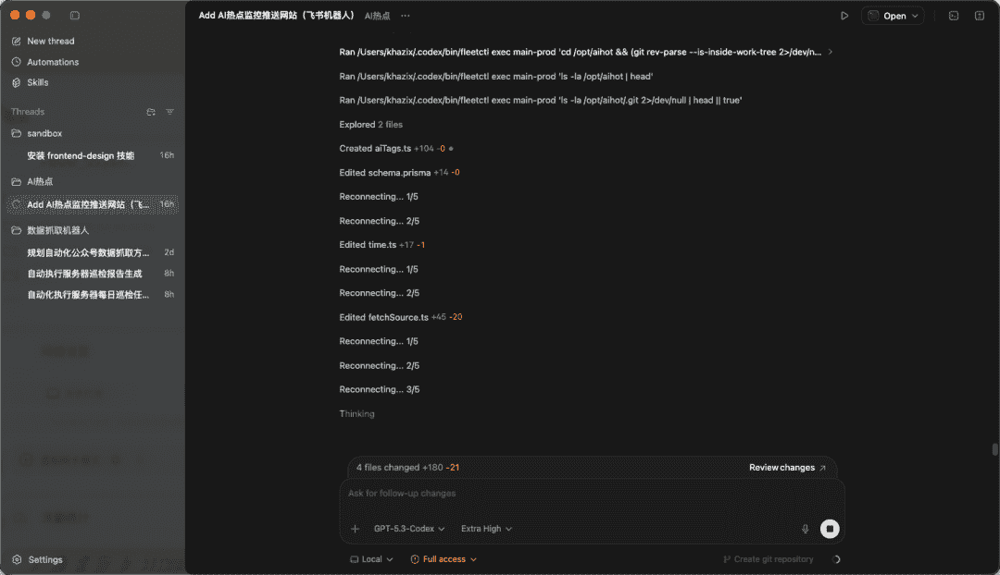

作为一个干了特么快10年的用户体验设计师，说真的，作为一个非专业编程用户，我真的接受不了都快2030年了，我还要用命令行界面。

真的，你知道我之前第一次用命令行的时候，还有OpenCode那个TUI的时候，我不知道怎么打开某一个目录，甚至有一个极度反常识的东西，就是复制粘贴。

你我都知道，Ctrl+C是复制对吧，我当初也是这么以为的。

结果在命令行里，我想复制一个东西，我直接习惯性的选中一堆字以后，按Ctrl+C，结果，这个快捷键是强制关闭。。。

还有Claude那个XX，不仅封号狂魔，而且感觉真的掉钱眼里了，周末他们又给Opus 4.6上了个Fast模式，说是快2.5倍。


大家都觉得没啥毛病对吧，结果我一看文档，尼玛的，价格贵了5倍，1M的Token消耗来到了离谱的150刀，真的有毒。

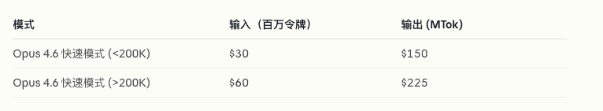

反观另一边奥特曼。


我是爱研究，但是教练，我是真的不想吃苦啊。

有一说一，这一波我站OpenAI，我爱OpenAI。

所以，今天这篇文章，我真挚的向大家推荐Codex，也希望大家，都能在这个时代，真正的开启自己的vibe coding旅程。

正好马上也春节了，在家闲着没事，用coding创造创造，拿在亲戚面前再秀一秀，那种成就感，真的比打游戏还要爽。

# **一. 啥是Codex**

还是先给大家做一下小小的科普，因为很多朋友可能完全没有听过这个东西。

相信很多朋友都知道Claude Code和大龙虾Clawdbot了对吧，这两，都可以理解为，是一个Agent应用，在上层，封装了很多的工程化能力。

而Codex，就是OpenAI对标Anthropic家的Claude code产品。

一个编程Agent，但其实走到今天，已经约等于通用Agent了，因为这信息化30年，一切的东西几乎都构建于代码之上，你的编程能力越强，就越趋近于通用Agent，这就是为啥最近美股那边天天吵着说软件的逻辑变了，一个Claude的excel cowork插件能给华尔街吓个半死的原因。

codex和claude code都是上层的编程应用，应用本身是需要搭配模型一起使用的，正好上周五两家都发了自己的新模型，GPT-5.3-codex和Claude Opus 4.6。

GPT-5.3-codex是一个纯粹的编程特化模型，所以在创作、事实核查、世界知识等方面效果并不好，所以OpenAI并没有把他上到ChatGPT里给所有人使用。

ChatGPT上只有GPT 5.2。

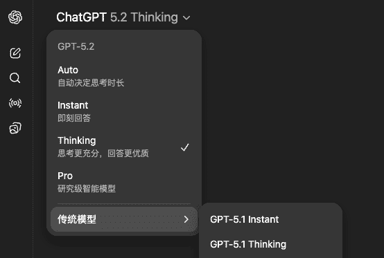

目前只有Codex中上线了GPT-5.3-codex。

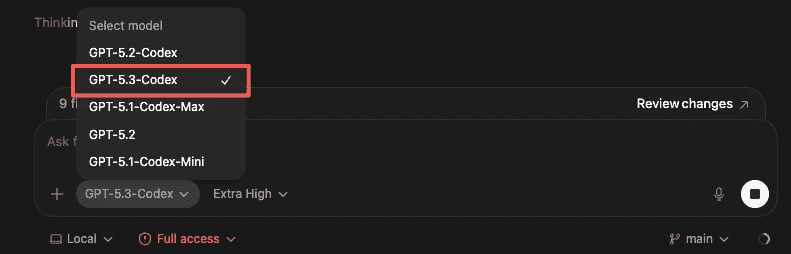

只要你是Plus或者Pro会员，都可以下载codex然后进行使用。

如果你是免费会员或者8美刀的Go会员，Codex可以下载也可以使用，但是是没有GPT-5.3-codex的，只能用GPT-5.2-codex，这个需要注意一下。

至于如何下砸Codex，那就更简单了。

进入到OpenAI的Codex官网：

https://chatgpt.com/codex

看到这个大大的下载应用没有，点击就行。

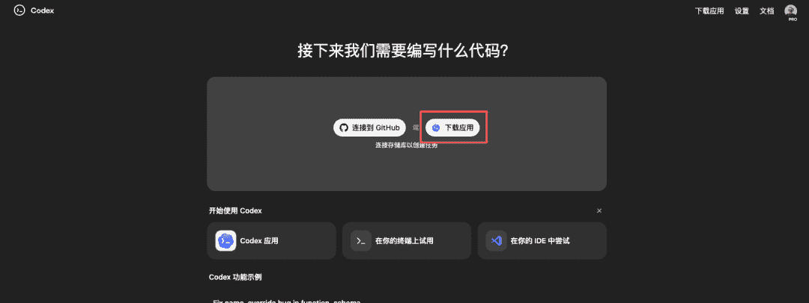

就会下载下来一个Mac的安装包，然后安装、登录就完事了。

不要太简单。

至于Windows的应用版本，目前还没上线，只能使用命令行版本，不过应用版本应该也快了，估计就在这一周内。


# **二. 如何使用**

当你下载好，登录到Codex的首页之后，你应该看到的，就是这个界面了。

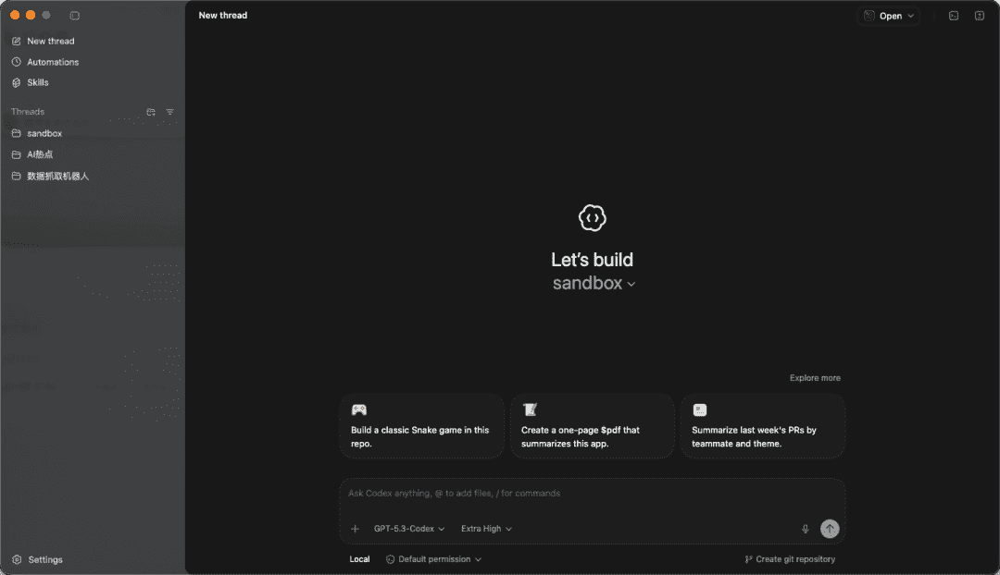

在整个编程的逻辑中，其实有一个很核心的东西，也就是左边的侧边栏哪里，一个一个的文件夹，这个东西，叫做Threads，也就是线程。

在整个Codex的逻辑里，左边这栏其实分两层。

**第一层是文件夹，也就是工作区。**

你可以把它理解成一个个项目目录，或者一个个主题盒子，比如我自己的AI热点、数据抓取机器人、sandbox，这种，它负责把你的文件放得井井有条。

**第二层才是Thread。**

你点开某个文件夹，会看到里面一条条对话，那些对话记录才叫Thread。每一条Thread就是一条独立的任务线。

所以整体关系是这样。

一个文件夹里可以有很多条Thread，每条Thread都是在同一个工作区里，围绕一个明确目标推进的一次协作过程。

举个最接地气的比喻。

文件夹像一个项目群。

Thread像这个群里的一个具体话题贴。

你在某个话题贴里聊需求，Codex就在同一个上下文里改文件，跑命令，做记录，你换一个话题贴，它就切换到另一条任务线。

这套设计对小白其实特别友好，因为它把两件容易混的东西拆开了。

文件夹负责存放代码和资料，Thread负责存放思路和过程。

你不会再遇到那种非常经典的崩溃场景。

比如上午让它写网页，下午让它算Excel，晚上又让它改文案，最后所有东西搅成一锅粥，全放在一块，上下文污染极其严重，AI也开始胡编，自己也找不到文件在哪。

在Codex里，你只要遵守一个简单到离谱的规则。

**同一个文件夹里可以做同一个大方向，同一个Threa**d里只推进一件具体的事，这样效果就最好。

它们都在同一个项目目录里，互相共享文件和资源。

但它们的对话和目标互不污染，随时可以断点续写。

所以，我非常建议大家，在万物之始，先想好分类。

比如我自己特别简单的习惯，就是我在我的电脑上，建了一个叫dev的文件夹。

里面有这些，Learning放我的一些学习资料，notes就是我自己的一些文章和笔记，Projects就是我实际做开发的真实项目任务，sandbox就是沙盒，不知道怎么分类的乱七八糟的东西就可以往这里面扔，tools就是我自己成型的通用脚本、可复用组件、小工具等等。

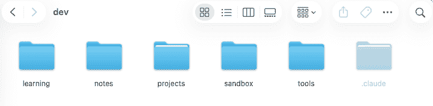

比如Project里现在旧有几个真实任务，AI热点和飞书机器人，而飞书机器人里又分类了好几个不同功能的飞书机器人文件夹。

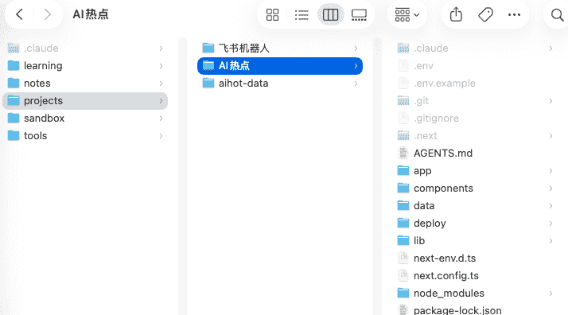

比如周末刚做完的，能把我👸号的数据按时全部爬下来存到我多维表格里的飞书机器人。

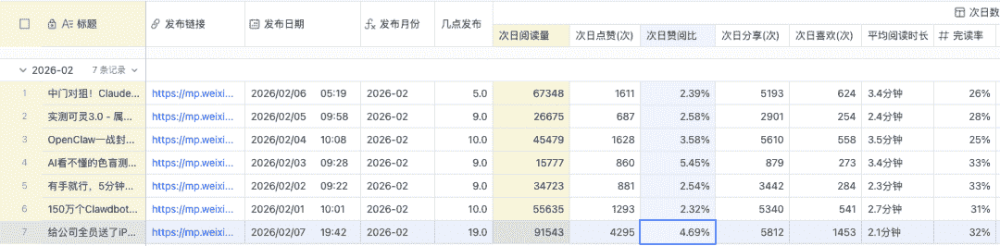

前期的分类，别看我絮絮叨叨的讲了很多，但是他真的非常非常重要！一个好的分类，才是你后续开心的开始，千万千万不要什么对话，都跟ChatBot对话一下随手开新的对话，Thread和项目文件夹，一定一定要管理好。

当你在本地建好了之后，你就可以通过这个地方，添加一个文件夹作为你的项目文件夹了。

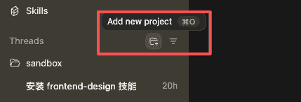

比如我就想开发我的AI热点网站，A就可以把这个项目文件夹添加进来，然后开一个Thread，进行对话。

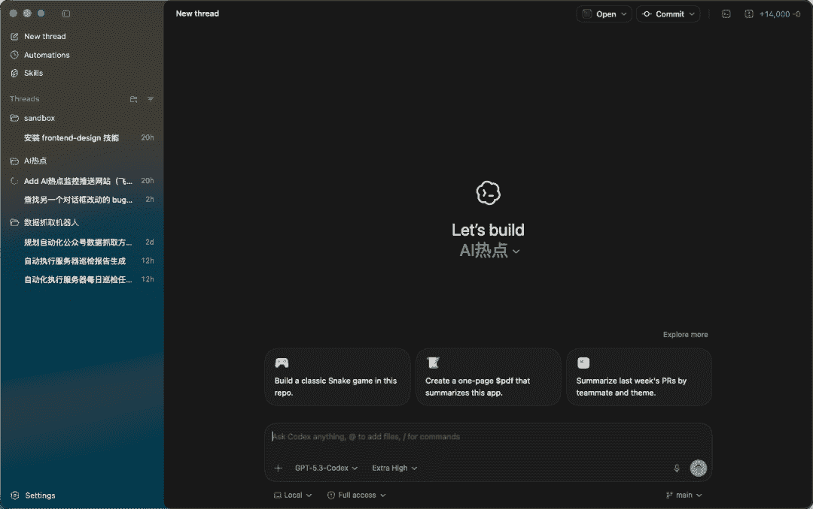

此时，你想说啥，就可以直接发消息了。

但，我知道你很急，但是你先别急，还有些配置项和功能，我跟你说完以后，你可以再开始玩。

# **三. 功能与配置项**

Codex毕竟是个很棒的产品了，有一些功能和配置项，我先给你介绍完。

这也是图形化界面所带来的，对我们小白来说特别友好的东西。

第一个，就是定时任务。

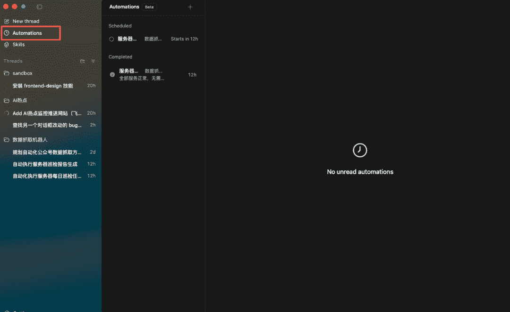

这个大概意思就是Codex会在特定的日期里去干一些特定的事。

比如说我自己就有个，是因为我的好几个项目都跑在我火山引擎上的云服务器上，我对服务器其实是完全不了解的，所以我直接把我那个服务器托管给了codex，所有的东西都是它去部署去运行的，它自己就给我建了一个自动化，每天早上9点对我的服务器进行巡检，看看有没有报错。

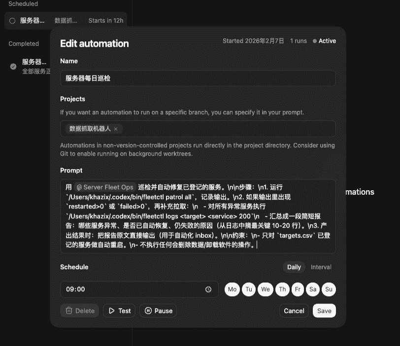

如果有报错的话，就会自己解决一下，然后总结一下原因，通过飞书机器人发送给我，这样，我就可以实现完全托管了。

第二个我觉得超棒的，就是skills。

skills有多重要、多牛逼，我相信我不需要我多解释了吧，看我文章的老朋友们肯定都知道，我写了很多skills教程和分享了。

而这事第一次，skills有了自己的可视化、图形化界面。

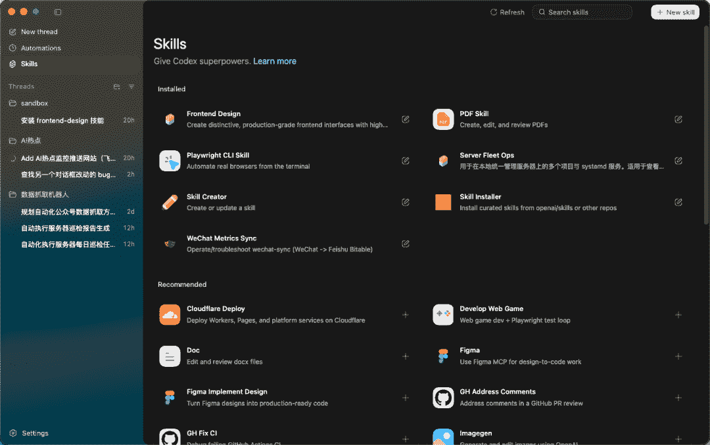

你不需要跟claude code或者opencode那样，根本不知道自己装了哪些skills，装到了哪，有什么用。

你只需要在这个界面，就能轻松的进行管理了。

同时，Codex自带了skill Creator，也就是说，在codex上构建一个skills，体验跟扣子几乎一样，你只需要点击右上角的New Skill。


然后用嘴告诉他，你想构建一个什么样的skill。

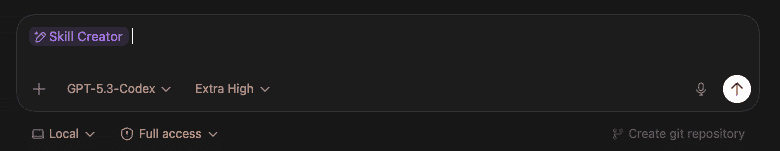

实在是太方便了，Claude code和OpenCode非常呆逼的一点就是，明明支持skill，但是构建skill的skill creator，需要还得我自己去找去安装下来，这实在太蠢了。

OpenAI，还是懂用户的。

除了这两个明面上的功能之外，还有一些小配置可以进行修改。

进入到设置界面。

在General里，把保持电脑开机的开关打开，Follow-up behavior那个选项改成steer，这样你就可以在开发过程中，也随时给Codex发消息调整任务了。

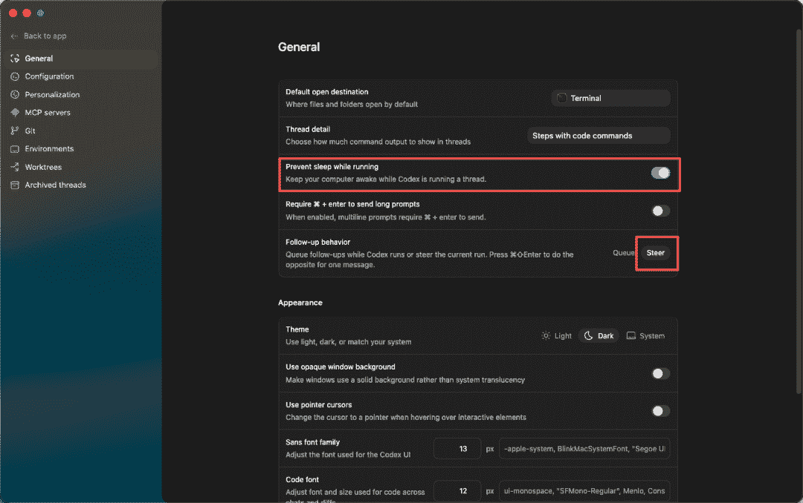

然后在Personalization（个性化设置）这一块，可以填一下全局规则，这个其实就是命令行见面中的AGENT.md，只不过OpenAI单独拎出来了。

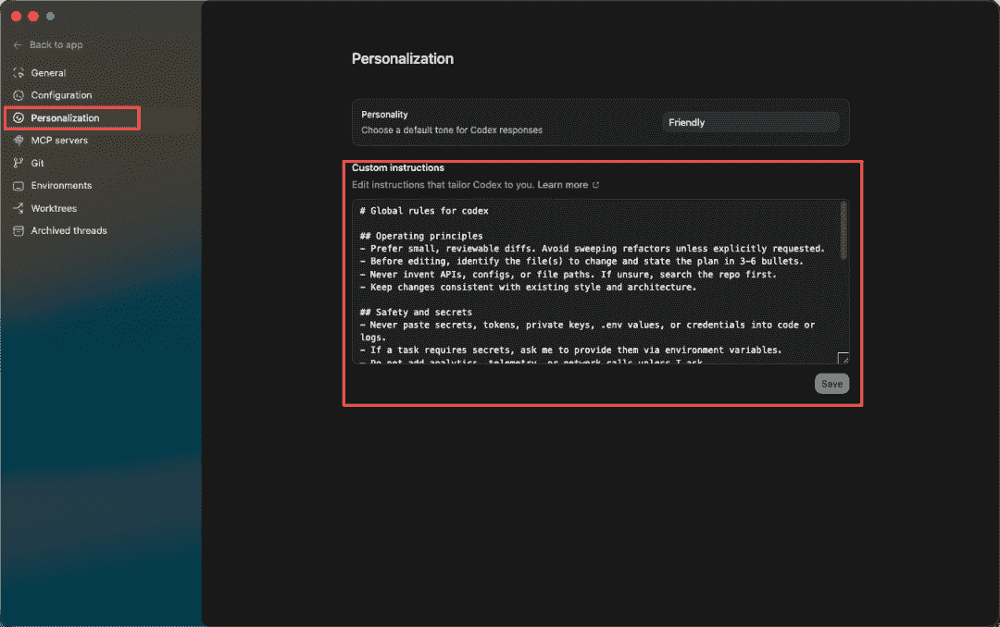

这块的全局规则，我也给大家推荐一个我常用的，新手直接复制粘贴就好：

```
# Global rules for codex
## Operating principles- Prefer small, reviewable diffs. Avoid sweeping refactors unless explicitly requested.- Before editing, identify the file(s) to change and state the plan in 3-6 bullets.- Never invent APIs, configs, or file paths. If unsure, search the repo first.- Keep changes consistent with existing style and architecture.
## Safety and secrets- Never paste secrets, tokens, private keys, .env values, or credentials into code or logs.- If a task requires secrets, ask me to provide them via environment variables.- Do not add analytics, telemetry, or network calls unless I ask.
## Code quality bar- Add or update tests for behavior changes when the project has tests.- Prefer type safety and explicit error handling.- Add comments only when the intent is non-obvious.
## Build and run etiquette- If you need to run commands, propose the exact command and why.- When you make changes that may break build, run the fastest relevant check first.
## Output formatting- For code changes: include a short summary + list of files changed.- For debugging: include hypotheses, experiments run, and the minimal fix.
## My preferences- I like concise explanations, concrete steps, and copy-pastable commands.- Default language for explanations: Chinese.
```

OK，到这步，设置这块就差不多了。

然后在对话框的首页，把权限改成Full access，让codex对你的电脑有最高的访问权限，这样就不会每次都要征求你同意了，就很烦。

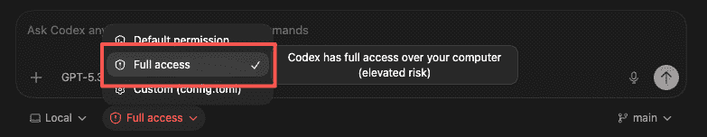

你每次一段Prompt过去，开启收菜就行。

然后在对话框中，你输出/键，就能吊起一些特殊功能。

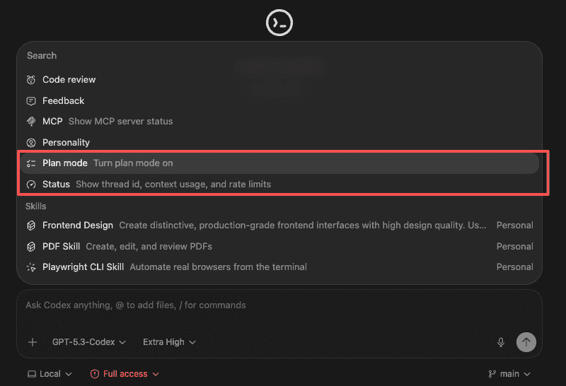

有两个比较重要的跟新手有关的。

第1个就是Plan mode。

这个功能很简单，他只规划，不写代码行，选中以后就会出来一个这个小图标。

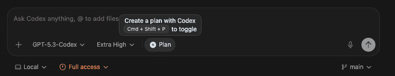

每个大型项目（帮你下载个视频、转个格的这种不算）的从0到1的起始，我都推荐你，使用Plan模式，对你的需求进行详细的规划，形成规范文档和实现计划之后，再开始开发。

比如我要构建一个管理我AI热点网站信源的skill，因为每个网站的爬取都是不一样的，我选择直接用一个skill对我的代码库进行修改的方式进行管理。

那这个时候，就可以先用skills进行规划一下，然后再开始开发这个skill了。


在一段时间以后，你就可以得到这个计划了。

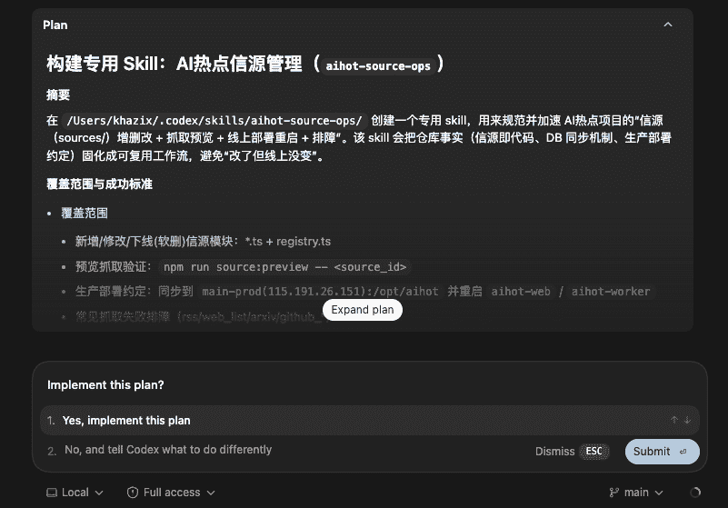

同时，codex也会询问你，是否实施此计划，是和否，一般来说，你选是就行了。

然后，他的Plan小图标就会消失，正式进入开发时间。

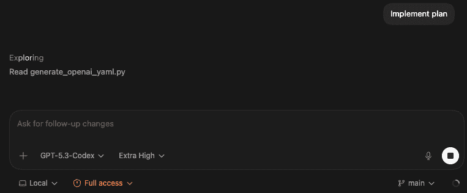

你等着收菜就行了。

第二个就是status，能看到你当前周期的用量和剩余额度，也是非常有用的。

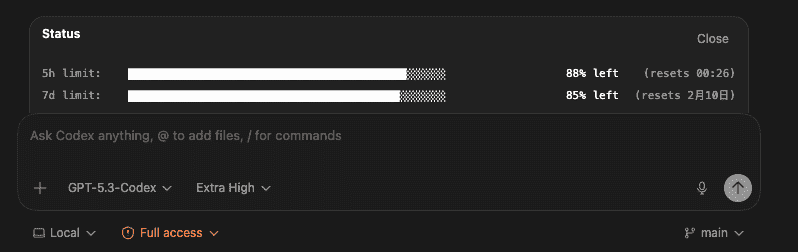

哦还有模型的推理深度这块，需要单独提一嘴。

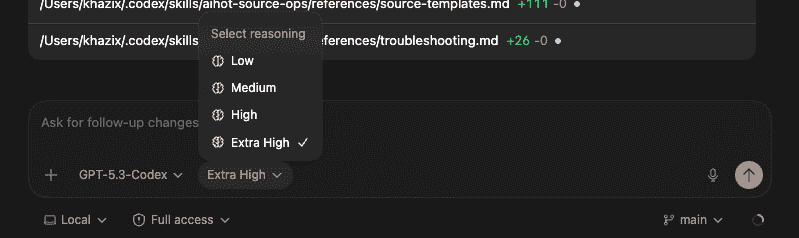

GPT-5.3-codex跟之前一样，也是4个推理等级。

你可以理解为，档位越高，模型在给出最终回答前，会用更多思考 token做推理与自检，通常更稳更全，但也更慢、更贵。

日常我更推荐你使用High，而一旦你觉得超出了日常的范畴，真的要干一些难活硬活大活了，就可以使用 Extra High，它基本等同于5.2的 xhigh。

这种大活，成功率和时间成本才是最值钱的，那多出来的一些推理消耗，无视掉就行了。

# 四. 开始Vibe Coding

最后，终于可以开始coding了。

coding这块反而没啥可以说的了，你就直接用嘴描述你的需求就行了。

Codex右下角有个麦克风，我现在经常就是打开麦克风，然后用嘴说。

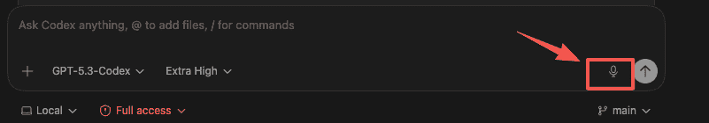

我个人现在的开发习惯是这样的：

先再codex上，打开Plan模式，用嘴描述我的需求，如果涉及到前端页面或者服务器，在需求描述时，会强调使用前端设计skill也就是Frontend Design来设计，再用我自己的服务器管理skill来进行介入管理。

计划生成好以后，我会进行开发，再开发完毕以后，我会第一时间先去看前端效果是否可行，如果可行，则在codex里用嘴进行后续的修改，如果效果是一坨大便💩，我会直接打开我的claude code，进入同一个项目仓库，选择Claude Opus 4.6，让他直接给我重制前端。。。

这个点属实是因为有时候Codex的前端能力确实非常的一般，甚至奥特曼自己的都这么说的。


如果你没有Claude opus 4.6，那用claude code+K2.5+ Frontend Design skill也没啥大问题。

重置完前端以后，就可以回到codex里，继续快乐的口喷了。

哦对了，还有个小技巧。

就是在codex里，是可以多个Threads一起，并行开发的。

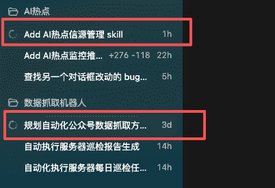

希望大家也能coding的愉快。

我在上一篇文章里说，

我一直觉得，Vibe Coding这个东西，对非程序员来说可能比对程序员更有价值。

因为程序员本来就会写代码，AI对他们来说只是提效，但对我们这些不会写代码的人来说，AI直接把一道原本过不去的坎给铲平了。

在未来，会用AI写代码会变成像会用Excel一样的基本技能。

这是一个必然。

希望人人，都能发挥自己的创意。

玩得开心。

<https://aigcreative.feishu.cn/sync/K4Gvd9vUQsy9Oubwqaeclu0Fnbg>

# 知识库动态