# AI 编程工具卷起来，免费！不限量！字节 MarsCode插上满血版Deepseek会发生什么

> 来源：[https://aigcreative.feishu.cn/docx/OCTIdmdkmorjkCxhwQVcf6gtnbd](https://aigcreative.feishu.cn/docx/OCTIdmdkmorjkCxhwQVcf6gtnbd)

> 作者：iaiuse  👸号：AI决策者洞察

> 链接：https://mp.weixin.qq.com/s/i5p_I6APR9lNhomSuggSSg

# **写在前面**

+   • 作为编程辅助工具， MarsCode 可以在VSCode 插件市场找到，安装方便，契合现有工作流。

+   • 现在，它又接入了 满血版 Deepseek R1 ，等于白嫖了一个强力 AI 代码助手。

+   • Cursor 等工具因网络波动频频受限，而 MarsCode + Deepseek ，就能畅快使用。

+   • 字节的 AI 助手 + Deepseek 的智能代码能力 ，双剑合璧，开发体验直接拉满。

这是一个能通过鼠标操作互动的网页，和小朋友一起只用了几句话就完成了，从安装编程环境到完成，不到1小时，而真正让它完成编程工作，也不过几分钟的时间，小朋友玩嗨了，这么快就能正反馈，没有AI的帮助要完成是无法想象的，MarsCode 主打的是免费，现在又多了deepseek的能力。真是给小朋友最好的礼物了。

# **执行过程**

首先需要在电脑上安装 vscode，下载地址是 https://code.visualstudio.com/download ，选择适合自己的版本。

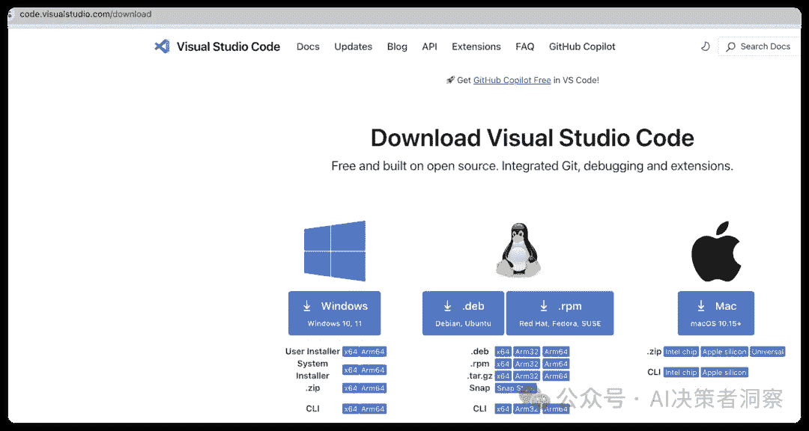

下载 vscode

安装以后，打开 vscode，安装 MarsCode 插件并登录

## **安装 **MarsCode **插件**

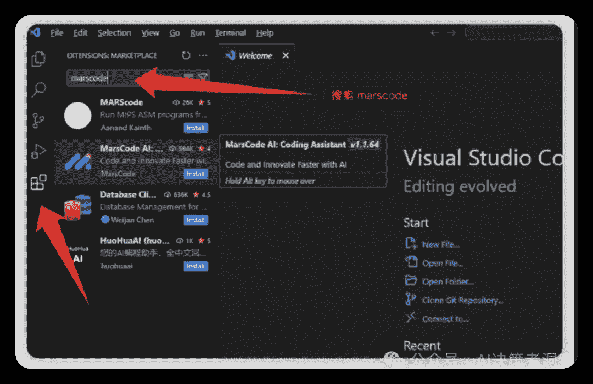

安装MarsCode插件

> 注意，要选择 MarsCode 官方的。

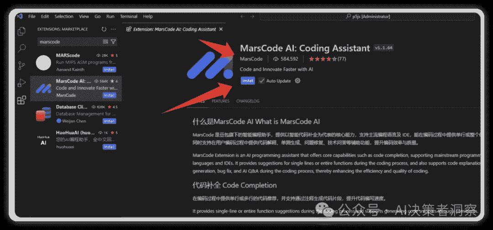

MarsCode官方插件

点击 “install“ 安装插件。安装成功以后，右侧会出现一个图标。

## **建立空白文件夹并打开**

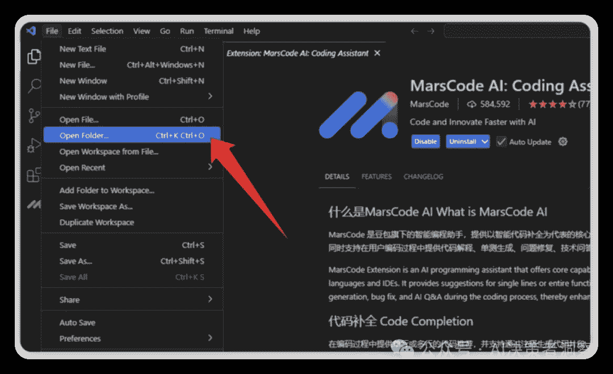

打开文件夹

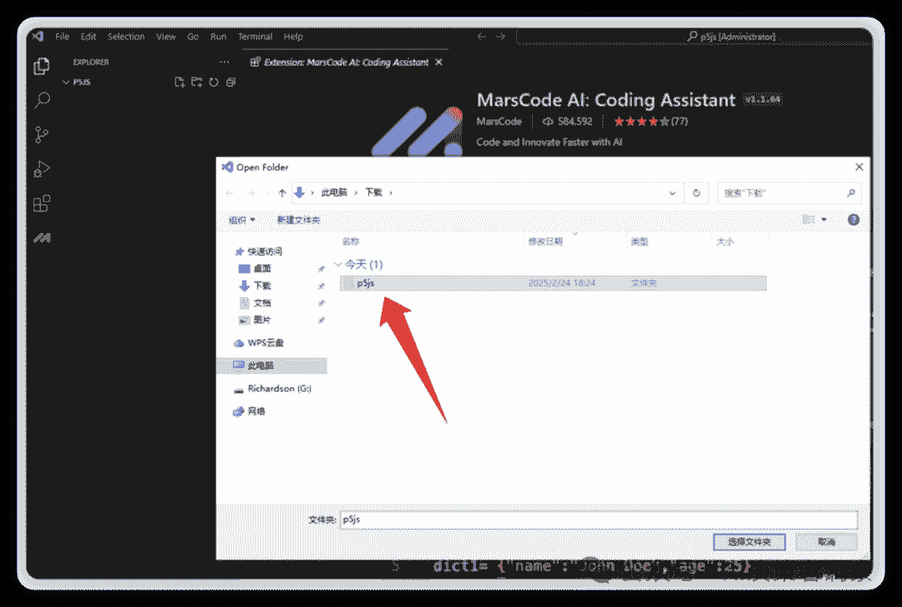

打开文件夹

点中文件夹以后，"选择文件夹"

## **注册/登录 MarsCode**

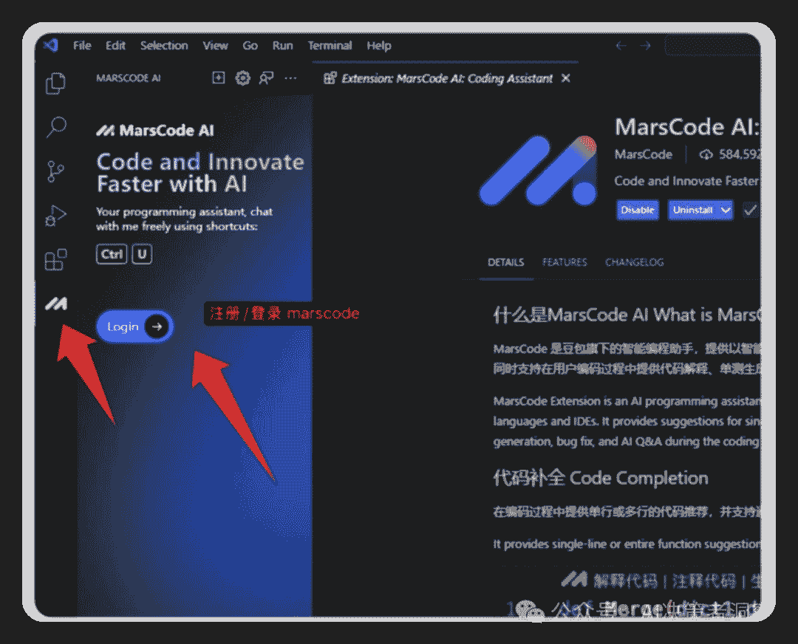

注册/登录MarsCode这个时候会弹出一个窗口，我们点击 "Open"

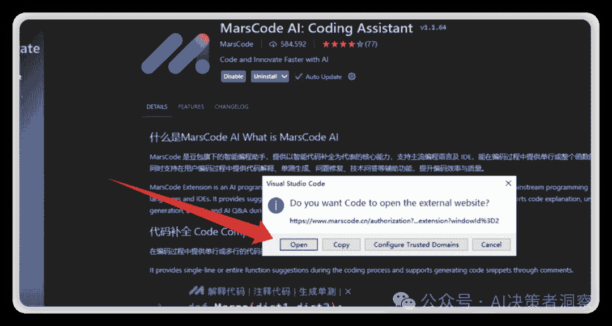

登录MarsCode

选择自己常用的浏览器

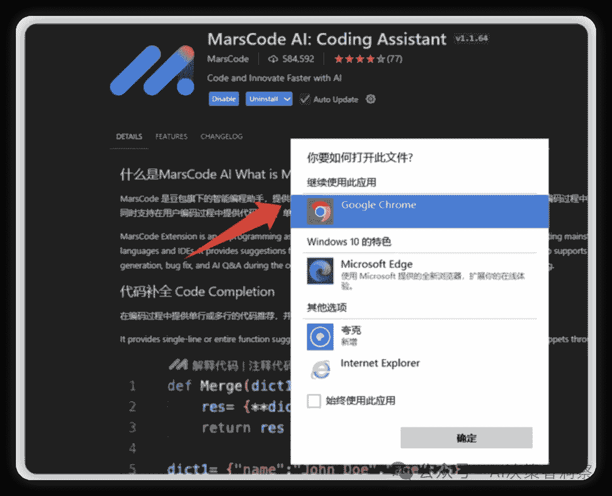

浏览器登录，可以手机登录，也可以抖音登录

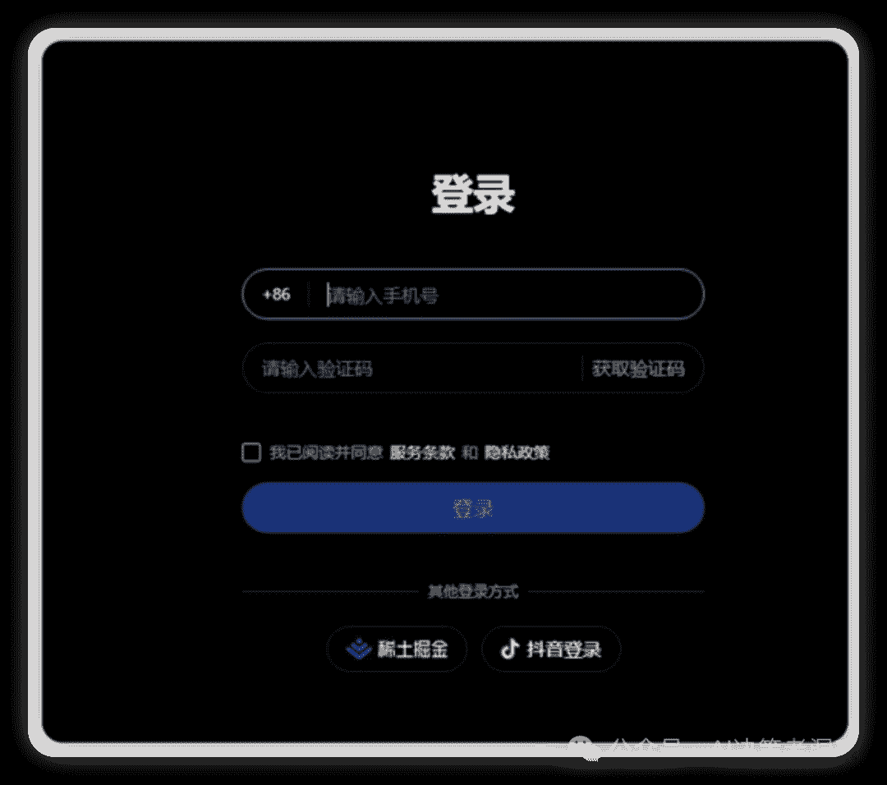

image.png

登录以后，会提示授权

授权

授权并打开

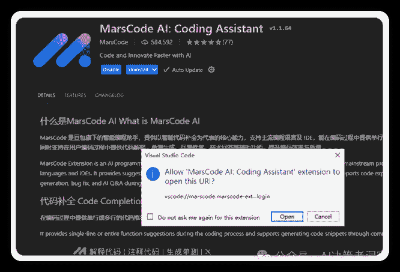

## **选择 Deepseek R1**

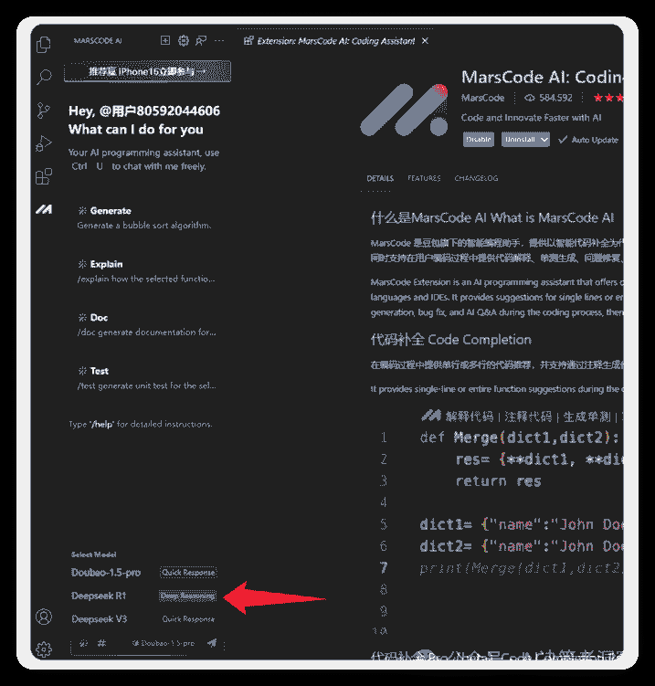

设置Deepseek让它帮我们做一个粒子效果的内容

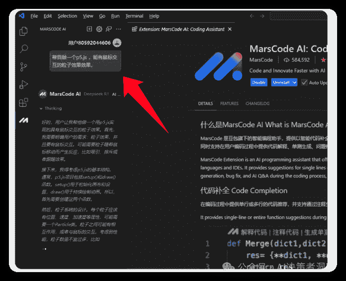

粒子效果

最后，让点击内容中的 Apply

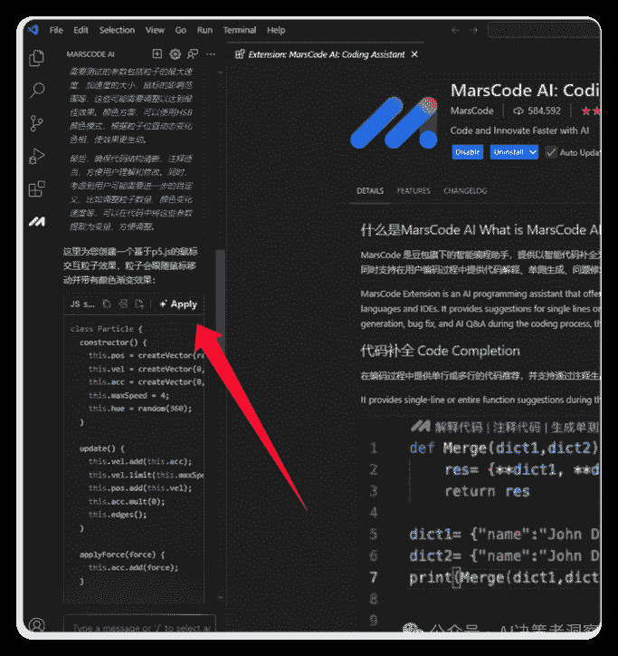

Apply

点击 Accept，就可以了。

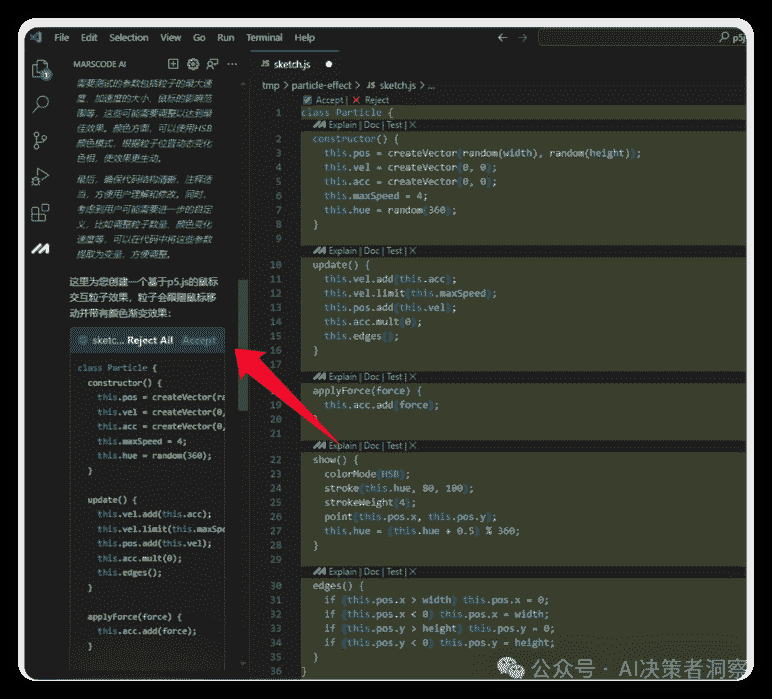

Accept

## **运行看看效果**

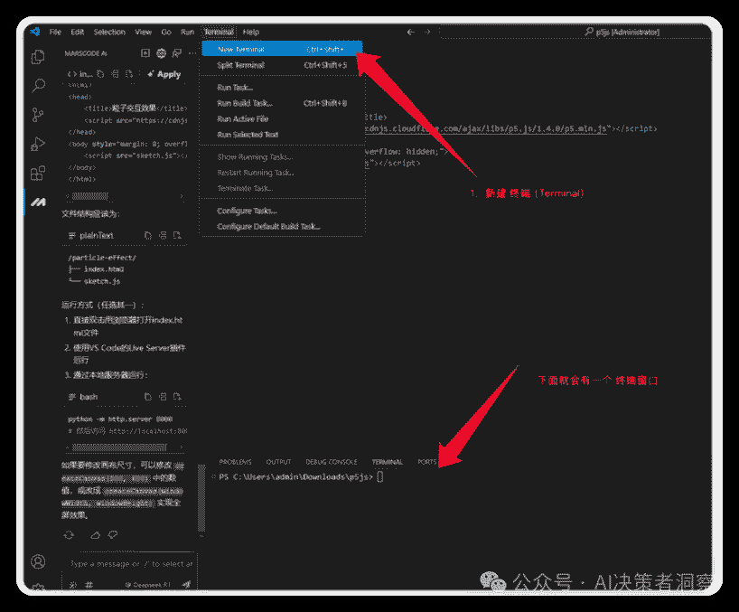

运行看效果

它会给我们一个命令，需要我们先开启终端。

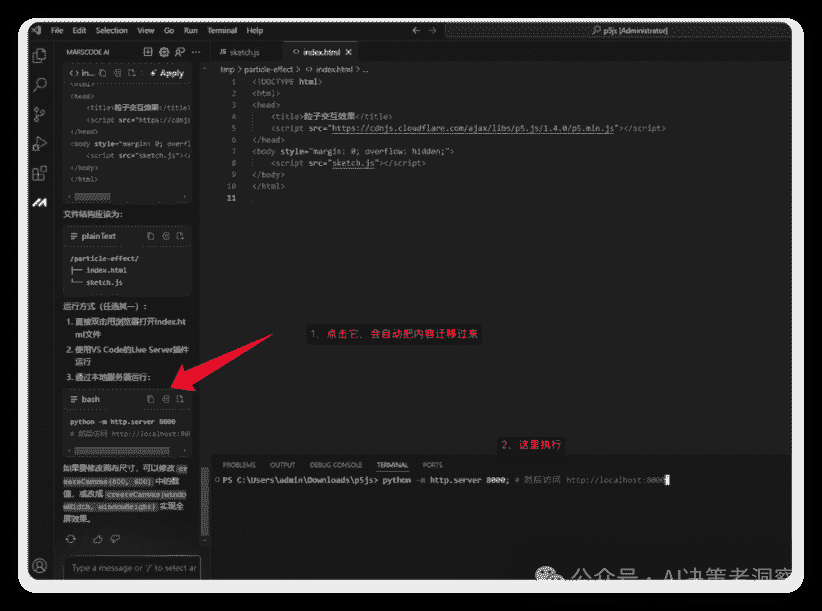

运行看

运行代码

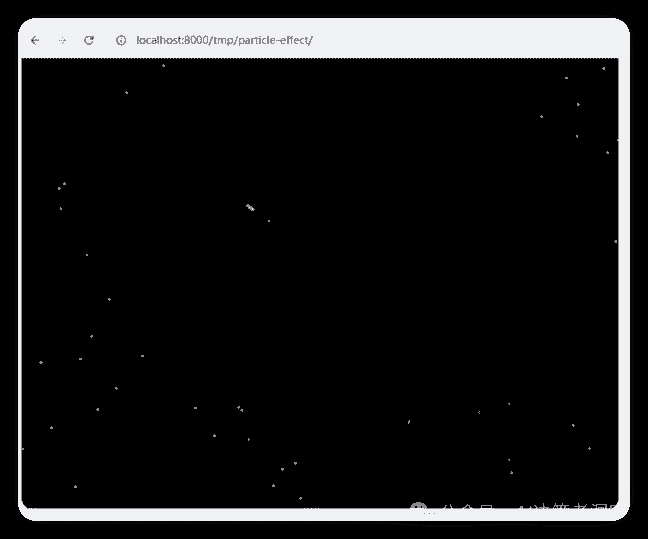

浏览器

## **异常处理**

如果运行报错，可以把错误信息发给 MarsCode，永远相信 deepseek + MarsCode 的威力

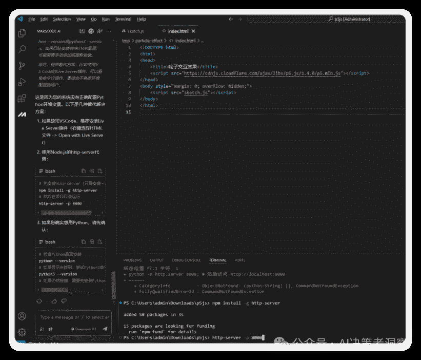

异常处理

# **总结**

• AI 编程工具层出不穷，但 MarsCode + Deepseek R1 让国内开发者更省心。

• 更快、更稳定、更智能 ，本地就能体验 AI 代码补全的强大能力。

• 效率提升的关键不是 AI，而是如何用好 AI。

• 现在就安装 MarsCode，试试看，它能让你的编码体验上一个台阶。

<https://aigcreative.feishu.cn/sync/K4Gvd9vUQsy9Oubwqaeclu0Fnbg>

# 知识库动态