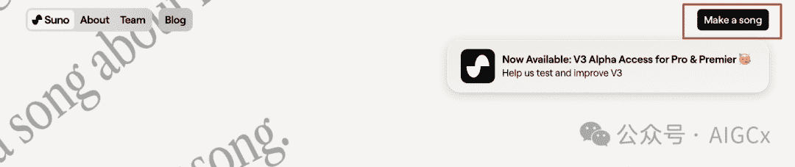
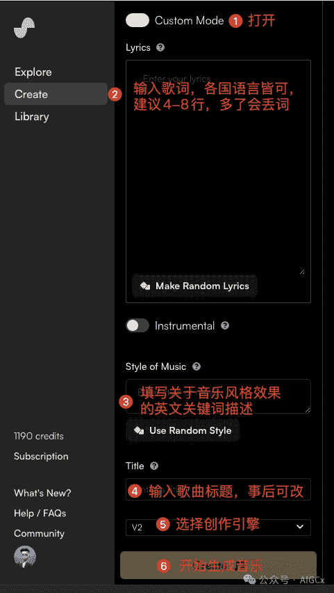

# Suno.ai音乐创作经验谈（基础版）

> 来源：[https://aigcreative.feishu.cn/docx/KSohd6ivDoNCg2x07eqciD1YnYb](https://aigcreative.feishu.cn/docx/KSohd6ivDoNCg2x07eqciD1YnYb)

> 👸号：AIGCx，作者：倪考梦

> 链接：https://mp.weixin.qq.com/s/INoSRxe0rC7s-m3__0tBXA

Suno是当前全球音乐创作领域的头部工具，地位堪比GPT、Midjourney和Sora等巨头。

你可以在电脑或手机端打开www.suno.ai（国内可以正常使用）后，点击Make a song来使用Suno。

# ** Suno注册指南 **

1.  初次登陆会要求注册，可点击Microsoft的Live账号（国内可以正常使用），注册登录一个后，关联Suno，即可注册使用。

1.  注册开通后，成为免费用户，每天拥有50credit（每月就是1500credit），可以生成5次音乐（每月生成150次音乐），10段歌曲（每月300段歌曲）。

1.  如果你想有更多credit，且不希望每天有限制，还想使用更多复杂功能，可以开通付费用户。按年订阅Pro的话，每月8美元，获得2500credit，每天不限制使用量。另外，付费用户可获得生成歌曲的商用授权。

# ** Suno使用指南 **

你可以让Suno随机创作歌词生成音乐，也可以自定义，建议是自定义，即选择Custom Mode。

## **一、输入歌词**

1.  歌[词可以自己创作，也可以让A](http://mp.weixin.qq.com/s?__biz=MzkzMDQ5ODQ0NQ==&mid=2247486833&idx=1&sn=16f875372a73316bd2b9bc7d713e9762&chksm=c2781f93f50f96855fa7fbf15465c2a37541b932f18a7763a138a0f580afdc5e6931639d9756&scene=21#wechat_redirect)I帮你创作。建议使用Kimi，另外是在歌词里增加温州元素，这样做出来的好歌，最后还能参加比赛。参见：写给全球音乐爱好者的一封信

1.  建议希望做出完美音乐的朋友提前学习歌曲结构相关知识，可以请教Kimi。下面是一个简单的演示，成歌约2分钟左右。

[verse]你的文章，犀利又深刻揭露黑暗，为光明而歌《新民晚报》，你改革的笔触让晚报焕发新生，成为市民的好朋友[chorus]赵超构的笔，如炬火照亮夜在动荡年代，书写着真理的篇他的笔下，延安的真相展现一笔曾当百万师，历史见证他的言[outro]赵超构，你的笔，永远铭记在历史的长河，你的名字熠熠生辉你的担当，你的使命，你的初心如同你的文字，永远激励着我们前行

1.  歌词中可以有标点符号，Suno官方建议每行末尾不加标点。实测下来，行末不加标点，AI唱歌时会更加灵活，可能组合没有标点断开的歌词。

1.  歌词中，每4行是一个组块，可在前面增加[verse] [chorus] [outro]等标记（不会被唱出）。

1.  每次输入的歌词不要太多，官方建议是每次输入4-8行，即1-2个组块，所以你在做歌之前先要有规划，或者说心理准备，你至少要生成两次音乐，才能获得一首完整的歌曲。

1.  目前Suno生成的歌曲，经常出现开头几个字不清楚或者唱错唱漏的情况，所以最好别在歌词开头写关键字关键句。

1.  Suno似乎不太认识一些中文字，所以如果有什么多音词、冷僻字，一定要用同音字替代，以免AI唱错或唱漏。如：石斛的「斛」字，AI不认识，会跳过，但用「湖」，它就唱出来了。歌曲末尾也是。

此外，你也可以把Instrumental打开，不要人声，只生成伴奏。

## **二、选择风格**

1.  你可以让AI随机生成音乐风格，也可以自定义风格。

1.  自定义风格时，关键词越简单，则AI自由发挥的余地最大。笔者前期的经验是，可以考虑输入多个短语作为关键词，从不同维度来限定歌曲风格。如：

pop, male, fast（男性唱流行的快歌）

male, slow, emtional（男性深情的慢歌）

更多经验欢迎大家分享。

## **三、选择引擎**

版本越高越好。目前主流引擎是V2，所有人都能用。V3 Alpha已经开始测试，优先开放给付费用户使用。实测下来V3A的确好一些，音质和曲风都更好。

## **四、设置名字**

这个歌名主要是显示在Library里。事后可以改名字，所以问题不大。

## **五、生成音乐**

完成上述设置后，点击Create，每次消耗10credit，然后生成两段音乐。

Suno是一个生成式AI，所以它给出的结果也是限定条件后的开盲盒。如果你认真看了前面我写的东西，那么你生成的歌曲音乐质量应该不会太差。

生成后的音乐会显示在Library，在这里可以给歌曲点赞（做好标记方便自己找到好的歌曲片段），也可以删除歌曲片段（在垃圾桶里可以找回）。

如果你要求不高，那么第一次生成的残缺内容已经够发给朋友炫酷了。但如果你想制作一首完美的歌曲，那么还要继续往下看。

## **六、迭代音乐**

你可以在Library里听自己生成的音乐，选择满意的歌曲片段后，在它基础上Continue from this song，以相同风格，输入后续的歌词后，继续创作第二段、第三段，直至歌曲完成。

说实话，因为AI是随机生成内容，所以这里不可控性很高。如果说第一次二选一里产生好歌的概率是50%，那么第二轮就成了25%，第三轮就是12.5%。概率越来越小。现实中概率更低，因为可能生成的内容你都不喜欢，只能在相同设置下重新生成，或者Remix。

再往后就是无止尽的抽卡、开盲盒、爆肝熬夜，并不断磨耳朵。当然，这个过程也很享受，毕竟是音乐，每段都不同，多巴胺不断分泌啊。

我们都学过一个词，叫「妙手偶得」，用Suno创作AI音乐，就是这么个过程。

## **七、完成音乐**

或是我们找到了满意的组合，或是我们搞不动了，或是我们credit耗尽了，或是比赛交稿时间到了，我们比较完成音乐。这时候，我们要在最后一段满意的音乐那里点击Get Whole Song，获得一首带有Full Song图标的完整歌曲。

## **八、分享音乐**

到时候分享你的作品了。你可以在Library里点击歌曲边上的分享图标，发送给朋友，朋友打开后可以看到带歌词的歌曲。

你也可以直接下载Video或Audio，直接发送文件给朋友。

你还可以下载Audio后导入剪映APP等工具，进行后期剪辑，搭配图片和视频、自动生成字幕后，做出AI音乐视频（MV）来。这里有一个我自己制作的比较喜欢的MV，欢迎观看。

<https://aigcreative.feishu.cn/sync/K4Gvd9vUQsy9Oubwqaeclu0Fnbg>