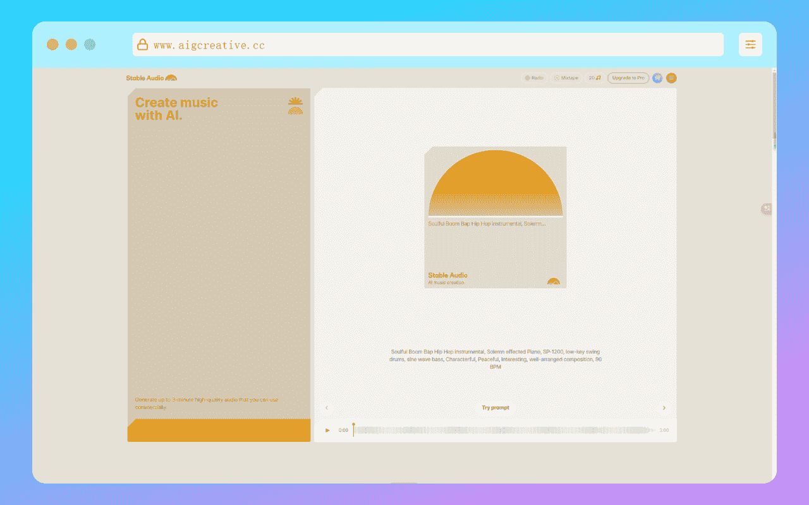
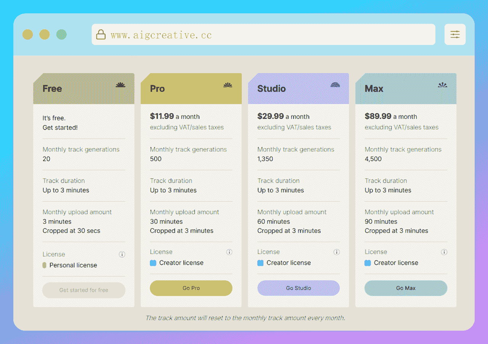
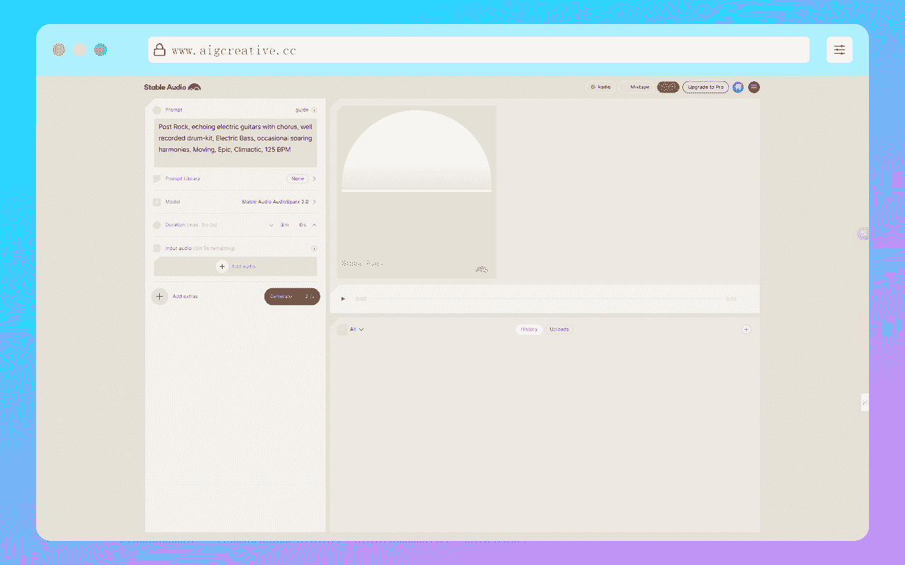
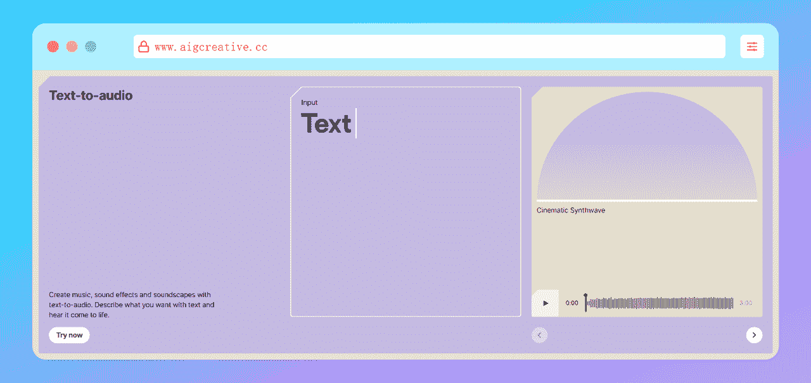
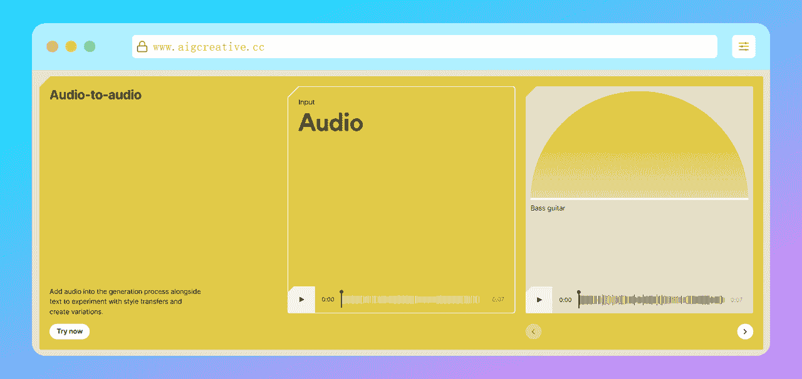
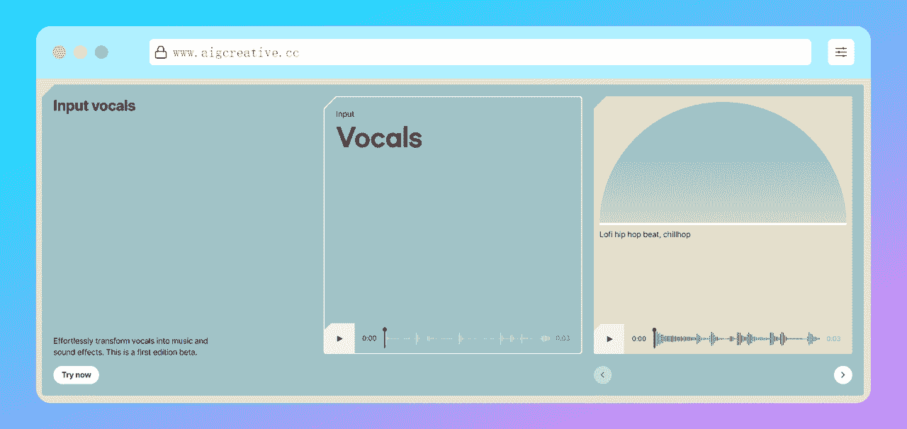
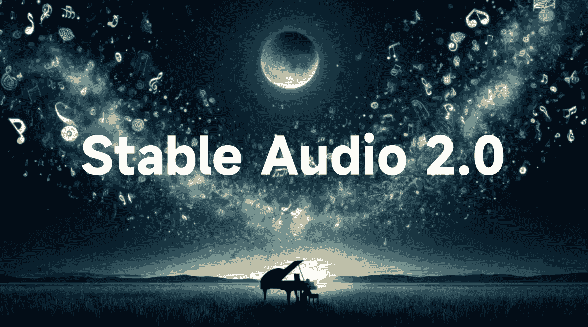
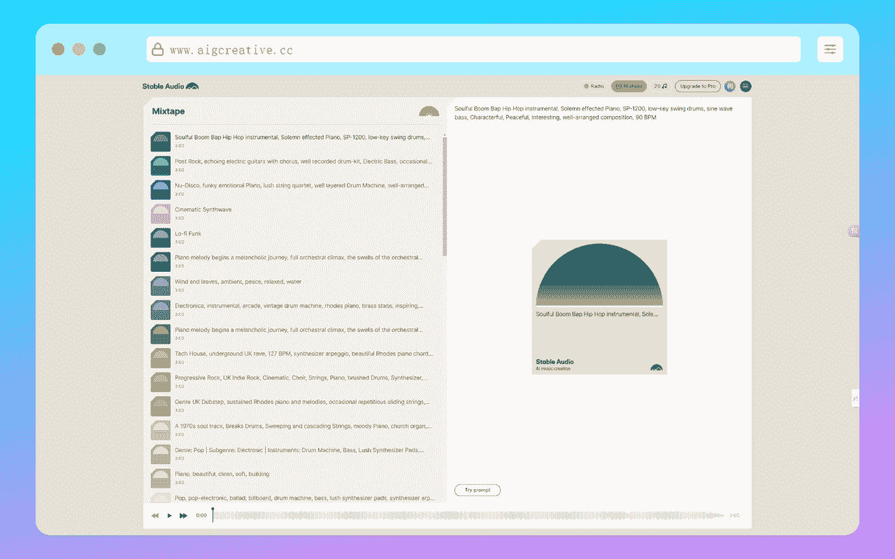

# AI音乐平台Stable Audio 2.0重磅发布，能生成3分钟高质量音乐！

> 来源：[https://aigcreative.feishu.cn/docx/TbmRdwyAioZdpfxTWI7cCzhJnVf](https://aigcreative.feishu.cn/docx/TbmRdwyAioZdpfxTWI7cCzhJnVf)

> https://mp.weixin.qq.com/s/aEY94FTVBP6lH9a3yCDYqg

今天，大名鼎鼎的Stability.ai 正式发布了音频模型 Stable Audio 2.0，它可以一次性生成 3 分钟 44.1 kHz 的摇滚、爵士、电子、嘻哈、重金属、民谣、流行、乡村等 20 多种类型的高质量音乐。

直接上链接：https://stableaudio.com/generate

该模型使用了 Diffusion transformer (DiT) 替换了 1.0 的 U-Net 架构，并且使用了一个超过 80 万个音频文件组成的数据集。Stable Audio 2.0 生成的音乐可以用于商业化。

下面直接来听一听生成的音乐的效果：

[cinematic-synthwave.mp3](https://internal-api-drive-stream.feishu.cn/space/api/box/stream/download/all/Ff1obig5woUpXgxAc2WcOg62nFh)

[soulful-boom-bap-hip-hop-instrumental-solemn-effected-piano-sp-1200-low-key-swing-drums-sine-wave-bass-characterful-peaceful-interesting-well-arranged-composition-90-bpm.mp3](https://internal-api-drive-stream.feishu.cn/space/api/box/stream/download/all/ESqkbz7H0o4hqpxQmlZcnSXPnbh)

停下来，感觉效果很好呀！

新用户注册免费有20积分，订阅费用如下：

Stable Audio 2.0 是一款利用人工智能技术将文字转化为音符的音乐创作平台。该平台包括文本到音频功能、音频到音频功能以及人声转化为音乐和声音效果等多种创作工具。

### 一、文本到音频：音乐创作的革命性工具

Stable Audio 2.0的核心理念是将音乐创作变得简单而直观。通过其强大的文本到音频功能，用户只需用文字描述他们心中的音乐，无论是激昂的摇滚、悠扬的古典，还是宁静的自然声音，AI技术都能精准地将这些描述转化为实际的音频。这种创新的方式极大地拓宽了音乐创作的边界，让每个人都能够轻松地成为音乐创作者。

### 二、音频到音频：**风格融合与声音创新**

Stable Audio 2.0的音频到音频功能，为用户提供了一种全新的音乐创作体验。用户可以将任何音频样本与文本描述相结合，实现风格转换和声音变体。这意味着，无论是想要将古典音乐与电子音乐融合，还是在摇滚乐中加入民族乐器的声音，Stable Audio 2.0都能帮助用户轻松实现。

### 三、人声转化为音乐和声音效果：**声乐的无限可能**

更令人兴奋的是，Stable Audio 2.0还能将人声转化为音乐和声音效果。这项技术的应用前景无限广阔，无论是电影配乐师、游戏声音设计师，还是广告制作人，都能够利用这一功能，将人声转化为引人入胜的背景音乐或特效声音。这不仅为声音设计领域带来了新的灵感，也为音乐创作提供了更多的可能性。

### **高品质音乐的商业应用**

Stable Audio 2.0所生成的音乐质量堪比专业水准。平台使用的是行业最新的音频扩散模型，确保了音乐作品的高质量。用户可以放心地将这些音乐作品用于商业项目中，无论是在电影、电视广告，还是在视频游戏中，Stable Audio 2.0都能提供强有力的支持。

### **社区的力量**

Stable Audio 2.0还拥有一个活跃的社区，用户可以在Stable Mixtape中分享和欣赏由其他创作者使用平台制作的音乐作品。这是一个充满创意和灵感交流的空间，每个人都可以在这里找到属于自己的音乐之声。社区的力量不仅激发了用户的创作热情，也为音乐创作带来了更多的合作机会。

### **未来的音乐创作**

Stable Audio 2.0的推出，标志着音乐创作进入了一个新的时代。这个高技术的模型不仅提升了音乐生成的质量，也为音乐家们提供了更多的创作自由度。随着技术的不断进步，我们可以预见，未来的音乐创作将更加多元和个性化。

更多AIGC领域最新进展，欢迎进群交流：

<https://aigcreative.feishu.cn/sync/K4Gvd9vUQsy9Oubwqaeclu0Fnbg>