# AIGC对VFX行业当下的影响

> 来源：[https://aigcreative.feishu.cn/docx/EDakdgtl2opXQRx3RiWcORvpnhd](https://aigcreative.feishu.cn/docx/EDakdgtl2opXQRx3RiWcORvpnhd)

> 来源：👸号：cgview ，作者VFXQH

## **前言**

随着我们进入 2024 年，电影和动画行业继续经历变革，这种演变的核心在于将AI与VFX领域相结合，从生产力和制作流程的升级与重塑，促使行业结构各种变化。AI具有从数据中学习和做出预测的能力，正在逐步改变视觉特效的方方面面，为艺术家提供强大的工具来突破创造力和效率的界限。AI正在日新月异进步，并已在视觉效果行业中得到广泛应用。本文我们将试图立体了解视觉效果的工作流程变革，并了解AI带来创造、效率提升方法与方向。AI从生文到图、声音再到视频，当下短视频时代显然是最快被改变的。看土味视频，品百味人生。可以预见未来短视频出现像去年的慈禧跳科目三舞蹈、AI周杰伦、AI孙燕姿唱别人的歌，这类网红现象级传播还会不断出现。创意短视频、新媒体广告等诸多领域的创作和展示方式改变也是全局的，我家电梯广告已经出现了注明使用AIGC生成的海报，伴随着各种制作成本不断下降，创意变得愈发重要。不过这些低成本内容和这个产业关系不是非常大，VFX专业壁垒相对还是比较高的。在工业光魔工作了20年的资深视效监督Scott Squires在过去的采访中表示：以前完成的大部分非常耗时和乏味的体力VFX工作至少已经部分实现了自动化。他赞同新技术使视觉特效艺术家能够制作出更高质量的作品，并为创造力提供更多选择。自动化视觉特效任务使影视、TVC、动画剧集提高了各种效益，一定程度减少了对大型团队的需求，从而降低了制作成本。重要的一点是：它通过减少花在重复性任务上的时间来增强创造力。因为视效产业制作需求还是相对短视频的门槛、质量创意双高的产品服务，所以预算和制作周期的平衡优化自诞生起就是非常渴求的。本文尽可能只想探讨VFX专业领域内：目前横向前后工作流程技能树解锁进度与展望，纵向垂直工种哪些被不同程度改变。

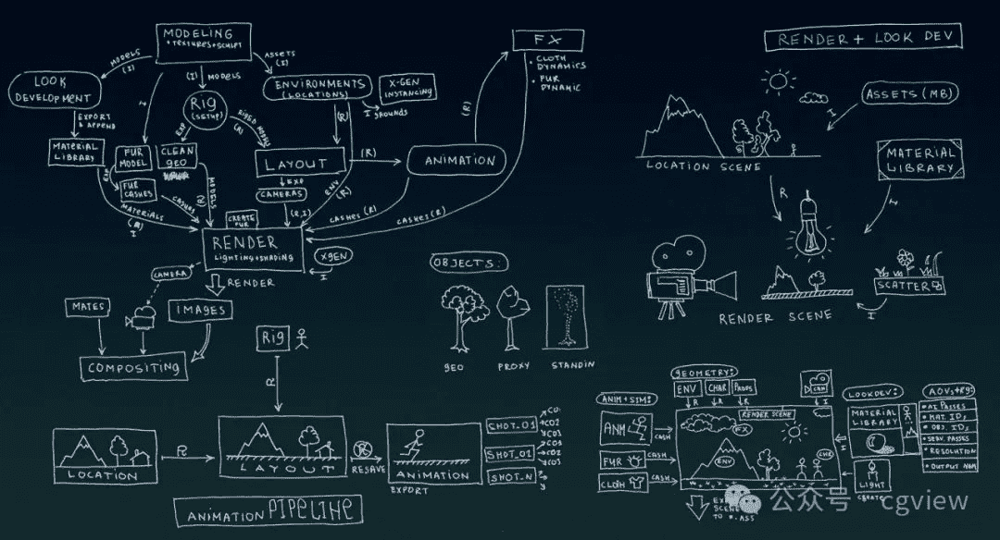

## **概念、文生图和视频**

在过去的一年里，AIGC图片生成式内容很火，我们看到使用 Stable Diffusion、Midjourney和 Dall-e 等平台的 2D 图像生成的 AI 工具取得了巨大发展，并且采取订阅制商业上也相对成熟快速落地。这些文本到图像的 AI 工具可在几秒钟内将文本提示转换为详细的图像。最传统概念设计师的影响显然是最大的，图片毕竟是静态，技术门槛还是比较低的。来探讨一下AI视频的进展，Sora显然是关键的技能树解锁之一。像 GPT的文本生成是 Transformer 模型，简单说它是一套使用神经网络编码和解码的文本预测架构，将文本编码成数据向量，然后解码的时候从数据还原出文本，来预测上下文。

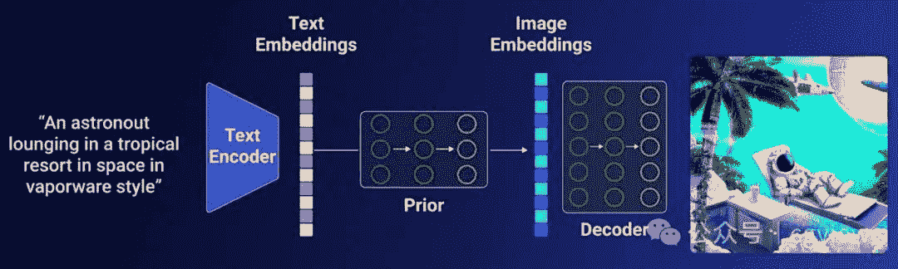

有了文本生成模型后，通过卷积神经网络让文本和图像关联。文生图是怎么到视频生成模型转变的？Runway、Stable Diffusion 是基于扩散模型（Diffusion Model），扩散模型的训练过程是通过多个步骤逐渐向图片增加噪点，直到图片变成完全2D无结构的杂乱噪点图片，然后在生成图片的时候，基于一张完全噪点的图片，逐步减少噪点，直到根据文本提示词还原出一张对应清晰的图片。这个数学过程不是非常复杂，对于有数学和机器学习基础的人看懂推导过程还是比较简单的。简单理解扩散模型之前的实现还是2D上意义的重建生成前后帧，所以很多AI视频模型动起来软绵绵的，除了抖动就是生成对象的几何模型立体表现不一致持续，这是以前方法最大的瓶颈。

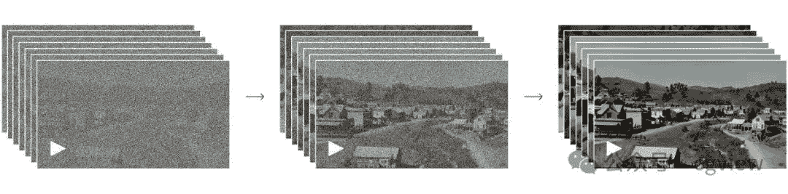

Sora 和之前扩散模型的架构上最大的区别与突破呢？AI视频模型本身是一个必须需要物理和几何感知的生成模型，Sora 朝这个方向迈出了一步，稳定一致性不抖是它非常重要的进步，Sora 是基于之前的进行改进，做出了自己的 Diffusion Transformer架构，基于目前的官方报告，可以看出它不是简单的2D生图进行再连续生成，否则透视都不会那么正常。官方称物理是用数据驱动学习模拟，这更像是一种映射替换，而非具有动力学理解了物理行为，重建这一过程，注意也只是重建，这和“理解”物理行为完全不同。扩散模型是深度学习和生成模型的关键技术之一。它指的是一种生成模型，可以生成模拟给定数据分布的高质量、多样化的“样本”。在这种情况下，数据分布是一系列电影风格的真实图像。但不要混淆;它不以3D建模，不了解物理或光，也不了解相机，无论是数字还是其他方式。它生成了统计学上合理的图像，现在它可以以一种看起来在时间上一致的方式做到这一点。换句话说，这些视频似乎在帧之间没有抖动，而且随着时间的推移，它们（某种程度上）是有意义的。我们之前已经看到过许多尝试，但没有一个像SORA那样好或那么长。新的 OpenAI SORA 正在制作合理的（大部分）60 秒视频——比以前可能的时间长得多。—— Mike Seymour，fxguide联合创始人和特约编辑评论道。另外，官方报告中特地提到了：“我们的研究显示，扩展视频生成模型的规模是向着创建能够模拟物理世界的通用工具迈出有前途的一步。”报告中没有包含具体实施方法的架构详细信息。而且计算性能和成本并未说明，我认为算力目前要求不会很低，成本下降空间一切还是未知，等待大规模测试才能知道。

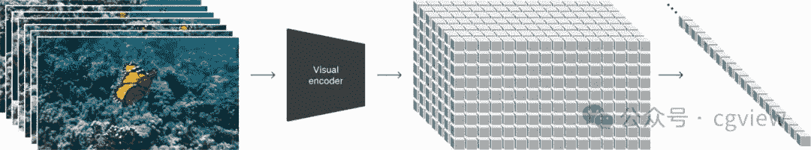

Sora 目前已知是一个融合不同以往的架构。Sora 不是预测序列中的下一个文本，而是预测序列中的下一个“Patch”，这肯定不是单纯的文本语义信息，而是含有语义、几何空间和物理感知数据压缩的。官方报告里面叫 Patches，Encoder 将视频压缩为低维数据，再反复编解码处理，再将其分解为 Patches。同样 Sora 也能从 Patches 反向解码生成视频图像。比如从《我的世界》游戏体素风格和写实风格的视频互相转换。

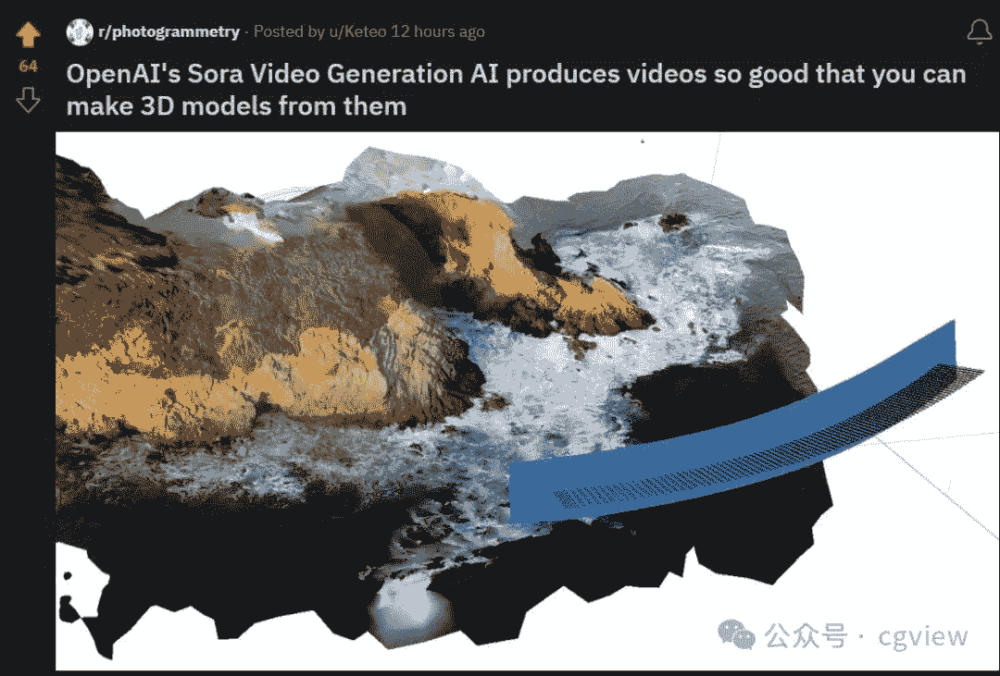

为了验证Sora具备几何感知能力，也就是对提示词表达的数据对象有隐式的基础空间点云生成能力，在官方视频流出后，专业的照片建模博主对其进行的重建，可以看出Sora已经具备，否则根据其城市、室内等视频运动分析是无法复原其内容3D结构的。在下面资产章节会更加细致讨论。以下是AI视频的技术论文和项目参考，来看看历史变迁：

Diffusion Transformers （DiT）

项目：https://wpeebles.com/DiT

Scalable Diffusion Models with Transformers

DiT论文：https://arxiv.org/abs/2212.09748

Patch n' Pack: NaViT, a Vision Transformer for any Aspect Ratio and Resolution

Patch NaViT论文：https://arxiv.org/abs/2307.06304

之前扩散模型架构的AI视频对比参考：

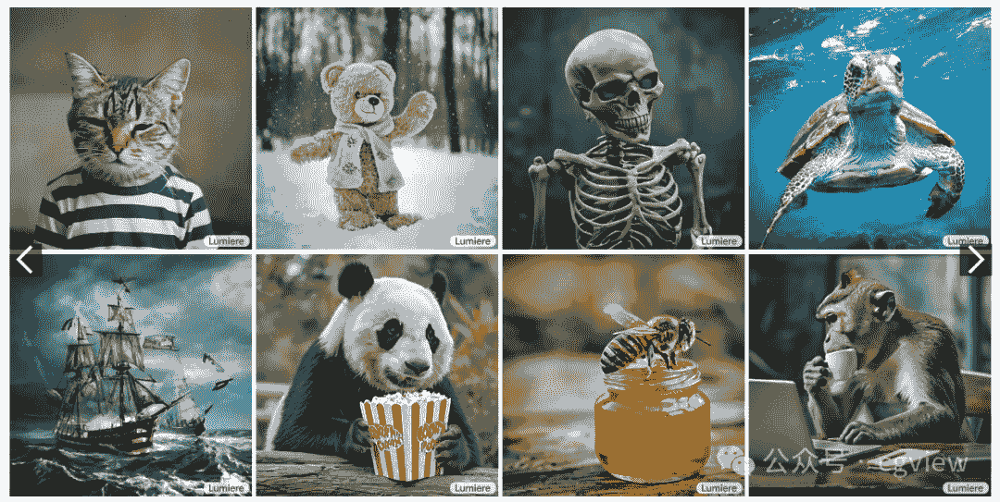

Google Research的LUMIERE是之前路子，Text-to-Video、Image-to-Video。

A Space-Time Diffusion Model for Video Generation

项目：https://lumiere-video.github.io/

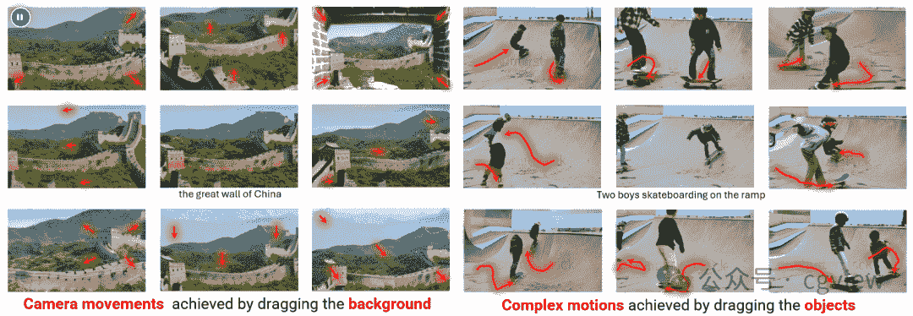

微软DragNUWA项目：https://microsoft.com/en-us/research/project/dragnuwa/

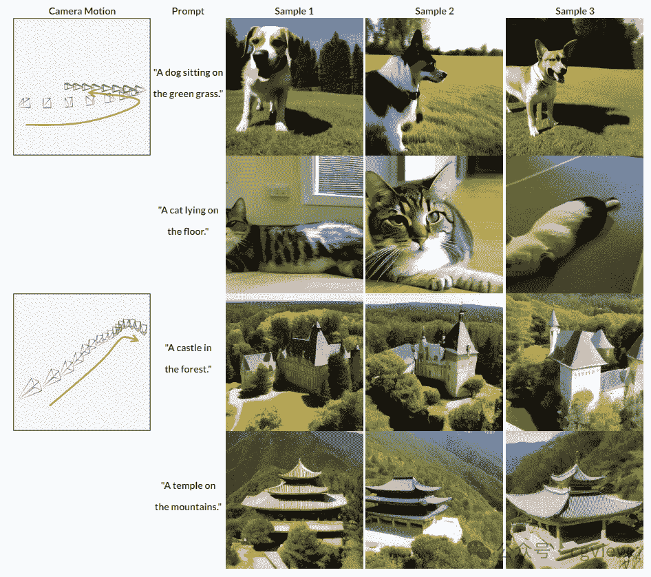

腾讯的MotionCtrl项目：

https://wzhouxiff.github.io/projects/MotionCtrl/

之前的项目可以看出由于没有精度较高的几何和物理感知信息，所以生成结果是不够长的，只能做简单的动图，几秒的镜头位移，透视大部分都不对。Sora没有披露架构细节，无论怎样至少目前可以合理推测，最后底层数据处理还是基于神经网络的随机梯度下降和正反向传播，这就意味着目前 Sora 中的内容是没有复杂推理能力的，数据集的物理信息不够的话，就会出现官方说的各种物理因果关系混淆。基于这样的模式是无法真的学会物理规律的，它只是统计学意义的逼近重现，现在无法高度自定义编辑各种属性，复杂提示需求还需时日。就好比将所有行星运动的数据拿来训练，它可以重现不同星体参数椭圆的轨道，对于某种尺度下它看似理解了引力分布，但也无法推导出引力的数学物理方程与定律。这就是为什么官方只称为数据驱动，是非常局限于数据集的标注信息量。暂时不要神话它为“世界大模型”，这里的路还需要几年，接下来的方向我认为很大可能会和UE引擎或工业仿真平台合作，通过自动非监督的决策学习获取一定的初级物理规则感知提升。

## **资产与虚拟制作**

除了图片资产，使用扩散模型架构去生成3D建模资产是业界还在持续探索的，精度大幅度提高至少还需要两三年。CG的模型资产采集和制作是劳动密集型创作，不仅耗时耗力，能够反复使用的资产并不多。每一次新项目都要去制作新需求的资产，AI对新需求这部分影响几乎没有，因为不能要求AI生成数据集里没有的东西。而影响最大的是普通复用的3D模型资产，来看看去年我看到的一些学术进展：

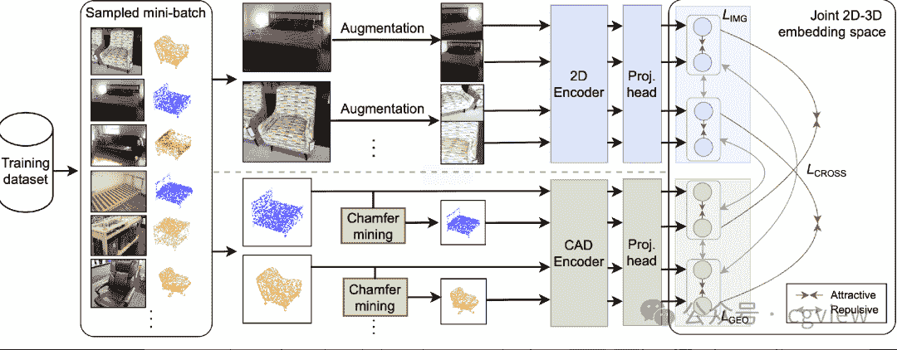

Learning Geometric-aware Properties in 2D Representation Using Lightweight CAD Models, or Zero Real 3D Pairs CVPR 2023：https://geoaware2drepusingcad.github.io/

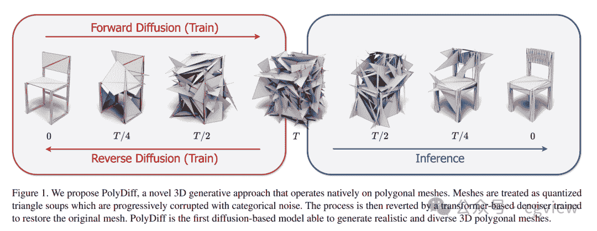

PolyDiff: Generating 3D Polygonal Meshes with Diffusion Modelshttps://arxiv.org/abs/2312.11417

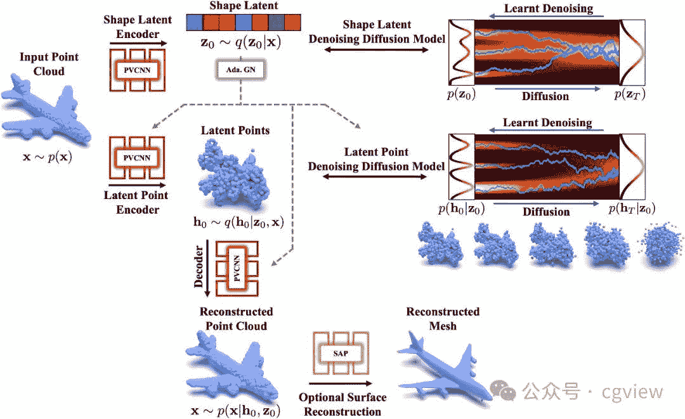

LION: Latent Point Diffusion Models for 3D Shape Generationhttps://research.nvidia.com/labs/toronto-ai/LION/

从上述图中可以看到目前AI生成3D模型围绕着两个方面：1）从图片或视频识别物体点云信息，不同于传统照片建模的生成方法，不仅速度快还有推测扩展能力。2）完成物体几何模型生成。这两步组合就可以从文字提示直接生成3D模型。可以明确判断的是这取决于其训练数据的数量、质量精度，否则只能是目前普通模型网站里的简模水平

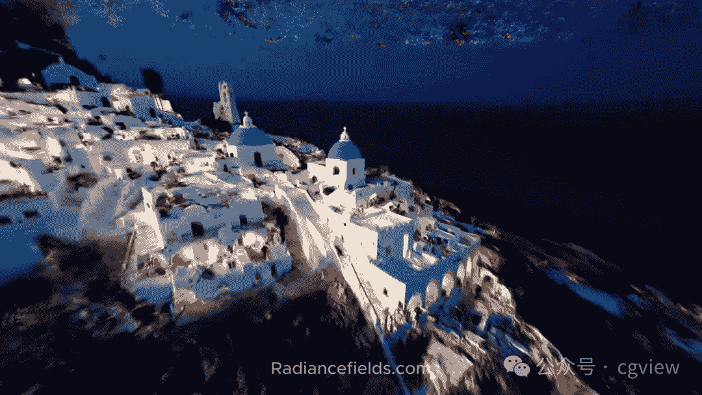

Sora如果后续提供相机、物体模型点云导出，这将改进很多流程。譬如说虚拟制作中需要大量的地形、建筑等生活常见的普通物体去填充空间，快速营造一个无限接近成品的场景。传统搞资产库商业上没大获成功过，除了盗版问题，最后都是卖给平台的命运。AI视频、资产生成现在可以让电影初期创作阶段的预演测试成本很低的来进行虚拟制片、虚拟讲戏，而不是等待资产制作足够丰富，导演面对空洞无实物地场景指导演员表演。以此，快速完成可见的接近成品的预演，无论只是传统预演、还是VP的UE使用都会带来画面的质量进步。最后按精度要求层次划分，再去离线制作完成更高质量，这一工作流程的融合程度逐步会随着这方面AI的进步持续变大。

## **动画与特效模拟**

动画和特效的模拟是CG图形学学科下完整的垂直分支，这俩都是艺术和技术要求双高的主。不仅需要大量动画师、特效师去按照预演提高精度完成艺术创作，还要完成物理模拟，这两步都非常耗费时间，前者耗费时间可能还只是创意沟通实现的各方面水平问题，但后者需要养一大堆技术人员和机器去完成，在AI的加持下如何简化和加速这个过程：

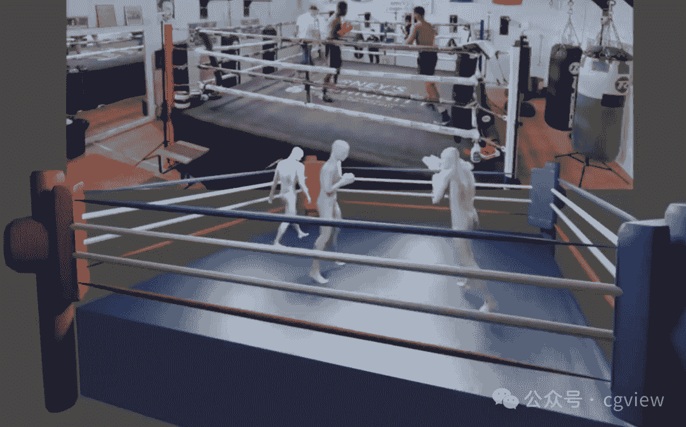

使用CV计算机视觉姿势识别的AI技术快速生成角色动画，虽然还有点粗糙，但满足了预演阶段大量的初级重复工作。诸如目前很多不成熟的测试项目，使用大量的动画库训练，可以文字生成很多简单的基本动作，AI生成的虚拟角色跳舞等短视频是目前使用最多的。动画这个方向有AI使用的两条主要路径：

1）快速完成基础动画的识别生成和预处理，不要小看这部分，是非常耗时耗力的，将解放动画师精力大幅度放在具体创意的动画精修表现上。

2）是加快动力学模拟与解算，通过AI训练完成复杂的动作，路径、交互动画等，游戏动画在这方面比影视探索的要更前沿，目前有很强的交汇趋势

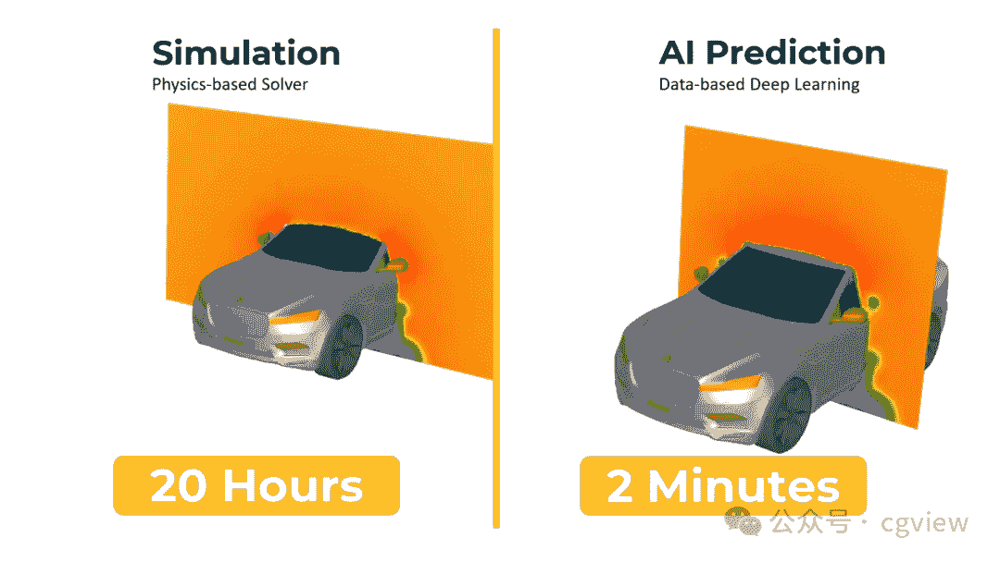

上图是Ansys SimAI云端仿真平台展示汽车的流体动力学传统与AI性能对比。工程师可以轻松可靠地以闪电般的速度预测物理行为，不止在工业界要做复杂的物理动力学模拟，VFX行业的角色动画，特效也需要大量的刚体、柔体、流体交互模拟，并且解算极其耗费时间和人力物力，这很大程度受限于底层的解算器算法难以大幅度改进，精度和速度无法同时兼顾，也受限于目前芯片计算性能。但神经网络的机器学习可以在大量数据中， 进行拟合得到很多有效近似数值解，并且满足一定尺度下的各种定律法则。所以除了工业界，各种实时特效工具在游戏和影视这方面使用中还在不断改进，足以大幅度降低模拟解算时间，从而简化工作调试流程。

## **渲染**

渲染是图形学CG中的主干研究方向，也是制作成本中最高支出之一。但在近年来AI发力主要是在计算机视觉CV领域中，这其实很悲哀，在学科过渡细分会让学科之间的鸿沟持续加大，同时会让学术界真正有能力的人难以发现这俩姊妹行业中交叉很有意义的方向。传统渲染还是光线路径积分的老办法，无非是围绕几十年不变的渲染积分公式，提高其计算效率展开，继续往前探索已经有了波动光学更复杂的渲染公式，整体纵深看变得越来越复杂这并不是一条很好的路？AI如何在灯光渲染的传统架构中加速？又怎么改写底层完成质量与速度双高的平衡？NVIDIA Research提出了一个完整的实时神经材质外观模型，用于实时渲染以前离线才能使用的复杂材质外观的场景。这是通过算法和系统级创新的结合来实现的。

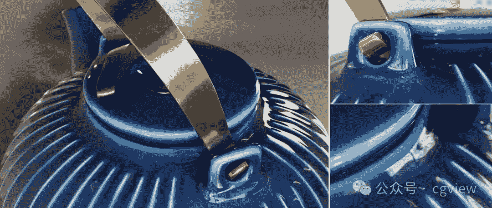

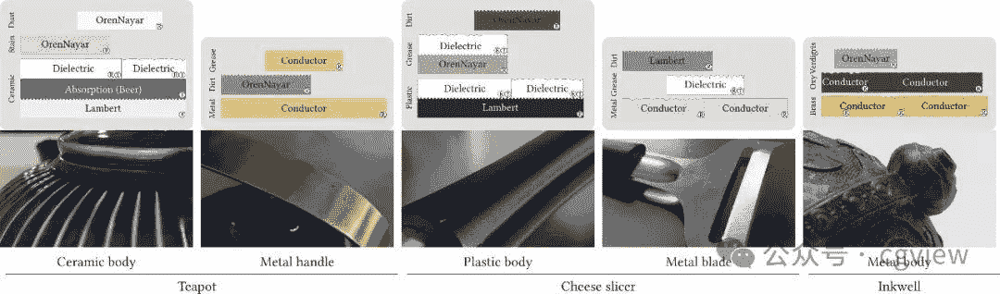

项目：https://research.nvidia.com/labs/rtr/neural_appearance_models/它利用AI学习的分层纹理，这些纹理使用神经解码器进行解释，从而产生反射率值和重要性采样方向。通过向光线追踪着色器的硬件加速，展示了在实时路径跟踪器中有效地内联和执行神经解码器的可能性。神经材质着色器可以比传统分层材质快一个数量级以上！这为在游戏和实时预览等实时应用程序中使用电影质量的渲染打开了大门，也让复杂的材质效果不仅仅只让高级Lookdev视觉开发的材质制作人员掌握。Chaos 作为最大的渲染器供应商之一，以Vray而闻名，刚刚发布了目前正在开发的一套AI驱动的渲染技术。这些即将推出的工具旨在增强和简化各个行业的创意流程，包括建筑、视觉效果、游戏设计和电影制作。

文本到PBR 材质渲染，快速指定材质一种变革性的解决方案，可从语言模型文本描述或参考图像创建复杂、逼真的 PBR 材质，简化工作流程促进创造力，并为建筑师、视觉特效艺术家、游戏设计师和电影制作人员提升视觉质量。

智能照明优化器，自动建议和调整场景中的照明，实现所需的氛围并增强真实感。自动完成基础布光。

智能场景填充器

设置扩展器，创建 3D 场景的一部分，然后智能地扩展它。在 3D 场景中自动放置资产提高效率，增强真实感，并使建筑师和专业人员能够专注于创造性探索而不是重复手动任务，从而节省制作时间并培养场景开发的创造力。这个过程很耗时，已有程序生成在影视和游戏大量应用了。

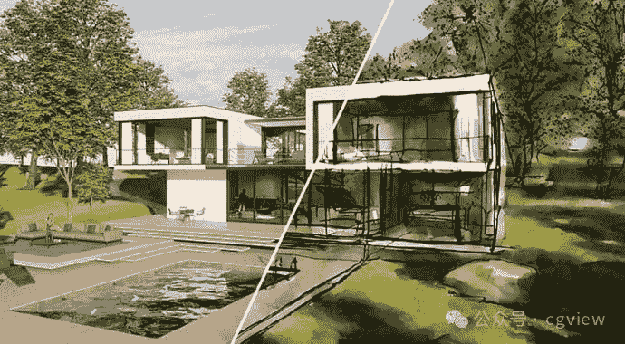

风格化转换，风格转换允许用户根据参考图像将不同的视觉风格应用于渲染，从而促进创造性探索和独特的美学。这个还是传统意义下的渲染，和AI生图和视频风格化实现不同。

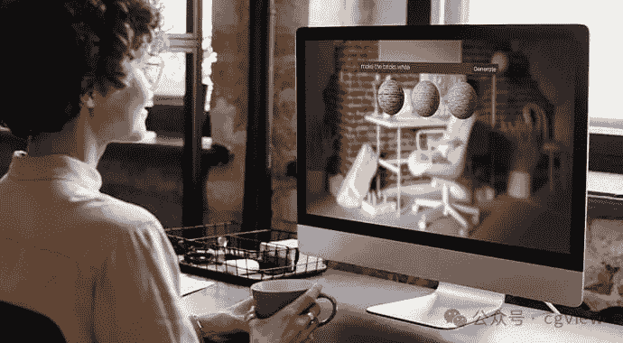

语音界面，使用语音控制的工作流程，解放双手并加快创作过程。这个听起来还很浮夸，自然语言处理的语音交互目前比较成熟了，做到软件的交互指令操作目前我认为是简单探索，毕竟大部分精确操作还是键盘鼠标完成的，手嘴并用的辅助操作在家里似乎实用？

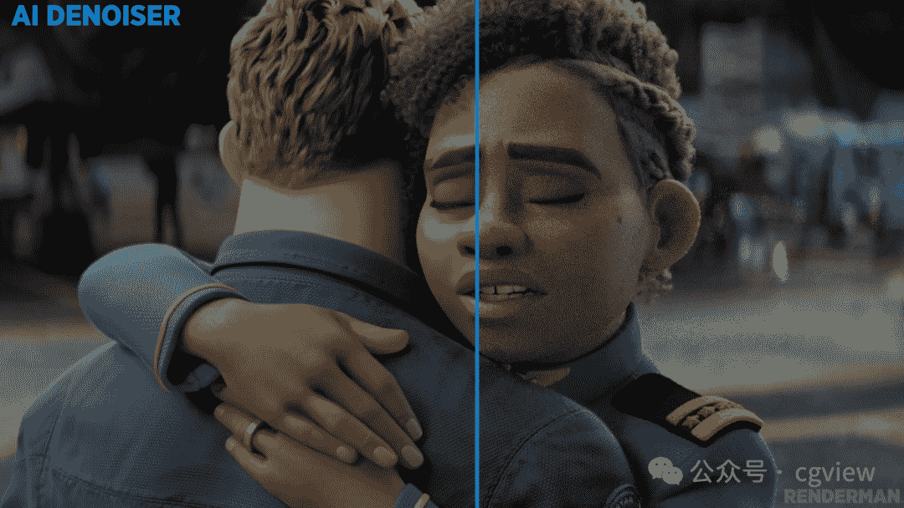

渲染目前的优化方向主要围绕的光线分布预测、和后期降噪。噪点产生的本质是通过概率预测的光线分布、采样插值导致的，有限的计算资源不可能计算所有角度光线反弹，没有计算到的地方插值就会出现大量误差。对于复杂材质的渲染，快速看到接近成品预览一直迫切需要，比如云、水、巨量粒子元素渲染调试反馈是很慢的。在已有的大量数据结果上用AI学习降噪结果是很早就开始的，目前业界主流的三家分别是NVIDIA的OptiX、Intel的Open Image Denoise、Renderman的降噪技术，前两者已经内置进了几乎所有渲染器。去年RenderMan 25 发布采用了来自 Disney Research 的全新业界最先进的降噪器，它使用机器学习来解析部分收敛的图像，同时保持图像细节和时间相干性，使最终结果与不降噪硬算几乎没有区别。这种先进的降噪技术已投入生产，由迪士尼研究与皮克斯、华特迪士尼动画工作室 （WDAS） 和工业光魔公司合作开发，基于对神经网络如何对图像进行降噪的新研究。降噪器已经在广泛的制作数据集上接受过机器学习训练，从ILM的影视到Pixar和Disney的长篇动画，这种先进的降噪技术是可靠的，因为它已被大量项目生产验证证明是非常有效的。其 Denoiser 在保留复杂、错综复杂的细节方面脱颖而出，否则这些细节可能会丢失，使其成为动画渲染和 VFX 等要求苛刻的应用程序的最高保真度理想选择。大大缩短了渲染时间，同时保持了高质量。在我实际使用中保守估计此方法至少下降40%渲染成本。缺陷是目前训练集能降噪的分层有限，不久会支持所有材质分层。下图桌面的物体是完全不同于传统光线追踪架构的渲染方式，使用扩散模型渲染达到！

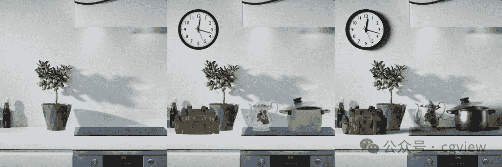

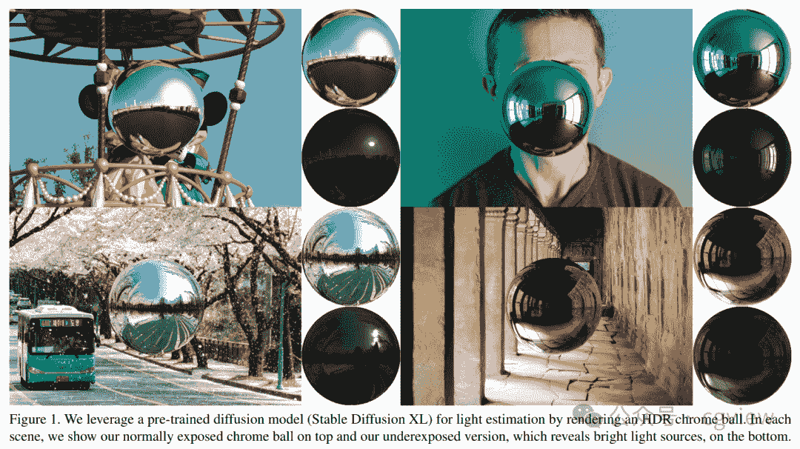

https://diffusionlight.github.io/

在给定输入图像，该方法把场景的照明估计预测为 HDR 环境贴图。想法是使用扩散模型将金属球渲染到图像中，预测正确的光照。这不是传统办法意义上的假反射，而是在庞大的数据集上训练，并遵从图形学第一定律——如果它看起来是对的，那一切就是对的。由此可见完全基于扩散模型的渲染器架构是很有前景的，甚至达到和传统进行混合的架构渲染。追求绝对精度和视觉正确平衡不断妥协的新办法。

高分辨率渲染也是业界不断探索的流程，除了渲染中的光线估计预测使用AI加速，降噪到最终高分辨率生成之间的联系也是非常紧密的。我们可以很实际期待AI在这些方面持续加快效率，这不仅仅是人们对于画面的诉求导致市场的要求变高外，硬件进展看起来飞快，但也始终捉襟见肘难以承受全程的高分辨率制作。

## **合成**

AI在合成的应用导致了Roto的重大革命。传统Roto遮罩是一个劳动密集型过程，需要很无聊手动地描摹每一帧中物体轮廓。然而，AI工具的出现使得自动化这一艰苦的过程成为可能，节省了大量的时间和精力。这些工具利用机器学习算法，从用户提供的几个示例中学习，并将其应用于其余帧，以与手动工作相匹配的精度执行任务。不同于那些AI静态图片快速扣除背景、提取元素，动态遮罩的自动实现难度一直比较大。早在2019年Foundry公司顺势而为发布ML-Server，它不是Nuke插件，而是一个机器学习环境。Foundry使得TD和工程师们能够使用其提供的新算法，将新的创意和工具提供给视效工作室的合成师们。NUKE的最新15版本中再次提升了此框架下CopyCat的性能。

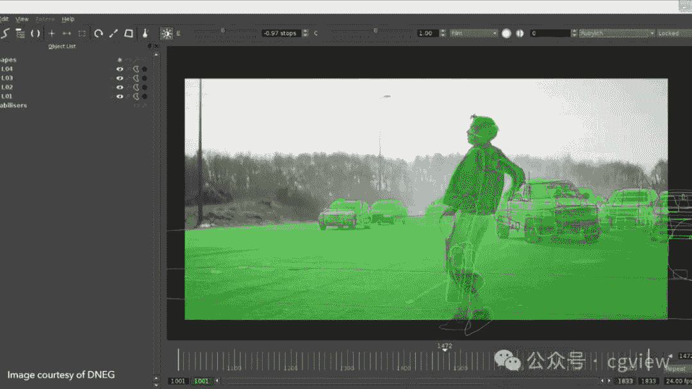

Weta 在《曼达洛人》AI Roto的使用是这项技术潜力的一个完美例子。他们创新的AI驱动方法能够处理整个电影的Roto复杂任务，有效地将时间缩短了约 90%。这意味着团队可以更专注于创意任务，从而提高整体质量。此外，CV的AI画面语义识别和分割能够处理具有多个对象和角色的复杂场景，展示了其强大的功能。经过这么多年，终于可以看到大幅解放劳动力的曙光，至少目前可以代替大部分手工重复工作。众多传统跟踪软件插件也开始专门针对自动遮罩有了其 AI 服务和工具。长期以来，数字绘景（MattePainting 简称MP）一直是VFX的重要组成部分，有助于创造广阔的风景、错综复杂的城市景观和奇幻的环境，这些都是不切实际或不可能拍摄或物理构建的。传统创作这些细致的画作是一项创意劳动密集型任务，需要高水平的技巧和艺术性。Pixomondo很早就使用AI为《火星救援》创作MP，是这项技术能力的一个很好的例子。不仅能够生成高度逼真的数字绘景，用于展示火星景观，使电影制作的艺术家能够创造一个更加可信的环境。

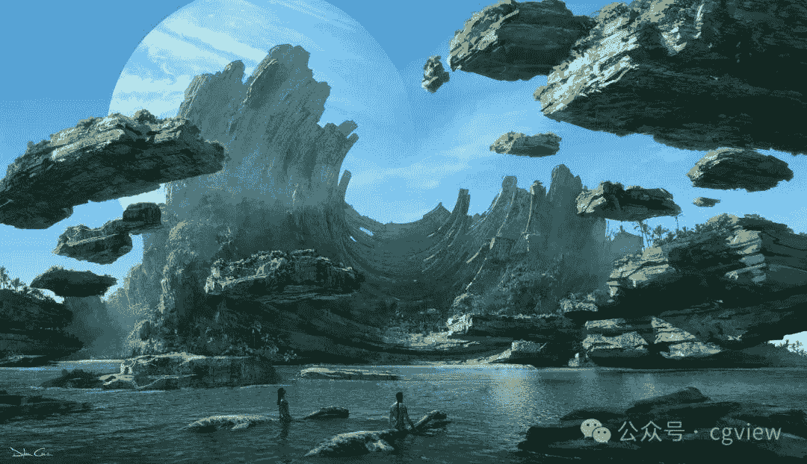

Dylan Cole为《阿凡达2》创作的概设

现在，AI生图工具正被用来彻底改变这一过程，使许多复杂的方面自动化，并节省大量的时间和精力。借助上文提到的目前文生视频，在这个阶段实现角色和景别微动，未来可以构造复杂镜头运动与变化，但目前大火的各种“AI电影预告片”质量游离在动态概念的水平。

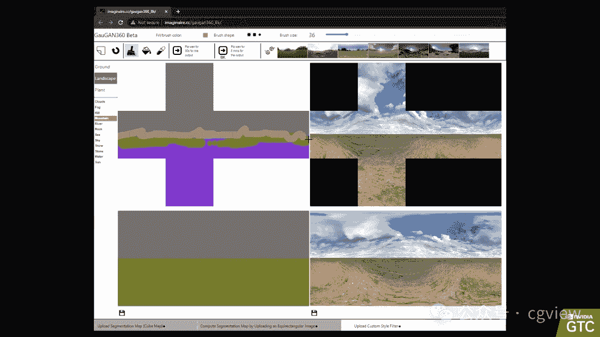

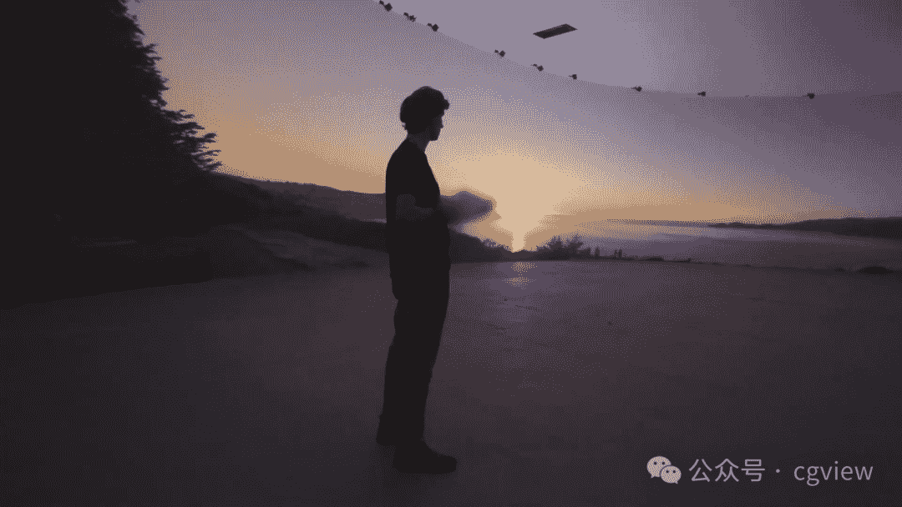

NVIDIA Canvas 快速生成概念艺术，制作写实的HDR全景，早已纳入工业光魔的虚拟制作流程中。使用 AI 进行绘图的显著优势之一是能够根据一组输入或参数生成高度详细和准确的结果，直接在合成和VP流程最终生产。还可以分析改变各种元素、智能填充、创建复杂的纹理等，同时整合到前后不同流程中。这允许高水平的精度和一致性，确保数字绘景的背景与真人镜头无缝集成。

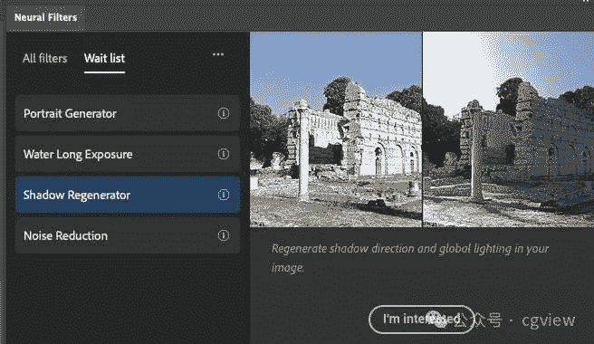

另外，AI这类工具可以处理通常耗时且具有挑战性的复杂任务，例如视频或图片的色彩、照明效果、景别扩展等调整，如上图PS的神经滤镜重新调整贴图光影，让资产处理灵活性大大提高。它们还可以适应不同类型的环境和场景，使其在不同前后期阶段流程具有高度的通用性。因此，在这些过程中的使用已经彻底改变视效艺术家的工作方式，使他们能够以更高的效率创建更复杂、更好的数字资产与环境在合成最终予以体现。

## **AI换脸**

除了元宇宙数字人的概念忽悠，近年在影视行业换脸需求持续上升。影视本身就是围绕角色讲故事，如何穿梭不同时间完成不同年纪的角色表演，保证其一致性，面部的减龄增龄都离不开AI换脸，如《流浪地球2》年轻的吴京、《夺宝奇兵5》的哈里森·福特、亦或是《速度与激情7》让去世的保罗复活，更甚某演员翻车不得已而换掉的影视项目，都离不开这项技术。而AI换脸的流程贯穿这个行业的基本全线，更容易让我们从局部而反瞰全部，总览AI对于流程的渗透和改变。总部位于香港的英国视觉特效公司Big Picture Studio去年在《别叫我“赌神”》项目中，让周润发减龄，在幕后制作中展示了其关键的工作流程。

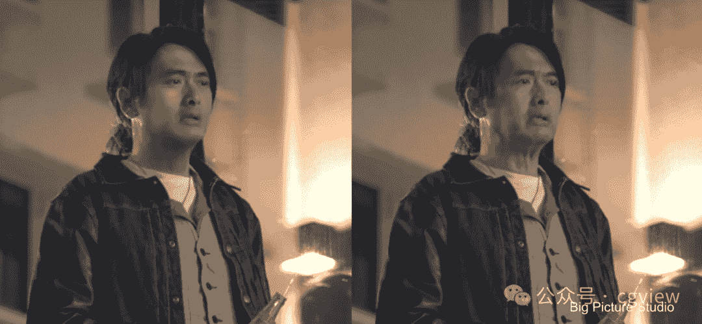

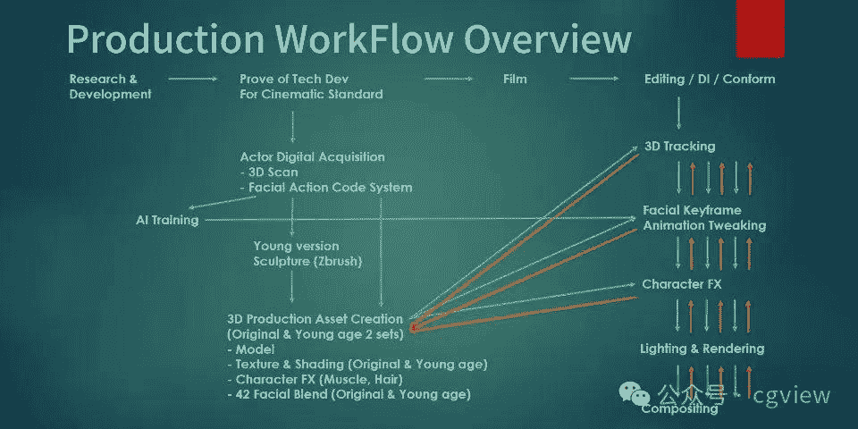

很复杂吗？其实这个行业制作的全流程远比上图更复杂，更循环往复需要不断调整反馈微调，单把VFX某个环节拿出来流程也是和上图类似的，所以Sora颠覆影视行业的外行论调目前是夸大其词，实际而是像上图橙色线条一样逐步改变的。从研发阶段到测试再到最终，需要技术和制作人员密切配合，十分考验沟通和执行能力，AI在重塑这个工作流程，会有老工种消失，也会有新的高度复合要求工种出现。

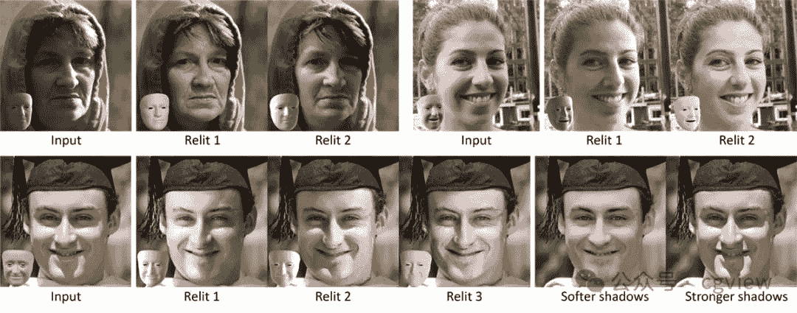

使用扩散模型对面部重新照明

来源于上文谈到的几何感知能力，AI可以根据2D素材生成人脸简单3D模型，使用法线等信息进行简单到复杂的环境光重新匹配，这在不同时期环节的角色补戏中，保持最终色彩照明结果一致性是非常刚需的。此类AI技术生成的：语义分割、元素探测、深度各种信息等等...会发展的足够成熟改变现有局部工具，从而诞生新的工作流程并不是与传统工作流程去生死对立，而是彼此深度关联的，更准确地说是生长延伸与优化。换个角度理解“网络上Sora颠覆制造恐慌的论调”并不是纯粹毁灭，所以慎用这类极端词汇，这个改变过程不是靠普通人能随便学会完成的，需要大量项目针对性不断地验证改进，这是一个动态过程。

## **AI声音**

AI 声音可以模拟人类的语音、世间万物已知的声音。并且可以根据需要进行定制和调整。AI 声音的应用非常广泛，例如语音助手、智能客服、有声读物、虚拟角色等等。AI 声音的生成通常使用深度学习神经网络技术。这些模型可以学习大量的语音数据，从而学会模拟人类的语音特点，如语调、语速、声音质量等。通过这种方式，AI 声音可以产生自然和逼真的语音输出。比如相同音色的不同语言，各种声效输出、甚至不同类型的谱曲混音。当然AI 人声目前还存在一些局限性，例如在情感表达和语音的灵活性方面不如人类。但随着技术的不断发展，AI 声音的质量和表现也在不断提高。如过去在《流浪地球2》中修复李雪健老师健康时的声音功不可没。各种声效除了文字去描述生成，也可以使用图片视频生成各种元素声音，如下图中AI识别出了火车，生成了铁轨和汽笛的声效。

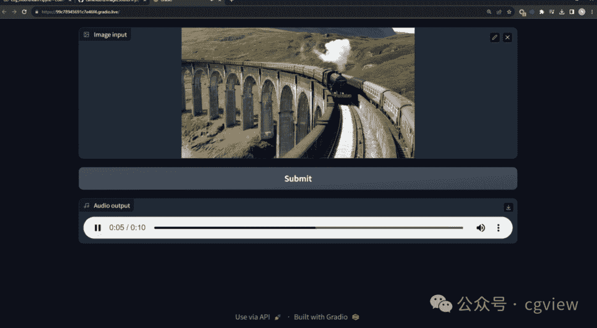

虽然视效主要关注画面，但是在选角未完成之前，预演有了AI完成真人台词和音效、音乐高效辅助，是百利无一害。快速让导演看到声画综合节奏反馈，把更多“感觉”要修改的部分过早在预演阶段提出。

## **AI调色**

DIT调色在这行是个设备门槛较高的环节，传统都是师傅带徒弟的模式去完成大部分看起来高大上的工作。调色不是一个劳动密集的工作，而更依赖于某几个调色师经验对感觉的表达。在调色主要有3个过程：

第1步：基本调整，各项参数的归一化处理。

第2步：色彩分离，完成不同调整区域的分离，主要是为了增强画面的层次感。

第3步：局部调整，精细调整、营造色彩情感等更细致的氛围表达。

这就是通俗广义的分级调色，以前调色师的徒弟都是主要在干前两步，这是个重复繁杂的过程。调色这个环节我认为是AI代替最快的，因为有庞大的数据可供学习，色彩科学看起来一大堆的名词，而数学上去量化这些参数是非常容易的，只要样本标注的足够准确。

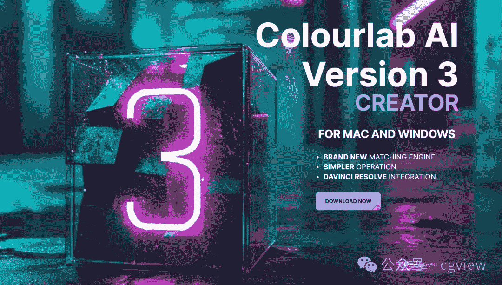

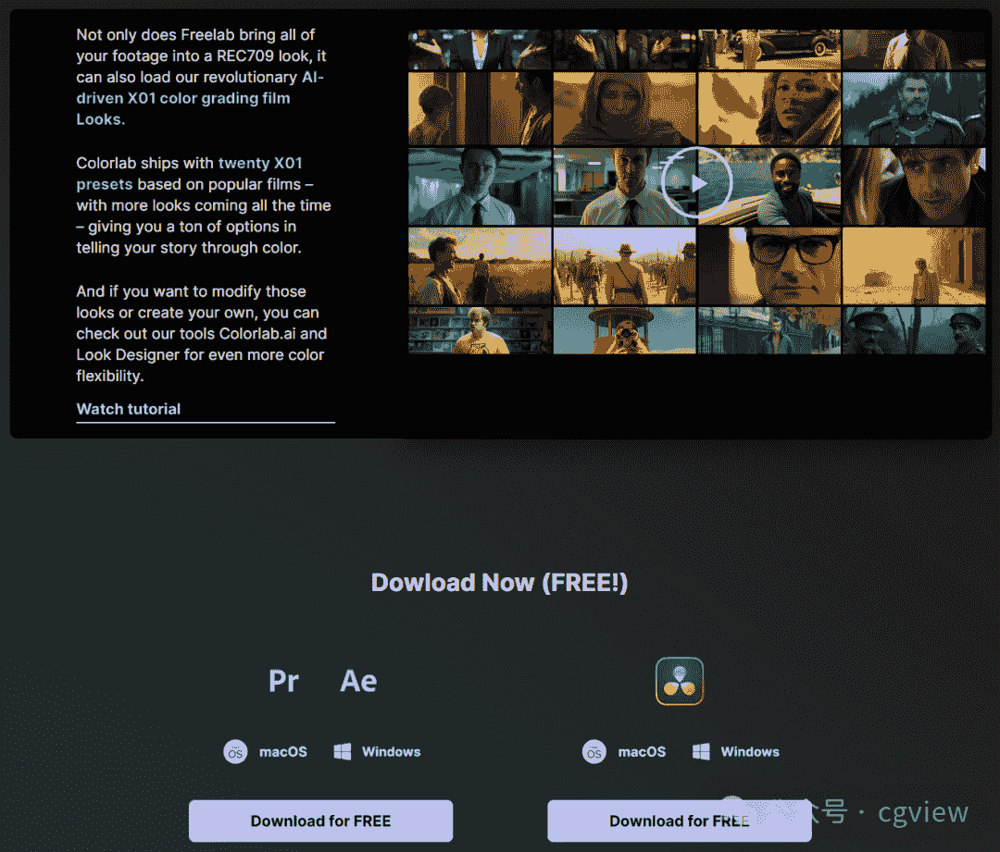

https://colourlab.ai/在过去的几年NAB展会中，Colourlab AI一次又一次地推出了不同版本的 AI 驱动的颜色分级工具。Colourlab 新推出的 Freelab，这是一种新的颜色分级工具，可以提供一键式颜色管理，并且免费使用。广告词是Say goodbye to off-the-shelf LUTs，支持达芬奇和PR，大家可以去体验一番。可以预见不远的将来，没有视觉色彩开发能力的初级调色师会大幅度被替代。而这种AI打破壁垒式的工具持续出现，将让各种已有风格人人都可以制作，存量样本会被AI全部学完，调色师会更加专注于高层次的色彩情感、氛围表达，去创造增量的新风格。迫使专业人士完成更加全面系统的理论知识提高职业门槛。

## **AI剪辑**

NVIDIA近期发布ChatwithRTX AI聊天应用，完全本地运行很符合这个行业对数据安全的需要，文字文档检索处理速度将大幅度提高。这将一定程度影响流程管理和资产管理软件的刚需功能诞生，庞大的数据记录、分析、快速精准检索迫切需求。尤其声音、图片和影像资产检索在剪辑环节也急需AI加速。

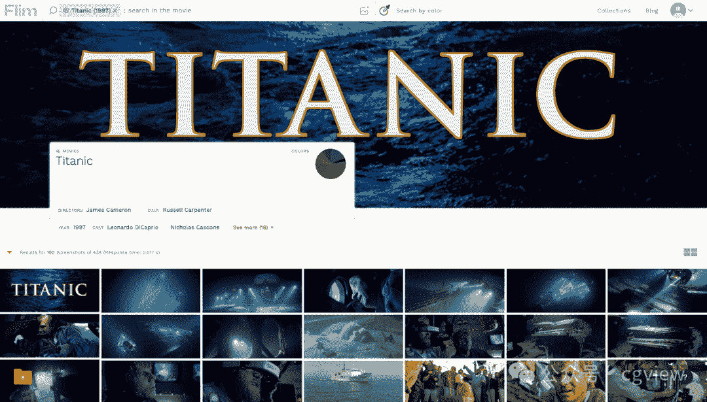

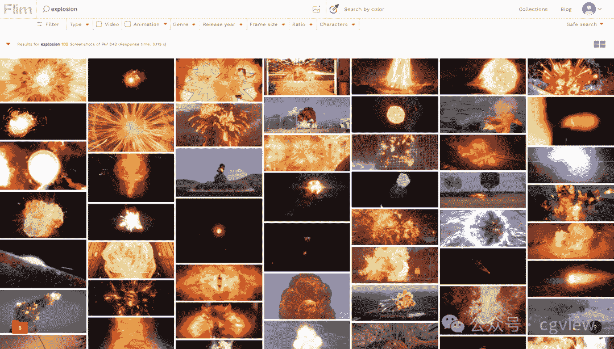

https://flim.ai/输入一个爆炸的电影镜头查询这类工具可以帮助大家快速找到已有的画面和声音的影像片段来表达具体想法，就可以在创作起草、参考、预演、粗剪过程与甲方沟通执行中更有效率。在非编软件的AI剪辑中主要体现在3个方面：智能识别视频精彩剪辑点、角色人脸识别自动二次构图、声音与音效的关键帧识别。这是无疑加速创作的，而且，这些识别标注还可以反过来使用分析优秀作品，快速理解剪辑里元素之间各种节奏关系。

## **结论**

正如我们所看到的，AI在VFX行业的各个方面都具有巨大的潜力，从起始概念生图到虚拟预演，到后期自动Roto抠像和逼真的换脸等。概念、预演、特效、动画、渲染、合成、调色、声音、剪辑等全流程渗透。它不仅大大减少了这些过程中涉及的时间和人力物力，而且还提高了创意到输出的最终质量一致性。通过自动化劳动密集型任务和提高速度与精度，AI使艺术家能够更专注于他们作品的创造性方面，从而突破视觉效果的可能性。来自各种例子展示了AI在视觉特效中的不同程度变革力量。随着技术的不断进步，可以预期AI在视觉效果中的作用将变得更加重要。虽然我们已经看到了其非凡应用，但旅程才刚刚开始。未来将持续带来令人兴奋的可能性，逐步改变视觉特效行业，从而深层次改变生产力和商业结构关系，带来更无与伦比的声画体验。它在视觉特效中的作用不是取代艺术家，而是为他们提供增强能力的辅助，以从前无法想象的方式将他们的创意愿景变为现实。说实话讨论这种产业变革话题难度还是很大的，把握好时间尺度和当下的关系，更考验我过去十几年对行业的各种理解。从整体流程进度来讲，目前AI的上限对VFX流程确实宏观看已经解锁到了预演这个阶段，别的前后工种是否渗透到足够以枝叶之变，去改变树干全局工作流程？这尺度恐怕远远超过三五年。很惭愧管中窥豹列举不全，只分享了当下能看到的、确定可行的各方面，试图钩深索隐展示一个立体的视角观察，时间有限难免有纰漏望请指正。

<https://aigcreative.feishu.cn/sync/K4Gvd9vUQsy9Oubwqaeclu0Fnbg>