# 20250713-你的创意，值得被亿万人看到！我们一起来捏“鹅”，一起“鹅鹅鹅”~~

> 来源：[https://aigcreative.feishu.cn/docx/IKIPdIZYJoeo6AxOsTicb4GMnj0](https://aigcreative.feishu.cn/docx/IKIPdIZYJoeo6AxOsTicb4GMnj0)

在AIGC浪潮席卷创作生态的2025年，腾讯做了一件足够创新、足够先锋的事情：

**“**🐧企鹅 × 十二生肖”——这个国民级经典IP，首次开放共创，邀请全民设计2026年【马年生肖企鹅】！

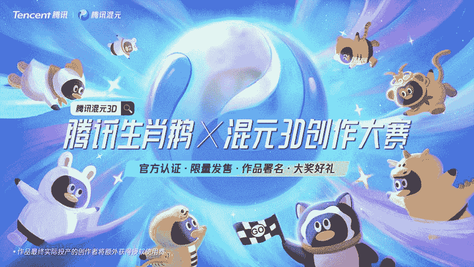

[腾讯生肖鹅预告片final（1920-1080）_0705.mp4](https://internal-api-drive-stream.feishu.cn/space/api/box/stream/download/all/C3HRbbU2bocoQxxyUSlcRGzPnof)

**从今天开始，每一个普通用户**，只要你有一个创意灵感，借助腾讯混元3D AI创作引擎，就可以参与这次“未来共创实验”——设计出属于你的马年企鹅，甚至有机会登上官方周边商城，变成真正的实体公仔走进千万人的生活。

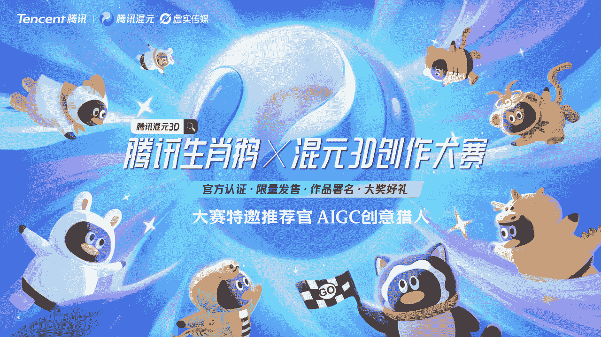

作为这次活动的推荐官与共创者，我第一时**间参与创作，也想借这此，向**你全面分享这场AI+IP的前沿创意大赛，邀你参与共创。

# 这不仅是设计比赛，而是一场“AIGC全民共创实验”

腾讯生肖企鹅自2010年推出以来，每年都会围绕当年生肖发布一款联名企鹅公仔，从“虎年企鹅”到“龙年企鹅”，承载着无数人的情怀与回忆。

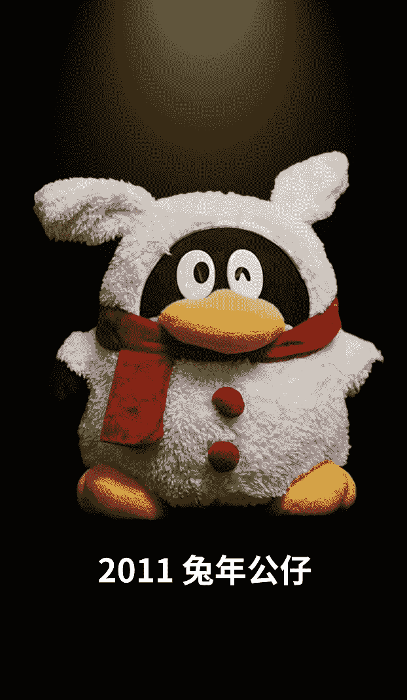

**但以往，这些企鹅都由腾**讯内部设计师“闭门手工捏”，而这一次，腾讯把创作权交给了用户本身——让我们普通用户用AI一同参与到IP的“进化”中。

✅ 不需要建模基础

✅ 不需要设计软件

✅ 你只需要一个创意，AI帮你把它变成三维模型

这背后依托的是腾讯自研的**混元3D大模型能力**，它能实现文本**生成3D（Text-to-**3D）、图**像生成3D（I****mage-to-3**D）、草图+Prompt生成3D，甚至支持多视角精准重建，整个流程无需任何3D基础，真正做到“秒级构想，分钟成型”。

# 四种创作方式，零门槛体验AI生成乐趣

腾讯混元3D创作平台为本次大赛开放了4种创作模式，每个人都可以找到自己的“捏鹅方式”：

### 1、文生3D（适合所有人）

只需输入一句描述，AI自动构建3D模型。

> 示例：“一只可爱的企鹅毛绒公仔，戴着独角兽帽子，帽子上有柔软的金色螺旋角、粉色马耳朵和蓝色鬃毛，企鹅身穿红围巾，表情微笑眨眼，肚皮洁白，脚掌圆润黄色，整体材质柔软毛绒，马蹄铁刺绣在身体两侧，尾巴是粉蓝渐变的马尾”

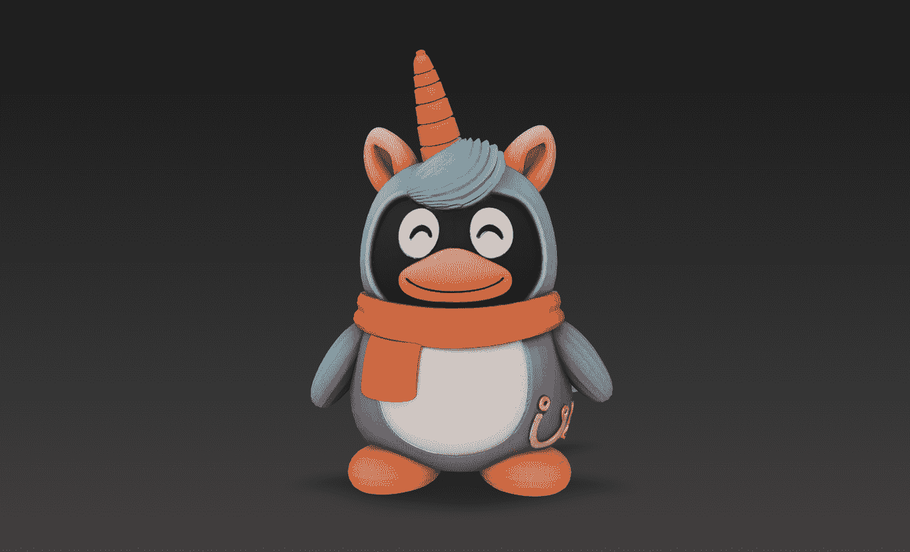

### 2、图生3D（适合画图爱好者）

这种方式，可控性就更强一点了，你可以先用其他AI绘画工具，一步步完善你的IP造型构想，直到完美的状态，再上传图片并添加描述，系统会参考图像结构进行建模。

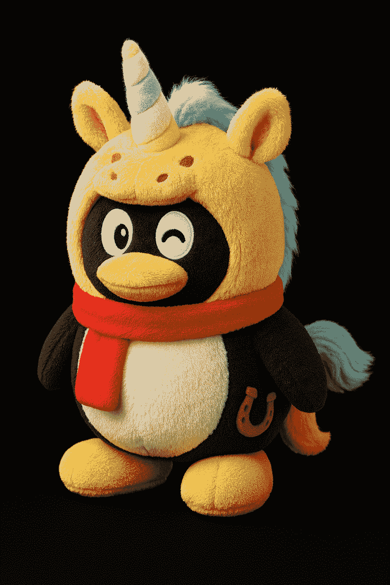

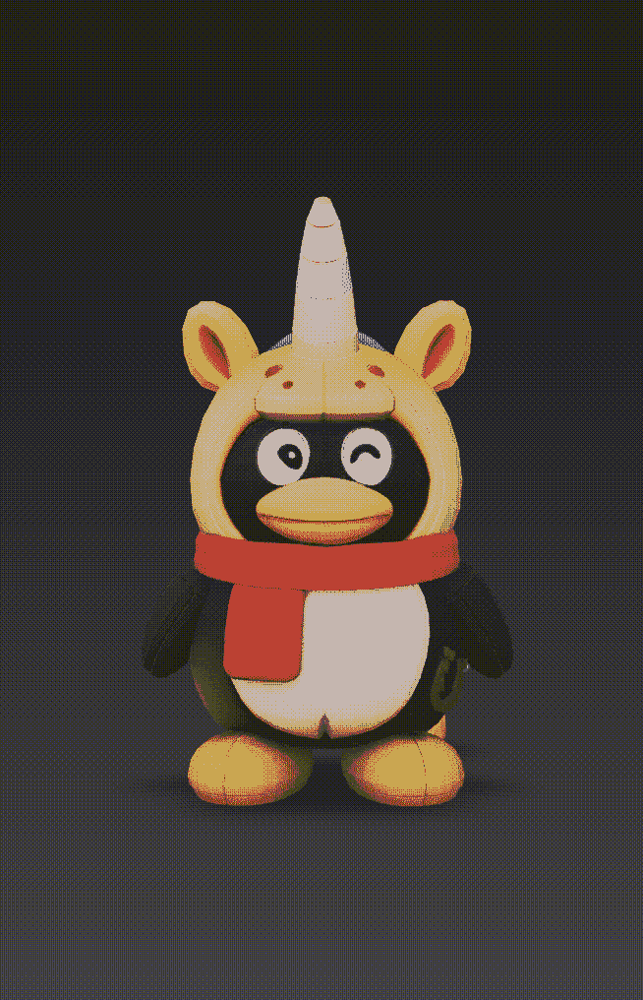

### 草图生3D（适合手绘党）

上传你的草图，结合描述词，AI补全结构与风格细节。

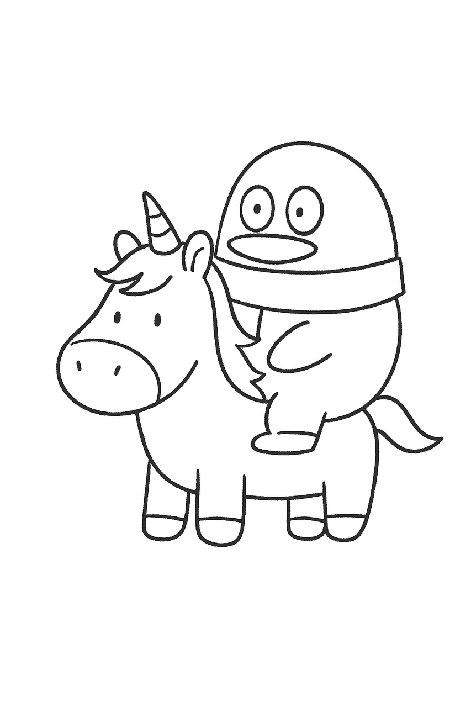

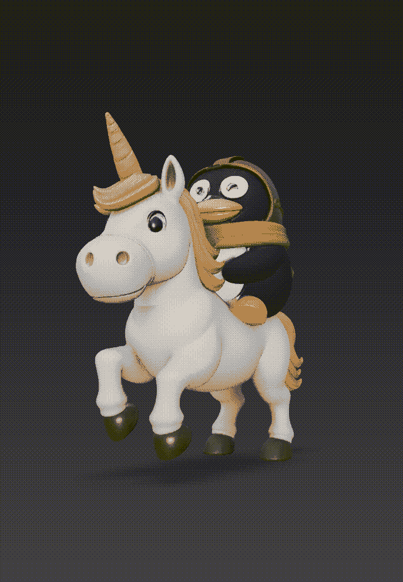

### 多视图生3D（专业级）

上传2-4张不同角度的图（正视图必填），生成精准高拟合度的3D企鹅模型。

提示：所有模式都默认加载【生肖鹅公仔】纹理风格，风格一致、成品Q萌。

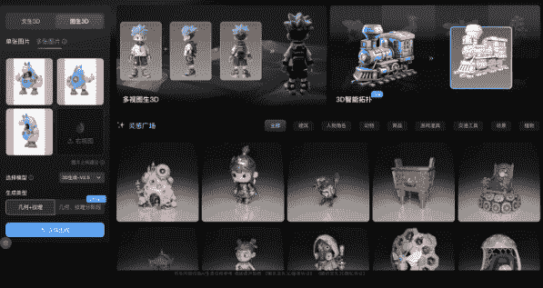

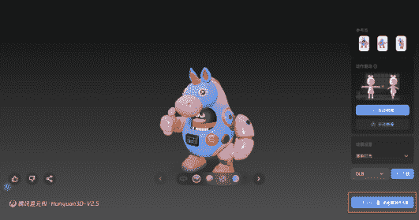

# 技术背后：腾讯混元3D为什么值得一试？

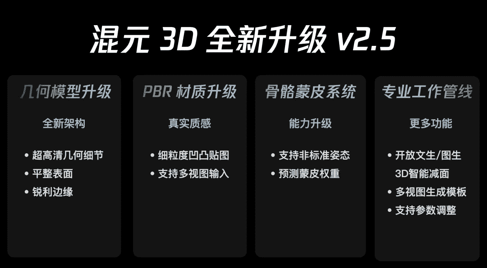

腾讯在多模态大模型上的探索已经进入全球第一梯队，特别是混元系列的进展非常迅速：

+   语言模型Turbo S已进入全球TOP 8

+   支持毫秒级图像生成、多尺寸模型推理

+   自研3D生成技术已在Hugging Face上突破190万下载量，成为开发者圈关注焦点

+   可在**数分钟内生成高精度3D模型**，媲美初级建模师的人效

+   支持AIGC输出为GLTF、GIF、表情包、动态演示等多种格式

这也意味着，你不仅可以参与比赛，还能借此构建专属3D资产库、AI角色形象库、甚至开发未来产品原型。

# 比赛奖励亮点：奖金只是基础，联名上线才是高光时刻！

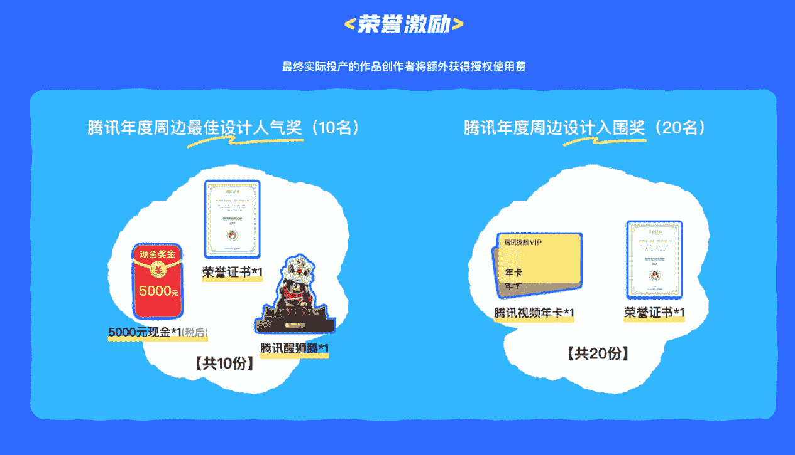

+   🎖最**佳人气奖（TOP10）**

+   每人5000元奖金

+   获奖证书

+   腾讯醒狮鹅纪念公仔

+   🎖设**计入围奖（TOP11-30）**

+   腾讯视频年卡 + 荣誉证书

+   🌟特**别评审推荐：**

+   从TOP10中选出2-4个优秀作品

+   直接与腾讯联名合作

+   上线腾讯周边商城 Tencent Image 进行量产贩售！

# 重要时间节点与参赛入口

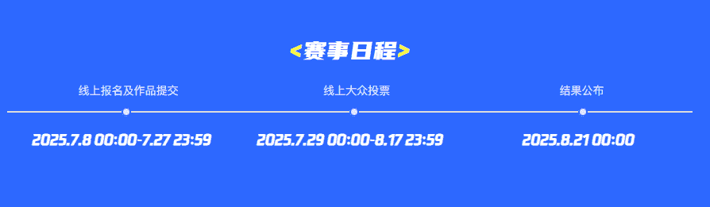

+   **活动时间**：即日起至2025年7月27日 23:59

+   **活动官网入口**：[https://3d.hunyuan.tencent.co](https://3d.hunyuan.tencent.com/event/penguin-doll)m/event/penguin-doll

+   **创作平台主页**：https://3d.hunyuan.tencent.com

投稿流程非常顺滑：生成模型 → 命名 & 填写设计理念 → 一键提交参赛

审核通过后，作品将出现在【作品广场】页面接受大众投票

# 我已经开始创作了，欢迎一起参与！

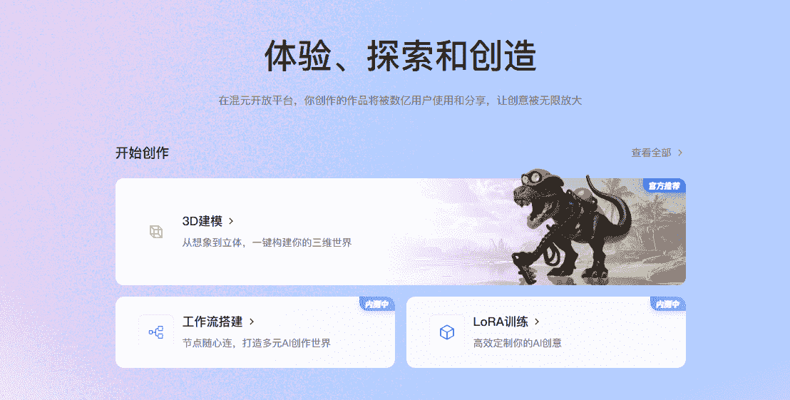

我尝试用文生3D和图生3D方式分别创作了一些企鹅模型，比如：

+   一只博士风格的“学术鹅”

+   结合独角兽意象设计的“幻想马鹅”

+   毛绒绒材质的Q萌治愈鹅

+   还有一只正在奔跑的运动风马年企鹅…

如果你暂时没有什么想法，也可以来创意广场看看，看看别人的创意，或许会有新的ides！

网址：https://3d.hunyuan.tencent.com/event/penguin-doll

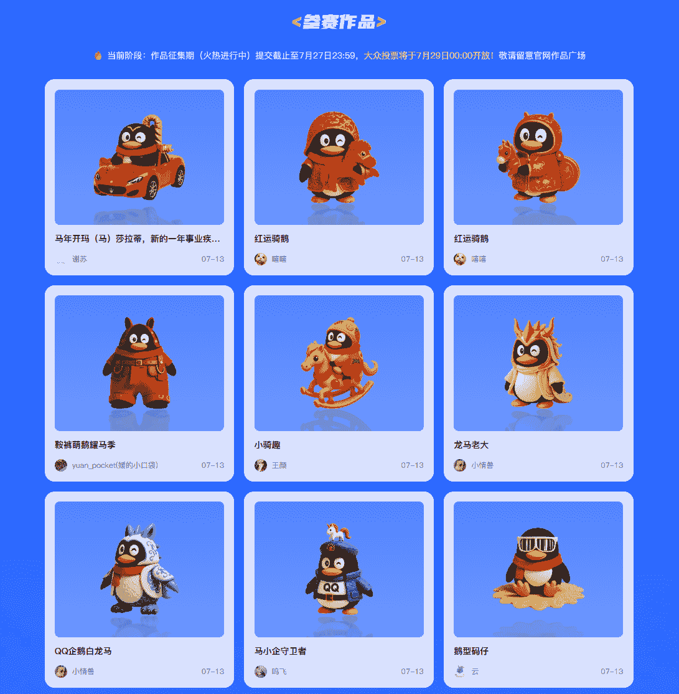

后续我会将这些作品上传至比赛广场，也欢迎你们留言告诉我你捏了什么样的企鹅！

我们可以互投、组队冲榜，甚至在评论区拼个“企鹅联盟”！

# 最后：AIGC的真正价值，是让“人人都能创作”

**腾讯这次**的共创大赛，是一场面向未来的“IP实验”。

它不是单纯的设计比赛，而是一次用AI推动创意民主化的范例活动。

在AI时代，每个人都可以成为创造者，你不需要是专业的3D建模师，也不需要懂C4D或Blender，只要你有一个念头，一个Prompt，AI就能把它变成现实

**2026年的腾讯马年企鹅**，或许就会是你创作的那一只。

你，愿意捏一下“鹅”吗？

👉 立即参与，活动详情： h[ttps://3d.hunyuan.tencent.com](https://3d.hunyuan.tencent.com/event/penguin-doll)/event/penguin-doll

<https://aigcreative.feishu.cn/sync/K4Gvd9vUQsy9Oubwqaeclu0Fnbg>

# 知识库动态