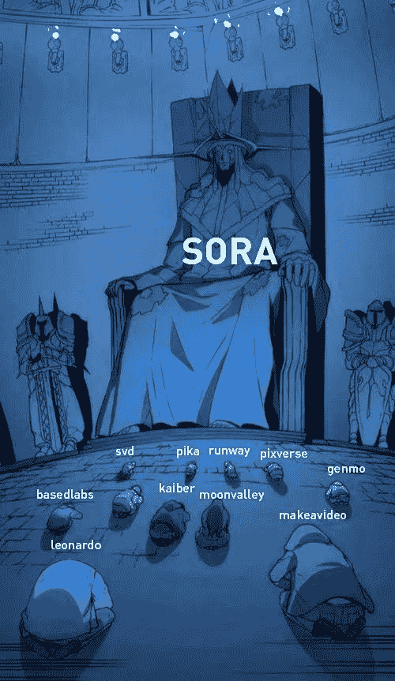
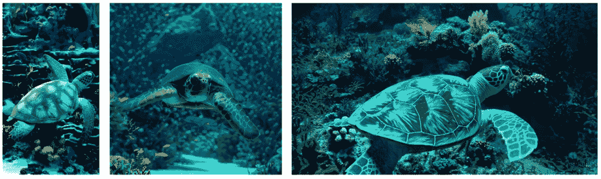
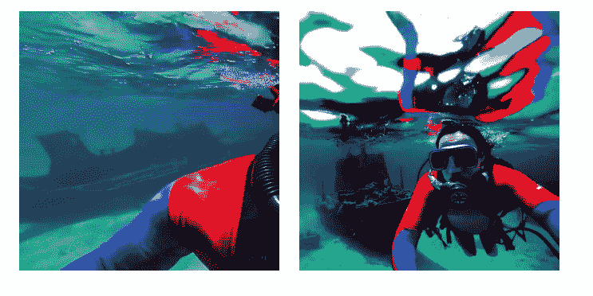
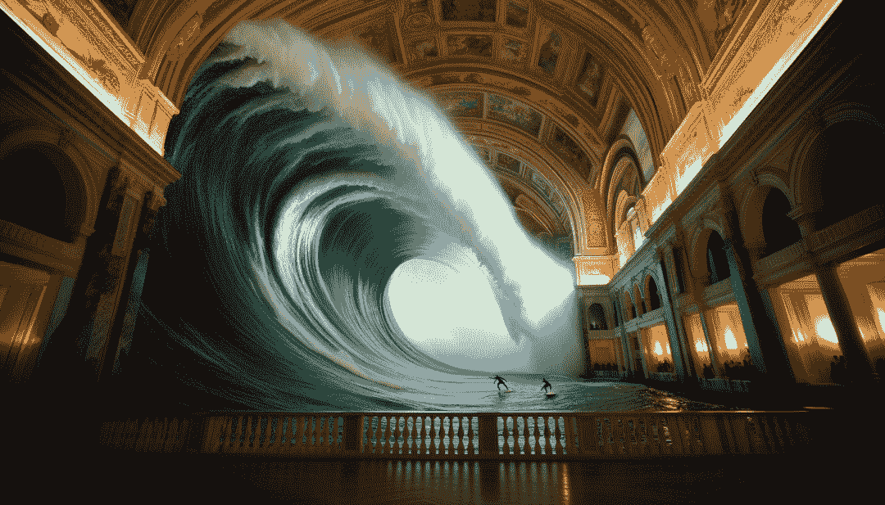
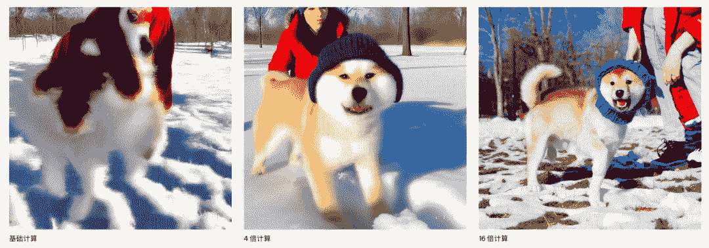

# Sora进一步拉大了中美AI差距

> 来源：[https://aigcreative.feishu.cn/docx/BoqIdBAiBowuJsxZSgYcwUWQnFn](https://aigcreative.feishu.cn/docx/BoqIdBAiBowuJsxZSgYcwUWQnFn)

> 来源：甲子光年（ID：jazzyear）

> 作者：赵健

AI 视频生成，多快迎来 “Midjourney 时刻”？

OpenAI 公布了准确答案：20 天。

OpenAI 昨天发布了全新的 AI 生成视频模型 Sora，凭借肉眼可见的性能优势与长达 60s 的视频生成时长，继文本（GPT-4）和图像（DALL·E 3）之后，也在视频生成领域取得了“遥遥领先”。

我们距离 AGI（通用人工智能）又近了一步。

值得一提的是，明星 AI 公司 Stability AI 原本发布了一个新的视频模型 SVD1.1，但由于与 Sora 撞车，其官方推文已被火速删除。

AI 视频生成的领头羊之一 Runway 的联合创始人、CEO Cristóbal Valenzuela 发推文表示：“比赛开始了（game on）。”

OpenAI 还发布了一份技术文档，但无论从模型架构还是训练方法，都未发布什么天才级的创新技术，更多是现有技术路线的优化。

但跟一年多以前横空出世的 ChatGPT 一样，OpenAI 的秘诀都是屡试不爽的 Scaling Law（缩放定律）——当视频模型足够“大”，就会产生智能涌现的能力。

问题在于，大模型训练的“暴力美学”几乎已经人尽皆知，为什么这次又是 OpenAI ？

## 01、数据的秘密：从 token 到 patch

AI 生成视频的技术路线主要经历了四个阶段：

循环网络（recurrent networks，RNN）、生成对抗网络（generative adversarial networks，GAN）、自回归模型（autoregressive transformers）、扩散模型（diffusion models）。

今天，领先的视频模型大多数是扩散模型，比如 Runway、Pika 等。自回归模型由于更好的多模态能力与扩展性也成为热门的研究方向，比如谷歌在 2023 年 12 月发布的 VideoPoet。

Sora 则是一种新的 diffusion transformer 模型。从名字就可以看出，它融合了扩散模型与自回归模型的双重特性。Diffusion transformer 架构由加利福尼亚大学伯克利分校的 William Peebles 与纽约大学的 Saining Xie 在 2023 年提出。

如何训练这种新的模型？在技术文档中，OpenAI 提出了一种用 patch（视觉补丁）作为视频数据来训练视频模型的方式，这是从大语言模型的 token 汲取的灵感。Token 优雅地统一了文本的多种模式——代码、数学和各种自然语言，而 patch 则统一了图像与视频。

OpenAI 训练了一个网络来降低视觉数据的维度。这个网络接收原始视频作为输入，并输出一个在时间和空间上都被压缩的潜在表示（latent representation）。Sora 在这个压缩的潜在空间上进行训练，并随后生成视频。OpenAI 还训练了一个相应的解码器模型，将生成的潜在表示映射回像素空间。

OpenAI 表示，过去的图像和视频生成方法通常会将视频调整大小、裁剪或修剪为标准尺寸，而这损耗了视频生成的质量，例如分辨率为 256x256 的 4 秒视频。而将图片与视频数据 patch 化之后，无需对数据进行压缩，就能够对不同分辨率、持续时间和长宽比的视频和图像的原始数据进行训练。

这种数据处理方式为模型训练带来了两个优势：

**第一，采样灵活性。**Sora 可以采样宽屏 1920x1080p 视频、垂直 1080x1920 视频以及介于两者之间的所有视频，直接以其原生宽高比为不同设备创建内容，并且能够在以全分辨率生成视频之前，快速地以较低尺寸制作原型内容。这些都使用相同的模型。

**第二，改进框架与构图。**OpenAI 根据经验发现，以原始长宽比对视频进行训练可以改善构图和取景。比如，常见的将所有训练视频裁剪为正方形的模型，有时会生成仅部分可见主体的视频。相比之下，Sora 的视频取景有所改善。

在方形作物上训练的模型（左），Sora 的模型（右）

在语言理解层面，OpenAI 发现，对高度描述性视频字幕进行训练可以提高文本保真度以及视频的整体质量。

为此，OpenAI 应用了 DALL·E 3 中引入的“重新字幕技术”（re-captioning technique）——首先训练一个高度描述性的字幕生成器模型，然后使用它为训练数据集中的视频生成文本字幕。

此外，与 DALL·E 3 类似，OpenAI 还利用 GPT 将简短的用户提示转换为较长的详细字幕，然后发送到视频模型。这使得 Sora 能够生成准确遵循用户提示的高质量视频。

提示词：a woman wearing blue jeans and a white t-shirt，taking a pleasant stroll in Mumbai India during a colorful festival.

除了文本生成视频之外，Sora 也支持“图像生成视频”与“视频生成视频”。

提示词：In an ornate, historical hall, a massive tidal wave peaks and begins to crash. Two surfers, seizing the moment, skillfully navigate the face of the wave.

此功能使 Sora 能够执行各种图像和视频编辑任务，创建完美的循环视频、动画静态图像、及时向前或向后扩展视频等。

## 02、计算的秘密：依旧是“暴力美学”

在 Sora 的技术文档里，OpenAI 并没有透露模型的技术细节（埃隆·马斯克曾经抨击 OpenAI 不再像它成立时的初衷一样“open”），而只是表达了一个核心理念——scale。

OpenAI 在 2020 年首次提出了模型训练的秘诀——Scaling Law。根据 Scaling Law，模型性能会在大算力、大参数、大数据的基础上像摩尔定律一样持续提升，不仅适用于语言模型，也适用于多模态模型。

OpenAI 就是遵循这一套“暴力美学”发现了大语言模型的涌现能力，并最终研发出划时代的 ChatGPT 。

Sora 模型也是如此，凭借Scaling Law，它毫无预兆地在 2024 年 2 月就打响了视频的 “Midjourney 时刻”。

OpenAI 表示，transformer 在各个领域都表现出了卓越的扩展特性，包括语言建模、计算机视觉、图像生成以及视频生成。下图展示了训练过程中，在相同的样本下，随着训练计算规模的增加，视频质量显著提高。

OpenAI 发现，视频模型在大规模训练时表现出许多有趣的新兴功能，使 Sora 能够模拟现实世界中人、动物和环境的某些方面。这些属性的出现对 3D、物体等没有任何明确的归纳偏差——纯粹是模型缩放现象。

因此，OpenAI 将视频生成模型，命名为“世界模拟器”（world simulators），或称之为“世界模型”——可以理解为让机器像人类理解世界的方式一样学习。

英伟达科学家 Jim Fan 如此评价道：“如果您认为 OpenAI Sora 是像 DALL·E 一样的创意玩具......再想一想。Sora 是一个数据驱动的物理引擎。它是对许多世界的模拟，无论是真实的还是幻想的。模拟器通过一些去噪和梯度数学来学习复杂的渲染、‘直观’物理、长期推理和语义基础。”

Meta 首席科学家杨立昆（Yann LeCun）曾在 2023 年 6 月提出世界模型的概念。2023 年 12 月，Runway 官宣下场通用世界模型，宣称要用生成式 AI 来模拟整个世界。

而 OpenAI 仅仅通过早就熟稔于心的 Scaling La**w，让 Sora 具备了世界模型的能力。OpenAI 表示：**“我们的结果表明，扩展视频生成模型是构建物理世界通用模拟器的一条有前途的途径。”

具体来看，Sora 世界模型有三个特点：

**3D 一致性。**Sora 可以生成带有动态摄像机运动的视频。随着摄像机的移动和旋转，人和场景元素在三维空间中一致移动。

**远程相关性和物体持久性。**视频生成系统面临的一个重大挑战是在采样长视频时保持时间一致性。OpenAI 发现 Sora 通常（尽管并非总是）能够有效地对短期和长期依赖关系进行建模。例如，模型可以保留人、动物和物体，即使它们被遮挡或离开框架。同样，它可以在单个样本中生成同一角色的多个镜头，并在整个视频中保持其外观。

**与世界互动。**Sora 有时可以用简单的方式模拟影响世界状况的动作。例如，画家可以在画布上留下新的笔触，并随着时间的推移而持续存在。

**模拟数字世界。** Sora 还能够模拟人工过程——一个例子是视频游戏。Sora 可以同时通过基本策略控制《我的世界》中的玩家，同时以高保真度渲染世界及其动态。这些能力可以通过用提及“我的世界”的标题提示 Sora 来实现零射击。

不过，跟所有的大模型一样，Sora 还不是一个完美的模型。OpenAI 承认，Sora 还存在许多局限性，它不能准确地模拟许多基本相互作用的物理过程，例如玻璃破碎。其他交互（例如吃食物）并不总是会产生对象状态的正确变化。

## **03、算力才是核心竞争力？**

为什么 OpenAI 能够依靠“Scaling Law”屡试不爽，其他公司却没有呢？

我们或许能找到很多原因，比如对 AGI 的信仰、对技术的坚持等。但一个现实因素是，Scaling Law 需要高昂的算力支出来支撑，而这正是 OpenAI 比较擅长的。

如此一来，视频模型的竞争点就有点类似于语言模型，先是拼团队的工程化调参能力，拼到最后就是拼算力。

归根到底，这显然又是英伟达的机会。在这一轮 AI 热潮的驱动下， 英伟达的市值已经节节攀升，一举超越了亚马逊与谷歌。

视频模型的训练会比语言模型更加耗费算力。在算力全球紧缺的状况下，OpenAI 如何解决算力问题？如果结合此前关于 OpenAI 的造芯传闻，似乎一切就顺理成章了。

去年起，OpenAI CEO 萨姆·奥尔特曼（Sam Altman）就在与为代号「Tigris」的芯片制造项目筹集 80 亿至 100 亿美元的资金，希望生产出类似谷歌TPU，能与英伟达竞争的 AI 芯片，来帮助 OpenAI 降低运行和服务成本。

2024 年 1 月，奥尔特曼还曾到访韩国，会见韩国三星电子和 SK 海力士高管寻求芯片领域的合作。

近期，根据外媒报道，奥尔特曼正在推动一个旨在提高全球芯片制造能力的项目，并在与包括阿联酋政府在内的不同投资者进行谈判。这一计划筹集的资金，达到了夸张的 5 万亿~ 7 万亿美元。

OpenAI 发言人表示：“OpenAI 就增加芯片、能源和数据中心的全球基础设施和供应链进行了富有成效的讨论，这对于人工智能和相关行业至关重要。鉴于国家优先事项的重要性，我们将继续向美国政府通报情况，并期待稍后分享更多细节。”

英伟达创始人兼 CEO 黄仁勋对此略显讽刺地回应道：“如果你认为计算机无法发展得更快，可能会得出这样的结论：我们需要 14 颗行星、 3 个星系和 4 个太阳来为这一切提供燃料。但是，计算机架构其实在不断地进步。”

到底是大模型的发展速度更快，还是算力成本的降低速度更快？它会成为百模大战的胜负手吗？

2024 年，答案会逐渐揭晓。

<https://aigcreative.feishu.cn/sync/K4Gvd9vUQsy9Oubwqaeclu0Fnbg>