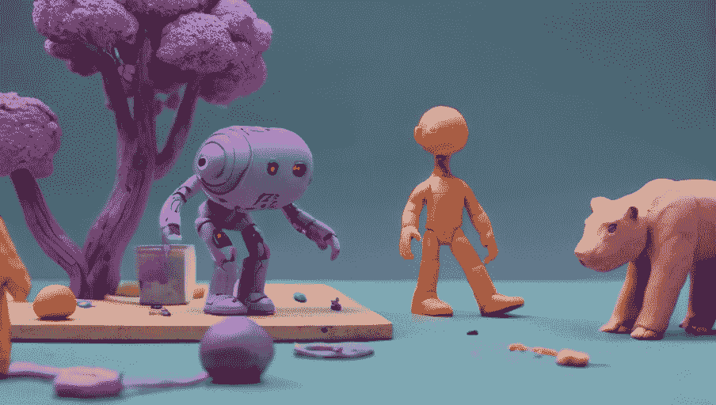
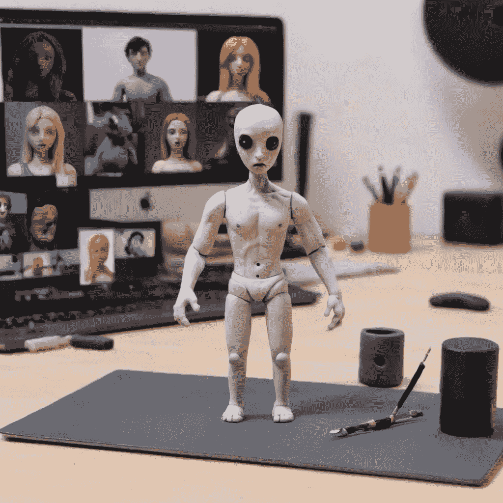

# Sora是如何发生的（二）：2022年发布的报告，关于“基础模型”带来的创造性涌现的意义和风险

> 来源：[https://aigcreative.feishu.cn/docx/COiJdUJ0HoX7Wwx98RIc6dp2nJf](https://aigcreative.feishu.cn/docx/COiJdUJ0HoX7Wwx98RIc6dp2nJf)

> 作者：Polyphony Group / 复调文化、经济学人杂志

> **插画创作：**复调文化 x Stable Diffusion XL

> **内容策划：**Peter YU

> 原文链接：https://mp.weixin.qq.com/s/QKpbck5Y2fjTgcxWUleLIA

**概述**

基础模型展示了一种新形式的非人类智能创造性，其主要特征包括

语言和规则的掌握**：这些模**型具有复杂的语言理解能力，能够连贯地打破规则，展现出超越传统程序的创造性。

理解与创造：基础模型能够解释笑话的有趣之处，**甚至创作出封面**艺**术等作品**，展现出对艺术与人类审美的理解和创造能力。

涌现行为：基础模型表现出的"**涌现****"行为意**味着其能够发展出新的技能和能力，这并非设计的结果，而是由模型的规模和深度决定。

逼真性：这些模型能够产生出逼真的理解和创造力，虽**然这种逼真性可能**并非完全理解，但其效果与人类的思维和创意相似。

基础模型对人性的重要意义在于

补充人类能力：与人类合作，提供**不同的视角和能力**，从而补充人类的不足，共同推动社会的发展。

提高生产力：能够帮助人类**提高生产力**，释放出更多时间和精力去从事更有意义的事情。

促进人机合作：促进了**人机合作**的发展，强调了人类与机器之间的互补性，为构建更加智能的社会奠定了基础。

（以下报告文章发布于2022年9月2日）

**转折点出现在深度学习带来的**

**“基础模型”**

想象一台计算机可以使用更好的措辞来完成你的句子；或者使用一段旋律来创作音乐，听起来就像你写的一样（尽管你永远不会这样做）；或者通过创建数百行计算机代码来解决问题，让您专注于更困难的事情。从某种意义上说，计算机只是加速工业革命的动力织机和蒸汽机的后代。但它也属于新型机器，因为它掌握语言、音乐和编程中的符号，并以看似创造性的方式使用它们。有点像人。能够完成这些任务的“基础模型”代表了人工智能的突破。他们也“承诺”进行一场革命，但这场革命将影响工业革命从未触及的高地位脑力劳动。我们无法保证未来会发生什么——毕竟，人工智能在过去曾犯过错误。但现在是时候审视机器智能领域下一个重大事件的前景和危险了。基础模型是“深度学习”（dl）的最新转折，这种技术在十年前崭露头角，现在在人工智能领域占据主导地位。深度学习系统松散地基于人脑神经元的网络结构，使用数百万或数十亿的文本、图像或声音片段示例进行“训练”。近年来，训练规模越来越大的深度学习系统所需的时间和金钱成本不断增加，这引发了人们对该技术即将达到极限的担忧。一些人担心“人工智能冬天”。但基础模型表明，构建更大、更复杂的深度学习确实会继续释放更令人印象深刻的新功能。没有人知道极限在哪里。

**非人类的创造性来源**

由此产生的模型是一种新形式的非人类智能的创造性。这些系统足够复杂，既能掌握语言，又能连贯地打破规则。狗无法因为《纽约客》中的笑话而发笑，但人工智能可以解释为什么它很有趣——坦率地说，这一壮举有时超出了《纽约客》的读者的范围。当我们要求其中一个模型使用某个前瞻的主题创作一幅拼贴画时，它为我们设计了封面艺术——我们试图用不同的封面来分散我们焦虑的人类设计师的注意力。基础模型具有一些令人惊讶且有用的特性。其中最奇怪的是他们的“涌现”行为，即技能（例如讲笑话或匹配情况和谚语的能力，创作新图像的能力），这些技能源自模型的大小和深度，而不是故意的结果设计。正如快速连续的静态照片给人一种运动的感觉一样，数万亿个二进制计算决策融合成人类流畅的理解力和创造力的拟像，无论哲学家怎么说，它看起来很像真实的东西。甚至这些系统的创建者也对其强大的功能感到惊讶。

这种智力是广泛且适应性强的。诚然，基础模型也会表现得像个白痴，但人类也是如此。如果你问谁在1625 年获得了诺贝尔物理学奖，他可能会提到伽利略、培根或开普勒，但他们不知道第一次该奖项是在1901年颁发的。然而，它们也具有早期人工智能所不具备的适应性，也许因为在某种程度上，绘画、创意写作和计算机编程等不同学科的符号操作规则之间存在相似之处。这种广度意味着基础模型可以用于许多应用，从通过预测蛋白质如何在三个维度上折叠来帮助寻找新药物，到从数据集中选择有趣的图表，以及通过搜寻庞大的数据库来制定答案来处理开放式问题开辟新的探究领域。

**普罗米修斯的执念**

这是令人兴奋的，并且有望带来巨大的好处，其中大部分仍然需要想象。但这也引发了担忧。不可避免的是，人们担心人工智能的创造力足以让其创造者感到惊讶，但它可能会变得邪恶。事实上，基础模型与好莱坞钟爱的有感知能力的杀手机器人（比如：终结者）相差甚远。终结者往往是专注的、执着的，并且对他们的行为所带来的更广泛的后果视而不见。相比之下，基础人工智能是模糊的。同样，人们对这些模型训练时消耗的巨大能量和产生的排放感到焦虑。一个更深入的担忧是谁控制着基础模型。训练像Google 的PALM这样的大型系统的成本超过 1000万美元甚至更多，并且需要访问大量数据——计算能力越强、数据越多越好。这引发了人们对技术集中在少数科技公司或利益集团手中的担忧。

如果是这样，训练数据可能会进一步巩固世界的偏见——而且是以一种特别令人窒息和不愉快的方式。你会相信一个整个现实感都是通过上网形成的十岁孩子吗？训练有素的人工智能是否会被招募来进行指向性的斗争以改变人的思想？那些在网上表现不佳的文化会发生什么？然后是访问的问题。目前，最大的模型受到限制，以防止它们被用于恶意目的，例如生成虚假新闻报道。初创公司Open AI设计了名为Dall-E 2的模型，却需要花很大精力去试图阻止其制作暴力或色情图像。企业担心滥用是正确的，但这些模型越强大，对它们的访问就越受限制，从而造就了“新的精英”（细思极恐，哪怕它正在发生，绝大多数人也不得而知）。自我监管不太可能解决这一困境。

## **带来革命**

多年来，人们一直认为人工智能驱动的自动化对从事重复性日常工作的人们构成了威胁，而艺术家、作家和程序员则更安全。基础模型挑战了这一假设。这种机器智能与人类不同，但提供了完全不同的令人惊讶的东西。如果处理得当，它更有可能补充人性而不是篡夺人性。如果处理不当……

<https://aigcreative.feishu.cn/sync/K4Gvd9vUQsy9Oubwqaeclu0Fnbg>