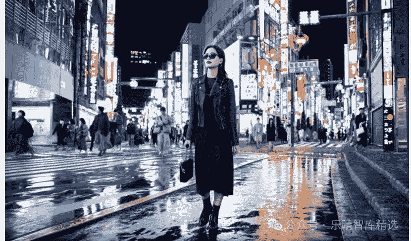
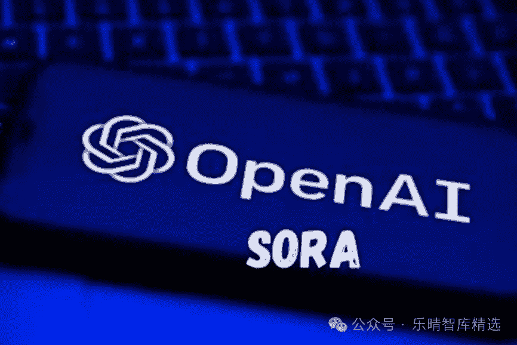
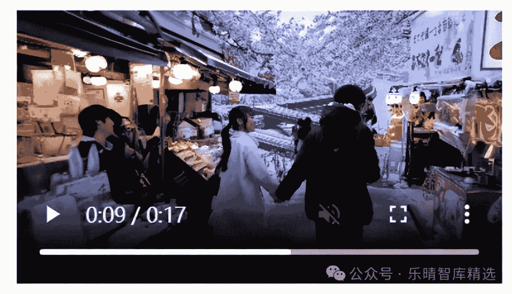
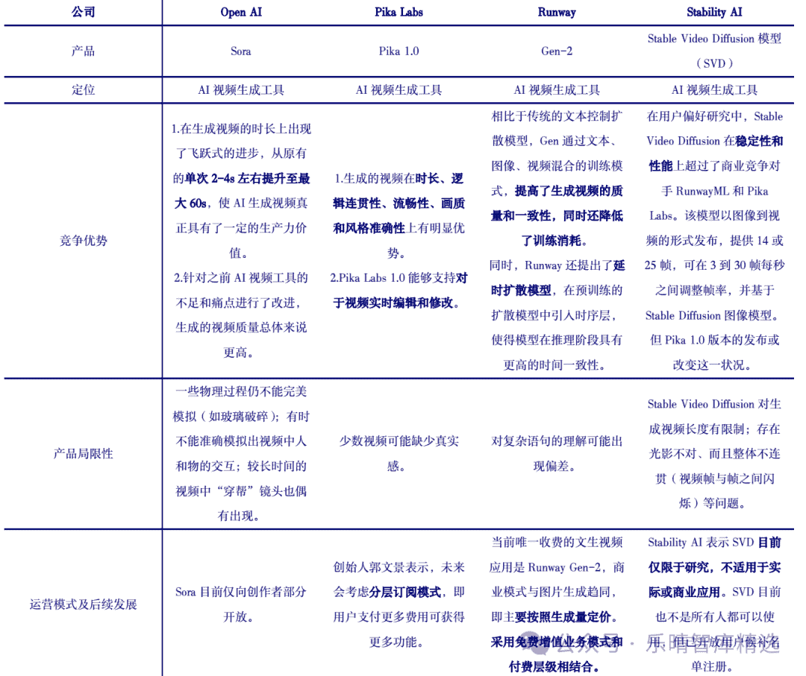

# Sora （文生视频）模型产业链全景梳理

> 来源：[https://aigcreative.feishu.cn/docx/IdRmdlPMNobDxVxDir6c1Z57nTd](https://aigcreative.feishu.cn/docx/IdRmdlPMNobDxVxDir6c1Z57nTd)

> 原文链接：https://mp.weixin.qq.com/s/eLGeznbV1GwMaywej8PBFQ

近期，OpenAI 发布旗下首个 AI 视频生成模型—Sora 模型。Sora 能够根据用户的文本描述生成长达 60 秒、1080P 高质量视频，其中包含精细复杂的场景、生动的角色表情以及复杂的镜头运动。

此外，Sora还展示了AI在理解和模拟物理世界方面的能力，这被认为是实现通用人工智能（AGI）的关键一步。

OpenAI认为，视频生成模型是构建通用物理世界模拟器的一条有前景的道路，它使人工智能理解和模拟运动中的物理世界，迈向了一个新的高度，Sora文生视频模型有望成为实现 AGI 的重要里程碑。Sora 发布视频展现物理世界模拟能力：

资料来源：OpenAI 官网

# **01、****什么是文生视频？**

#

文生视频大模型是一种能够由 AI 生成视频内容的大型机器学习模型。文生视频基于用户的自然语言描述准确地生成相应视频内容。以用户给出的文本、 图像、音频、视频等内容作为提示（prompt），模型能够处理并结合用户提供的内容，创造 出完全自主生成或拓展的视频。这些模型通常基于深度学习，尤其是自然语言处理（NLP）、计算机视觉（CV）和语音识别（ASR）等技术的融合。以OpenAI官方发布的范例视频为例，输入提示词：“一位时尚的女士漫步在东京街头，街上充满了温暖的霓虹灯和 生动的城市标志。她穿着黑色皮夹克、红色长裙和黑色靴子，手中提着一个黑色手提包。她戴着太阳镜，涂着红色口红。走路时自信而随意。街道潮湿且反光，形成了彩色灯光的 镜面效果，许多行人来来往往。”

Sora 生成 1 分钟视频示例:

资料来源：OpenAI 官网2023年实际诞生的文生视频大模型达到数十个，全球用户数量超过百万级 别，但目前多数视频模型仍处于产品早期阶段。

2024 年各大公司加快了文 生视频模型的研发步伐。Midjourney 宣布将在未来几个月加快训练文生视频模型；随后谷歌推出文生视频模型Lumiere。Lumiere模型的推出，进一步展示了谷歌在文生视频技术上的深厚实力。该模型不仅具备高度智能化的文本解析能力，还能根据文本内容自动生成与之相匹配的视频画面，实现了真正意义上的“文本到视频”的转化。

国内字节跳动和腾讯也分别公布了视频模型MagicVideoV2与VideoCrafter2。从创作端看，市场上已公开的大多数模型出自初创公司和小型技术开发团队，包括Runaway、Pika 等，且目前已呈现较为可观的完成效果和商业模式。预计随着科技大厂产品的发布，后续相关产品生态将持续繁荣。

# **02、****什么是Sora？**

Sora是一个在可变持续时间、分辨率、宽高比的视频和图像上联合训练的文本条件扩散模型。

该模型将自然语言处理技术与视频生成技术相结合，并通过使用大量带有相应文本字幕的视频进行训练。其机理是从静态噪声开始，通过多个步骤逐渐去除噪声，最终生成清晰视频。Sora利用了 DALL·E3的重新标注技术，为视觉 训练数据生成高度描述性的说明文字，与 GPT 模型类似，Sora 使用 Transformer 架构，扩展性强大。OpenAI声称，如果给定一段简短或详细的描述或一张静态图片，Sora 就能生成类似电影的1080p场景，其中包含多个角色、不同类型的动作和背景细节。

与此前的视频生成模型相比，Sora 主要实现了以下突破：视频时长达到 60 秒：Sora 目前可以根据文本要求生成 60s 的连贯视频，并保持视频主体与背景的高度流畅性与稳定性。文本的深度理解能力：Sora可以准确理解用户的文本指令，无论是复杂的动作 场景还是细腻的情感表达，Sora 都能够精确捕捉并展现。对真实世界的理解：生成的视频除满足了文本要求的主题、要素外，Sora 对物理规律的遵循程度较高，对于光影反射、运动 方式、镜头移动等细节的呈现效果较为逼真，都展示了极高的质量。根据OpenAI官方介绍，目前Sora具备生成包括多个角色、特定类型的运动、准确细节的 主体和复杂场景的能力。同时，还能够创建多个镜头，模拟复杂的摄像机运镜效果，使得 生成的视频更加生动。3D一致性：Sora可以生成摄像机动态运动的视频。随着摄像机的移动和旋转，人物和场景元素在3D空间中的移动会保持一致。Sora 生成动态运动视频示例:

资料来源：OpenAI 官网

Sora 可以向前向后拓展视频，连接视频。可以使用Sora 在两个输入视频之间逐渐插值，在具有完全不同主题和场景构图的视频之间创建无缝过渡。Sora 及之前部分可比产品对比：

资料来源：Open AI，Pika，澎湃新闻，银河证券

# **03、**Sora（文生视频）模型产业链梳理

Sora 的横空出世，有望带动产业新一轮的景气度，进一步激发市场对 AI 产业持续创新能力。Sora模型产业链涵盖了数据收集与处理、模型训练与开发、部署与应用、硬件与云服务以及产业链上下游企业等多个环节。AI模型的训练需要大量数据，包括文本、图像、视频等多种形式。这些数据需要经过收集、清洗、标注等处理，以满足模型训练的需求。在收集到足够的数据后，需要进行模型的训练。这个过程需要大量的计算资源，包括高性能计算机、GPU、TPU等。同时，还需要专业的AI算法工程师进行模型的设计、调优等工作。

在B端，Sora文生视频模型，可以广泛应用于影视制作、动画制作、游戏开发、音乐教育等领域。AI视频可以大幅度降低视频的制作成本，对应用领域将有可观的降本增效作用，供给端有望加速推进。此外，AI模型的运行需要强大的硬件支持，包括高性能计算机、服务器，以及算力租赁服务等。

Sora 支持在生成视频过程中加入图片提示：

资料来源：Open AI

**Sora+影视视频**Sor**a有望明显降低**制作门槛及成本，且可以极大程度丰富影视 作品的创造性及风格。Sora 的出现将重塑影视行业，拥有核心导演或创意**人才，及 IP**资源的厂商具有先发优势。影视和IP方向代表厂商包括上海电影、光线传媒、中文在线、掌阅科技、华策影视、果麦文化等。Sora+游戏游戏是虚拟世界的一 种体现，Sora 对于物理世界的理解和模拟可以与游戏场景开发高度适配， Sora 可被应用于游戏角色创立，场景开发等过程，降低开发成本。代表厂商包括三七互娱、恺英网络、巨人网络、昆仑万维、掌趣科技、盛天网络等。Sora+算力Sora在视频生成领域具有的标志性意义，大模型所预期的 能力得以逐步验证。但与此同时，生成产品存在的瑕疵亦说明训练仍 需继续，算力基础设施的部署需求仍在扩大和升级。AI模型的运行需要强大的硬件支持，包括高性能计算机、服务器、云服务和算法等厂商。国产算力基础设施代表厂商包括中科曙光、浪潮信息、紫光股份、工业富联、拓维信息、海光信息、寒武纪、神州数码、锐捷网络等；算法层面主要布局厂商包括科大讯飞、云从科技等。整体而言，Sora产业链各环节布局厂商众多，主要参与布局厂商还包括会畅通讯、当虹科技、因赛集团、安诺其、国脉文化、新华网、易点天下、数码视讯、东方国信、万兴科技、海康威视、大华股份等。应用层面主要参与者有金山办公、新国都、虹软科技、熵基科技、美图公司、佳发教育等。

未来随着模型规模增大，参数将继续放大，多模态大模型陆续推出将引发对算力需求的指数级提升，包括训练和推理，并且在场景应用中带来颠覆式革命。随着文生图、图片对话技术的成熟，文生视频可能成为多模态大模型下一步发展的方向。Sora 文生视频的视觉效果明显高于其他 AI 工具，品质已经接近专业内容 生产者的创作标准，未来若得以推广，有望进一步降低用户创作门槛，重塑视 频等内容创作生态。值得注意的是，考虑到技术局限、安全 伦理等技术滥用后可能会面临的多重风险，OpenAI 表示暂无计划向公众开放使用 Sora 模型，仅提供给部分内测用户使用。

随着未来AI文生视频技术的不断完善和更新，AI视频有望凭借人工智能的技术优势和视频这一品类的内容优势打开市场，开启AI新一轮变革。

<https://aigcreative.feishu.cn/sync/K4Gvd9vUQsy9Oubwqaeclu0Fnbg>