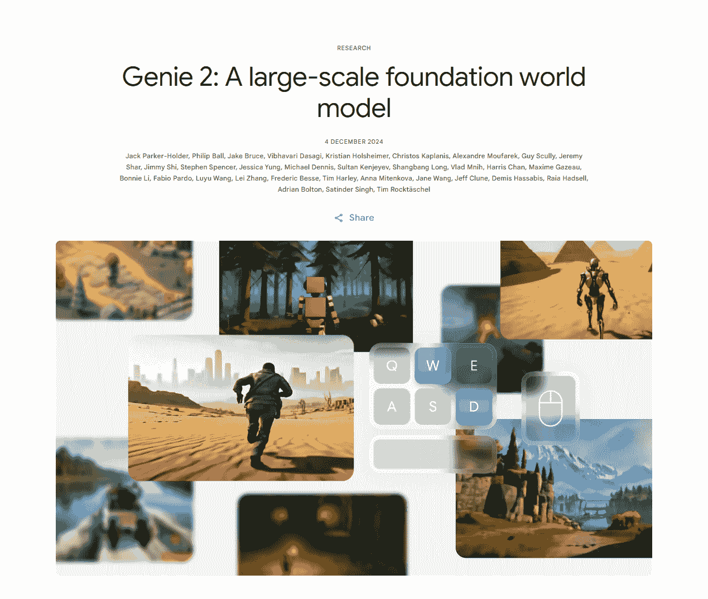

# 谷歌DeepMind重磅推出Genie 2：AI生成虚拟世界，游戏开发进入新纪元！

> 来源：[https://aigcreative.feishu.cn/docx/P7fqdDGEXoTfQtxcOVHcaOApneh](https://aigcreative.feishu.cn/docx/P7fqdDGEXoTfQtxcOVHcaOApneh)

> https://deepmind.google/discover/blog/genie-2-a-large-scale-foundation-world-model/

谷歌旗下的人工智能公司DeepMind近日发布了全新的大型基础世界模型——Genie 2。这一模型在其前身Genie的基础上，进一步提升了生成可交互虚拟环境的能力。用户只需输入简单的文本或图像提示，Genie 2即可生成可供玩家实时互动的3D游戏世界。

## 从2D到3D：虚拟世界的全新体验

此前，Genie主要针对2D平台游戏，能够根据合成图像、照片甚至手绘草图，生成各种动作可控的2D世界。而Genie 2则突破了这一限制，支持生成复杂的3D虚拟环境。用户可以通过输入诸如“赛博朋克风的西部世界”或“航海冒险”等提示，Genie 2会将其转化为丰富细致的3D场景，供玩家自由探索。

## 无需额外硬件：AI生成游戏的普及之路

值得一提的是，Genie 2内置了定制的硅芯片，使其无需额外硬件即可运行。这意味着，无论是开发者还是普通用户，都可以通过USB-C接口，在各种设备上体验AI生成的虚拟世界。这一设计大大降低了使用门槛，有望推动AI生成游戏的普及。

## 逼真的互动：从水面反射到物体破坏

Genie 2在模拟真实互动方面表现出色。它支持多种视角，包括第一人称视角和等距视角。在演示中，玩家砍破气球，气球会真实地爆裂并产生烟雾效果。此外，水面的反射、物体的破坏等复杂互动，Genie 2都能准确模拟，为玩家带来沉浸式的游戏体验。

## 挑战与未来：从短时一致性到无限可能

尽管Genie 2带来了诸多创新，但目前生成的世界只能保持20秒到1分钟的连贯性，随后可能出现一致性问题。这主要是由于在模拟“长时间跨度”时，需要保持玩家重访区域的连续性。DeepMind团队认识到这一挑战，但他们相信，Genie 2是迈向更广泛AI和游戏应用的重要一步。

## **AI角色的加入：丰富的游戏互动**

Genie 2不仅能生成环境，还能引入AI控制的角色和非玩家角色（NPC）。在某个场景中，一个AI角色在接收到简单的文本指令后，成功地在复杂环境中导航。这展示了AI角色在增强游戏互动方面的潜力，为未来的游戏设计提供了更多可能性。

## **行业反应：机遇与挑战并存**

游戏业界对Genie 2的潜力表示关注，但也存在一些担忧。由于模型的训练数据可能包含热门游戏的实况录像，涉及知识产权的问题引发讨论。此外，AI生成内容的兴起，也引发了对创意专业人士可能面临工作替代和创作控制减弱的担忧。

## **结语：AI生成游戏的未来已来**

尽管面临挑战，Genie 2无疑是AI研究和应用的重要进展。谷歌在世界模型领域的投入，包括近期聘请的知名研究人员，体现了其推动该领域发展的决心。虽然AI生成的游戏距离主流应用还有一段路要走，但Genie 2让我们看到了未来的可能性：只需输入提示，就能创造出沉浸式的虚拟环境。

<https://aigcreative.feishu.cn/sync/K4Gvd9vUQsy9Oubwqaeclu0Fnbg>