# 谷歌发布首个实时交互式世界模型`Genie 3`，世界模型迎来新里程碑

> 来源：[https://aigcreative.feishu.cn/docx/FZRodEyocogwjEx2xBkcl8I1nQe](https://aigcreative.feishu.cn/docx/FZRodEyocogwjEx2xBkcl8I1nQe)

谷歌DeepMind于今日公布了其在人工智能领域的最新研究成果——`Genie 3`。

[`X2Twitter.com_JywsncdCnP-e2dp4_1080p (1).mp4`](https://internal-api-drive-stream.feishu.cn/space/api/box/stream/download/all/T2LSbCbZroCLNPxVEeKcVlt3nCc)

作为一个通用目的的世界模型（`World Model`），`Genie 3`实现了从单一文本提示生成可实时交互动态环境的重大突破，标志着AI技术从内容生成向环境模拟的重大范式转移，为通用人工智能（`AGI`）及相关领域的研究开辟了新的道路。

## 核心技术突破：从被动生成到主动模拟

长期以来，人工智能领域在生成式模型上取得了长足进步，以`Sora`、`Veo`为代表的视频生成模型能够创造出视觉上极为逼真的影像片段。然而，这些模型生成的内容是预设且被动的，用户只能作为观察者。

`Genie 3`则在根本上改变了这一模式。其核心创新在于实时交互性与环境模拟。用户输入文本指令后，`Genie 3`并非生成一段固定的视频，而是构建一个动态的、可持续响应用户输入的虚拟环境。该模型能够以720p分辨率、24fps的帧率稳定运行，允许用户在其中进行长达数分钟的自由探索，实现了真正意义上的“所想即所见，所见即可游”。

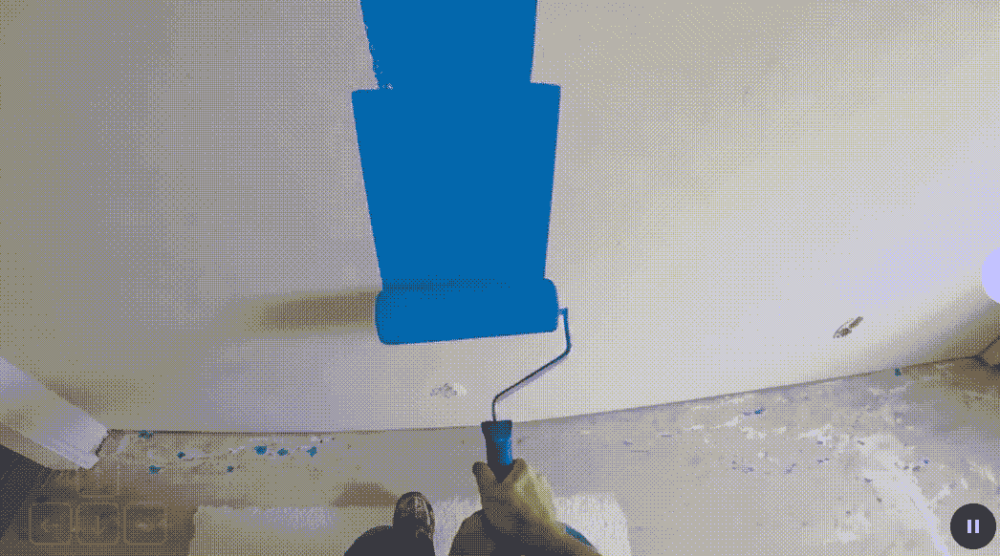

这一能力的背后，是`Genie 3`在长期一致性（`Long-horizon Consistency`）方面取得的关键进展。在实时交互的自回归生成过程中，模型极易因误差累积而导致环境失真，例如用户转身后场景发生不合逻辑的变化。`Genie 3`通过其先进的架构，能够有效维持环境的物理和视觉一致性，其视觉记忆可回溯长达一分钟。值得注意的是，谷歌研究团队指出，这种一致性是一种“涌现能力”，是模型在海量数据训练中自发学习到的高级特性，而非通过显式编程实现，这本身就是一项重要的研究发现。

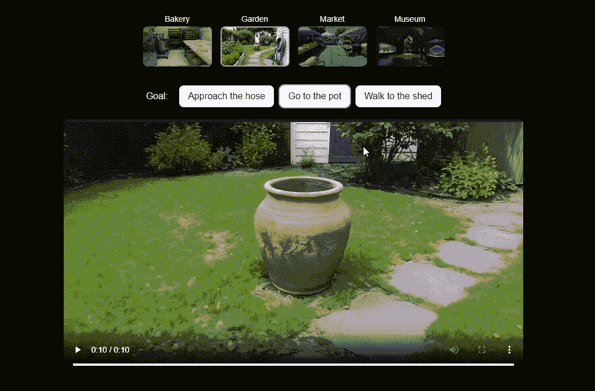

## 关键功能与应用前景

`Genie 3`的发布不仅是一项技术展示，其功能设计更指向了明确的应用方向。

1. 可提示的世界事件 (`Promptable World Events`)

这是`Genie 3`最具革命性的功能之一。它超越了简单的导航控制，允许用户通过自然语言指令实时修改和干预模拟环境。例如，用户可以在一个晴朗的场景中输入“开始下雨”，环境便会实时渲染出相应的动态天气变化。该功能极大地扩展了人机交互的维度，从“控制角色”升级为“编辑世界”，为游戏设计、影视预览、建筑可视化等领域提供了前所未有的创作自由度和效率。

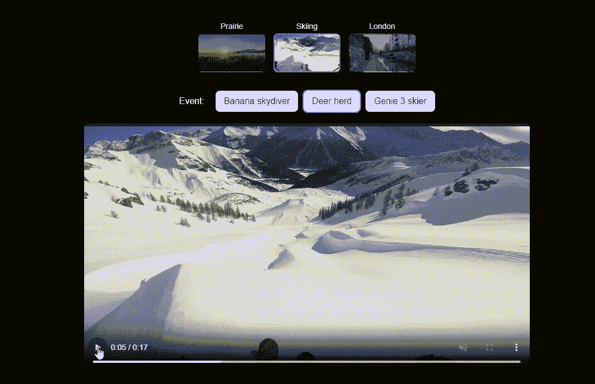

2. 加速具身智能体（`Embodied Agent`）研究

构建通用人工智能的一大挑战，是为AI智能体提供足够丰富、多样且可控的训练环境。`Genie 3`为此提供了理想的解决方案。研究人员可以利用它无限生成各种“反事实”（what if）场景，用于训练AI智能体（如谷歌的`SIMA Agent`）在复杂和未知环境中完成任务。通过简单的文本指令，即可为AI创建定制化的训练课程，这大大降低了环境开发的成本和周期，有望显著加速`AGI`的研发进程。

## 当前的技术边界与挑战

作为一项前沿研究，DeepMind同样坦诚地指出了`Genie 3`目前存在的局限性，这些也是该领域未来的研究方向：

+ 动作空间的局限性：尽管用户可以改变环境，但智能体自身能够执行的直接物理交互动作（如抓取、投掷）仍然有限。

+ 多智能体模拟的复杂性：精准模拟多个独立智能体在共享环境中的复杂互动，仍是一个悬而未决的难题。

+ 现实世界保真度：模型目前尚无法以高地理精度模拟真实的物理位置。

+ 交互时长：当前模型的稳定交互时长为数分钟级别，距离长时间、不间断的沉浸式体验还有差距。

## 分析与展望

`Genie 3`的问世，是人工智能发展道路上的一个重要节点。它清晰地表明，顶尖AI研究的焦点正在从“理解和描述世界”的生成式任务，转向“模拟和交互于世界”的更高维度。

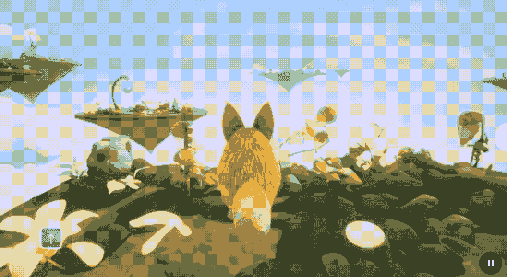

对于产业界而言，这项技术预示着下一代数字内容创作工具的雏形，有望将游戏开发、虚拟制作等行业的生产力提升到一个新的数量级。对于科研界，它是一个强大的实验平台，将推动强化学习、机器人学和认知科学等领域的发展。

谷歌DeepMind此次采取的有限研究预览发布策略，也体现了其在面对强大基础模型时审慎和负责任的态度。通过与学术界和创作者的早期合作，有助于在技术应用的探索过程中，更好地理解和规避潜在风险。

`Genie 3`不仅是一个强大的新工具，更是一种思想的验证：通过构建可交互的“世界模型”，我们正在为最终实现通用人工智能铺设一条坚实而清晰的道路。数字与现实的边界，正因于此而变得愈发模糊。

## 更多演示案例

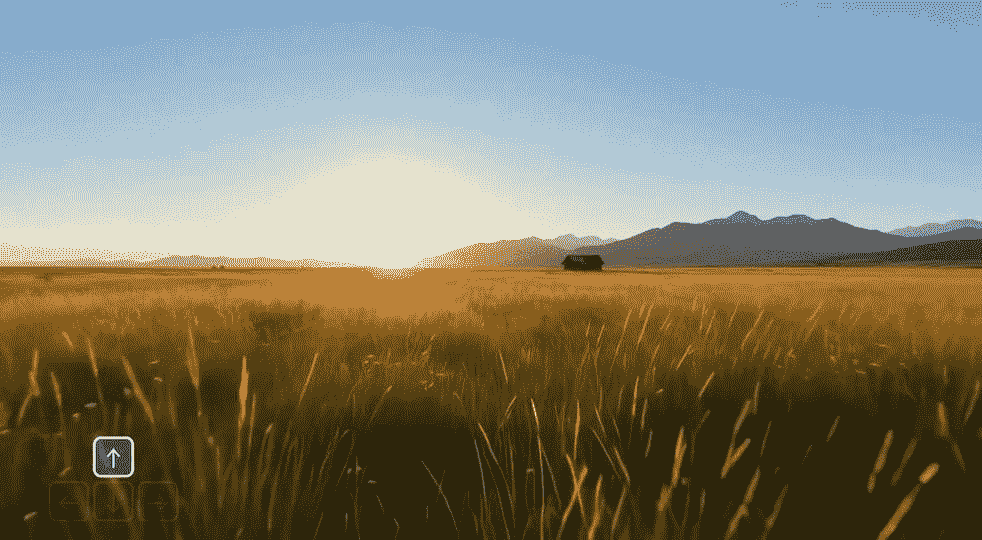

[`prefix.mp4`](https://internal-api-drive-stream.feishu.cn/space/api/box/stream/download/all/P3kqbHgBHougXdxkNWocGIADnsH)

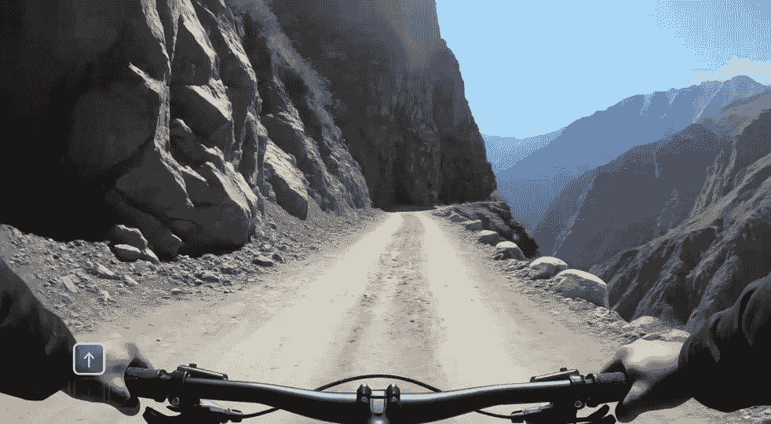

[`genie_exploring_locations_5_LKqlgO0.mp4`](https://internal-api-drive-stream.feishu.cn/space/api/box/stream/download/all/I7cObCgLEoKkCuxrqnGcvRxun5f)

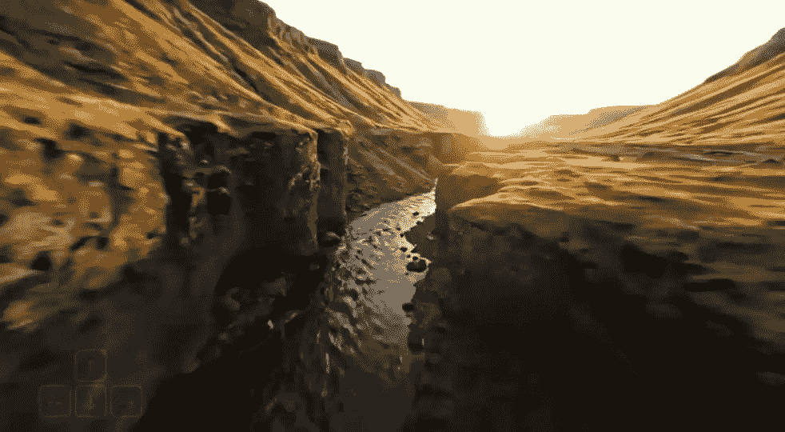

[`genie_environmental_consistency_long.mp4`](https://internal-api-drive-stream.feishu.cn/space/api/box/stream/download/all/HtGCbwfY4oWJB7xaemYcLZqfndh)

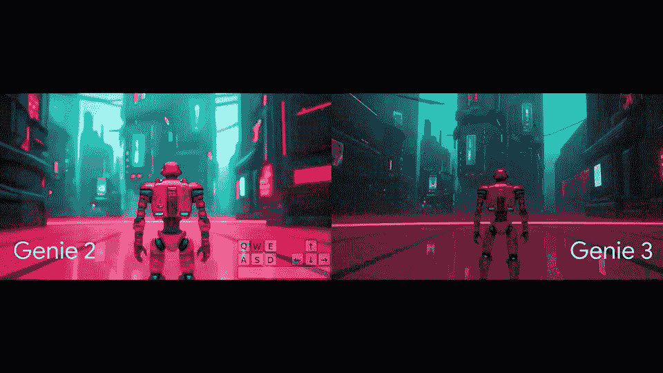

[`sxs_1.mp4`](https://internal-api-drive-stream.feishu.cn/space/api/box/stream/download/all/Fx7cbEygfobEDsxA5tdcxh7DnN5)

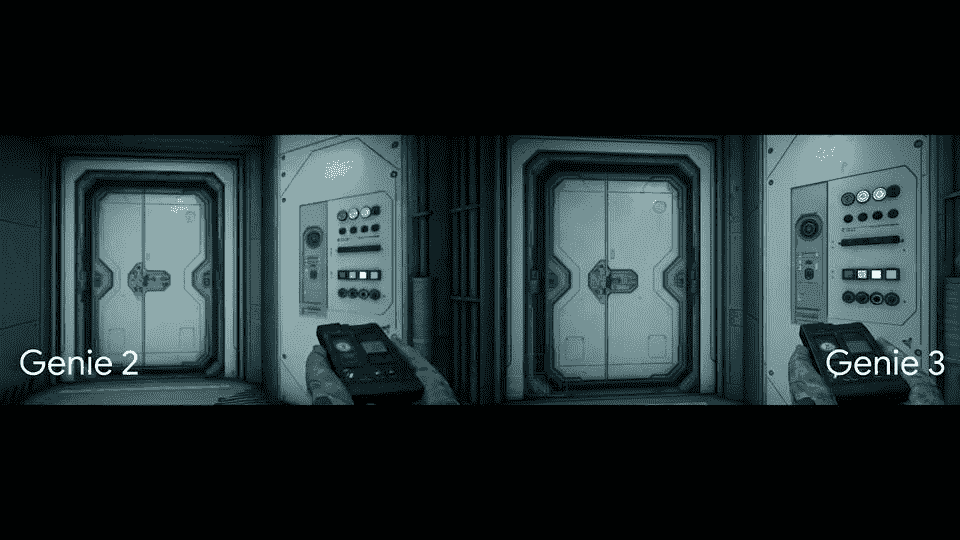

[`sxs_2.mp4`](https://internal-api-drive-stream.feishu.cn/space/api/box/stream/download/all/PrjHbvm7DofjvpxVFJUcbATTnsb)

[`genie_exploring_locations_2_ryC3jcr.mp4`](https://internal-api-drive-stream.feishu.cn/space/api/box/stream/download/all/NW0LbVMe2o0tK0xoUuycVjUqn1d)

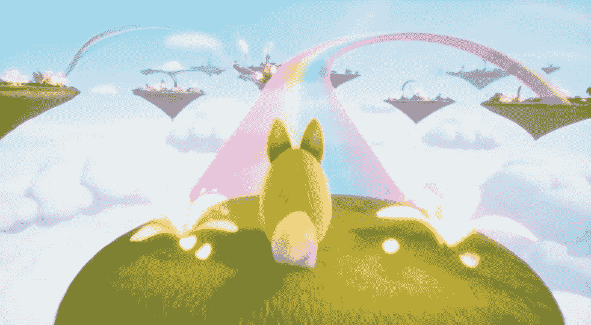

[`genie_modelling_animation_fiction_1_cTvKl3P.mp4`](https://internal-api-drive-stream.feishu.cn/space/api/box/stream/download/all/TRoubClfBoWYaUxTBJJc1MTKnhg)

[`genie_simulating_natural_world_3_gwzGBLr.mp4`](https://internal-api-drive-stream.feishu.cn/space/api/box/stream/download/all/UgkjblN9hoRZsGxoUV9cuuEXnRe)

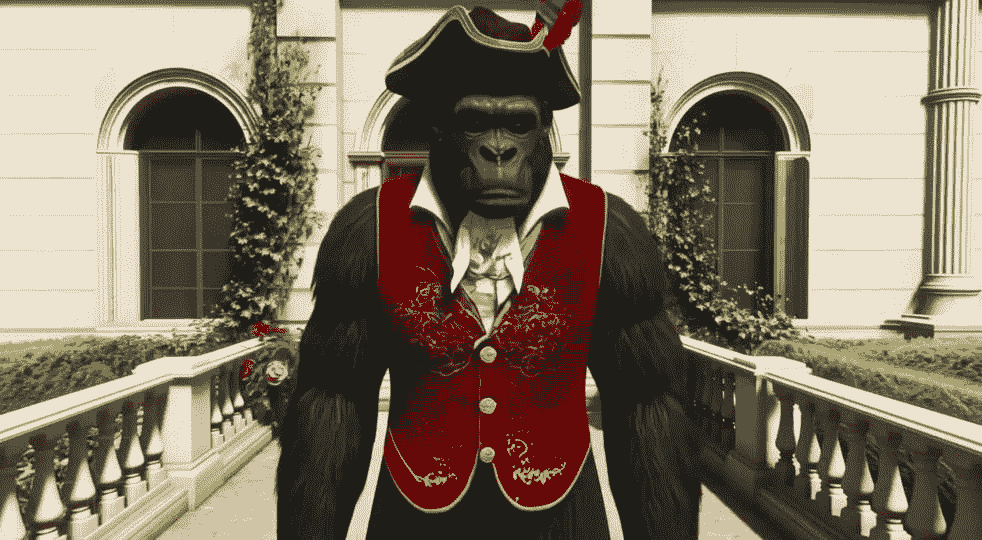

[`genie_environmental_consistency_5_OCdIbx8.mp4`](https://internal-api-drive-stream.feishu.cn/space/api/box/stream/download/all/FvkDbSmC2o0unrxcjdXc64FVnOf)

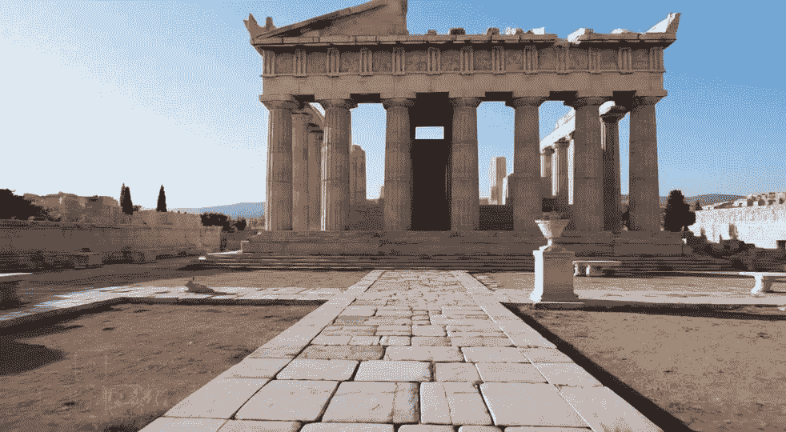

[`genie_exploring_locations_4_oZjNQYu.mp4`](https://internal-api-drive-stream.feishu.cn/space/api/box/stream/download/all/DGk9bb3iWoUK9nxVKpIcmWLlnvh)

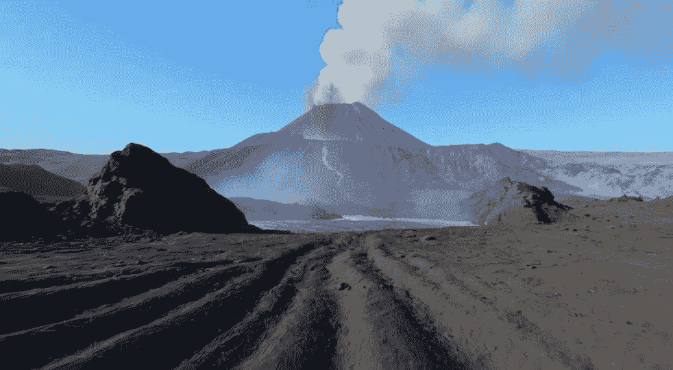

[`genie_modelling_physical_properties_1_MNInndd.mp4`](https://internal-api-drive-stream.feishu.cn/space/api/box/stream/download/all/QmjLbQBxGozkhTxsJw4c5MT4nOg)

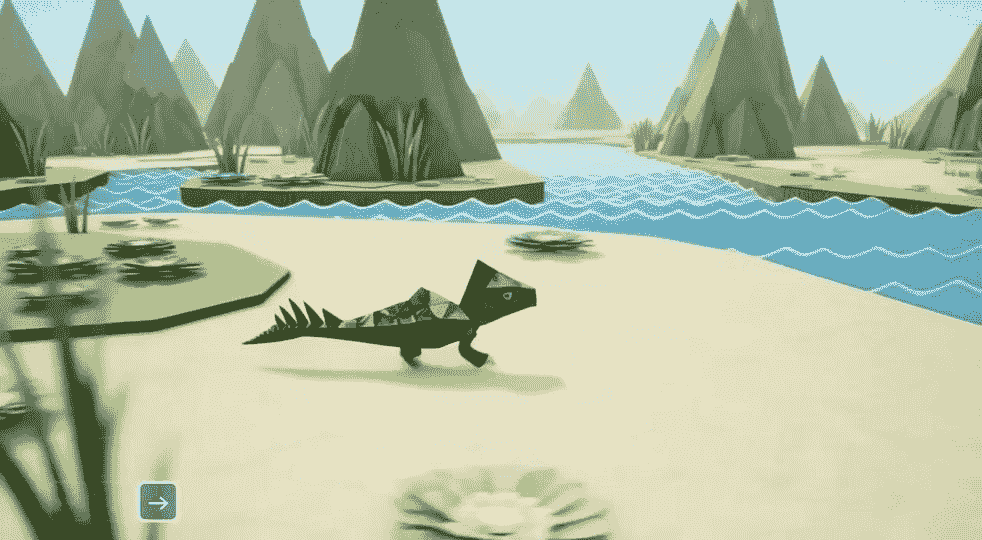

[`genie_modelling_animation_fiction_2_RNg1ibH.mp4`](https://internal-api-drive-stream.feishu.cn/space/api/box/stream/download/all/Bbpub2YnMop5wWx6KbVcoOSZn4g)

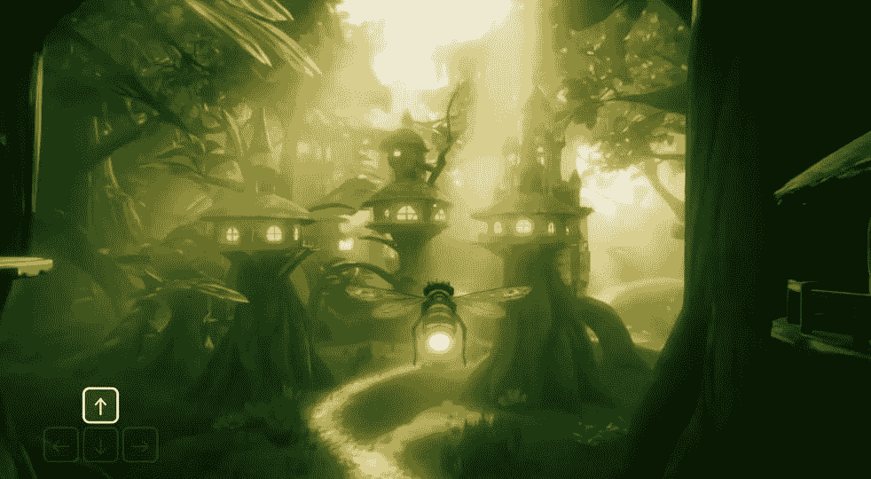

[`genie_modelling_animation_fiction_3_ZXctgpq.mp4`](https://internal-api-drive-stream.feishu.cn/space/api/box/stream/download/all/Fzdob9GcgoJmO7xRrlncXL29nhf)

[`genie_modelling_physical_properties_3_I8KO3kl.mp4`](https://internal-api-drive-stream.feishu.cn/space/api/box/stream/download/all/FA9pbqyIAoHlHHxhXDYcYWTqn3d)

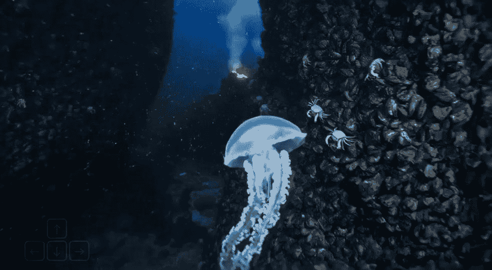

[`genie_modelling_physical_properties_4_6dT1rge.mp4`](https://internal-api-drive-stream.feishu.cn/space/api/box/stream/download/all/GUXYbdRGHoZHiRxLhiUcqKUunfb)

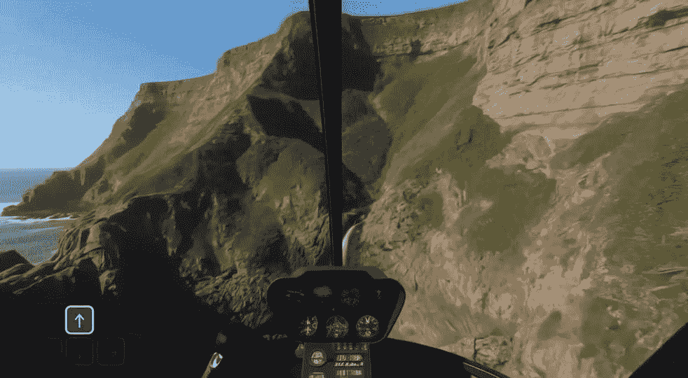

[`genie_modelling_physical_properties_5_1sm8u8o.mp4`](https://internal-api-drive-stream.feishu.cn/space/api/box/stream/download/all/VJi2bUerpoBPncxyGcfcCvGPnVh)

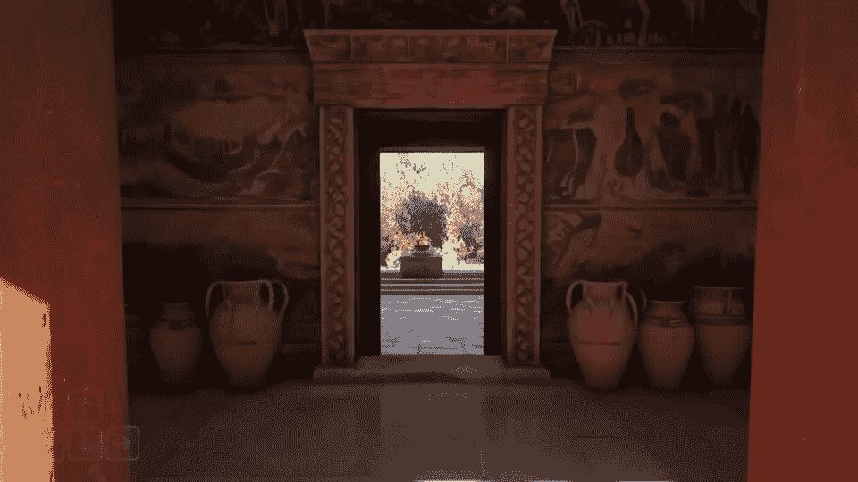

[`genie_exploring_locations_3_dlHXqb9.mp4`](https://internal-api-drive-stream.feishu.cn/space/api/box/stream/download/all/SjXfbotXaoXgTxxcfAucdXMgnJb)

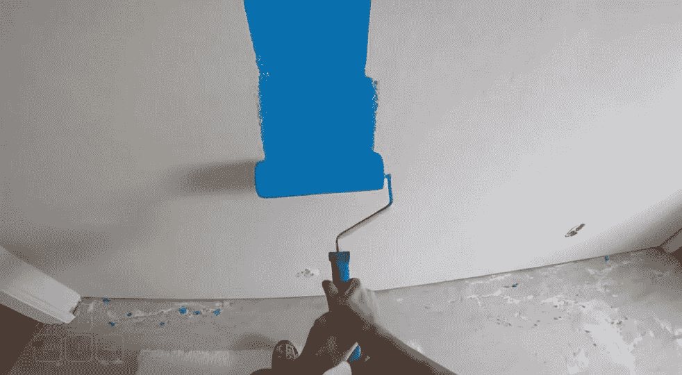

[`genie_environmental_consistency_1_iNVUBuv.mp4`](https://internal-api-drive-stream.feishu.cn/space/api/box/stream/download/all/ChLvbCdVFoSwh9xfO9scOiBmnRf)

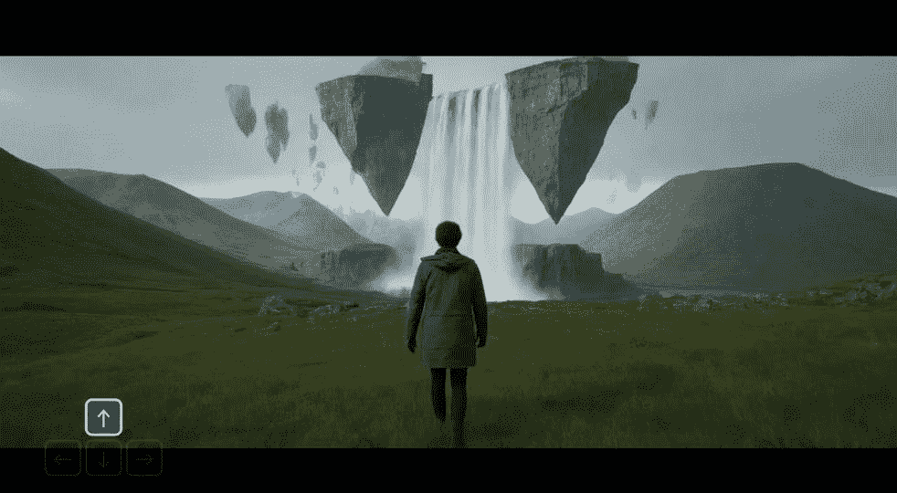

[`genie_modelling_animation_fiction_4_DuLFEfx.mp4`](https://internal-api-drive-stream.feishu.cn/space/api/box/stream/download/all/PoHDb1fVYozDZRxZ8PZc3faYnJg)

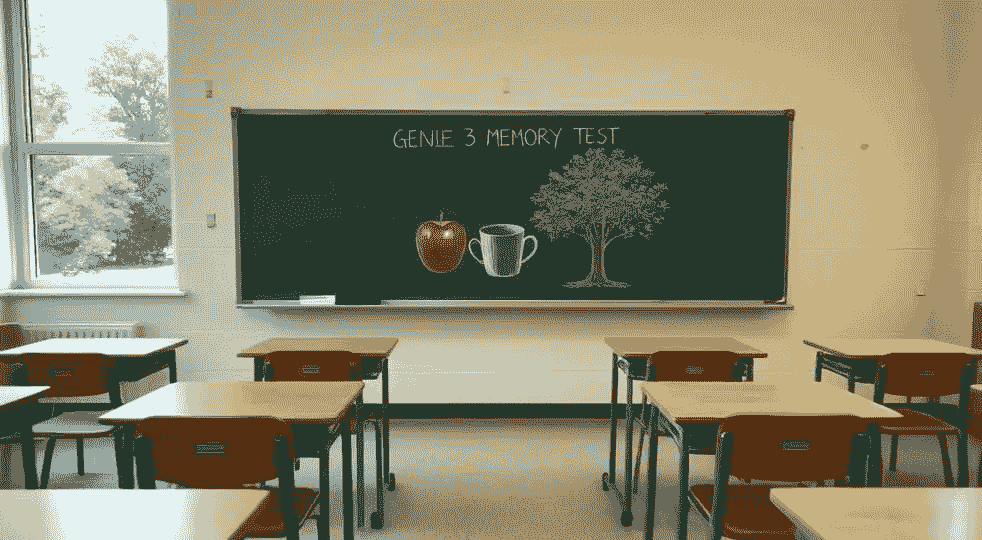

[`genie_environmental_consistency_3_ccj4cHU.mp4`](https://internal-api-drive-stream.feishu.cn/space/api/box/stream/download/all/ZkoebpmMKohqCDxjHpJccWZinTd)

[`genie_simulating_natural_world_4_KmMnEoZ.mp4`](https://internal-api-drive-stream.feishu.cn/space/api/box/stream/download/all/CH7RbN5lJoGjqvx17tvcUt0OnLd)

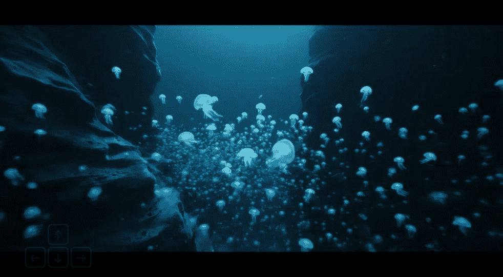

[`genie_simulating_natural_world_2_BJ3YgL8.mp4`](https://internal-api-drive-stream.feishu.cn/space/api/box/stream/download/all/YHsnbRFSGocOJOx7P10cvl9fnqd)

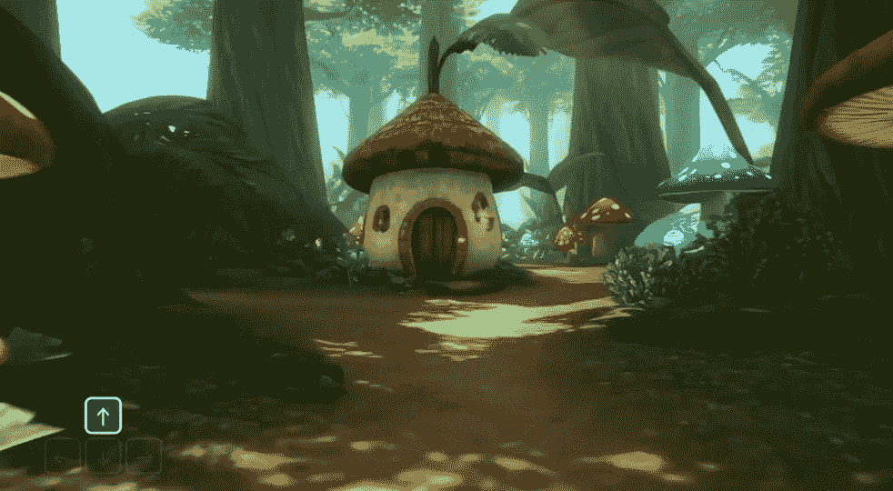

[`genie_environmental_consistency_4_gIb3IbS.mp4`](https://internal-api-drive-stream.feishu.cn/space/api/box/stream/download/all/KWlubBkr2ocTt7xEaIfcwJKrngg)

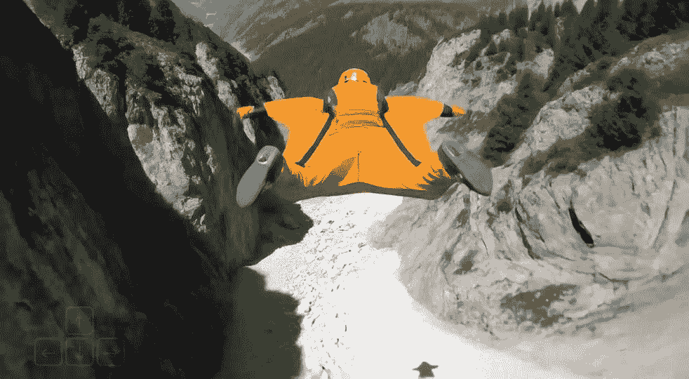

[`genie_exploring_locations_1_OUxxXpK.mp4`](https://internal-api-drive-stream.feishu.cn/space/api/box/stream/download/all/JhSbbs4ZMo77aMxgf8zcXSqfn1d)

[`genie_environmental_consistency_2_zS0EAgg.mp4`](https://internal-api-drive-stream.feishu.cn/space/api/box/stream/download/all/V5Rhb1wE9orgZfxkpIac2yTZnQl)

[`genie_simulating_natural_world_1_KkDJNGE.mp4`](https://internal-api-drive-stream.feishu.cn/space/api/box/stream/download/all/A8nTbtataoBNPgxfC3HcyNqcnDd)

[genie_modelling_physical_properties_2_Qvyu3BP.mp4](https://internal-api-drive-stream.feishu.cn/space/api/box/stream/download/all/Xap3b5FTsoeZNWxJhH4chndEnKe)

[genie_fueling_embodied_agent_research_1_iOYImiQ.mp4](https://internal-api-drive-stream.feishu.cn/space/api/box/stream/download/all/WkcvbDvyIoypzVxlg4YcqhMGnHb)

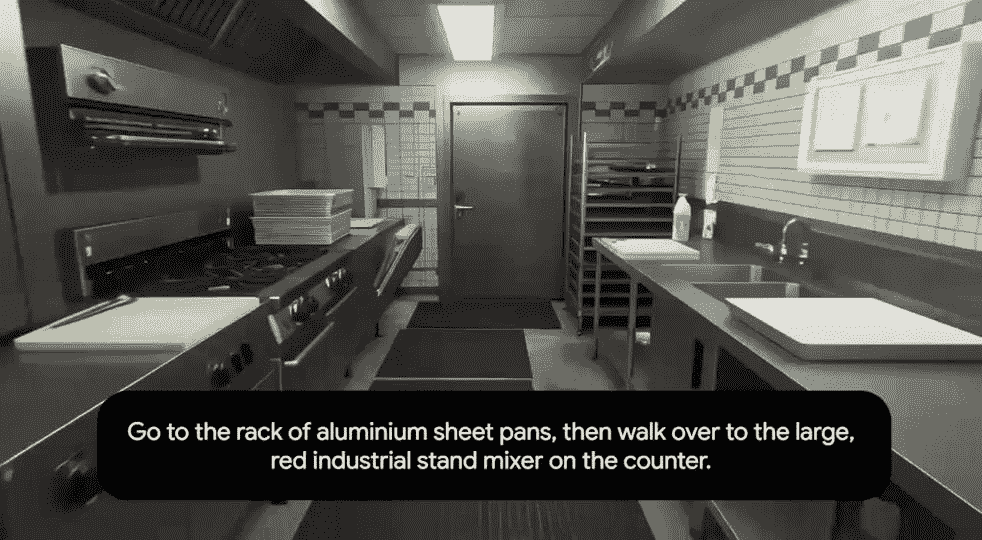

[genie_fueling_embodied_agent_research_3_DqcMxHl.mp4](https://internal-api-drive-stream.feishu.cn/space/api/box/stream/download/all/Dglvbl6hGo1OJlxEdJhcy1Nknqf)

[genie_fueling_embodied_agent_research_2_BBtpEde.mp4](https://internal-api-drive-stream.feishu.cn/space/api/box/stream/download/all/F9dVbm5DcoTphYxp2tvcOoMbn1b)

<https://aigcreative.feishu.cn/sync/K4Gvd9vUQsy9Oubwqaeclu0Fnbg>

# 知识库动态
