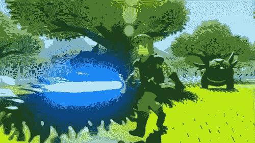
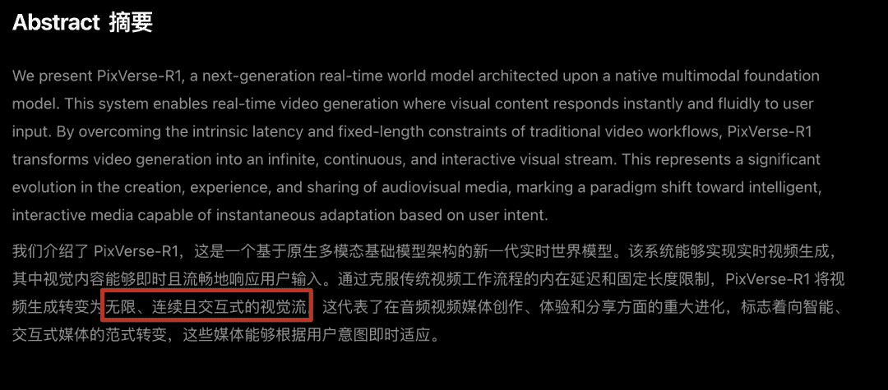
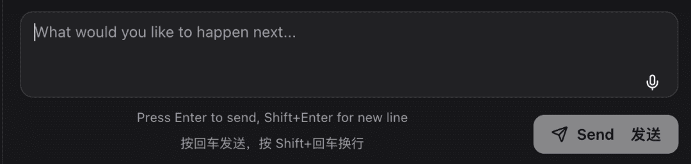
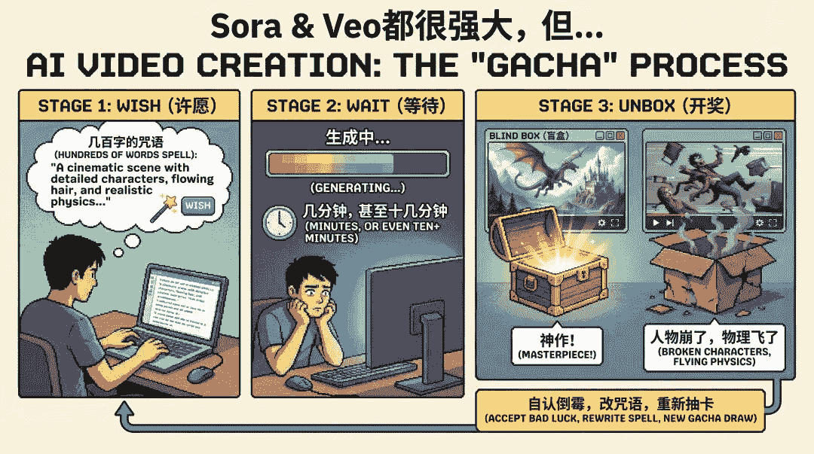
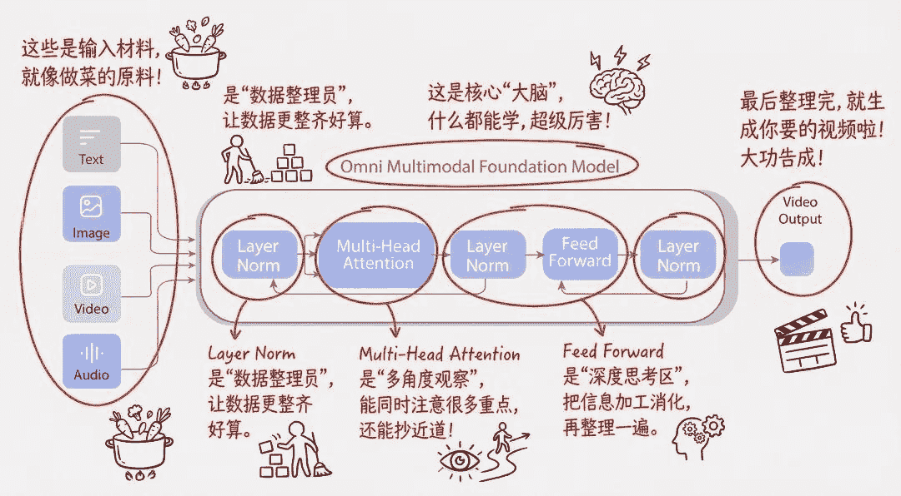
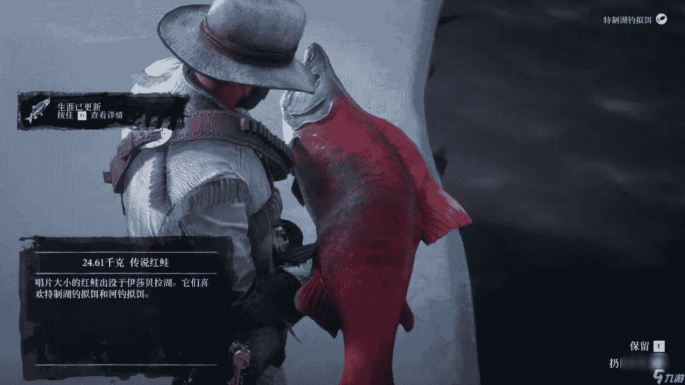
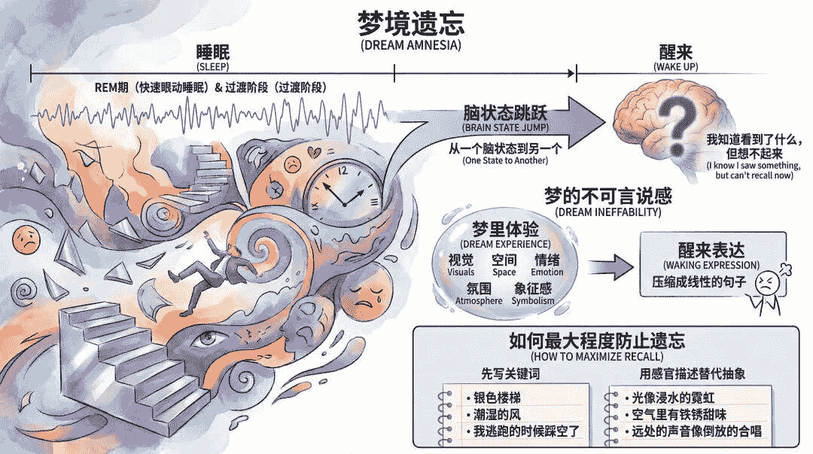

# Pixverse悄悄上线世界模型R1，我做的AI视频能无限实时交互了

> 来源：[https://aigcreative.feishu.cn/docx/UCvSd54gTo7ymaxMOkVcqeCpn1U](https://aigcreative.feishu.cn/docx/UCvSd54gTo7ymaxMOkVcqeCpn1U)

> 原文链接： https://mp.weixin.qq.com/s/MBewcoOLH_kJgHpCs-ZxAg

> 来源：👸号：卡尔的AI沃茨

## AI视频的下一步会是什么？

更快？更清晰？更可控？这些点都很明确了，

但我确实儿没想到，我26年先看到的会是这样一个，

能够一边打字一边实时生成的新视频生成模型 ，也可以叫实时世界模型，

**Pixverse R1**

可能我这么说，大家还感受不太到，直接给大家看一个case。

[🎦 点击观看视频](https://mpvideo.qpic.cn/0bc3beawsaabeaahmwtgazuvccodneeqc2ia.f10002.mp4?dis_k=b40f593e85a306b2805d7956b7cc2b00&dis_t=1768393766&play_scene=10120&auth_info=CL7o5fMAbF9O27je1RgtWFdHJXhuATQZRGYLdD4/QEM5NkJoMmNOZTdHbE1Zd2tHBkkmeG0MLCI+M0AlZGEbXzV5Qg==&auth_key=40f14fac66fecddd9e97be18609349de&vid=wxv_4341500484705239045&format_id=10002&support_redirect=0&mmversion=false)

🔗 试玩demo https://realtime.pixverse.ai/

**这个**过程最头皮发麻的地方在于，世界是连续的。

不是重新生成了一个新视频，而是在刚刚那个世界的基础上，实时地为林克装备了一把武器。这感觉就像你在玩游戏时，突然拥有了开发者权限，可以随时用语言为游戏增加新的元素。

这段演示里还有一个细节，当指令变得复杂，比如让怪物追赶林克时，怪物的行为会有些笨拙。

这种不完美反而证明了它不是一段预设好生成好拼接好的AI动画，

而是一个真的拥有初步物理和行为逻辑的世界。

可能它的清晰度还不太完美，

但仔细想想从360p的AI视频画质到稳定低价的1080p，我们只用了18个月。

所以我根本不担心这个问题，我关心的是它在根据我的指令，实时地进行演算。

这种可被观察的演算过程，正是它与传统AI视频最大的不同。

修的都不是同一个体系 ，而且从他们技术报告上看，这个视频能自己无限期演下去。

🔗 技术报告 https://pixverse.ai/en/blog/pixverse-r1-next-generation-real-time-world-model

R1叫世界模型，3D模型也叫世界模型，Banana2也叫世界模型，

用人话来说，世界知识就是给生成内容装上一个能自洽的底层引擎，让它不止能把画面长得像，还得把因果，物理，常识都对上号。

经得起推敲的，不会穿帮的，能按照你模糊的提示语补充细节的。

[🎦 点击观看视频](https://mpvideo.qpic.cn/0bc3k4aauaaaeuablhlhu5uvav6dbjlqacqa.f10002.mp4?dis_k=12ef8c3cd7d706602f808b8aa753e111&dis_t=1768393766&play_scene=10120&auth_info=CMXI6OgHbF8a2bKI2EwiA1oQJng4UWNKRWdYcms/TRk5MB5qN2dOZWNFZhtUI2QcCx4leDtce3E/MhMjMWEWBTV/Hg==&auth_key=be7da36675ab35253aba68abd3250d8b&vid=wxv_4341501710515830791&format_id=10002&support_redirect=0&mmversion=false)

打开Demo，打开麦克风，就这样一边说话，R1一边就把剧情全出了。

**声画一体的Sora**和Veo都很强大，创作流程基本上也都是 许愿-等待-开奖 。

当我写下一段几百字的咒语，点击生成，然后就是盯着进度条等。几分钟，甚至十几分钟后，才能打开那个盲盒。运气好，开出神作；运气不好，人物崩了，物理飞了，只能自认倒霉，回头再去改那段天知道哪里不对的咒语，然后开始新一轮的抽卡。

Veo3.1还可以用json约束一下，但很多别的视频模型还是要慢慢磨自然语言。

Pixverse这个就给我一个很新的感受，

它的整个过程其实有点像是导演在现场指挥演员。

你可以设想一下，在一个电视剧或电影的片场，演员在表演时，导演有时会在画外音中进行一些实时指导，告诉演员如何去演、做哪些动作，或者表情哪里不到位。

这样的实时指导就非常像我现在用PixVerse R1的感觉，通过打字告诉视频，我需要接下来的这个人物去进行怎样的动作，或者进入到什么样的场景。

这种交互体验真的蛮能圆我导演梦的。

比如这个太空驾驶的场景，

[🎦 点击观看视频](https://mpvideo.qpic.cn/0bc3rqaroaabzqaaridgnbuvddgdc6gacfya.f10002.mp4?dis_k=38e2ee4e6428c6883677ef00db4e7fff&dis_t=1768393766&play_scene=10120&auth_info=D5/o+uENP18U0bPY10t/B1JBIy05BzEdEjBaeGtrEB8+NkxpYWgdZW1NZ0tbJDkYA08gLToKKSZoZREpMTVLAzJ5TA==&auth_key=16f465b2c8bc435386196f8d406a7665&vid=wxv_4341500879187836935&format_id=10002&support_redirect=0&mmversion=false)

一连串的文字像写剧本一样，实时驾驶着飞船逃离地球、飞向月球、遭遇神秘光线、最后被巨大的土星所震撼。我感觉自己不再是观众，而是第一人称的导演。我输入的每一个字，都像是在给飞船添加燃料，驱动着它飞向我想象中的下一帧。

再比如这个，直升机飞越巴黎时，输入突然天空转暗，电闪雷鸣，画面立刻风云突变；接着输入“远处一个巨大的烟花绽放”，天空中真的就升起了一朵烟花，天气也随之转晴。整个环境和特效都能配合着指令实时做出互动，是一个非常连续性的展示。

[🎦 点击观看视频](https://mpvideo.qpic.cn/0b2ejeaawaaad4abin3hrzuvasodbneqacya.f10002.mp4?dis_k=3d5ec6623b4fa02be9604de30602546f&dis_t=1768393766&play_scene=10120&auth_info=Deq7hcVUPVkei+XX1kwuBQdCd3k9UDNPQjBaJDs8Fkw8YUk/ZzYfY2cXMURaI2gaVkx0eT5dK3Q4ZRF1YWJNUDAuSQ==&auth_key=59f109c210b65dbb9b697f459c6a29e4&vid=wxv_4341501235905019919&format_id=10002&support_redirect=0&mmversion=false)

你就看这个Pixverse实机操作的录屏界面，我感觉这玩意儿根本不只是一个视频生成器，更像是一个可以被语言实时编程的微型世界。

[🎦 点击观看视频](https://mpvideo.qpic.cn/0bc3g4ac4aaasuadcethijuvan6dfy3qalqa.f10002.mp4?dis_k=b9e2febf1e90bfd0c597d8d36a64a204&dis_t=1768393766&play_scene=10120&auth_info=WfLMid4APg9I2ePb2Ut+WQZCcS47VmdJRGILeWtrEx9oNUs4amAcNTFFN0hVJDhGV0xyLjhbf3I+N0AoMTVIA2R6Sw==&auth_key=4e7fb0f739ccad13fcfd1d67fb602853&vid=wxv_4341502512701489157&format_id=10002&support_redirect=0&mmversion=false)

我就好奇了，这背后到底是怎么做出来？为什么要做一个跟别人不一样的？

我去啃了一下他们的技术论文，

用人话翻译一下，R1能做到这个实时生成的效果，主要靠这三样：

第一 个是 叫Omni的原生多模态大模型。

你可以把它想象成一个从小就同时学习了看、听、说三种语言的天才。它不像别的模型需要把音视频翻译成文本才能懂，它天生就能在一个系统里，同时理解视频、音频和文字。这让它的反应快得像是本能。

第二个零件是一种叫自回归的机制。

这东西就像一个拥有超强短期记忆的说书人，它永远记得自己上一秒讲了什么，所以下一秒的故事，总能和前面无缝衔接。这保证了视频可以像一条无限的河流一样，持续地连贯地生成下去。

最后，也是最关键的，是一种叫即时响应引擎（IRE）的技术。

如果说传统AI视频生成，像是搭乐高，需要一步步拼接（几十步的采样） ， IRE就像是变魔术，它能直接预测出最终成品的轮廓，然后用极少的步骤（一到四步）就把它变出来。

这些正是它能实现实时交互的秘密武器。

**所以，它到底用在哪？**

我个人是感觉，PixVerse R1这类实时模型，并非要取代Veo们在叙事性短片创作上的作用。它们其实可以并驾齐驱，Sora们在追求成为顶级的电影工作流，

而R1正在努力成为一个充满无限可能的互动娱乐引擎。

它真正开疆拓土的地方，在于那些极度依赖实时交互的领域。

比方游戏， 想象一下你走到NPC面前，不需要几周目才能引导变化，不再是从预设的三个选项里选一句对话。你可以自由输入任何你想说的话，NPC会根据他的性格和你们之前的经历，实时生成独一无二的表情和互动场景，

我甚至可以开个上帝模式，对游戏世界本身下指令，

我希望我这个赛博钓鱼佬可以回回上鱼，那我真的要笑到合不上嘴了

也就是说，游戏，将从一个玩家只能被动体验的故事，变成一个真正可参与的世界。

再再比方说互动电影，

现在去大商场体验4D电影都要out了，我大胆想象一下，我可以摆脱A/B选项式的伪互动，随时暂停，给主角下达一个全新的指令，别相信他，先看看他口袋里藏了什么，

然后电影会为你即时地生成一段新的故事脉络，我就经常在想要是故事不会结束就好了。

盗梦空间这个陀螺我是真希望能看到它停下来，被一个新的幕后之人拿起来

写到这里，

我突然想到了一个可能离我们每个人都更近的使用场景。

你有没有过这样的经历？

做了一个无比清晰的奇幻梦，画面感强到你自己都起鸡皮疙瘩，

但我醒来后想跟朋友描述，搜肠刮肚用了无数的形容词，要不就发现忘了，要不就是形容不出来，

什么叫我在鳌太线拿着四块压缩饼干在大爷海煮火锅啊（我至今形容不出来神秘园究竟在我脑子里留下了什么）。

这还能联系上一个科学名词，

梦境遗忘（dream amnesia）

梦大多发生在REM期（快速眼动睡眠）或临近醒来的过渡阶段，醒来属于从一个脑状态跳到另一个脑状态，所以会出现一种典型的感觉，

就是我知道我刚刚看到了什么，但现在就是想不起来。

因为在梦里体验的是视觉，空间，情绪，氛围，象征感，但醒来我要把它压缩成线性的句子的话，这个过程中会出现一种梦的不可言说感（dream ineffability）。

这时候想要最大程度保证梦不被遗忘，可以先写关键词，不要追求完整叙事，比如，银色楼梯，潮湿的风，我逃跑的时候踩空了，也可以用感官描述替代抽象形容词，光像浸水的霓虹、空气里有铁锈甜味、远处的声音像倒放的合唱。

说实话，我每天都在跟这种转达的损耗作斗争。

但R1这类实时模型的出现，

或许为我们提供了一种全新的表达方式。

它能让我能把那个转瞬即逝的梦境，用一种更直观 ， 更无损的方式复现出来。

它将创作的反馈周期从数小时甚至数天，压缩到了零。

而这种即时反馈极大地释放 了 我的实验精神和表达欲望。

现在 已经可以排队内测了，

目前能体验360p 了 ，

过几天还能用上720p ，

趁着还没收费之前，

我要多跑五六七八九十个。

<https://aigcreative.feishu.cn/sync/K4Gvd9vUQsy9Oubwqaeclu0Fnbg>

# 知识库动态