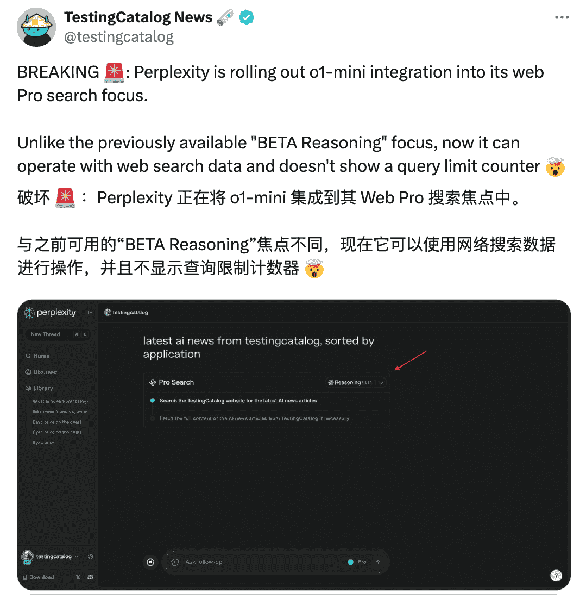
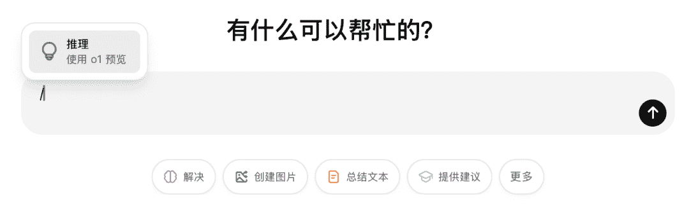
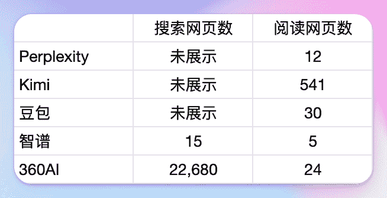
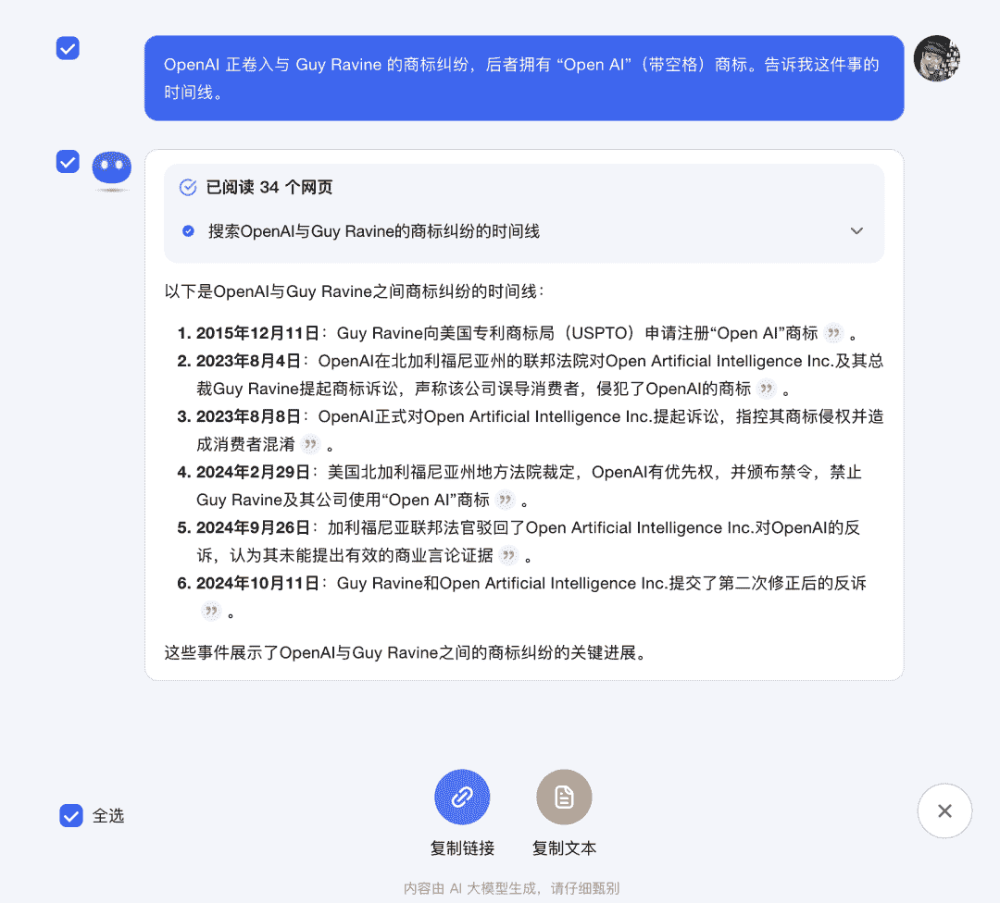
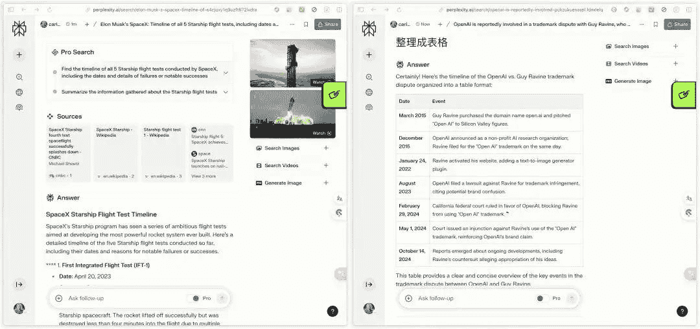
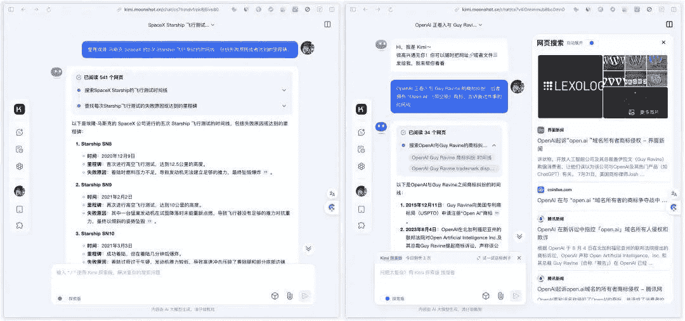
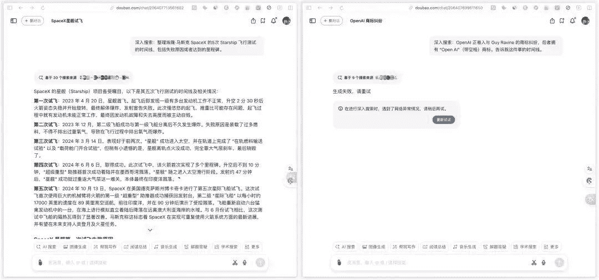
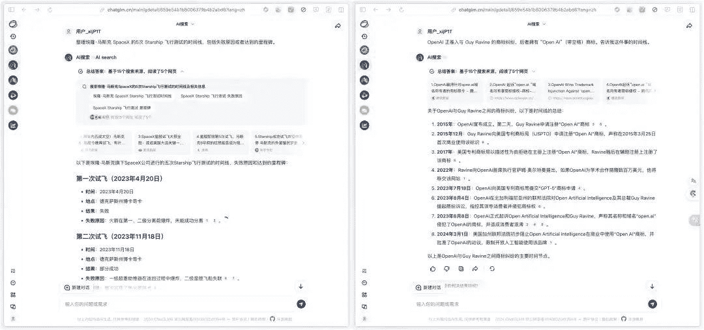
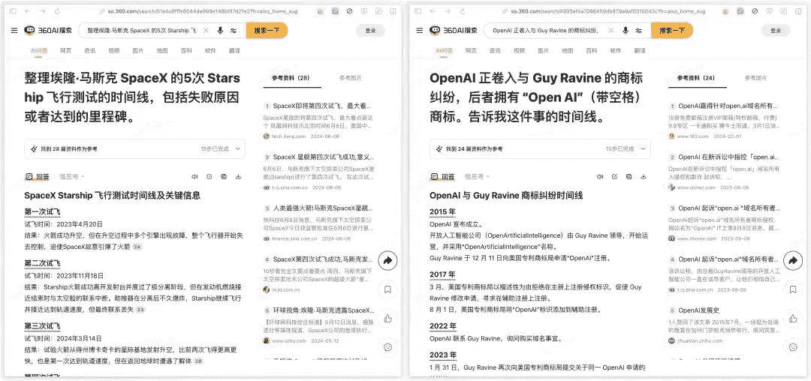
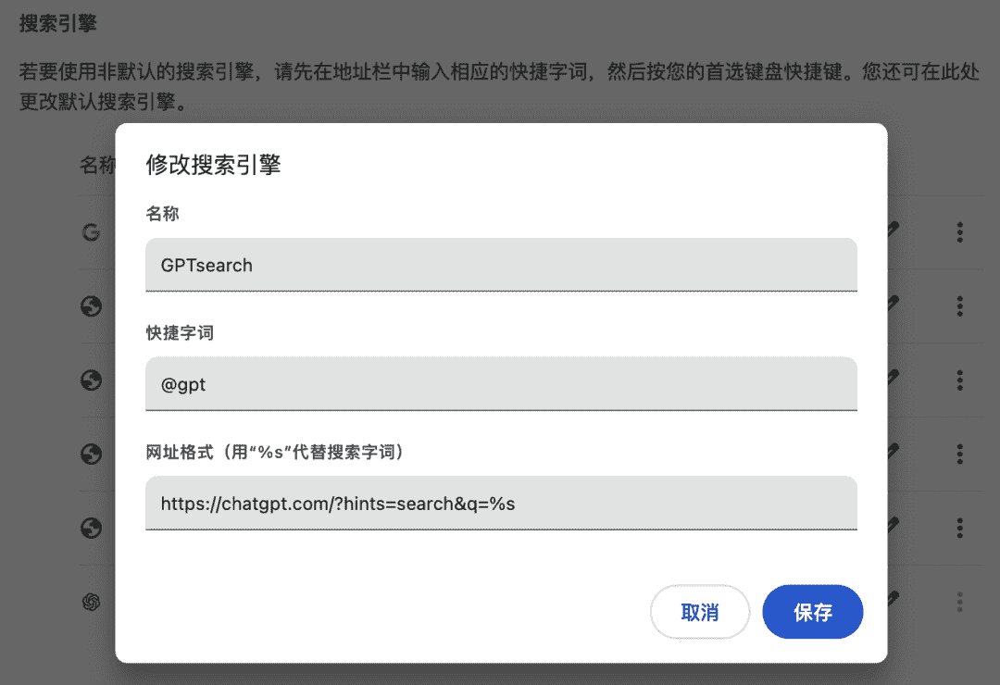

# AI搜索迎来2.0版本，我对比了五款支持深度推理的搜索引擎

> 来源：[https://aigcreative.feishu.cn/docx/JlsqdaQxho2yZXx4SWrcGp6xnX9](https://aigcreative.feishu.cn/docx/JlsqdaQxho2yZXx4SWrcGp6xnX9)

> 来源：👸号：卡尔的AI沃茨

> 链接：https://mp.weixin.qq.com/s/h1H7K8x8KRwyNKvl1O0YDQ

** "You'll never go to a** search site again"

这是比尔·盖茨在旧金山举行的 AI Forward 2023 活动上说过的话。

17个月后，AI搜索迎来2.0时代!

就在上周，Kimi 上线“探索版”，也就是支持深度推理的AI搜索。每人每天只让用五次的情况下，都把 Kimi 的服务器给用崩了，

而且厂商们又一次像商量好了一样扎堆更新，

AI 搜索引擎 Perplexity 水灵灵上线了 ChatGPT O1-mini 驱动的 Pro 搜索！

离谱的是，在 OpenAI 本家的对话页面里，o1-preview 还没支持上联网搜索。

这我就很好奇了，都有哪些熟面孔“悄咪咪”支持了深度搜索呢？

一番搜索下来：

+   Perplexity - “Pro搜索”

+   kimi - “探索版”

+   豆包 - “深入搜索”

+   智谱 - “AI搜索「默认就是推理版本」”

+   360AI 慢搜索 - “慢思考模型”

可以预想到，未来2.0版本的 AI 搜索产品会重现 AI 模型的“百家争鸣”，推理能力也将成为标配。

不过，难受的是AI搜索不像AI模型，有各种各样的排行榜，找靠前的用就好了。

所以今天我就根据**易用性、理解能力、准确性**这三个维度来测评一下2.0们有多好用！

# **一、易用性**

先说结论：豆包 = 智谱 = 360AI > Perplexity > kimi

我将易用性划分为 AI 搜索的三大使用难点：

+   使用次数是否存在限制

+   单次搜索支持的页面数量

+   搜索结果的分享形式

Perplexity 的 Pro 搜索功能每四个小时免费使用五次 Pro 搜索功能。Kimi 探索版目前每人每天仅可使用5次。豆包深入搜索、智谱 AI 搜索、360 AI 慢搜索并没有明切的使用次数限制。

由于 Kimi 探索版额外强调了单次搜索能访问超过500个页面，我也对比了在同一个高难度问题下，重复提问3次，每款产品每次访问的网页数量的多少。

毕竟页面数量间接影响了 AI 模型的“眼界”有多大。

接下来就是分享形式，平时使用搜索引擎的时候，用得最多形式就是将链接复制黏贴到各种地方，

**Ki**mi、智谱、豆包、360AI 都支持复制完整文本、生成图片和链接，豆包可以额外设定是否允许其他用户访问对话记录里出现的文件。Perplexity可以限定链接是否仅自己访问。

# **二、理解能力和准确性**

既然它们最大的特点都是**支持推理能力的AI搜索**，

那**理解能力**对应的就是第一步：

将问题发送给 AI 们后，是否能被正确 get 到，并搜索到有效的网页；

而**准确性**对应的是最后一步：

模型是否能准确无误地整合网页里内容，不胡编乱造。

所以，我早就准备好了2个上天入地级别的问题：

+   Elon Musk's SpaceX: Timeline of all 5 Starship flight tests, including dates and reasons for failures or notable successes.「整理埃隆·马斯克 SpaceX 的5次 Starship 飞行测试的时间线，包括失败原因或者达到的里程碑。」

+   OpenAI is reportedly involved in a trademark dispute with Guy Ravine, who owns the ‘Open AI’ (with a space) trademark. Tell me the timeline of this matter.「OpenAI 正卷入与 Guy Ravine 的商标纠纷，后者拥有 “Open AI”（带空格）商标。告诉我这件事的时间线。」

一个横跨时间线，另一个有隐藏名称陷阱。

小声bb，没用奥数题测试是为了尽可能模拟平时使用场景，平时如果不是为了为难 GPT，估计我都没啥机会解题。

（由于图片大小限制，下面的截图目的是以展现交互形式为主，我会把原图链接放在评论区）

1.  Perplexity

这里说明一下，用英文提问是因为 Perplexity 还加了个设定，他会判断当前问题是否值得o1出手，也就是说如果你的问题要是没那么棘手的话，是够不上o1出场的。

**点评一下**：Perplexity准确理解了两个问题，搜索出了12个网页，选择其中的5个作为信息源都没发生错误。在没有人工干预的情况下，也都额外补充了更加详细的补充信息，只可惜对最新一次 Starship Flight5的回答失败，判断为实验没有运行。

1.  kimi

**点评一下：**这里再赞一下kimi的自动展开功能，因为我们在使用 AI 搜索的时候，为了二次确认信息的准确性，是会有反复阅读信息源的需求。从结果上看，kimi的信息源是中英文类型各占了一半，能够准确理解两个问题，最终回答输出都没有问题。

1.  豆包

**点评一下：**豆包稍微有点麻爪啊，第二个问题每次问都是半路报错，看了一下，第一个问题的搜索来源都是中文网站，应该是对搜索网页的来源做了限制，导致信息源没那么广泛，不过最终回答结果是正确的，没有受太大影响。

1.  智谱

**点评一下：**智谱也是一样，搜索来源也都是中文网站。在第一个问题里，回答第五次飞行时犯了和Perplexity的同款错误，也认为实验还没有开始。不过第二个问题顺利回答出来了，但很可惜还是有部分错误，Guy Ravine申请商标的时间是早于OpenAI公司成立时间的。

1.  360AI

**点评一下：**360AI搜索有一个很强的优势，就是可视化了思考过程，方便我们快速了解过程并找到问题所在。这里我们可以看到，第一步的时候它只搜索了第五次起飞实验，但在后面的反思过程中，它又找回了前面四次的实验结果。比较可惜的是第五次实验依旧没有回答正确，在第二个问题里，丢失了2024年发生的时间记录。

个人账号使用次数有限，上面的例子对比花了三天，每个都重复运行5次。

到这一步，结论也新鲜出炉了：

kimi > Perplexity = 智谱 = 360AI > 豆包

btw，谁还记得远在大明湖畔的Bing AI呢？

大家也可以结合这三大指标选择出自己的AI搜索初体验～

## 写在最后

写这篇文章的时候，

我问了很多有 AI 使用习惯的朋友，

他们大部分已经从搜索引擎转移到 GPT 们或 Perplexity 们，

甚至已经完全排除传统搜索，将 GPT Search 设置成为默认选项。

我无比期待的是，当深度推理能力得到进一步发展后，

未来，我们是不是能像《超体》一样，

可以拥有一个开发率100%的AI大脑。

这样的世界，我想了，但又有些不敢想。

<https://aigcreative.feishu.cn/sync/K4Gvd9vUQsy9Oubwqaeclu0Fnbg>