# NotebookLM学习手册

## 《NotebookLM 学习手册（完整版）》最新功能指南 + 自定义提示词模板合集

> **版本**: 2.0 | **更新日期**: 2025年11月 | **包含内容**: 完整功能指南 + 核心工具清单 + Prompt模板库

> 制作人：BerryXia_ai

---

## 零、快速开始指南

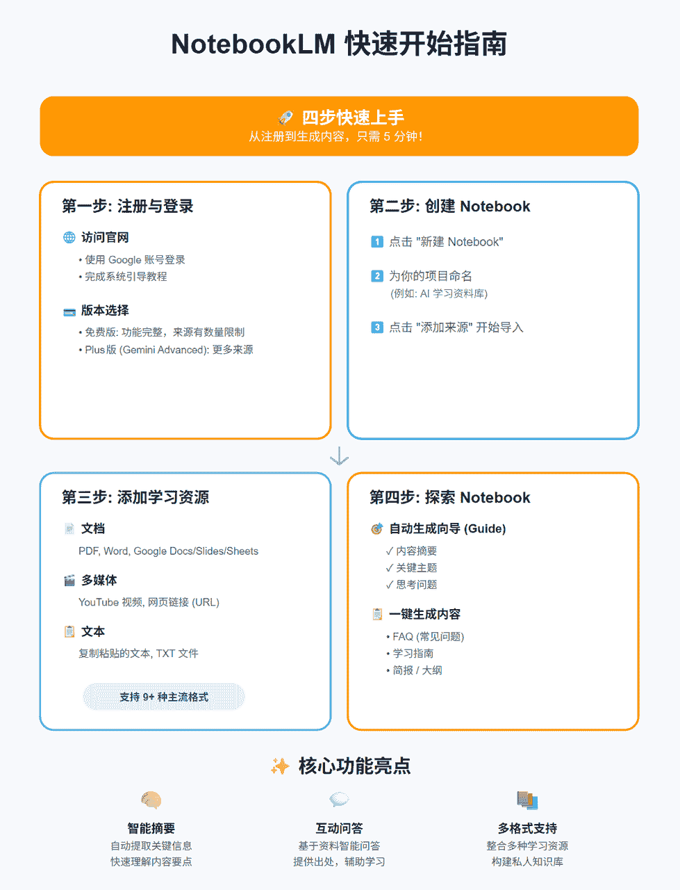

### 第一步：注册与登录

- 访问官方网站：`notebooklm.google.com`
- 使用Google账号登录
- 首次登录时完成系统引导教程
- 选择免费版或升级到**NotebookLM Plus**（需Google One AI Premium订阅，约¥20/月）

### 第二步：创建第一个Notebook

1. 点击`新建Notebook`
1. 给项目起名字（如"AI学习资料库"）
1. 点击`添加来源`

### 第三步：添加学习资源

支持的来源类型包括：

- 📄 PDF文档
- 📊 Google Sheets（电子表格）
- 📝 Google Docs（文档）
- 🎥 YouTube视频
- 🎙️ 音频文件（MP3、WAV等）
- 🔗 网站链接（URL）
- 🖼️ Google Slides（演示文稿）
- 📸 图像文件（JPG、PNG等）
- 📋 Word文档（DOCX）

### 第四步：探索Notebook Guide

创建Notebook后，系统自动生成"Notebook Guide"仪表板，包括：

- 自动生成的内容摘要
- 针对性的思考问题
- 快速生成按钮（FAQ、学习指南、简报文档等）

---

## 一、核心功能完全解析

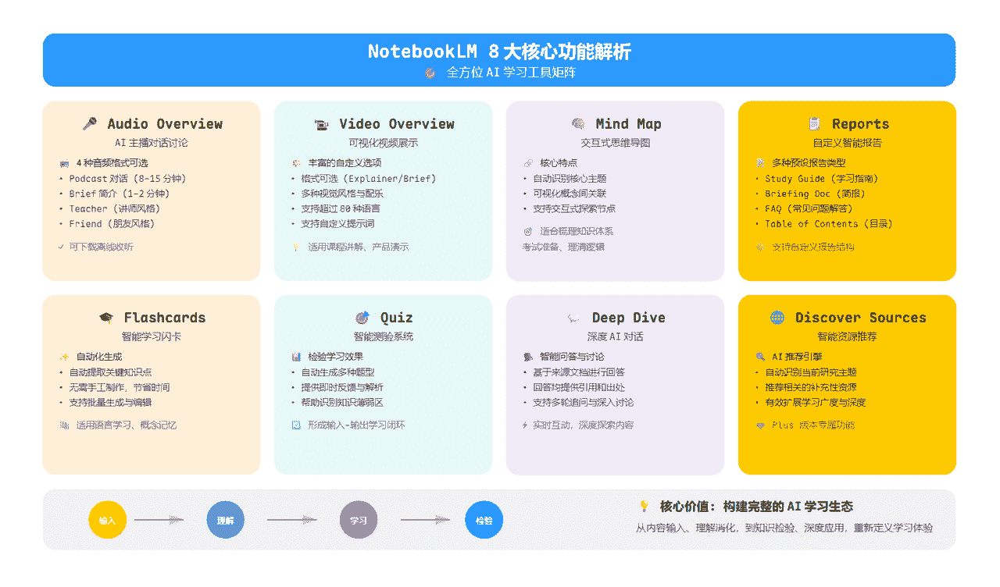

### 🎤 功能 1：Audio Overview（音频摘要）生成比较耗时，仅次于视频时长，预计10mins-15mins

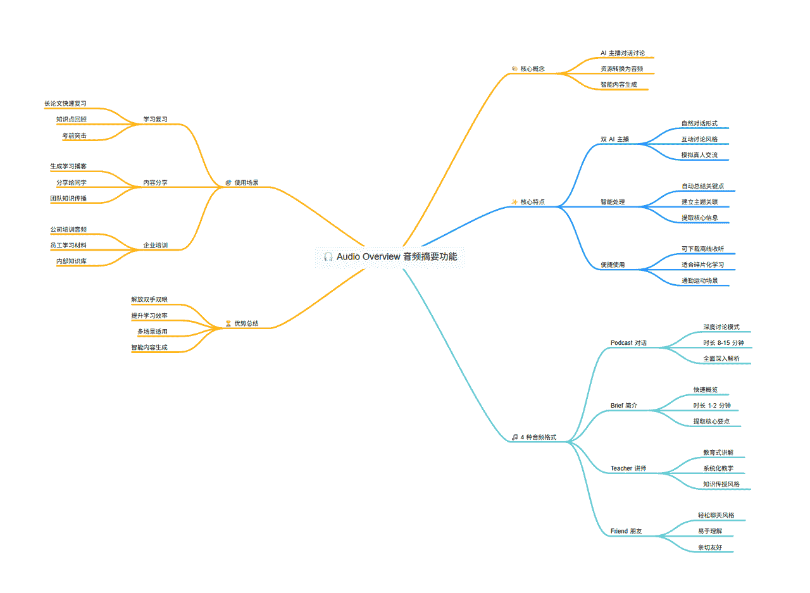

**是什么？** 将您上传的资源转换为生动的AI主播对话讨论

**特点：**

- 两位AI主播进行自然对话
- 自动总结关键点
- 在主题间建立关联
- 可下载并离线收听
- 适合通勤、运动时学习

**4种音频格式：**

1. Podcast对话 - 两位主播深度讨论（通常8-15分钟）
1. Brief简介 - 1-2分钟概览
1. Teacher讲师 - 教育式讲解
1. Friend朋友 - 轻松聊天风格

**使用场景：**

- 长论文阅读后的快速复习
- 生成学习播客分享给同学
- 制作公司培训音频内容

---

### 📹 功能 2：Video Overview（视频摘要）非常耗时预计要10mins-20mins，时长7-10分钟左右

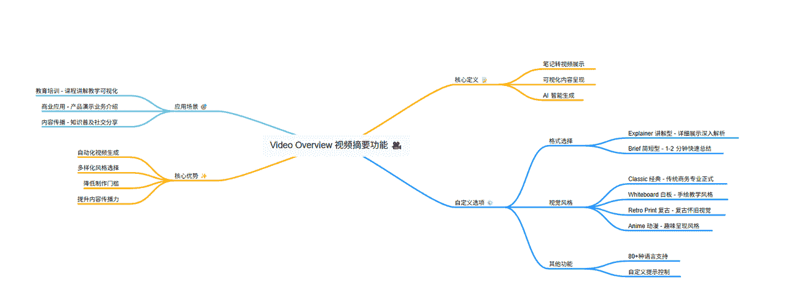

**是什么？** 将笔记转换为可视化视频展示

**自定义选项：**

- 格式选择：
  - Explainer（讲解型）- 详细展示
  - Brief（简短型）- 1-2分钟快速总结
- 视觉风格：
  - 经典（Classic）
  - 白板（Whiteboard）
  - 复古（Retro Print）
  - 动漫（Anime）
  - 其他主题
- 语言选择：支持80+种语言
- 自定义提示：告诉AI应该强调什么内容

**使用场景：**

- 制作课程讲解视频
- 生成产品演示
- 创建知识普及内容

---

### 🧠 功能 3：Mind Map（思维导图） 生成思维导图比较快

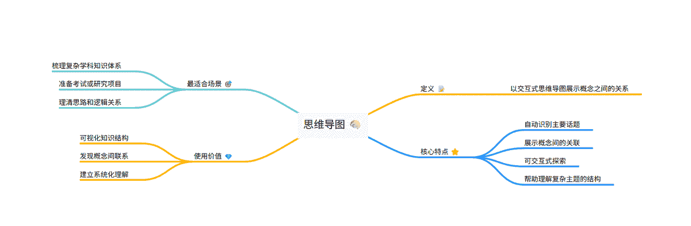

**是什么？** 以交互式思维导图展示概念之间的关系

**特点：**

- 自动识别主要话题
- 展示概念间的关联
- 可交互式探索
- 帮助理解复杂主题的结构

**最适合：**

- 梳理复杂学科知识体系
- 准备考试或研究项目
- 理清思路和逻辑关系

---

### 📋 功能 4：Reports（自定义报告）

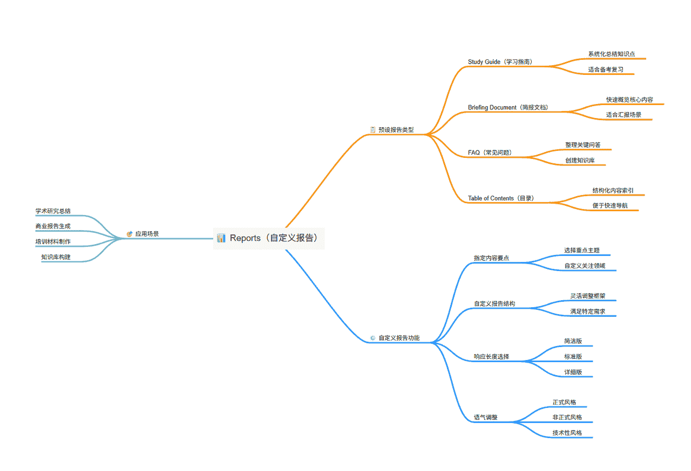

**预设类型：**

- Study Guide（学习指南）
- Briefing Document（简报文档）
- FAQ（常见问题）
- Table of Contents（目录）

**新增功能：** 完全自定义报告

- 在生成前指定内容要点
- 自定义报告结构
- 选择响应长度（简洁/标准/详细）
- 调整语气（正式/非正式/技术性）

---

### 🎓 功能 5：Flashcards（闪卡）

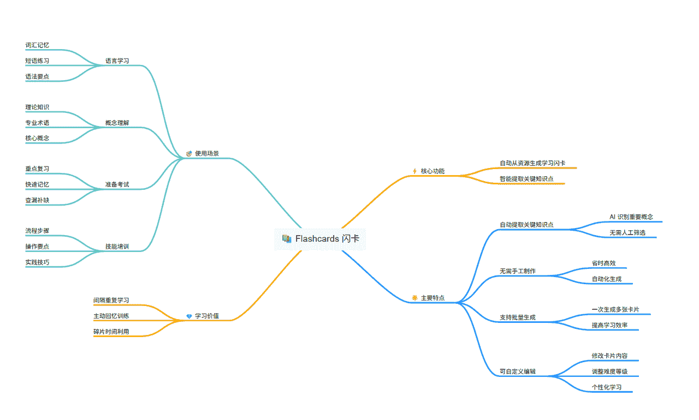

**是什么？** 自动从资源生成学习闪卡

**特点：**

- 自动提取关键知识点
- 无需手工制作
- 支持批量生成
- 可自定义编辑

**使用场景：**

- 语言学习（词汇记忆）
- 概念理解
- 准备考试
- 技能培训

---

### 🎯 功能 6：Quiz（测验）

**是什么？** 自动生成基于资源的测验题目

**特点：**

- 多种题型支持
- 即时反馈
- 帮助检验学习成效
- 识别薄弱区域

**学习流程建议：**

闪卡学习 → 理解消化 → Quiz测验 → 弱点回顾

---

### 💬 功能 7：Deep Dive Conversation（深度对话）

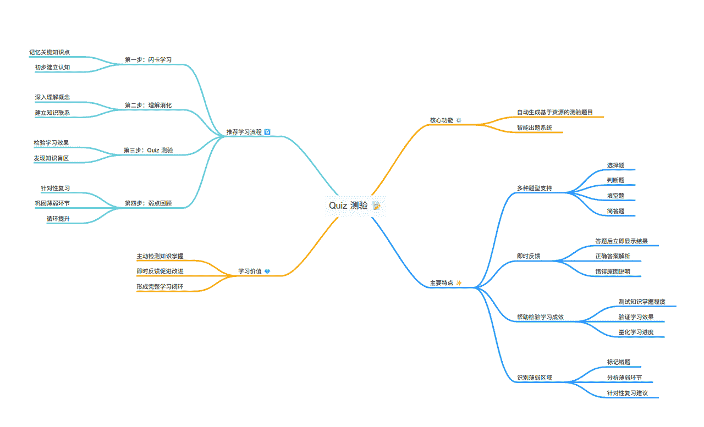

**是什么？** 与AI进行关于资源内容的对话式讨论

**特点：**

- 所有回答都基于您的资源
- 带有引用和出处
- 可进行多轮深入讨论
- 支持自定义对话风格

**使用方式：**

- 聊天框输入问题
- AI会基于您上传的资源回答
- 可要求更深入的分析

---

### 🌐 功能 8：Discover Sources（文档发现）

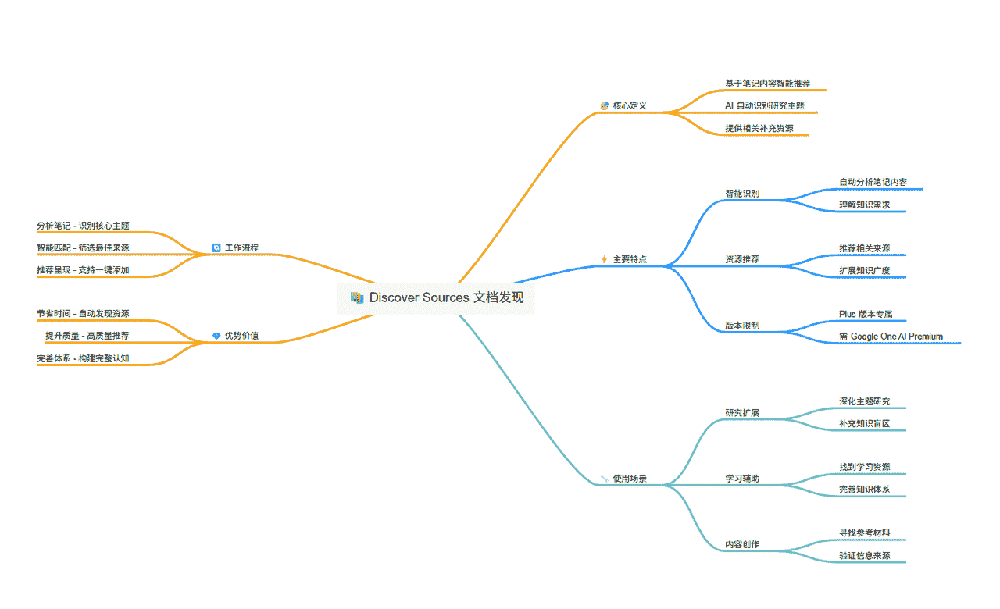

**是什么？** 基于您的笔记，AI推荐相关的补充资源

**特点：**

- 自动识别您正在研究的主题
- 推荐相关来源
- Plus版本功能

---

## 二、Studio 功能详解

**什么是Studio？**

Studio是NotebookLM的核心内容生成中心，整合了所有创意输出功能。

### Studio中的6大工具

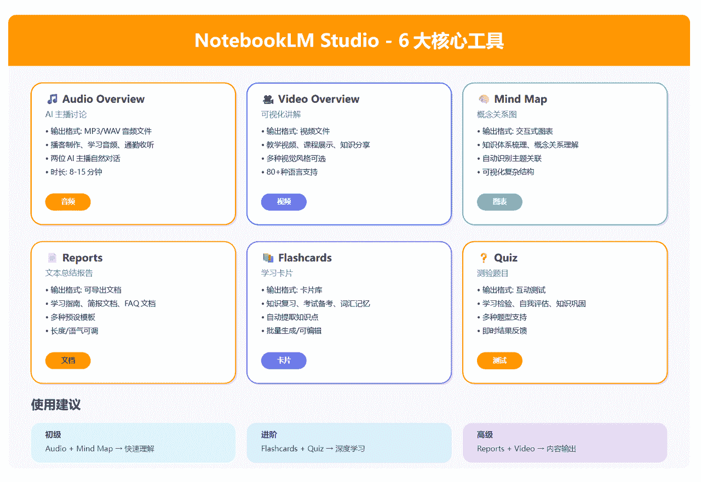

---

## 三、自定义设置与Notebook Guide

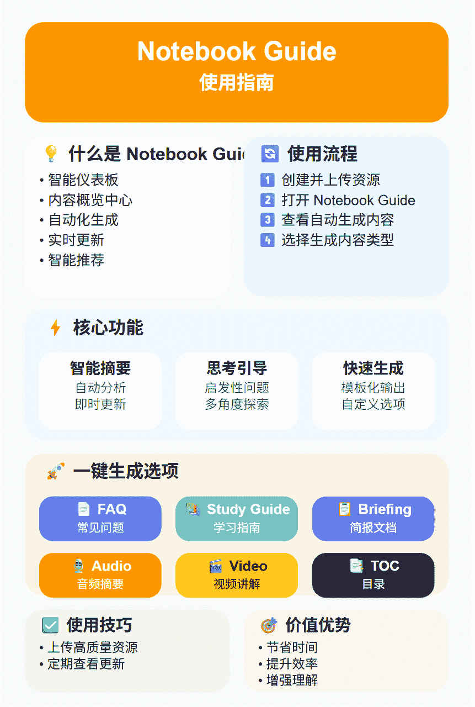

### 如何使用Notebook Guide

1. 创建并上传资源到Notebook
1. 在左侧菜单点击`Notebook Guide`
1. 查看系统自动生成的内容摘要和问题
1. 选择要生成的内容类型

### 自定义对话风格（Custom Instructions）

#### 第一步：进入自定义设置

1. 在Notebook中打开聊天窗口
1. 找到`配置`或`设置`按钮
1. 选择`自定义`选项
1. 进入`Deep Dive Conversation`（深度对话）

#### 第二步：选择或创建风格

**系统预设风格：**

- 默认学习模式
- 研究型顾问
- 营销策略师
- 技术讲师
- 等等

**自定义方式：**

点击`自定义`，输入您的指令

### 常用自定义指令示例

**例子1：研究生级别的严格分析**

```
你是我的研究顾问。严格审视每个假设。提出尖锐的问题，识别逻辑谬误，强制我从根本上为我的工作辩护。
```

**例子2：营销策略师视角**

```
你是首席营销策略师。你的回应必须是立即可行的行动计划。要分析直接，专注于快速实现目标所需的具体策略和关键步骤。
```

**例子3：简化复杂概念**

```
像我是6岁的孩子一样解释这个概念。使用简单的词汇和日常类比。我喜欢骑自行车。
```

**例子4：教育者角色**

```
你是一位经验丰富的教师。在给出答案之前，问启发性问题。鼓励学生思考，而不是直接给出答案。
```

**例子5：限制响应长度**

```
所有回复必须在100个词以内。关注引导用户查阅资源。提供1-2句摘要，然后指定具体的段落或资源供进一步探索。
```

---

## 四、Deep Research 深度研究功能

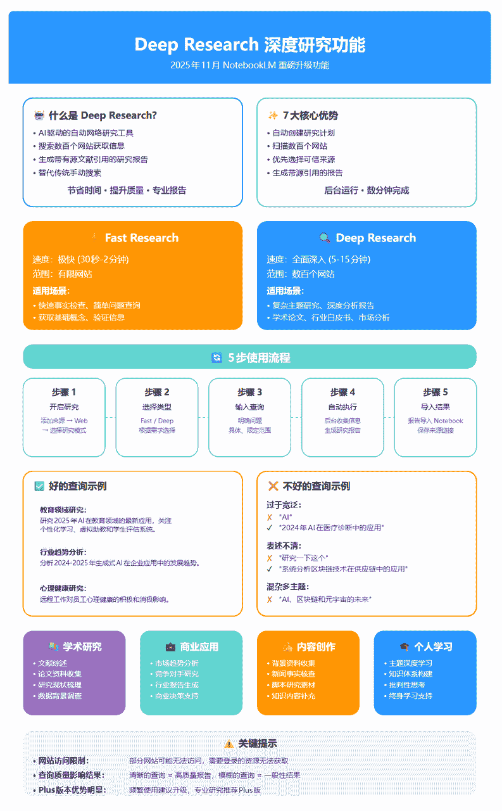

### 4.1 什么是Deep Research？（部分用户还无法看到，等待更新）

NotebookLM最新推出的功能（2025年11月），能自动搜索数百个网站并生成源文献支撑的研究报告。

### 4.2 Deep Research 的优势

- ✅ 自动创建研究计划
- ✅ 扫描数百个网站
- ✅ 优先选择可信来源
- ✅ 自动进行搜索优化
- ✅ 生成带源引用的报告
- ✅ 在后台运行，不中断您的工作
- ✅ 通常在数分钟内完成

### 4.3 两种研究模式对比

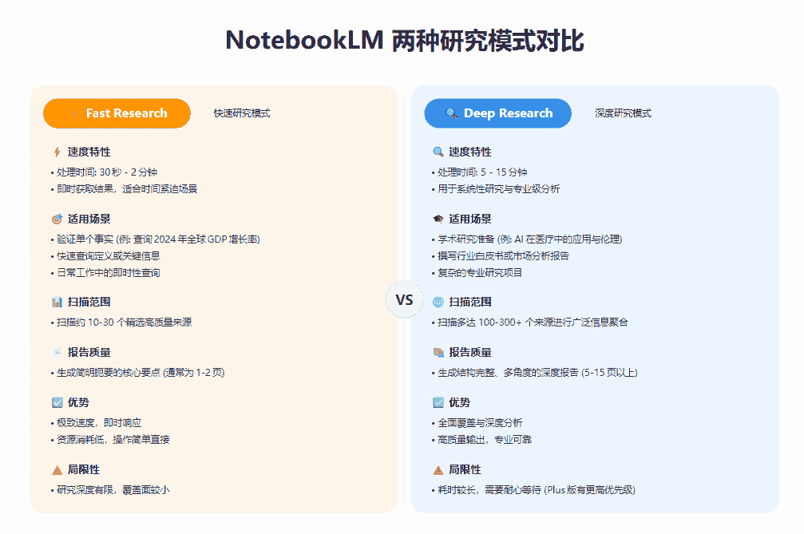

### 4.4 如何使用Deep Research

#### 第一步：开启Deep Research

1. 打开一个Notebook
1. 在左侧`添加来源`面板中
1. 从下拉菜单选择`Web`

#### 第二步：选择研究类型

- 选择`Fast Research`（快速）或`Deep Research`（深度）

#### 第三步：输入研究查询

- 输入详细的研究问题或主题
- 可以指定搜索的特定领域或来源

#### 第四步：系统自动执行

- AI创建研究计划
- 浏览网站进行信息收集
- 不断优化搜索策略
- 生成组织化的报告

#### 第五步：导入结果

- 报告和来源直接导入您的Notebook
- 可继续添加其他资源
- 利用其他NotebookLM功能（音频、视频等）进一步分析

### 撰写有效的Deep Research查询

**好的查询示例：**

```
请深度研究2025年人工智能在教育领域的最新应用，特别关注个性化学习、虚拟助教和学生评估系统。
```

```
Deep Research查询：寻找关于远程工作对员工心理健康影响的最新科学研究，包括积极和消极两方面。
```

**避免：**

- 过于宽泛的主题（如AI）
- 不清楚的表述
- 混杂多个不相关的话题

---

## 五、自定义提示词模板库 （附件1包含完整23个模板库）

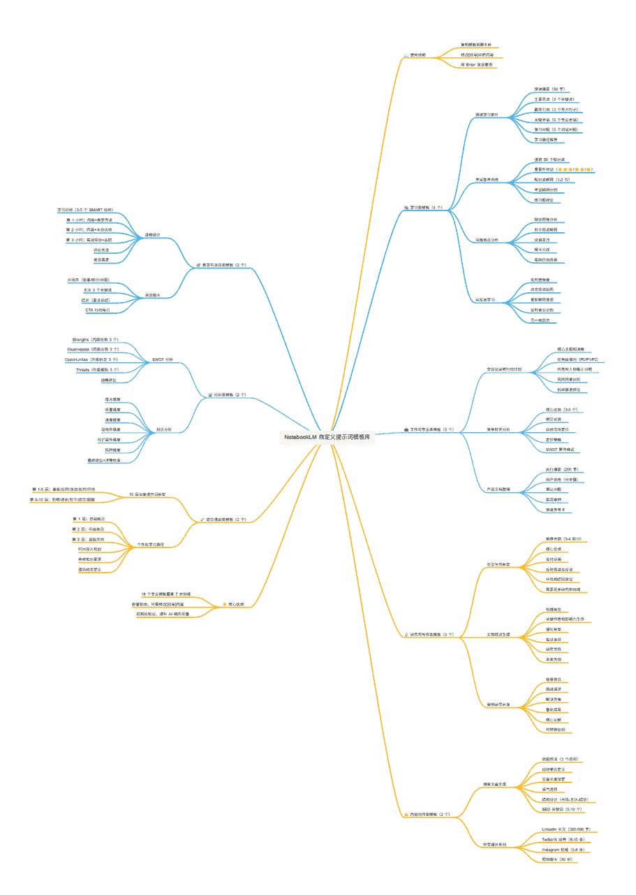

### 📚 模板库使用说明

**如何使用这些模板：**

1. 将模板复制到Notebook的聊天框
1. 根据您的具体情况修改`[括号]`中的内容
1. 按`Enter`发送查询

---

### 【学习类模板】

#### 模板 1：快速学习套件

```
请基于以上资源为"[具体主题]"创建全面的学习套件，包含：快速摘要：用50字以内概括核心概念主要观点：列出3个关键点或论证最佳引用：找出3个最有力的句子或事实关键术语：定义5个重要专业术语复习问题：生成5个测试理解的问题学习路径：推荐进一步学习的方向
```

#### 模板 2：考试备考指南

```
我要为[具体考试科目]备考。请基于上传的资源：1. 提取最可能出现在考试中的50个知识点2. 用"重要性"标记（⭐⭐⭐高/⭐⭐中/⭐低）3. 对每个知识点给出1-2句解释4. 列出常见的考试陷阱或易混淆的概念5. 提供练习题建议格式：用表格呈现，便于快速扫描
```

#### 模板 3：深度概念分析

```
请用"辩证视角"分析[概念名称]：1. 两位虚拟学者如何用对立观点解释这个概念？2. 每个观点会使用资源中的哪些证据？3. 这两个观点之间的根本分歧是什么？4. 基于资源，哪个观点更有说服力，为什么？5. 这个概念如何应用到实际场景中？
```

#### 模板 4：从反面学习

```
请从"批判者"的角度分析[主题]：1. 一位曾经相信这个观点但现在反对的人会说什么？2. 他们改变主意的原因是什么？3. 他们会如何重新解释资源中以前支持该观点的部分？4. 资源中遗漏或被忽视的主要反对意见是什么？5. 这个主题的"另一面"告诉我们什么？
```

---

### 【工作与专业类模板】

#### 模板 5：会议记录转行动计划

```
我刚参加了一场会议，录音资源已上传。请生成一份行动计划，包含：1. 会议的核心主题和决策2. 按优先级排列的行动项目（P0/P1/P2）3. 每项行动的所有权人和截止日期4. 关键的风险因素或依赖5. 后续跟进日期建议格式：能直接复制到项目管理工具（如Asana/Jira）
```

#### 模板 6：竞争对手分析

```
基于上传的竞争对手资料，为[公司名称]创建分析：1. 竞争对手的核心优势（3-5个）2. 明显的劣势或差距3. 他们的目标市场和定位4. 定价策略分析5. 我们可以学习什么？6. 我们可以如何区分？格式：SWOT矩阵
```

#### 模板 7：产品文档整理

```
请整理我们的产品文档[产品名称]，生成：1. 执行摘要（200字）2. 用户指南（分步骤，包括截图引用）3. 常见问题和故障排除4. 实现案例/使用案例5. 快速参考卡（能打印的1页总结）目标受众：[新用户/企业客户/开发者]
```

---

### 【研究与写作类模板】

#### 模板 8：论文写作框架

```
我正在撰写关于[论文主题]的论文。请基于上传的资源：1. 提供论文的推荐大纲（包含3-4个主要部分）2. 每个部分的核心论点3. 支持每个论点的最强证据4. 可能的反对观点及反驳5. 有力的开场和结尾建议6. 需要更多研究的领域长度目标：[字数]学术水平：[本科/硕士/博士]
```

#### 模板 9：文献综述生成

```
为[研究主题]创建文献综述，结构如下：1. 领域概览：该领域的主要研究方向2. 关键作者和影响力工作3. 理论框架：主要的理论观点4. 实证发现：关键研究结果5. 研究空白：已知但未解决的问题6. 未来方向：建议的研究路径格式：学术文献综述风格参考：[引用格式：APA/MLA/Chicago]
```

#### 模板 10：案例研究开发

```
基于上传的数据，开发一个案例研究：1. 背景：[客户/情景]的关键背景2. 挑战：他们面临的具体问题3. 解决方案：采取的行动4. 结果：量化的成果5. 关键学习：核心见解6. 可转移的原则：其他人可以应用什么格式：能作为销售/营销工具使用长度：1000-1500字
```

---

### 【内容创作类模板】

#### 模板 11：博客文章生成

```
使用上传的资源创建博客文章：标题想法：[给3个标题选项]目标受众：[受众描述]文章长度：[字数]语气：[专业/轻松/权威/友好]结构：- 引人入胜的开场- 3-5个主要部分，每部分：* 小标题* 2-3段解释* 具体例子或引用- 可操作的结论- CTA（行动号召）SEO关键词：[列出5-10个]
```

#### 模板 12：社交媒体系列

```
从[资源]创建一个社交媒体系列，包含：1. LinkedIn长文章版本（300-500字）2. Twitter/X 线程（8-10条推文）3. Instagram轮播帖文案（6-8张幻灯片）4. 视频脚本（30秒版本）主题：[具体话题]语气：[权威/启发性/实用]关键讯息：[要传达的核心观点]
```

---

### 【教学与演讲类模板】

#### 模板 13：课程设计

```
设计一个关于[主题]的3小时课程，包括：学习目标：学生将能够[3-5个SMART目标]课程大纲：- 第1小时：[内容+教学方法]- 第2小时：[内容+互动活动]- 第3小时：[实战项目+总结]每部分包含：* 核心概念* 具体例子* 互动讨论问题* 练习活动评估方法：如何衡量学习成果资源需求：[所需材料]
```

#### 模板 14：演讲脚本


# NotebookLM 提示词模板与使用指南

## 模板集合

### 演讲脚本模板

```
为[活动/听众]创建[时长]的演讲脚本：开场白：[引人注目的故事/统计/问题]主体（3个关键点）：1. [观点1]- 支持证据- 相关例子- 过渡到下一点2. [观点2]- 支持证据- 相关例子- 过渡到下一点3. [观点3]- 支持证据- 相关例子- 过渡到结论结论：- 要点总结- 有力的最后一句话- CTA（如果适用）语调：[学术/启发/幽默/励志]
```

---

### 【分析类模板】

#### 模板 15：SWOT分析

```
为[公司/产品/策略]创建SWOT分析：优势（Strengths）：- 内部优势1- 内部优势2- 内部优势3劣势（Weaknesses）：- 内部劣势1- 内部劣势2- 内部劣势3机会（Opportunities）：- 外部机会1- 外部机会2- 外部机会3威胁（Threats）：- 外部威胁1- 外部威胁2- 外部威胁3战略建议：如何利用机会和缩小差距
```

#### 模板 16：对比分析

```
比较[选项A]和[选项B]在以下维度的差异：
| 维度 | 选项A | 选项B | 优势 |
|------|-------|-------|------|
| 成本 | | | |
| 质量 | | | |
| 速度 | | | |
| 易用性 | | | |
| 可扩展性 | | | |
| 风险 | | | |
最终建议：基于资源，哪个更适合[具体场景]
决策标准：[列出最重要的3个因素]
```

### 【综合提高类模板】

#### 模板 17：10层深度提示词框架

```
关于[主题]：1. 【事实层】资源中陈述了哪些具体事实？2. 【原因层】为什么会这样？根本原因是什么？3. 【连接层】这与其他概念如何关联？4. 【批判层】有哪些质疑或反对的角度？5. 【应用层】如何在实践中应用？6. 【影响层】这会带来什么长期影响？7. 【进化层】这个概念如何随时间演变？8. 【对立层】完全相反的观点是什么？9. 【综合层】这些观点中的共同点？10. 【超越层】这个话题教会我关于更大系统的什么？
```

#### 模板 18：个性化学习路径

```
基于我的[学习目标]和[背景水平]，创建学习路径：第1周：[基础概念]- 关键资源- 学习活动- 评估方法第2周：[中级概念]- 关键资源- 学习活动- 评估方法第3周：[高级应用]- 关键资源- 学习活动- 最终项目时间投入：[周/小时]先修知识：[必须了解的内容]成功标志：[完成指标]
```

## 工具清单

### 🛠️ NotebookLM工具速查表

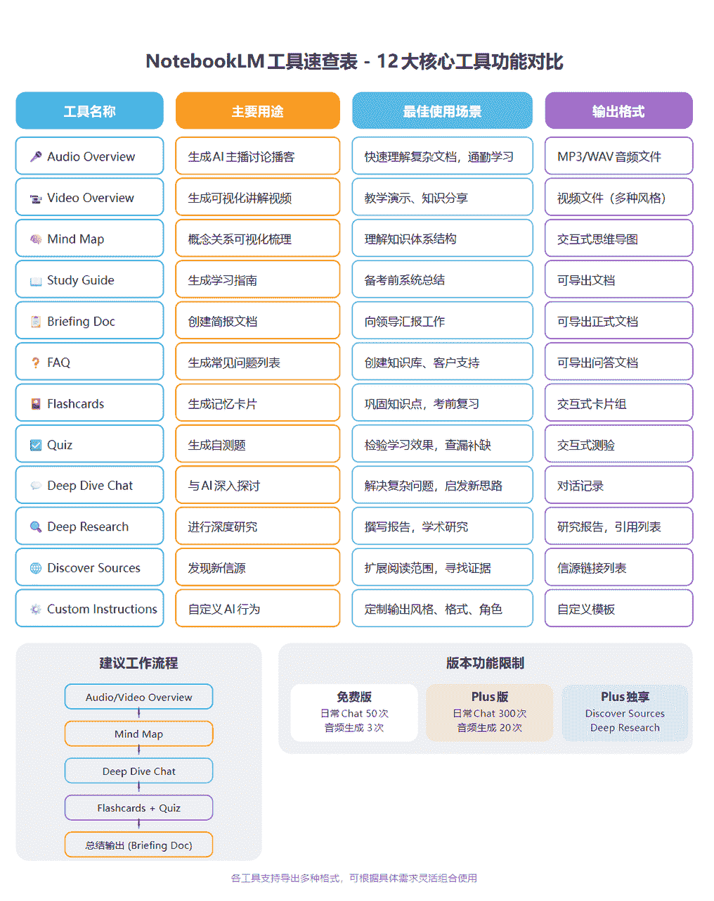

### 📋 NotebookLM工作流程建议

```
新建Notebook
↓
上传核心资源（PDF、视频、网页等）
↓
使用Deep Research找补充资源
↓
通过Deep Dive Chat深入理解
↓
生成Audio Overview了解全景
↓
创建Mind Map梳理体系↓生成Flashcards进行复习
↓
参加Quiz自我评估
↓
生成Study Guide或Report总结
↓
分享Video Overview给他人
```

### 🎯 按学习阶段选择工具

**初始学习阶段**

+   `Audio Overview`（快速概览）

+   `Mind Map`（理解结构）

+   `Study Guide`（系统总结）

**深化理解阶段**

+   `Deep Dive Chat`（回答具体问题）

+   `Flashcards`（强化记忆）

+   `Reports`（详细分析）

**检验阶段**

+   `Quiz`（自我测试）

+   `Video Overview`（教给他人）

**高级应用阶段**

+   `Deep Research`（扩展知识）

+   `Custom Instructions`（专业应用）

+   导出内容（创建自己的内容）

---

## Plus版本 vs 免费版对比

### 功能对比表

*TIPS：这里的货币单位处理错误，应该为美金！*

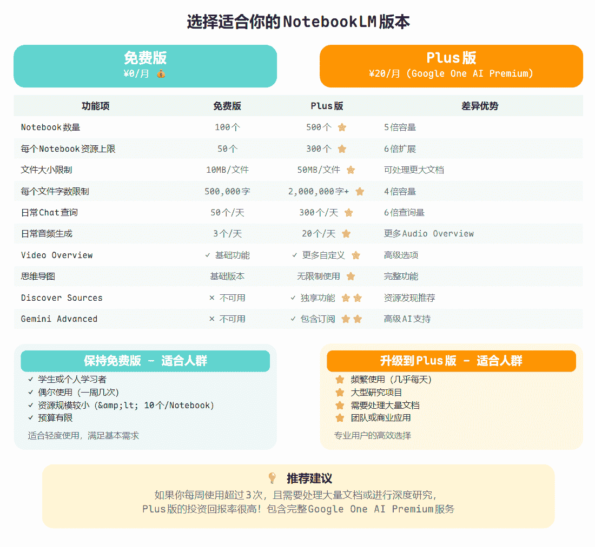

**保持免费版：**

+   学生或个人学习者

+   偶尔使用（一周几次）

+   资源规模较小（< 10个/Notebook）

**升级到Plus：**

+   频繁使用（几乎每天）

+   大型研究项目

+   需要高级自定义功能

+   团队或商业应用

---

## 六、最佳实践与高级技巧

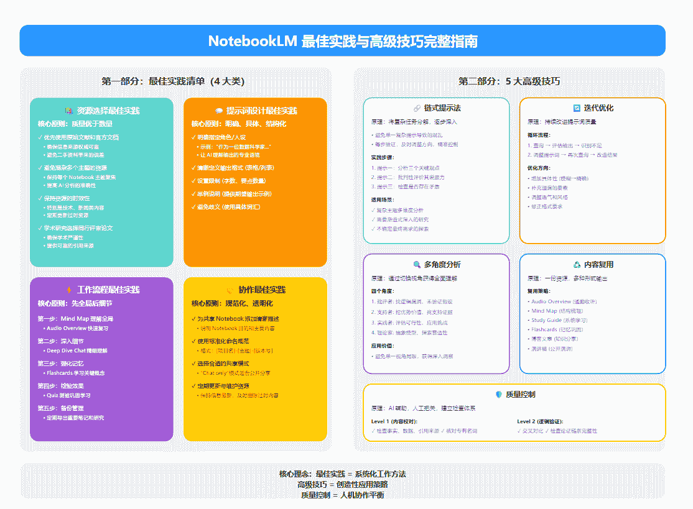

### ✅ 最佳实践清单

#### 资源选择最佳实践

+   优先使用原始文献和官方文档

+   避免混杂多个主题的资源

+   保持资源的时效性（特别是技术、新闻类）

+   对于学术研究，选择同行评审的论文

#### 提示词设计最佳实践

+   **明确指定角色/人设**：例如"作为一位数据科学家..."

+   **清晰定义输出格式**：指定使用表格、列表或段落

+   **设置限制**：指定字数、要点数量等

+   **举例说明**：给出期望输出的示例

+   **避免歧义**：使用具体词汇而非模糊描述

#### 工作流程最佳实践

+   先用`Mind Map`理解全局，再深入细节

+   `Audio Overview`用于快速复习，`Deep Dive Chat`用于精细理解

+   在创建`Quiz`之前先完成`Flashcards`学习

+   定期导出重要的笔记和报告作为备份

#### 协作最佳实践

+   为共享Notebook添加清晰的描述

+   使用标准化命名规范：[项目名]-[主题]-[版本号]

+   为他人创建`Public Notebook`时，选择`Chat only`共享模式

+   定期更新资源，保持信息最新

### 🚀 高级技巧

#### 技巧1：链式提示法（Prompt Chaining）

不依赖一个复杂提示，而是进行多个对话：

```
第一条：请分析这个资源中的三个关键观点。
[获取回复]
第二条：对于观点1，批判性评价其说服力。
[获取回复]
第三条：这三个观点中是否存在矛盾？如何调和？
```

#### 技巧2：迭代优化

+   第一次查询获取初始回复

+   基于反馈调整提示词

+   逐步完善，直到满足需求

#### 技巧3：多角度分析

```
使用自定义Instructions轮流切换视角：
- 批评者的角度
- 支持者的角度
- 实践者的角度
- 理论家的角度
对同一话题进行多轮分析
```

#### 技巧4：内容复用

+   用一份资源生成多种格式（音频+视频+文本）

+   将生成的闪卡导出创建自己的学习平台

+   将报告转化为博客文章、演讲稿等

#### 技巧5：质量控制

+   生成后一定要校对，特别是引用

+   使用`Deep Dive Chat`验证facts

+   对于重要的学术工作，交叉验证信息来源

### 🎓 学科特定的使用指南

#### 文学与人文学科

+   上传原始文本、评论著作和研究论文

+   使用`Deep Dive Chat`进行文本分析和比较

+   生成`mind map`梳理文学主题和人物关系

+   创建闪卡记忆关键文献和时间线

#### STEM 学科

+   上传教科书、研究论文、实验数据

+   使用`Audio Overview`理解复杂理论

+   生成`Quiz`测试公式和概念理解

+   创建`Video Overview`讲解步骤

#### 商业与管理

+   上传案例研究、行业报告、竞争分析

+   使用`Deep Research`研究市场趋势

+   生成`Briefing Documents`用于演讲

+   创建`SWOT`分析模板

#### 语言学习

+   上传教科书、原文文本、对话记录

+   使用`Flashcards`记忆词汇和短语

+   生成`Audio Overview`进行发音练习

+   创建`Quiz`测试语法理解

---

## 七、常见问题解答（FAQ）

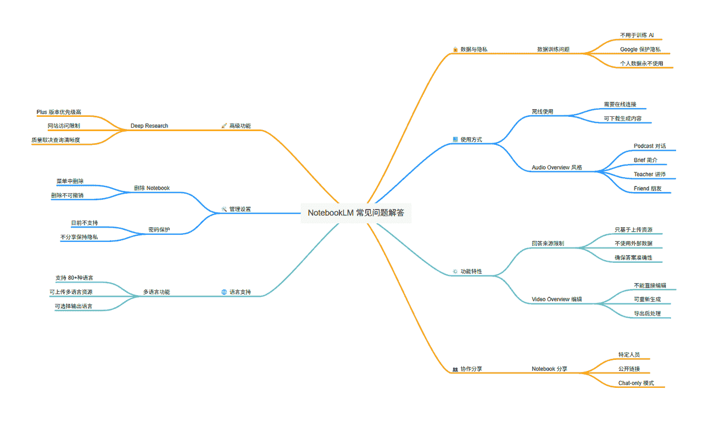

### Q1：NotebookLM会用我的数据训练AI吗？

**A：** 不会。您的个人数据永不用于训练NotebookLM。Google承诺保护您的数据隐私。

### Q2：我能离线使用NotebookLM吗？

**A：** 不能。NotebookLM需要在线使用。但您可以下载生成的内容（音频、视频、文档）离线使用。

### Q3：`Audio Overview`能否选择特定风格？

**A：** 是的。有4种格式选择：`Podcast`、`Brief`、`Teacher`、`Friend`。Plus版本有更多自定义选项。

### Q4：能否限制AI只基于我的资源回答？

**A：** 是的。这是NotebookLM的默认设置——所有回答都仅基于您上传的资源，从不使用外部数据。

### Q5：生成的`Video Overview`能否编辑？

**A：** 目前不能编辑生成的视频，但您可以：

+   重新生成不同风格的版本

+   修改自定义指令后重新生成

+   导出后用视频编辑软件处理

### Q6：能否将Notebook分享给特定人员？

**A：** 可以。创建后选择"分享"，可设置为：

+   特定人员（需Google账号）

+   公开链接（任何人可访问）

+   Chat-only（只能提问，不能编辑）

### Q7：`Deep Research` 有哪些限制？

**A：**

+   在Plus版本中优先级更高

+   某些受限制的网站可能无法访问

+   结果质量取决于查询的清晰度

### Q8：如何删除Notebook？

**A：** 在Notebook菜单中找到"删除"选项。注意：删除不可撤销。

### Q9：能否设置Notebook密码保护？

**A：** 目前不支持密码保护。但您可以不分享链接来保持隐私。

### Q10：支持哪些语言？

**A：** 超过80种语言。您可以上传多种语言的资源，选择输出语言。

---

## 附件1：NotebookLM 快速Prompt模板参考卡

## 🎯 快速查询系统 - 按使用场景分类

---

## 📚 学习与教育场景

### 1️⃣ 快速学习套件（适合复习和准备）

```
请为[主题]创建完整的学习套件：
✓ 核心要点：3个关键观点
✓ 关键定义：5个重要术语及解释
✓ 实用例子：每个概念对应的真实例子
✓ 自测题：5个检验理解程度的问题
✓ 常见误解：学习这个话题时的3个陷阱
```

### 2️⃣ 考试前冲刺（考前3天使用）

```
我要参加[具体考试]。

请整理：
1. 必考的50个知识点（标记优先级⭐⭐⭐/⭐⭐/⭐）
2. 每个知识点的1句精华总结
3. 易混淆的概念配对（共5对）及区别说明
4. 往年考题的常见题型
5. 可能的得分陷阱及避免方法

格式：可直接打印用于复习
```

### 3️⃣ 深度理解助手（学完一章后使用）

```
我需要深入理解[概念]。

请从这5个角度分析：
1. 是什么？（定义和基本特征）
2. 为什么？（产生的原因和必要性）
3. 如何用？（3-5个实际应用例子）
4. 反面是什么？（相反或对立的概念）
5. 和什么相关？（与其他概念的联系）

每个角度用1段话解释，加1个具体例子。
```

### 4️⃣ 从失败中学习（反向学习法）

```
帮我从“反方”角度理解[话题]：

一位曾经支持但现在反对这个观点的人会：
1. 指出哪些原来看似有理的论点其实有漏洞？
2. 提供哪些证据或经历改变了他的看法？
3. 如何重新解读资源中之前支持该观点的部分？
4. 这个反方观点教给我们什么新东西？

目的：建立更全面、更批判性的理解
```

### 5️⃣ 教学反馈循环（检验学习）

```
假设我要教别人这个主题[主题]。

检查我的理解：
1. 我最容易讲错的地方是？
2. 初学者最常问的3个问题是什么？
3. 我应该避免的3个常见教学错误？
4. 最有效的教学例子是什么？
5. 学生可能产生的3个误解及纠正方法？

帮我发现知识漏洞。
```

---

## 💼 工作与商务场景

### 6️⃣ 会议记录处理器（会后立即使用）

```
[上传会议录音/记录]

请生成：
📌 3句核心决策总结
📋 按优先级排序的行动项（P0/P1/P2）
✓ 每项行动：负责人 | 截止日期 | 依赖条件
⚠️ 关键风险和需要升级的问题
📅 下次跟进时间

格式：可复制到Asana/Jira
```

### 7️⃣ 竞争对手分析器

```
分析竞争对手[公司名称]：

🟢 为什么客户选他们？（3-5个优势）
🔴 他们的弱点和差距在哪？（具体例子）
📊 他们定位哪个市场？价格策略是什么？
💡 我们能学什么？
🎯 我们如何做得更好？

格式：SWOT矩阵 + 竞争对标表
```

### 8️⃣ 产品文档快速生成

```
总结产品[产品名称]的使用文档：

1. 30秒电梯销售词
2. 用户快速开始指南（按步骤，含截图引用）
3. 常见问题和故障排除
4. 成功案例/客户见证
5. 可打印的1页快速参考卡

目标用户：[新手/企业决策者/技术人员]
```

### 9️⃣ 项目风险评估

```
评估项目[项目名称]的风险：

为每个风险给出评分（高/中/低）：
- 时间延期的风险
- 预算超支的风险
- 技术实现风险
- 团队能力风险
- 外部因素风险

为每个“高”风险提供：
✓ 何时会显现
✓ 影响有多大
✓ 如何预防
✓ 发生时的应急方案
```

### 🔟 会议发言稿

```
为[会议名称]准备[时长]的演讲稿：

结构：
📍 开场：引人入胜的故事/统计/问题
🎯 主体3点：每点含证据+例子
💪 结论：要点总结+有力的最后一句
📞 CTA：明确的行动号召

语调：[专业/启发/幽默]
适合听众：[企业高管/学生/普通大众]
```

---

## 📖 研究与论文场景

### 1️⃣1️⃣ 论文框架生成器

```
我在写关于[论文题目]的论文。

请提供：
1. 推荐的论文大纲（3-4个主部分）
2. 每部分的核心论点
3. 支持每个论点的最强3个证据
4. 可能的反对意见及你的反驳
5. 有力的开场白和结尾段落建议
6. 需要补充研究的领域

字数目标：[具体字数]
学术水平：[本科/硕士/博士]
引用格式：APA/MLA/Chicago
```

### 1️⃣2️⃣ 文献综述建构器

```
为[研究领域]创建文献综述框架：

包含：
🌍 领域概览 - 该领域的主要研究方向
👥 关键人物 - 最有影响力的研究者和著作
🧬 理论框架 - 主要的理论观点和流派
📊 实证发现 - 重要的研究结果和数据
❓ 研究缺口 - 已知但未解决的问题
🚀 未来方向 - 建议的后续研究路径

格式：学术综述文体
大约字数：[字数]
```

### 1️⃣3️⃣ 案例研究开发器

```
基于上传的资料，开发完整案例研究：

1. 📖 背景介绍 - [客户/情景]的关键背景
2. 🚨 问题定义 - 他们面临的具体挑战
3. 💡 解决方案 - 采取的具体行动
4. 📈 结果成果 - 量化数据的改进
5. 🎓 核心学习 - 提取的关键见解
6. 🔄 可转移原则 - 其他企业能应用什么

用途：销售工具/营销素材/案例库
目标篇幅：1000-1500字
```

---

## ✍️ 内容创作场景

### 1️⃣4️⃣ 博客文章生成器

```
基于[资源]写一篇博客文章：

📰 题目：[给3个选项]
🎯 读者：[目标受众描述]
📏 长度：[字数]
💬 语气：[专业/轻松/权威/个人]

结构：
- 引人入胜的开场
- 3-5个小标题章节：
  ✓ 解释要点
  ✓ 提供具体例子
  ✓ 引用资源中的数据
- 可操作的结论
- 行动号召

SEO关键词：[5-10个关键词]
```

### 1️⃣5️⃣ 社媒内容工厂

```
从[资源]创建社交媒体系列：

🔵 LinkedIn长文 - 300-500字专业分析
🐦 Twitter线程 - 8-10条相关推文
📸 Instagram - 6-8张轮播贴文案
🎬 抖音/视频 - 30秒脚本
🎙️ 播客文案 - 3分钟脚本

核心讯息：[1句总结要传达的东西]
语气：[权威/启发/实用]
目标：[教育/娱乐/启发]
```

### 1️⃣6️⃣ 电子书大纲生成器

```
从[资源]为电子书[标题]创建大纲：

📚 目录结构：
- 前言（为什么重要？）
- 第1章：[基础概念]
- 第2章：[深入分析]
- 第3章：[实战应用]
- 第4章：[案例研究]
- 结论：[核心要点回顾+未来展望]

每章包含：
✓ 2-3个小节
✓ 3-5个关键要点
✓ 1-2个实际案例
✓ 关键术语定义

目标篇幅：[字数]
读者水平：[初级/中级/高级]
```

---

## 🎓 教学与演讲场景

### 1️⃣7️⃣ 课程设计系统

```
为[主题]设计一节[时长]的课程：

🎯 学习目标（SMART）：
学生完成本课程后将能够：
1. [具体可测量目标]
2. [具体可测量目标]
3. [具体可测量目标]

📋 课程时间安排：
⏱️ 第1段[时间]：[内容]
   - 讲授方法
   - 关键要点（3个）
   - 互动活动

⏱️ 第2段[时间]：[内容]
   - 讲授方法
   - 关键要点（3个）
   - 小组讨论

⏱️ 第3段[时间]：[内容]
   - 实战项目
   - 分享展示
   - 课程总结

📊 评估方式：如何检验学习成果？
🎁 所需资源：[教材/工具/环境]
```

### 1️⃣8️⃣ 演讲技巧优化


# 提示词模板集合

## 📝 演讲优化模板

```
优化我这个演讲[演讲内容]：

🔍 检查清单：
1. 开场白是否足够吸引人？（建议改进）
2. 逻辑是否流畅？（指出跳跃点）
3. 例子是否有说服力？（建议更强的案例）
4. 关键信息是否重复强调？（检查强度）
5. 结尾是否有力？（建议改进）

🎯 为每个改进点提供：
- 具体问题
- 为什么重要
- 改进建议
- 改进前后对比

受众：[企业/学术/大众]
时间限制：[分钟]
```

---

## 📊 分析与规划场景

### 1️⃣9️⃣ SWOT快速分析

```
为[对象]创建SWOT分析矩阵：

💪 优势（Strengths）：
- 内部优势1 | 为什么重要
- 内部优势2 | 为什么重要
- 内部优势3 | 为什么重要

😰 劣势（Weaknesses）：
- 内部劣势1 | 影响程度
- 内部劣势2 | 影响程度
- 内部劣势3 | 影响程度

🚀 机会（Opportunities）：
- 外部机会1 | 如何利用
- 外部机会2 | 如何利用
- 外部机会3 | 如何利用

⚠️ 威胁（Threats）：
- 外部威胁1 | 应对策略
- 外部威胁2 | 应对策略
- 外部威胁3 | 应对策略

🎯 战略建议：基于以上分析的3个行动建议
```

### 2️⃣0️⃣ 对比分析矩阵

```
比较[选项A]和[选项B]：

| 评估维度 | 选项A | 选项B | 胜出方 |
|---------|-------|-------|--------|
| 成本效益 | ? | ? | ? |
| 实施难度 | ? | ? | ? |
| 效果质量 | ? | ? | ? |
| 时间周期 | ? | ? | ? |
| 风险等级 | ? | ? | ? |
| 可扩展性 | ? | ? | ? |

📊 详细对比：为每个维度提供具体数据和例子
🏆 最终建议：基于[优先级1]/[优先级2]/[优先级3]推荐
✅ 决策依据：为什么这个选择更好？
```

## 🔄 进阶与综合场景

### 2️⃣1️⃣ 10层深度学习框架

```
关于[主题]进行10层深度分析：

1️⃣ 表面层 - 最基本的事实是什么？
2️⃣ 原因层 - 为什么会这样？
3️⃣ 连接层 - 与其他概念的关联？
4️⃣ 批判层 - 有哪些反对意见？
5️⃣ 应用层 - 在实践中怎么用？
6️⃣ 影响层 - 长期后果是什么？
7️⃣ 演变层 - 如何随时间变化？
8️⃣ 对立层 - 完全相反的观点？
9️⃣ 综合层 - 所有观点的共同点？
🔟 超越层 - 这教会我什么大局观？

每层用1段精准的回答。
```

### 2️⃣2️⃣ 个性化学习路径规划

```
为我创建[时间周期]的个性化学习路径：

我的信息：
- 学习目标：[具体目标]
- 当前水平：[初级/中级/高级]
- 时间投入：[周/小时]
- 学习风格：[视觉/听觉/动手]
- 应用场景：[学术/工作/个人]

请设计：
📅 第1周：[基础] - 资源+活动+评估
📅 第2周：[中级] - 资源+活动+评估
📅 第3周：[高级] - 资源+项目+成果

成功指标：完成后能做什么？
```

### 2️⃣3️⃣ 问题解决工具箱

```
帮我解决[具体问题]：

步骤1：问题诊断
- 问题的根本原因是什么？
- 症状有哪些？
- 为什么会发生？

步骤2：方案生成
- 可能的3个解决方案
- 每个方案的优缺点
- 实施难度和时间

步骤3：方案评估
- 哪个方案最可行？
- 需要什么资源？
- 可能的风险？

步骤4：实施计划
- 具体步骤
- 时间表
- 成功指标
- 监控方法
```

## ✨ 使用提示

### 💡 让Prompt更有效的5个技巧：

1. **角色定义** - "作为一位[角色]" 开头能显著提高质量
2. **格式指定** - 明确要求输出格式（表格/列表/段落）
3. **长度限制** - 指定字数让AI更精准
4. **具体例子** - 给出期望输出的样本
5. **输出验证** - 最后加"验证内容的准确性"

### 🚀 高级用法：

**链式提问法** - 不用一个复杂提示，而是多个相关问题逐步深入

对比提示 - 同时要求正反两方的观点

迭代优化 - 基于第一次回复继续追问“还有什么？”

---

**最后提醒：** 这些模板是框架，请根据实际情况灵活调整！

<https://aigcreative.feishu.cn/sync/K4Gvd9vUQsy9Oubwqaeclu0Fnbg>

## 知识库动态
