# 20260101-2026第一弹！稚晖君发布可装进背包的人形机器人Q1，具身智能走进生活

> 来源：[https://aigcreative.feishu.cn/docx/TN3wdAWN3oNqH2xVkqLcjRUjnNh](https://aigcreative.feishu.cn/docx/TN3wdAWN3oNqH2xVkqLcjRUjnNh)

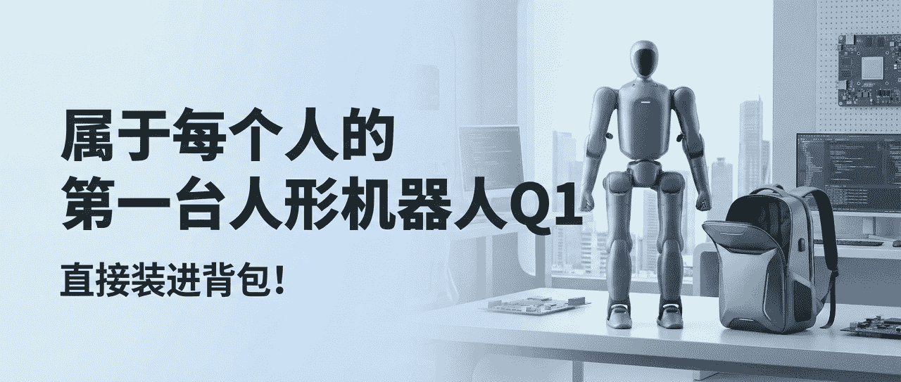

大家好，我是创意猎人。

首先祝大家元旦快乐！马年大吉～🎉🎉🎉

在过去的2025年，整个具身智能行业的玩家们，都在比拼谁家的机器人更像人、谁跑得更快、谁搬箱子负载更大，这个行业跟大模型、AI应用一样，也是卷到起飞。

时间来到2026年。

**稚晖君/上纬启元却反其道而行****，发布了一款全**球最小的全身力控人形机器人——启元Q1：

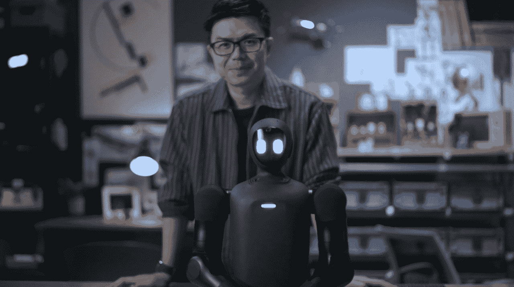

就是下面这个，一只手就能拎起来：

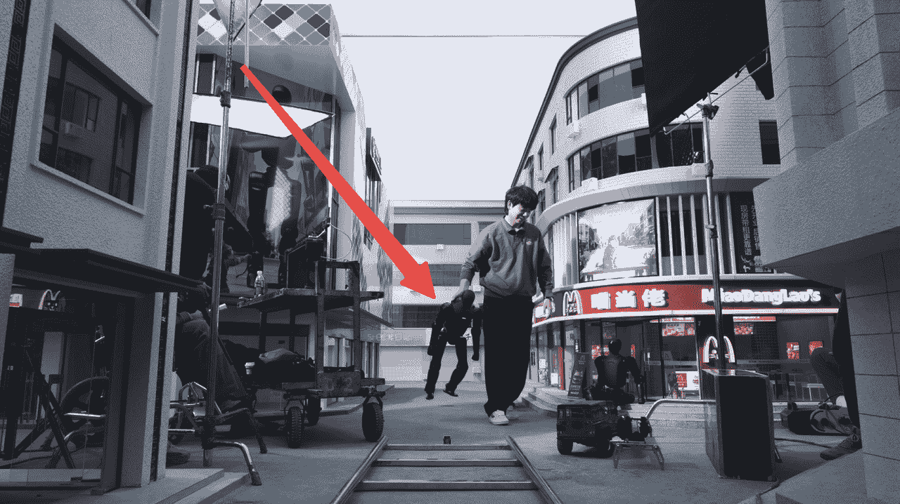

这是一个极其反直觉，但细想又非常精准的信号。

当大厂们还在因为恐怖谷效应和高昂的B端落地成本挣扎时，稚晖君把目光投向了桌面和背包。

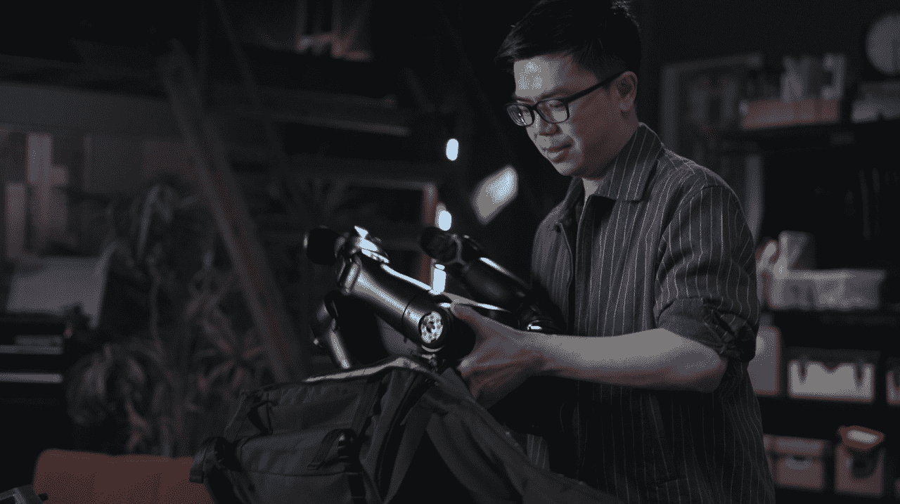

这款身高0.8米、能直接装进背包的机器人，表面看是尺寸的缩小了，实则是对目前具身智能发展路径的一次降维打击。

它不再试图立刻去工厂打螺丝干苦力活，而是先试图占领科研人员的背包和普通人的客厅。

# 01.把便携实验室塞进书包

很多人第一眼看到Q1，会觉得它像个大号手办，但对于科研和教育用户来说，这是一个解决刚需的毕业级神器。

在具身智能的研发领域里，门槛着实是有点高。

传统的大型人形机器人不仅昂贵，而且对场地要求极高，通常需要安装笨重的桁架来防止机器人跌倒损坏，这意味着你的实验只能被锁在固定的实验室里。

Q1彻底打破了这个空间限制，它不需要桁架保护，可以直接塞进双肩包随身携带。

这带来的好处是，无论是在宿舍、咖啡馆还是户外，开发者都可以随时随地开始调试代码。

**除了便携**，它还解决了科研中最大的痛点：试错成本。

在三维空间里，尺寸减半，体积缩小至1/8，重量约缩小至1/8，这个物理法则给Q1带来了天然的耐摔属性。

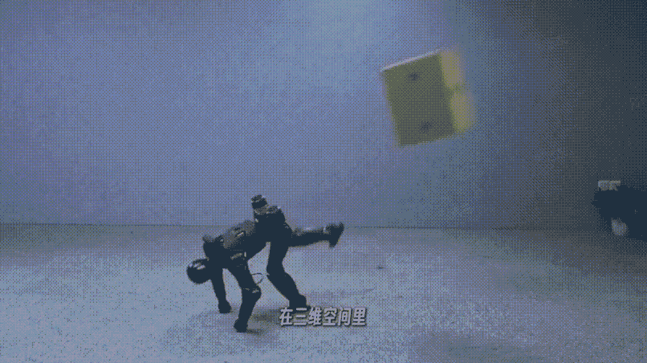

配合全量开放的SDK和HDK接口，开发者可以毫无顾虑地去跑激进的强化学习算法。

就像稚晖君说的：**炸得轻，炼得稳**。

这种低成本、快迭代的特性，填补了个人科研场景的巨大空白，让它极有可能成为具身智能领域的标准化教具。

## 02.从冷冰冰的机器人到有温度的小伙伴

**如果说科研属性**是它的硬核一面，那么沉浸式智能交互则是它柔软的一面。

我们习惯了将手机、音箱作为智能入口，但它们都止步于屏幕和声音。

Q1试图打破这个边界，它依托智元灵心AI平台，把交互从二维升维到了三维。

它不再只是一个会说话的机器人。

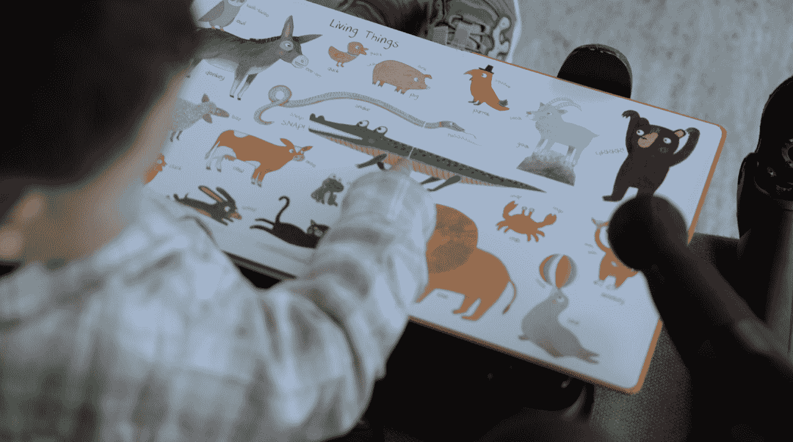

当你问它英语单词怎么发音，它不仅能教你标准发音，还能配合手势；当你让它跳舞，它能精准地踩点律动；当你问它十万个为什么，它能一边解释一边演示。

更重要的是，它搭载的先进柔性阻抗控制技术，让科技变得不再危险。它可以让孩子安全地触碰，甚至进行肢体互动，这种安全性是它进入家庭的前提。

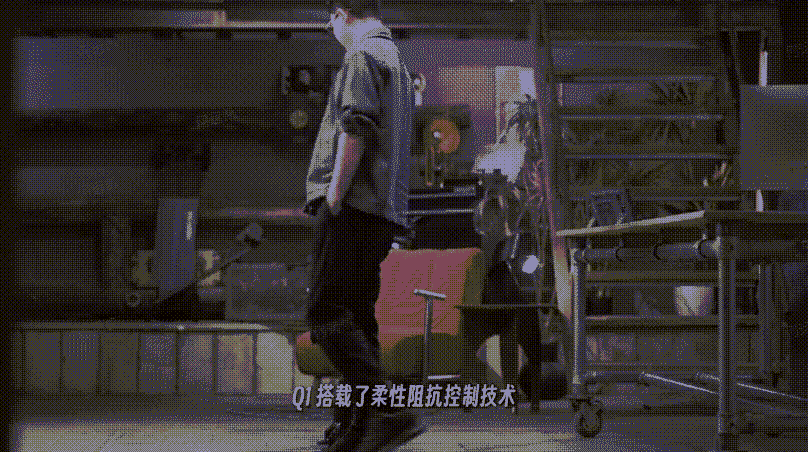

这种长得像人、懂你需求、且能给出物理**反馈**的交互模式，让智能终端从工具升级成了伙伴。它既可以是陪孩子练习英语的助教，也可以是极客桌面上那个随时待命的赛博朋友。

它让AI不仅能被听见、被看见、更能被触摸。

## 03.好的产品是未完成的

我一直坚持一个观点：好的科技产品，在极客眼中应该是未完成的。

如**果Q1只是一个会跳舞、**会聊天的机器人，那它只是一个昂贵的电子宠物。但Q1最强的地方在于它的这个定位——属于极客的自由创作画布。

它的外观结构件都开源支持3D打印，官方只提供了一个强悍的骨架和聪明的大脑，剩下的血肉和灵魂，全部交给了用户。

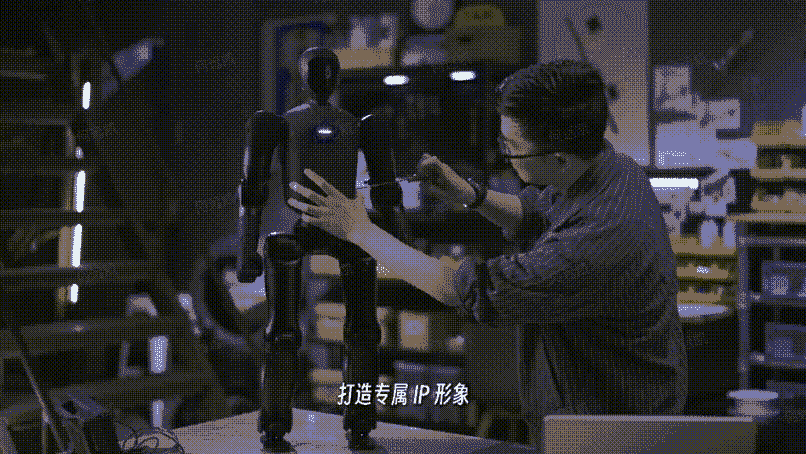

**硬件上**： 它可以是赛博朋克的机械姬，也可以是蒸汽朋克的侦探，头部和外壳完全模块化。

**软件上**： 依托智元灵创灵心平台，动作编排和行为逻辑变成了低代码的积木搭建。

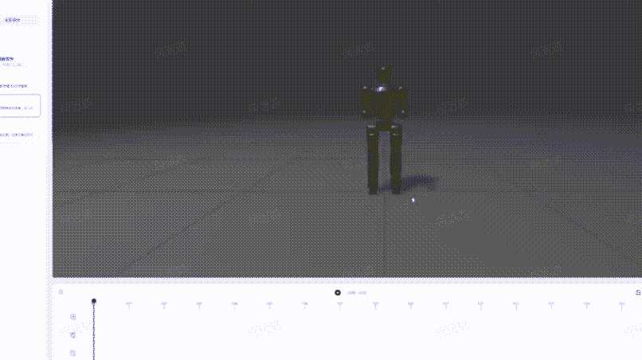

这种策略极其聪明。

它解决了一个核心痛点：具身智能的门槛太高了，以前你想研究具身智能，需要海量的专业知识储备。

现在，门槛已经被踏平了，它极有可能像当年的Arduino或树莓派一样，成为具身智能领域的标准化开发平台。

## 04.被物理法则偏爱的“小”

当然，实现上述一切的前提，是硬件技术的极致压缩。

之前有过一段在协作机器人公司工作的经历，有了解：传统的高性能机器人依赖QDD准直驱关节来保证爆发力，这种关节一旦要缩小到鸡蛋大小，对生产工艺是很大的挑战。

上纬启元这次的核心突破，就是搞定这颗微型QDD关节。

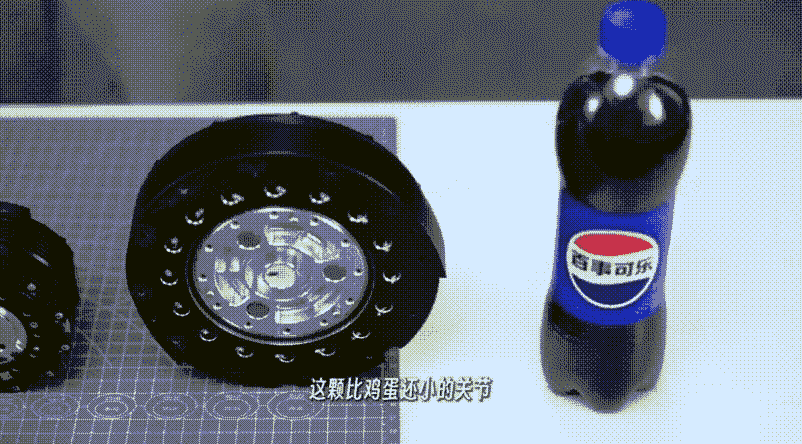

这是为了降低**Sim2Real Gap**（仿真到现实的差距），因为更轻便，Q1能更好地从仿真环境中迁移算法。

它不仅是一台输出动作的机器，更是一台高效输入真实物理反馈的数据采集器，帮助开发者去采集与积累那些大型机器人不敢轻易尝试的交互数据。

## 05.具身智能的“iPhone时刻”前夜

我们回顾历史，计算机是从房间大小的ENIAC变成了桌面的PC，才真正爆发了互联网革命。

我想，人形机器人也一样。

只要它还被锁在实验室的玻璃房里，它就永远只是演示品。

Q1的出现，是一次将智能体**个人化****、****私有化**的尝试。

科技在变，交互的入口也在变。

上纬启元这一步棋，走得非常务实。

他们没有画替代人类劳动的大饼，而是先用低成本、高可玩性、强开发属性的Q1，切入科研教育和家庭陪伴这两个高频场景。

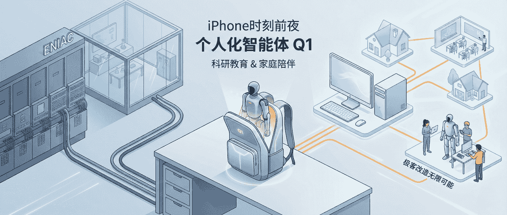

**Q1或许不是那个最终改变世界的全能管家，但它很可能是**那个教会一代人如何定义机器人的启蒙老师。

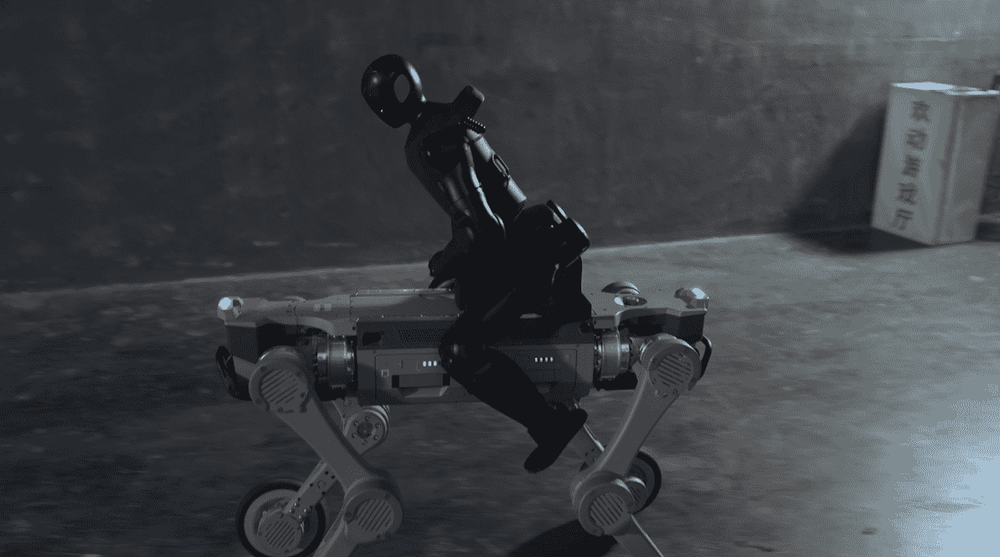

这款集"**大动作、大智慧、大可玩性**"于一体的小尺寸人形机器人Q1，对于我们这些普通用户、消费者来说，最令人兴奋的不是它现在能做什么，而是当它到了成千上万个极客手中后，会被改造成什么，这个想象空间就很大很大了。

未来已来，而且它就在你的背包里。

---

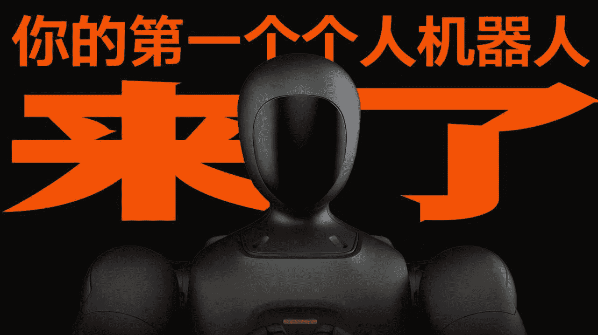

# 你好，2026！你好，未来创造者！

欢迎登陆「探索者计划」，全球首款【个人机器人】因共创而生，也会因你的共创而强！请用勇气和创意解锁四重新年专属权益！

问卷链接：https://primebot.feishu.cn/share/base/form/shrcnRfFmNaEsDek8ZzSwU3PV9d

> 欢迎登陆「探索者计划」，全球首款【个人机器人】因共创而生，也会因你的共创而强！请用勇气和创意解锁四重新年专属权益！

> 1、 【个人机器人共创礼】：成为前1000名提交完整问卷的共创伙伴，将获得5000元专属启元Q1代金券。

> 2、 【2026共创限定】：前12位问卷尾号逢“26”的共创者（26、126、226、326、426、526、626、726、826、926、1026、2026），可以以 2026元 斩获一个稚晖君签名版的全球首款个人机器人启元Q1。

> 3、 【稚晖君共创点将】：稚晖君将亲自从问卷池中挑选 20位硬核极客进入个人机器人创意项目，一起探索个人机器人能力与场景的无限可能。（时间限定：从问卷发布时至1月4日8：30假期结束，上班前）

> 4、 【学生共创专属】：如果你是在校学生（须年满16周岁），且热爱具身智能，我们会遴选20位进入上纬启元具身智能研究院实习，一起开创个人机器人的未来。

>

> 「PrimeQuester 1」 Your Mate，You Made！

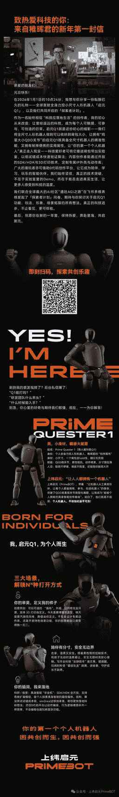

（本问卷活动最终解释权归上纬新材公司所有）

---

按照惯例，用一张图来总结今天的分享：

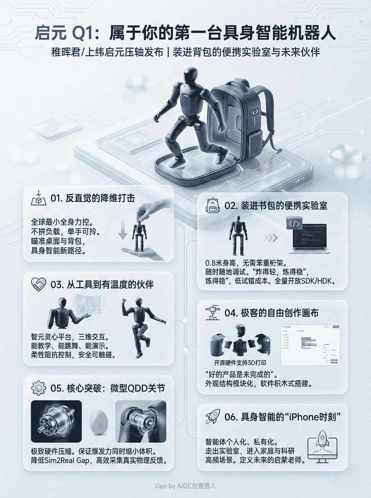

更多精彩内容，

我们下期见。

<https://aigcreative.feishu.cn/sync/K4Gvd9vUQsy9Oubwqaeclu0Fnbg>

# 知识库动态