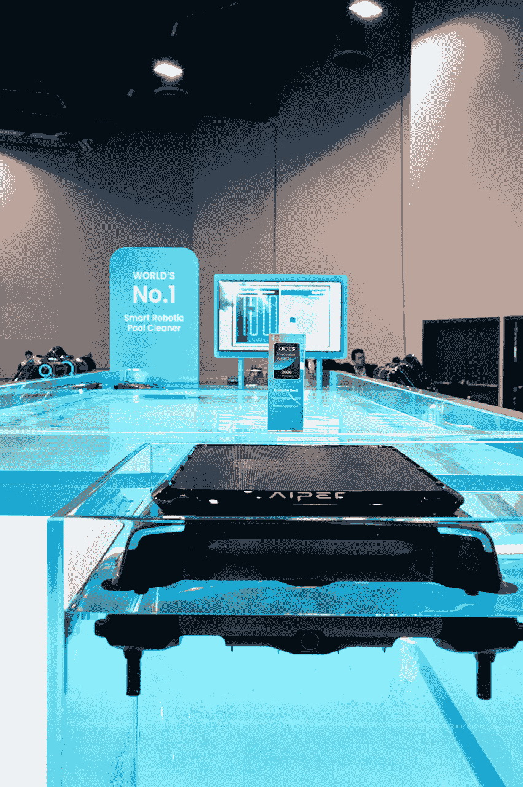
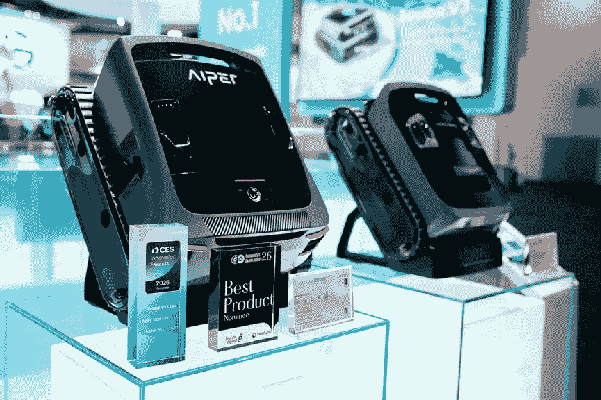
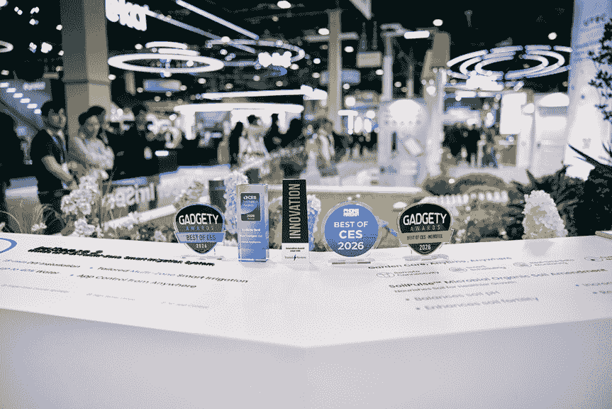
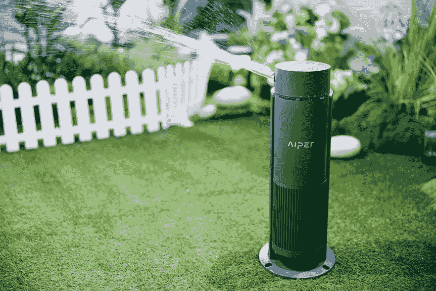
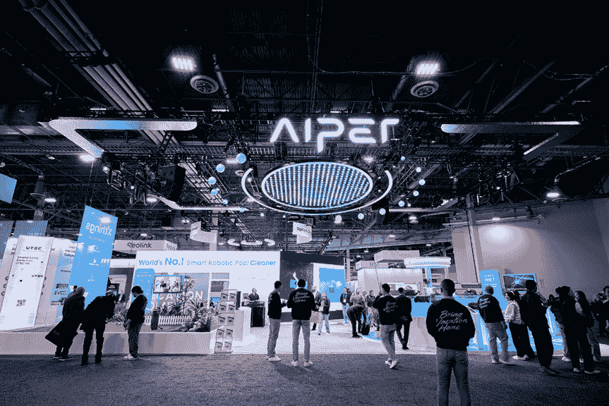

# 20250113-看似清澈的泳池有多脏？Aiper用智能科技重新定义“干净”

> 来源：[https://aigcreative.feishu.cn/docx/Ea8bdv8wtoRKRTx43jecx243nhh](https://aigcreative.feishu.cn/docx/Ea8bdv8wtoRKRTx43jecx243nhh)

你是否也曾站在泳池边，看着那一汪清澈见底的水，以为它足够干净？

你是否觉得，只要没有落叶、没有明显的杂质，泳池就“干净”了？

真相可能让你大吃一惊——你眼中那池“清澈”的水，可能比你想象的脏得多。

# 01. 泳池里的“脏”，远不止你肉眼所见

没错，水面漂浮的落叶、偶尔沉底的砂砾，都是泳池垃圾的一部分。但真正的问题，藏在你看不见的地方。

**那些“看不见”的污染物**

+   细菌与微生物：泳池中常见的细菌包括大肠杆菌、金黄色葡萄球菌等，它们可能来自人体皮肤、口腔甚至排泄物。

+   藻类孢子：尤其在日照充足的户外泳池，藻类会在池壁、池底迅速滋生，形成滑腻的“生物膜”。

+   化学残留：氯、pH调节剂等化学物质若分布不均或反应不充分，可能形成刺激性副产物，影响水质与健康。

+   微小颗粒：灰尘、花粉、防晒霜、身体油脂等悬浮微粒，直径小于30微米，肉眼难以察觉，却会使水质浑浊、触感黏腻。

**传统清洁方式的“盲区”**

+   人工打捞：只能处理表面漂浮物。

+   传统吸污机：依赖人力推动，清洁路径随机，覆盖率低，且无法清除池壁与水位线的污渍。

+   水质管理依赖人工检测与投药，滞后性强，难以做到实时、精准。

换句话说，泳池的“干净”≠“健康”。清澈不等于无菌，无杂物不等于无污染。

# 02.智能清洁时代：从“看得见的干净”到“看不见的安心”

正因如此，泳池清洁的升级，本质上是一场从“表面清洁”到“深度健康管理”的科技进化。而在这场进化中，以Aiper为代表的智能泳池机器人，正在重新定义“干净”的标准。

## 2.1 从“无线”到“AI视觉”：清洁进入精准时代

早期无线机器人解决了“线缆束缚”的痛点，让清洁更自由。而如今，搭载AI视觉识别技术的机器人如Aiper Scuba V3，已能识别超过20种常见垃圾，实现“看见—追踪—清理”的闭环。这意味着机器人不仅能扫，还能“看懂”什么是脏、哪里该扫。

## 2.2 认知级AI：让清洁从“被动执行”到“主动决策”

在今年CES 2026上，Aiper发布的“认知级AI”技术，将泳池清洁推向新的高度。搭载该技术的Scuba V3 Ultra，能通过多维度环境感知，动态调整清洁策略。比如：

+   识别到池底落叶集中区域，自动加强清洁力度；

+   感应到浅滩与深水区，调整行进模式与吸力；

+   结合水质传感器数据，判断是否需要重点清洁易滋生藻类的池壁区域。

这意味着清洁不再是固定的程序，而是有感知、会思考、能适应的智能过程。

# 03.CES 2026启示：泳池清洁已进入“全自动健康管理”阶段

今年CES不仅是新品秀场，更是一次行业趋势的集中展现。Aiper旗下多款产品获奖的背后，透露出一个重要信号：泳池机器人正从“清洁工具”转型为“健康管理系统”。

例如，首次亮相的Scuba V5-X，配备多模态融合感知系统（AI视觉+激光雷达+水声雷达），不仅能完成全池3D建图与深度清洁，更集成水质自检测与智能处理模块，实现“清洁—监测—养护”一体化。

换句话说，未来的泳池机器人，不仅是“扫地僧”，更是“水质管家”。它能在清洁的同时，实时监测pH值、余氯、浊度等关键指标，并与智能投药系统联动，让泳池水质始终处于健康区间。

# 04.从“一池水”到“整个院”：智能庭院生态正在成形

泳池的清洁与健康，只是智能庭院生活的一个起点。基于同样的技术逻辑与用户需求，智能清洁的边界正在不断拓展。

在CES 2026上，Aiper同步展出了全球首款4合1多区域智能灌溉系统IrriSense 2。它通过自定义灌溉区域、模拟自然降雨的EvenRain™雨帘技术，以及与天气数据联动的智能调度，实现精准、节能、均匀的庭院浇灌。

这意味着，一家企业的技术能力正从“泳池清洁”延伸至“庭院养护”，形成“清洁—水质—灌溉”三位一体的智能生态系统。用户不再需要购买多个孤立的设备，而是可以通过一个协同化的系统，实现整个庭院的智能管理。

回到最初的问题——泳池到底有多脏？答案或许是：比你想的脏，但也可以比你想象的更干净。

科技的进步，正让“清澈见底”从视觉标准，升级为“健康可测、过程可控、全程可信”的系统化体验。而这一切，不再依赖繁琐的人工操作，而是由更智能、更自主、更可靠的机器人系统默默完成。

从清洁一片叶子，到管理一池清水，再到养护整个庭院——这场始于“看不见的脏”的技术革命，最终带来的，是看得见的安心、省心与可持续。

<https://aigcreative.feishu.cn/sync/K4Gvd9vUQsy9Oubwqaeclu0Fnbg>

# 知识库动态