# NVIDIA

> 来源：[https://aigcreative.feishu.cn/docx/B2Zfd9MbJoVy2sxsnUbcv1ndnZd](https://aigcreative.feishu.cn/docx/B2Zfd9MbJoVy2sxsnUbcv1ndnZd)

> 来源知乎：https://zhuanlan.zhihu.com/p/643574303

20235月29日，英伟达创始人兼CEO黄仁勋在NVIDIAComputex2023的主题演讲中发布一系列成果，包括：宣布可加速生成式AI设计的GraceHopper超级芯片GH200已全面投产，推出大内存生成式AI超级计算机DGXGH200和全新加速以太网平台Spectrum-X，宣布与全球最大的营销服务机构WPP合作打造生成式AI内容引擎，并与多家知名的电子制造商融合英伟达生成式AI工具、3D协作、仿真模拟和自主机器技术实现先进工厂的数字化。

在下面的内容中我们复盘了英伟达所处不同发展阶段的行业背景，深入分析了三个阶段中英伟达通过实施何种战略超越了竞争者，形成了竞争优势。并通过分析英伟达的产业链布局及商业模式，以帮助我们更好了解GPU的应用和未来趋势，并为国内企业提供一些有益的启示。

## 一、英伟达：算力芯片巨头领跑AI时代

### 1、公司是全球GPU龙头，市场份额遥遥领先

英伟达（NVIDIA）是一家全球知名的技术公司，成立于1993年，最初以图形处理器（GPU）起家，通过不断的创新和发展，逐渐成为高性能计算领域的领导者。根据JonPeddieResearch发布的GPU市场数据统计报告，英伟达2022年全年PCGPU出货量高达3034万块，是AMD的近4.5倍；截至2022年四季度，在独立GPU市场，英伟达占据84%的市场份额，远超同业竞争公司。

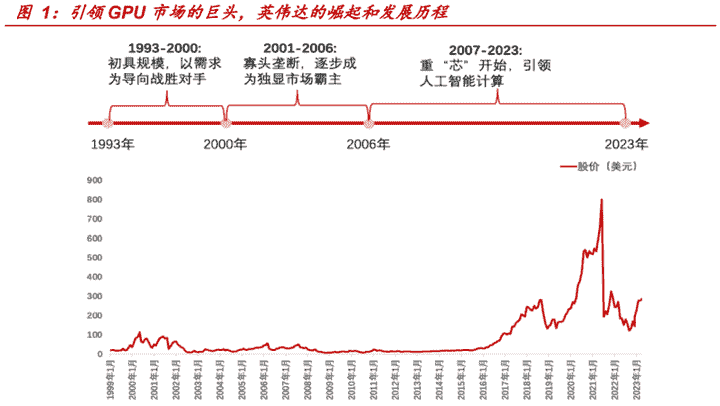

### 2、英伟达的产品创新和迭代从未止步

自英伟达成立以来，其经历了多个重要的发展时间点。其中包括1999年推出全球第一款GPU、2006年发布Fermi架构、2012年发布Kepler架构、2016年推出AI加速器TeslaP100和Volta架构、以及2020年发布Ampere架构等。这些重要时间点的创新和进步，为英伟达在高性能计算、人工智能、虚拟现实等领域的发展奠定了坚实的基础。

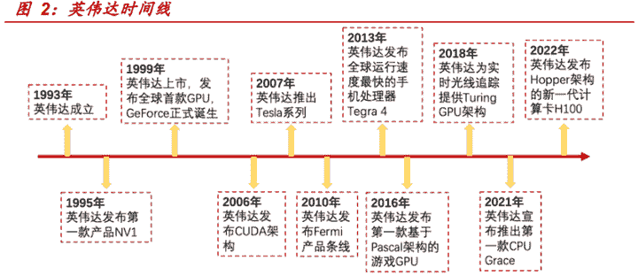

### 3、横向拓展丰富业务产品线，实现“CPU+GPU+DPU”三芯布局

英伟达的三芯战略侧重于在数据中心市场实现CPU、GPU和DPU三类硬件的布局，旨在全面提升竞争力，满足云计算、人工智能及机器学习等高端应用领域的需求。CPU的加入使英伟达能够更好地应对各种计算任务，尤其是那些需要快速逻辑判断和高度并行处理能力的应用。而DPU则针对数据中心和网络设备的需求，具有高效处理数据包和协议的能力，为英伟达的产品线增添了新的价值。通过将CPU、GPU和DPU集成到同一平台上，英伟达可以为客户提供更加全面、高效的计算解决方案。目前CPU+GPU的产品组合获得超级计算中心的采用并即将广泛部署于大型服务器，三芯战略初显成效。

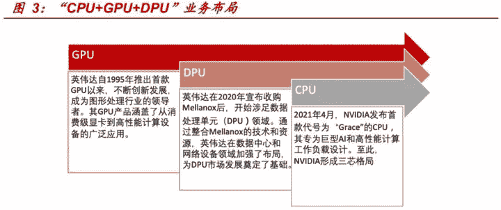

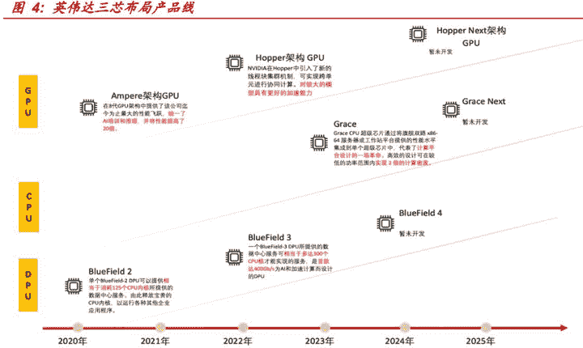

### 4、芯片架构是英伟达的技术核心，快速迭代的新架构为产品带来不断的创新与升级

自英伟达GPU问世以来，其架构经历了多个重要发展阶段。2006年，Fermi架构在GPU计算领域实现了重大突破，Kepler架构进一步提高了能效比和GPU性能，并引入了动态并行处理技术。随后，Maxwell架构实现了更加节能和高效的设计，Pascal架构则引入了深度学习计算中的TensorCore和NVLink技术，以及更多的AI加速功能。Volta架构则实现了更高的计算能力和存储带宽，并引入了深度学习加速器TensorCoresV100。Turing架构则进一步提高了光线追踪和图形渲染性能，而Ampere架构则在AI加速、性能和能效方面实现了重要进展。每一代架构的创新和进步，都为GPU技术在高性能计算、人工智能、虚拟现实等领域的应用奠定了坚实的基础。

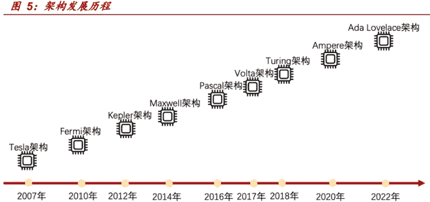

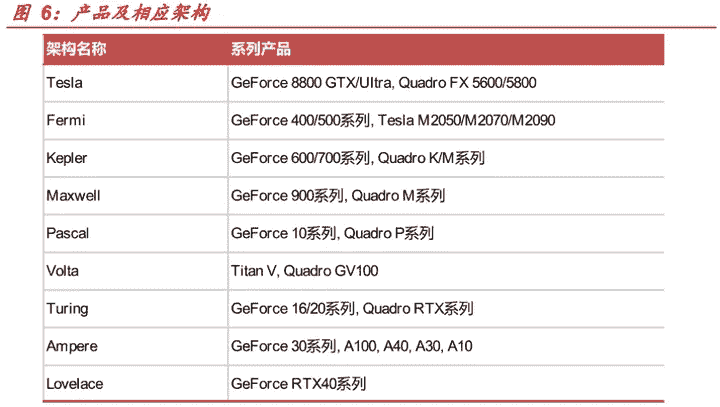

## 二、复盘英伟达发展历程

### 1、1993-2000：初具规模，提升研发效率战胜对手

1993年黄仁勋、克里斯〃马拉科夫斯基和柯蒂斯〃普利姆在美国加州创立了英伟达。在创建之初，公司设想着个人电脑将会成为游戏、多媒体的主流消费设备。90年代初，高性能图像被使用在工作站和视频游戏机上，在此之后，3件独立事件改变了这样的情况，推动了3D图像市场的发展：

1）微软推出的Windows95包括了视频、音频功能，刺激了多媒体市场发展。3D图形逐渐增加的重要使得个人电脑制造商的差异性更加明显；2）电脑仿真渲染动画出现，3D动作游戏登陆PC平台；3）在摩尔定律的推动下，IC的集成度不断提高，能够将大量3D图形处理器放在一个芯片上。半导体设计和制造的不断进步，使得以前只能在工作站级别获得的高性能3D图形技术，现在能够以合理的价格获得。而图形处理器的不断发展也带动英伟达整体规模不断增长。

### （1）推进“三团队-两季度”研发模式，新品不断迭代满足下游需求

一般图形市场产品有两个开发周期：6-9个月和12-18个月，英伟达执行了“三团队-两季度”的运营模式，具体方式包括三个并行开发团队，专注于三个独立的分阶段产品开发。一个在第一年秋季，一个是在第二年春季以及第二年秋季。这样的运行方式允许公司每6个月推出一次新产品，与图形市场产品周期一致，并且领先市场1-2个研发周期，从而满足下游需求变化

### （2）不断丰富产品矩阵满足下游客户不同需求

GeForce系列是英伟达为台式机提供图像处理的芯片。2002年11月，英伟达推出为个人电脑市场消费者开发的产品线GeForceFX系列。GeForce系列的其他产品，比如GeForce2、GeForce3、GeForce4都能够为不同价位的主流产品提供最高的性能。

### （3）高研发带来技术水平不断升级，英伟达在1996年后接连推出旗舰产品，击败行业竞争者

英伟达在1996年，推出NV3系列的Riva128芯片，在性能方面具有优势，并且芯片尺寸更小，因此结构成本更低，通过数据对比，RIVA128甚至优于下一年Intel推出的i740，而且i740不支持任何OpenGL驱动程序。在英伟达推出RIVATNT时已经没有产品能够和其匹敌。1999年，Intel宣布完全退出独立显卡芯片组业务。而在2000年英伟达推出GeForce256，全面超过当时行业最大竞争者3dfx，最终3dfx宣布破产并且被英伟达收购。

### （4）总结

英伟达在成立初期，面对着技术不成熟、行业竞争激烈等难题，依靠“三团队-两季度”的研发模式和以DirectX、OpenGL为代表的API出现，不断进行技术更新、降低产品价格，挤压同业竞争对手的生存空间，从而在早期的GPU市场上存活下来。

### 2、2001-2006：寡头垄断，逐步成为独显市场霸主

### （1）英伟达在游戏市场率先取得突破

自1999年Geforce系列推出以来，它一直在游戏性能的创新和提升方面保持领先地位。GeForce系列显卡被广大游戏爱好者和电子竞技玩家所推崇，因为它们能提供极高的图形渲染能力和实时光线追踪技术，以实现更加真实的游戏体验。与此同时，Xbox为代表的游戏主机兴起助力了英伟达在游戏GPU行业的发展。英伟达为Xbox视频游戏系统设计的处理器利用双处理架构推动了其优秀的图形、音频和网络功能，确立了英伟达在游戏机市场的稳固地位。虽然后续英伟达未能持续成为XboxGPU供应商，但是早期在Xbox上的成功已经为英伟达在游戏市场的发展奠定基础。

### （2）通过收购，技术开发及广纳人才，英伟达进一步开拓市场，增强自身实力，保持市场领先地位

英伟达预测未来能够实现通话和多媒体功能的手机半导体将会大放异彩，因此积极通过收购移动端公司来布局移动端图像芯片产业，并紧密融合Direct3D和OpenGL以最大程度地支持第三方软件。Direct3D和OpenGL作为应用程序编程接口，使软件开发人员能够在不需要深入了解硬件特性的情况下编写应用程序，从而在3D图形、视频媒体通信以及超低功耗方面保持其技术的领先地位。为了维护市场的领导地位，英伟达积极地招募业界经验丰富的3D图形和通信工程师，并持续开发新一代的GPU、MCP以及UMP。

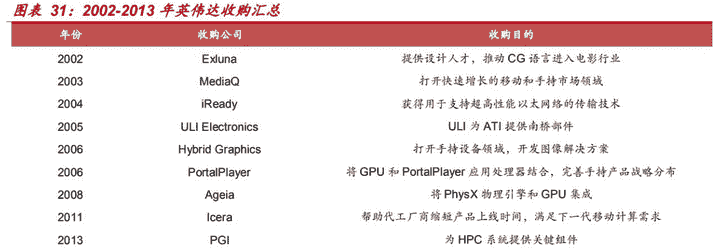

### （3）英伟达全面完善产品线，产品覆盖高中低端下游各应用市场

经过了不断的发展，英伟达的产品线逐渐丰富，覆盖了多种不同的下游应用。首当其冲的是GeForce系列显卡，主要针对的是个人电脑的游戏领域。同时，为了满足科研和企业市场的需求，英伟达推出了Tesla和Quadro系列的GPU，这些产品被广泛应用于机器学习、数据科学、计算机视觉等领域。此外，英伟达还在汽车自动驾驶等前沿领域推出了专门的解决方案，如Jetson和DRIVE系列。

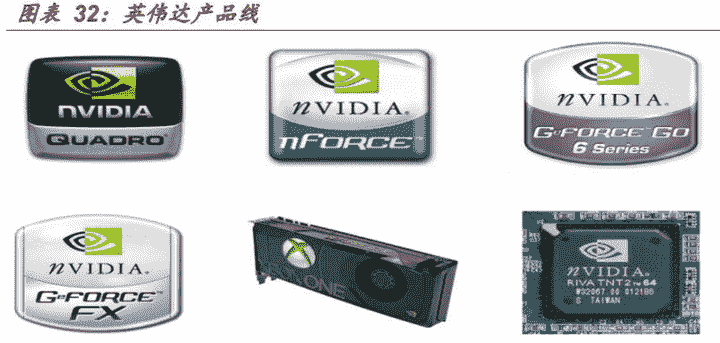

### （4）总结

在经历了行业发展初期洗牌之后，英伟达在独立显卡市场上的主要竞争对手只剩下ATI，整个独立显卡行业逐步向寡头垄断转变。在这六年时间里，公司曾因产品定位和市场需求贴合度不够而落后，但通过坚持投入研发，完善产品线，竞争力持续提升。2006年AMD收购ATI后，英伟达终成行业霸主。

### 3、2007-2023：重“芯”开始，引领人工智能计算

### （1）智能手机浪潮来临，但是由于时机和定位上的失误，英伟达错失机遇

自苹果系列产品推出后，智能手机成为一大热点，引领时代风潮。在这样的背景下，Intel推出了Atom，英伟达推出了Tegra。然而手机芯片市场并没有像PC市场一样被这两个大场占领，相反高通依靠着基带技术的垄断成为了移动端市场的主流。Tegra系列在最初是依靠英伟达在图像处理的优势为平板和游戏机研发的。当英伟达推出Tegra2系列时，3G/4G技术开始成为移动端市场追逐的目标。但由于Tegra3没有能够整合基带技术从而失去了占领市场的必要条件，而Tegra4迟迟没有发布以及低性价比也失去了市场的青睐。

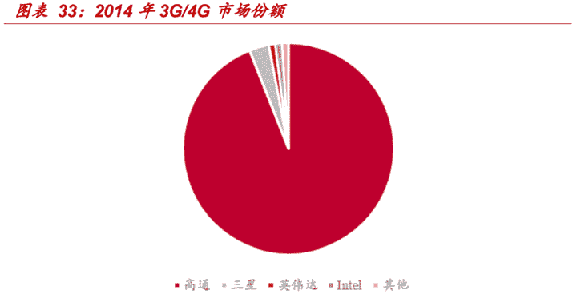

### （2）英伟达退出手机市场，转向汽车、人工智能市场，调整竞争策略

在经历了手机市场的挑战后，英伟达进行了战略调整，从手机市场退出，并将其研发重心转向了汽车和人工智能市场。这一转变对于英伟达来说，不仅是其业务发展的一次机遇，更是对于行业趋势的敏锐洞察。在汽车市场中，英伟达通过自己的技术优势，推出了一系列高效能的自动驾驶处理器，逐渐在此领域确立了自己的领导地位。而在人工智能市场，英伟达的GPU产品凭借其超强的并行计算能力，成为了支撑深度学习和机器学习应用的核心设备，展现出强大的市场竞争力。

### （3）事实证明英伟达的转型抓住了市场需求的改变，英伟达2015-2023年营收增速可观

在2008年全球经济危机爆发之后，英伟达的业务收入也受到了经济危机的影响，在2009年和2010年财报中净利润呈现负值，亏损达到三千万和六千万美元，但在之后的几年中，英伟达依靠着在游戏行业中的基础，继续拓宽在可视化计算、人工智能业务，并且借助于比特币和区块链对于显卡芯片的高增长需求，在2016年之后，保持着高增长的营业收入增长趋势。高增长的净利润得益于英伟达每年研发费用的投入，使得英伟达的产品领先同行业的竞争对手，更快地拓展新业务，更早地形成进入壁垒。而净利润的增长又会使得英伟达有更多的资金进行新产品的研发，从而达成良性循环，占据市场领先的地位。

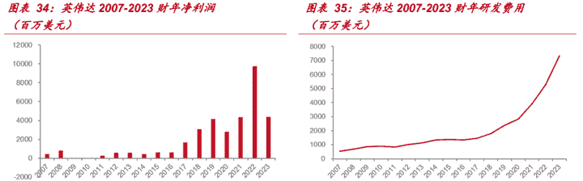

### （4）具体从各终端来看，英伟达各方面业务保持收入增长，全面发展

从英伟达终端用户划分来看，各终端产品收入都保持着稳定增长。数据中心发展加速，游戏终端依旧是英伟达重要的业务收入基础。

### （5）英伟达不断更新产品技术，AI市场成为主要目标，给英伟达带来新的增长

随着AI市场的蓬勃发展，英伟达敏锐地将其定位为公司的主要发展目标。英伟达开发了一系列专门针对AI应用的GPU，如Tesla、Titan以及Quadro系列。这些产品能够高效处理深度学习和机器学习的大规模并行计算，极大地推动了AI的发展。2020年在SC20超级计算大会上，NVIDIA发布了新一代DGXStationA100以及NVIDIAA10080GBGPU支持诸如BERTLarge推理等复杂的对话式AI模型。此后在2022年3月，NVIDIA又宣布推出第四代NVIDIA®DGX™系统，是全球首个基于全新NVIDIAH100TensorCoreGPU的AI平台，彻底占据AI市场领先地位。

### （6）总结

当iPhone出现后，全球智能手机市场的帷幕被拉开。移动端GPU市场逐渐成为了大家的焦点。但英伟达并没有能够在手机GPU市场取得较大的成功，但英伟达将手机GPU芯片Tegra用在了其他应用领域，为公司打开了新的业务市场。

## 三、英伟达产品线梳理

英伟达产业布局多元化，解决了客户不同需求。GPU产品为英伟达主要收入来源，收入占比稳定在80%以上。相比较于CPU，GPU在机器学习算法有天生的优势。英伟达一直专注于GPU的设计，同时由于GPU的并行计算能力，可以通过数千个计算核心进行深度学习，英伟达开始将服务和系统、软硬件和可编程算法结合在一起，提出CUDA架构。

从下游应用来看，英伟达产品主要集中于游戏、专业可视化、数据中心以及自动驾驶领域：1）游戏市场：英伟达提供的产品包括PC游戏的GeForceRTX和GeForceGTX，用于游戏和流媒体的SHIELD设备，用于云端游戏的GeForceNOW，以及用于专门控制台游戏设备的平台和开发服务；2）专业可视化市场：英伟达除了加速GPU计算解决方案，同时也为汽车、娱乐、建筑工程、石油和天然气、医疗等行业引入新的解决方案；3）数据中心市场：英伟达使用NVlink技术将多个GPU结合在一起，加速神经网络训练和推理。同时开发出DGX超级计算机，进行科学计算、深度学习和机器学习；4）自动驾驶市场：英伟达Drive作为一个人工智能汽车平台，涵盖了从交通拥堵到机器人出租车自动驾驶的所有领域。2018年有超过370家自动驾驶汽车公司开始使用Drive，共同开发自动驾驶的人工智能系统。

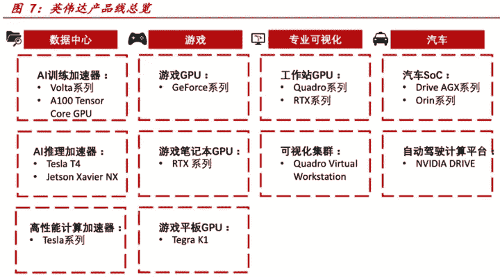

### 1、游戏业务：是英伟达主要产品线，作为基本盘见证了其里程碑式的革新

英伟达在游戏业务领域持续不断的技术升级，以应对玩家日益增长的画质需求。游戏业务一直是英伟达的核心领域，每年都以引人注目的新产品展现其持续的创新力。与前一代产品相比，每一代新显卡都带来了显著的性能提升。从核心数量来看，英伟达显卡产品的CUDA核心数量已从最初的640颗增长到现在的高达16384颗，技术上不断突破，包括实时光线追踪技术等。另外，英伟达在游戏显卡市场上有着广泛的布局，从入门级到专业级，都提供了相应的产品。这一策略允许英伟达满足从独立游戏玩家到专业电竞选手的多元需求。

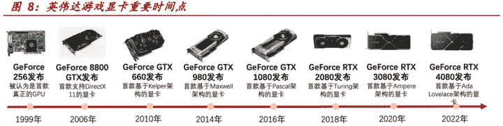

### 2、数据中心：持续发力，高市占率源自于英伟达持续不断的研发与创新

英伟达长期占据高端GPU市场的领导地位，截至目前英伟达占据全球算力芯片90%的市场份额。高端芯片领域的霸主地位主要源自于公司不断的技术提升所形成强大的技术壁垒。从2017到2022这五年间，公司先后推出了Volta、Ampere、Hopper等针对高性能计算和AI训练的架构，以此为基础发布了V100、A100、H100等高端GPU。通过不断的技术革新，英伟达GPU产品向量双精度浮点算力已从7.8TFLOPS增至30TFLOPS。

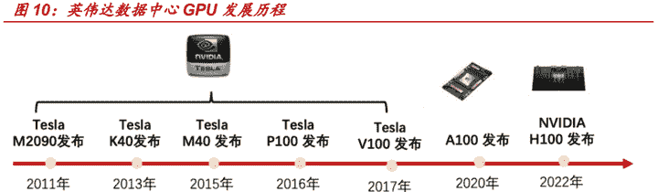

### 3、英伟达数据中心GPU在11年间从制程工艺到核心数量，各参数全方位提升

从2011年的TeslaM2090开始英伟达不断更新迭代数据中心产品，到了2022年发布的英伟达全新GPU产品NVIDIAH100，性能上已经出现了质的飞跃。此外，英伟达在数据中心的布局不仅仅停留在GPU，在CPU方面英伟达也全面发力，在2022年发布了首款CPU产品Grace。Grace内臵下一代ArmNeoverse内核，采用第四代NVIDIANVLink，从CPU到GPU连接速度超过900GB/s，相当于目前服务器14倍的带宽速度；从CPU到CPU的速度超过600GB/s。并且Grace拥有最高的内存带宽，采用的新内存LPDDR5x技术，带宽是LPDDR4的2倍，能源效率提高了10倍，能提供更多计算能力。

### 4、自动驾驶业务：为英伟达提供中长期增长曲线

英伟达的自动驾驶SoC产品线以其高性能、高能效和创新技术而著称，致力于满足不断增长的计算需求。英伟达推出的自动驾驶SoC产品包括先进的Atlan和Orin芯片，它们集成了安培架构GPU核心、基于Arm的GraceCPU核心、深度学习和计算机视觉加速器单元以及BlueFieldDPU核心，以实现卓越的算力和性能。英伟达的SoC产品线不断创新，为客户提供卓越的性能和可靠性，帮助推动未来智能驾驶和高度互联的汽车发展。

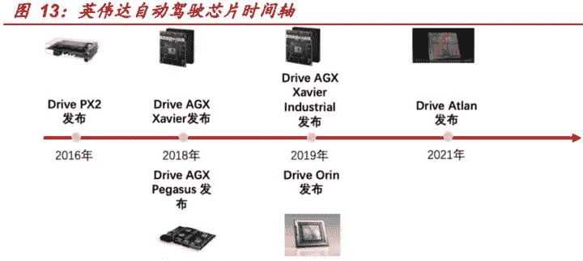

最新款AtlanSoC算力获得指数级提升，为自动驾驶提供充足算力。2021年，英伟达推出了自动驾驶SoCAtlan，其单颗算力高达1000TOPS，是上一代OrinSoC（254TOPS）的近四倍。Altan还支持400Gbs（40万兆）网络和安全网关，可以满足高速通信需求。同时，Atlan可与为上一代芯片组编写的软件堆栈（如Orin或Xavier）兼容，使得汽车制造商和AV开发人员不需要重新设计软件就能利用新SoC的性能提升，大大提升使用的便捷程度。

### 5、可视化业务：技术革新助力卓越视觉与计算体验

在过去几年，英伟达专业可视化业务持续推出了一系列的技术革新，包括新的GPU架构（如Pascal、Volta、Ampere、AdaLovelace），更高效的显存技术（如GDDR6X），以及更加智能化的软件工具（如RTXStudio）。这些创新大幅提升了英伟达专业显卡在高性能计算、人工智能、虚拟现实等领域的性能和可靠性，为专业用户提供了更加卓越的视觉体验和计算能力。

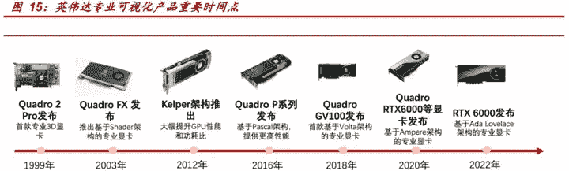

### 6、英伟达专业显卡技术不断进步，性能显著提升

随着英伟达专业可视化显卡的不断升级，计算能力和相关性能得到了显著提升。从最初的几百万个CUDA核心、数百GB/s的显存带宽，到现在的数千万个CUDA核心、TB/s级别的显存带宽，英伟达专业显卡已经成为高性能计算、人工智能、虚拟现实等领域不可或缺的重要组成部分，为专业用户提供了更加卓越的视觉体验和计算能力。

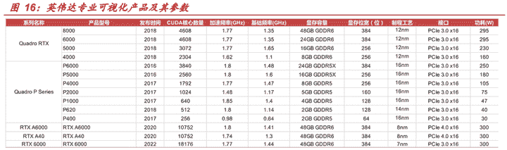

## 四、英伟达营收情况分析

### 1、公司营业收入高速增长，1999-2023财年CAGR24%

1996年英伟达的营业收入仅391万美元，净利润亏损超过300万美元。此后，英伟达的体量快速增长，到2023财年营收和净利润分别达270亿美元和44亿美元，1999-2023财年营收CAGR24%，净利润CAGR34%。

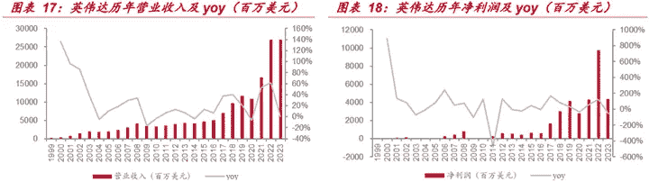

### 2、新兴市场成为英伟达主要收入来源地

分地区看，中国大陆在2023财年营业收入达到58亿美元，占总收入的21%，而在2003财年中国大陆营业收入只有2.4亿美元，占总收入的比例仅为13%。和中国大陆市场一样，亚太其他地区以及美洲其他地区都出现了较大的增长幅度。相反，中国台湾市场出现了较大的衰退。2003财年，中国台湾市场占总营收的比例为45%，到2023财年下降到32%，而美国市场收入则保持稳定在31%左右。

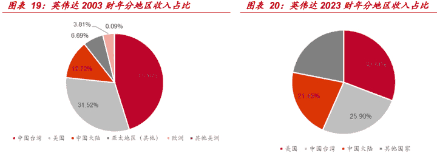

### 3、随人工智能发展，数据中心业务收入增速最高，逐步成为公司最大营收占比

从业务板块看，英伟达下游应用包括游戏、数据中心、专业化视觉、汽车、OEM及其他。其中，数据中心业务收入在2023财年达到150亿美元，占据英伟达营业总收入的56%，数据中心业务收入同比增长41%，主要增长来源于AI发展及美国云服务提供商的推动。游戏业务收入90.7亿美元，占总营业收入的34%，受全球游戏行业需求下行影响同比下降27%。汽车、代工以及专业可视化业务都保持着低速增长。

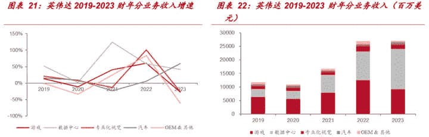

### 4、英伟达净资产收益率周期波动，毛利率和净利率总体呈现上升趋势

2000财年之后，英伟达开始负责Xbox（微软公司开发并于2001年发售的一款家用电视游戏机）的芯片设计工作，因为Xbox相比较于英伟达其他产品有着相对较少的利润率，所以ROE和净利率都呈现下降趋势。在此之后英伟达依靠新产品的开发，使得ROE重新上升到34%。2008财年英伟达已成长为全球图像处理器行业龙头，但因全球经济危机影响，公司ROE和净利率创新低，至2010财年分别达-2.69%和-2.04%。2010年后，全球经济复苏，游戏市场在新兴市场蓬勃发展，英伟达游戏部门业务及图形处理器收入平稳上升。2017财年，英伟达迎来了新一轮的增长期，产品全面发力，GeForce、Tesla、GRID和Quadro销售收入相较于2016年都出现大幅度增长。

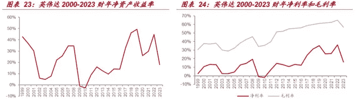

### 5、良好的营收状况是公司增加研发投入的基本，研发投入也保障了公司营收的持续健康成长

相比较于竞争对手ATI和AMD，英伟达在竞争初期都处于下风。随着研发投入的不断增长，英伟达通过技术进步降低成本和产品价格，不断推出新的产品吸引更多消费者，优势逐渐凸显。在与ATI竞争的周期中，英伟达的研发费用从1999财年的2507万美元，以年均55%的增长率赶上ATI的研发费用，在2005财年达到3.6亿美元。ATI被AMD收购后，英伟达在独立显卡的竞争对手就变为了AMD。2005年，AMD的研发费用为11亿美元，是英伟达的3.2倍左右，而到了2022年，英伟达的研发费用达到了73.4亿美元（对应2023财年），是AMD的1.47倍。

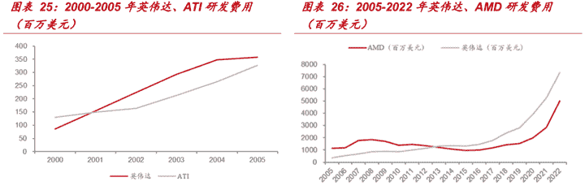

### 6、研发费用率保持高位，不断吸引优秀人才加入

从早期的“三团队-两季度”研发迭代模式开始，英伟达的研发目标就一直走在市场的前端。英伟达研发团队分为软件工程、硬件工程、超大规模集成电路工程、工艺工程、架构和算法团队，负责研究开发统一的硬件和软件架构，提供领先市场的图像加速技术。英伟达研发人员数量持续增长，截至2023财年达到19532人。

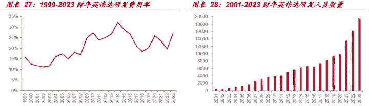

## 五、英伟达以CUDA为基础构筑生态链

CUDA助力英伟达成长为AI产业龙头，构建强大生态护城河壁垒。CUDA是英伟达基于其生产的GPUs的一个并行计算平台和编程模型，目的是便于更多的技术人员参与开发。开发人员可以通过C/C++、Fortran等高级语言来调用CUDA的API，来进行并行编程，达到高性能计算目的。CUDA平台的出现使得利用GPU来训练神经网络等高算力模型的难度大大降低，将GPU的应用从3D游戏和图像处理拓展到科学计算、大数据处理、机器学习等领域。这种生态系统的建立让很多开发者依赖于CUDA，进一步增加了英伟达的竞争优势。

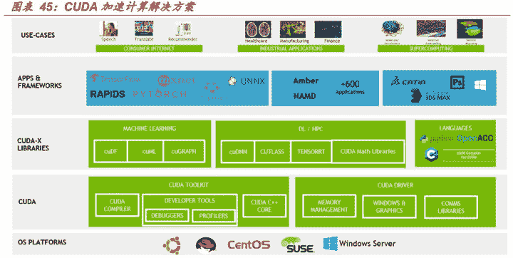

### 1、CUDA的低成本和兼容性成为其最重要的吸引点之一

英伟达的CUDA是一个免费、强大的并行计算平台和编程模型。安装过程简单且明确，让开发者能够轻松快速地启动并行编程。CUDA对新手极其友好，特别是对C语言、C++和Fortran的开发者。同时为支持其他编程语言，如Java、Python等，CUDA还提供第三方包装器进行扩展。为广大开发者提供了极大的便利和高效的编程体验。操作系统方面，CUDA在多种操作系统上也都有良好的兼容性，包括Windows、Linux和macOS。

### 2、CUDA有着丰富的社区资源和代码库，为编程提供良好的支持

英伟达的CUDA享有强大的社区资源，这个社区由专业的开发者和领域专家组成，他们通过分享经验和解答疑难问题，为CUDA的学习和应用提供了丰富的支持。另外，CUDA的代码库资源涵盖各种计算应用，具有极高的参考价值，为开发者在并行计算领域的创新和实践提供了宝贵的资源。这两大特点共同推动了CUDA在并行计算领域的领先地位。

### 3、CUDA借助燕尾服效应，搭配GeForce覆盖多元市场

CUDA技术最初是为了配合GeForce系列芯片而推出的，利用GeForce在游戏市场的广泛覆盖率，作为一个技术杠杆，推动CUDA的普及和发展。作为一项可以帮助GeForce拓展新的市场的重要技术，CUDA极大地提高了视频和图像应用（如CyberLink、MotionDSP和Nero）的性能，实现了多倍的效率提升。

### 4、创业公司的大量采用使得CUDA应用场景进一步得到拓展，游戏不再是唯一应用领域

随着时间的推移，超过一百家创业公司开始利用CUDA的强大计算能力，使其应用领域得以扩展，不再局限于游戏方面。在视频编码领域，英伟达与Elemental公司合作，利用并行计算技术加速了高清视频的压缩、上传和存储速度。这一成功的合作不仅体现了CUDA在各种场景下的适用性，也进一步推动了CUDA技术的发展。当Elemental公司后被亚马逊收购，其基于CUDA的视频处理技术也成为AWS的服务组成部分，这一过程也让CUDA的使用场景得到了进一步的丰富和拓宽。

CUDA形成完整生态链，通过大学普及学习以推广CUDA。英伟达将CUDA引入了大学的课堂中，从源头上扩大了CUDA的使用范围和受众群体。早在2010年，已经有关于CUDA数千篇论文，超过350所大学进行CUDA教学课程。在此基础之上，英伟达建立了CUDA认证计划、研究中心、教学中心，不断完善CUDA的生态链。从结果看：2008年仅有100所大学教学CUDA课程，在2010年英伟达全球建立了20个CUDA研发中心后，2015年已有800所大学开放CUDA课程。

### 5、对比OpenCL，CUDA是英伟达GPU编程的更优解

OpenCL虽然具有更广的兼容性，但CUDA由于与英伟达的硬件紧密结合，能更有效地利用其GPU的性能。同时，CUDA的编程模型相比OpenCL更加简洁，易用，并提供完整的开发工具链。此外，CUDA的社区资源丰富，代码库多样，使得在科学计算、深度学习等领域的应用更为便捷。因此，对英伟达GPU的开发者来说，CUDA往往是更优的选择。

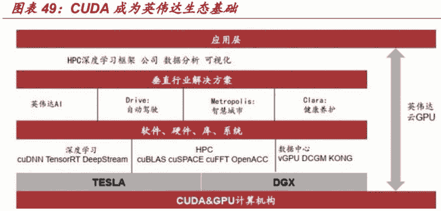

### 6、对比ADM的CTM编程模型，CUDA拥有更广泛的应用和更高的操作性

从操作性来说，由于CTM更接近硬件，因此开发者需要有更深入的硬件知识才能进行开发，但是这也意味着CTM能够提供更精细的控制和优化。对比之下，CUDA提供了一套完整的开发工具链，包括编译器、调试器和性能分析工具，以及丰富的库函数，为开发者提供了极大的便利。从应用来说，CUDA已经在各种领域获得了广泛的应用，尤其是在科学计算和深度学习等领域，CUDA拥有大量的优化库和开发工具。而CTM的应用相对较少，但是由于它提供了对硬件的低级别控制，因此在一些特定的应用场景中会具有优势。

### 7、对比微软的DirectCompute，CUDA胜在配套设施的支持

与DirectCompute相比，CUDA由于其丰富的功能库，完善的开发工具和广泛的应用支持，尤其在科学计算和深度学习领域，具有明显优势。CUDA在英伟达GPU上的性能优化也更为出色。而DirectCompute作为跨平台工具，其优势在于与DirectX的兼容性以及对多种硬件的支持。但从英伟达GPU的应用广泛度来看，使用CUDA才是开发者的首选。总的来说，虽然DirectCompute的通用性更强，但英伟达的CUDA在功能、性能和应用范围上提供了更强大的支持，对于使用英伟达硬件的开发者来说是更优的选择。

### 8、CUDA的开发提升了英伟达的品牌竞争力和影响力

CUDA的开发使英伟达的GPU超越了仅用于图形处理的传统角色，转变为通用的并行计算设备，极大地提升了其在市场上的竞争力。英伟达因此能够满足广泛的高性能计算和人工智能需求，使其产品得以进入新的市场领域。同时，随着CUDA在各类高性能计算任务，特别是人工智能领域的广泛应用，英伟达的品牌影响力得到了显著增强。越来越多的人开始认知和使用英伟达的产品，这不仅加强了英伟达的市场地位，也为其未来的发展奠定了坚实的基础。

### 9、CUDA促进了英伟达的产品创新，激发更多可能性

CUDA的开发推动了英伟达在并行计算技术领域的创新，尤其在硬件架构方面。这不仅体现在优化了的GPU架构上，例如将流多处理器（SM）配臵为处理并行线程的方式，也在软件架构上如CUDA自身的持续更新和优化。为了更有效地满足用户对于更高性能和更易用并行计算工具的需求，英伟达不断创新，致力于提高CUDA的性能和用户体验。这一切不仅反映出英伟达对创新的重视，也为其在并行计算技术领域的领导地位提供了坚实的技术支撑。

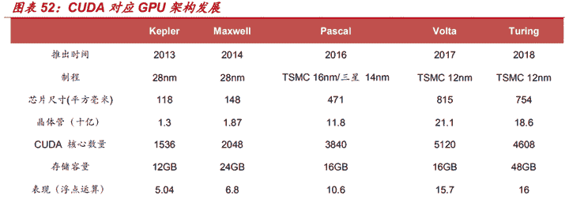

### 10、英伟达的CUDA技术凭借其广泛应用和强大合作伙伴网络，巩固了英伟达的领导地位

CUDA技术在众多领域均有广泛应用，包括但不限于深度学习、图像和自然语言处理、天气模拟、流体动力学、分子动力学、量子化学以及天体物理模拟。因此，适配CUDA的应用程序数量繁多，进而催生了对CUDA的广阔需求空间。英伟达与诸如Dell、HP、联想等知名OEM厂商，以及Netapp、PureStorage等渠道合作伙伴和如埃森哲等服务公司展开了深度合作。

### 11、CUDA整合英伟达体系，培养了开发者和使用者的用户粘性

当开发者融入CUDA的生态系统，他们往往会被其卓越的计算性能、充裕的库函数和出色的易用性所吸引，因此更倾向于持续利用此技术。另一方面，为CUDA优化的代码移植至其他平台通常需要消耗大量的精力和时间，这进一步增强了客户的留存度。此外，英伟达不断推陈出新，发布新的硬件产品及CUDA版本，从而维持用户对其技术的关注并持续使用。这种深度使用使得用户在选购硬件产品时倾向于选择对CUDA有更好支持的英伟达产品，进而建立起稳固的客户忠诚度。

## 六、英伟达产业链相关公司

AI发展提速电子半导体基础设施发展，海量数据的收集、清洗、计算、训练以及传输需求，催化AI产业链加速迭代升级，带动服务器增长与AI服务器占比提升，利好英伟达及服务器产业链大量使用的CPU，GPU，PCB，DDR5/HBM存储器，服务器散热，光芯片/光模块等。AI驱动下英伟达产业链快速发展带来新机遇，A股细分板块有望持续受益：

### 1、GPU

GPU为AI训练算力之源，在训练服务器中价值量占比超过80%。测算2026年全球数据中心GPU市场规模有望达749亿美元，22-26年CAGR达44%，目前英伟达市占率高达80%，可关注国内GPU产业链在国产替代和自主可控逻辑下的渗透率提升以及AI及信创推动核心行业服务器CPU国产替代浪潮，相关公司：寒武纪，海光信息，长电科技，通富微电。

### 2、PCB产业链

AI服务器PCB价值量是普通服务器的价值量的5~6倍，随着AI大模型和应用的落地，市场对AI服务器的需求日益增加，市场扩容在即。以DGXA100为例，15321元单机价值量中7670元来自载板、7651元来自PCB板，因此我们应当关注在载板和服务器PCB上具有较好格局的厂商，相关公司：

沪电股份：公司2022年营收占比中，高速通信类占66%，汽车占23%，高速通信类是保证公司成长的关键。公司高速通信产品主要用于交换机、服务器、运营商通信，客户覆盖包括国内外主要的设备商和云计算厂商，是A股PCB中涉及海外高速运算敞口最大的厂商，也是参与全球AI运算供应的关键厂商，未来有望随着AI市场扩容而实现快速增长。公司汽车类产品主要供应全球龙头TIER1厂商，并且依据多年的技术积累不断调整产品结构至覆盖多类域控制器用HDI产品，汽车智能化趋势将为公司带来成长贡献。

生益科技：从基本面的逻辑出发，公司作为全球第二大的覆铜板厂商，订单景气度随着电子行业整体回暖而将会逐季改善，并且我们认为公司能够凭借其强大的竞争力（产品系列全、产品品质优秀、客户和原材料管理能力强等）先于行业走出景气低谷、实现单张毛利反转，基本面胜率有一定的保证。从竞争格局上来看，公司是国内少有全系列覆盖高端产品的厂商，随着AI带动高端市场成长放量，公司有望加速自身产品结构调整进程，打开盈利增长空间。

联瑞新材：根据2022年年报数据，公司产品结构中球硅占53%、角硅占35%、球铝占11%。高端服务器载板和PCB板中打开球硅在PCB产业链的应用，AI服务器GPU所采用的2.5/3D封装外壳EMC需要用到20umcut及以上等级的球硅和low-α球铝，因此在当前AI等高速运算需求带来高端产品扩容的大背景下，公司有望依据现有已经站好的竞争格局实现成长。

生益电子：公司是传统高速通信类覆铜板生产厂商，在服务器需要用到高多层板上具有深厚的技术积累，公司服务器类客户覆盖了国内主流客户群和海外部分客户，随着国内加大训练端算力需求、海外AI相关应用加速推出，公司服务器类PCB将迎来增长。

兴森科技：根据公司2022年年报数据，公司PCB产品占比75%、半导体产品占比21%，其中半导体产品主要来自封装基板和半导体测试板，公司是国内布局封装基板第一梯队的厂商之一。公司目前配合下游终端厂商研发服务器用FCBGA高端载板，是高端载板国产替代的先行者。

深南电路：根据公司2022年年报数据，公司PCB产品占比63%、封装基板占比18%、电子装联占比12%，其中PCB产品有配套国内外品牌服务器厂商主板产品，封装基板是国内封装基板规模最大的厂商、目前正在配套下游终端厂商研发高端FCBGA产品，AI带动的载板和PCB板价值量增长将有助于公司成长。

### 3、存储芯片

根据Yole，2022年全球内存模组出货量5.11亿，其中DDR4出货5.0亿，DDR5出货0.11亿。2028年全球内存模组出货量有望达6.5亿，DDR5占比超过98.7%，22-28年DDR5内存模组出货量CAGR达97%。“3D堆叠+近存储运算”突破内存容量与带宽瓶颈，HBM成为处理大量数据和复杂处理要求的理想解决方案，我们测算得2026年HBM市场规模有望达56.9亿，22-26年CAGR有望达52%，相关公司服务器DDR5渗透率提升及HBM显存投资机会，可关注：澜起科技、雅克科技、深科技。

澜起科技：存储器价格处于历史低位叠加AI推动高容量内存需求，推动DDR5渗透率提升。由于目前DDR5与DDR4价差缩小，因此下游厂商加速产品的升级迭代，AMD、英特尔等厂商均已规划推出搭载DDR5的新世代产品。从2022年第四季度合约价来看，DDR58Gb模块的均价约24.6美元，相较于DDR4同规格产品的19.7美元，两者价差大幅缩小，DDR5跌价给下游厂商的产品迭代添加了动力，AMDRyzen7000系列、英特尔第13代Core处理器两大平台均已规划搭载DDR5。另外，从需求上看，AI推动数据中心建设需求增加，将对大容量内存带来增长。因此，我们预计2023年DDR5渗透率将攀升至20-25%，2024年或可达40-50%，较2022年的10%左右渗透率大幅提升。公司是全球领先的内存接口芯片龙头，在DDR5内存接口芯片方面市占率全球领先，并与Intel等国际大厂深度合作，我们看好公司未来受益于行业高速发展，预计2023-2025年净利润分别为16/25/32亿元。

### 4、服务器散热

AI大模型有望引领算力需求升级，带动高功率密度的智算和超算中心建设，加速配套设施液冷系统导入市场，未来伴随新建数据中心建设和存量数据中心改造，整体渗透率有望快速提升，同时高功耗也有望带动散热系统向芯片级升级。当前液冷行业仍处在发展早期，看好在技术+产能领先布局的厂商。考虑到竞争壁垒在于对场景定制化程度的理解、平台化能力的快速延展，建议从三条主线关注液冷技术的发展和投资机会：

华为电气-艾默生系的专业温控厂商：最早从事精密空调研发设计，具备多年的产业洞察，对技术研发具备前瞻性，且形成平台化的散热布局，赋能多行业应用，可关注：英维克、依米康、华为数字能源。

布局液冷技术的服务器厂商：冷却技术由房间级向行级甚至服务器内部芯片级延伸，能够参与液冷技术方案的服务器厂商，有望更快抓住算力升级的产业机遇，强化产品竞争力，建议关注：中兴通讯、浪潮信息、中科曙光。

提供包含芯片级散热的完整解决方案的供应商：芯片作为服务器核心热量源，随着高算力、高性能、先进制程芯片功耗的提升，散热方案向服务器内部芯片级升级，芯片级散热由风冷系统向液冷升级，建议关注：双鸿科技，健策精密，富信科技，中石科技。

### 5、光芯片/光模块

全球数据量爆炸式增长，光通信逐渐崛起。据Lightcounting数据，2027年全球光模块市场规模超200亿，数通市场为光模块成长的主要驱动力，400G/800G光模块将成为主要增长点，光芯片为光模块核心组件，相关公司高端产品领先布局的光模块厂商以及相对稀缺的光芯片厂商，相关公司：中际旭创，源杰科技，天孚通信。

<https://aigcreative.feishu.cn/sync/K4Gvd9vUQsy9Oubwqaeclu0Fnbg>