# 英伟达全产品体系：从全新Blackwel架构，到能容纳32000块GPU的超级AI工厂

> 来源：[https://aigcreative.feishu.cn/docx/Ha7NdKOtOo04bdxrQC0cwRtXnGd](https://aigcreative.feishu.cn/docx/Ha7NdKOtOo04bdxrQC0cwRtXnGd)

> **先复习一下基础知识：**

> 浮点运算次数（Floating Point Operations Per Second，简称FLOPS）是用来衡量计算设备执行浮点运算能力的指标。这个指标通常用来描述处理器（CPU）、图形处理器（GPU）或其他计算设备在一秒钟内能够执行多少次浮点运算。浮点运算是指能够处理带有小数点的数学运算，这对于科学计算、工程模拟、图形渲染等领域尤为重要。

> 浮点运算次数的单位按照大小顺序如下：

1.  **KFLOPS**（Kilo FLOPS）：每秒千次浮点运算。

+   1 KFLOPS = 1,000 FLOPS

1.  **MFLOPS**（Mega FLOPS）：每秒百万次浮点运算。

+   1 MFLOPS = 1,000,000 FLOPS

+   也就是每秒一百万次浮点运算。

1.  **GFLOPS**（Giga FLOPS）：每秒十亿次浮点运算。

+   1 GFLOPS = 1,000,000,000 FLOPS

+   也就是每秒十亿次浮点运算。

1.  **TFLOPS**（Tera FLOPS）：每秒万亿次浮点运算。

+   1 TFLOPS = 1,000,000,000,000 FLOPS

+   也就是每秒一万亿次浮点运算。

1.  **PFLOPS**（Peta FLOPS）：每秒千万亿次浮点运算。

+   1 PFLOPS = 1,000,000,000,000,000 FLOPS

+   也就是每秒千万亿次浮点运算。

1.  **EFLOPS**（Exa FLOPS）：每秒百亿亿次浮点运算。

+   1 EFLOPS = 1,000,000,000,000,000,000 FLOPS

+   也就是每秒百亿亿次浮点运算。

> 这些单位通常用于高性能计算（HPC）领域，以及在描述超级计算机的性能时。随着技术的发展，现代的超级计算机已经达到了EFLOPS级别的计算速度，例如，用于气候模拟、生物信息学、物理模拟等复杂计算任务。在评估计算设备的性能时，FLOPS是一个重要的参考指标，但它并不是唯一的衡量标准，内存带宽、存储速度、软件优化等因素也会影响实际的计算性能。

先上2024GTC大会开胃菜

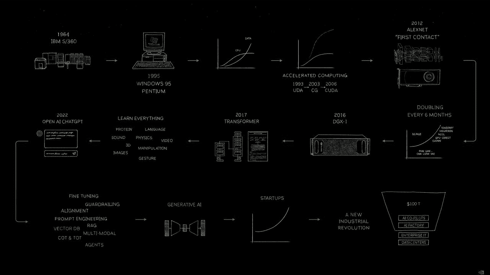

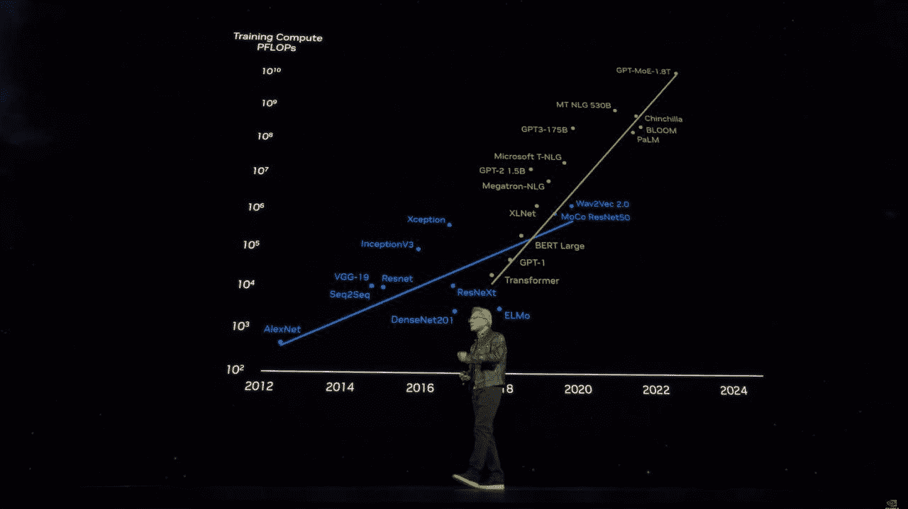

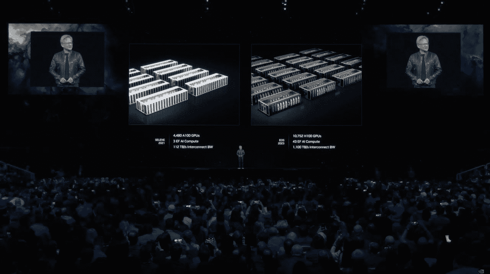

开始

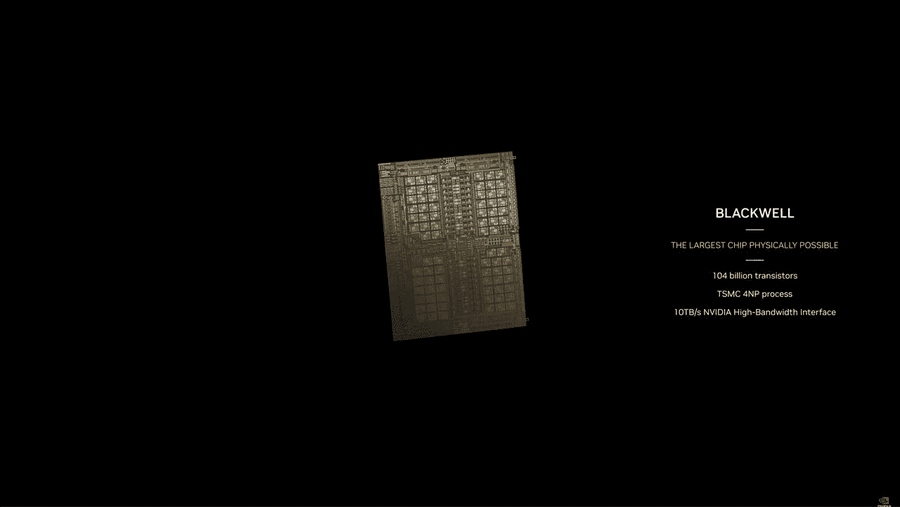

Blackwell

物理上可能存在的最大芯片

1040亿个晶体管

合积电4NP工艺

10TB/S NVIDIA高宽带接口

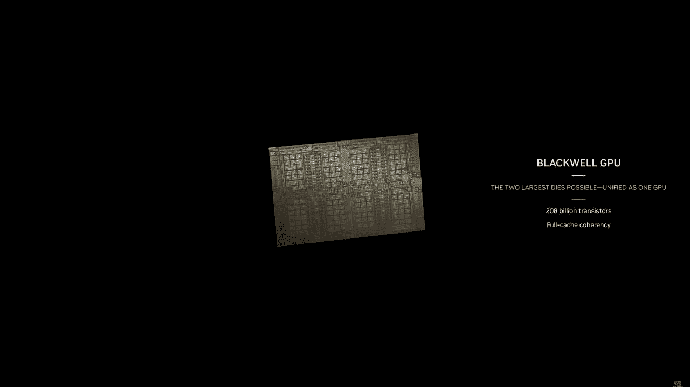

Blackwell GPU

两个裸片集成为一个GPU

2080亿个晶体管

全缓存一致性

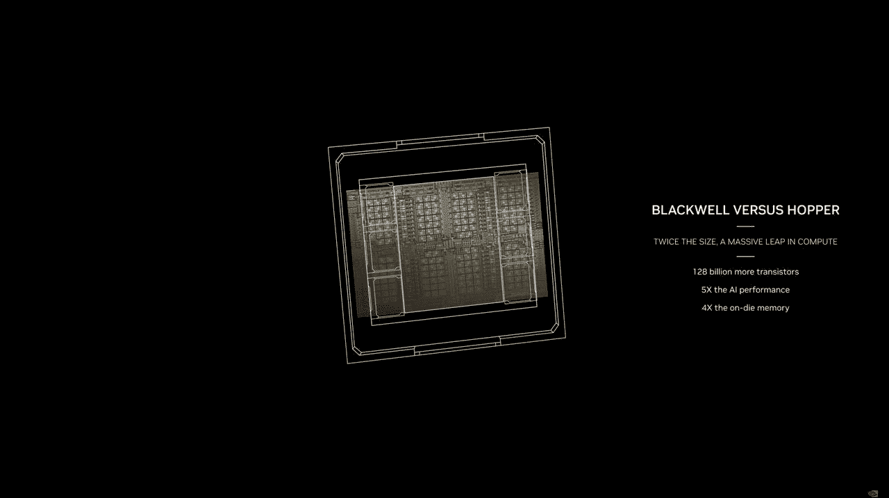

Blackwell Vs Hopper

尺寸是Hopper的两倍

5倍的AI性能

4倍的no-die memory

Blackwell

新工业革命的引擎

AI性能 20 petaFLOPS

192GB的HBM3e

8TB/s的内存带宽

全栈，启用CUDA

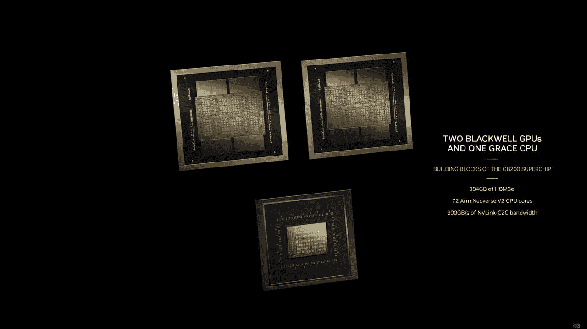

两个BlackwellGPU和一个Grace CPU

GB200超级芯片的组成部分

384GB的HBM3e

72 Arm Neoverse V2 CPU cores

900GB/s的NVlink-C2C带宽

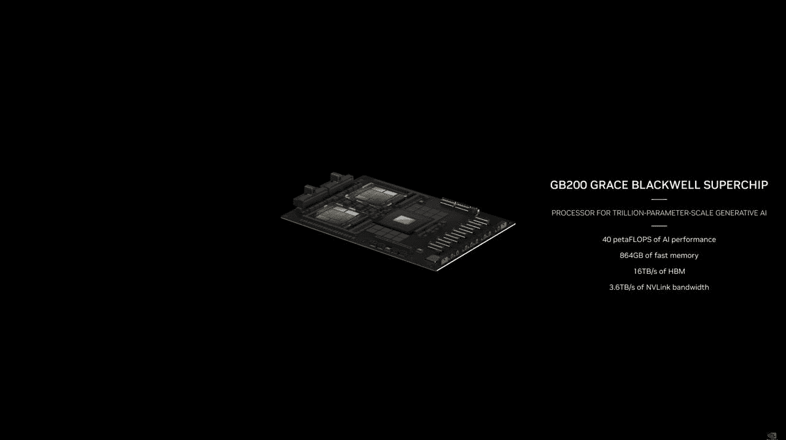

GB200 Grace Blackwell超级芯片

万亿参数级人工智能生成处理器

40 petaFLOPS的AI性能

864GB 高速内存

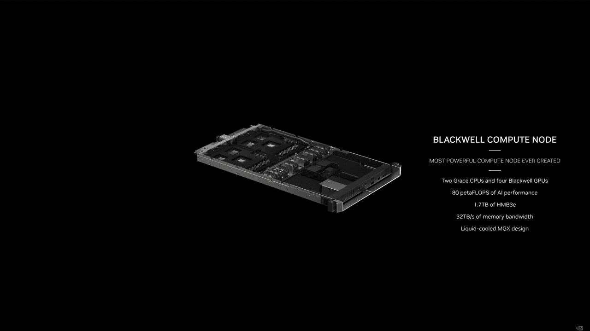

Blackwell Compute node

有史以来最强大的计算节点

两个Grace CPU和四个Blackwell GPU

80 petaFLOPS的AI性能

1.7TB的 HMB3e

32TB/s的内存带宽

水冷式 MGX设计

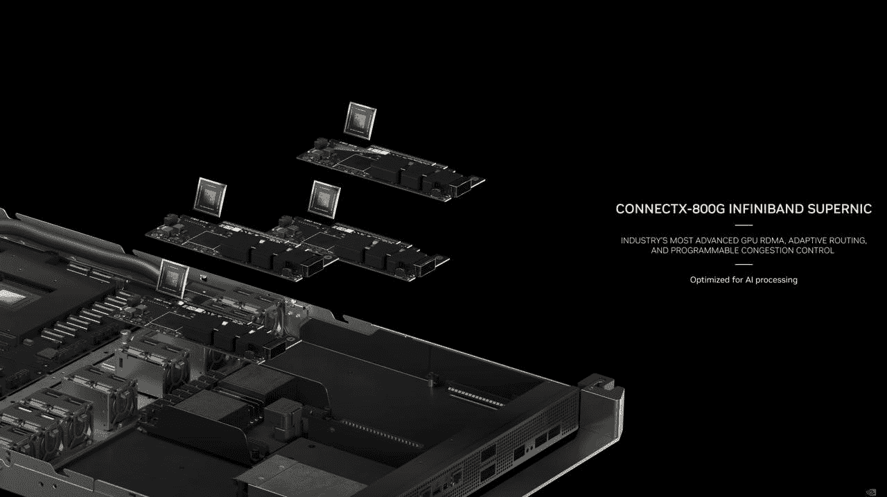

connectx-800G infiniband supernic

业界最先进的 GPU RDMA

自适应路由和可编程拥塞控制

针对AI处理进行了优化

BLUEFIELD-3 DPU

强大的基础架构处理器

网络、存储和网络安全的线速处理

网络内计算

每秒 8oCB 的内存带宽

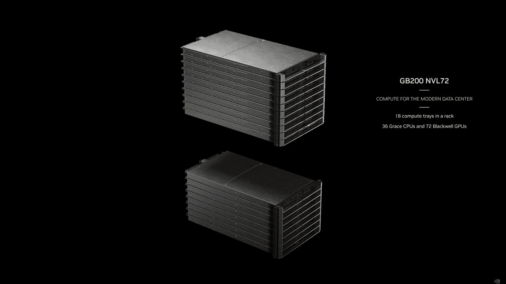

GB200 NVL72

为数据中心设计

一个机架上有18个计算托盘

36个Grace CPU 和 72个Blackwell GPU

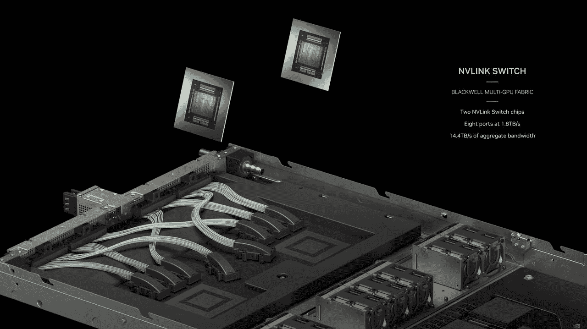

NVLINK SWITCH

多BlackwellGPU 架梅

两个NVLINK交换芯片

八个端口，速度为 1.8TB/S

14.4TB/的总带宽

NVLINK交换机系统

Blackwell多GPU架构

18个NVLINK交换机芯片

72个端口，1.8TB/秒的速度

以 130TB/的总带宽进行全对全通信

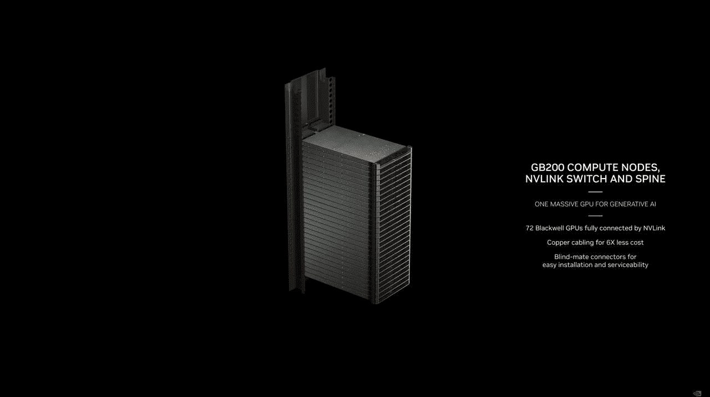

GB200计算节点Invlink交换机和SPINE

用于生成式人工智能的天型GPU

72个Blackwell GPU由NMLINK完全连接

铜缆布线，成本降低6倍

盲插连接器便于安装和维护

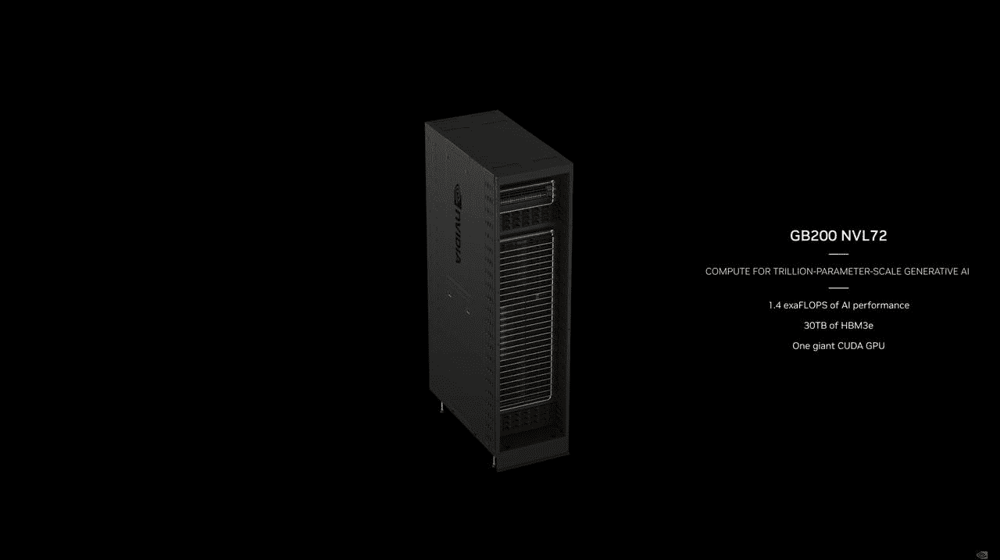

CB200NVL72

计算万亿参数规模的生成式人工智能

1.4exaFLOPS的AI性能

30TB HBMЗe

一个巨大的 CUDA GPU

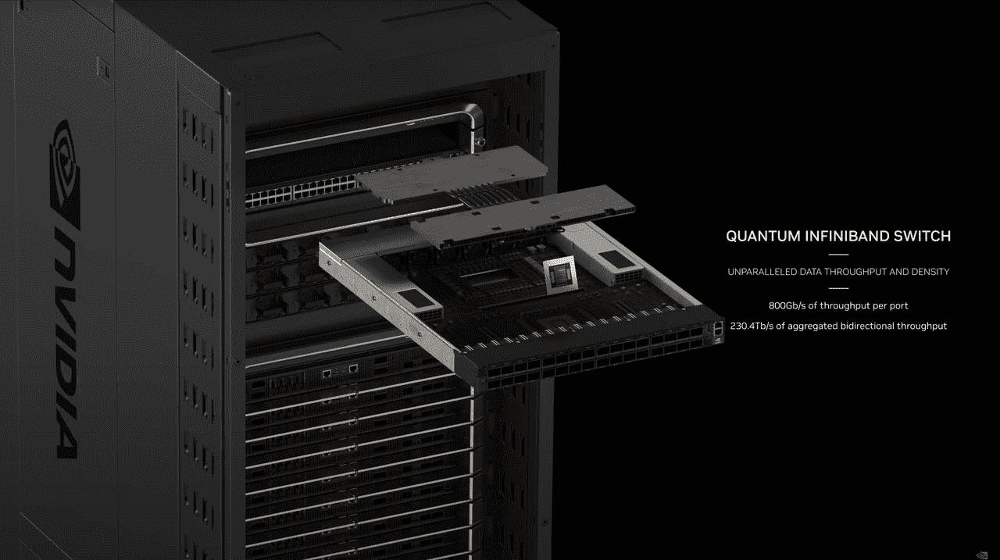

QUANTUN INFINBAND SWITCH

无与伦比的数据吞吐量和密度

每个端口800Gb/s的吞吐量

每秒230.4TB的聚合双向吞吐量

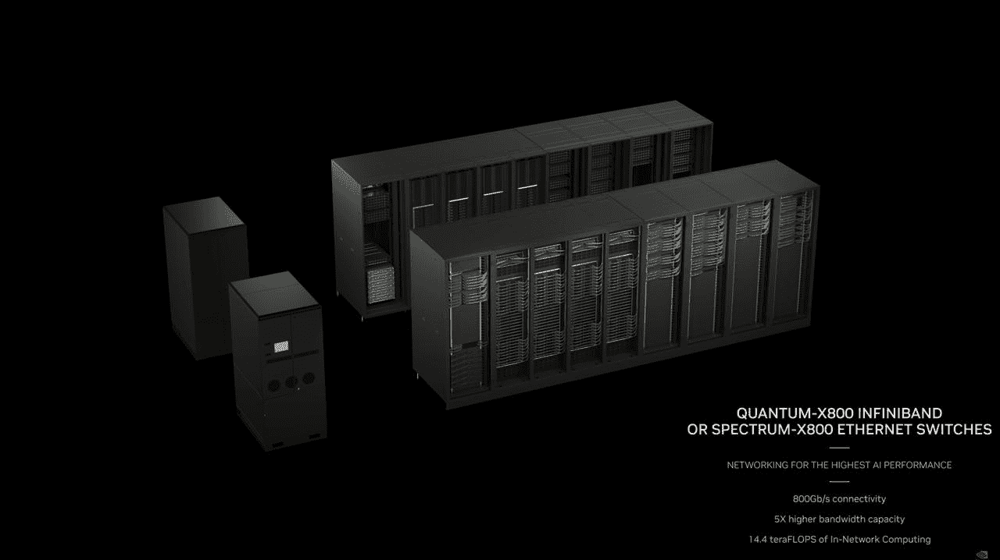

quantum-X800 infiniband

或spectrum-X800 以大网交换机

最高性能的网络

800Gbs连接

带宽容量提高5倍

14.4 teraFLOPs 的网内计算能力

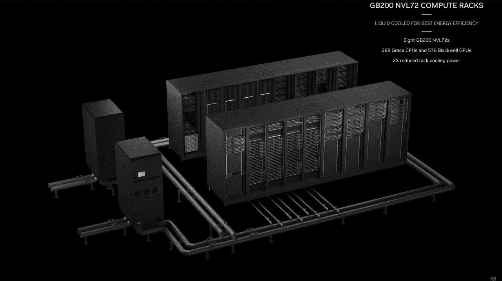

GB200 NVL72 计算机架

液体冷却，实现最佳能效

八个GB200 NVL72

288个GraceCPU和576个Blackwell GPU

机架冷却功率降低2倍

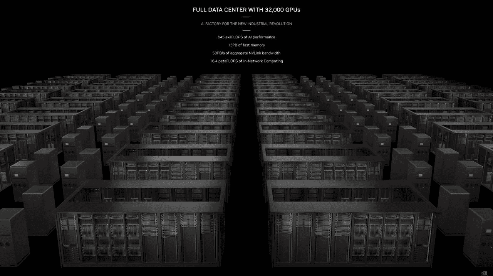

配备32,000个GPU的完整数据中心

新工业革命的AI工厂

645 exaFLOPS的AI性能

13PB 快速内存

58PB后的NVLINK总带宽

16.4百万亿次网络内计算

<https://aigcreative.feishu.cn/sync/K4Gvd9vUQsy9Oubwqaeclu0Fnbg>