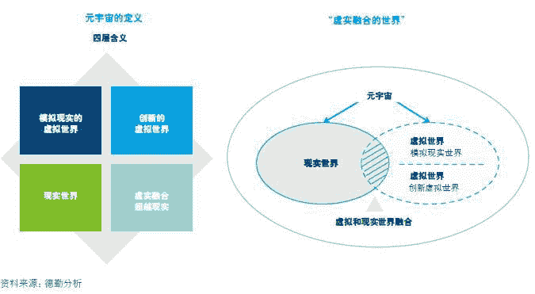
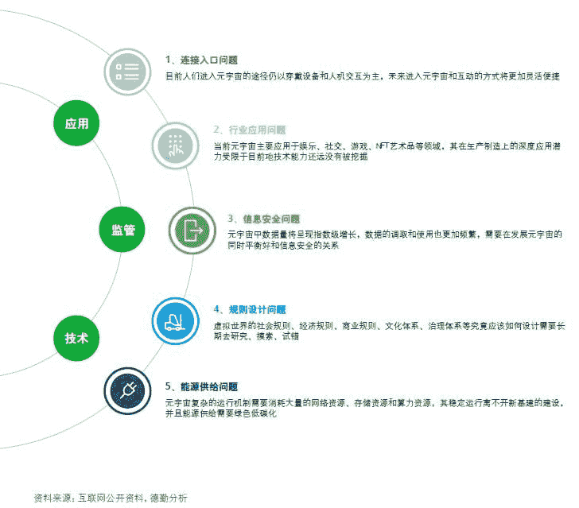
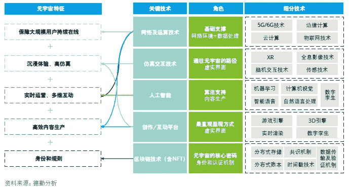
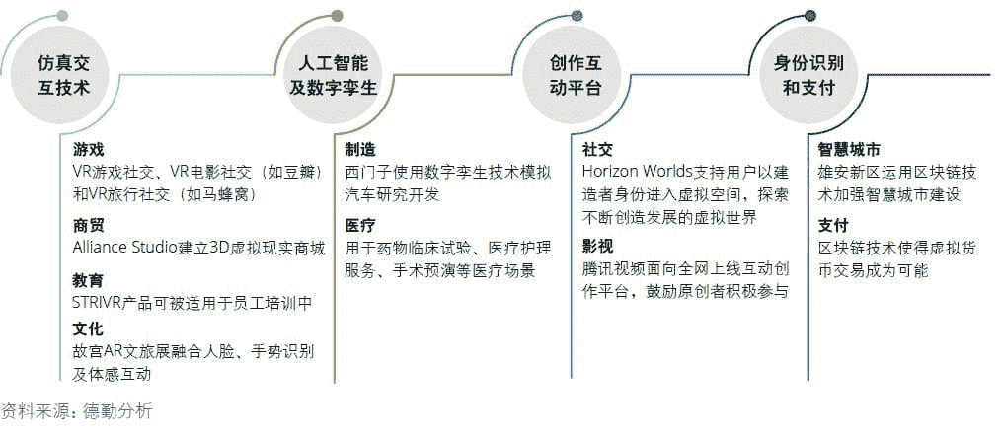
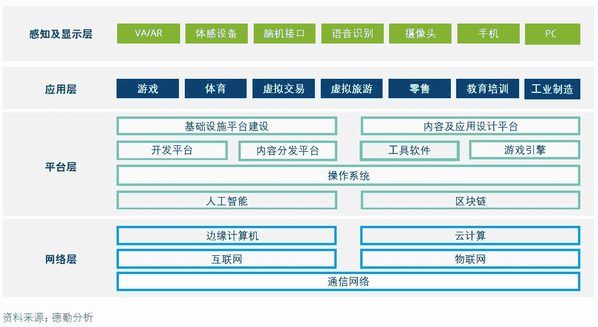
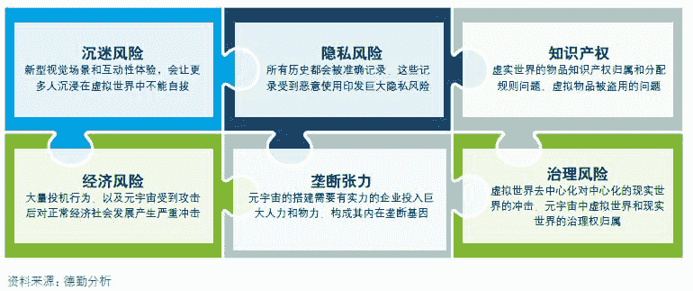
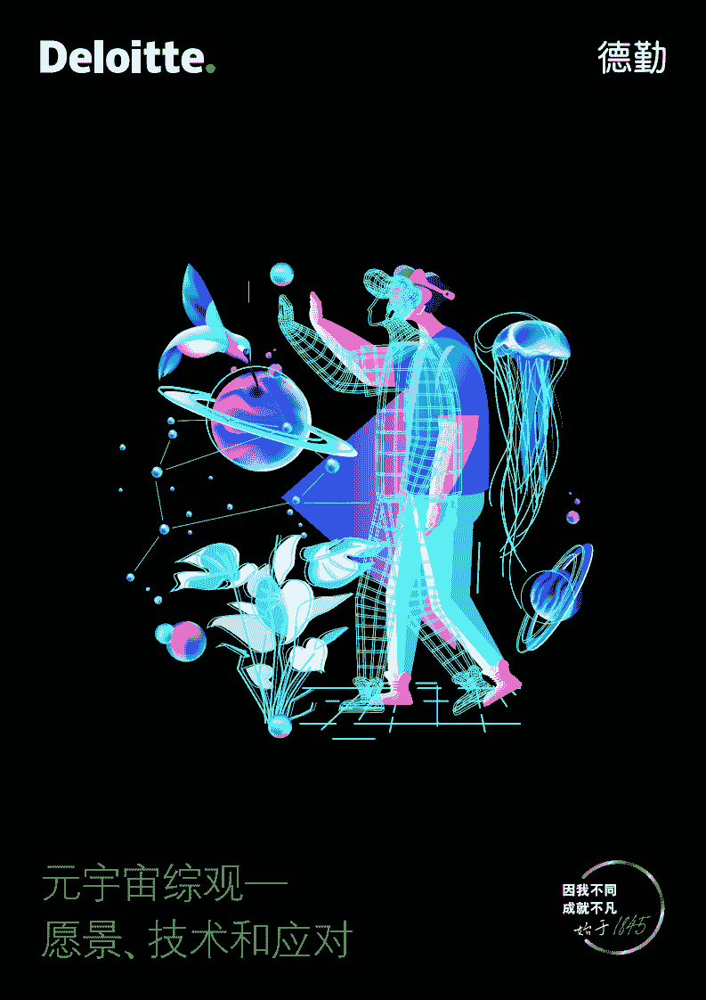

# AI元宇宙

> 来源：[https://aigcreative.feishu.cn/docx/PHi3dKpQioJ2RFxWKticnBaQnQf](https://aigcreative.feishu.cn/docx/PHi3dKpQioJ2RFxWKticnBaQnQf)

> 内容参考：德勤官网

2021年，被业界视为元宇宙元年，其爆发的强度和市场的响应速度，远高于互联网最初出现时的景象。纵观国际市场和中国市场，元宇宙绝不仅是小范围玩家的试验，似乎成为全人类向社会、科技、人文、法制下一个发展阶段的共同探索。2022年，随着各大入场的科技企业股价回落，资本市场对元宇宙的热情普遍退减，人们对元宇宙的探索逐渐趋于理智。长期来看，元宇宙将重塑人们生产、生活和社会关系。热度退却之后，那些兼具精确目标、不辍精神、优异才能的团队必将重掀热浪。

## **愿景和价值**

### 1、元宇宙的定义和四层含义

从“Meta（元）+ Verse（宇宙）”的本意出发，去定义和设想元宇宙的未来，即元宇宙是“虚实融合的世界”，包含4层含义：

+   **含义一：模拟现实的虚拟世界。**元宇宙将包括一个模拟现实世界的虚拟世界，具有现实世界的全部要素，包含身份、商业、娱乐、社交、文明、治理等，以及现实世界最重要的特征之一——感受。这是理解和设想元宇宙未来发展方向很重要的一个出发点。

+   **含义二：创新的虚拟世界。**元宇宙包括一个创新的虚拟世界，具有完全虚拟创造出来的人、物品、环境、规则等。这个创新的世界也具备现实世界的所有要素。

+   **含义三：元宇宙包括现实世界。**未来所有现实世界的元素都会在虚拟世界产生镜像，并与现实世界互动产生意义和价值。从这个意义上说，元宇宙是包括现实世界的。

+   **含义四：虚实融合超越现实。**第一点是虚实融合互动：长远看，虚拟世界和现实世界会形成紧密融合和互动——由虚到实、由实到虚，虚中有实，实中有虚。第二点是虚实融合的入口：第一种是应用数字工具，包括各种便携可穿戴的AR/VR设备等，第二种是应用脑机接口技术直接将相关的电信号通过无线脑机接口提供给人脑，进行实时、无障碍地信息交换，以此自由进入元宇宙。

图：元宇宙的定义和四层含义

### 2.** 元宇宙具备5大特征：**

+   **特征1：逼真的沉浸体验**，主要体现在感官逼真性和物体逼真性，这是元宇宙热得以爆发的关键要素之一。

+   **特征2：完整的世界结构。**元宇宙将是对于现实世界的完整复刻，模拟整个现实世界的所有要素。

+   **特征3：巨大的经济价值。**元宇宙空间的创造者们会通过各种技术手段赋予元宇宙稀缺性，对数字资产进行权利管理，让数据可用不可见，且无法篡改。元宇宙和现实世界相比拓宽了这种稀缺性，使得元宇宙又可能超越于现实世界的经济价值。

+   **特征4：新的运行规则。**元宇宙作为另一个“平行宇宙”的意义是在某种程度上削弱现实世界的“中心特权”。

+   **特征5：潜在的不确定性。**元宇宙的核心问题在于治理结构，即未来谁是治理结构中的金字塔尖。未来谁在虚拟世界中说了算，虚拟世界中的经济红利归于谁，其实是所有元宇宙的创造者，在设计元宇宙时就在考虑的问题。

### 3. 元宇宙可以带给人们精神及物质方面的价值，包括5个方面：

+   **娱乐性：**游戏和社交等活动，玩家进入其中获得沉浸式逼真体验，产生游戏和社交的愉悦体验；

+   **体验第二人生：**创意协作平台，创作者在虚拟空间里建造自己的个人世界，使得个人有机会体验不同于现实世界的人生；

+   **促进现实世界的效率：**教育、生产等领域，不受时空限制，升级体验，提高生产效率，增强效果；

+   **拥有新的财富：**虚拟货币、交易虚拟物品等，一次财富重新洗牌的机会；

+   **拥有新的影响力和社会地位：**虚拟社区，获得不同社会地位的机会。

1.  元宇宙目前发展处于萌芽期，理想形态的元宇宙未来终将到来。但是元宇宙走向成熟的过程中必会不断遇到并突破各种瓶颈，主要体现在5个方面：连接入口问题、行业应用问题、信息安全问题、规则设计问题和能源供给问题。

图：元宇宙目前面临的5大瓶颈

## **技术**

### 1. 用户使用元宇宙的场景顺序和相应的特征大致可以分为5类：

+   先接入，强调沉浸体验，以XR和数字孪生为主要技术群；

+   再互动，强调高仿真互动，包括3D引擎、实时渲染、数字孪生等技术；

+   同时使用数字内容，需要虚拟物品/空间的创作；

+   规则和身份，支持虚拟世界不同用户、实体间相互识别和交互的基础，以区块链技术为基础；

+   大规模持续在线使用，确保虚拟世界像现实世界一样持续运转和实时反馈，需要大量、高速的计算和信息传输能力，以云计算、超算、无线通信（5G，6G等）为主。人工智能算法将支撑其中的绝大部分技术。

图：元宇宙场景/特征对应的技术群

### 2.目前各项技术只是满足初期元宇宙的发展需要

+   **仿真交互技术——XR。**仿真交互技术在体感实现上，目前虚拟空间视觉和听觉的体验上走的最快，嗅觉、触觉和意念体验有了起步，味觉是多种感官的综合，目前尚未起步。

+   **区块链。**区块链稳步发展，经过了早期探索、市场准备、市场认可阶段后已步入产业发展阶段，目前比较典型的是区块链金融领域结合应用，对应于元宇宙中，下一阶段区块链和NFT将解决元宇宙生产资料和资产所有权的问题。

+   **物联网。**物联网的发展将经历爆发前期、爆发期和全面爆发期三大阶段，目前，全球物联网核心技术持续发展，标准体系正在构建，产业体系处于建立和完善过程中，全球物联网行业处于高速发展阶段，距离爆发期仍需要奋斗数年。要实现规模化加速演进仍需解决成本高昂、技术不成熟和安全等问题。

+   **移动通信网络。**理想中元宇宙的运行至少需要6G及以上的网络，预计6G网络通信在2030年能够全面落地。相比较5G，6G能够支持微妙甚至亚微秒级别的延迟通，真正能实现几乎零延时地在元宇宙穿梭互动。

+   **算力。**近20年来中国算力应用逐渐丰富，算力中心建设加快。从侧重于科研应用和仿真、油气、气象等重点领域应用的超算中心，发展至动漫渲染、生命科学、航天航空、无人驾驶、金融经济、智慧城市等更加多元化、智能化的应用领域，业务应用逐渐丰富，并且行业应用增速加快。

### 3. 元宇宙各项技术最终将走向融合，赋能各种应用场景

实现生产力的解放、洞察力的飞跃、决策力的提升和商业升级。

图：元宇宙相关技术应用示例

## **产业**

### 1. 如果将元宇宙看作一个大的应用场景，支撑这个应用场景有４层元素：

+   **感知及显示层**：VR/AR、体感设备、脑机接口等技术提供进入元宇宙的入口。

+   **内容应用层**：产生元宇宙的所有数字内容和应用。包括游戏，娱乐，社交，数字产品，经济活动，办公，生产应用等。

+   **平台层**：支持虚拟社区环境搭建、社区规则、以及上层应用层开发的各项技术。比如街道、建筑物等基础设施的生成和导入；游戏引擎、内容分发平台等应用支持技术；支持各种智能应用和互动的人工智能算法也在这一层。

+   **网络技术层**：包括5G、云、互联网、去中心存储等技术，是元宇宙的底层网络技术保障。

图：元宇宙产业架构

### 2. 从公司背景分，元宇宙主要包括四类参与者

互联网厂商、硬件技术厂商、软件技术厂、新创业者。在元宇宙未来的版图中，这四类企业之间更多的是合作关系，每种类型的企业之间会有更强的竞争关系。其中，一些大型互联网和科技企业作为平台型元宇宙玩家，依靠深厚的技术积累、广大用户群体、以及现成的应用场景，能够很快布局元宇宙的各类初级应用。同时通过资本优势，在元宇宙发展初期通过投资或收并购的方式拓展原先未涉及的领域，全面进行元宇宙布局。

### 3. 虚拟艺术品成为元宇宙热潮中增长最快的领域之一

从NFT流通视角看，产业链上的角色分别为上游创作者、中游NFT平台和下游交易竞拍者。NFT在各环节均产生价值，包括区块链平台收取的Gas费、项目创作平台收取的销售/转售服务费和内容创作者收取的销售收入版权费。

## **企业应对之道**

### 1.此刻元宇宙的发展还处在普及初级应用阶段

大量新的企业和服务形式出现，未来还将经历长期的发展成熟之路，可能会面临来自沉迷、隐私、知识产权、经济、垄断、以及伦理方面的众多风险。

图：元宇宙发展面临的风险

### 2. 对于中国来说，中国对待元宇宙采取“积极拥抱、谨慎前行”的政策

工信部指出在推动数字化赋能中小企业进程中将支持中小企业发展数字经济，抢抓国家推进新基建、大力发展数字经济的大好机遇，培育一批数字产业化专精特新中小企业，培育一批进军元宇宙、区块链、人工智能等新兴领域的创新型中小企业。但是，在对待虚拟货币和虚拟数字艺术品交易时，中国的相关政策表现出严格的监管态度。

### 3. 面对这样一个大的机遇和风险并存的热点，建议企业采取积极拥抱的思路以应对

+   **积极拥抱，迅速了解。**积极拥抱变化，迅速了解元宇宙的全貌，寻求企业在其中的机遇，形成自己的元宇宙应对策。

+   **力拔头筹，占领客户心智。**元宇宙的概念一经推出，迅速得到了资本市场、企业、以及个人的响应，整体的市场应用速度要远快于当初互联网被企业和大众接受的速度。在这个领域中，各个机会的窗口期都很短，优先占领者会享有先发优势。

+   **从数字化转型视角看待。**对于希望将元宇宙的各种技术、模式应用起来为自己赋能的企业，可以将元宇宙看作自身数字化转型、智能化升级策略的一部分。

+   关注基于核心竞争力的业务模式创新。希望从某个点切入元宇宙市场开拓创新业务的企业，可以从元宇宙的价值链出发寻找与自己既有能力契合的点。

+   **建立生态。**元宇宙的技术在向着更颗粒化、精细化的方向发展，客户的场景应用需求在向着更综合的方向发展。这要求企业建立起围绕自身核心能力的生态体系，为客户提供整合的应用场景和解决方案。

+   **规避风险。**避开与国家政策不符合的领域；做好数据管理和网络安全，防止数据泄露；避免投机心态参与元宇宙，防止经济风险对企业的危害。

德勤相关报告：

[deloitte-cn-tmt-metaverse-report-zh-220304.pdf](https://internal-api-drive-stream.feishu.cn/space/api/box/stream/download/all/GZN7bGyCIoXwWXxVzrKcg66mnXf)

<https://aigcreative.feishu.cn/sync/K4Gvd9vUQsy9Oubwqaeclu0Fnbg>

# 知识库动态