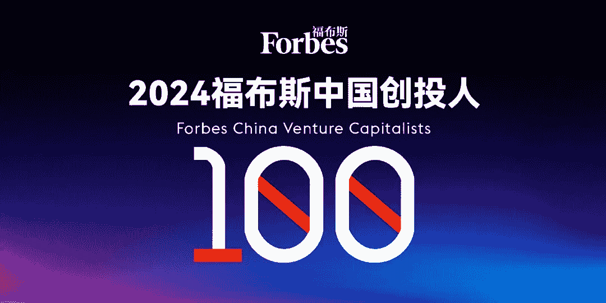
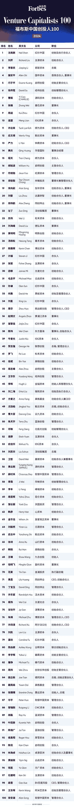
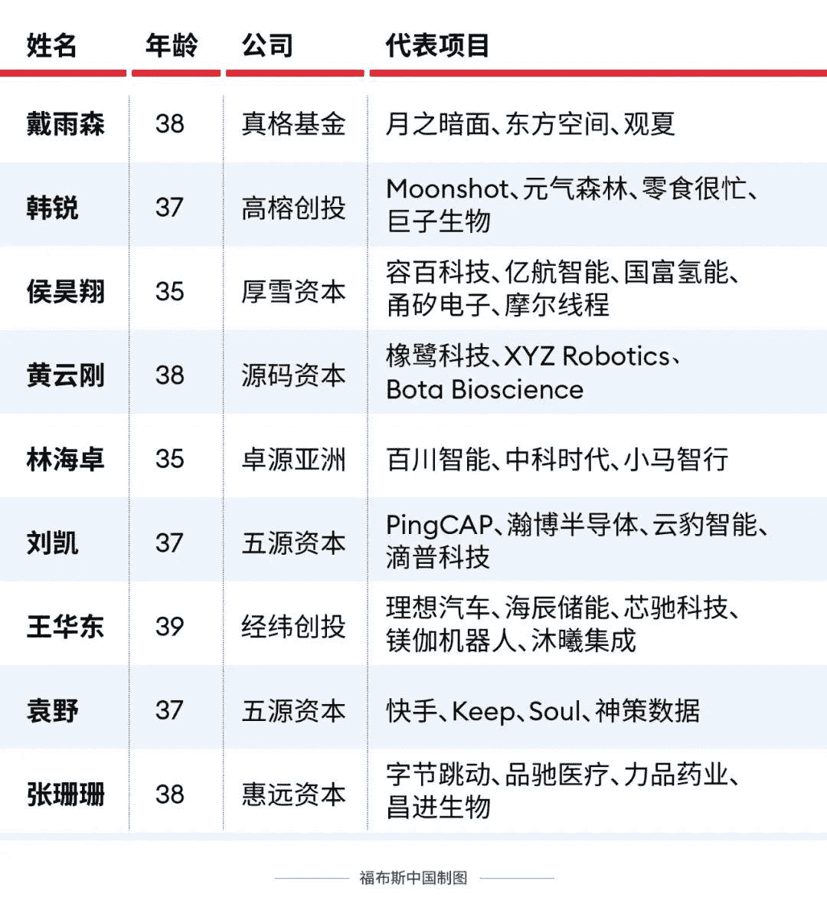

# 福布斯中国发布2024年创投人100榜单：激活新增长

> 来源：[https://aigcreative.feishu.cn/docx/XzfMdQ6inoijjdx198Dc23wVnEb](https://aigcreative.feishu.cn/docx/XzfMdQ6inoijjdx198Dc23wVnEb)

> 公众号：福布斯

> 链接: https://mp.weixin.qq.com/s/h7PYzTcaDOMmzcSuRTEFaQ

今年是中国创投机构人事更迭最频繁的一年。因此在第18届福布斯中国创投人100榜单中，更新率连续第二年超过了20%。本年度的新上榜者中有14位首次被我们关注，另有8位凭借出色业绩强势回归。此外，在激烈竞争的环境下，榜单中女性投资人共11位，数量与去年基本持平。

今  年，福布斯中国连续第 18 年对活跃于中国大陆市场的 风险 投资 人进行独立调研，并在数百家创投机构所推荐的近千 个 样本中找出 100 位过去 5 年中取得良好业绩的 投资 人。

**2024年共有34位投资人的名次出现显著提升，其中最**引人关注的“回归”来自五源资本的刘芹。

这位投资老将时隔1年重新回到了榜单前10——由去年的第13位上升至今年的第2位。 他的新收获包括6月上市的AI制药公司——晶泰科技，以及在10月份完成IPO的无人驾驶解决方案供应商地平线机器人，后者亦是本年度中国科技界最大的首次公开募股。 刘芹领导的五源资本是地平线上市背后的最大赢家。 早在2015年，该机构便领投了地平线的首轮融资； 直至上市前夕，五源资本依然是地平线机器人最大的财务投资者——占股5.55%。

除此之外，地平线这家市值超500亿的人工智能小巨头还帮助9位投资人增加了入选榜单的砝码。 其中早期支持者包括红杉中国周逵、祥峰投资郑俊聪以及真格基金方爱之等。 今年，他们分别排在第9位、第18位与第47位。

伴随“全球通用自动驾驶第一股”、“全球Robotaxi第一股 ”文远知行在美国纳斯达克的上市，启明创投邝子平也因此进入榜单前十。在此次IPO前，启明创投持有该公司8.5%股权，是文远知行的重要股东，也是最早和最大的机构投资者。

**随着中国二级市场回暖与政策利好，更**多硬科技项目的回报也开始变得极具想象力。

国产EDA软件龙头公司华大九天在最近50个交易日市值翻了接近一倍，达到740亿人民币。施安平带领下的国中资本除了在该公司2017年的A轮融资中领投4000万元人民币外，也在后续轮次中持续“加注”。今年该项目为国中资本创造了超过40倍的回报。

与科技领域相比，2024年消费公司IPO的好消息不多，但例如东鹏饮料、泡泡玛特、乖宝宠物等消费品牌背后的投资人却实现了名次的大幅飞升。 事实上，消费投资人在今年所取得的成功大多归结于过去项目的IPO及其流动性回报。 加华资本宋向前凭借东鹏饮料创纪录的现金退出，排名从41位上升至第19位，亦是今年专注消费赛道投资人中排名最高的一位。 同样，泡泡玛特的市值飙升也帮助黑蚁资本何愚、嘉御资本卫哲、蜂巧资本屠铮等投资人的排名更上一层楼。

以下是2024年福布斯中国创投人100完整名单：

**在第18届福布斯中国创投人100榜单中**，40岁以下的入选者达到了创纪录的9位。

其中新面孔包括排在第44位的经纬创投管理合伙人王华东。他推动了经纬对理想汽车的投资，随后开辟了经纬创投在智能电动车、半导体产业链、新能源产业链及智能制造领域的投资。而排名第85位的真格基金管理合伙人戴雨森是月之暗面最早期支持者之一。

**以下是今年榜单中最值得关注的85**后新生代投资人：（按照姓氏首字母排序）

<https://aigcreative.feishu.cn/sync/K4Gvd9vUQsy9Oubwqaeclu0Fnbg>

# 知识库动态