# 大厂AI优秀实践

> 来源：[https://aigcreative.feishu.cn/docx/TaeedAJNAomlZexJRUgcARaQn0g](https://aigcreative.feishu.cn/docx/TaeedAJNAomlZexJRUgcARaQn0g)

> 来源：优设@WOWDesign

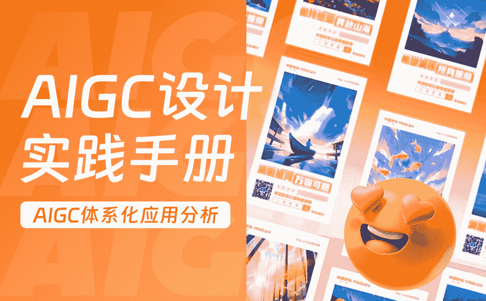

#### **一、前言**

随着技术的不断迭代，AIGC 能力的可控性得到了进一步提升，可应用的场景也越来越多，在文本、图像、视频等多个领域都有了广泛应用。用户已经可以用自然语言来与 AI 工具进行交互，革新传统办公方式，工作任务可以更具创造性，并且提高了生产效率。

本[文将从 ](https://www.uisdc.com/tag/aigc)AIGC 体系化应用角度聊一聊，设计团队如何利用 AIGC 来优化工作流，提升效率的同时，更多推动 AIGC 能力应用与落地。

#### **二、AIGC 对设计的影响**

如何更好的利用 AI 工具帮助我们提升设计效率与价值，我们尝试了从产品设计类需求、运营设计类需求、视频/动效类需求及用户研究类 5 类需求场景的尝试。

我们认为流程可复用的 AI 才能真正来为现有工作流程提效赋能；于是对现有工作场景进行梳理，结合不同 AI 工具的特点及各类需求的特性，来制定更有针对性的标准化 AIGC 工作流程。通过 AIGC 工作流标准化的落地，逐渐覆盖更多高频、重复性的工作节点及应用场景来解放设计生产力，从而工作重心更多以创意、创造性任务为主。

1.  目前现阶段 AIGC 工具使用功能偏好：

+   创意发散：使用 AIGC 工具来快速生成参考，激发新灵感

+   快速设计：使用 AIGC 提升设计效率，如快速生成视觉元素、完整画面进行应用

+   定制效果：利用 AIGC 工具例如训练 lora 模型或 ControlNet 控制生成生成元素效果或形态，来实现相对定制化的视觉需求

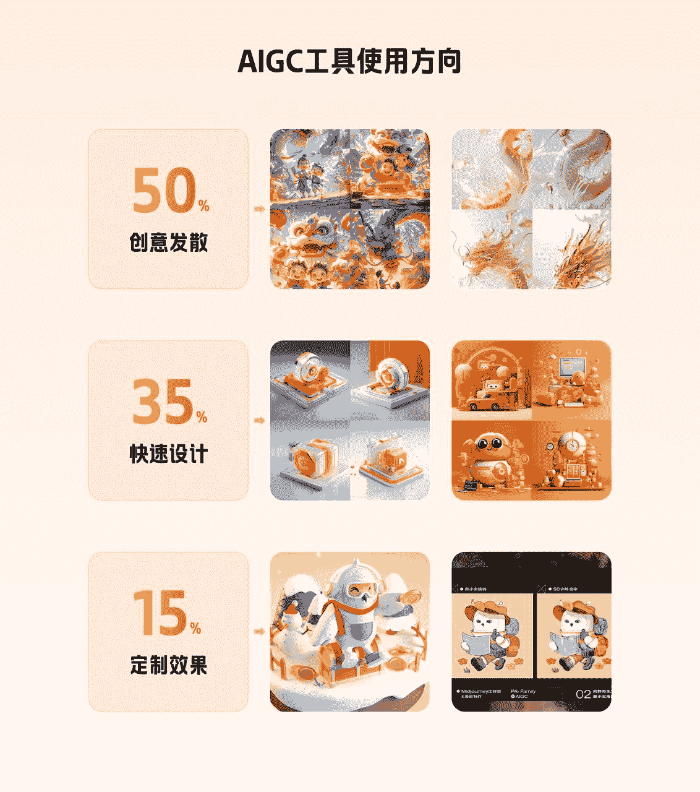

1.  **AIGC 设计师的角色变化**

根据个人特长和承接需求，部分设计师角色及能力维度也产生了变化

对于产品设计师来说可以利用 AIGC 工具加速设计流程的变革，重塑团队合作模式。整合 UE、UI 设计师能力往 UX 全链路设计师方向转变。

运营视觉设计师利用 AIGC 来洞察设计趋势及用户的偏好，快速输出创意参考，更深入、精准洞悉业务需求同时，更深入理解商业目标，更多的参与到创意决策和场景故事塑造中去，从而往运营产品设计师方向转变。

1.  **设计师所面临的挑战：**

新事物的学习适应能力：设计师面临着学习新工具、新方式的学习压力，并同时还需探索如何将 AIGC 配合融入现有工作流之中

创意的差异化：如何在保持设计作品的个性、特点、差异化来尽量减少 AIGC 的特征

AIGC 输出稳定性：在使用 AIGC 工具时如何才能让输出物可控、稳定，得到设计师想要的效果

#### 三、AIGC 设计工作流标准化建设

1.  **产品设计类需求工作流程**

根据需求类型进行拆分，在设计分析、UI 设计及设计输出等阶段均可由 AI 工具介入，从而优化工作流程，提升设计效率。通过 AI 自动化走查工具进行设计走查提效提质。

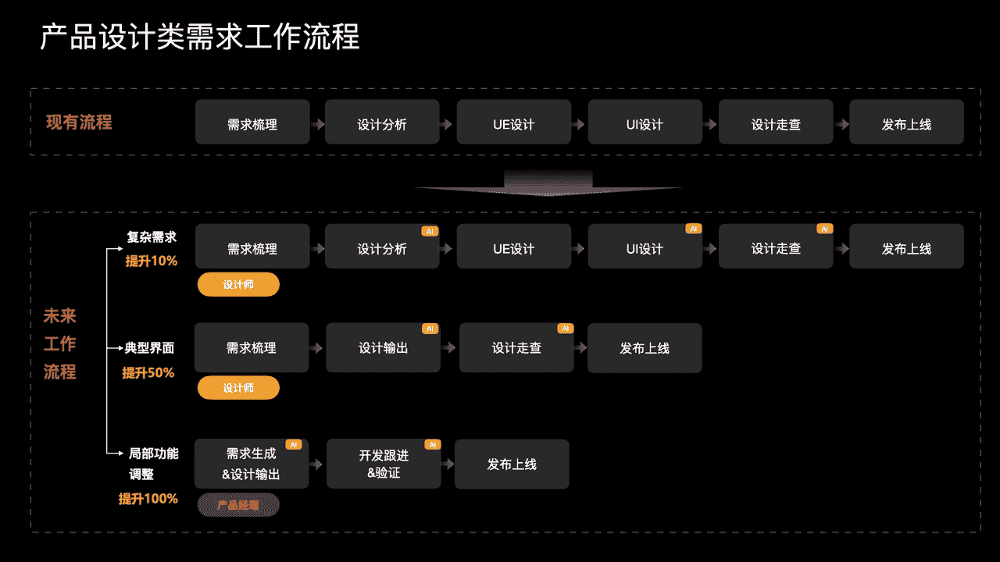

针对运营需求可以拆分为定制类运营需求和泛场景类运营需求

1.  **定制类运营需求工作流程**

可从前期的设计风格确认，设计素材查找/制作、运营图片设计/延展进行设计提效。

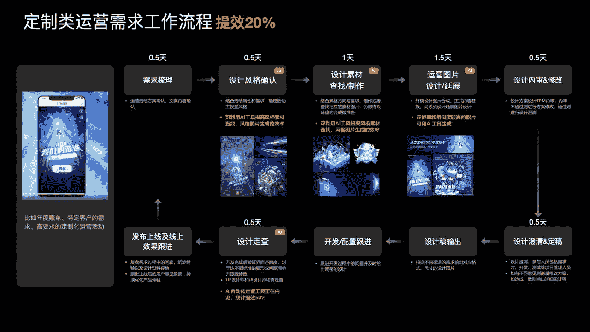

1.  **泛场景类运营需求工作流程**

可通过 AI 工具生成素材图片或通过智能海报工具完成海报设计

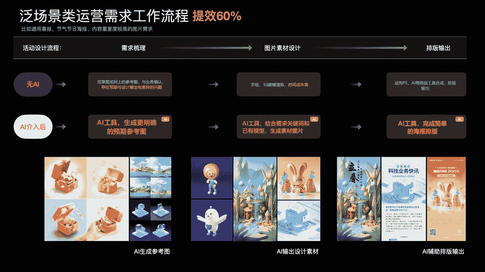

1.  **视频/动效类需求工作流程**

通过 AI 工具，可以把图片生成动效视频，可根据业务场景生成动画视频，还可创建专属的数字分身。拓展了运营宣发形式，可做更多创意场景。

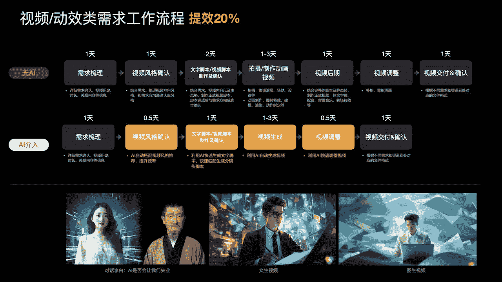

1.  **用户研究类需求工作流程**

可通过对 AI 工具帮搜索收集调研资料，并且可以对资料进行整合分析，辅助输出用研报告。

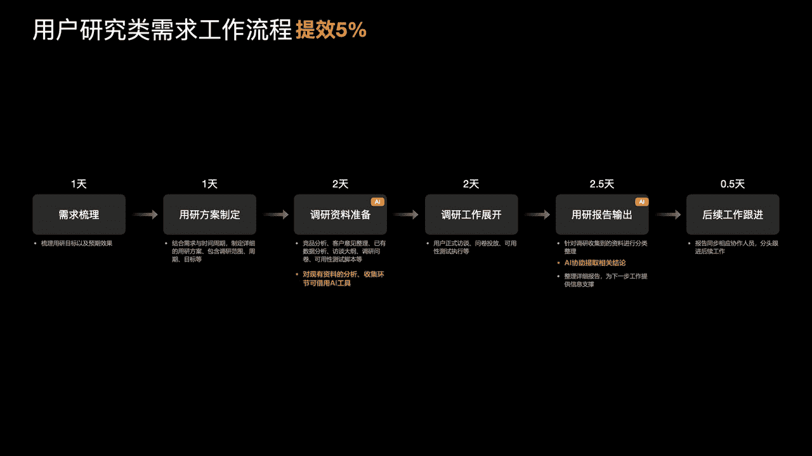

#### **四、AIGC 场景应用**

AIGC 主要应用场景：营销活动、微海报、IP 形象、动态视频……

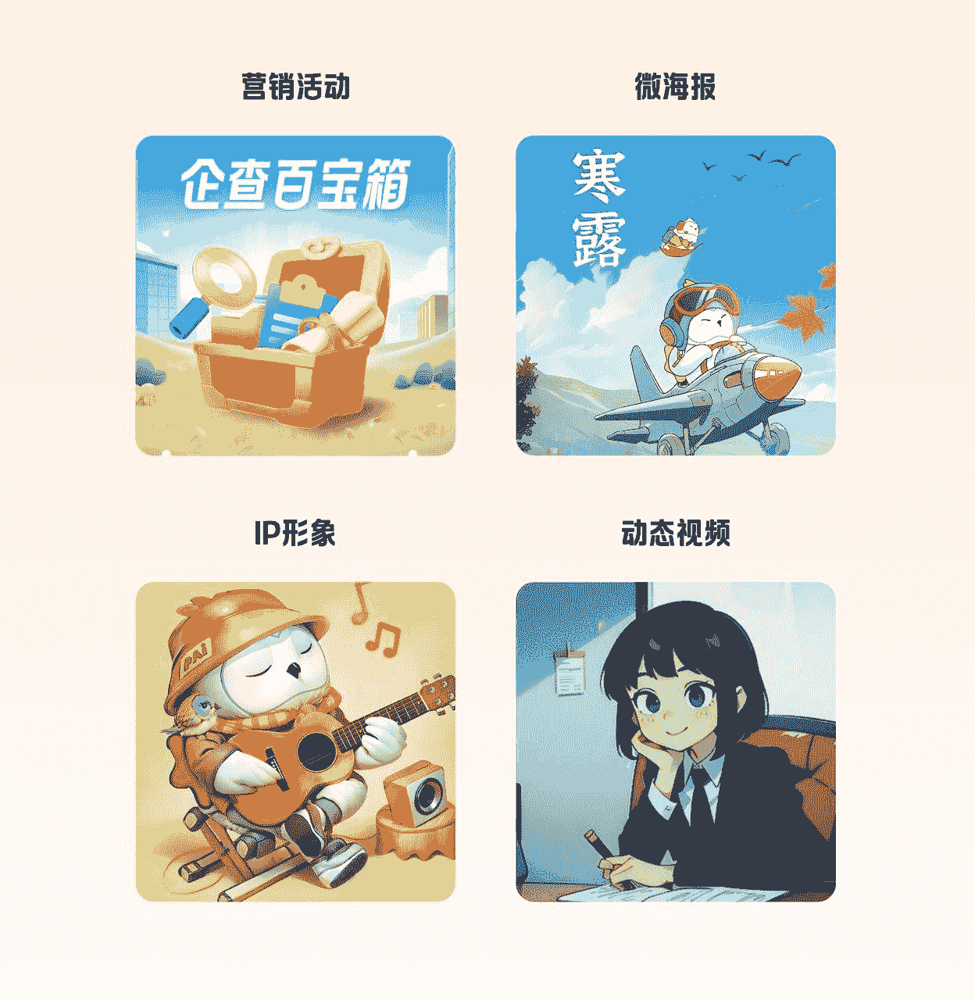

1.  **智能海报系统**

利用前端设计排版的海报模版，结合 AIGC 素材出图能力，非设计人员可快速输出模版海报。

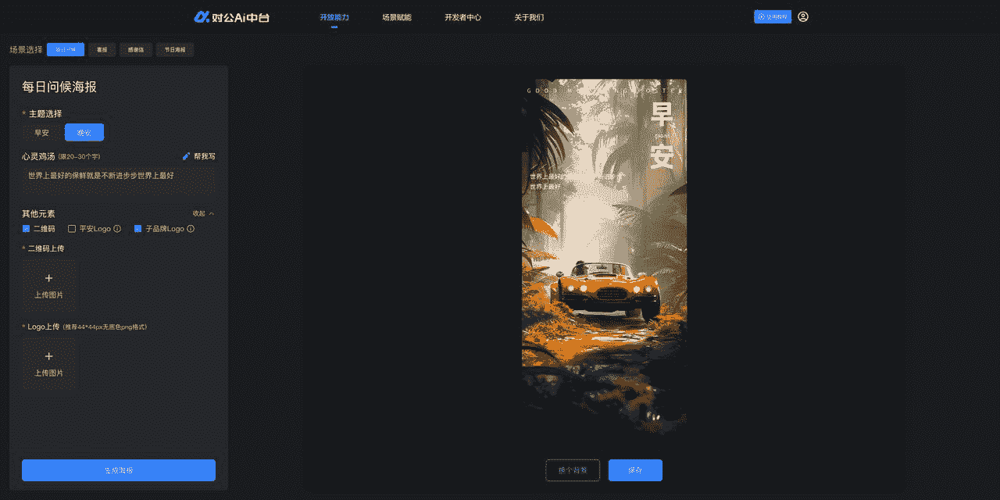

1.  **AI 辅助运营活动、海报设计**

①设计拆解：

通过拆解，把运营活动分为：背景层、主体层、文案层，其中背景层、主体层可通过 AI 辅助生成，提升设计效率。

背景层：通过活动主题诉求绘制草图，得出背景层设计元素及风格，转换成关键词在 Midjourney 中生成高质量背景

主体层：活动主体如果有明确的内容要求，或 IP 形象，此时通过 Stable Diffusion 的 control net 插件结合草图，或通过训练的 ip 形象 lora 模型产出 ip 定制化姿态与服装，高效完成主体绘制。

②Prompt 关键词系统搭建：

把设计师对画面的构思思维，翻译转换成 AI 能读懂的 Prompt 关键词，并形成结构化：场景+主体+风格+提质等关键词，并通过不断优化尝试，形成稳定的出图关键词模版，减少试错成本

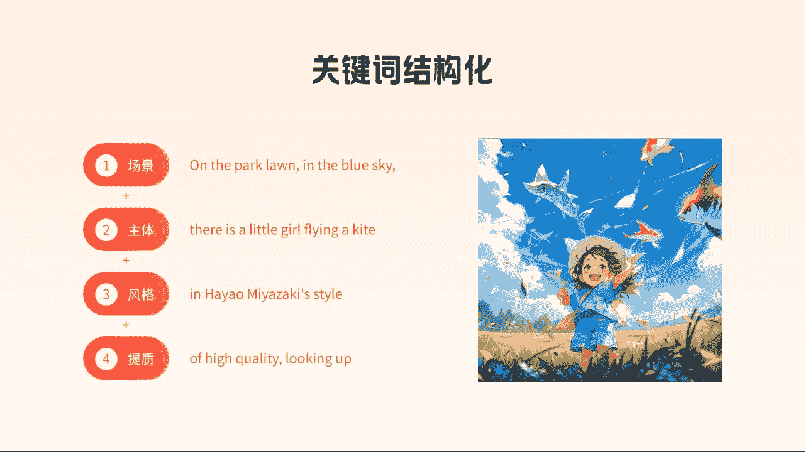

③Prompt 关键词模版库：

把关键词沉淀成资源，团队内共享，提升设计效率，形成 AI 素材库

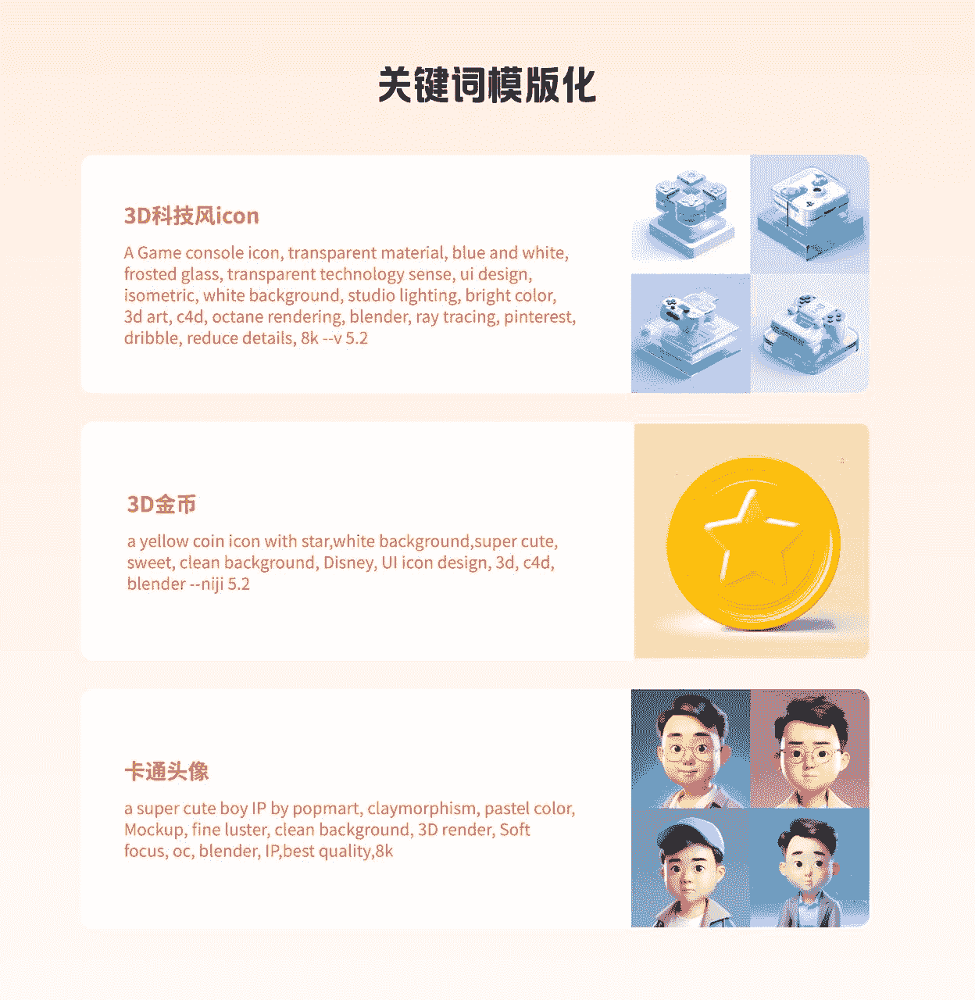

④排版合成

通过关键词在 AI 工具生成所需设计素材，通过设计软件合成、修图、排版，输出最终设计物料

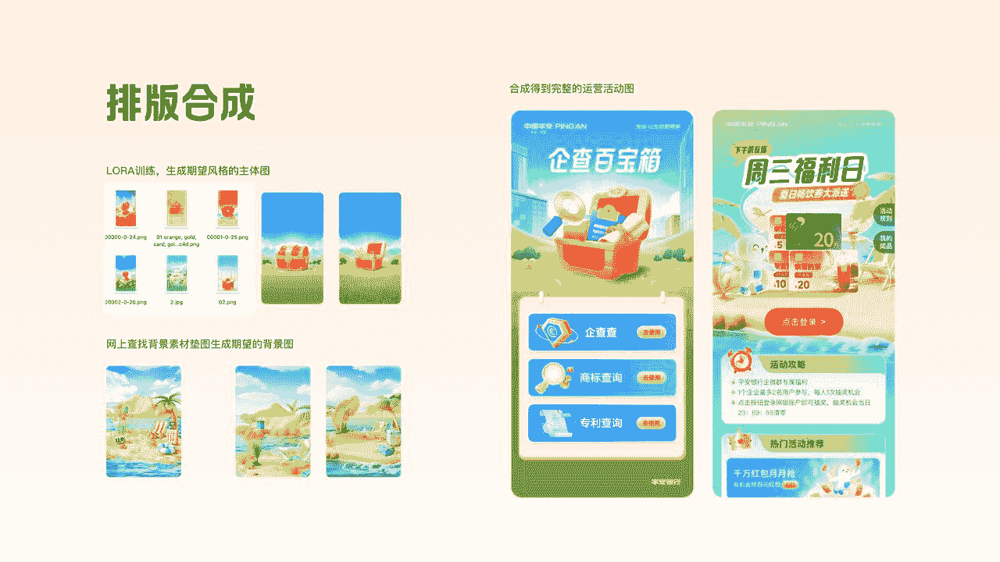

#### **四、AIGC 其他案例展示**

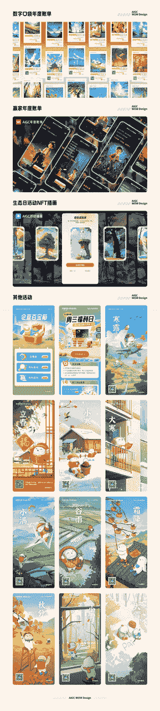

<https://aigcreative.feishu.cn/sync/K4Gvd9vUQsy9Oubwqaeclu0Fnbg>