# 如何用 Stable Diffusion 制作超级符号海报？

> 来源：[https://aigcreative.feishu.cn/docx/Yc68dgqfPo8p1BxbiXuc1fz6nJM](https://aigcreative.feishu.cn/docx/Yc68dgqfPo8p1BxbiXuc1fz6nJM)

> 来源：👸号-百度MEUX

#### **前言**

品牌符号宣传海报作为品牌运营很重要的曝光手段，随着 AI 技术的不断发展，已经逐渐替代传统设计方法，质量和效率的提升使它成为热门的超级符号延展设计方式，今天我们就来了解下这套设计方法论，解析利用 AI 生图制作超级符号海报的方式。

更多[AIGC](https://www.uisdc.com/tag/aigc)实战案例：

#### 一、SD 品牌运营实例：抖音+天猫+文字

我们可以看到各大设计网站展示的用 AI 制作的符号海报，有文字、图形等，它们大多设计样式丰富，成矩阵展示，画面精致度很高，充满想象力，并且耗时特别少，产量很丰富，那么这样的海报是怎么生成制作的呢？下面带来一步步的解析。

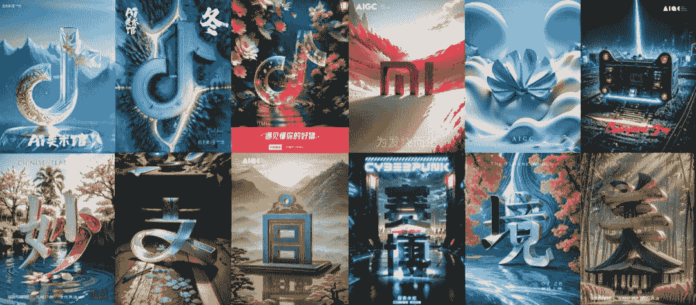

#### **二、SD 符号演绎解析**

1.  **基础教程分析**

基础理论分析：在文生图模式下，通过大模型+prompt+controlnet（lineart 控制外轮廓）的组合设计品牌符号海报，同时可以辅助 lora、以及设计师创造力。

总结基础公式：logo+lineart/canny

基础公式生图：

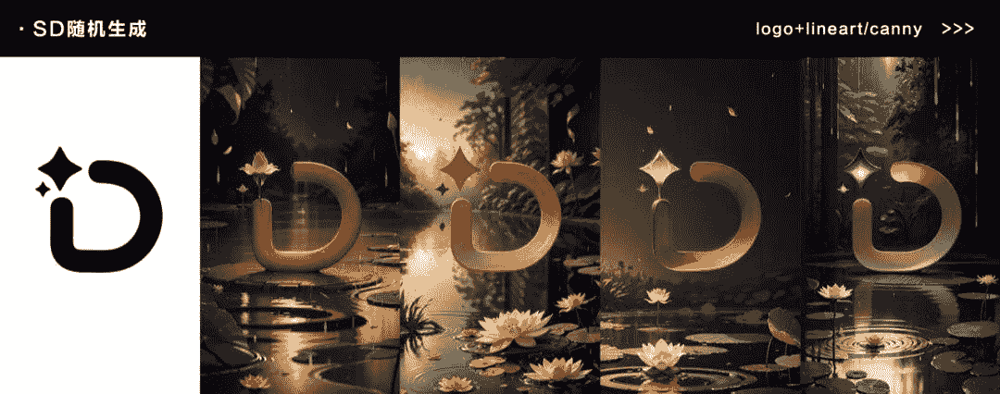

基础公式下设计的百家号符号海报：

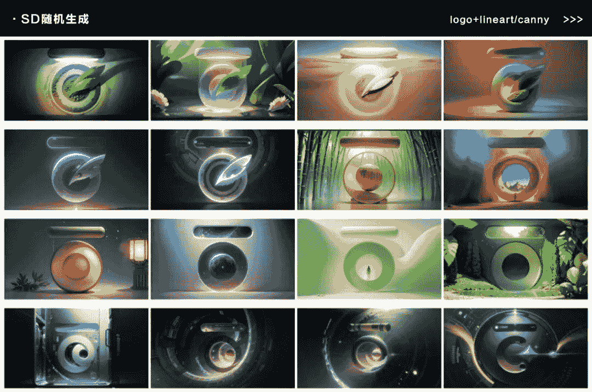

#### **三、SD 符号进阶版理论**

1.  **入门 SD 符号生成模式**

在基础公式下，我们需要加入深层 controlnet 来控制画面的前后关系。

进阶版入门公式：logo+canny/lineart+depth

进阶版入门公式下设计的度加符号海报：

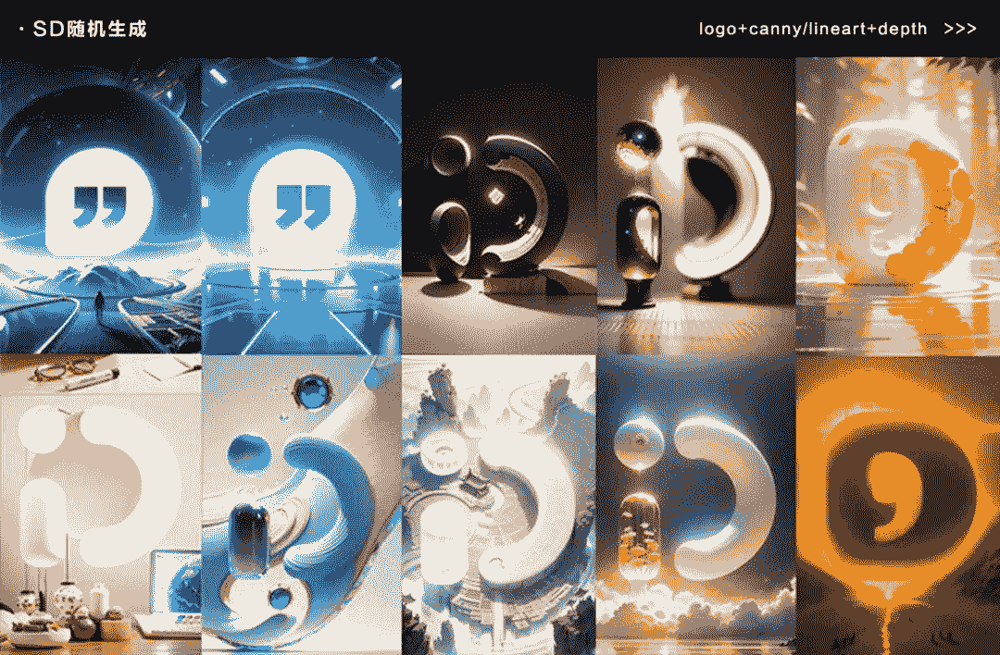

1.  进阶门槛——深度图（depth map）

作为进阶入门我们需要了解一个概念就是“深度图”：

①深度图（depth map）

深度图指存储单视图所有像素的深度值的二维图像，是空间单位，比如毫米。

+   深度图是一张二维图像，和原图等大小

+   深度图每个位置保存的是该位置像素的深度值

+   深度值就是相机坐标系下的 Z 坐标值

深度图上对应的区域越浅（深度值接近 1），越远则越黑（深度值接近 0）。也就是说深度值从 0 到 1 代表的是从远到近。

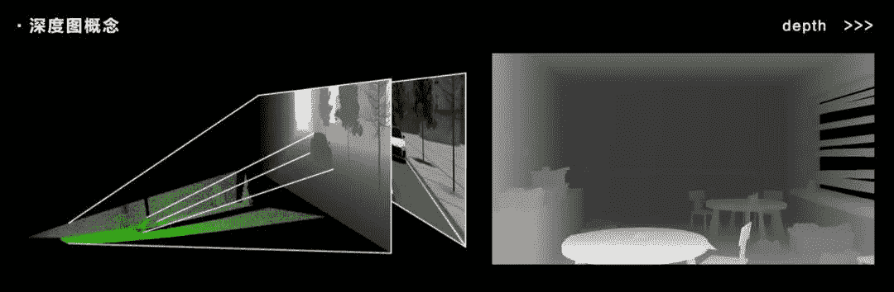

②SD 深度图解析：

controlnet 插件中有四种处理器，分别是 midas、zoe、leres，leres++四种，精细度是递增的，随之而来的模型的生成时间也是成倍的增加，我们可以根据需求进行选择，其中以符号来说选择 midas 和 zoe 比较适合。

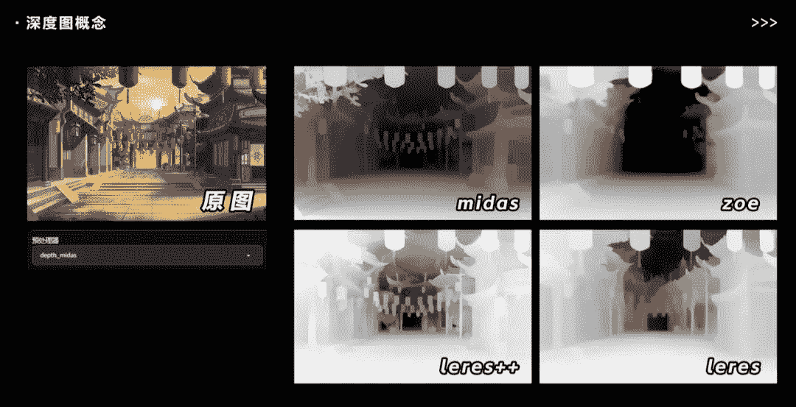

③进阶版入门公式生图：

我们在 SD 的 controlnet 插件中选择 depth 可以自动生成的深度图，我们可以通过预处理的效果进行跑图，然后挑选一张比较满意的生成一张海报，当然自己做深度图对于画面精准度的控制会更好。

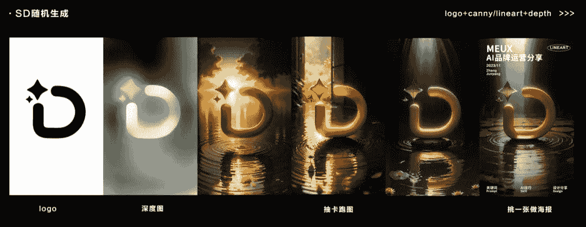

1.  初级 SD 符号生成模式（建模辅助）

在 AI 生成的符号立体度不能满足我们设计创意的需求时候，我们需要自己进行辅助建模。

进阶版初级公式：立体 logo+depth+canny

建模辅助 1.0——进阶版初级公式：

①建模辅助 2.0——进阶版初级公式：

我们还可以生成倒下的两点透视的符号视角，但是相应的视角是需要考虑到生图时候会出现的遮挡和识别性问题。

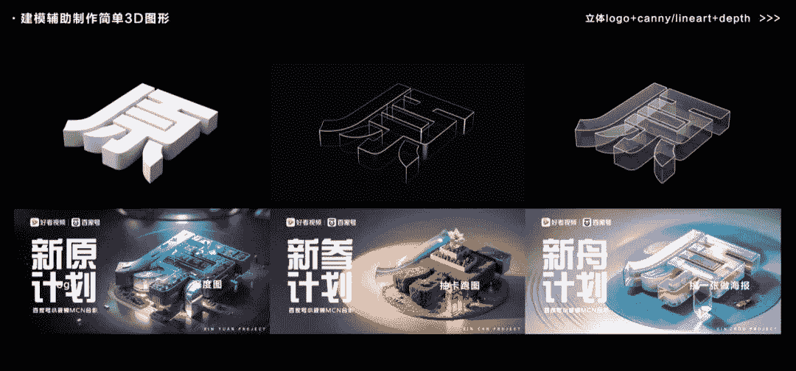

1.  **中级 SD 符号生成模式**

在日常生图的过程中会，我们会经常花很多时间进行抽卡，幸运的抽到 S 卡，生图时间减半，如果不幸抽不到 S 卡那生图时间加倍，这里我给大家介绍一个自研是符号生成方式，有效帮助提升概率，抽 S 卡卡池。

1.  **进阶门槛——语义分割**

作为进阶中级生成模式需要了解一个概念就是“语义分割”：

①语义分割（Segmentation）

语义分割是计算机视觉中很重要的一个方向。不同于目标检测和识别，语义分割实现了图像像素级的分类。它能够将一张图片或者视频（视频以帧来提取的话其实就是图片），按照类别的异同，将图像分为多个块。

语义分割即能够将整张图的每个部分分割开，使每个部分都有一定类别意义。和目标检测不同的是，目标检测只需要找到图片中目标，打上框然后分出类别。语义分割是以描边的形式，将整张图不留缝隙的分割成每个区域，每个区域是一个类别，没有类别的默认为背景 background。

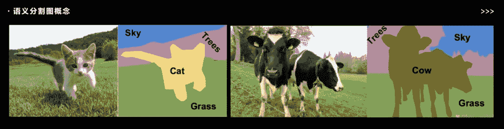

②加语义分割的画面对比：

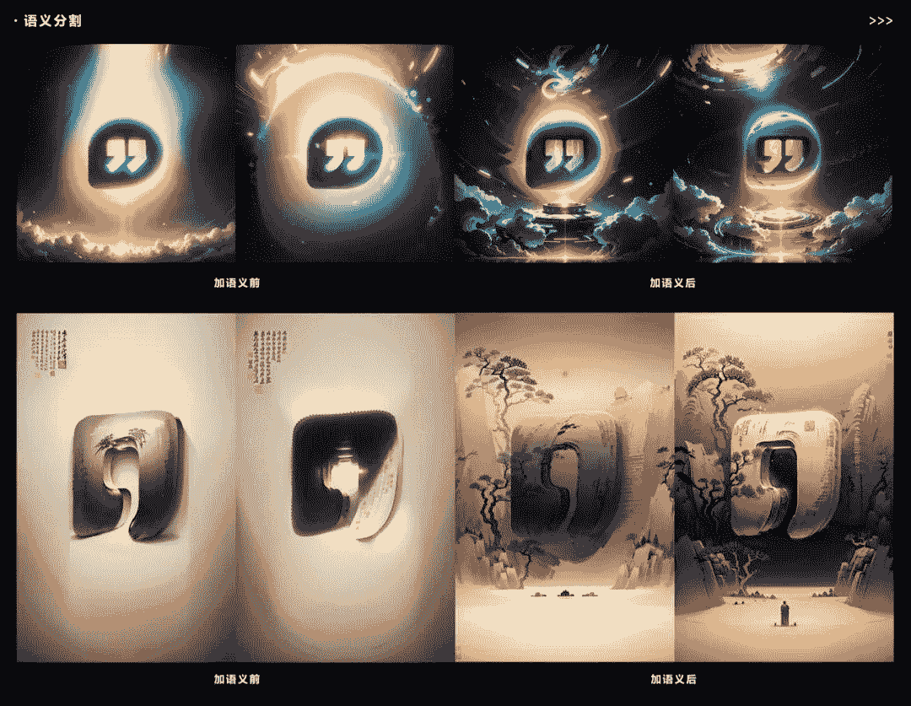

③中级 SD 符号方式设计的度加符号海报：

这里我们可以自己根据设计方案画出黑白灰的 depth 深度图，这里的深度图只有黑白灰的轮廓，并没有具体的元素的含义，所以生成的图只有构图和光影。

④中级 SD 符号方式设计的度加符号海报：

在黑白灰的 depth 深度图的基础上我们将各个部分进行颜色分割，可以参考网上的语义分割表，这时候我们除了构图和光影，也赋予了每个元素的具体的含义，进一步的控制住画面的构成。

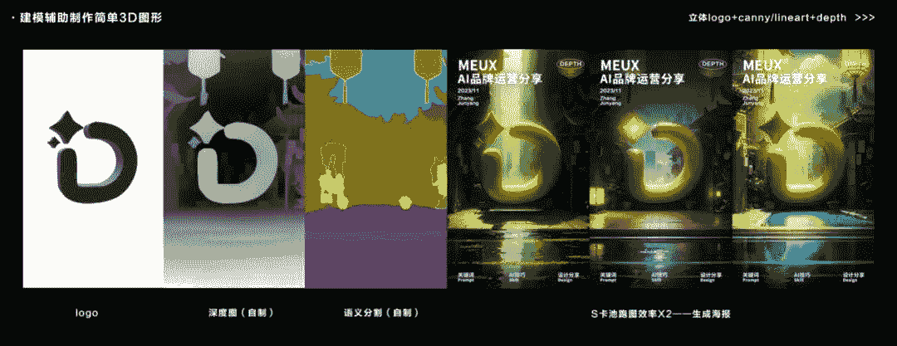

⑤+LoRA

我们可以用这个方法加上各种 LoRA 就可以稳定生成很高品质的海报图，在 S 卡池中选择合适的图进一步精修，加上排版就是一套品牌符号宣传海报图。

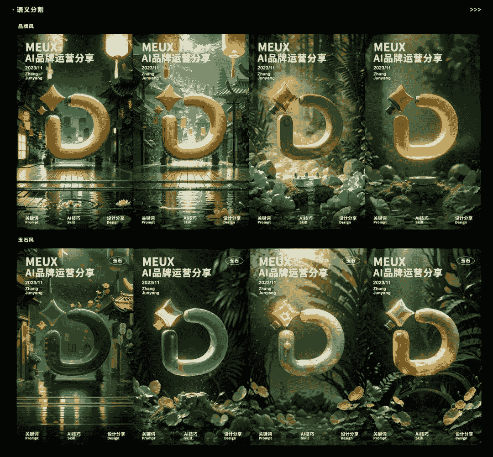

1.  高级 SD 符号生成模式（风格控制）

当我们想要某种风格的时候，但是没有适合的 LoRA，我们需要自己研究办法去提取风格，这也就是自研的高级符号生成方式，这里介绍两个特殊的 controlnet 控制，shuffle 和 Refrence。

shuffle 是洗牌，就是把一张图打乱，只保留风格；Refrence 是参考，整个风格、构图颜色等按照参考走，例如下面的两张图，我们可以通过这两个插件进行风格提取：

shuffle 和 Refrence 生图：

运用高阶的符号生成模式，我们可以同时跑出一系列的品牌符号海报：

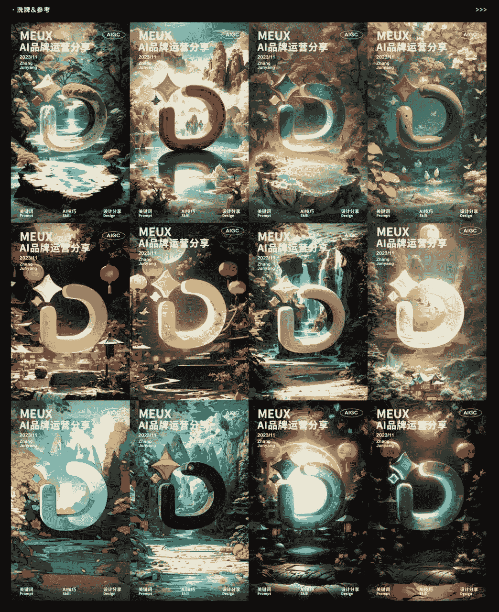

1.  **后期处理&图生图**

后期主要是通过图生图模式下进行的，常见的后期方式有放大算法，tile 加细节，后期合成，局部重绘等方式。

这里介绍一个增强细节的插件模型 tile：

tile 模型本质上是一个重绘模型，但是会在保持原图构图、画风、人物主体等基础上，为画面增添更多的细节，提高图像的画质。

1.  增加细节，比如高清放大、修复照片、补齐草图、增加画质等

1.  配合其它放大算法进行超高清放大（tile 模型可以抑制全局提示词对局部图像的污染）

1.  根据画面自动推断内容，消除违和感

#### **四、SD 符号生成项目中的应用**

度加、多艺、新原计划 logo 演绎：

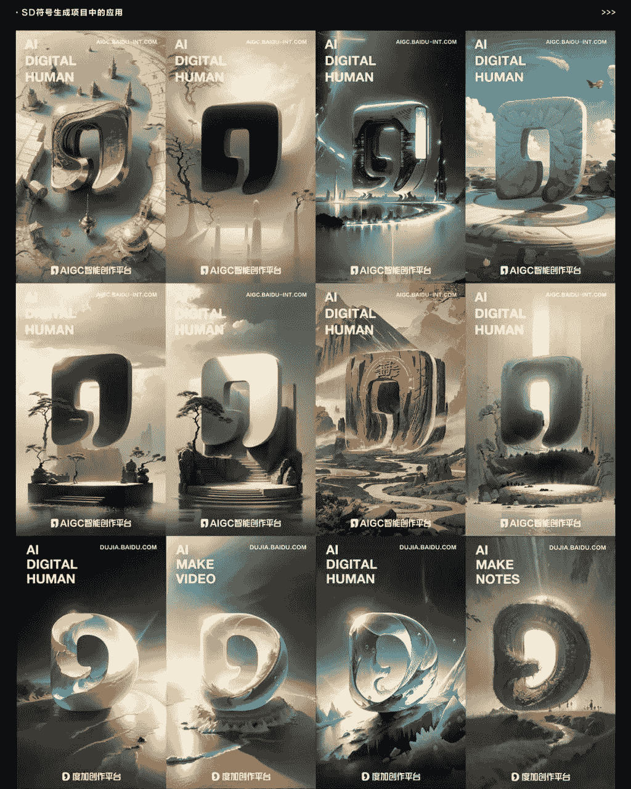

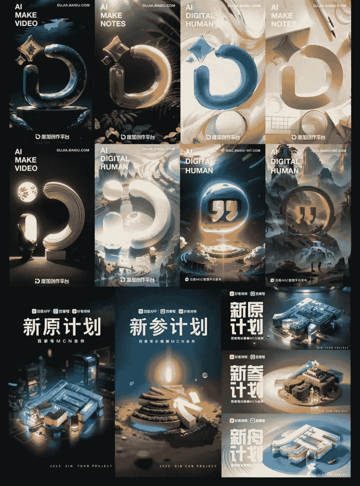

#### **结语**

单纯用 AI 设计方式设计视觉只能让你跟上设计步伐不掉队，MEUX 内容生态设计团队致力于研究出更多方式控制 AI 的创意、风格、品质和效率，探索 AI 生图中更多可能性，让 AI 成为设计师手上一款好用的设计工具。

欢迎关注作者的🛰️👸号：「百度MEUX」

<https://aigcreative.feishu.cn/sync/K4Gvd9vUQsy9Oubwqaeclu0Fnbg>