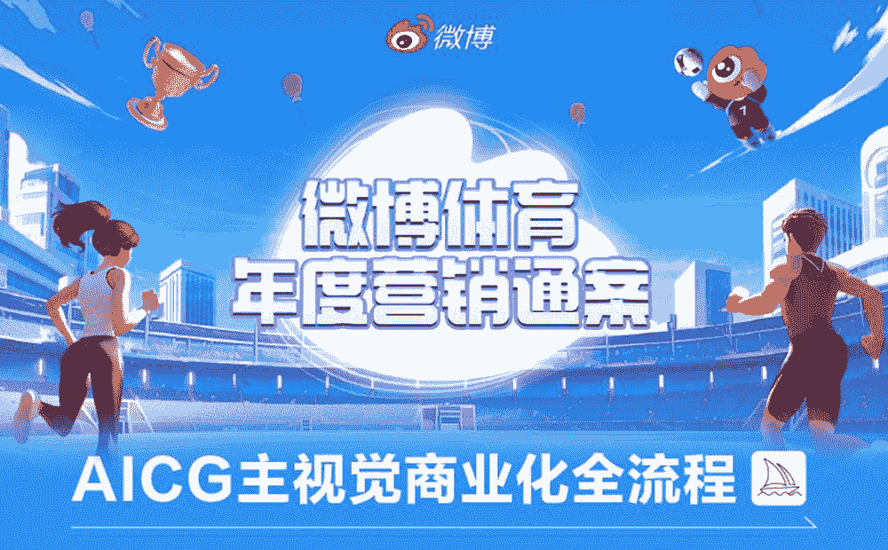
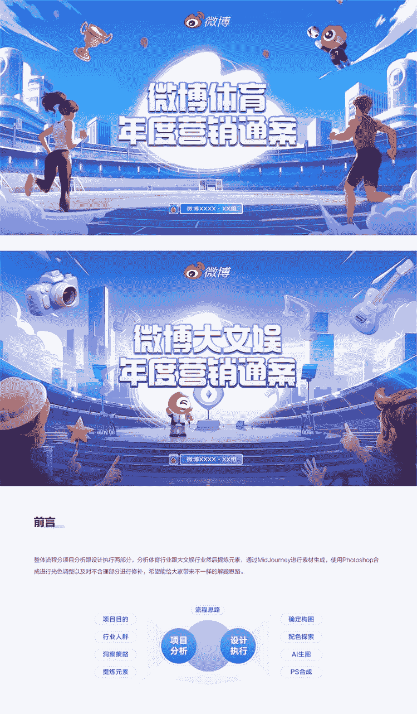
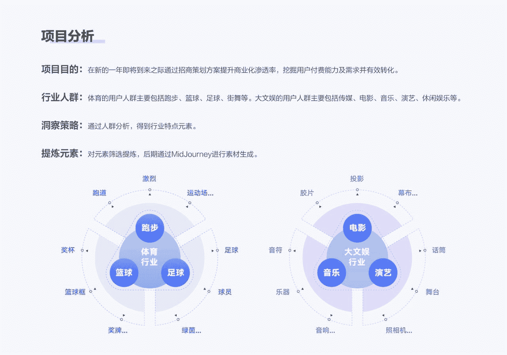
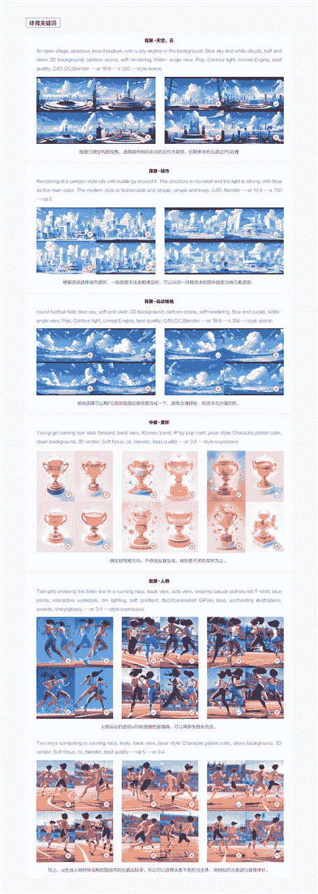
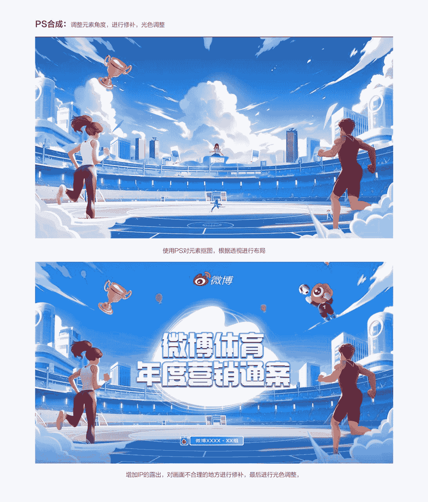
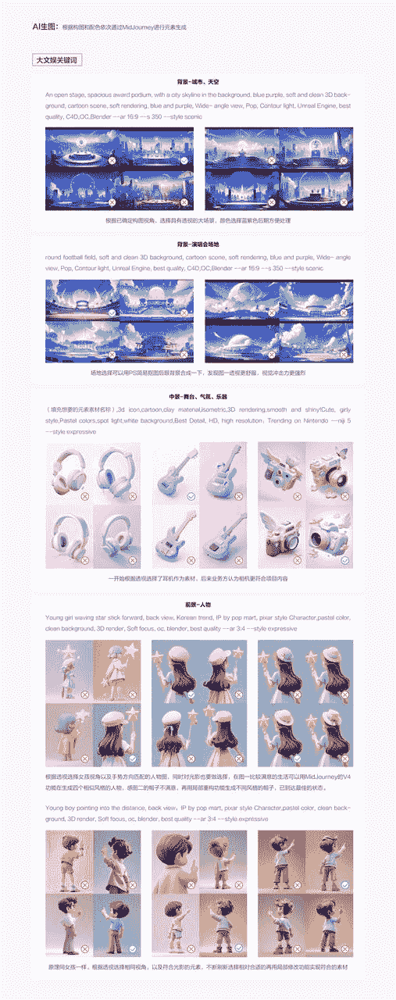
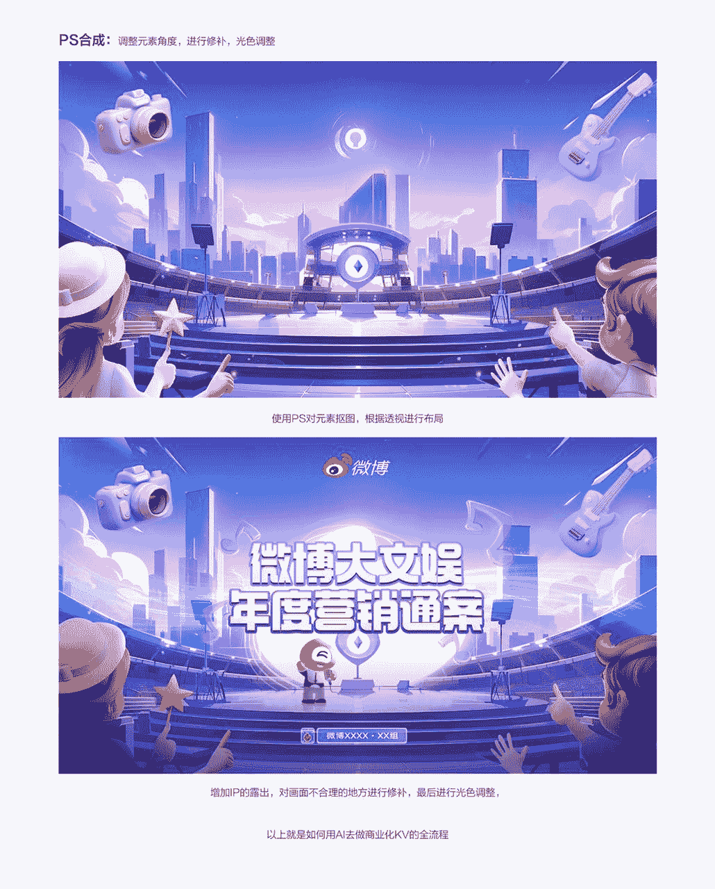
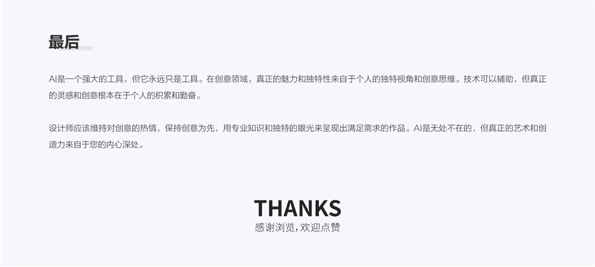

# 微博：商业化主视觉设计全流程

> 来源：[https://aigcreative.feishu.cn/docx/HrdgdH6uVoybcfx3ZAIcCPl8n4e](https://aigcreative.feishu.cn/docx/HrdgdH6uVoybcfx3ZAIcCPl8n4e)

> AI 创意：@大鹏

> 后期合成：@大鹏

> 设计指导：@原叔

这次文章来聊聊如何使用 AI 生图工具去辅助从 0 到 1 的主视觉项目。由于所在行业特性，业务量大、节点多、时事热点跟进等，需要我们高效快速消化业务。通过 AI 辅助提高效率，已经成为趋势。同之前项目所说，虽然 AI 是非常好的工具，但最终还是要回归到设计本身，激发创意，玩转创意表达。

<https://aigcreative.feishu.cn/sync/K4Gvd9vUQsy9Oubwqaeclu0Fnbg>