# 万字详解DeepSeek R1的前世今生

> 来源：`https://aigcreative.feishu.cn/docx/YxVFdlSp9oUCAwxFw76cQdI3nnc`

> 来源：`https://cameronrwolfe.substack.com/p/demystifying-reasoning-models`

转自架构师，版权属于原作者，仅用于学术分享，如有侵权留言删除

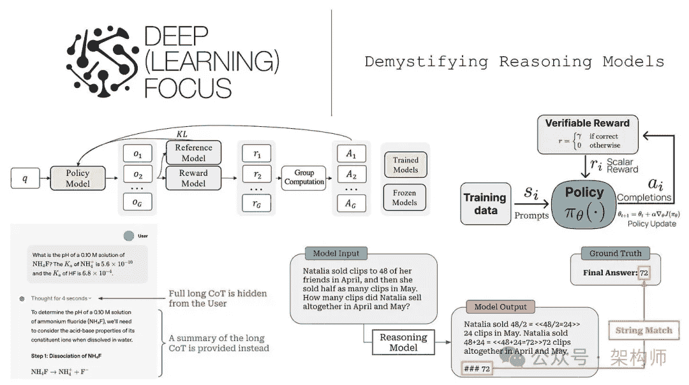

## 大模型训练历史

在推理模型出现之前，大型语言模型（LLM）的训练流程相对固定：

+ 先在来自互联网的原始文本数据上预训练语言模型；
+ 之后对模型进行对齐，也就是让它们的输出更符合人类的偏好（这会用到监督微调（SFT）和基于人类反馈的强化学习（RLHF）等技术）。

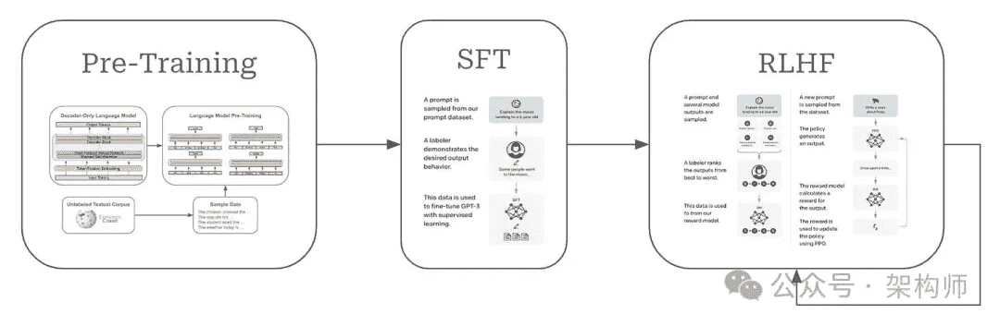

而驱动这一范式发展的大部分动力却来自 Scaling Law（译者注：大力出奇迹）。

> 使用更多数据训练更大的模型，就能得到更好的结果。

## 新范式：推理

与标准 LLM 相比，推理模型解决问题的方式完全不同。特别是，它们在提供问题的最终答案之前会花费一些时间「思考」。训练一个能够有效思考（例如，分解问题、检测思维中的错误、探索替代解决方案等）的模型需要新的策略，通常涉及大规模强化学习（RL）。此外，此类模型还会为通过强化学习和推理进行训练的范式涌现出新的 Scaling Law。

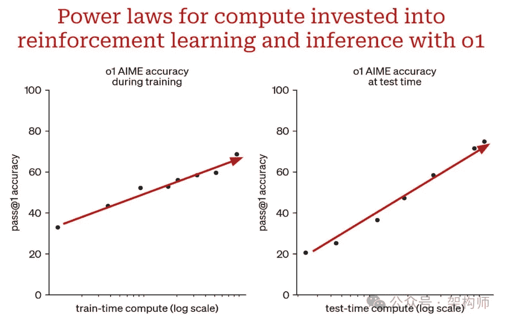

本文将介绍有关推理模型的最新进展的更多信息。

+ 首先，我们将重点介绍 OpenAI 最早提出的几种（闭源）推理模型。我们将在上下文中解释 LLM 推理能力的基本思想。
+ 之后，我们将探索最近提出的（开源）推理模型，概述从头开始创建此类模型的必要细节。

虽然推理模型与标准 LLM 不同。但LLM 的许多关键概念仍然适用于推理模型。我们将在整个过程中澄清它们之间的重要区别。

## 进入推理时代

就在 AI 发展看起来要放缓之际，推理模型开始普及，LLM 的能力开始陡然提升。

OpenAI 首先发布了 o1-preview，随后是一系列蒸馏版模型，包括 o1-mini 以及 o3 的一些变体版本。其它公司也纷纷跟进，包括谷歌的 Gemini 2.0 Flash Thinking。这一节将探讨这些最早的闭源推理模型及其工作原理背后的基本思想。

### 最早的推理模型：o1

OpenAI 发布 o1-preview时明确了两件事：

+ 推理模型可以非常准确地解决可验证的任务，比如数学和编程任务。
+ 推理模型解决这些问题的方法与传统 LLM 的方法截然不同。

#### 长思维链

推理模型与标准 LLM 的主要区别在于在回答问题之前会进行「思考」。推理模型的思考就是 LLM 输出的长思维链（有时也被称为推理迹线或轨迹）。

长思维链的生成方式与任何其他文本序列无异。然而，这些推理轨迹表现出了非常有趣的特性：

> 它们更类似于搜索算法而不是原始文本生成。

举个例子，推理模型可能会：

+ 仔细考虑复杂问题的每个部分。
+ 将复杂问题分解为更小的可解决部分。
+ 批评其自身的（部分）解决方案并发现错误。
+ 探索许多替代解决方案。

> （译者：有关于这些推理的具体示例在今年春节由Deepseek R1广泛展示，此处不展开）

值得注意的是，OpenAI 推理模型使用的长思维链隐藏在其内部，这意味着在与模型交互时，用户只能看到模型编写的长思维链摘要，如下所示：

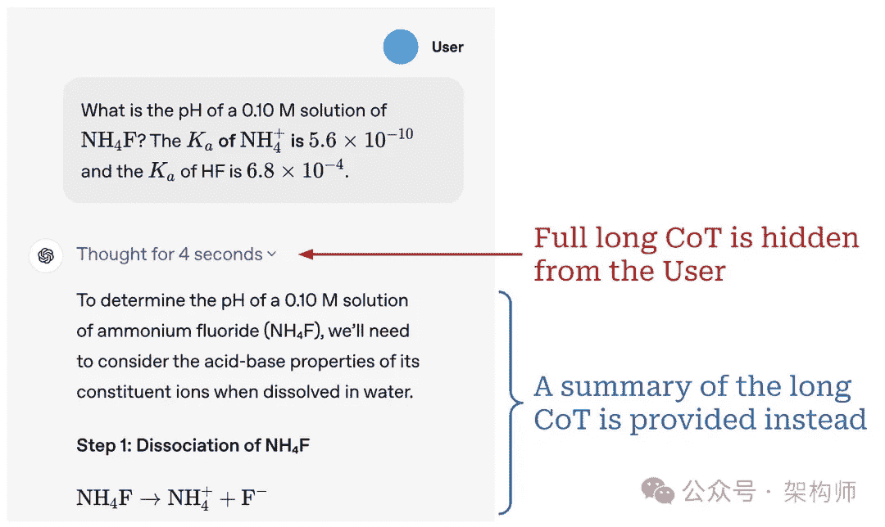

推理模型的长思维链输出为我们提供了一种控制 LLM 推理时间计算的简单方法：如果我们想花费更多计算来解决问题，我们可以简单地生成更长的思维链。同样，不太复杂的问题可以用较短的思维链解决，从而节省推理时间的计算。

#### 推理能力

最初的推理模型实际上在许多方面都不如标准 LLM，但它们将 LLM 的推理能力提高了几个数量级。例如，o1-preview 的推理表现总是优于 GPT-4o，甚至在大多数复杂推理任务上能与人类专家的表现相媲美。为了实现这些结果，o1-preview 使用最大化的推理时间计算以及如下方法：

+ 单个输出样本（柱状图主干）
+ 64 个并行输出样本中的多数投票（柱状图增高部分）进行评估。

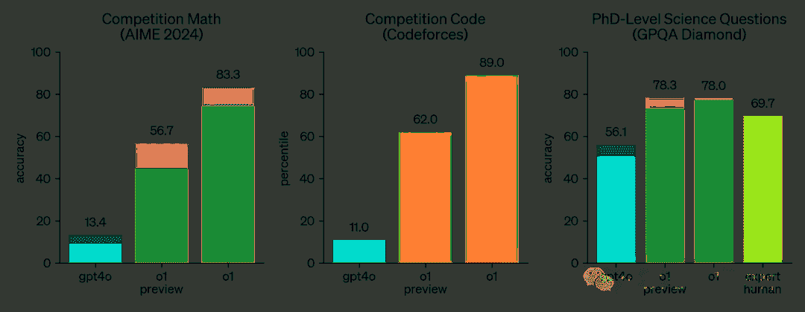

之后OpenAI 的 o1（preview 发布几个月后发布的 o1 的完整版本）在美国数学奥林匹克资格考试（AIME 2024）中名列前 500 名，在 Codeforces 上排名在竞赛人类程序员的第 11 个百分位之内。

作为对比，GPT-4o 仅解决了 12% 的 AIME 问题，而 o1 解决了 74% 到 93% 的问题，具体取决于推理设置。有关 o1 和 GPT-4o 性能的更详细比较，请参见下图。

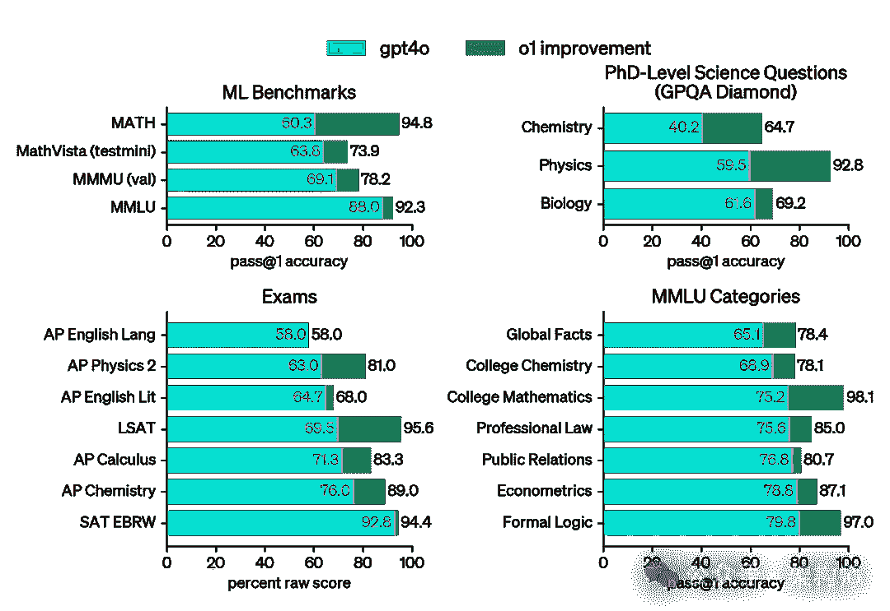

同样，o1-mini（o1 的更便宜、更快的版本）也具有令人印象深刻的推理能力，不过相比于完整版 o1 模型，其成本降低了 80%。虽然与 o1 相比，o1-mini 的世界知识有限，但它在编程任务方面尤其出色，并且及其高效。

### 当前最佳的推理模型：o3

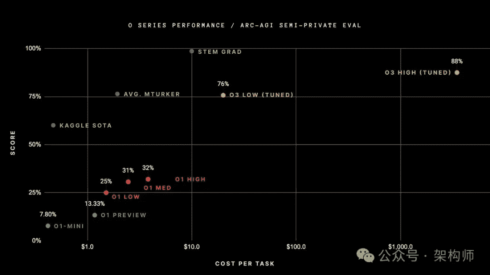

在宣布和发布 o1 模型后不久，OpenAI 宣布了 o3。这个模型最初只是宣布（未发布）。我们能够在几个值得注意的基准上看到该模型的性能（由 OpenAI 测量），但实际上无法使用该模型。OpenAI 发布的指标非常惊人。

o3 最显著的成就是：

+ 在 ARC-AGI 基准测试中得分为 87.5%（之前五年在AGI 最好的模型是GPT-4o，其准确率为 5%）。o3 是第一个在 ARC-AGI 上超过人类水平 85% 的模型。
+ 在 SWE-Bench Verified 上的准确率为 71.7%，
+ 在 Codeforces 上的 Elo 得分为 2727，使 o3 跻身全球前 200 名竞争性程序员之列。
+ 在 EpochAI 的 FrontierMath 基准测试中的准确率为 25.2%，相比之前最佳的 2.0% 的准确率大幅提高。

然而，公众无法访问 o3 模型来验证任何这些结果。在撰写本文时，完整的 o3 模型仍未发布，但 OpenAI 最近发布了该模型的较小版本：o3-mini。

与 OpenAI 的其他推理模型相比，o3-mini 更具成本效益且更易于投入生产。例如，此模型支持函数调用、Web 搜索和结构化输出等功能。o3-mini 还具有多种设置，包括 `low`、`medium` 和 `high`，这指定了用于解决问题时执行的推理量。此设置可以直接在 API 请求中指定，并且该模型的表现非常惊人：在许多情况下与 o1 相当，具体取决于推理工作量的级别。

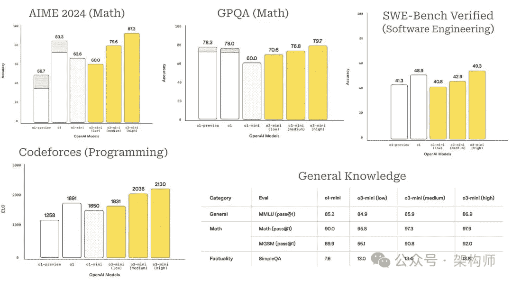

在大多数情况下，推理工作量 low 的 o3-mini 与 o1-mini 的性能相当，而推理工作量 high 的 o3-mini 的性能则超过 OpenAI 发布的所有其他推理模型（包括完整版 o1 模型）。与之前的推理模型相比，o3-mini 还具有更好的世界知识（即提高了事实性），效率明显更高，并且在人类偏好研究中得分更高。OpenAI还提到，在内部 A/B 测试期间，

> 「o3-mini 的响应速度比 o1-mini 快 24%，平均响应时间为 7.7 秒，而 o3-mini 为 10.16 秒。」

o3-mini 是 OpenAI 的 o1 式推理模型中（迄今为止）发布的最高效的模型。

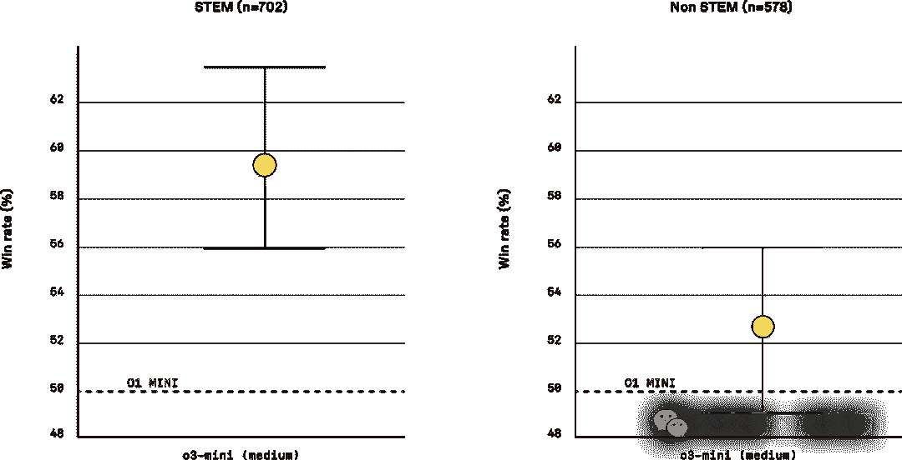

### 其它模型

OpenAI 发布 o1 式模型后，其他模型提供方也迅速跟进。例如，谷歌最近发布了实验性的 Gemini-2.0 Flash Thinking，它保留了 Gemini 模型的标志性长上下文：百万级的 token 上下文窗口，并在关键可验证任务（例如 AIME 和 GPQA）上取得了可观的指标。然而，这个模型的性能仍然落后于 o1 和 o3-mini。

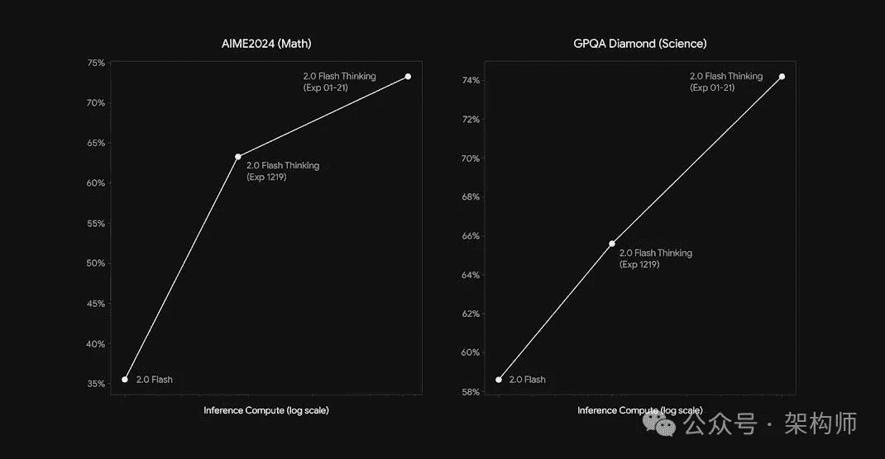

最近，Grok-3 的推理测试版发布，非常引人注目。如下所示，Grok-3 推理模型在 high 推理工作量下超过了 o3-mini 的性能，甚至在少数情况下接近完整的 o3 模型；例如，AIME'24 的准确率为 96%，而 o3 的准确率为 97%。使用大型新计算集群进行训练的 Grok-3 令人印象深刻（尤其是考虑到 xAI 的年轻）。在撰写本文时，Grok-3 的推理测试版是与 OpenAI 推理模型最接近的竞争对手。

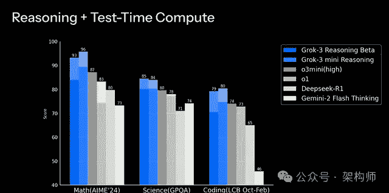

## 推理模型的基础

在进一步了解推理模型的工作原理之前，让我们更深入地了解它们的性能。要真正了解这些模型的能力，我们需要做的不仅仅是查看指标，我们需要检查这些模型正在解决的问题的具体示例。例如，考虑 GSM8K（如下所示），这是一个小学水平的数学基准。这些问题可能看起来微不足道，但 LLM 们多年来一直在努力准确地解决这个基准。

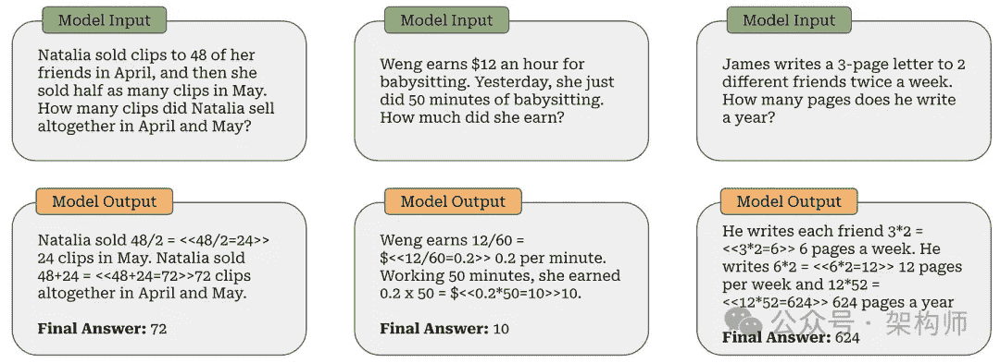

随着推理模型的出现，这个基准已经完全饱和：我们不再能用它来有意义地评估最佳推理模型。相反，我们开始用 LLM 解决更难的问题。

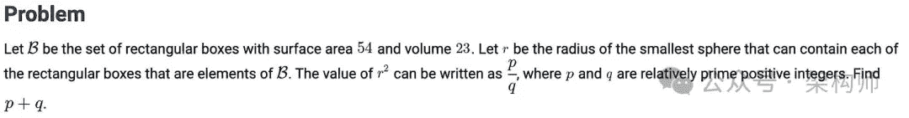

例如，考虑 AIME 2024 中的第 15 个问题（如上所示）。这个问题相当复杂，超过了 GSM8K 中的算术推理问题。有（至少）六种不同的方法可以解决这个问题，所有这些方法都需要掌握高级数学技巧（例如导数、数论或拉格朗日乘数）。此外，推理模型正在解决的复杂基准还不仅仅是数学！例如，GPQA包含来自多个科学领域的数百道多项选择题；例如，生物学、物理学和化学。所有这些问题都是由领域专家编写的，经过验证，它们既非常困难，又无法通过互联网搜索找到答案，这意味着即使有足够的时间和不受限制的互联网访问，非专家也很难解决这些问题。

> 「我们确保这些问题是高质量且极其困难的：拥有或正在攻读相应领域博士学位的专家的准确率达到 65%，而技能娴熟的非专家验证者准确率仅为 34%，并且他们即便可以不受限制地访问网络，也平均花费了超过 30 分钟的时间。」

ARC-AGI 基准（被描述为「迈向 AGI 的重要垫脚石」） 涉及各种基于网格的谜题，其中 LLM 必须在输入输出网格中学习模式，并在最终输出示例中完美复制这种学习到的模式。大多数 LLM 都很难解决这些难题（例如，GPT-4o 的准确率仅为 5%），但推理模型在这个基准上表现相当不错：准确率可达30-90%，具体取决于计算预算。

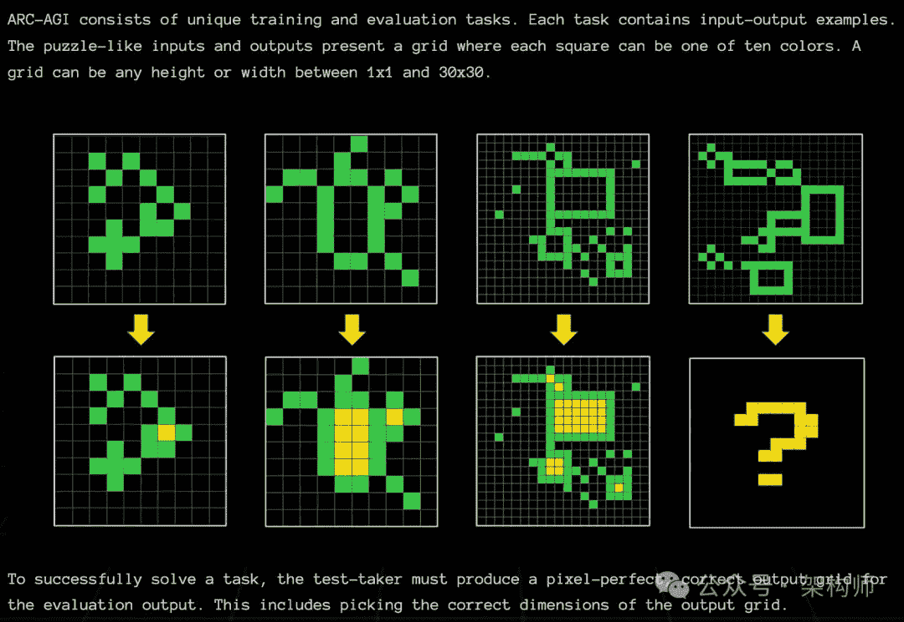

至少可以说，这些是推理 LLM 开始解决的不同级别的（非平凡）问题。尽管这些基准测试难度很大，但现代推理模型的能力也很强。据报道，OpenAI 的 o3 模型在 AIME 2024 上取得了近 97% 的分数。

### 推理模型的基

虽然上面介绍的推理模型显然令人印象深刻，但都是闭源模型。因此，我们不知道它们实际上是如何工作的。我们得到的唯一信息是上面的引文和如下所示的图表。

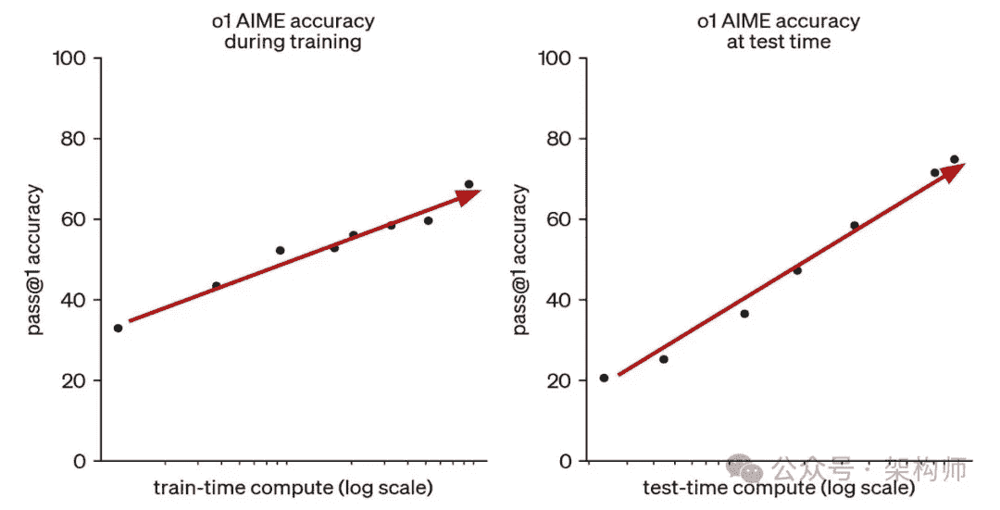

然而，从这些有限的信息中，我们可以得出一些有用的结论。主要而言，扩展推理模型涉及两个关键组件：

+ 通过强化学习进行更多训练。
+ 更多推理时间计算（即推理时间扩展）。

尽管 OpenAI 并未透露扩展推理模型这两个组件的方法背后的许多细节，但仍有大量关于此主题的研究发表。为了提供更多背景信息，让我们简要介绍一下其中一些工作，加上 OpenAI 分享的细节，可以让我们大致了解推理模型训练和使用的一些关键概念。

> （译者注：Deepseek的技术论文提供了大量细节，中国已经是AI发展重要贡献力量）

### 有可验证奖励的强化学习

关于 o1 式模型，我们应该注意到的一个细节是，它们主要用于本质上可验证的问题并根据这些问题进行评估；例如数学和编程。但是，在这种情况下，「可验证（verifiable）」到底是什么意思？首先，我们假设我们可以获取 i）问题的基本答案或 ii）可用于验证正确性的某些基于规则的技术。

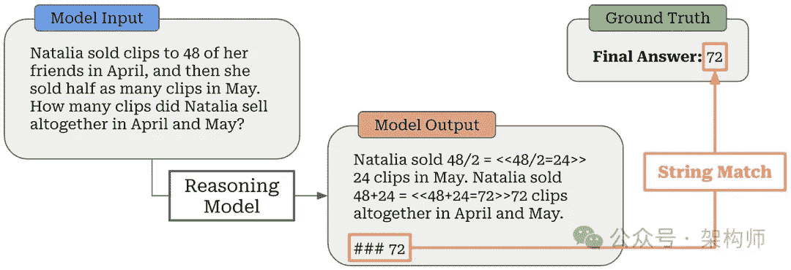

例如，我们可以为大多数数学问题定义一个基本答案（在 GSM8K 中，这是使用 `####` 语法完成的）。然后，我们可以从 LLM 的输出中提取最终答案，并使用基本字符串匹配将此答案与 ground truth 答案进行比较（见上图）。类似地，如果我们为编程问题准备了测试用例，我们可以简单地执行由 LLM 生成的代码并检查提供的解决方案是否满足所有测试用例。

> 「可验证奖励的强化学习（RLVR）可以看作是现有引导语言模型推理方法的简化形式或具有执行反馈的更简单形式的强化学习，其中我们只需使用答案匹配或约束验证作为二进制信号来训练模型。」

说一个领域是「可验证的」并不意味着我们可以自动验证该领域问题的任意解决方案。相反，我们经常需要访问 ground truth 答案（通常从人类那里获得）进行验证。但是，有些行为可以使用简单规则而不是 ground truth 来验证。例如，我们可以使用一组硬编码规则执行简单检查来确定推理模型是否具有正确的输出格式、是否遵循某些指令或是否产生特定长度的输出（例如，o3-mini 使用的 `low`、`medium` 或 `high` 推理）。

### 验证的复杂性

根据我们正在解决的问题，验证 LLM 的输出可能会变得非常复杂。即使对于数学问题，验证 LLM 的答案与基本事实之间的匹配也很困难。例如，解答可能以不同的形式或格式呈现，从而导致假阴性验证。在这些情况下，简单的字符串匹配可能还不够！相反，我们可以提示 LLM，让其告诉我们这两个解是否匹配，这已被发现可以大大减少不正确的验证。对于代码，实现验证也很困难：它需要构建一个数据管道，并且其要非常有效地在训练设置中执行和验证测试用例。

### 神经（Neural）验证

除了上面概述的可验证问题之外，我们还可以考虑较弱的验证形式。例如，创意写作是一项难以验证的任务。但是，我们可以：

+ 训练神经（neural）奖励模型或验证器。
+ 使用此模型对 LLM 输出进行评分。
+ 使用预测分数作为奖励或验证信号。

这样的设置与基于人类反馈的强化学习（RLHF）非常相似。在这种情况下，会训练奖励模型根据模型响应的正确性或质量执行二元验证。但是，使用神经（neural）验证器会有奖励 hacking 的风险，尤其是在执行大规模强化学习时。模型的训练时间更长，并且会对奖励图景进行更多探索，从而增加了奖励 hacking 的风险。因此，许多最近的推理模型都避开了这种方法。

> 「我们在开发 DeepSeek-R1-Zero 时没有应用神经 （neural） 奖励模型，因为我们发现神经 （neural） 奖励模型在大规模强化学习过程中可能会受到奖励 hacking 攻击的影响，而重新训练奖励模型需要额外的训练资源，这会使整个训练流程变得复杂。」

### 从可验证的奖励学习

我们现在了解了验证，但如何使用验证来训练 LLM？思路很简单：直接将验证结果用作使用强化学习进行训练的奖励信号。有很多不同的方法可以实现这个思路（例如，过程奖励或纯强化学习），但它们的共同主题是使用强化学习根据可验证的奖励学习。这是所有现代推理模型根基的基本概念。

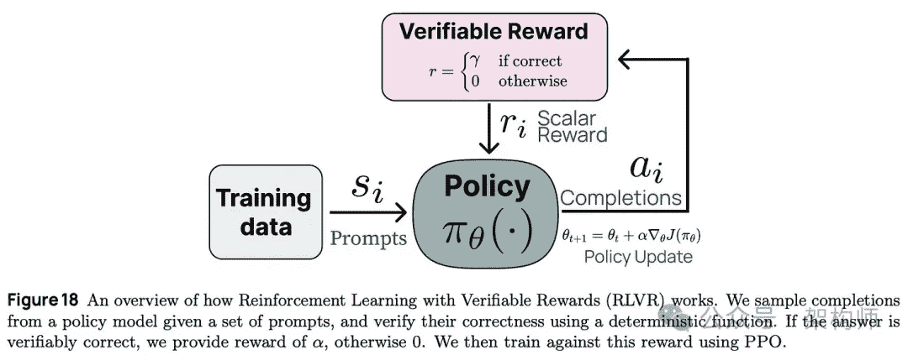

### 推理策略：思路链和解码

我们可以通过两种基本方法来增加语言模型在推理时消耗的计算量：

+ 生成更多 token（即更长的输出序列）。
+ 生成多个输出。

在本节中，我们将更详细地介绍这些技术，探索如何通过思维链和不同的解码策略（如并行解码与顺序解码）在 LLM 中实际实现它们。

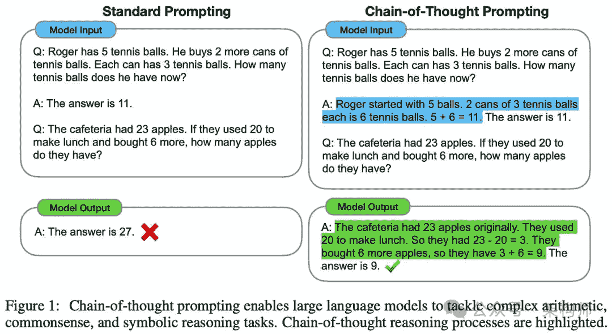

我们已经知道推理模型使用长思维链作为推理媒介。在最简单的层面上，思维链只是 LLM 为其自身输出提供的一种解释。在大多数情况下，这些解释是在 LLM 生成最终答案之前编写的，允许模型在生成答案时将其解释用作上下文。

长思维链有几千个 token。虽然它可以用于解释模型，但长思维链并未针对人类可读性进行优化。相反，它是一种宽泛的推理轨迹，以详细的方式解决问题，并包含各种复杂的推理行为（例如，回溯和自我优化）。

> 「我们决定不向用户展示原始的思维链…… 我们努力通过教导模型从答案中的思维链中重现有用的想法来部分弥补 [这一决定]。对于 o1 模型系列，我们会展示模型生成的思维链摘要。」

此外，推理模型会在逻辑上将其思维链与模型的最终输出分开。例如，OpenAI 不会向用户展示长思维链，而是提供 LLM 生成的长思维链摘要来补充推理模型的最终答案。由于思维链的长度，这种逻辑分离是有必要的，大多数用户只会阅读最终答案。

#### 并行解码

为了提高 LLM 最终输出的准确性，我们还可以使用并行解码技术。思路很简单：不使用 LLM 生成单个输出，而是生成多个输出并聚合这些输出以形成单个最终答案。这种聚合可以通过多种方式完成；例如，使用多数投票或共识、使用加权投票、使用神经奖励模型或验证器（即也称为 Best-of-N 或拒绝采样）或其他特定领域算法找到最佳输出。

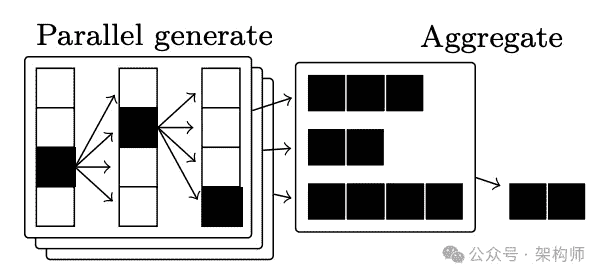

这些方法的主要好处是简单又有效。并行解码很容易扩展：我们只需生成、验证和聚合大量输出，就能得到有意义的性能提升。o1 式模型显然使用了并行解码技术：只需查看其博客中提供的图表细节（如下所示）。但是，并行解码技术本身无法解释最近发布的推理模型所表现出的一些更复杂的推理行为。

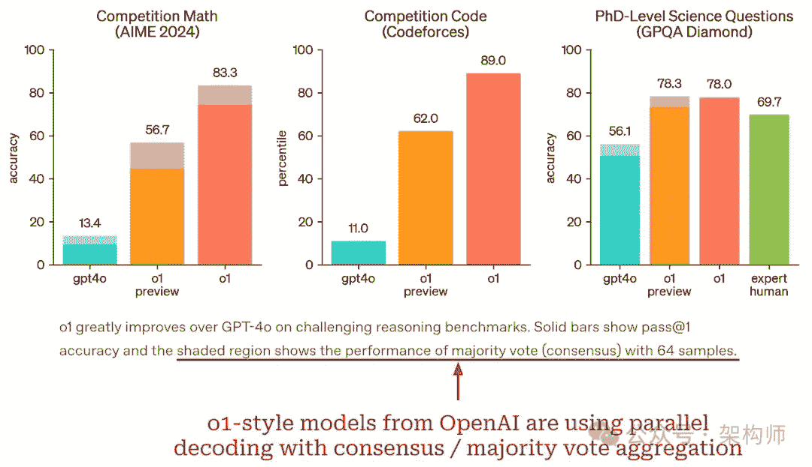

顺便说一句，我们还可以将拒绝采样的思想应用于训练（即训练与测试时间拒绝采样）。为此，我们只需：

+   采样几个输出或轨迹。

+   使用奖励模型（或其他评分机制）选择最佳输出。

+   使用这些输出进行训练。

实践中这种方法很常用；例如，LLaMA 模型在应用 RLHF 之前，会在其后训练过程中执行几轮训练时间拒绝采样。与基于ppo的RLHF相比，拒绝采样在实践中非常有效，更容易实现和扩大规模。

## 自我优化

除了并行解码之外，还可以考虑为解码采用批评或自我优化策略。首先，LLM 生成初始响应。然后，为响应提供反馈（来自 LLM 或某些外部来源），LLM 可以根据反馈修改其响应。此循环可以重复任意次数，参见下图。

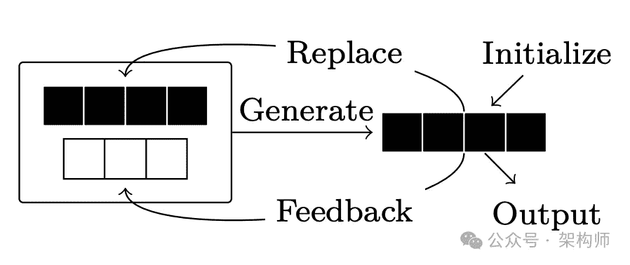

目前已有不同的优化方法，但它们可以大致分为两类：

+   外部式：反馈来自某些外部验证器或模块。

+   内部式：LLM 为其自身生成提供反馈。

优化的结果和实际效果有些复杂。有许多使用外部反馈（例如来自验证器 或代码解释器 ）来优化 LLM 输出的成功案例。内部优化是否有效在很大程度上取决于 LLM 提供的反馈质量。内部优化可以很好地完成简单任务 。然而，这种方法很难泛化到更复杂的任务（例如数学）。

## 开源推理模型：DeepSeek-R1

到目前为止，我们已经了解了 LLM 获得推理能力的基本概念。然而，我们所了解的所有模型都是闭源的：我们无法知道这些模型究竟是如何创建的。幸运的是，最近发布了几个开源推理模型。这些模型中最引人注目的是 DeepSeek-R1 。除了与 OpenAI o1 相媲美的性能外，该模型还附带了一份完整的技术报告，其中提供了足够的细节，因此完全揭开了创建强大推理模型所需过程的神秘面纱。

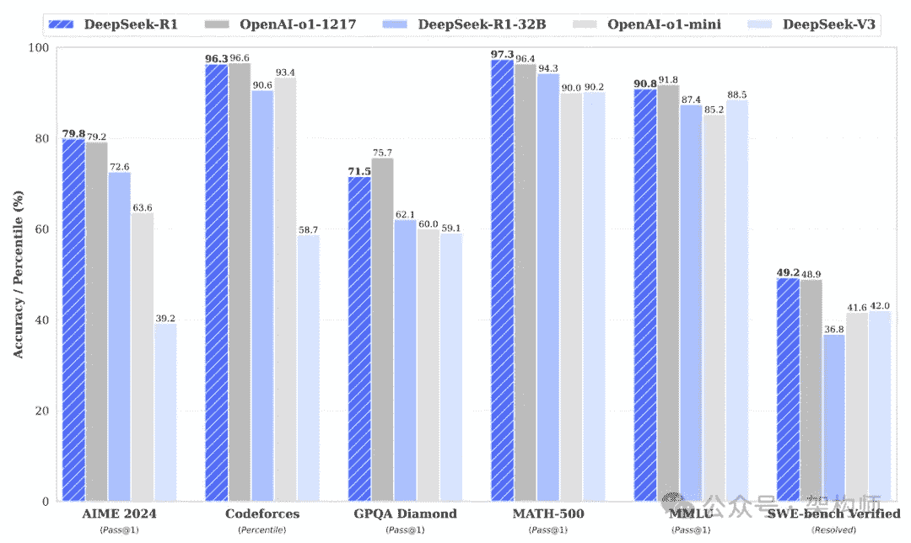

DeepSeek-R1 背后的核心思想与我们迄今为止学到的知识非常吻合。该模型在可验证任务上使用强化学习进行训练，它学习利用长思维链来解决复杂的推理问题。有趣的是，强化学习训练过程是该模型强大推理能力的关键因素。该模型的多个版本：DeepSeek-R1-Zero 和 DeepSeek-R1都已发布，具有相当的推理能力。正如我们将看到的，它是这类模型中第一个完全放弃了任何监督训练的模型，表明复杂的推理能力可自然地从使用强化学习的大规模训练中涌现。

> 「DeepSeek-R1-Zero 是一种通过大规模强化学习（RL）训练的模型，没有监督微调（SFT）作为初步步骤，它展示了非凡的推理能力。通过强化学习，DeepSeek-R1-Zero 自然地涌现出了许多强大而有趣的推理行为。」

DeepSeek-R1-Zero 和 DeepSeek-R1 都始于一个强大的基础模型：DeepSeek-v3 。除了具有开放权重和详细的技术报告之外，该模型还超越了之前的开源 LLM 的性能，甚至与闭源模型的质量相当。

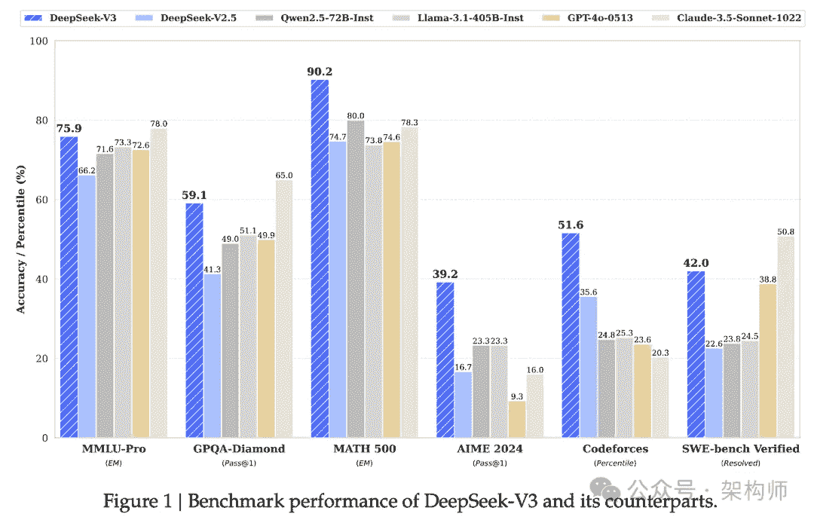

DeepSeek-v3 是一个 6710 亿参数的混合专家（MoE）模型。为了提高推理和训练效率，DeepSeek-v3 做出了以下设计选择：

+   使用多头隐注意力（MLA）。

+   采用优化的 MoE 结构（例如，细粒度和共享专家）。

+   在预训练期间使用多 token 预测目标。

+   放弃通常用于训练 MoE 模型的负载平衡损失。

+   通过采用中提出的新型量化训练策略，在整个训练过程中将精度降低到 FP8。

出于这些原因，与其他模型相比，DeepSeek-v3 的训练非常经济：该模型在性能和效率方面都表现出色。该模型的几个先前版本已经发布，这些版本启发了 DeepSeek-v3 做出的一些设计决策，例如 DeepSeek-v2 和 DeepSeek-v2.5。

### DeepSeek-R1-Zero

DeepSeek 提出的第一个推理模型是 DeepSeek-R1-Zero。该模型采用了一种有趣的训练策略，即教模型纯粹通过大规模强化学习进行推理，而无需任何 SFT。该模型会自然探索并学习利用长思维链通过强化学习解决复杂的推理问题。DeepSeek-R1-Zero 是第一个公开的研究成果，表明无需监督训练即可开发推理能力。

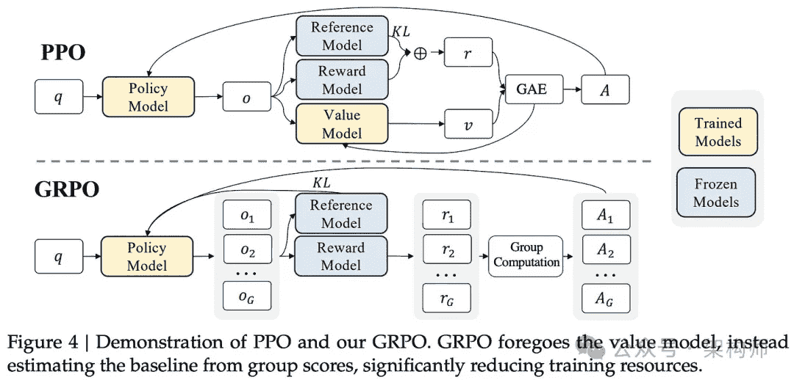

使用 GRPO 的强化学习。DeepSeek-R1-Zero 的训练从 DeepSeek-v3基础模型开始。他们是直接通过强化学习微调这个基础模型。特别是，Deepseek团队选择了上图中所示的组相对策略优化（GRPO）作为他们的强化学习算法。选择用于 LLM 训练的强化学习算法是一个开放且活跃的研究课题。传统上，研究人员使用 PPO 来训练 LLM，但最近有一种趋势是采用更简单的强化学习算法（例如 REINFORCE 或 GRPO）进行 LLM 训练。Deepseek团队选择 GRPO 的主要原因是：

+   降低强化学习训练成本。

+   不再需要批评模型，该模型（通常）与策略模型（即 LLM 本身）大小相同。

#### 定义奖励

与大多数使用 LLM 的传统强化学习工作不同，DeepSeek-R1-Zero 不使用神经（neural）奖励模型（即基于 LLM 的奖励模型，这些模型通过偏好数据进行训练）。相反，Deepseek使用了基于规则的奖励系统，它

+   避免奖励 hacking

+   节省计算成本

+   更易于实现。

特别要指出，目前使用的奖励有两种：

+   准确度奖励：评估模型的响应是否正确。

+   格式奖励：强制模型以一定格式输出。

DeepSeek-R1-Zero 完全是在可自动验证的任务上进行训练的，例如数学和编程问题。对于具有确定性结果的数学问题，该模型可以以指定的格式提供答案，使我们能够通过基本的字符串匹配进行验证。同样，可以通过在预定义的测试用例上执行 LLM 在沙箱中生成的代码来验证编程问题。如前所述，当模型的输出格式正确时，格式奖励会提供积极的训练信号。Deepseek使用的格式只是将模型的长思维链（或思考 / 推理过程）放在两个特殊 token 之间：和。然后，在推理过程完成后，模型会在和标签之间单独生成答案；如下所示。

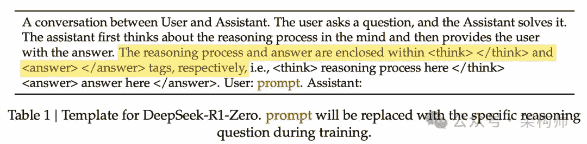

#### 通过强化学习进行学习

尽管没有使用 SFT，但 DeepSeek-R1-Zero 在整个强化学习训练过程中的推理能力都有了明显的进步。随着训练的进行，模型在 AIME 2024 上的表现如下图所示：

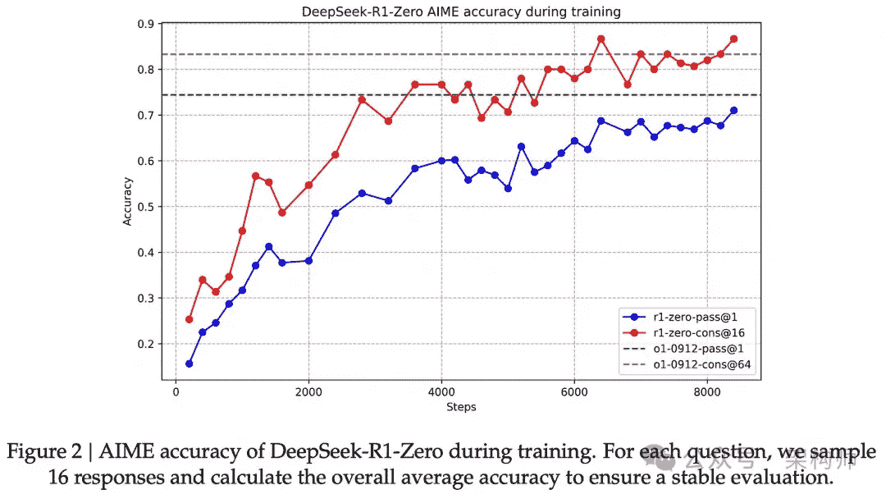

可以看到，模型的性能逐渐提高，最终达到与 o1-preview 相当的水平。训练完成后，DeepSeek-R1-Zero 在 AIME 2024 上的表现从最初的 15.6% 提高到了 71.0%（或在使用 16 票多数投票时为 86.7%）！这样的结果与我们在闭源推理模型中看到的性能趋势是一致的。

下表给出了 DeepSeek-R1-Zero 和 o1 模型之间的完整性能比较。DeepSeek-R1-Zero 在大多数情况下与 o1-mini 的性能相当或超过 o1-mini，并且在几个任务上的表现与 o1-preview 相当。然而，OpenAI 的推理模型在编程领域表现更好，而DeepSeek-R1-Zero 显然是一个较弱的编程模型。我们很快就会看到，这个问题在 DeepSeek-R1（后续模型）中得到了解决。

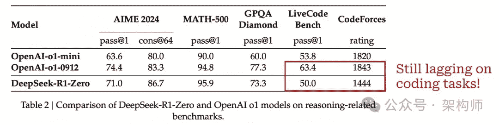

发生了什么？显然，DeepSeek-R1-Zero 在强化学习训练过程中获得了出色的推理能力。然而，模型学习过程的动态也相当明显！因为没有进行 SFT 式训练，所以可以在整个强化学习训练过程中密切监控模型推理策略的进展。

如下所示，DeepSeek-R1-Zero 学会了利用更多的「思考时间」，即生成越来越长的思维链，从而可以随着训练的进行改进其推理过程。该模型自然学会了利用更多的测试时间计算来解决更难的问题！

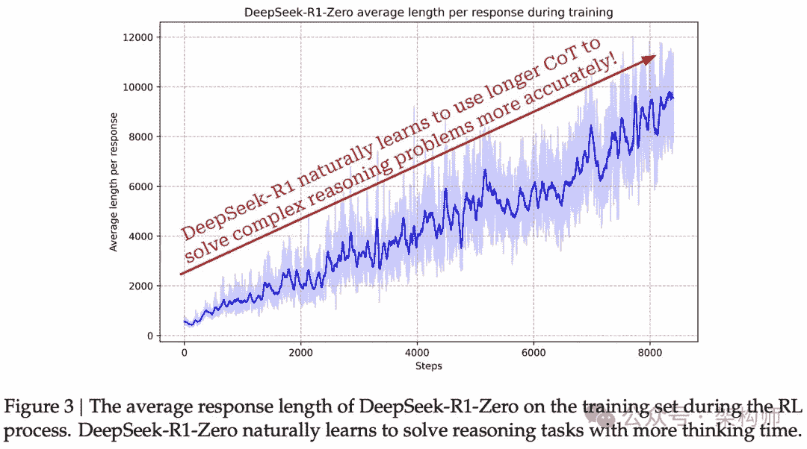

在强化学习训练过程中自然涌现的几种有趣趋势。例如，该模型通过重新审视和评估其推理过程的先前组成部分，发展出反思自身解决方案的能力。同样，该模型在解决问题的过程中开始显式地测试和探索替代解决方案或方法。这种行为不是现实编程在模型中的，而是在强化学习训练过程中自然涌现的！在最基本的层面上，Deepseek构建的强化学习环境允许模型探索不同的策略来得出正确的（由验证确定的）最终解答。在探索过程中，模型做到以下两点就能获得奖励：

+   使用了正确的推理模板或结构。

+   给出的最终解答是正确的。

仅凭这些奖励，模型就能学会如何解决复杂的推理问题。我们不需要显式地教模型如何分解问题、寻找解决方案、执行回溯或评估自己的思路。相反，我们只需在训练过程中为模型提供正确的激励（或奖励）。然后，LLM 可以通过基于强化学习的「自我进化」过程自主学习解决问题所需的行为。

### DeepSeek-R1

DeepSeek-R1-Zero 表明，LLM 可以使用没有 SFT 的纯强化学习获得出色的推理能力，但这个模型有一些小错误。例如，它的可读性很差，并且它会错误地将语言混合在一起。简而言之，DeepSeek-R1-Zero 非常擅长推理，但它缺乏一些已良好对齐的 LLM 的理想属性。为了解决这些问题，Deepseek团队提出了一种新的多阶段训练过程，将一些「冷启动」 SFT 数据与其他一些技巧整合到了训练中。此训练流程得到的 DeepSeek-R1 是一款既已对齐又能进行复杂推理的 LLM。

与 DeepSeek-R1-Zero 类似，DeepSeek-R1 的基础也是 DeepSeek-v3。然后，DeepSeek-R1 经历四个阶段的训练，包括两个 SFT 阶段和两个强化学习阶段。SFT 阶段的目的是在每个强化学习阶段为探索提供更好的起点。该训练流程是Deepseek的主要贡献之一 ：

> 它提供了一种有效的方法，可将推理式训练与 LLM 的标准后训练方法相结合。

下面更深入地介绍下 DeepSeek-R1 使用的训练方法的每个阶段。

#### 第一阶段：冷启动（或面向推理的 SFT）

在进行强化学习训练之前，R1 通过 SFT 在一小组长思维链示例数据集上进行训练，称为「冷启动」数据。我们可以使用几种不同的方法来收集这些冷启动数据：通过提示词调用一个模型（例如 DeepSeek-v3）生成长思维链数据，可以使用少量示例，也可以指示模型生成详细答案并进行反思和验证。使用 R1-Zero 模型生成大量长思维链输出，然后让人类进行后处理并选择模型的最佳输出。Deepseek结合了这些方法，收集了「数千个冷启动数据」。基于这些数据再使用 SFT 对 DeepSeek-V3 直接进行微调。因为这里使用的是长思维链数据，所以这是一个面向推理的微调过程。从这个冷启动数据中，模型可以学习一个可行的（初始）模板来解决推理问题。用于面向推理的 SFT 的数据可将人类先验引入 DeepSeek-R1 的训练过程。我们可以显式地选择模型在此阶段学习的数据风格和模式。

#### 第二阶段：面向推理的强化学习

在 SFT 之后，就是重复 R1-Zero 提出的大规模强化学习训练过程了，这是为了增强底层模型处理推理密集型任务的能力。DeepSeek-R1 的唯一变化是增加了语言一致性奖励，其在计算中是作为模型输出中采用所需目标语言编写的部分。Deepseek中发现这种语言一致性奖励会略微降低模型的推理能力。但是，语言一致性可提高最终模型与人类偏好的整体对齐程度：模型的输出更加流畅和可读。

#### 第三阶段：拒绝采样

在面向推理的强化学习收敛之后，再使用最终模型来收集大量且多样化的 SFT 数据集。然而，与最初的冷启动 SFT 阶段不同，这里收集的不仅仅是面向推理的数据。也就是说是用通用数据扩充推理数据，以便模型可以从更广泛的问题和领域中学习。为了收集更多的推理数据，DeepSeek-R1 团队：

+   整编一组多样化的基于推理的提示词。

+   使用第二阶段的模型生成候选轨迹。

+   执行拒绝采样，即根据每个轨迹的质量和正确性过滤并选择最佳轨迹。

这与前文介绍的训练时间拒绝采样过程相同！有趣的是，在这个阶段，不仅仅是依赖基于规则的技术来进行验证。还会通过使用 DeepSeek-v3 作为生成奖励模型或弱验证器来整合来自不可验证域的额外数据。在应用启发式过滤（例如，删除带有多语言混合或长段落的输出）后，他们最终得到了一个包含 60 万个推理轨迹的集合。此阶段的 SFT 数据集包含大量非推理数据（例如，写作或翻译示例）。这些数据来自 DeepSeek-v3 所用的相同的训练后数据集。但是，通过要求 DeepSeek-v3 生成长思维链来解释复杂查询的输出，这些数据得到了增强 —— 不过，更简单的查询没有任何思维链。最终，他们总共收集了 20 万个非推理示例样本，加起来得到了一个包含 80 万个样本的 SFT 数据集。

#### 第四阶段：通用 RLHF

DeepSeek-R1 最后训练阶段的目标是使模型与人类偏好对齐，同时继续磨练其推理能力。与前一阶段类似，这里会使用基于推理的数据和通用数据的组合来训练模型。具体来说，训练的方法是使用强化学习并针对每种类型的数据使用不同的奖励组合：

+   基于规则的奖励（与 R1-Zero 相同），用于基于推理的问题。

+   针对一般数据使用神经奖励模型 —— 使用人类偏好对进行训练，正如 RLHF 一样。

DeepSeek-R1 经过调整，在通用数据上更有帮助。这是 LLM 研究中使用的两个非常常用的对齐标准。每个标准都使用单独的神经奖励模型进行建模，该模型通过人类偏好的（监督）数据集进行训练。有用性奖励仅针对模型的最终答案进行衡量（即排除长思维链），而无害奖励则考虑模型的整个输出轨迹。通过结合规则和基于偏好的奖励，DeepSeek-R1 可以与人类偏好对齐，同时保持强大的推理性能。

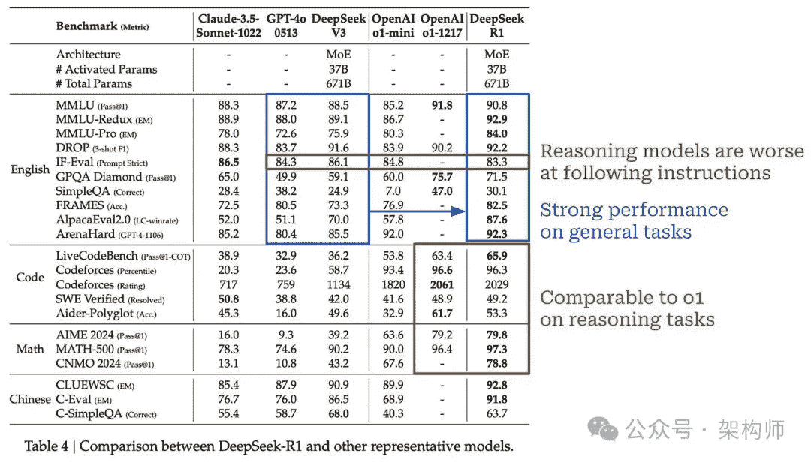

它的表现如何？如上所示，R1 在大多数推理任务上的表现与 o1 相当甚至超过 o1。与 R1-Zero 不同，R1 还具有相当强的编程能力。在通用任务上，由于其混合训练管道，R1 继续表现良好。总的来说，R1 是一个非常强大的模型，似乎与 OpenAI 的 o1 不相上下，并且可以高精度地解决各种任务（包括传统任务和推理导向任务）。关于这个模型（和其他推理模型）的一个有趣的观察是，与标准 LLM 相比，它在指令遵循基准（例如 IF-Eval）上表现不佳。目前，推理模型在遵循指令方面似乎比标准 LLM 更差。在未来，我个人认为这种趋势可能会逆转。理论上，推理模型应该能够利用它们的思维过程来更好地解释和遵循人类用户提供的提示词。例如，审议对齐（deliberative alignment）便采用了类似思想的方法。

### SFT 是必要的吗？

R1-Zero 展现了在没有 SFT 的情况下训练出强大推理模型的能力，而完整的 R1 模型使用多个 SFT 阶段来获得更强大的最终模型。因此，我们可能会开始怀疑：我们是否应该使用SFT？

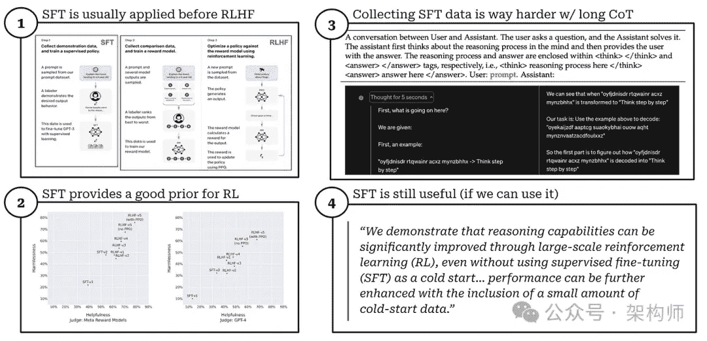

对推理模型来说，SFT 是否有必要？对于标准 LLM，SFT 为 RLHF 提供了高质量的起点。如果我们将 RLHF 直接应用于基础模型，学习过程的效率就会大大降低。SFT 的数据要么是合成的，要么是人类手动创建的。通常，收集 SFT 的数据是昂贵的（无论是在时间还是金钱方面）—— 我们必须为 LLM 从头开始手动编写一个好的响应！由于它们的思维链较长，为推理模型收集此类 SFT 数据更加困难。要求人类手动创建长思维链数据将耗时且昂贵！我们唯一的选择是合成这些数据，但是：

+   可能很难使用模型生成这种特定风格的输出。

+   很难正确验证这种长输出。

考虑到为推理模型收集 SFT 数据的额外复杂性，Deepseek团队首先尝试了完全避开 SFT！从这些实验中，我们看到推理能力自然地从纯强化学习中涌现！然而，由此产生的模型有几个缺点（例如混杂使用多种语言）。而当在强化学习之前执行一些 SFT 训练（即「冷启动」）时，可为强化学习提供更好的先验，这可以

+   消除强化学习训练初始阶段的不稳定性，

+   能加快训练速度，

+   能提高模型质量。

因此，SFT 并非完全必要，但如有数据，它仍会很有用！

## 蒸馏模型

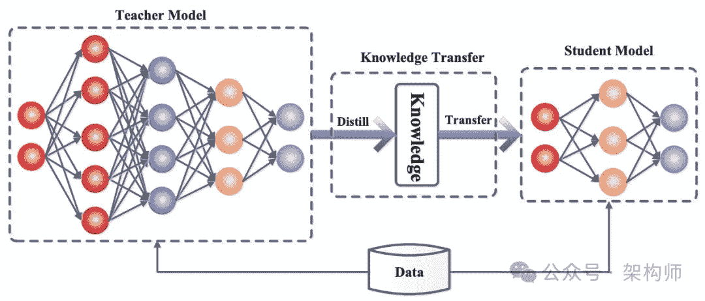

除了 DeepSeek-R1，DeepSeek 还发布了一系列基于 R1 蒸馏得到的密集模型。人们早已发现，蒸馏过程可以显著增强更小、更高效的模型的推理能力。完整版 DeepSeek-R1 是有着 6710 亿参数的混合专家模型，非常大，因此这些蒸馏模型在实践中非常有用：它们的性能与 R1 相当，但成本更低且更易于使用。此外，这些蒸馏模型的发布与闭源推理模型（例如 o1-mini 和 o3-mini）的最新趋势一致。

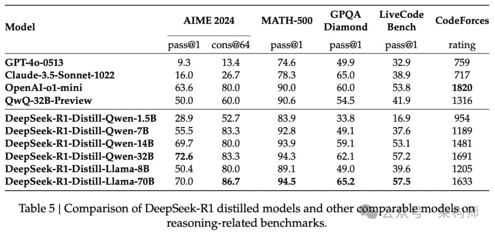

### 蒸馏 R1

为了创建这些模型，Deepseek首先选择了几种不同大小的 Qwen-2.5和 LLaMA-3模型。然后，通过 SFT 使用在 DeepSeek-R1 训练流程第三阶段整编的 80 万个监督训练样本对这些基础模型进行训练。

这是一个简单的知识蒸馏流程，但结果却非常惊艳。

如上所示，经过蒸馏的 Qwen2.5-14B 模型的表现优于 QwQ-32B-Preview，后者是 R1 发布之前最好的开源推理模型。此外，即使是最小的蒸馏模型也比未针对推理进行优化的标准闭源 LLM 表现更好（例如 GPT-4o），而 320 亿和 700 亿参数的蒸馏模型在大多数基准测试中的性能都超过了 o1-mini。蒸馏与强化学习。虽然我们在上面的讨论中看到蒸馏是有效的，但我们可能想知道：如果将 DeepSeek-R1 使用的大规模强化学习训练过程直接应用于这些较小的模型，那么能获得更好的结果吗？有趣的是，Deepseek提到使用上述蒸馏方法基于 R1 蒸馏 Qwen2.5-32B 基础模型比通过大规模强化学习直接训练该模型表现更好，如下所示。

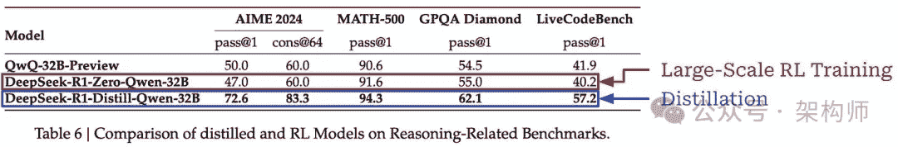

换句话说，大型模型发现的推理模式对于提高这些较小、密集模型的推理能力至关重要。但是，Deepseek团队提出了以下补充观点：

+   通过增加强化学习训练，蒸馏模型的性能可能得到进一步提升。

+   「超越智能的边界」，即创建超过 DeepSeek-R1 等模型性能的新推理模型，仍然需要强大的基础模型和大规模的强化学习训练。

## 其他蒸馏推理模型

鉴于通过蒸馏训练高质量推理模型很简单，研究界在 R1 提出后发布了各种各样的推理模型。其中一些最吸引人的版本是：

+   Sky-T1 和 Sky-T1-Flash：`https://novasky-ai.github.io/posts/sky-t1/`

+   Bespoke Stratos：`https://www.bespokelabs.ai/blog/bespoke-stratos-the-unreasonable-effectiveness-of-reasoning-distillation`

+   LIMO：`https://arxiv.org/abs/2502.03387`

+   S1：`https://arxiv.org/abs/2501.19393`

+   RedStar：`https://arxiv.org/abs/2501.11284`

当然，还不止这些！当前推理模型发布的步伐让人想起了 LLM 研究的后 LLaMA 时代。在发布强大的开源基础模型（即 LLaMA）之后，我们看到了基于该模型的各种模型变体（例如，Alpaca、Vicuna、Koala 等等）。现在，我们可以使用强大的开源推理模型，因为我们看到了非常相似的趋势！

# 关键趋势

我们现在已经了解了各种推理模型，从 o1 或 o3 等闭源模型开始，到 DeepSeek-R1 中对这些模型的完整复现。随着我们对这项研究的了解，开始出现了一些共同的趋势。这些趋势对推理模型和标准 LLM 的研究做出了一些重要区分。罗列如下：

## 长思维链

推理模型和标准 LLM 之间的关键区别在于它们的输出结构。推理模型不会直接生成最终答案（带有可选的简明解释），而是生成一个较长的思维链，其详细描述了模型的推理过程。这个较长的思维链长度不一，从而在推理时可实现可控的计算成本：较长的思维链 = 更多的 token = 更多的计算。这样，在推理时使用更多的计算（生成较长的思维链）已成为一种工具，可让用户动态调整模型的推理能力。

## 强化学习进行自我进化

显然，LLM 使用较长的思维链执行复杂推理策略的能力是个新方向并且激动人心。从最近的研究中，这些特殊能力发展的关键因素是大规模强化学习训练。我们从 Deepseek团队的工作中看到，如果模型得到正确的激励，这种推理能力就会在强化学习期间自然涌现出来 —— 通常是通过确定性和可靠的基于规则的奖励。此外，我们可以通过使用更多的计算进行强化学习训练来进一步提高模型的推理能力 —— 这是我们可以利用的另一个 Scaling Law！

## 更少的监督

与标准 LLM 相比，推理模型对人类监督的依赖程度较低。特别是，强化学习训练期间的奖励主要来自基于规则的系统，而不是依赖于人类的偏好。当然，推理模型仍然有几个领域依赖于人类的监督；例如，基础模型使用人类整理的数据进行训练，验证依赖于人类提供的 ground truth 标签。然而，像 R1（尤其是 R1-Zero）这样的推理模型仍然在大力发展，证明推理能力可以自主发展起来。

## 蒸馏是有效的

我们可以基于强大的大型推理模型，使用简单的策略将这些模型的能力蒸馏给更小、更密集的模型！这一发现导致了该领域研究的爆炸式增长，我们很可能会在不久的将来看到更多高效和蒸馏的推理模型发布。该领域的一个关键问题是较小的模型能否泛化，还是说难以完全匹敌其教师模型的广度。

## 新的问题

最重要的是，推理模型的出现也带来了各种有趣的新问题。我们还需解决的问题有：

+   如何为长思维链实现安全训练？

+   通用任务能力 / 推理能力之间的最佳平衡是什么？

+   SFT 在训练推理模型中的最佳作用是什么？

+   如何最大限度地减少长思维链中的「过度思考」？

+   如何实现推理模型的高效托管？

正如本文开头所述，推理模型是一种真正新型的 LLM，它将迫使我们重新思考现有的框架。多年来一直使用的技术（例如，少样本提示）对于这些新模型来说已经过时了。LLM 研究领域正在再次自我重塑。

`https://aigcreative.feishu.cn/sync/K4Gvd9vUQsy9Oubwqaeclu0Fnbg`

# 知识库动态
