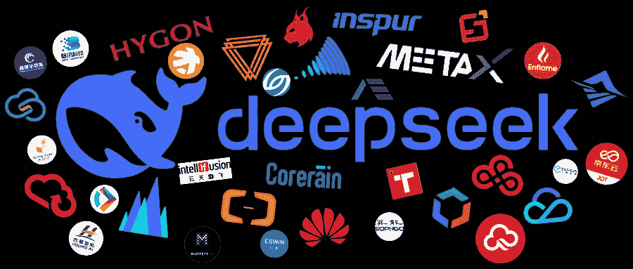
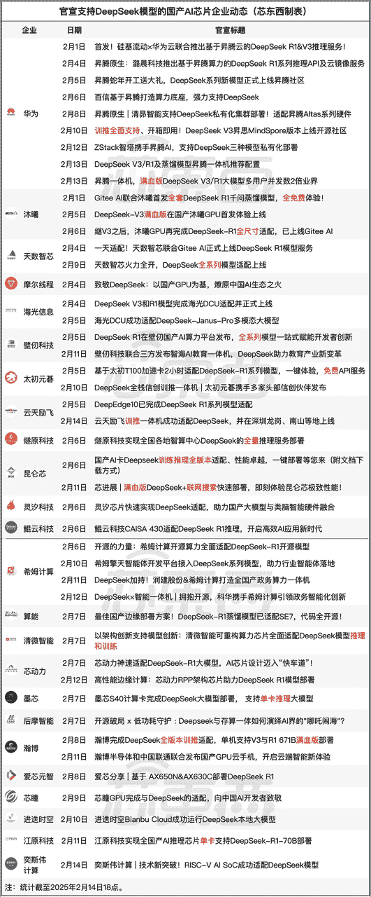
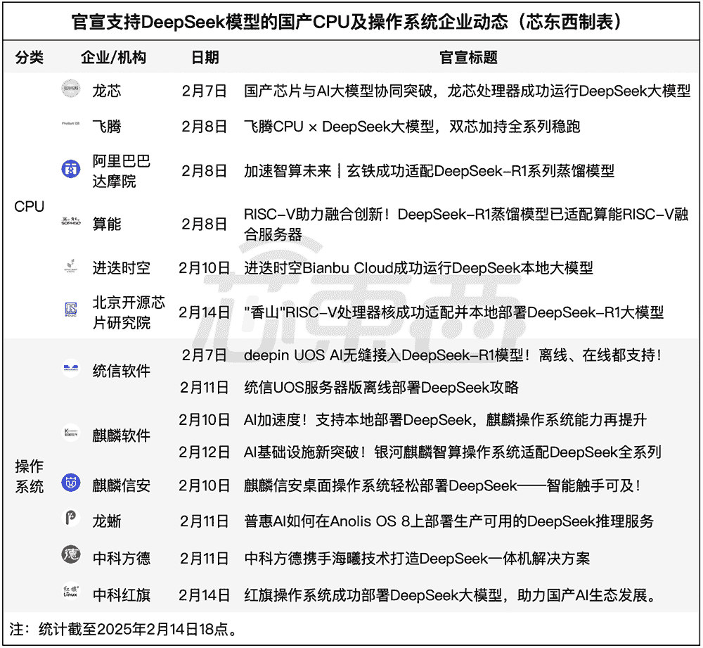
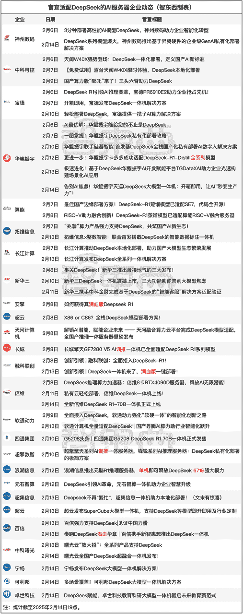
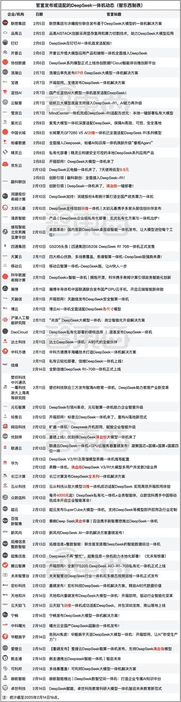
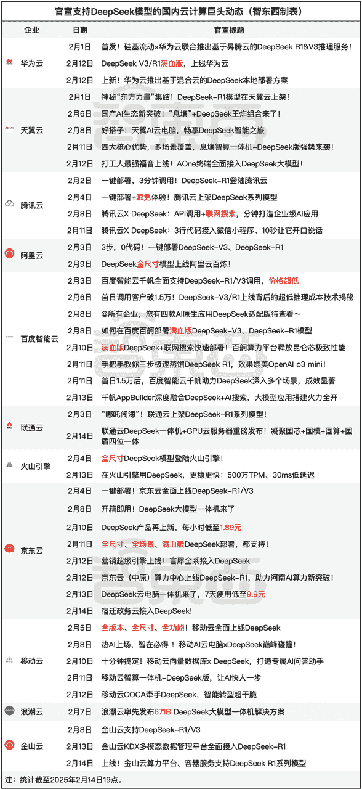
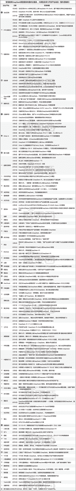

# DeepSeek国产智算生态大爆发！160家企业领跑

> 来源：[https://aigcreative.feishu.cn/docx/Qc8Cd7cdmotipyxQXHqcb8wGnOd](https://aigcreative.feishu.cn/docx/Qc8Cd7cdmotipyxQXHqcb8wGnOd)

> 👸号：芯东西

> 链接：https://mp.weixin.qq.com/s/WJuxERXMqQjxvosLhy7VKw

十天，至少60家企业亮出DeepSeek一体机。

一周前，芯东西发表了《 [创历史！DeepSeek获16大国产A](https://mp.weixin.qq.com/s?__biz=MjM5NTM4MTUyMg==&mid=2447910020&idx=1&sn=5bc8b76f5cfcbf73cac5fe94b17f93b0&scene=21#wechat_redirect)I芯片力挺，中国智算的半壁江山都出动了 》报道，承蒙厚爱，文内统计数据被很多文章照搬，但也有一些文章添枝加叶地把龙芯算进去、改成“17大国产AI芯片”，给读者朋友们辟个谣： 龙芯不是AI芯片公司！龙芯不是AI芯片公司！龙芯不是AI芯片公司！

过去一周，更多芯片公司、云服务及智算公司宣布适配或上线DeepSeek。我们对截止到 2月14日19点官宣 支持DeepSeek的企业统计列表做了更新，包括：

+   **24家国产AI芯片企业**

+   **6家国产CPU企业**

+   **6家国产操作系统企业**

+   **26家国产AI服务器企业**

+   60家DeepSeek一体机企业

+   **82家中国云服务及智算平台**

**正文：**

2月1日~14日，14天， **24家**国产AI芯片企业（华为昇腾、沐曦、天数智芯、摩尔线程、海光信息、壁仞科技、太初元碁、云天励飞、燧原科技、昆仑芯、灵汐科技、鲲云科技、希姆计算、算能、清微智能、芯动力、墨芯、后摩智能、瀚博、爱芯元智、芯瞳、进迭时空、江原科技、奕斯伟计算）宣布适配或上线DeepSeek模型服务 ，这就是中国AI芯片企业的速度！

其中， 华为昇腾、沐曦、太**初元碁、昆仑芯、清微智能、瀚博 已实**现训推支持； 华为昇腾、沐曦、天数智芯、海光信息、燧原科技、昆仑芯、清微智能、瀚博、芯瞳 均已适配满血版DeepSeek R1 671B模型。

[早先16家国产AI芯片公司适配情况的具](https://mp.weixin.qq.com/s?__biz=MjM5NTM4MTUyMg==&mid=2447910020&idx=1&sn=5bc8b76f5cfcbf73cac5fe94b17f93b0&scene=21#wechat_redirect)体介绍可参见《 创历史！DeepSeek获16大国产AI芯片力挺，中国智算的半壁江山都出动了 》一文，我们再补充介绍8家此前统计列表中没有包含的AI芯片公司：

**1、墨芯： **已完成与DeepSeek R1全系列蒸馏模型的推理部署。凭借自研双稀疏算法技术，墨芯S40计算卡在较短时间内完成DeepSeek R1 32B*、70B*等中、大模型部署，且成功实现单卡支持DeepSeek R1 32B*部署。

**2、后摩智能： **自研存算一体AI芯片后摩漫界M30芯片成功适配DeepSeek R1系列蒸馏模型，包括1.5B、7B、14B等。M30芯片专为端边部署大模型而设计，具有低功耗的核心优势。

**3、瀚博半导体： **已完成DeepSeek V3与R1全系列模型训推适配，单机可支持V3与R1 671B全量满血版模型部署，产品全面支持V3与R1全系列模型在数据中心、企业私有化和边缘智能部署。

**4、爱芯元智： **AX650N、AX630C芯片平台已在节前完成DeepSeek R1蒸馏版本1.5B、7B、8B的适配，海外开发者在春节期间已基于AX630C平台顺利复现。

**5、芯瞳半导体： **芯瞳CQ2040系列GPU基于llama.cpp推理框架，在国内AI全链路自主技术闭环条件下，已成功完成DeepSeek R1模型的兼容适配。

**6、进迭时空： **1月28日，DeepSeek R1 1.5B蒸馏版本地大模型在进迭时空自研AI CPU芯片K1上成功部署；近日，Spacemit Bianbu Cloud也成功运行该模型，为用户提供一站式、接近本地化的RISC-V云调试服务体验。

**7、江原科技： **致力于开发全国产AI芯片，第一颗立足全国产供应链的云端推理芯片（代号D1）于去年10月成功点亮，进入大规模量产测试阶段，可单卡支持DeepSeek R1全部6个蒸馏模型。这家创企将于今年内推出国内第一款全国产自主研发和本土先进工艺制造的AI推理芯片。

**8、奕斯伟计算： **在搭载了自研RISC-V AI SoC EIC77系列芯片EIC7700X和EIC7702X的EVB开发板上，成功完成对DeepSeek模型的适配，测试分别达到7 tokens/s和14 tokens/s的推理速度，展现出远超同类架构的高能效比。

AI芯片上市公司 **寒武纪 **至今未官宣支持DeepSeek。不过南京智算中心、浙东南智算中心均在2月6日透露已实现基于寒武纪AI芯片的DeepSeek模型部署。

除了上述AI芯片企业外， **6 **家国产CPU企业或机构（龙芯、飞腾、阿里玄铁、算能、进迭时空、北京开源芯片研究院）以及6家国产操作系统企业（统信、麒麟软件、麒麟信安、龙蜥、中科方德、中科红旗）均已官宣适配DeepSeek 。

截至2月14日19点， 官宣适配De**epSeek的AI服务器企业至少有26家 ，分别是： 神州数码、中科可控、宝德、华鲲振宇、算能、拓维信息、**长江计算、新华三、安擎、超云、天河计算机、中国长城、融科联创、信维、软通动力、四通集团、超擎数智、浪潮信息、元石智算、超集信息、超云、百信、中科曙光、宁畅、可利邦、卓世科技 。

**从2月5日到2月14日，10天之内， 至少有60家**企业宣布发布DeepSeek一体机或完成其AI一体机对DeepSeek的适配 ，名单如下：

**1**1家云巨头（华为云、天翼云、腾讯云、阿里云、百度智能云、联通云、火山引擎、京东云、移动云、浪潮云、金山云）均已上线DeepSeek ：

除了这些云大厂外，还有 **至少71家国内独立云服务商、大模型及算力开放平台已上线DeepSeek模型服务**，提供模型开发、API调用、一键部署、算力租赁、快速搭建应用（如智能体）等能力 ：

支持DeepSeek的智算企业及机构数量实在太多了，如有错漏，欢迎在评论区补充~

<https://aigcreative.feishu.cn/sync/K4Gvd9vUQsy9Oubwqaeclu0Fnbg>