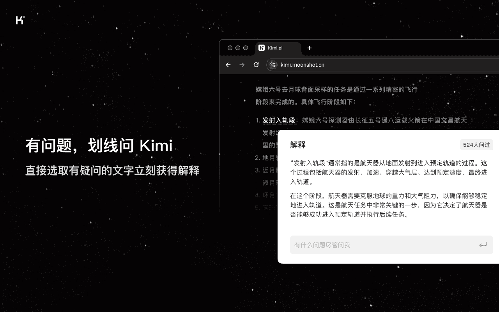
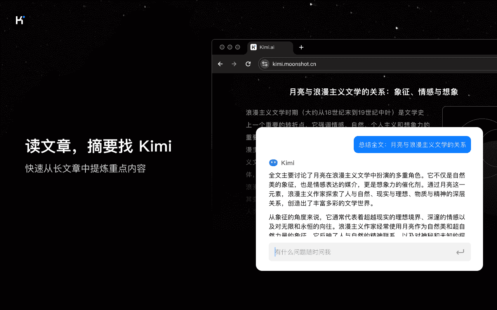
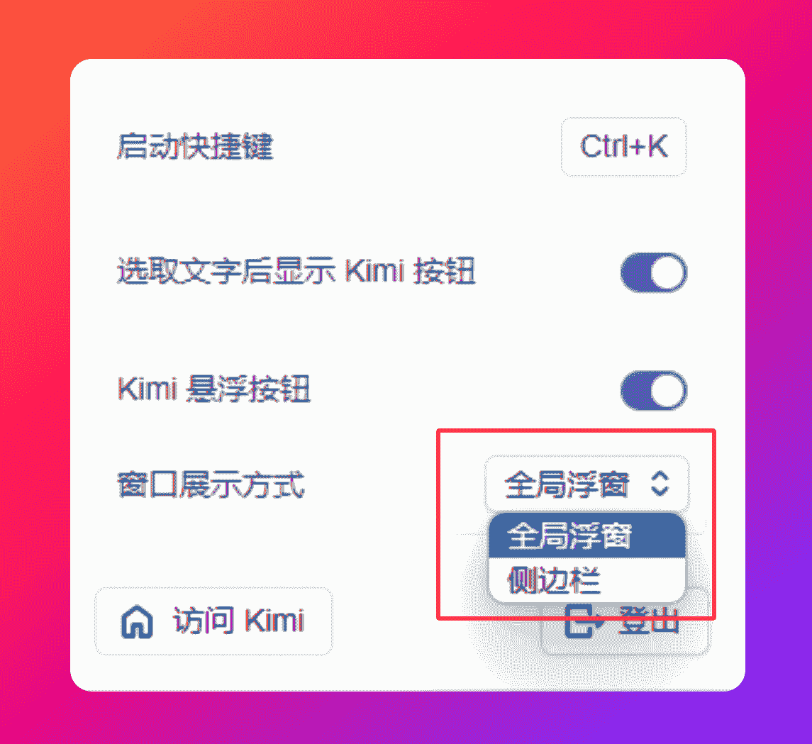
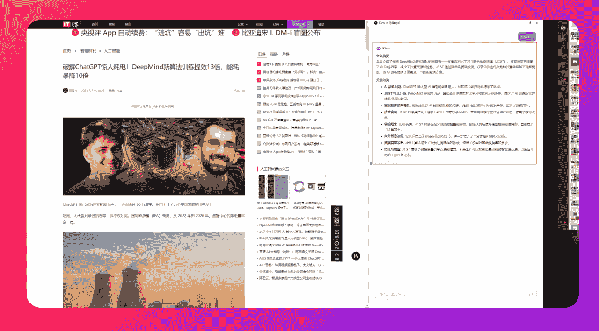
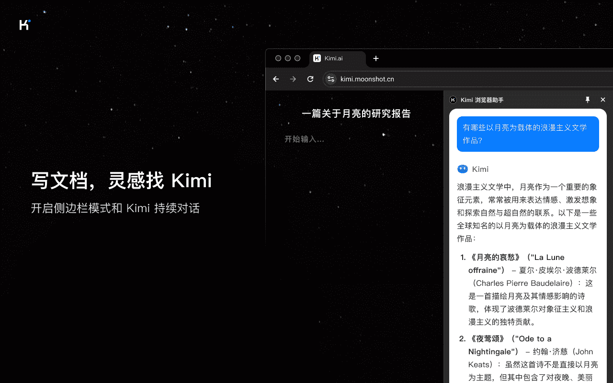
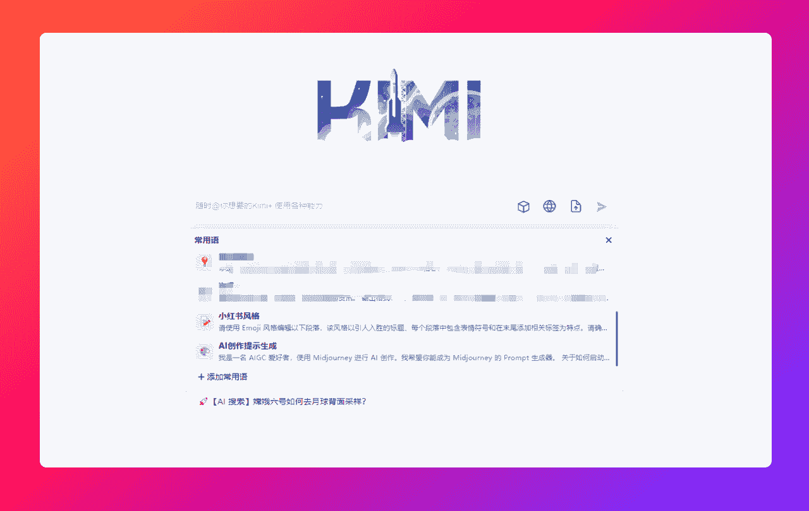

# 20240708-大杀器！Kimi官方浏览器插件测评，3大功能，高效交互

> 来源：[https://aigcreative.feishu.cn/docx/LRD2dkPzSoJIuUxJaYic9d0kn4g](https://aigcreative.feishu.cn/docx/LRD2dkPzSoJIuUxJaYic9d0kn4g)

真是千呼万唤始出来~~

Kimi官方浏览器助手—浏览器插件终于来了！

先上官网链接：https://kimi.moonshot.cn/extension/download

或chrome商店下载直达：https://chromewebstore.google.com/detail/kimi-%E6%B5%8F%E8%A7%88%E5%99%A8%E5%8A%A9%E6%89%8B/caejcfciegnnnepdhaopdogngbmojodl?hl=zh-CN&utm_source=ext_sidebar

关于基于Kimi的（chrome）浏览器插件，嗅觉敏锐的三方开发者在Kimi发布后不久，就开发了插件上架，都出来好几个月了。

之前也写过2篇文章介绍过，可以再看看：

Kimi copilot：

Kimi阅读助手：

都很好用，很受大家欢迎，只是没想通，官方为什么一直迟迟未动。

好在是，官方插件也终于来了。

Kimi浏览器助手，一款旨在提升用户网页浏览体验的智能工具，通过下划线高亮和悬停提示，为用户提供内容深度解释和优质问答。用户可以轻松选取网页文字，获取Kimi的即时解释或提出疑问。

有问题，随时问 Kimi：

选取有疑问的段落轻松划线获得符合上下文的答案，浏览网页不再需要反复切换页面查询新问题。

这就很方便了，跟以前翻译软件，划词翻译差不多，很方便，浏览网页的时候，遇到不明白的地方，直接划线提问，就会出来详细的解释答案。不要再去打开Kimi官网，效率直接拉满。

更有意思的是，你划线过的地方，还会留下痕迹，其他浏览该网页的用户，会看到你过去的提问，跟现在阅读公众号时的划线功能差不多。

读文章，摘要找 Kimi：

点击右侧悬浮图标或快捷键一键唤起对话窗口，快速总结全文减少阅读时间消耗。

全局浮窗：直接在网页上方悬浮展示，专心提问，网页不能在操作。

侧边栏展示：

个人更喜欢这一种，可连续提问交互，对网页操作无影响。

写文档，灵感找Kimi：

侧边栏模式和全局浮窗模式可在插件设置页自由切换，在你有需要的任意场景下常驻手边。比如，写公众号的时候，素材灵感匮乏，可以直接右侧问Kimi，再直接复制到编辑窗口，十分快捷方便！你真正的Copilot！

整体体验下来，Kimi浏览器助手真是很丝滑，相信在深入的使用下，会进一步的提升交互使用效率！

不过，功能上有一点小缺憾，那就是，Kimi官网上的“常用语”——也就是你日常高频使用的Prompt还没同步过来，使用上会带来一定的不不便，得去反复的复制自己的常用提示词。

毕竟三方的插件“Kimi阅读助手”早就做到了！

<https://aigcreative.feishu.cn/sync/K4Gvd9vUQsy9Oubwqaeclu0Fnbg>