# 字节生AI半年大考，超级APP工厂如何继续跳动？

> 来源：[https://aigcreative.feishu.cn/docx/Rz4Rdb2tZo0kK4xGkjZcJPXDnjc](https://aigcreative.feishu.cn/docx/Rz4Rdb2tZo0kK4xGkjZcJPXDnjc)

> 来源：Z Finance

> 链接：https://mp.weixin.qq.com/s/yhyQsk9F2LbUH3n3zhEjAA

# **| 引子**

字节跳动自 2012 年成立伊始，就将数据挖掘和推荐引擎技术作为公司产品的核心，推出基于智能推荐算法的资讯产品「今日头条」，它是国内最早把人工智能技术运用到移动应用场景中的个性化内容推荐产品之一。

梁汝波在年会中提到，字节跳动在2023年才开始布局AI，“已经是太晚了”。根据界面报道，去年一年，字节跳动创始人张一鸣将主要精力都花在了AI上。2024年2月初，张楠宣布卸任抖音集团CEO的，转战AI生成式视频领域的剪映。这无一不显示，字节将迅速回归AI的主业。

**过去**这半年，字节在 AI 应用尤其是大模型赛道火力全开。内部完成了组织架构调整，全面押注 AI 原生应用，连续推出了十多款基于 AI 和大模型的产品，让整个公司快速升级为 “超级 AI 应用工厂”。目前已经初见成效，占领应用场景的目标非常明确。

本文完整梳理了字节AI团队架构和发展沿革，字节在AI大模型和产品上的布局和数据表现，同时也推测了字节可能上线的新产品。Enjoy！

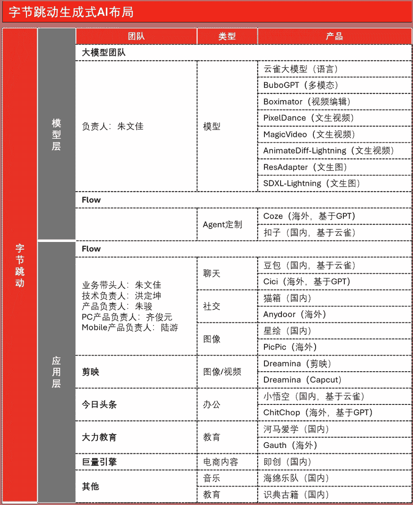

# 字节AI团队和团队布局

如果想获取全部字节AI相关资料，关注👸号并发送“字节AI”和本文朋友圈分享截图即可获取

# **| 字节AI团队架构**

**2**023年的1月，字节跳动组建了首个专注于大型模型研发的团队，该团队由其搜索部门主导，朱文佳担任负责人。朱文佳此前在TikTok担任技术负责人，并在加入字节跳动之前在百度担任搜索部主任架构师。2019年，朱文佳曾担任今日头条的CEO，后于2021年转任TikTok产品技术负责人。

该团队由两个小组构成，一个小组来自字节跳动的原搜索部门，负责开发语言模型；另一个小组属于产品研发与工程架构部下的智能创作团队，负责图片模型的开发。陆游，抖音的社交负责人，也在2023年上半年加入了这个大型模型团队。

8月，该团队开发的“云雀”大型模型完成了网信办的备案工作。同一时期，字节跳动还推出了一款多模态的大型模型——BuboGPT。

**11月，字节跳动成立了一个名为“F****low”的新部门，专注于AI技术的应用。这个部门隶属于公司**的研发与工程部门（简称“PDI”），由上半年带领团队开发“云雀”模型的朱文佳担任业务负责人，洪定坤作为技术负责人，朱骏则是产品负责人。该部门目前有四个主要业务线：AI教育、国际化、社区和豆包。

**截至当时，Flow部门的员工人数已经超过100人。**飞书产品副总裁齐俊元和抖音社交负责人陆游也已转至Flow部门，分别负责PC端和移动端产品。

**2**024年4月，朱文佳获得了进一步的晋升，现在直接向CEO梁汝波汇报。朱文佳领导的AI团队倍称为“Seed”。

**除了Flow和See****d团**队，字节跳动还有两个AI团队：李航领导的AILab()更侧重于学术理论的探索，而项亮的团队则专注于Data-AML。

此外，字节跳动的各个业务单元也在积极探索将现有产品与AI技术相结合。2024年2月，张楠宣布辞去抖音集团CEO的职位，未来将专注于剪映的发展。目前，剪映已经推出了Dreamina，对标OpenAI的Sora。

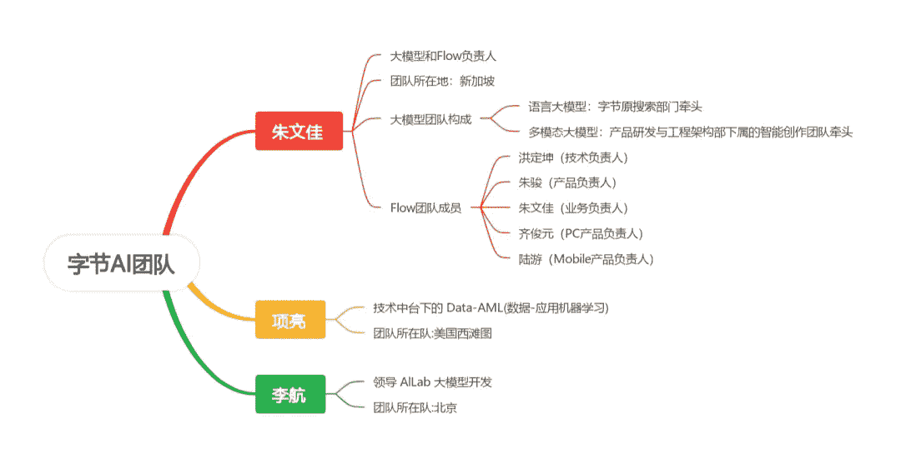

# 字节AI团队组织架构

# **| 字节AI产品和应用**

从 2023 年下半年开始，字节连续推出一系列基于 AI 和大模型的创新型产品，包括10个模型层产品和15个应用层产品。

字节有数个产品在海外和国内都有发行，但通常在一侧先上线，完成对市场和用户数据分析后，在另一侧上线类似的产品。几款产品基本上基本都有明确的对标品。字节的国内 AI 产品主要使用云雀大模型为底座，国外则主要基于 GPT 提供服务。

**从用户量**来看，豆包和扣子是其中的优等生，也是各个 AI 社群讨论的重点。其中豆包是字节目前用户量最大的产品，数据已经接近于爆发。大多数的产品处于“无人问津”的状态，甚至用户量还在不断下滑。也许和赛道有关，但大力教育的Gauth成为字节AI产品矩阵中的黑马，目前Gauth在北美地区 iOS 免费下载量最高的教育应用类型中位列第二，仅次于多邻国。

## **模型层**

### **大语言模型：Skylark**

云雀语言模型是字节在人工智能领域的一项重要技术成果。经过数月紧锣密鼓的研发和内部测试，云雀语言模型 V1.0 于 2023 年 8 月正式发布。

产品主页：https://www.volcengine.com/product/yunque

云雀语言模型的关键信息如下：

+   **模型架构**：云雀模型基于 Transformer 架构，这是一种在自然语言处理（NLP）任务中广泛使用的深度学习模型，因其并行处理能力和训练效率而受到青睐。

+   **功能定位**：云雀模型主要定位于自然语言内容的生成和理解，能够进行高效的互动对话、信息获取和协助创作等任务。

+   **技术能力**：云雀模型具备丰富的文字创作能力、严格的指令遵从性、庞大的知识储备、生动精确的角色扮演能力、专业的代码生成能力和强大的语言理解能力。

+   **版本多样性**：云雀模型有多个版本，包括 lite、plus、pro、pro-4k、chat 等，以适应不同的应用场景和需求。

+   **安全性与可信度**：云雀模型注重语言能力的工程化，确保模型的可信安全，为用户提供可靠的AI服务。

###

### **多模态模型：BuboGPT**

BuboGPT 是字节开源的一个先进的大型语言模型，它融合了文本、图像和音频三种模态的输入，具备独特的将响应与视觉对象相关联的能力。BuboGPT 的架构涉及将预训练的大型语言模型（如 Vicuna）与视觉和音频编码器相结合，并通过一个简单的投影矩阵连接不同模态的 Q-Former。由于其多模态和视觉定位能力，BuboGPT 可以应用于多种场景，如图像和视频描述、内容推荐、交互式对话系统等。

BuboGPT 开源项目网站：https://bubo-gpt.github.io/

BuboGPT 的主要功能特性如下：

+   **多模态输入处理**：BuboGPT 能够接收和处理多种类型的输入数据，包括文本、图像和音频，这使得它能够理解和生成更加丰富和互动的内容。

+   **视觉定位**：BuboGPT 具备视觉定位的能力，这意味着模型可以将文本中的描述与图像中的具体区域相对应，从而提供更精确的反馈和描述。

+   **对话能力**：该模型在对话系统中表现出色，能够根据任意图像-音频数据对进行理解和生成响应，无论这些数据对是否对齐。

+   **细粒度的视觉理解**：BuboGPT 通过视觉定位管道，可以对图像中的不同对象进行细粒度的理解和关联，这包括使用特定的模型来识别图像中的实体，并找到与文本标签相对应的掩码或边界框。

+   **两阶段训练方案**：BuboGPT 的训练包括两个阶段：首先是单模态预训练，然后是多模态指令调整。在单模态预训练阶段，模型在大量模态-文本配对数据上训练，学习将模态特征与语言对齐。在多模态指令调整阶段，使用高质量的多模态指令跟随数据集对模型进行微调。

+   **高质量的数据集构建**：为了训练 BuboGPT，研究人员构建了一个高质量的多模态指令调整数据集，该数据集包括细粒度的音频描述、跨模态声音定位，以及正面和负面的图像-音频对，以促进跨模态理解。

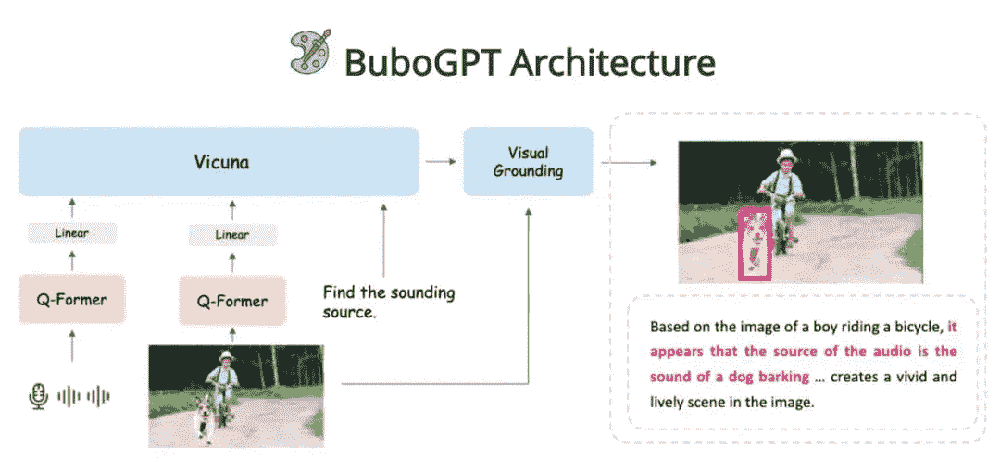

### 图片来源：BuboGPT

### 视频编辑模型：Boximator

Boximator是由字节跳动研究团队开发的AI视频生成模型。它能够根据用户提供的图像和文本提示，精准控制生成视频中人物或物体的动作，从而创造出独特且引人入胜的视频内容。以下是关于Boximator的一些关键特性和信息。

Boximator的主要特性:

+   **丰富的动作生成**：Boximator能够根据用户提供的文本提示生成多样化的动作。这些动作不仅限于简单的移动还包括复杂和具体的场景，如动物动作、人物互动等。

+   **高度可控性**：与其他视频合成工具相比，Boximator提供了更高的可控性。用户可以通过详细的文本描述来精确指定他们想要的动作和场景，Boximator将根据这些描述生成视频。

+   **图像和文本输入的结合**：该工具使用初始图像和描述所需动作的文本提示来生成视频。这种结合方式允许创造与用户愿景一致的连贯和吸引人的视频内容。

### 图片来源：Boximator

### 视频生成模型：PixelDance

研究团队介绍了一种名为PixelDance的创新方法，用于生成具有复杂场景和精细动作的高动态视频。现有的基于文本指令的视频生成方法往往只能产生动作有限、视觉细节不足的视频。PixelDance通过结合图像指令（针对视频片段的首尾帧）和文本指令，使模型能够构建复杂的场景和动作。该模型采用潜在扩散架构进行训练，并使用真实视频帧作为指令。实验结果显示，PixelDance在生成复杂场景和动作的视频方面超越了现有模型。

项目地址：

https://makepixelsdance.github.io/

### 图片来源：PixelDance

### 视频生成模型：MagicVideo

Magic Video V2是一个由字节跳动公布的A!视频生成框架，该框架集成了文本到图像模型、视频运动生成器、参考图像嵌入模块和帧插值模块，形成了一个端到端的视频生成流程。这个系统能够根据文本描述生成具有高审美价值、高分辨率和平滑度的视频。根据测试，MagicVideo-V2在性能上优于其他领先的文本到视频系统，如Runway、Pika1.0、Morph、MoonValley()和Stable Video Diffusion模型。

项目地址：

https://magicvideov2.github.io/

MagicVideo的主要特性:

+   **文本到视频生成**：系统能够将文本描述转换为视频，生成具有高审美质量的视频内容。

+   **高分辨率和平滑度**：生成的视频具有高分辨率，并且与帧之间的过渡平滑，没有明显的跳跃感.

+   **流畅性和连贯性**：通过先进的帧插值技术，确保视频的流畅性和连贯性。

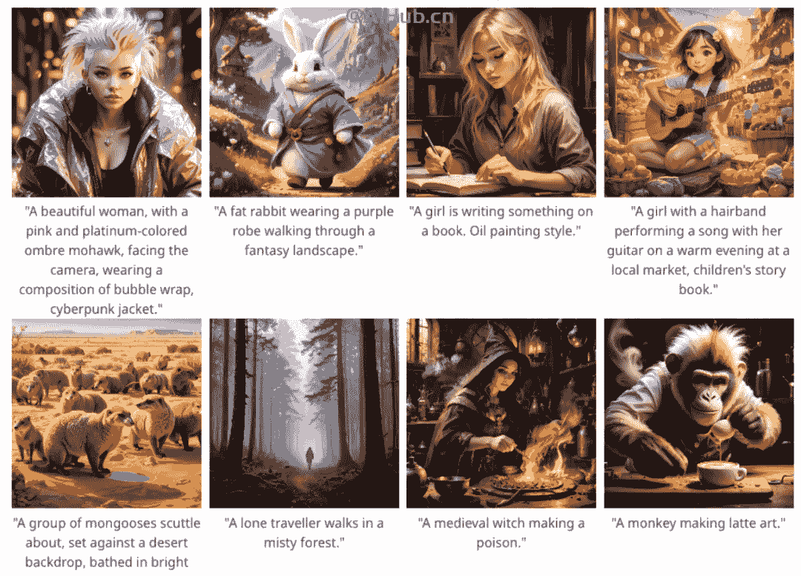

### 图片来源：magicvideov2

### 视频生成模型：AnimateDiff-Lightning

AnimateDiff-Lightning 是字节推出的一款文本到视频快速生成模型。相较于原始的 AnimateDiff 模型，AnimateDiff-Lightning 在视频生成速度上有了显著的提升，生成速度超过了 AnimateDiff 的十倍以上，极大地提高了视频内容创作的效率。

模型介绍主页：

https://huggingface.co/ByteDance/AnimateDiff-Lightning

该模型主要特性如下：

+   采用了先进的渐进式对抗扩散蒸馏技术，通过深入学习和理解原始 AnimateDiff 模型的生成过程，成功提取出关键特征并应用到蒸馏模型中，从而实现了视频生成的快速化。

+   模型还融入了交叉模型扩散蒸馏技术，这进一步增强了模型在不同风格化基础模型上的推广能力，使得生成的视频内容更加多样化。

+   功能上，AnimateDiff-Lightning 模型只需4至8步的推理，就能生成出质量极佳的视频。这种高效的生成能力对于视频制作行业是一次重大的技术突破，为用户提供了更加便捷和高效的视频制作方式。

+   AnimateDiff-Lightning 模型是从 AnimateDiff SD1.5 v2 中提炼而来，包含了1步、2步、4步和8步等多个版本的提炼模型。其中，2步、4步和8步模型的生成质量表现尤为突出，能够为用户带来更加优质的视频生成体验。

### 图片来源：AnimateDiff-Lightning

### 图形生成模型：ResAdapter

ResAdapter是一款由字节跳动开发的扩散模型辨率适配器，它能够在保持风格域一致性的同时，生成任意分辨率和宽高比的图像。这个工具通过在扩散模型中插入适配器，实现了高效的推理过程，同时保持了图像的风格域。ResAdapter可以与ControINet、IP-Adapter和LCM-LORA等其他模块兼容，支持灵活的图像生成，可以解决StableDiffusion()肢体异常、画面崩坏问题。

项目地址：https://github.com/bytedance/res-adapter/?ref=aihub.cn

ResAdapter的主要特性:

+   **分辨率适配**：能够生成任意分辨率的图像，包括低于或高于训练分辨率的图像，而不会损失图像质量。

+   **风格一致性**：在改变图像分辨率的同时，保持原始图像的风格和特征，确保生成图像与训练数据集的风格一致。

+   **高效推理**：通过优化的网络结构，提高模型的推理速度，使得在不同分辨率下生成图像的过程更加高效。

+   **兼容性**：与现有的扩散模型和其他AI工具兼容，比如ControlNet()、IP-Adapter和LCM-LORA等，方便用户集成到现有的工作流程中。

+   **多任务支持**：不仅适用于文本到图像的生成任务，还可以应用于图像到图像的任务，如风格迁移、图像修复等。

+   **图像质量**：生成的图像具有高质量的视觉效果，无论是在细节表现还是整体风格上都接近或达到训练模型的水灭。

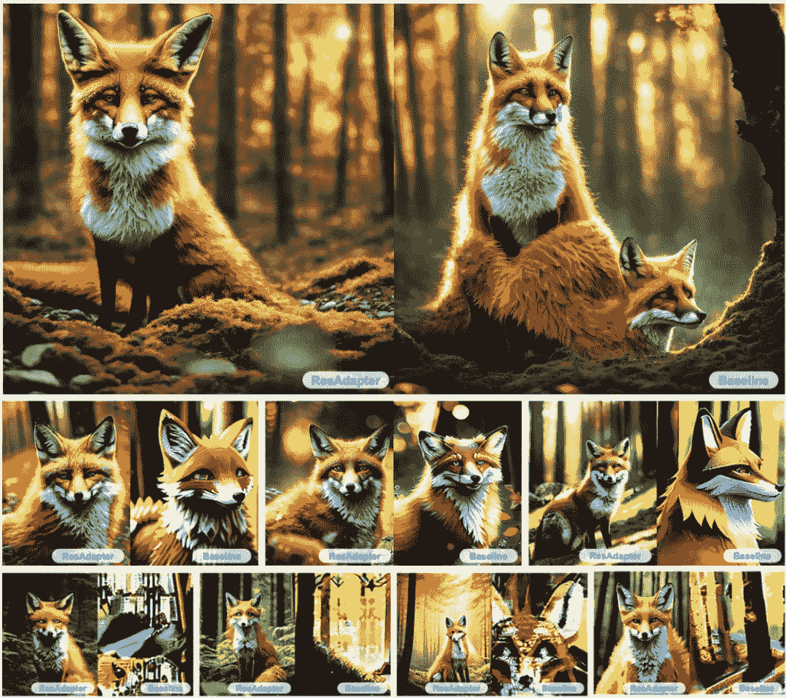

### 图片来源：ResAdapter

### 图形生成模型：SDXL-Lightning

SDXL-Lightning 是字节开源的一个文本到图像快速生成模型。该模型在生成高质量和高分辨率图像方面表现出色，能够在极短的时间内完成生成过程，极大地降低了计算成本和时间，满足了快速、实时文生图像的应用场景。SDXL-Lightning 的应用场景非常广泛，包括广告设计、虚拟现实、游戏制作、摄影后期处理等。

除了商业应用，SDXL-Lightning 在学术研究领域也有着广阔的应用前景。在计算机视觉领域，该模型可以用于图像识别和目标检测等任务，提高模型的准确率和鲁棒性。在自然语言处理领域，该模型可以用于文本生成和机器翻译等任务，通过生成高质量的图片来提高机器翻译的准确性和流畅性。

模型介绍主页：https://huggingface.co/ByteDance/SDXL-Lightning

SDXL-Lightning 的主要特性：

+   采用了渐进式对抗蒸馏技术，使得其生成图像的速度相比传统的扩散过程有了显著提升，效率提高了十倍以上。

+   用户可以通过输入文本描述来生成相应的图像，SDXL-Lightning 支持多种推理步骤（包括1步、2步、4步和8步），推理步骤越多，生成的图像质量越高。

+   在4步生成模式下，该模型能够生成极具细节和图文匹配度的高质量图像，如清晰呈现人物微笑、动物细毛等细节。

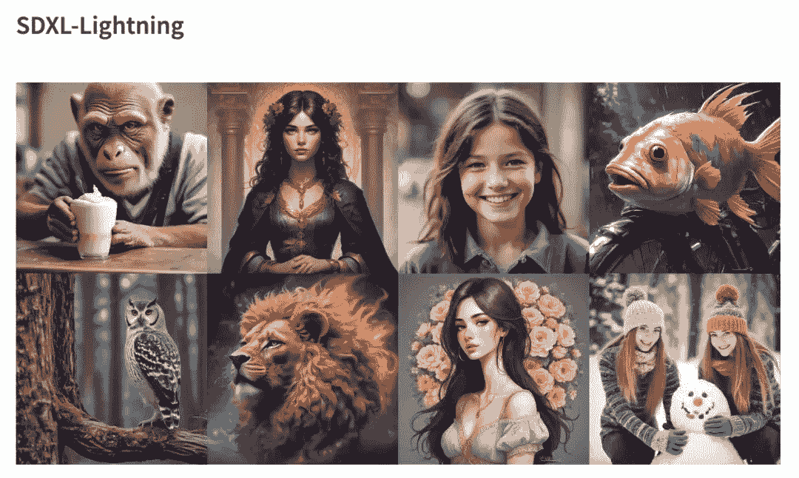

### 图片来源：SDXL-Lightning

### Bot 开发平台：扣子 / Coze

扣子 / Coze 是由字节推出的一款 AI 聊天机器人开发平台。该平台在海外以 “Coze” 名称先行推出，之后在国内市场上线并更名为 “扣子”。作为一站式的 AI Bot 开发平台，Coze 支持用户快速创建、调试和优化 AI 聊天机器人，为非开发者提供了极大的便利。

国内版 "扣子" 网站：https://www.coze.cn/

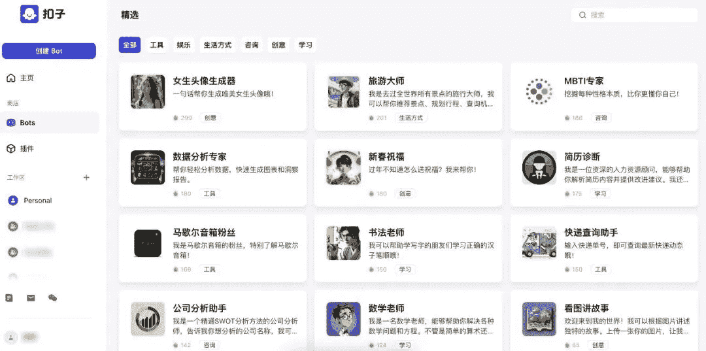

### 图片来源：扣子

海外版 "Coze" 网站：https://www.coze.com/

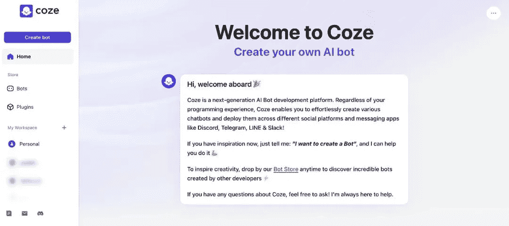

### 图片来源：Coze

平台主要特点如下：

+   易于使用：无论是否有编程基础，用户都可以在扣子平台上通过直观的界面和丰富的模板快速创建属于自己的 Chatbot。

+   多样化功能：无论是简单的问答，还是处理复杂的逻辑对话，扣子都支持用户根据实际需求进行定制。

+   丰富的插件和扩展能力：平台提供了数百种不同的插件，覆盖搜索、页面读取、资料查找、文章阅读、生产力工具等多个领域，并允许用户创建自定义插件，以扩展机器人的功能。

+   多渠道发布：用户可以将所创建的 AI Bot 一键发布到多个平台，如飞书、🛰️👸号、豆包等（海外版包括 Discord, Telegram, Messenger, LINE, Instagram, Slack 等），从而扩大机器人的应用范围。

+   数据分析和监控：平台提供了完善的数据分析和监控功能，帮助用户实时了解 Bot 的运行情况，以及时进行优化和调整。

**从**数据上来看，Coze暂时比扣子做的更好。2024年3月，Coze的网页端月访问人数为330万人，是扣子的3倍。

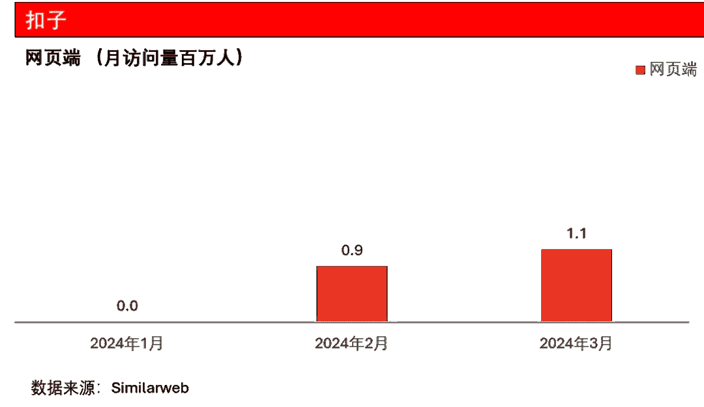

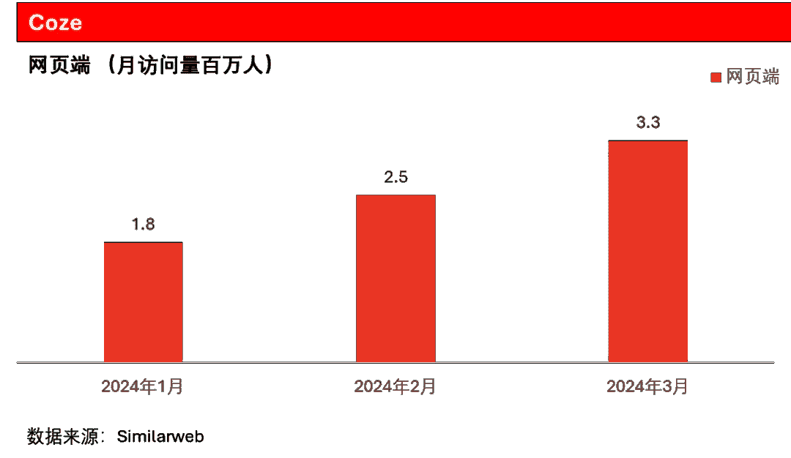

## **应用层：已经上架的产品**

### AI 对话平台：豆包 / Cici

豆包是字节基于云雀大模型推出的 AI 工具平台，其前身以 "Grace" 作为项目代号，该名字也表明字节在开发该产品过程中就注重产品的优雅和流畅性。Cici 是面向海外市场的豆包同款，基于 GPT 大模型能力。

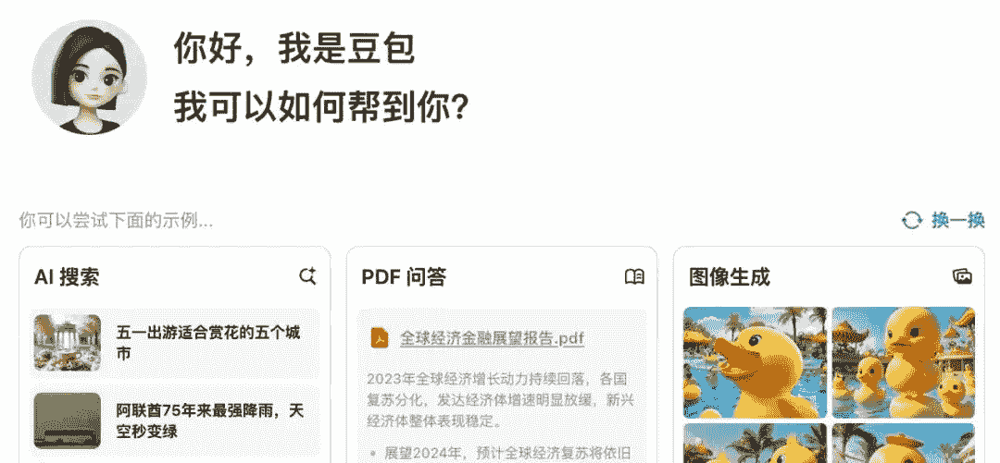

豆包网站：https://www.doubao.com/

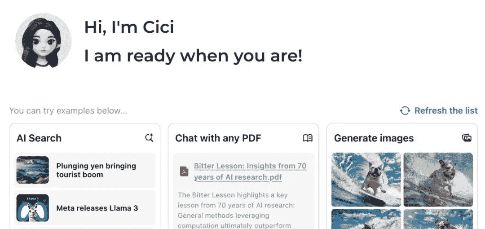

Cici 网站：https://www.ciciai.com/

豆包/CiCi的主要功能和特性如下：

+   提供聊天机器人、写作助手以及英语学习助手等功能，旨在帮助人们获取信息，支持网页/Web平台、iOS 以及安卓平台的使用。

+   在功能方面，可以编程，写讲话稿，查热门信息，甚至还能写抖音短视频剧本、📕剧本，还能应付数学和编程等问题。

+   拥有文生文、文生图的功能，现已正式对外开放测试。它接入了利用深度神经网络、强化学习等技术训练的大规模语言模型以及其他模型及服务，模型采用对话格式，可以根据用户输入的指令，通过自动化分析后生成参考信息。

+   其生成内容的速度非常快，且在聊天方面更擅长闲聊，尤其适合普通的聊天场景。该产品能够理解对话的上下文，这意味着它能够根据对话的历史信息提供相关且连贯的回复。

**从**数据上来看，豆包的表现十分抢眼，是字节最火爆的产品，移动端的月活已经突破2500万人，网页端的访问量接近300万人。CiCi的表现稍差一些，网页端的访问量接近160万人。

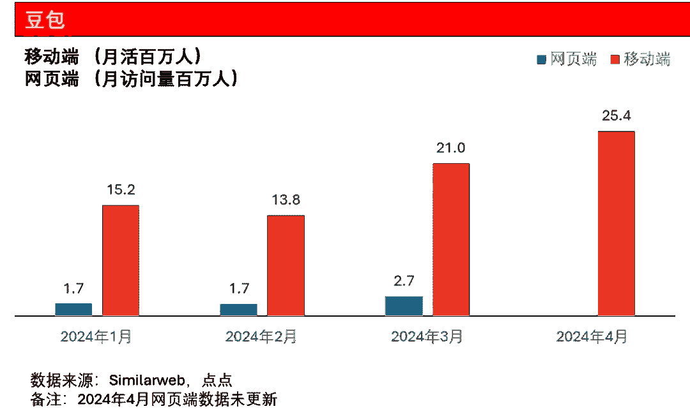

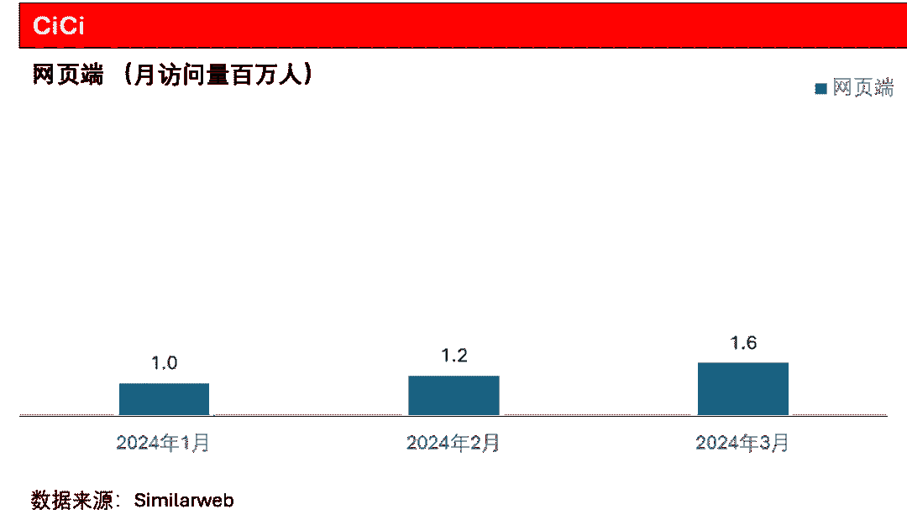

### AI 工具助手：小悟空 / ChitChop

小悟空 和 ChitChop 是字节面向国内和海外市场的 AI 互动助手，为用户提供了丰富的智能服务。小悟空/ChitChop 是一款 AI 工具集平台，支持智能对话和辅助推荐功能。小悟空提供了包括创作生成、学习提升、工作职场、专业咨询、虚拟角色、休闲娱乐等分类在内的 20 余个分类和 200+ AI 工具，用户可以根据自己的需求进行选择。

小悟空网站：https://wukong.com/

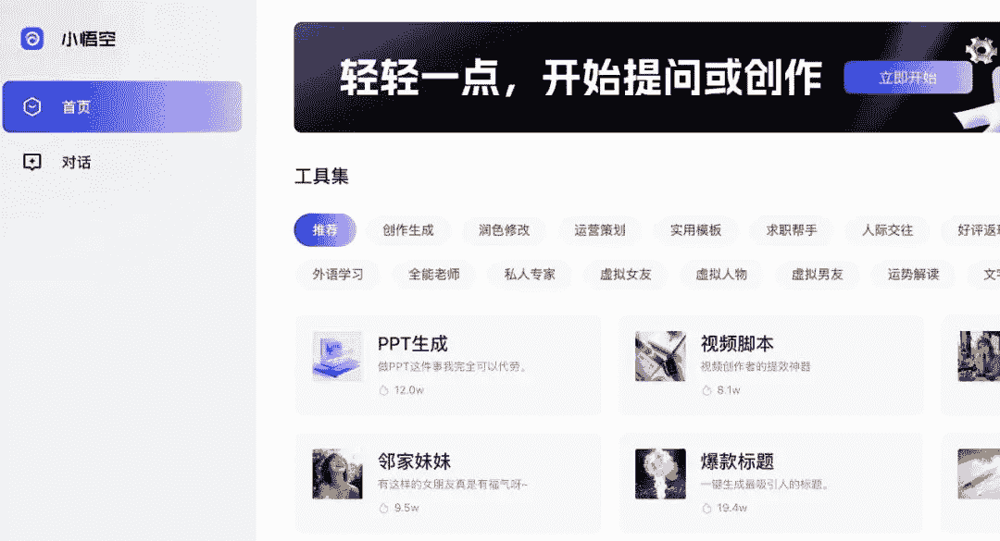

ChitChop 网站：https://www.chitchop.com/

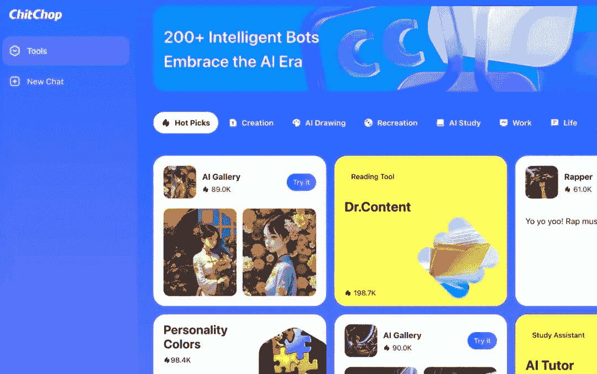

**从数据上来看，小悟空和ChipChop的表现都较为差强人意，**不论是移动端还是网页端的用户量都在下滑。

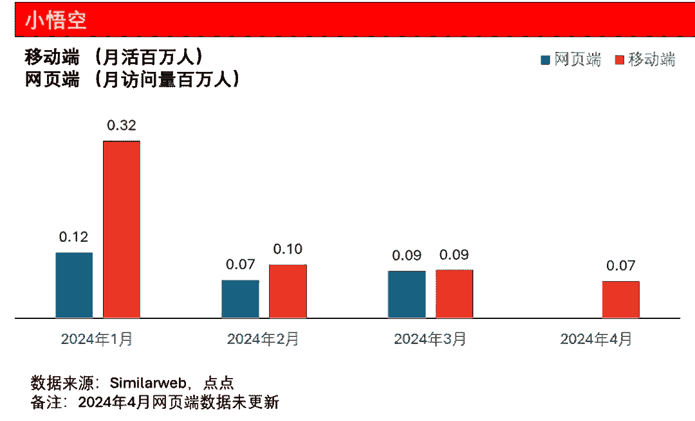

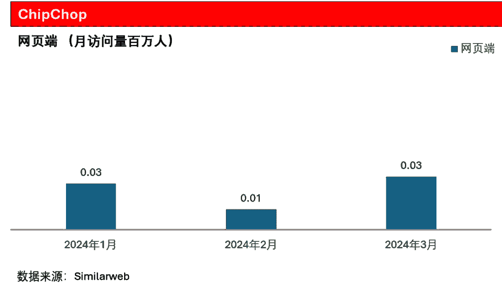

### AI 角色互动：猫箱 / AnyDoor

猫箱（原名 围炉）和AnyDoor (原名 BagelBell) 是字节推出的 AI 剧情互动平台。该平台提供了一个由 AI 驱动的虚拟世界，用户在这个充满活力的创造力空间中，不仅可以探索丰富多彩的故事，更能创建个性化的 AI 角色，并与这些角色进行深度互动。

猫箱APP Store下载地址：https://apps.apple.com/cn/app/%E7%8C%AB%E7%AE%B1-%E5%BC%80%E5%90%AF%E4%BD%A0%E7%9A%84-ai-%E5%A5%87%E9%81%87/id6475000292

Anydoor 网站：https://www.anybagel.com/

猫箱/Anydoor主要特性如下：

+   支持用户创建 AI 虚拟角色和故事创作，用户可以通过设置角色的设定、名字、音色等参数，打造出一个全新的 AI 智能体。

+   这些智能体不仅拥有生动的个性和语言特点，还能根据用户的输入进行智能化的回应和互动，使得每一次的交流都充满新鲜感和趣味性。

+   除了角色创建和故事创作，猫箱/Anydoor还提供了丰富的图像生成工具。用户可以选择不同的风格，为他们的叙事带来独特的视觉身份。这些视觉元素不仅丰富了故事的表现力，也让用户能够更直观地感受到故事的情感和氛围。

+   猫箱/Anydoor的故事类型非常丰富，涵盖了狼人、校园、悬疑、霸总、女仆、年下等多种类别，大部分故事都带有恋爱元素。用户可以在这个平台上尝试多种主题的情节，获得更沉浸式的体验。

+   平台还鼓励用户分享自己的创作，与其他用户交流心得，共同构建一个充满创意和活力的社区。

### AI 图片视频应用：Dreamina

Dreamina 是字节旗下视频工具软件剪映 / CapCut（剪映海外版）推出的一款强大的 AIGC 创作产品，它为用户提供了丰富的 AI 辅助图片和视频创作功能。这款工具不仅为用户提供了丰富的创作工具和功能，还通过融合先进的AI技术，使得内容创作变得更加简单、高效和有趣。

CapCut 在 2024 年 2 月正式开放了 AI 生成视频功能的公测。此前，CapCut 已经通过引入 AI 生成模版和特效等功能，实现了下载量的激增和收入的增长，成为 2023 年全球最赚钱的视频剪辑应用之一。

剪映 Dreamina 入口：https://dreamina.jianying.com/

CapCut Dreamina 入口：https://www.capcut.com/ai-tool/

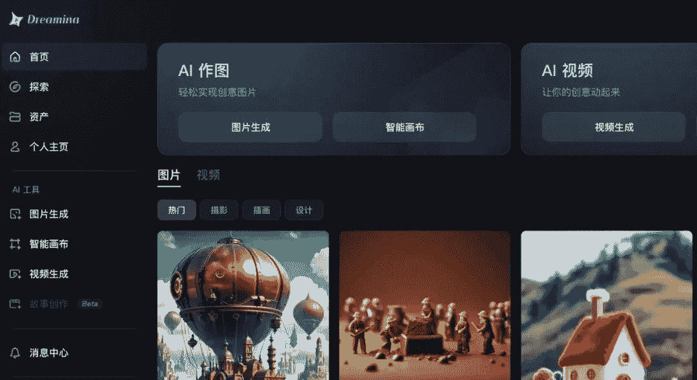

### 图片来源：Dreamina

Dreamina 主要特性如下：

+   支持文生图、图生图、文生视频、图生视频等多种功能，不仅可以将文字描述转化为生动的图像和画面，还可以根据已有的图片生成新的创意图片或视频。

+   提供丰富的提示语模板，如摄影、写实、插画、设计等，用户只需选择相应的模板，即可一键生成同款内容。

+   在创作参数设置方面，Dreamina 也提供了灵活的选择，用户可以根据需要调整模型、尺寸比例、画面精细度等参数，以获得更加满意的创作效果。Dreamina 还支持将生成的低分辨率模糊图像变为超清图片，使得生成的图片更加清晰细腻。

+   Dreamina 还具备局部重绘和画面扩图等高级功能。局部重绘允许用户对生成后的图片进行局部修改和重绘。画面扩图则可以将生成后的图片进行画幅扩展。

**从**数据上来看，Dreamina因为刚开始公测，目前月访问人数约30万人。因为其产品功能还在不断升级过程中，其后续表现还需要观察。

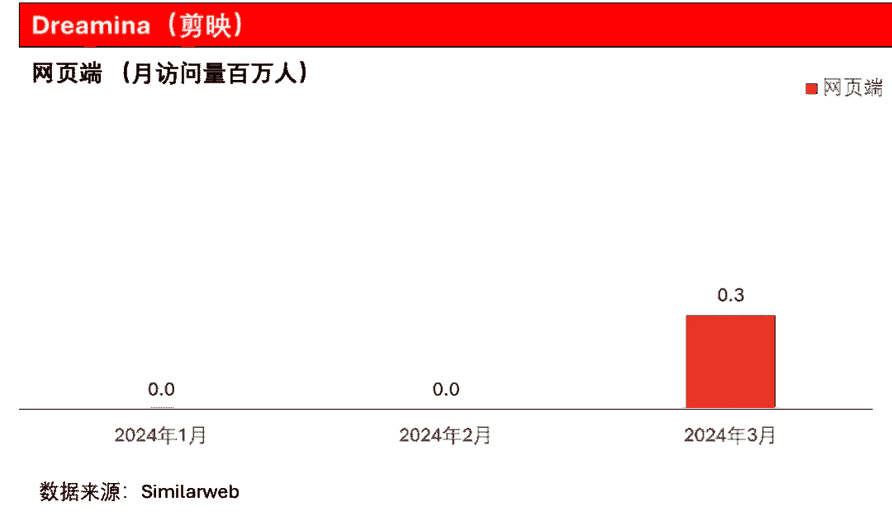

### AI 图片应用：星绘/ PicPic

字节 Flow 部门近期在国内上线了字节版的“妙鸭相机”——星绘。星绘提供丰富的AI生图能力，你可以创建AI世界()的你，并且为你的分身定制多样的效果，体验各种虚拟人生。你可以上传图片，简单输入关键词，任意切换它们的风格，像素风、赛博朋克、日式漫画，即刻拥有，以及智能换脸、高清放大、背景去除、图片分层、矢量转换等实用的 AI 工具组合。PicPic 是海外版星绘，本月初启动内测最近正式上架海外 App Store。

星绘 App Store 下载地址：

https://apps.apple.com/cn/app/%E6%98%9F%E7%BB%98/id6475072892

PicPic App Store 下载地址：https://apps.apple.com/ph/app/id6475074973

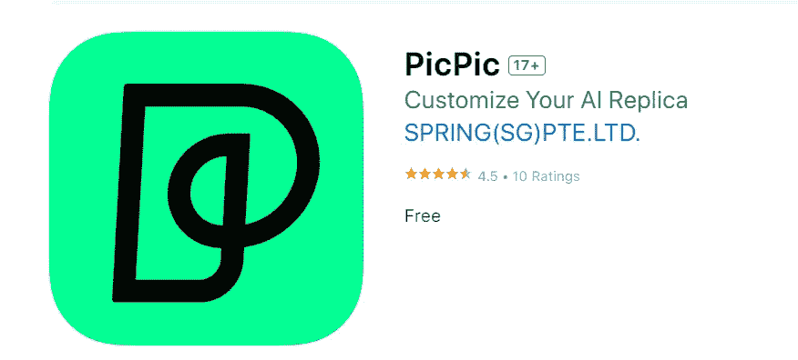

星绘/PicPic App 主要特性如下：

+   一键图片：只需拍摄 3 张自拍，即可生成高质量的图像、充满情感的杰作、角色扮演照片等。

+   制作 AI 分身：说出想去哪里以及想做什么，AI 分身即可环游世界、穿越时空，为自己实现梦想。

+   风格特效：上传或拍摄一张照片，即可将其转换为卡通人物或赋予其不同的质感。

### **AI 创意生产：即创**

即创 是字节旗下巨量引擎推出的一个智能创意生产与管理平台，致力于为创作者提供一站式的智能创意生产与管理服务，满足其在抖音电商、短视频创作以及直播等领域的全方位需求。它不仅可以提供专业级的工具和服务，帮助用户轻松应对各种创作挑战，还携手众多服务商，共同激发创新灵感，提供多元化的供给，为商业化经营提供有力支持。

即创平台入口：https://aic.oceanengine.com/

### 图片来源：即创

即创平台集成了视频创作、图文生成、直播工具等多种服务场景，以满足不同创作需求。平台主要功能和特色如下：

+   即创拥有强大的智能创意生产能力。通过AI技术，它可以实现智能成片、AI 视频脚本、AI 数字人等多种功能，帮助用户快速生成短视频、编写视频文案，以及生成虚拟的视频主播。

+   即创提供图文工具支持，可以根据商品编号自动生成原创的图文素材，还有商品卡工具功能，可以制作精美的商品卡片，方便图文带货。

+   在直播方面，即创提供了 AI 直播背景功能，能够一键生成不同风格的直播场景，并通过 AI 直播脚本功能，自动编写直播话术，以提升直播效果。

从数据上来看，即创的表现也并不两眼，目前月访问人数稳定在20万人左右。

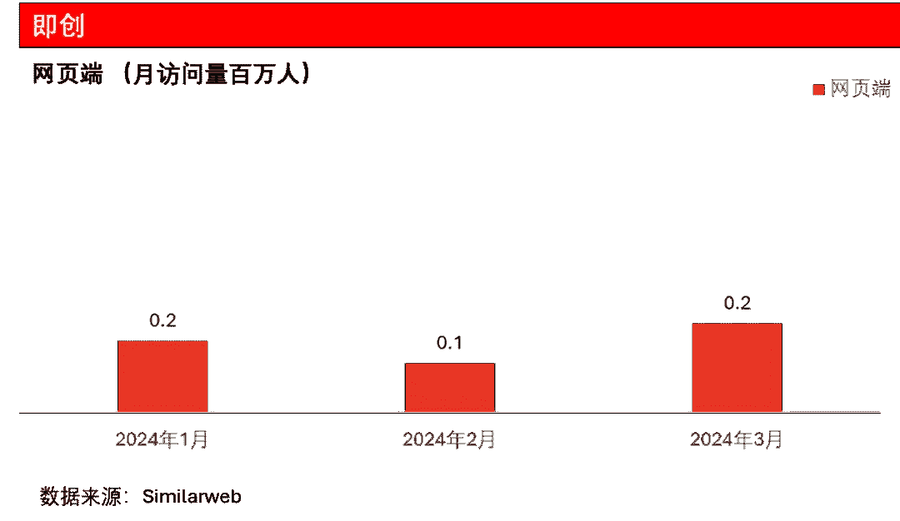

### **AI 音乐创作：海绵乐队**

海绵乐队是字节推出的手机端音乐创作工具，在实现传统的录音、效果器同时，引入大量 AI 能力来协助创作，降低使用难度、提高创作趣味和效率。它旨在满足专业音乐人和音乐初学者的创作需求，特别服务于汽水音乐和抖音平台上的用户，让他们能够随时随地进行音乐编辑和创作。

App Store 下载地址：https://apps.apple.com/cn/app/id1620738933

软件功能：

+   高质量录音：支持音频导入、音频编辑、多轨录音、耳返监听、自带多种可自定义参数的效果器。一键处理功能帮助你提高创作效率，获得更美妙的人声做完的音乐既能保存成音频文件，也可以保存成视频存进本地相册。

+   弹唱优化：录制弹唱音频时，底噪太大？人声太小？弹唱伴侣帮你解決烦恼。一键优化功能帮你处理钢琴或吉他的弹唱音频，得到更好音质的弹唱曲。更支持伴奏、人声分轨处理。

+   一键曲风变化：听腻了原版歌曲，想换换风格？or制作视频时想配上独-一无二的BGM?导入音频后，即可一键智能remix改变原有的曲风，多种风格可供挑选。

+   Mashup 大师：传统的 DAW软件制作流程太复杂？海绵乐队支持•键快速mashup， 1分钟即可完成两首歌曲的融合。更有智能提取与节奏对齐功能，提高自定义个性化mashup 的创作效率，帮你成为mashup 大师.

+   实用工具：翻唱好帮手！移调，-键混音等操作。用手机就能做出高质量翻唱！-键从歌曲中提取人声或伴奏，一键混音等操作。用手机就能做出高质量翻唱。

从数据上来看，海绵乐队的表现较为惨淡，目前移动端的月活仅有几千人。

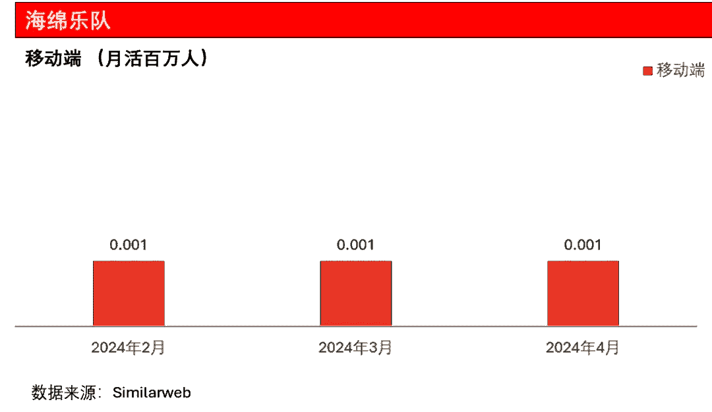

### **AI 教育平台：河马爱学**

河马爱学是字节旗下大力教育推出的一款专为中小学生设计的 AI 教育平台，旨在通过 AI 技术帮助学生提升学习效率，同时支持教师的教学工作。它提供课前预习、课中自主学习、课后巩固的全过程服务，支持多种智能互动做题方式，让学生在学习过程中保持兴趣，主动学习和知识巩固。

河马爱学官网：https://www.hippolearning.cn/

河马爱学及教育平台的主要功能和特色如下：

+   拍照答题：用户可以通过拍照上传题目，应用会自动识别并提供答案和解题思路。

+   作业批改：它不仅能帮助学生检查作业，还能提供正确的答案和改进建议，从而帮助学生更好地掌握知识点。

+   河马爱学不仅关注数学和语文等基础学科，还提供口算和作文批改服务。针对数学口算，应用提供批改服务，帮助学生提高计算能力；针对语文和英语作文，应用同样提供批改服务，从立意、内容、结构、语言等方面给出点评，并提供智能润色和防跑题分析，帮助学生提升写作技巧。

### **AI 学习助手：Gauth**

Gauth（原名 Gauthmath）是一款由字节海外公司推出的 AI 学习助手，专注于面向海外用户的拍照搜题服务。该产品初期以解决数学问题为主，后来拓展至理化生、文学、写作、商业、社会科学等学科，可随时随地为初高中学生提供拍照搜题服务。用户只需用手机拍下待解答的题目，Gauth 会通过 AI 对题目进行分析识别，并给出分步解答。

除了 AI 伴学之外，Gauth 还提供远程家教高级服务，以帮助学生在解决难题时进行一对一辅导。Gauth 上的导师来自全球各地，他们需要提供相关证书以证明其在教学方面的专业资格，并需要具备相应的教学辅导能力。

Gauth 官网：https://www.gauthmath.com/

**从数**据上看，Gauth 在海外市场上表现亮眼，月访问量已经突破400万。根据 data.ai 的数据，在最近数月，Gauth 在北美地区 iOS 免费下载量最高的教育应用类型中位列第二，仅次于多邻国。

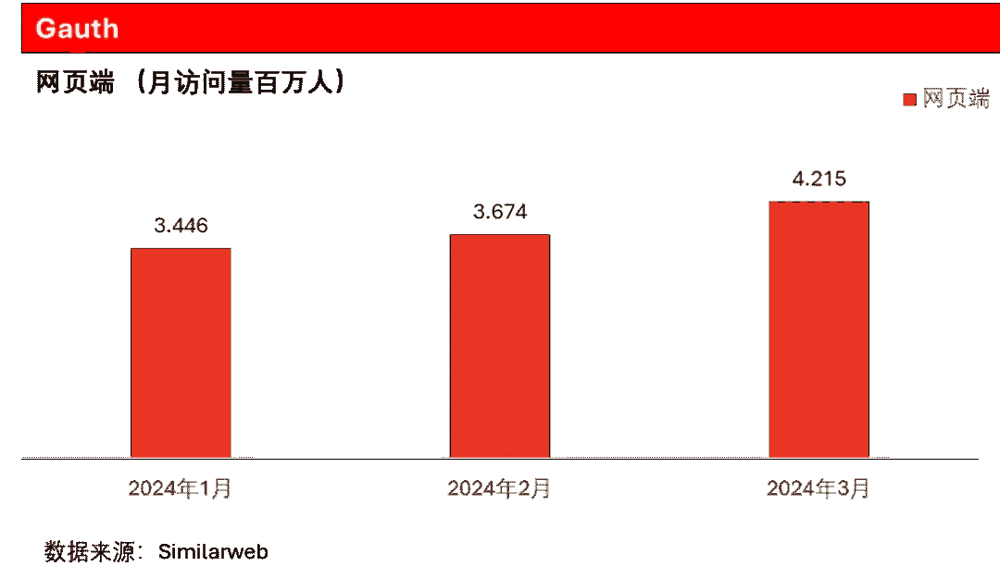

### **AI 文化公益：识典古籍**

“识典古籍” 是一个致力于古籍数字化和文化公益的项目，其核心价值在于推动古籍资源的保护与活化，让更多人能够便利地接触、了解和阅读古籍。2022 年 10 月，字节跳动与北京大学数字人文实验室合作，共同推出了 “识典古籍” 这一古籍数字化阅读平台，

识典古籍网站：https://www.shidianguji.com/

该平台功能和特色包括：

+   平台不仅涵盖了大量的经典古籍，如《论语》、《孟子》、《周易》等，还提供了分词检索、图文对照、字典释义等功能，使得普通人也能轻松阅读古籍文献。

+   开放性和公益性。平台上的古籍资源全部免费开放，任何人都可以随时随地在线阅读和学习。

+   备智能助手功能，支持用户以 “问AI” 的方式，获得古文语句翻译、全文内容总结、可供参考的研究等回答，提升了古籍查阅的效率。

## **应用层：潜在上架的产品**

### **AI 代码：MarsCode**

根据公开信息，字节在代码生成方向推出CodeGen，对标Replite做AI代码生成。而根据天眼查的信息，Flow已经注册了MarsCode/码思Code等相关商标和域名。代码生成产品或上市在即。

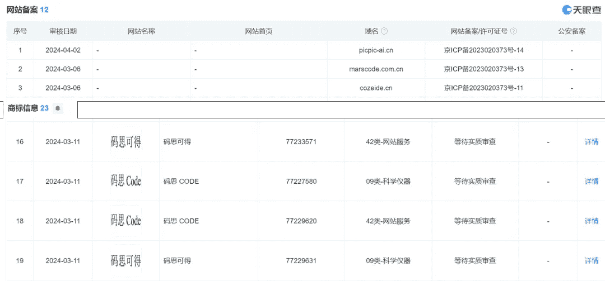

Source：

https://www.bytedance.com/

https://www.douyin.com/home/

https://www.oceanengine.com/

https://www.tianyancha.com/company/6345417206/zhishi

https://mp.weixin.qq.com/s/MshRhpbaI0ab5zkBNwh3CA

https://mp.weixin.qq.com/s/kRuMQD0L4vkAXkLWiCeGsw

<https://aigcreative.feishu.cn/sync/K4Gvd9vUQsy9Oubwqaeclu0Fnbg>