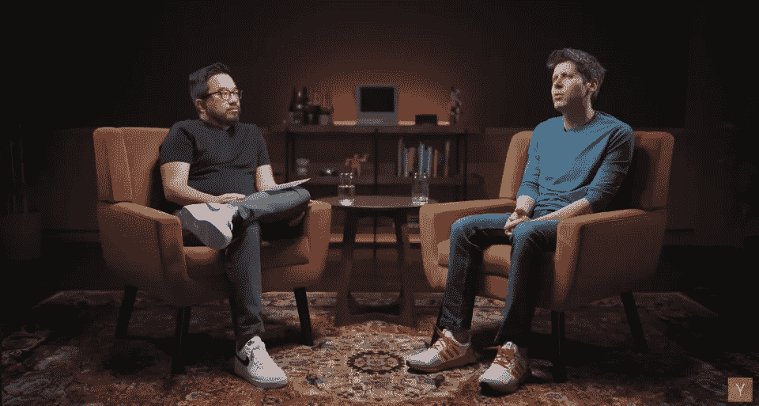

# 奥特曼专访自曝：OpenAI将实现AGI第三级，一人也能打造10亿独角兽

> 来源：[https://aigcreative.feishu.cn/docx/Dn4HdORmKov3KBxkwuCcJw5qnDg](https://aigcreative.feishu.cn/docx/Dn4HdORmKov3KBxkwuCcJw5qnDg)

> 原文链接： [https://mp.weixin.](https://mp.weixin.qq.com/s/IRt6xtwt0o7-Yj0XErj0iQ)qq.com/s/IRt6xtwt...

> 公众号：腾讯科技

在当前的科技界，山姆·奥特曼（Sam Altman）无疑是对未来影响最深远的人物之一。作为OpenAI的掌舵人，奥特曼及其团队在机器学习、生成式人工智能领域，以及最新推出的具备博士级推理能力的大语言模型（LLM）上，均实现了突破性进展。而这，仅仅是他们征程的起点。在奥特曼的最新文章中，他大胆预言，超级人工智能（ASI）将在几千天后降临。那么，他们究竟是如何走到这一步的呢？

在《如何构建未来》系列访谈节目中，美国知名创业孵化器Y Combinator（简称YC）的总裁兼首席执行官陈嘉兴（Garry Tan）对奥特曼进行了专访。他们深入探讨了OpenAI的诞生起源、公司的未来发展方向，奥特曼还为那些正面临平台转型挑战的创业者们提供了宝贵建议。

以下为奥特曼访谈全文：

# 01、**现在是创业最佳时机！**

#

**陈嘉兴： **让我们来聊聊你最新的文章，关于智能时代的话题。你觉得，现在是否是创办一家科技公司的最佳时机？

**奥特曼： **至少可以说，这是迄今为止最理想的时机，当然，我也期待未来能出现更佳的时机。在我看来，每次重大的技术革新都会极大地拓宽我们的能力边界，你能做的事情都会比以前更多。我深信，这些新兴公司将在更多领域内创造非凡的成就，带来深远的影响。因此，我认为现在就是最佳的创业时机。当行业发展趋于平缓，缺乏活力时，大公司往往更具优势。但每当像这样的技术革命，或是移动技术、互联网、半导体等领域的变革兴起时，就像工业革命一样，新兴公司便能脱颖而出。所以，现在的形势真的令人振奋，因为我们已经很久没有遇到这样的颠覆性变革了。

**陈嘉兴： **在你的文章中，你提出了一个非常大胆的预测，即超级人工智能将在数千天后诞生。

**奥特曼： **是的，这既是我们的期望，也是我们的推测。我能清晰地看到一条发展路径，我们正在进行的工作将不断累积成果，产生复利效应。如果我们能保持过去三年取得的进步速度，甚至有所超越，那么在接下来的三年、六年、九年——也就是说，大约3500天左右的时间里，这个系统将能够完成许多令人惊叹的事情。我认为，即便是像o1这样的系统，在特定领域内的限定任务上，也已经展现出了极高的基础认知能力。o1无疑是一个非常聪明的存在，而且我认为我们远未达到进步的极限。

**陈嘉兴： **你的文章真的是我所读过的最具技术乐观主义色彩的文章之一。我们期待的一系列成就包括修复气候问题、建立太空殖民地、揭示所有物理学原理、实现近乎无限的智能以及获取丰富的能源。

**奥特曼： **我确实相信，所有这些事情，甚至更多我们目前还无法想象的奇迹，或许并不遥远。能够半认真半憧憬地谈论这些可能性，本身就是一件极其激动人心的事情。我一直以来最喜爱YC的一点就是，它培育了一种略带魔幻色彩的技术乐观主义，以及一种坚定的信念——即你能够解决任何难题。在这个总是向人们灌输“这不可能，你做不到”的世界里，我认为这种乐观主义能够激励创业者们将目光投向更远的地方，这在全球范围内都是独树一帜的。

# 02、**无限能源+无限智能**

#

**陈嘉兴： **获得充足的能源无疑是一个宏大的课题。我们知道有A路径和B路径两种解决方案。如果我们真的能够实现能源充足，这似乎能够解锁几乎所有的领域，不仅仅是知识密集型工作，还包括体力密集型工作。这可以通过机器人技术、自然语言处理以及无处不在的智能来实现。我们就好像正步入一个真正的富足时代。

**奥特曼： **我认为智能充足和能源充足是实现其他所有愿景的两个核心要素。当然，还有其他诸多重要的因素，但如果我们能够拥有充足的智能和能源，那么我们在世界上所能达成的成就将是惊人的。比如，我们不仅能更快地产生更好的创意，还能在物理世界中将其实现。更不用说，运行大量的人工智能系统也需要能源。我认为这将是一个巨大的突破。而且，事实上，我并不觉得这会让人惊讶，所有这一切都在同时发生，或许这只是技术进步加速的必然结果。但毫无疑问，这是一个极其令人振奋的时代，也是一个绝佳的创业契机。

**陈嘉兴： **所以我们正身处这个富足的时代。也许你们的机器人实际上能够制造任何东西，几乎所有的体力劳动都可以转化为物质进步，这不仅限于最富有的人群，而是惠及每一个人。但如果我们不能实现无限的能源供应会怎样？如果存在着某种物理定律阻止我们达到这一点，那会是什么呢？

**奥特曼： **太阳能与储能技术的发展轨迹已经相当乐观，即使我们在核能领域没有取得重大突破，我们也勉强能够应对。但毫无疑问，降低能源成本、增加能源供应对提升生活质量有着直接的影响。最终，我们将解决物理学中的所有难题。我们一定会找到解决方案的，这只是时间问题，我们也理应得到这样的成果。有一天，我们或许将不再谈论聚变或其他类似的技术，而是会关注更高级别的技术，那也将是极其精彩的。对于我们来说，现在可能感觉能源很充足，但对于我们的子孙后代来说可能还远远不够。而且宇宙广阔无垠，物质资源极其丰富。

# 03、**畅想退休后经营研究实验室**

#

**陈嘉兴： **你之前提及了保罗·格雷厄姆（Paul Graham），他创立了YC，并将我们聚集在一起。他很喜欢讲述你加入YC的故事，说当时你是斯坦福大学的大一新生，而2005年正好是YC的第一个创业批次。他建议你等大二再来，但你却坚称自己是大二学生，坚持要参加。因此，你在我们的社区里非常有名，被视为极具实力的人物之一。你认为这种决心源自何处？

**奥特曼： **这些故事有时被传得有些夸张了。其实，我并不是喜欢被看作一个令人畏惧的人。在很多方面，我都觉得自己并不符合这样的形象。我只是有一种想法，就是不明白为什么事情一定要按照现有的方式发展，所以我只是按照我认为从基本原理上可行的方式去做。这种想法可能有些独特。我一直觉得YC很棒的一点，也是我至今仍非常珍视的一点，就是它聚集了一群特立独行的人，他们只是说：“我要做我自己想做的事情。”这与我的自我认同相契合，我确实认为你可以尝试去做很多事情，或者尝试新事物，这在很大程度上是可行的。而且，我认为这样的尝试越多越好。后来我才意识到，YC之所以如此特别，除了格雷厄姆这样的伟大人物一直鼓励你，告诉你“你可以做到，我相信你”之外，更重要的是周围有一群和你有着相同信念的人。给年轻人的最大建议就是，尽早找到一个能激励你的同行群体，这对我来说真的太重要了。

**陈嘉兴： **谈谈YC Research（YC旗下的非营利研究机构）的早期岁月吧！你给YC带来了一种非常酷的实验精神。我记得你曾回来和合伙人们分享你与拉里·佩奇（Larry Page）和谢尔盖·布林（Sergey Brin）等人在一些房间里的对话。那时，人工智能已经成为热议的话题，虽然离真正成熟还有很长的路要走，但感觉已经触手可及——这已经是十年前的事情了！

**奥特曼： **我一直觉得，经营一个研究实验室是最酷的退休工作。当我们最初谈论YC Research时，它并不是专门针对人工智能的，但我一直想做类似的事情：创建一个可以资助不同方向研究的实验室。回想起来，我希望我能告诉你，我们一开始就预见到了人工智能会成为主流，但实际上我们也尝试了很多不成功的项目。那段时间，我读了几本关于施乐公司帕洛阿尔托研究中心（Xerox PARC）和贝尔实验室的书，硅谷当时也在广泛讨论我们需要重建优秀的研究实验室。我觉得这个想法很酷，而且与YC有些相似：你为聪明的人提供资金，有时会成功，有时会失败，但最重要的是去尝试。人工智能确实在那个时候经历了一个小高潮，特别是2014年底到2016年初。关于超级智能的讨论非常热烈，那类书籍也广受欢迎。DeepMind也有一些令人印象深刻的成果，但方向与我们略有不同。事实上，我一直是人工智能的忠实粉丝，所以我觉得很酷，想尝试做点什么。但即便是那时，我们也很难判断人工智能是否已经准备好进入主流。

# 04、**组建OpenAI原始团队**

#

**陈嘉兴： **在YC Research和OpenAI的初创阶段，你是如何挑选并组建你的团队的？

**奥特曼： **格雷格·布罗克曼（Greg Brockman，OpenAI联创兼总裁）是很早就决定加入我们的核心成员。那时候，我们的招募过程就像一部电影的蒙太奇场景，四处奔波，寻找那些能够与我们共同前行的人。我记得，当我听说伊利亚·苏茨克维（Ilya Sutskever，OpenAI联创兼前首席科学家）这个名字时，我就知道他是个非常聪明的人。通过一些视频资料，我发现他是一个拥有远见和天赋的天才。他的个人魅力深深地吸引了我，让我觉得一定要和他见面聊聊。于是，我给他发了邮件，但遗憾的是，他没有回复。我并没有放弃，而是决定去他即将发表演讲的会议现场，争取和他见面。那次交流非常愉快，我们聊了很多关于人工智能和未来的想法。

回想起来，我们做得特别好的一件事就是，从一开始就明确表示我们要追求AGI（通用人工智能）。在那个时候，很多人对这个目标还持怀疑态度，甚至觉得公开谈论它可能是疯狂的，不负责任的。但正是这种态度，立刻吸引了年轻一代的关注，也引来了年长一代的质疑和讥讽。但我觉得这其实是个非常好的信号，它证明了我们所做的事情很有意义。我们的团队就像一支由年轻人组成的“杂牌军”。我当时可能是最年长的，大概30岁左右。其他人可能更年轻，外界看我们可能觉得我们就是那种“不知所谓的年轻人”。但我们不管这些，我们就是要去做这件事。我们一个个去找人，碰面，组成小组。经过一段时间的摸索和尝试，整个团队逐渐成型。虽然过程中有过一些波折，但大概九个月左右，我们才慢慢找到了方向，然后事情开始有了进展。

我记得OpenAI的一个特别时刻是，我们在2015年12月宣布OpenAI成立，但因为苏茨克维与谷歌存在合作关系问题，实际上我们等到了2016年1月才能正式开始工作。所以，大约是2016年1月3日，大家从假期回来，聚集在布罗克曼的公寓里，可能有十个人左右。我们围坐在一起，都觉得自己做了一件划时代的大事，终于要开始了。但接下来大家的反应却是：“那我们现在该做什么？”这是一个非常有趣的时刻。它让我想起那些创业者在筹集资金时，经过长时间的努力，终于成功融资，觉得自己做成了很伟大的事。但其实真正的考验才刚刚开始，这还不是庆祝的时候，而是实际的比赛才拉开序幕。我们完全不知道这场“比赛”会有多难。花了很长时间，我们才开始弄清楚到底该做什么。但有一件事让我非常印象深刻，那就是苏茨克维，尤其是他，甚至整个早期团队，都非常了不起。尽管这个过程充满了曲折和变化，但我们最初的那些想法，最终证明是如此正确和影响深远。

我们就在布罗克曼的公寓里，用白板列出了我们的想法和计划。然后我们开始尝试去做一些事情，有些成功了，有些则失败了。但最终，我们现在有了一个相对完善的系统。回头看，感觉这个过程非常疯狂和不可思议。我们从那时走到现在，经历了无数的曲折和困难，但最终还是达到了我们当时设定的目标——深度学习。更具体一点来说，就是做一个大型的无监督学习模型，然后解决强化学习（RL）的问题。这是从非常早期的一次离线会议上就确定下来的方向。我们当时设定了三个目标：一是搞清楚如何进行无监督学习；二是解决强化学习的问题；三是团队规模永远不超过120人（这个目标我们没达成）。不过，说到前两个目标的预测方向，回顾来看还是很准确的。

# 05、**为什么缩放定律被认为是异端**

#

**陈嘉兴： **接下来我们谈谈“缩放”的问题，即我们能否扩大模型规模。当时，缩放定律被视为一种异端观点，你们因此受到了不少批评。

**奥特曼： **我们坚信深度学习有效，并且其效果会随着规模的扩大而提升。这些观点在当时颇受质疑，甚至被认为是错误的。我们虽无法确切预知规模提升的效果，但直觉告诉我们这是可行的。但人们普遍认为，这些神经网络并未真正“学习”或“推理”，而只是在“玩把戏”。这种批评不仅来自外界，连一些领域的领军人物也持此观点，他们认为这可能导致人工智能再次陷入寒冬。然而，我们目睹了模型性能的不断提升，更加坚定了我们的信念。

随着实践的深入，我们发现缩放带来的损失是可预测的，因此我们决定继续推进这一方向。我们意识到，学习是一种自发出现的重要现象，尽管当时我们并不了解所有细节。这就像发现了元素周期表中的新元素一样，我们想要深入探索这一领域。尽管资源有限，无法与DeepMind等公司相比，但我们决定集中精力，专注于一个方向，以期取得突破。这种专注让我们避免了自作聪明和分散精力，从而取得了显著成果。

**陈嘉兴： **你创造了一个让世界上最聪明的人能够尽情发挥才华的地方。我听说，即使在那时，获取计算资源也异常艰难。有些行业的“长辈”批评你们浪费资源，可能导致人工智能寒冬。

**奥特曼： **人们总是质疑我们是在浪费资源，而且是以过于冒险的方式集中资源。他们认为我们应该将资源分散在多个方向，以降低风险。然而，我们坚信自己的选择，并决定在当时的环境下做出这一决策。我们明白，分散资源可能意味着在每个方向上都难以取得突破，而集中精力则可能带来意想不到的成果。尽管这种策略在当时并不被普遍接受，但我们坚信它会成功。

**陈嘉兴： **你说得对，这也涉及到聚焦的问题。你必须做出选择，并且这个选择最好是正确的，因为资源有限。优先排序是提高成功概率的关键。

**奥特曼： **我们并没有从一开始就知道语言模型会成为主流。我们经历了许多尝试和挫折，才逐渐积累了科学上的理解。如果当时我们知道现在的一切，或许能加速整个过程。但现实是，我们无法准确预测未来。我们设定了许多假设，包括技术发展方向、公司构建方式以及AGI的未来等，这些都充满了不确定性。然而，我们的一大优点就是能够在挫折中重新站起来，继续前行。这种心态不仅适用于科学探索，也适用于我们对世界和产品形态的思考。我们并未预料到语言模型会成为主流，至少我不知道。我们开始的时候做了很多不同的尝试，包括研究机器人、智能体、视频游戏等。几年后，GPT-3出现了，这在当时并不那么受关注。

# 06、**GPT-4的商业化**

#

**陈嘉兴： **当时，无监督学习尚未真正发挥效用，但有人发现了一个有趣的现象，即某个神经元能在情感上实现正面或负面的翻转，这最终催生了GPT系列。CaseText的创始人杰克·海勒（Jake Heiler），可能是最早将GPT-4商业化的人之一。他经历了GPT-3、GPT-3.5到GPT-4的迭代，并形容获得GPT-4的那一刻如同重大启示。因为相较于GPT-3.5在法律应用中常出现的“幻觉”问题，GPT-4在处理复杂提示方面已达到全新水平，只要提示足够细化到工作流程中，它几乎能完成人们期望的任何任务。海勒围绕GPT-4构建了广泛的测试用例，并成功以6.5亿美元售出公司。因此，我认为他是大规模商业化GPT-4的先驱。

**奥特曼： **我记得与海勒的那次交谈，那是我们意识到GPT-4真正具备巨大潜力的时刻之一。在最初推销GPT-3时，创业者们虽然觉得它很酷，但并未看到足够的商业机会。随着GPT-3.5的出现，特别是YC的初创企业开始对其产生兴趣，我们感受到了市场的热情。而到了GPT-4发布时，客户们甚至开始直接询问我们能提供多少GPU。这让我们确信，我们手中握有真正优秀的产品。实际上，从用户反馈中我们得知，每当新模型发布并投入使用后，他们都会惊叹于它的进步。我们进行了各种测试，结果都令人振奋。GPT-4甚至能押韵、讲有趣的笑话，这让我们团队倍感兴奋。然而，你永远无法仅凭内部测试就判断一款产品是否会成为真正的“爆款”，真正的考验在于用户。尽管我们内部对GPT-4充满信心，但在用户测试之前，我们仍感到焦虑。

# 07、**为何想到创办Loopt？**

#

**陈嘉兴： **在创建可能是有史以来最疯狂的人工智能实验室之前，你在19岁那年就创立了Loopt，一个类似于“查找朋友位置”的应用，这远早于苹果推出的类似功能。当时，是什么激发了你的这个创意呢？

**奥特曼： **我对手机技术非常着迷，当时手机正逐渐普及，而我还在高中。我意识到，手机不仅仅是通讯工具，它将成为一个便携的计算平台。Loopt的想法源于我对手机未来潜力的憧憬，我想利用手机做些有趣且实用的事情。

**陈嘉兴 **：虽然Loopt最终并未取得商业上的成功，但那段经历对你而言无疑是非常宝贵的。你从中获得了管理员工、企业销售等方面的实战经验。

**奥特曼： **确实，Loopt让我深刻体会到了创业的不易。尽管我们未能找到产品市场的契合点，但那段经历教会了我很多关于创业、平台变革以及如何在变革中找到定位的重要课程。正如格雷厄姆所说：“你20多岁是一个学徒期，但你并不知道自己在为什么做准备，直到你真正开始做自己的事业。”我所听说过的任何事情中，没有比创业更能快速获得广泛学习的机会了。

**陈嘉兴： **这让我想起了Facebook几乎错过了移动大潮，因为他们一直在做网页软件，他们不得不收购Instagram、WhatsApp等公司来弥补自己的短板。我认为，你和埃隆·马斯克（Elon Musk）、杰夫·贝索斯（Jeff Bezos）以及很多人一样，作为创始人开始了你们的旅程。有些人可能认为，在创业初期应该先解决资金问题，然后再考虑做最疯狂、最具挑战性的项目。你对此有何看法？

**奥特曼： **我认为，能够为创业项目提供早期资金是非常有帮助的。我认为在最初阶段，很难找到其他人来做这件事。在OpenAI的早期，我获得了马斯克和其他人的投资，我对此非常感激。我也投资了其他一些项目，并且非常高兴能支持这些项目，我觉得如果让我去找别人做这些投资，可能也不容易。这些资金让我们能够专注于技术研究和产品开发，而不必过分担心资金问题。我从这些经历中学到了非常宝贵的教训。但我也感觉自己在做Loopt的时候，好像有点浪费了时间。用“浪费”这个词可能不太恰当，但总之，我觉得如果可以重来，我可能会选择做一些别的事情。我当然不后悔这一切，这都是人生的一部分，我学到了很多东西。

# 08、**重返19岁会怎么做？**

#

**陈嘉兴： **假如时光能够倒流，让你有机会向19岁时在斯坦福大学求学的自己，通过一个时间胶囊传递建议，你会怎么做？

**奥特曼： **这确实是个难题，因为研究人工智能始终是我最想做的事情。我踏入校园，正是为了深入探索这一领域。然而，在当时的人工智能实验室里，我常被告诫的一点是，切勿涉足神经网络的研究，前辈们曾尝试却未能成功，那是颇为久远的事情了。我或许会选择一条不同于Loopt的研究道路，但确切的方向，我亦难以预知。不过，总体来说，一切还算顺遂。

**陈嘉兴： **对OpenAI而言，过去一年可谓是波澜壮阔，同时也取得了诸多成就。你如何看待去年秋季发生的一系列事件？团队确实会经历变迁，但你们目前的感受如何？

**奥特曼： **虽有些许疲惫，但总体而言，感觉还不错。我们的进展很快，仿佛在极短的时间内跨越了中型乃至大型科技公司通常需要十年才能达成的成长阶段。ChatGPT的问世至今不足两年。这一路上，我们历经诸多磨难。任何企业在规模扩张的过程中，管理层都会经历更迭。那些擅长从零到一创业阶段的人，未必能驾驭从一到十或从一百到一千的飞跃。我们也经历了诸多变革，犯过错，也做出了正确的抉择。公司的宗旨，无论是实现通用人工智能（AGI）还是其他宏伟目标，都在于做出最优决策。这将带来诸多变化，我期望我们正步入一个相对平稳的阶段，但我深知，未来还会有其他动荡的时期。

**陈嘉兴： **OpenAI目前究竟是如何运作的呢？你们当前的工作质量和效率，在我看来，已经远远超越了世界上众多历史悠久的软件公司。

**奥特曼： **这是我第一次真切地感受到，我们真正明晰了前行的方向。我认为，从当下到建立AGI，尽管还需付出巨大的努力，但我们已明确知晓要做些什么。这实在令人振奋不已。在产品层面，仍有诸多待解之谜，但大体上，我们已锁定了目标，以及需要优化的关键领域。当你拥有了这份清晰的认识，我相信你可以疾步前行。只要你愿意专注于这几项核心任务，并全力以赴将其做好，你就能很好地围绕它们进行布局。我们的研究路径已相对清晰，基础设施路径也日趋明朗，产品路径亦在逐渐成形。你可以围绕这些方向进行高效的调整。曾几何时，我们缺乏这些，那时的我们仅是一个纯粹的研究实验室，即便你知晓了这些方向，实际操作中也很难下定决心，因为总有太多你渴望尝试的事情。但能够让全体成员瞄准同一目标，并携手共进，这是决定公司发展速度的关键因素。

# 09、**为AGI分级**

#

**陈嘉兴： **我深感我们近期实现了一次通用人工智能从第一级到第二级的飞跃，这一转变力量巨大。紧接着，在YC举办的o1黑客马拉松上，我见证了一个真正令人赞叹且趣味十足的景象。其中一位脱颖而出的获奖者是Camper，这是一家专注于CAD/CAM（计算机辅助设计/计算机辅助制造）领域的初创企业。他们构建了能够不断迭代优化翼型的系统，将一个原本无法飞行的设计转变为实际具备显著升力的构造。这听起来就像是直接跨越到了第四级——创新者阶段，真是令人惊叹。

**奥特曼： **你的描述确实引人深思。我一直向外界传达的观点是，从第二级到第三级的跨越将会迅速实现，但从第三级迈向第四级则会面临更大的挑战，需要涌现出一些中等规模乃至更大规模的新颖理念。然而，一些演示成果让我坚信，只要能够巧妙地运用当前的模型，我们依然能够解锁大量的创新潜力。

**陈嘉兴： **Camper已经成功构建了CAD/CAM所需的核心软件架构，并巧妙地将语言作为与大语言模型的交互接口，使得模型能够利用这些软件工具。如果将这一点与代码生成的理念相融合，那么这将是一个极为大胆的设想——大语言模型不仅能够编程，还能自我创造工具，并将这些工具组合起来，类似于“思维链”与o1的强强联合。

**奥特曼： **我认为，接下来事情的发展速度将会远远超出大家当前的预期。这确实是一个充满无限可能的时代。你之前提到的“发现物理学的一切”，让我深有感触。我曾梦想成为一名物理学家，但遗憾的是，我并未具备成为杰出物理学家的天赋，只能以其他方式贡献自己的力量。然而，我现在坚信，总有一天，会有人利用这些技术去解决物理学领域的所有难题。能够生活在这个时代，我感到无比激动，并热切期盼那位能够取得突破性进展的人早日出现。

**陈嘉兴： **能否请你简要阐述一下通用人工智能第三级、第四级和第五级的概念？

**奥特曼： **我们意识到，“通用人工智能”这个词已经被过度使用，且人们对它的理解各不相同。因此，我们尝试给出一个大致的顺序框架，将其分为几个阶段。

第一级系统是聊天机器人，

第二级系统则是推理引擎，我们认为随着o1的发布，我们已经在今年早些时候达到了这个级别。

第三级是智能体，它们能够执行长期任务，比如与环境进行多次交互，在需要时向人类请求帮助，协同工作等。

至于第四级的创新者，我认为将比人们预料更快地达到这个级别。这就像科学家有能力去探索和理解那些长期以来一直困扰我们的现象。

至于第五级，这个概念相对模糊，它类似于以同样的方式行事，但规模扩大到了整个公司或组织等层面。那将是一种极其强大的存在。

**陈嘉兴： **你是否认为，未来会有年收入高达数十亿美元的公司，但其员工数量可能不到100人、50人、20人，甚至仅有1人？

**奥特曼： **这看起来确实是一个可能的发展趋势。我不知道该如何全面评价这一现象，但我确实感受到这个趋势正在悄然发生。至少对于创业者来说，这无疑是一个绝佳的机遇。

# 10、**给早期创始人的建议**

#

**陈嘉兴： **对于即将开始或刚刚开始创业的人来说，你有什么建议吗？

**奥特曼： **首先，要敏锐地抓住当前的技术趋势，并押注于这个趋势。我们目前还远未达到技术的饱和点，这些人工智能模型将会以惊人的速度持续进步。作为创业公司的创始人，你能利用这项技术做的事情，与没有它相比，会有天壤之别。大公司、中型公司，甚至是已经成立几年的初创公司，他们的规划周期都相对较长，比如谷歌甚至在进行十年规划。但你的优势在于速度、专注力、信念，以及对于技术进展的快速反应能力。这是现在创业公司最大的竞争优势。

其次，我建议你们一定要亲自上手，用人工智能去构建一些实际的东西。当你们看到一个新的想法时，不要犹豫，要立即去实现它，而不是把它放进季度计划或者长远的规划中。

再者，当有一个新的技术平台时，有些创业者可能会认为：“因为我在做人工智能，所以商业规则对我不适用，我有这种神奇的技术，所以我不需要建立竞争优势或开发更好的产品。”这种想法是非常危险的。确实，通过更快地拥抱新技术，你可能会获得短期的爆发式增长，但长期来看，你仍然需要构建一个能持续提供价值的产品或服务。每个人现在都能做出非常棒的演示，但要真正构建一个成功的商业，那才是关键所在。那是最艰难的部分，而商业规则仍然适用。你可以比以往任何时候都更快、更好地实现创新，但你仍然需要建立一个稳健的业务。

**陈嘉兴： **你对2025年有什么期待？

**奥特曼： **我当然期待AGI的发展。但除此之外，我还有一件更加让我兴奋的事情，那就是我的孩子。他的到来让我感到无比的幸福和期待。

（腾讯科技特约编译金鹿）

<https://aigcreative.feishu.cn/sync/K4Gvd9vUQsy9Oubwqaeclu0Fnbg>