# 2024《财富》全球最具影响力的100位商界领袖

> 来源：[https://aigcreative.feishu.cn/docx/SsMudwxAQoKJnqxhw4lcqcPMnXb](https://aigcreative.feishu.cn/docx/SsMudwxAQoKJnqxhw4lcqcPMnXb)

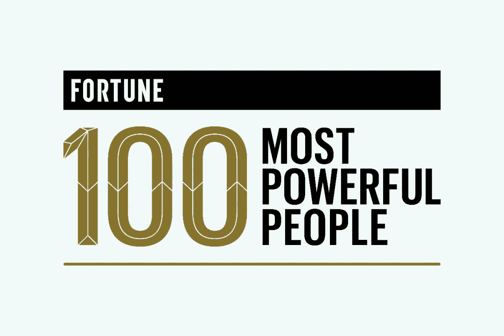

如何精确衡量一个人的“影响力”？既不能以公司的营收来衡量，也不能依据个人的资历来评判。谁更具影响力？是管理一家市值为200亿美元的公司的首席执行官，还是离开官僚作风盛行的大公司，创办了一家灵活的、颠覆性的初创公司的人工智能天才？是富有远见、为初创公司提供融资的风险投资家，还是做空衰退的老牌科技巨头并迫使其首席执行官下台的卖空者？答案不尽相同。影响力是微妙的，它来之不易却又很容易失去，它从来不会一成不变。

这份榜单囊括了来自40个行业的领袖人物，年龄跨度从30多岁到90多岁，既包括知名的创始人和伟大公司的首席执行官，也包含了行业颠覆者和创新者。上榜者中，有10位商界领袖来自中国的企业，他们创立或带领的企业不乏中国的科技巨头、新能源行业领跑者，以及影响年轻一代生活方式的新型社交媒体。除了实现规模增长，这些商界领袖也正在打破行业和地域的壁垒，在全球市场扩大影响力。榜单上不包括已经不再活跃于商界的“化石级”亿万富翁，也没有政治人物、监管者或者二把手。“最具影响力的商界领袖”榜单的上榜者都有一个共同的特质，那就是他们的言行和财富正在影响着他人的思想和行为。

# **01**

**埃隆·马斯克**

特斯拉（Tesla）、太空探索技术公司（SpaceX）

首席执行官兼创始人

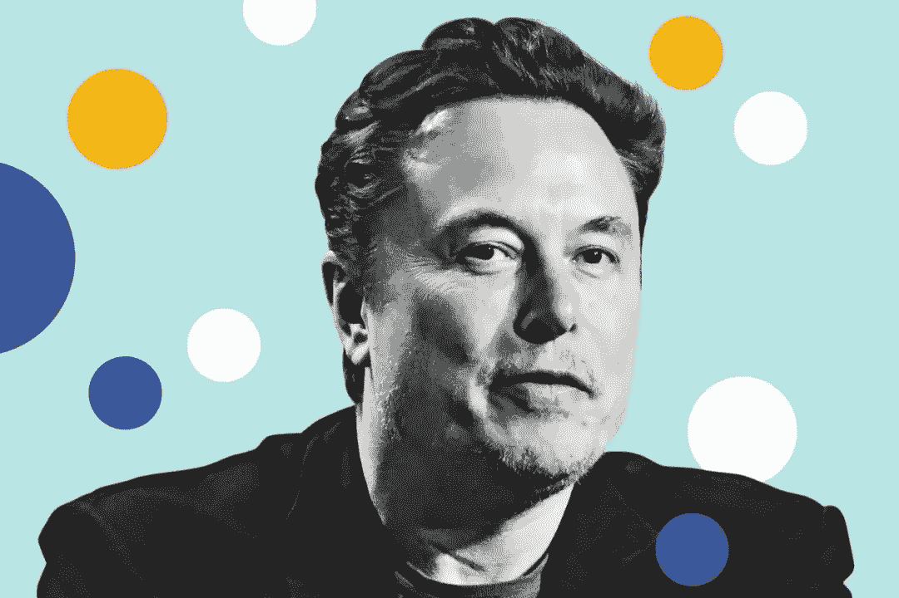

图片来源： FREDERIC J. BROWN—AFP/Getty Images

埃隆·马斯克 （Elon Musk）  虽然是特斯拉的首席执行官，但他的宏伟远景和工程直觉，却让他成为多个行业公认的领袖，尽管他有时会发表冷酷的言论，对员工会有苛刻的期待，这些都让他备受争议。今年秋季，太空探索技术公司（当前的估值为2,100亿美元）在测试其下一代“星舰”（Starship）火箭时，完成了一次历史性的工程壮举。他的另外一家公司Neuralink（估值为80亿美元）首次成功将脑机接口芯片植入人体，使一位瘫痪患者能够通过大脑来操控电脑鼠标。

然而，马斯克旗下的一些公司也经历了挫折，例如社交媒体平台X[前身为推特（Twitter）]面临的商业困境、Boring公司的员工在拉斯维加斯挖掘隧道时出现的安全问题，以及特斯拉自动驾驶软件的安全性正在接受联邦调查等。同时，马斯克在政治领域投入了更多的时间，他是唐纳德·特朗普竞选总统过程中最引人注目、捐款最多的支持者之一。

# **02**

**黄仁勋**

英伟达（Nvidia）首席执行官兼创始人

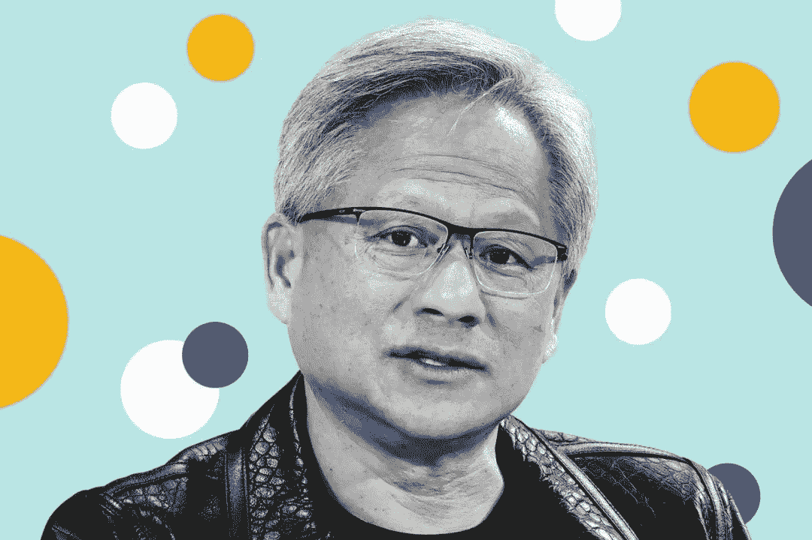

图片来源：Michael M. Santiago—Getty Images

在过去四十年间，黄仁勋 （Jensen Huang） 将英伟达从一家游戏显卡制造商，打造为人工智能热潮中举足轻重的公司之一。科技界的首席执行官们争相与爱穿皮夹克的黄仁勋会面，力求为他们的数据中心争取到英伟达珍贵的GPU芯片。与此同时，美国的拜登政府将这些芯片视为战略资产，限制中国获得英伟达最先进的产品。在黄仁勋的领导下，英伟达正“向上延伸”，从硬件业务拓展至直接向客户提供云计算服务和人工智能模型。黄仁勋设想了一种新范式：人工智能助手将成为我们与数字世界互动的主要接口，GPU将取代CPU（中央处理器）成为计算的核心驱动力。英伟达的市场主导地位使其股价暴涨至历史新高，市值突破了3万亿美元，跻身全球最有价值的公司之列。尽管有批评者质疑这种高估值的可持续性，但黄仁勋的影响力毋庸置疑。

# **03**

**萨蒂亚·纳德拉**

微软（Microsoft）首席执行官兼董事长

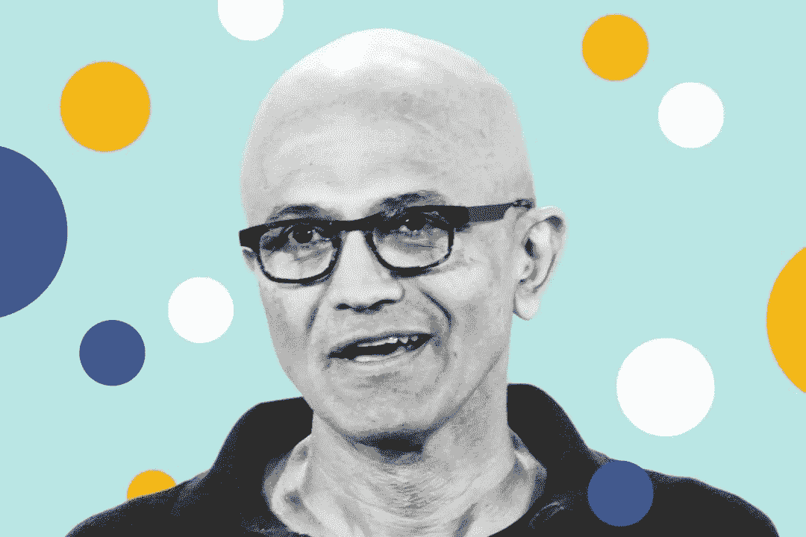

图片来源：JASON REDMOND—AFP/Getty Images

在执掌全球最大软件公司的十年间，萨蒂亚·纳德拉 （Satya Nadella ） 成功推动微软完成了两次重大转型——从PC向云服务转型，再到如今的向人工智能转型。他颇有先见之明地提前投资OpenAI，让微软站上了科技巨头之巅，目前的市值达到3.1万亿美元。在他的领导下，微软的Azure云计算服务持续从亚马逊（Amazon）的AWS手中争夺市场份额，而微软的365商务办公软件套件在各行各业几乎无处不在。同时，微软旗下的GitHub Copilot已经成为软件开发者的必备工具。纳德拉并未止步不前，而是继续加大投入，增强微软的内部人工智能能力，同时在从自动驾驶汽车到量子计算等诸多领域，非常明智地对有潜力的初创公司进行投资。

纳德拉被认为是当今管理界最敏锐的战略家之一，他是极具魅力的领导者，并且富有同理心，《财富》美国500强公司的首席执行官、初创公司的创始人、投资者以及一些国家的总统和总理都深受他的影响。

# **04**

**沃伦·巴菲特**

伯克希尔-哈撒韦首席执行官兼董事长

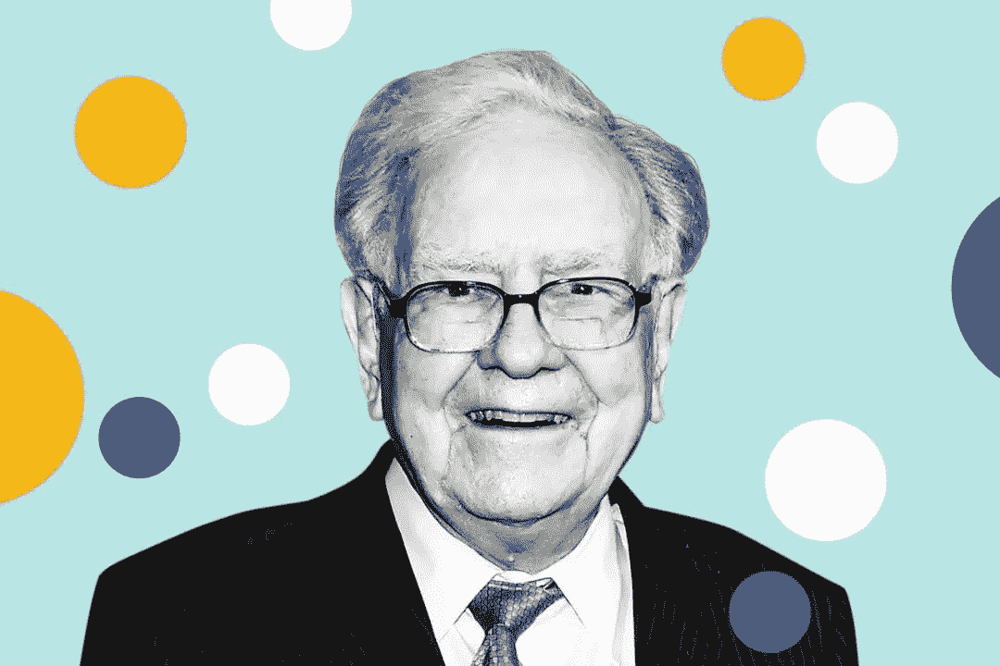

图片来源：Daniel Zuchnik—WireImage

世界上只有一个沃伦·巴菲特（Warren Buffett）。作为“奥马哈先知”（Oracle of Omaha），巴菲特凭借对公司建设和选股的精准直觉，赢得了一代又一代的模仿者和仰慕他的股东。他对苹果（Apple）、美国银行（Bank of America）和可口可乐（Coca-Cola）等公司的投资已经被奉为传奇，而他那句“在他人贪婪时恐惧，在他人恐惧时贪婪”的投资箴言更是经久不衰。

在巴菲特的领导下， 伯克希尔-哈撒韦 （Berkshire Hathaway） 从1965年到2023年间的年均回报率达到19.8%，远超标准普尔500指数（S&P 500）的10.2%。正如《财富》杂志在2003年所评价的那样，巴菲特的“非凡地位赋予他一种道德感召力，而他恰到好处地运用了这种影响力。巴菲特仅仅通过他的言辞，就能够影响远超他直接接触范围的人们的行为，这进一步巩固了他作为美国资本主义非官方守护者的形象。”

# **05**

**杰米·戴蒙**

摩根大通首席执行官兼董事长

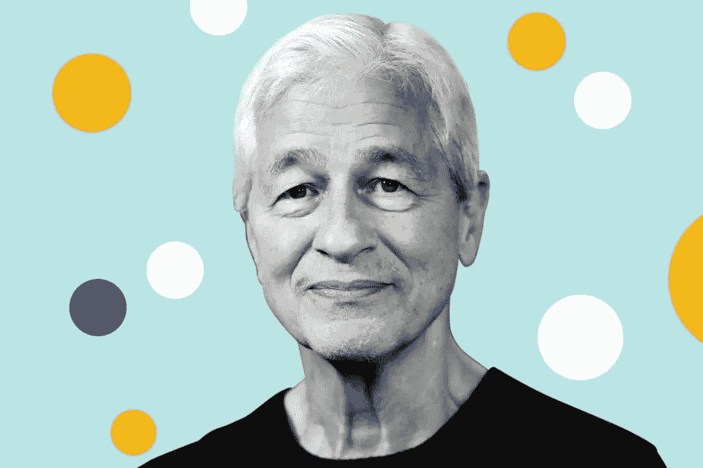

图片来源：Hollie Adams—Bloomberg/Getty Images

现年68岁的杰米·戴蒙 （Jamie Dimon） 从未竞选过、甚至未曾公开考虑过竞选任何公职。然而，许多人频频询问摩根大通（JPMorgan Chase）的首席执行官是否有意参选美国总统，这一简单事实已经足以证明他的影响力。戴蒙所管理的这家银行巨头拥有309,000名员工，超过匹兹堡的人口。摩根大通在2024年《财富》美国500强榜单中的收入达2,390亿美元，高于许多国家的国内生产总值。戴蒙拥有如此巨大的影响力，以至于去年当第一共和银行（First Republic Bank）濒临破产时，美国财政部的部长珍妮特·耶伦亲自致电请求他帮助拯救该银行。戴蒙答应了耶伦的请求，并策划了一次收购。

上个季度，摩根大通重组后的首家第一共和银行分行重新开业，专门为富裕客户提供高端服务。与此同时，戴蒙利用其强大的影响力，频频就经济、全球政治、国家债务以及美国社会的特质等议题发表见解和预测。

# **06**

**蒂姆·库克**

苹果（Apple）首席执行官

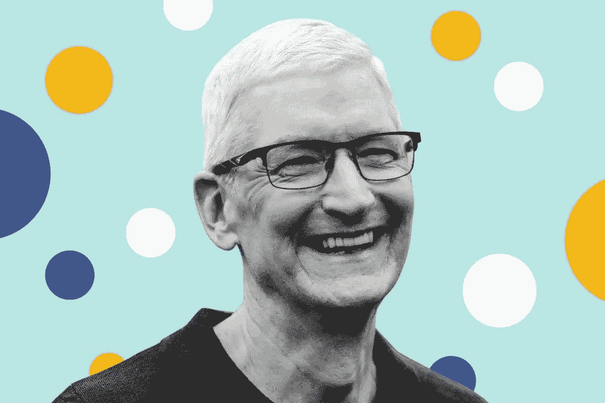

图片来源：Victor J. Blue—Bloomberg/Getty Images

在领导苹果公司的十余年间，首席执行官蒂姆·库克 （Tim Cook） 致力于在最畅销的产品iPhone手机的基础上，拓展公司的产品线。他取得了一些显著成就，包括推出了Apple Watch，并增强了云存储和音乐等在线服务业务。然而，他在其他方面的一些努力仍是进行时，比如今年推出的售价3,500美元的混合现实头戴设备Apple Vision Pro。此外，今年宣布的为新款iPhone手机整合人工智能（库克称之为Apple Intelligence）的计划也需要时间来实现。与此同时，iPhone手机在公司的业务中依然占据重要地位。投资者希望为最新和未来版本添加人工智能工具可以推动销售的增长，但中美之间日益加剧的贸易摩擦让这家公司在提升整体业务方面面临着更多的挑战。

# **07**

**马克·扎克伯格**

Meta首席执行官、董事长兼创始人

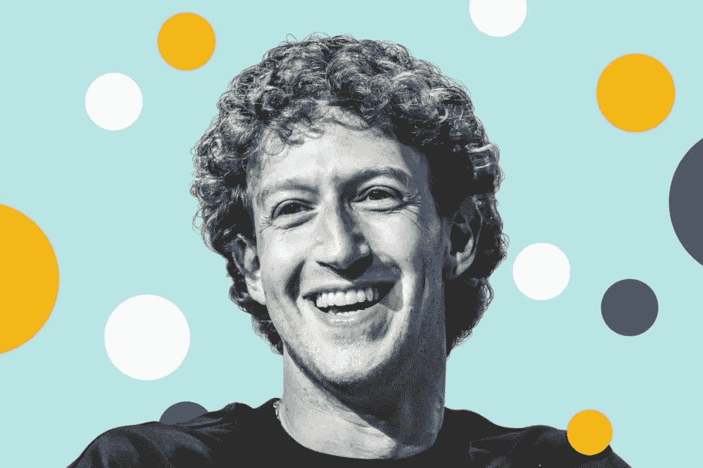

图片来源： David Paul Morris—Bloomberg/Getty Images

马克·扎克伯格 （Mark Zuckerberg）  有“重新创造”的天赋。这位Meta的掌门人褪去了昔日涂着防晒霜和留着凯撒式发型的书呆子形象，换上了设计师品牌的服装和金链子。与外表变化同样引人注目的是他带领公司实现了业务上的转型：在最初因为ChatGPT的崛起而措手不及之后，扎克伯格成功将Meta打造成蓬勃发展的生成式人工智能领域的领军者之一。

Meta推出的准开源大语言模型Llama被众多初创公司广泛采用，并为Meta旗下从Instagram和WhatsApp到备受欢迎的Meta Ray-Ban智能眼镜等一众产品的人工智能功能提供支持。尽管Meta因为社交媒体带来的社会问题而依旧面临批评，但公司通过收入的强劲增长（预计今年将增长20%，超过1,600亿美元）和严格的成本控制，重新赢得了投资者的信任。

# **08**

**萨姆·奥尔特曼**

OpenAI首席执行官兼联合创始人

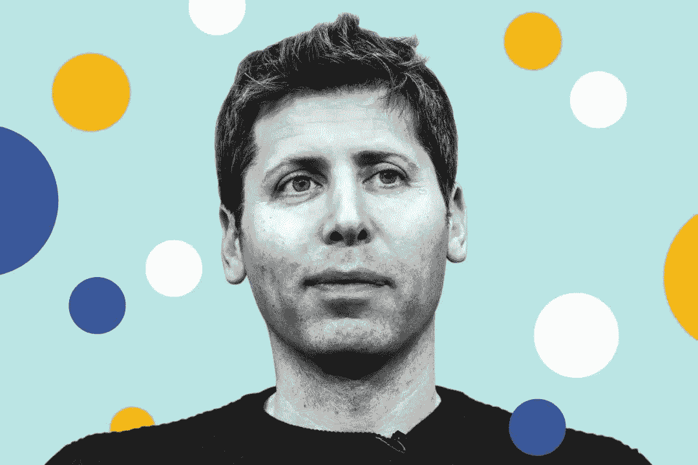

图片来源：Chris Ratcliffe—Bloomberg/Getty Images

萨姆·奥尔特曼 （Sam Altman ）  已经成为人工智能热潮中的明星首席执行官。作为OpenAI的联合创始人兼首席执行官，奥尔特曼将一家曾经默默无闻的非营利研究实验室打造成了家喻户晓的品牌，当前的估值超过1,570亿美元，并且许多人认为它是自工业革命以来最重要的技术变革的引领者。其标志性产品ChatGPT每周吸引超过1亿用户，而其企业级产品更是广泛应用于多数《财富》美国500强公司。商界领袖和政府官员纷纷向奥尔特曼请教人工智能的未来影响，以及该技术所需要的巨额投资。

在2023年年底，奥尔特曼曾经被短暂解除职务，但迅速官复原职，这不仅彰显了他在OpenAI的不可或缺性，也突显了人工智能治理中的紧张关系。奥尔特曼仍然是一位颇具争议的人物，批评者认为他将产品发布置于安全考量和法律问题（例如版权）之上。另一些人则指出，他个人在科技初创公司中的数十亿美元投资构成了利益冲突，并担忧OpenAI每年烧掉数十亿美元的资金可能导致公司最终陷入困境。然而，无论人们爱他或憎他，奥尔特曼的影响力都不容忽视。

# **09**

**玛丽·巴拉**

通用汽车首席执行官兼董事长

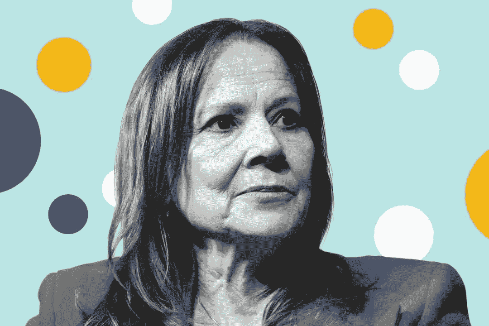

图片来源：Anna Moneymaker—Getty Images

在担任通用汽车 （General Motors） 的首席执行官的第十个年头，玛丽·巴拉（Mary Barra）带领公司达到数十年来最强劲的财务状况，通过革新公司文化和重组产品线，为电动汽车革命做好准备。她因此荣登《财富》2024年最具影响力的商界女性榜单的榜首。然而，这一路并非没有挑战。通用汽车表示，公司预计2024年将在北美售出20万辆电动车，而该公司此前设定的目标是到2025年，电动汽车的年产能达到100万辆。尽管如此，在巴拉的领导下，通用汽车上一个财年的收入达到了1,718亿美元，同比增长近10%。

2023年年末，巴拉还成功带领公司完成了与全美汽车工人联合会（United Auto Workers）的激烈谈判，双方达成协议，结束了一场代价高昂的罢工。随着任期迈入十周年，巴拉也进入了精英领导者行列：在《财富》美国500强公司中，男性首席执行官的平均任期为7.2年，而女性首席执行官的平均任期仅为4.5年。

# **10**

**桑达尔·皮查伊**

Alphabet（谷歌）首席执行官

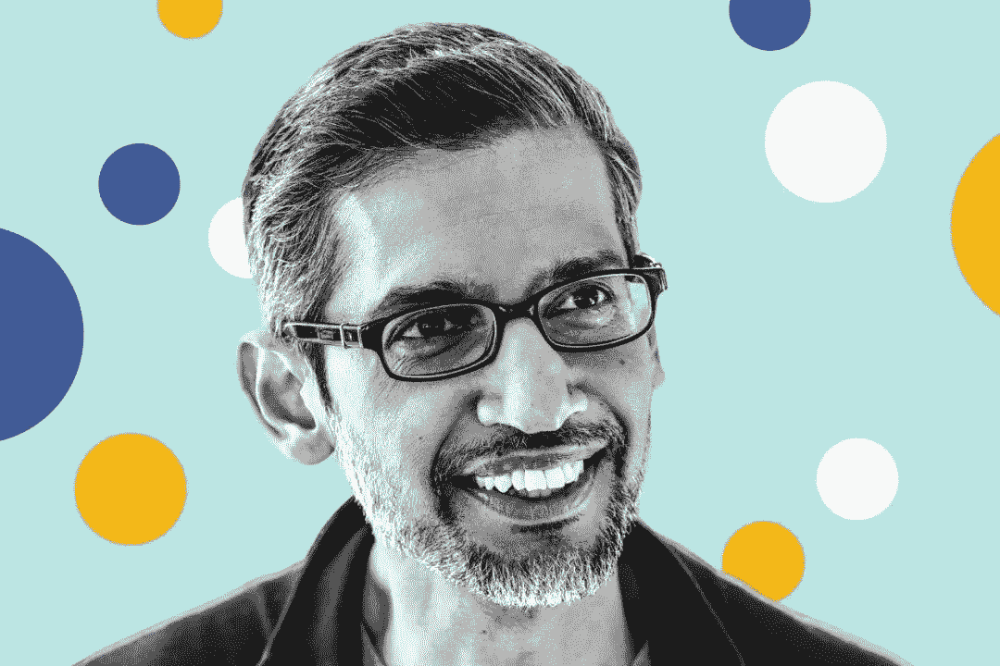

图片来源：David Paul Morris—Bloomberg/Getty Images

作为Alphabet公司的首席执行官，桑达尔·皮查伊 （Sundar Pichai） 领导的是全球最强大的科技巨头之一，公司旗下拥有谷歌（Google）、YouTube、安卓（Android）系统和Waymo自动驾驶汽车等顶尖业务，市值超过2万亿美元。皮查伊于2004年加入谷歌，之后逐步晋升，最终接替联合创始人拉里·佩奇担任最高职位。然而，他深知不能止步不前。反垄断监管机构正在迫切希望拆分这家公司（去年的利润为740亿美元），而生成式人工智能的兴起也可能削弱其主要利润来源——搜索广告业务。为此，皮查伊对公司的内部人工智能团队进行了多次重组。今年8月，他以27亿美元的价格获得了初创公司Character.AI的聊天机器人技术授权，并重新聘用了该公司的创始人（一位前谷歌员工）。

# **11**

**杰夫·贝佐 斯**

亚马逊（Amazon）董事长兼创始人

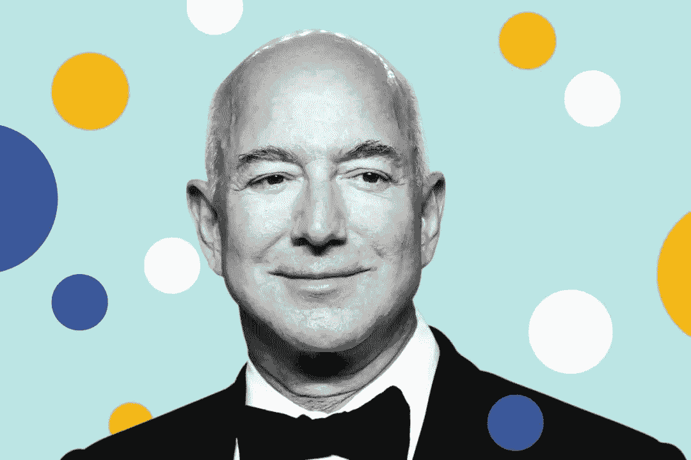

图片来源：MICHAEL TRAN—AFP/Getty Images

亚马逊的创始人杰夫·贝佐斯 （Jeff Bezos） 曾经作为公司内权力至高无上的首席执行官，执掌该零售巨头近三十年，如今他进入了人生的新阶段，监督旗下多家公司的首席执行官，包括亚马逊、蓝色起源（Blue Origin）火箭公司、《华盛顿邮报》（Washington Post）以及贝佐斯地球基金（Bezos Earth Fund）等。

蓝色起源在近两年内完成了首次载人航行，90岁的艾德·德怀特成为史上年龄最大的太空旅客；而规模高达100亿美元的地球基金则在持续投入资金以产生影响力，其中包括投入1亿美元用于支持由人工智能驱动的新气候解决方案。据彭博社（Bloomberg）估计，截至今年10月中旬，亚马逊的股价上涨了25%，使贝佐斯的财富攀升至2,120亿美元，仅次于太空竞赛的对手埃隆·马斯克。此外，贝佐斯还抽出时间在价值4亿美元的Koru号超级游艇上接待了全球知名名人，并造访了梵蒂冈，与教皇方济各会面。

# **12**

**穆克什·安巴尼**

信实工业董事长兼总经理

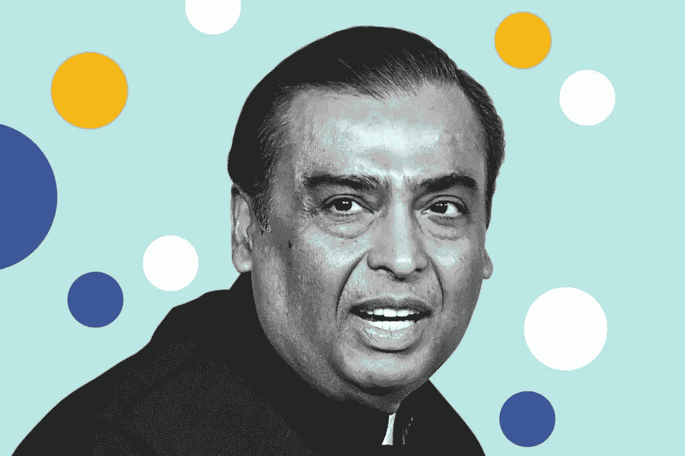

图片来源：SUJIT JAISWAL—AFP/Getty Images

印度信实工业的董事长穆克什·安巴尼 （Mukesh Ambani） 知道如何举办一场盛大的聚会。今年，Meta公司的马克·扎克伯格和三星（Samsung）的李在镕等商界领袖（同时也是最具影响力商界领袖榜单的候选人），特地前往印度参加了安巴尼小儿子阿南特的婚礼庆典，庆典活动持续了长达数月。截至今年11月初，安巴尼成为亚洲首富，预计净资产约为1,000亿美元。

信实工业 是印度最重要的企业集团之一，旗下的业务涉及石化、零售、娱乐和电信等多个行业。安巴尼正在培养下一代接班人：长子阿卡什担任信实旗下的电信业务公司Reliance Jio的董事长，而女儿伊莎则负责主持信实零售业务的增长。

# **13**

**布莱恩·莫伊尼汉**

美国银行首席执行官兼董事长

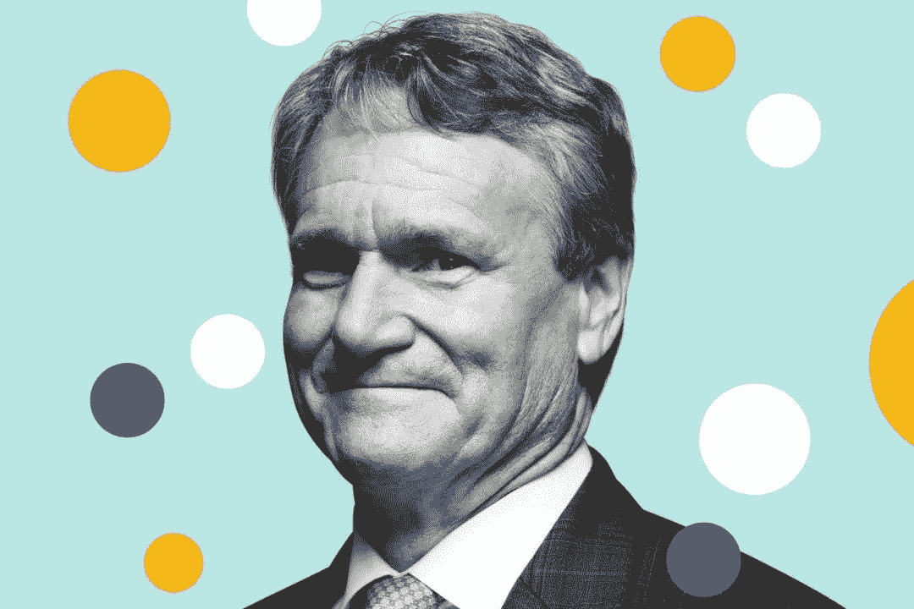

图片来源 ： Hollie Adams—Bloomberg/Getty Images

65岁的布莱恩·莫伊尼汉（Brian Moynihan）为维护自己的权力付出了巨大努力。几乎在2010年晋升为美国银行 （Bank of America） 的首席执行官后，他就不得不采取防御措施，带领该银行度过了与全球金融危机（Great Financial Crisis）相关的一系列灾难的冲击。上任首席执行官后的第一年，他几乎用一整年的时间，力争确保美国银行拥有足够的资本应对潜在的失败风险，期间他还接受了沃伦·巴菲特的50亿美元投资（这一举动被视为对该银行的信任）。次年，莫伊尼汉成功抵御了美国财政部要求拆分银行的呼声。

2023年的年报显示，他稳住了局面，帮助美国银行在2014年起的十年里累计盈利2,000亿美元，其中仅去年就盈利290亿美元。今年1月，莫伊尼汉成为母校布朗大学（Brown University）的校监，负责监督该校由54人组成的治理机构。

# **14**

**任正非**

华为技术有限公司首席执行官兼创始人

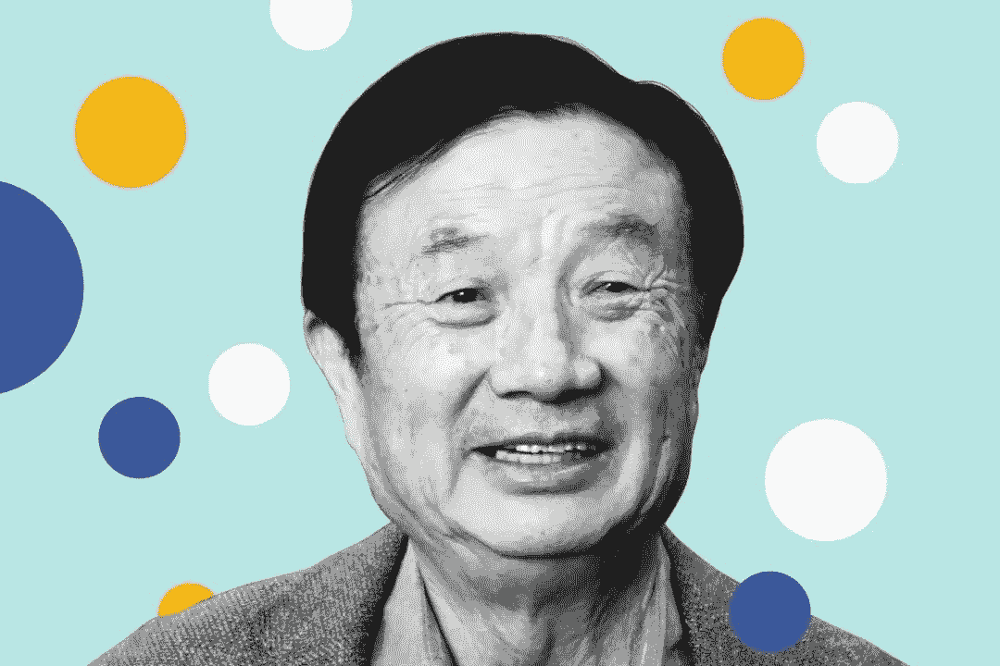

图片来源：JESSICA YANG—AFP/Getty Images

作为中国最举足轻重的科技巨头华为的创始人，任正非近年来的压力稍减。2019年，华为被列入美国的贸易黑名单，任正非曾经将这些制裁视为公司的“生死攸关”时刻。但如今，华为正在成为中国实现科技自给自足的领头羊。2023年，华为推出了一款配备中国国产芯片的全新高端智能手机，公司由此开始复兴。数据显示，2024年上半年，华为在中国智能手机市场出货量位列第一。目前，华为正在积极投入到人工智能芯片和电动汽车等战略性产品领域。这一系列举措对华为来说成效显著，去年公司的营收接近1,000亿美元。

# **15**

**范洁恩**

花旗集团（Citigroup）首席执行官

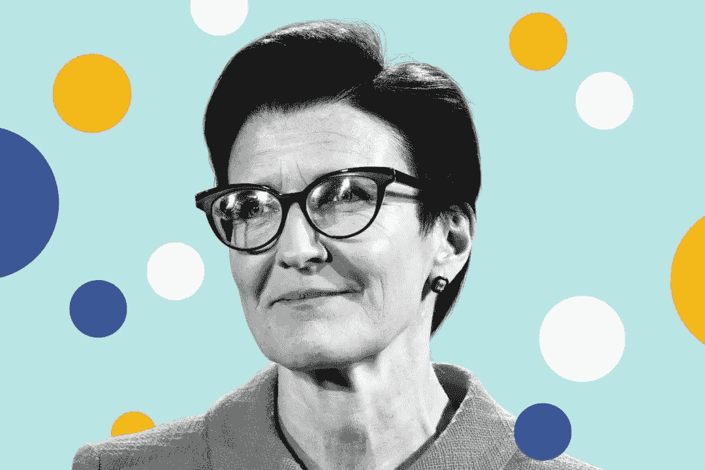

图片来源：Valerie Plesch—Bloomberg/Getty Images

过去几年，作为华尔街唯一的女性首席执行官，范洁恩 （Jane Fraser ） 备受关注。她自2021年升任花旗集团的首席执行官以来，领导了一场多管齐下的改革运动，力图带领该银行走出困境。过去一年，花旗集团经历了不少波折，包括最终完成大规模重组，导致第一季度裁员约7,000人，并在7月被美联储（Federal Reserve）与美国货币监理署（Office of the Comptroller of the Currency）处以1.356亿美元的罚款。预计在未来两年内，花旗集团将再裁员数千人，可能产生高达10亿美元的离职补偿金和重组费用。范洁恩是这次重组的策划者，她还领导了另一项举措，包括出售公司14个国际消费品业务中的9个。

范洁恩在花旗集团工作了19年，此前曾经担任麦肯锡公司（McKinsey & Co.）的合伙人。花旗集团的业绩喜忧参半，尽管其股价同比上涨，但净收入却从2022年的148亿美元降至去年的92亿美元。

# **16**

**里德·霍夫曼**

Greylock Partners合伙人

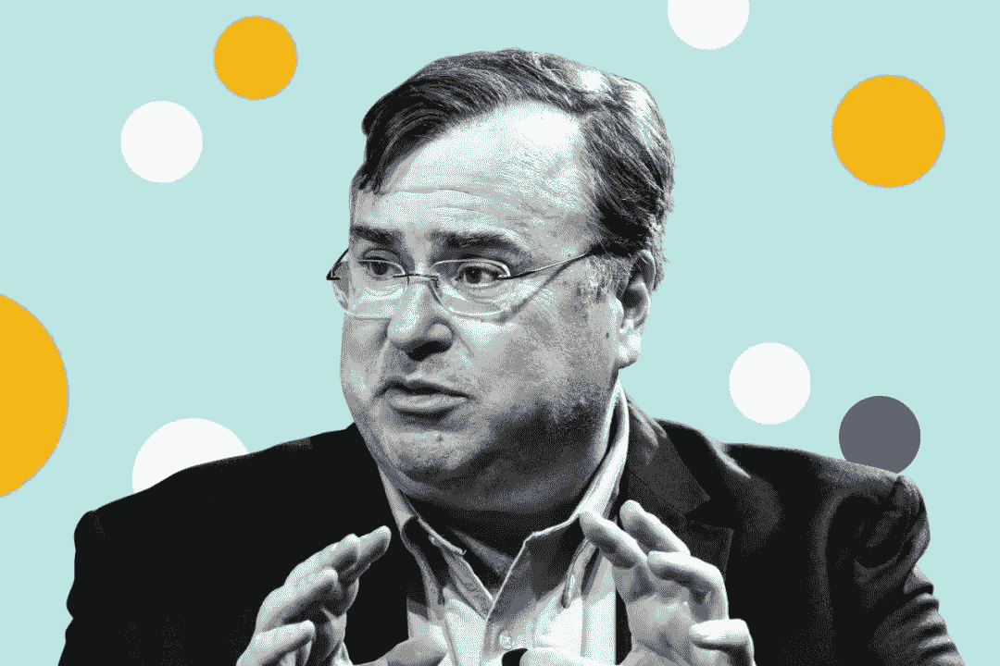

图片来源：David Paul Morris—Bloomberg/Getty Images

“PayPal黑手党”（PayPal Mafioso）成员、LinkedIn联合创始人、微软董事会成员、Greylock投资人：里德·霍夫曼 （Reid Hoffman） 的诸多头衔，让他成为硅谷最具影响力的声音之一。但在霍夫曼跻身精英高管行列的过程中发生了一些有趣的事情。首先：霍夫曼在2017年创办了每周播出的播客节目《规模大师》（Masters of Scale），分享来自科技领袖的建议。这个节目的热度逐渐攀升，成为每一位有抱负的创业者最喜爱的播客节目。

其次：霍夫曼一直在积极参与政治事务，并且直言不讳。在2024年美国总统大选前，他成为“PayPal黑手党”中自由派的代表，站在了保守派阵营（其中包括埃隆·马斯克、戴维·萨克斯和彼得·蒂尔等人）的对立面，因为他坚决反对资本主义优于能力的观点。

# **17**

**贝尔纳·阿尔诺**

路威酩轩（LVMH）首席执行官兼董事长

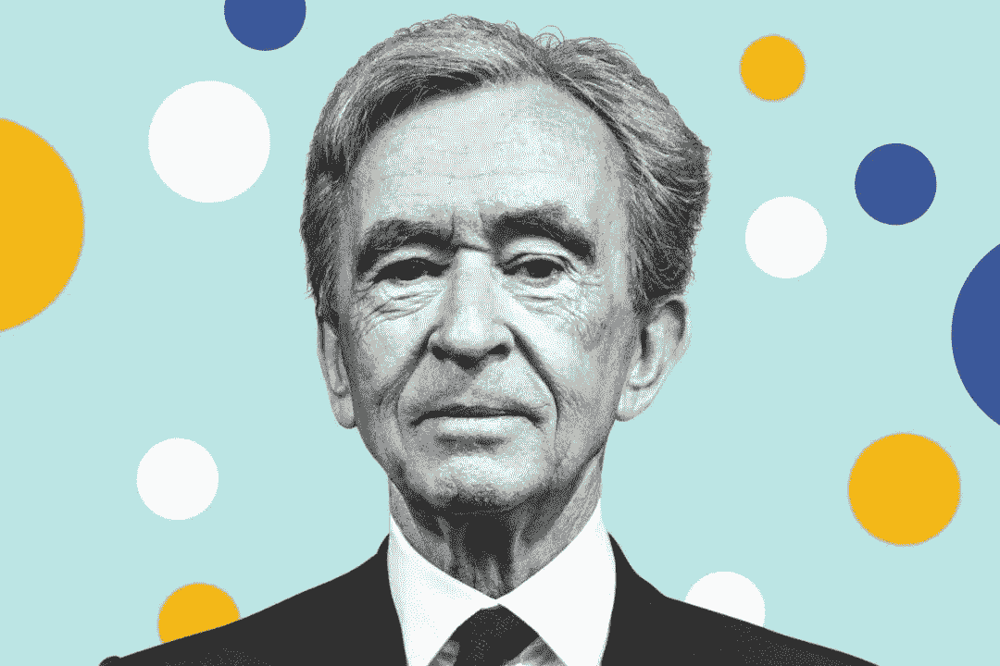

图片来源：Nathan Laine—Bloomberg/Getty Images

路威酩轩的董事长兼首席执行官贝尔纳·阿尔诺 （Bernard Arnault ） 曾经在2024年年初成为世界首富。尽管公司的股价下跌（部分原因是中国市场需求放缓）使他失去了这一头衔，但他依然是全球奢侈品领域的重要人物。自1989年起，他一直担任路威酩轩的董事长兼首席执行官。

该公司旗下拥有一系列令人羡慕的品牌，专门服务超高净值人群，包括蒂芙尼（Tiffany & Co.）、迪奥（Christian Dior）、芬迪（Fendi）、丝芙兰（Sephora）等知名品牌。在2023财年，该奢侈品集团的营收约为930亿美元，比2022年增长了约8.8%。除葡萄酒和烈酒业务外，集团的所有业务板块均实现了增长。同时，随着阿尔诺逐渐老去，关乎路威酩轩未来的接班人戏码正在上演。他的子女——包括《财富》2024年最具影响力的商界女性榜单第39位的德尔菲娜·阿尔诺——都参与了集团的某些业务，关于他的接班人的猜测愈演愈烈。

# **18**

**董明伦**

沃尔玛（Walmart）首席执行官兼总裁

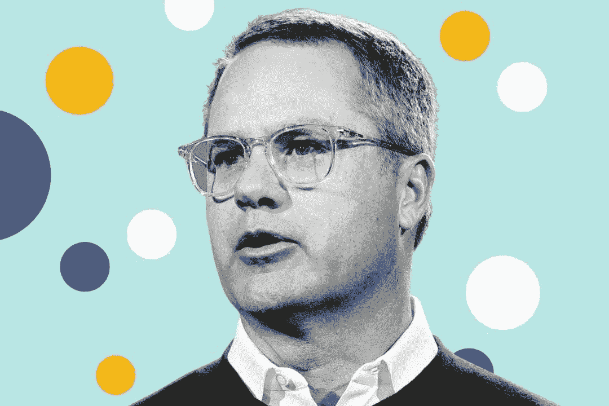

图片来源：Ethan Miller—Getty Images

董明伦 （Doug McMillon）  担任沃尔玛的首席执行官已经有十年，他带领公司连续12年稳居《财富》美国500强榜单的榜首。沃尔玛在截至今年1月的财年实现了6,480亿美元的收入，同比增长6%。公司还获得了1,000亿美元的全球电商收入。今年，董明伦进行了股票拆分，这是沃尔玛自1999年以来首次进行拆股。董明伦于1984年加入沃尔玛，最初是一名计时工。他表示，股票拆分的目的是让更多的员工更容易地购买到完整的股票。

# **19**

**王传福**

比亚迪首席执行官、董事长兼创始人

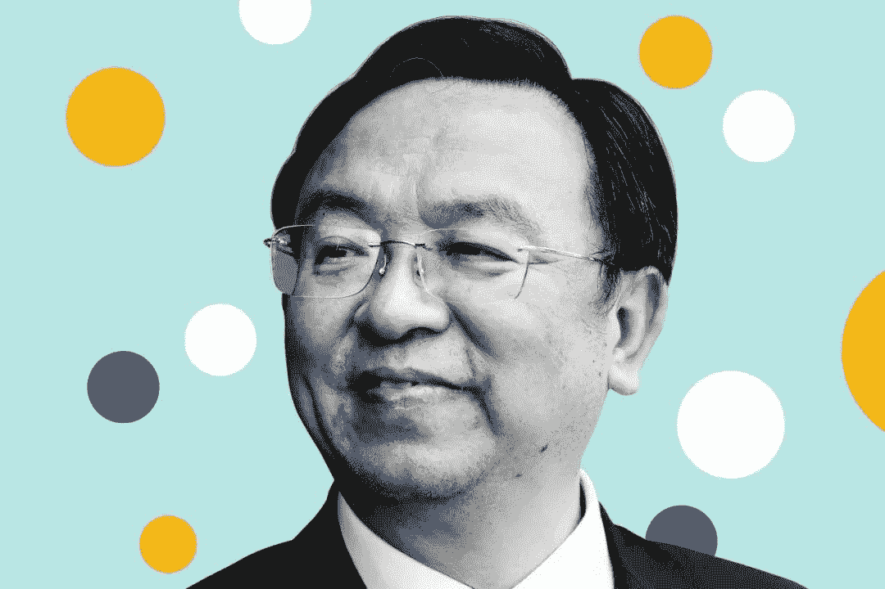

图片来源 ：Valeria Mongelli—Bloomberg/Getty Images

电动汽车市场的领先者并非特斯拉，而是比亚迪。2023年，比亚迪的销量超过300万辆。迄今为止，比亚迪在“新能源汽车”领域的销量遥遥领先。“新能源汽车”这一类别包括插电式混合动力车和纯电动汽车。正如查理·芒格所说，王传福堪称“托马斯·爱迪生与杰克·韦尔奇的结合体”。他于1995年共同创立比亚迪，最初是为手机制造电池，2003年转型进入汽车制造领域。

比亚迪凭借极具性价比的汽车已经在中国市场占据主导地位，如今该公司正在欧洲、东南亚和拉丁美洲等地区开辟全球市场。此外，公司还计划在泰国、匈牙利、巴西和巴基斯坦等地新建一批工厂。

# **20**

**苏德巍**

高盛集团首席执行官兼董事长

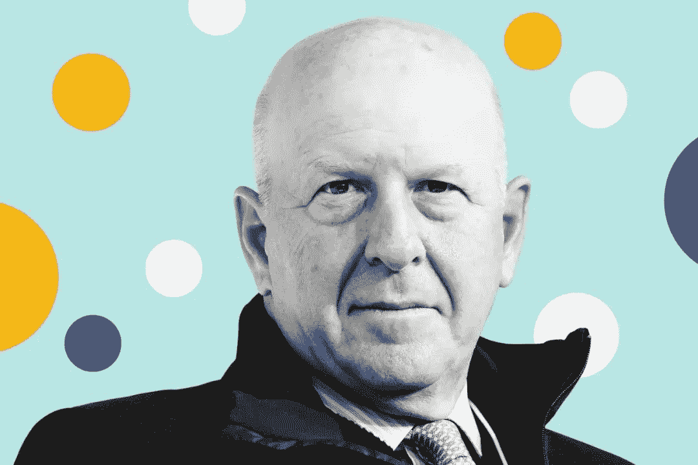

图片来源：Stefan Wermuth—Bloomberg/Getty Images

现年62岁的苏德巍 （David Solomon） 接掌高盛集团（Goldman Sachs）仅仅六年时间，截至上一季度，他已经带领公司实现了3.1万亿美元的资产管理规模，创历史纪录，增幅高达106%。然而，这一路并不轻松。2020年，在高盛同意支付30亿美元的罚款后，他的薪酬遭到削减；随后，在高盛裁员3,200人后，他被再度降薪。由于多位高层银行家离职，苏德巍的领导风格也引发了一些质疑。然而，普遍共识认为，只要他持续取得成功[今年高盛的股价上涨了33%，比道琼斯美国银行业指数（Dow Jones U.S. Banks Index）高出8个百分点]，他就可以继续稳坐高盛“王座”。

# **21**

**布莱恩·尼科尔**

星巴克（Starbucks）首席执行官兼董事长

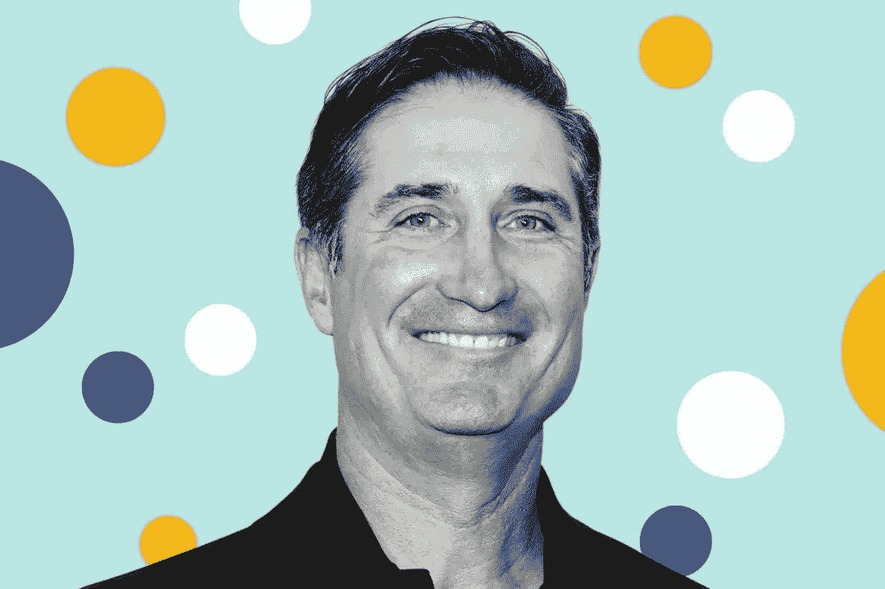

图片来源：Ryan Miller—Getty Images/Orange County Museum of Art

布莱恩·尼科尔 （Brian Niccol） 给星巴克带来了极大的信心。事实上，当星巴克在今年8月宣布Chipotle前掌门人布莱恩·尼科尔将成为咖啡连锁巨头的新任首席执行官时，公司的股价应声上涨20%。在布莱恩·尼科尔执掌Chipotle期间，公司的年收入翻了一番，达到了近100亿美元。尼科尔加入星巴克时，正值公司的多事之秋：一方面通货膨胀导致顾客的需求下降，另一方面公司要与加入工会的员工持续进行合同谈判。尼科尔于今年9月在星巴克走马上任，就迅速着手做出重大决策，比如减少折扣和精简菜单等措施。

# **22**

**比尔·盖茨**

微软联合创始人

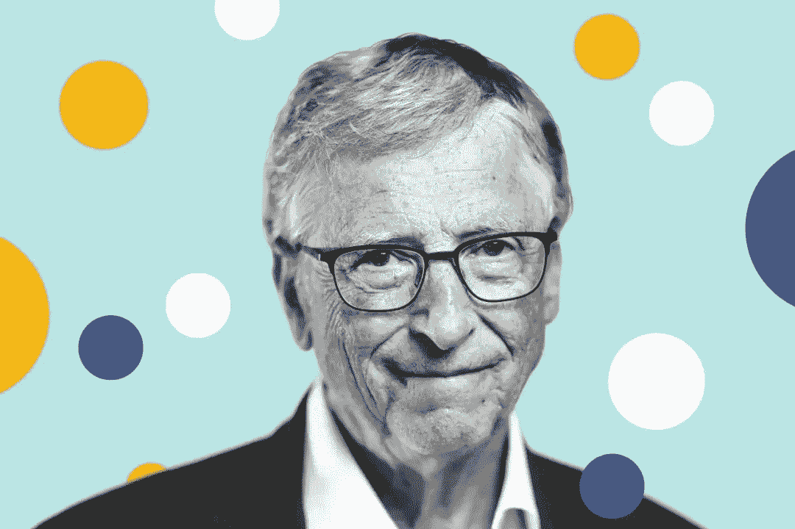

图片来源：Hollie Adams—Bloomberg/Getty Images

自2020年从微软董事会卸任以来，盖茨 （Bill Gates ） 已经不再直接参与公司的事务。然而，作为21世纪大部分时间里的全球首富，他依然是微软最大的个人股东，这也为盖茨推动他重要的全球事业提供了持续的资源支持。盖茨基金会（Gates Foundation）是全球最受尊敬、资金实力最雄厚的慈善机构之一，该基金会致力于减少全球与疾病、农业和教育有关的不平等现象。他创办的Breakthrough Energy Ventures公司致力于开发气候解决方案。

此外，通过投资公司Cascade Investment，盖茨拥有四季酒店集团（Four Seasons）的多数股权，并被认为是美国最大的私人农场主。同时，他与前妻梅琳达·弗兰奇·盖茨及伯克希尔-哈撒韦的沃伦·巴菲特共同发起的“捐赠誓言”（Giving Pledge）项目，仍旧是推动富豪圈内慈善行动的重要力量。

# **23**

**沈居丽**

埃森哲（Accenture）首席执行官兼董事长

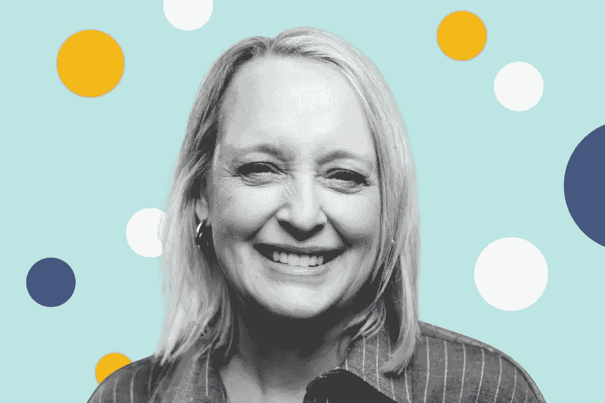

图片来源：Hollie Adams—Bloomberg/Getty Images

随着沈居丽 （Julie Sweet） 接任首席执行官，埃森哲成为《财富》世界500强中由女性执掌的最大公司，拥有774,000名员工。2024财年，埃森哲公布的年收入达到649亿美元，同比增长1%。沈居丽和她的团队正在引领客户迈入人工智能时代：在2024财年，埃森哲达成了30亿美元的生成式人工智能业务合同额，相比上一财年的3亿美元大幅增长。然而，由于经济不确定性，公司在2024年3月下调了收入预期。9月，公司宣布将大部分员工晋升时间从12月推迟至2025年6月。

沈居丽在多个董事会任职，其中包括世界经济论坛理事会（World Economic Forum Board of Trustees）。她于2019年出任埃森哲的首席执行官，之前曾经负责公司在北美地区的业务。

# **24**

**马克·贝尼奥夫**

赛富时首席执行官、董事长兼联合创始人

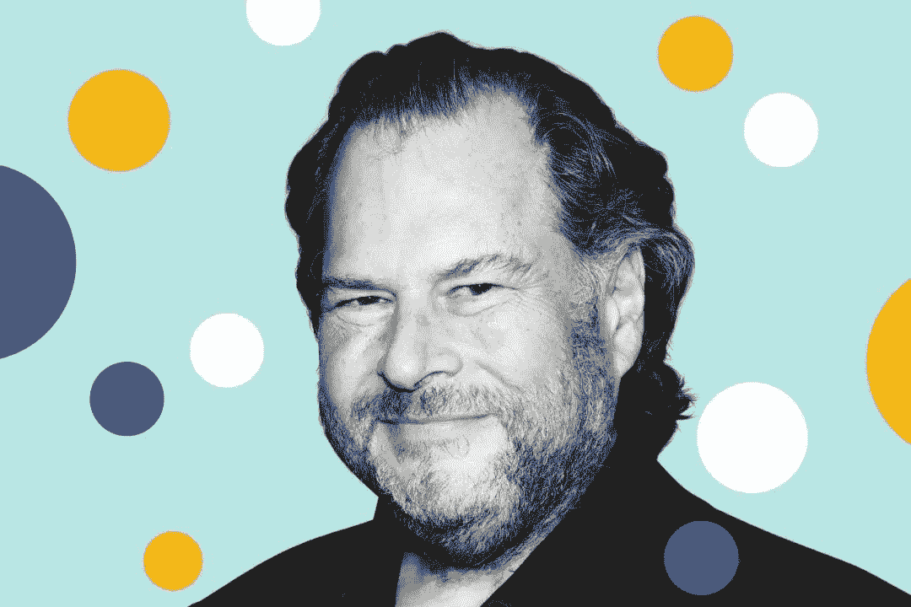

图片来源：Mike Coppola—Getty Images/TIME

赛富时（Salesforce）的首席执行官马克·贝尼奥夫 （Marc Benioff） 创立这家云计算先锋公司至今已经过去25年，当年他曾经宣称该公司代表了“软件的终结”。然而，在生成式人工智能时代，显然他并未停止大胆探索：今年，他带领公司完成了一次“重大转型”，推出了一个全新的人工智能代理平台Agentforce，并在公司于9月举行的年度Dreamforce大会上隆重亮相。贝尼奥夫对《财富》杂志表示，人工智能是“一场重大变革”，而赛富时要做到与时俱进。迄今为止，华尔街很满意赛富时的表现：在经过艰难的第一财季后，赛富时第二财季的业绩强势反弹，营收达到93.3亿美元，同比增长8%。投资者也很满意公司在Dreamforce大会上的表现，Agentforce发布后，赛富时的股价稳步上涨。

# **25**

**艾玛·沃姆斯利**

葛兰素史克（GSK）首席执行官

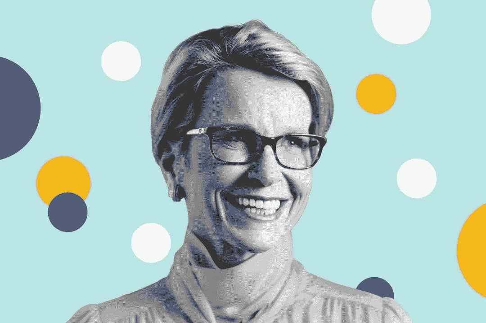

图片来源：Jason Alden—Bloomberg/Getty Images

葛兰素史克的首席执行官艾玛·沃姆斯利 （Emma Walmsley） 对英国药企的复兴计划已经执行了近八年时间，希望让公司恢复增长，她的努力已经初见成效。葛兰素史克的首款呼吸道合胞病毒（RSV）疫苗Arexvy功不可没，这款疫苗的成功上市弥补了公司未能研发出新冠疫苗的遗憾。Arexvy疫苗在2023年第三季度发布，第一年就为公司创造了16亿美元的销售额。此外，带状疱疹疫苗Shingrix的销售也呈现出强劲增长势头。葛兰素史克在2023年录得375亿美元的营收，同比增长3.4%。在葛兰素史克之外，沃姆斯利还担任微软的独立董事。

# **26**

**安迪·贾西**

亚马逊首席执行官兼总裁

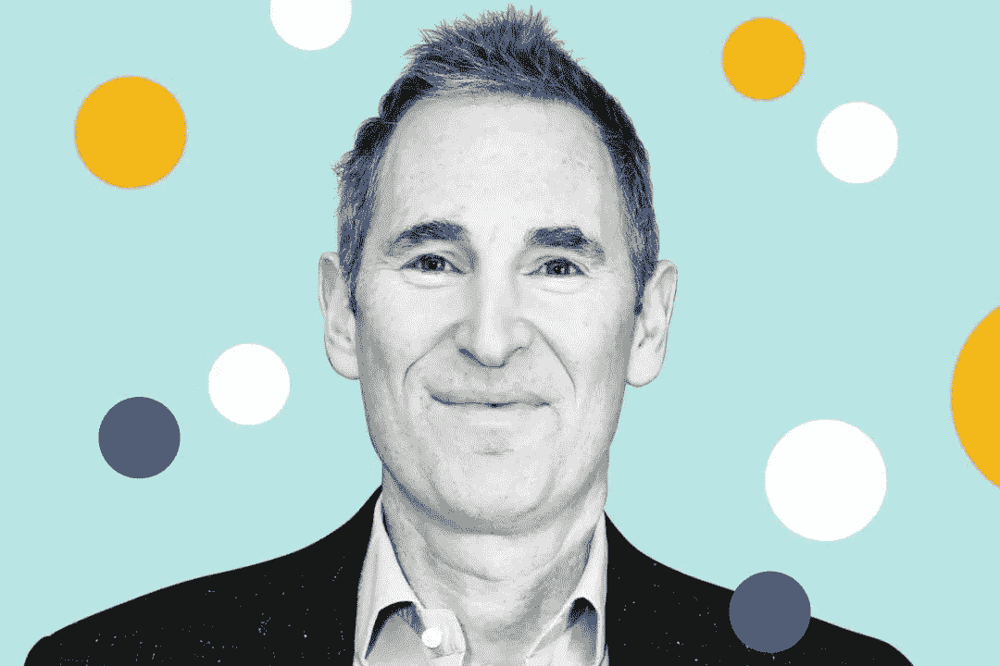

图片来源：Randy Shropshire—Getty Images/Vox Media

安迪·贾西 （Andy Jassy） 接替杰夫·贝佐斯担任亚马逊的首席执行官已经有三年时间，他似乎正在给亚马逊打上自己的烙印——他改造公司的措施并不仅限于大规模裁员。2024年，贾西的亚马逊在提升配送速度的同时，降低了服务购物客户的成本。此外，公司还通过一项价值200亿美元、为期11年的合同取得了NBA赛事的流媒体转播权，丰富了视频内容，并进一步强化了其500亿美元的广告业务。

同时，估值达千亿美元的AWS部门，在贾西的主持下完成了首席执行官的更替。生成式人工智能革命的爆发一度令AWS部门措手不及。再加上具有争议的每周五天返岗办公要求，亚马逊终于展现出贾西的个人管理风格。尽管部分员工对返岗政策表示抗议，但投资者似乎认可贾西的执行力与远见，推动亚马逊的市值在今年首次突破了2万亿美元。

# **27**

**达拉·科斯罗萨西**

Uber首席执行官

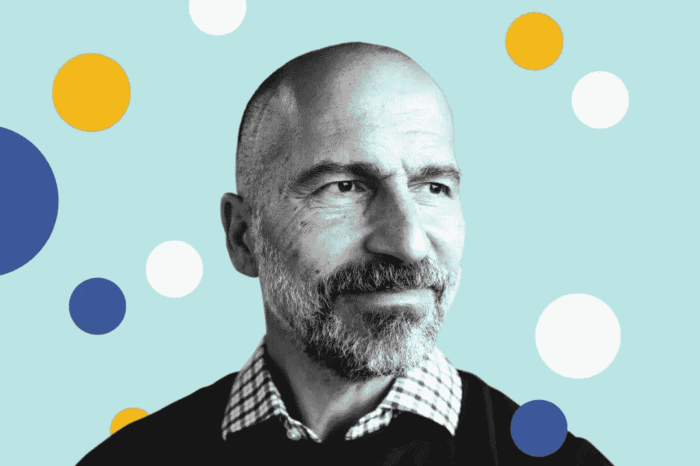

图片来源：Jose Sarmento Matos—Bloomberg/Getty Images

在担任Uber公司的首席执行官的七年里，达拉·科斯罗萨西 （Dara Khosrowshahi） 帮助这家网约车和外卖服务公司成为行业领军者，将包括Lyft在内的一批竞争对手甩在身后。在这一过程中，他带领Uber度过了长达数年的高额支出以及新冠疫情初期的严重冲击，实现了财务健康。2023年，Uber作为上市公司迎来首次盈利，实现了一个重要的里程碑。2024年上半年，Uber的总营收增长近16%，达到208亿美元，利润则激增近46%，达到3.45亿美元。

展望未来，曾经担任Expedia公司首席执行官的科斯罗萨西希望将Uber打造成为一个“超级应用程序”，不仅能够打网约车，还可以预订各种旅行服务。同时，他还需要找到在仍然处于起步阶段的无人驾驶出租车领域的竞争策略，而谷歌旗下的Waymo在这一领域已经遥遥领先。

# **28**

**格雷戈里·阿贝尔**

伯克希尔-哈撒韦非保险业务副董事长

伯克希尔-哈撒韦能源董事长

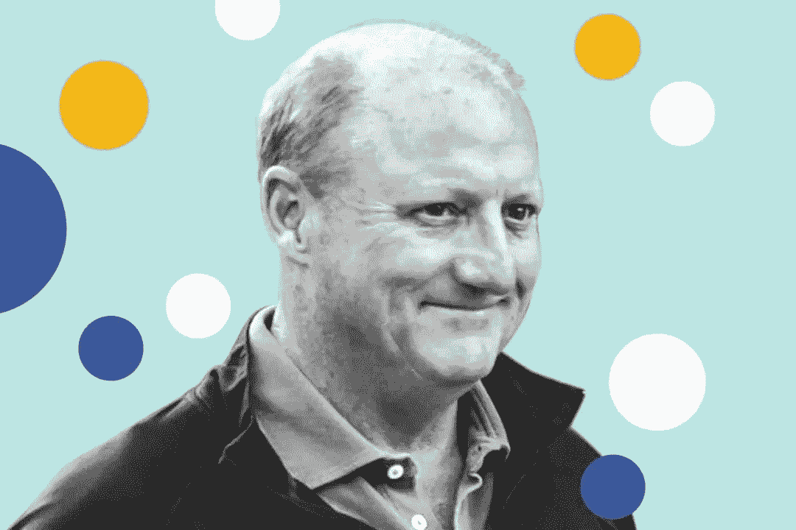

图片来源：David Paul Morris—Bloomberg/Getty Images

沃伦·巴菲特难以超越，但他坚信格雷戈里·阿贝尔 （Gregory Abel） 拥有接班的实力。巴菲特曾经在2021年告诉美国消费者新闻与商业频道（CNBC）：“董事们一致同意，如果今天晚上我有任何不测，明天早上接班的人就是格雷格。”时任副董事长查理·芒格当时也指出，伯克希尔的运作依赖于其独特的文化，而“格雷格将延续这种文化”。阿贝尔被认为是集远见卓识、交易能力和高效运营于一身的稀有人才。

性格温和的阿贝尔出生于加拿大，起初从事会计工作，后来加入了一家位于加州的小型地热公司。这家公司即2000年被伯克希尔收购的MidAmerican。阿贝尔随后负责该业务，后更名为伯克希尔-哈撒韦能源（Berkshire Hathaway Energy）。在随后的数年间，阿贝尔承担的职责逐步增多，2018年开始负责伯克希尔的所有非保险业务，并于2021年被正式指定为巴菲特的首席执行官接班人。

# **29**

**周赋德**

诺和诺德（Novo Nordisk）首席执行官兼总裁

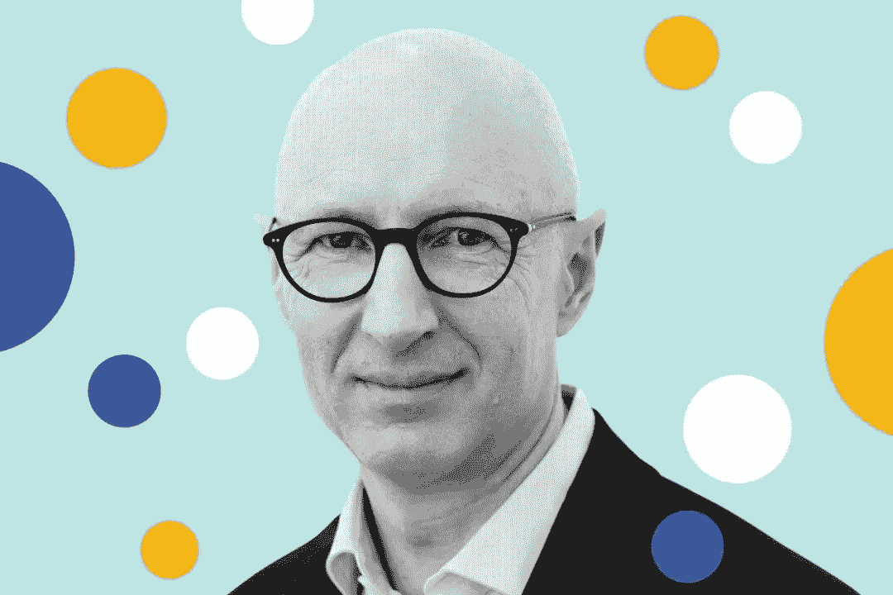

图片来源：Nanna Navntoft—Bloomberg/Getty Images

周赋德 （Lars Fruergaard Jørgensen）  在30多年前加入诺和诺德，最初担任医疗保健、经济与规划部门的经济学家。他于2017年起担任首席执行官，并带领公司实现了显著增长，这特别得益于司美格鲁肽（Ozempic）和诺和盈（Wegovy）这两款热销的减肥药。仅2023年，公司整体销售额就增长了超过30%。然而，这家丹麦公司在今年面临着日益激烈的市场竞争和供应方面的挑战。

# **30**

**马克·罗恩**

阿波罗全球管理公司

首席执行官兼联合创始人

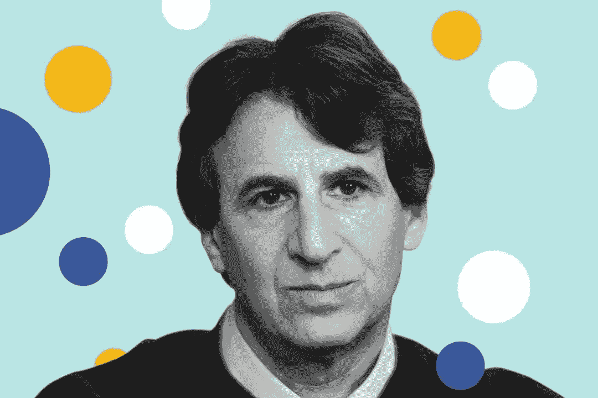

图片来源：Jeenah Moon–Bloomberg/Getty Images

如果你问马克·罗恩（Marc Rowan）他是如何成为一位华尔街巨头的，他的回答可能就会让你惊讶：他上课时专心听讲。罗恩曾经任职于德崇证券（Drexel Burnham），迈克·米尔肯是他的导师。当该公司于1990年倒闭时，罗恩与布莱克·哈里斯和乔什·哈里斯共同创立了阿波罗公司（Apollo Global Management）。他们的首笔交易就是收购并拯救了一家名为Executive Life的破产保险公司。

罗恩在今年早些时候接受《财富》杂志的采访时表示：“当时，我像是班上唯一一个读过书、能够举手回答问题的学生。得益于精算研究，我比其他人更了解保险风险。”罗恩通过大力发展利润丰厚的私人信贷业务，让这家另类资产管理公司实现了强劲的业绩增长。他承诺到2026年将阿波罗的管理资产（AUM）增加三分之二，达到1万亿美元，并使收入几乎翻倍，而目前公司的收入水平已经创历史新高。他告诉《财富》杂志的肖恩·塔利：“我不认为自己发现了什么新大陆。我想我们只是基于逻辑观察趋势，选择了一个在信贷领域中拥有最佳前景的巨大市场。”

# **31**

**戴文睿**

礼来公司（Eli Lilly）首席执行官兼董事长

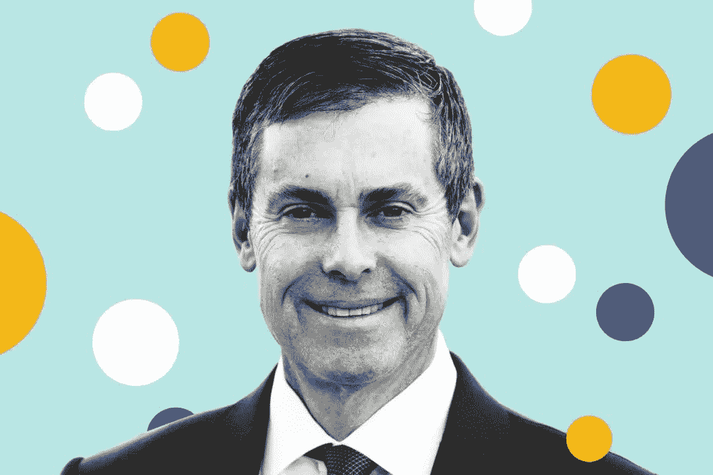

图片来源：Paulo Nunes dos Santos—Bloomberg/Getty Images

戴文睿（Dave Ricks） 于2017年担任礼来公司的首席执行官，但他从1996年起就已经在该公司的多个部门内任职。近年来，礼来公司发展迅猛。2023年，礼来公司的一款糖尿病药物Zepbound获得美国食品与药品管理局（FDA）批准，可以用于减肥用途。这帮助该公司在2023财年实现了340亿美元的收入，同比增长近20%。2024年，礼来公司宣布将额外投资53亿美元，用于提升该产品的产能。

# **32**

**斯科特·纳托尔和约瑟夫·贝**

KKR联席首席执行官

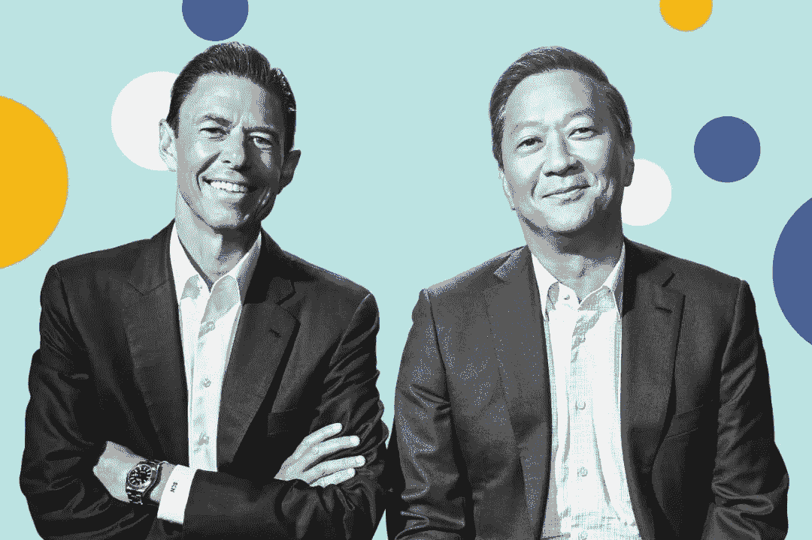

图片来源：PJMP IMAGES

与他们的导师亨利·克拉维斯和乔治·罗伯茨一样，斯科特·纳托尔 （Scott Nuttall） 和约瑟夫·贝 （Joseph Bae） 这对KKR高层组合有着长期共事的经历。两人在27岁做分析师的时候相识，之后在这家私募股权巨头一路晋升，两人的职业生涯遍及全球。如今，作为KKR的联席首席执行官，他们领导着全球第三大另类资产管理公司，拥有行业内最炙手可热的股票和最大的野心。

通过开拓私募股权以外的业务，构建类似伯克希尔-哈撒韦的买入并持有战略，贝和纳托尔制定了一个大胆的目标，计划在2030年前将资产规模提升至1万亿美元。正如贝在今年秋季接受《财富》杂志采访时所说：“从哲学上讲，公司的文化是低调承诺，高调兑现。如果我们没有极大的信心能够实现并超越这些长期目标，我们就不会公布这些目标。”

# **33**

**谢尔盖·布林和拉里·佩奇**

Alphabet（谷歌）联合创始人

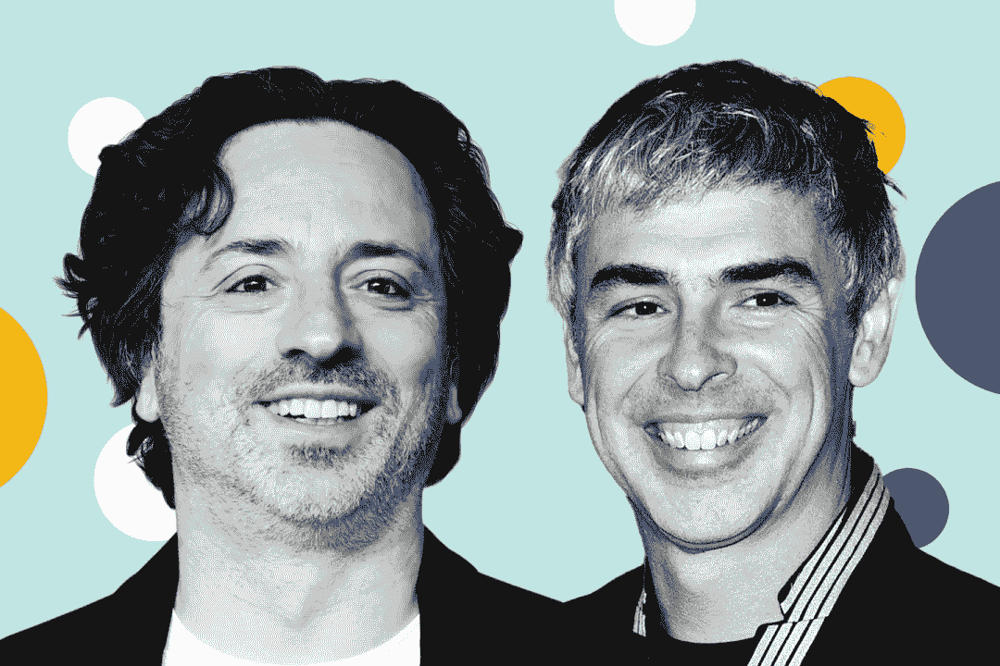

图片来源：MICHAEL TRAN—AFP/Getty Images, C Flanigan—FilmMagic

谷歌的联合创始人谢尔盖·布林（Sergey Brin）和拉里·佩奇（Larry Page）的净资产估计达到数千亿美元。他们原本能够在偏远的岛屿上悠闲度日，间或参加火人节（Burning Man），偶尔投资初创公司。然而，自从几年前两人淡出这家互联网搜索巨头及其母公司Alphabet的日常运营后，他们并未真正退休。布林重返谷歌总部，因为他迫切希望帮助谷歌的首席执行官在人工智能领域取得成功。

布林在9月的一次会议上表示：“作为一名计算机科学家，我从未见过如此令人兴奋的事情。”据报道，在谷歌以27亿美元让Character.AI的诺姆·萨泽尔回归公司一事中，布林发挥了关键作用。佩奇同样举足轻重——他坚定支持谷歌DeepMind的首席执行官戴密斯·哈萨比斯，并且在谷歌之外的科技投资中一直扮演着领导角色。鉴于他们的地位、强大的平台和雄厚的资本，可以预期在未来多年里，我们还会持续听到这对搭档的消息。

# **34**

**彼得·蒂尔**

Palantir Technologies董事长兼联合创始人

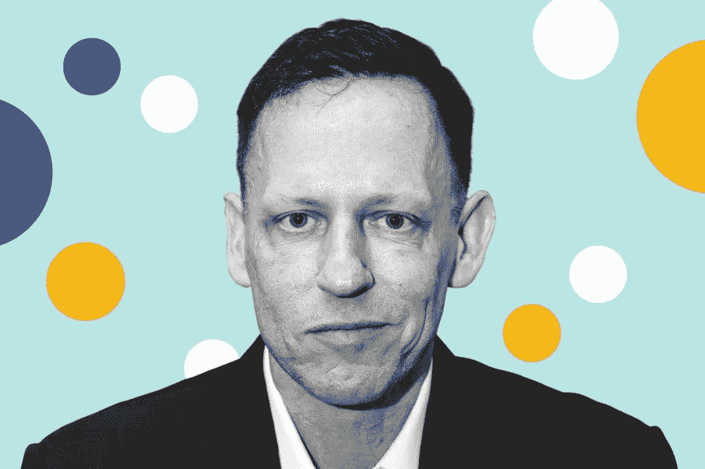

图片来源：Nordin Catic—Getty Images/The Cambridge Union

彼得·蒂尔（Peter Thiel）那无形的影响力堪称深远。就像他钟爱的J.R.R.·托尔金小说中的维拉一样（他已经用托尔金奇幻小说中的术语为六家公司命名），蒂尔神秘、强大，且令人难以捉摸。他担任董事长并与别人联合创立的Palantir Technologies公司非常神秘，该公司已经成为政府人工智能工作的首选供应商，估值接近1,000亿美元。他的Founders Fund投资来自各行各业的初创公司，比如帕尔默·拉基的Anduril Industries、汤姆·穆勒的Impulse Space和萨姆·奥尔特曼的OpenAI等。他的反大学教育的蒂尔奖学金（Thiel Fellowship）依旧是培育年轻企业家的另类平台。

除此之外，蒂尔在政治领域也颇具影响力。他毫不掩饰的自由意识保守主义立场，再加上他作为PayPal联合创始人和Facebook的第一批外部投资者获得的数十亿美元财富，为美国各地的右翼政治候选人提供了支持，包括特朗普的竞选伙伴JD·万斯。

# **35**

**萨弗拉·卡茨**

甲骨文（Oracle）首席执行官

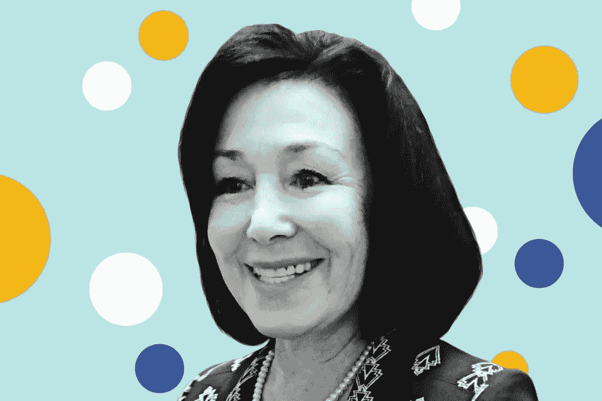

图片来源：Spencer Platt—Getty Images

作为硅谷的先锋企业，已经有47年历史的甲骨文在云计算领域一直落后于亚马逊、微软和谷歌，但于2019年担任甲骨文首席执行官的萨弗拉·卡茨 （Safra Catz） 很清楚，大公司并不打算弃用该公司在市场上领先的数据库软件。她通过与竞争对手合作，为客户提供在Microsoft Azure、Google Cloud和Amazon Web Services等平台上使用甲骨文产品的选择，帮助总部位于奥斯汀的甲骨文迎头赶上。今年9月，甲骨文公布的盈利超出预期，季度营收达到133亿美元（同比增长7%），之后公司与竞争对手的联盟关系引起了投资者的关注，令投资者兴奋不已；有多位分析师预计未来甲骨文将实现两位数增长。经过最近的一系列合作，卡茨对甲骨文在人工智能领域的前景同样充满信心，例如甲骨文与OpenAI合作，以提供额外的云基础设施，用于训练其人工智能模型。

# **36**

**苏姿丰**

AMD首席执行官兼董事长

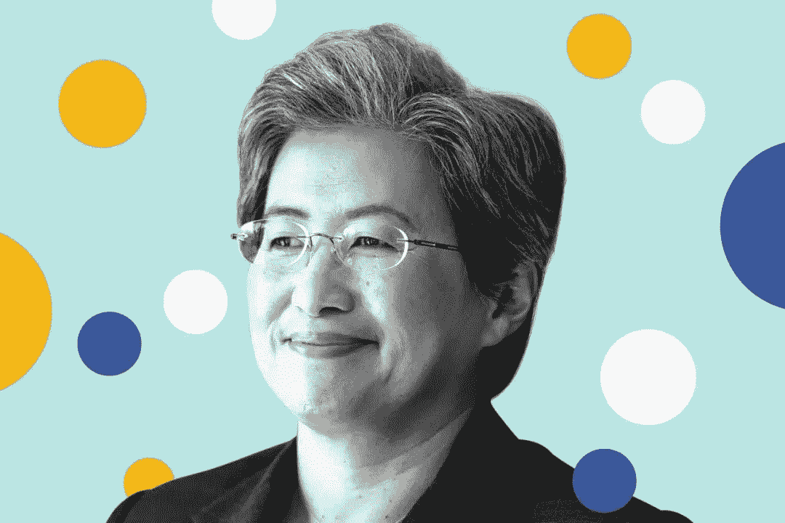

图片来源：Marlena Sloss—Bloomberg/Getty Images

在AMD担任首席执行官的十年里，苏姿丰 （Lisa Su） 成功领导这家芯片制造商实现业务多元化，从PC微处理器业务扩展到游戏和高性能计算等关键领域。然而，目前最重要的战场在于数据中心人工智能芯片的竞争。毋庸置疑，英伟达在这一领域占据绝对优势，市场份额超过90%，但即便位列第二，也能够获得丰厚回报。AMD的首款Instinct MI300芯片在第二季度的销售额超过10亿美元，去年公司的收入达到227亿美元。AMD希望通过不断丰富产品线进一步增加公司收入。为增强挑战英伟达的实力，AMD今年还收购了芬兰的人工智能公司Silo。

# **37**

**丹尼尔·艾克**

Spotify首席执行官兼联合创始人

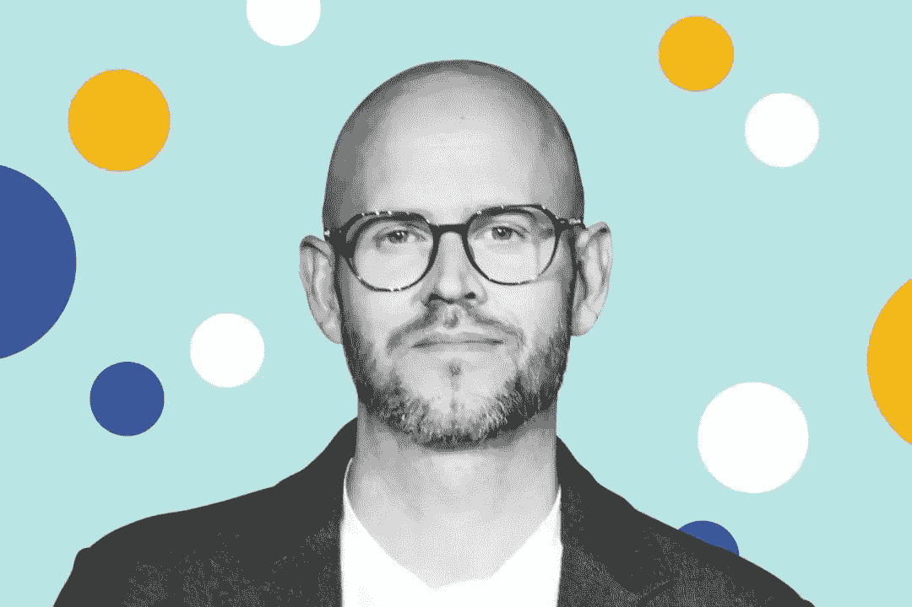

图片来源：Noam Galai—Getty Images/Spotify

Spotify的“货币化之年”对用户的钱包并不友好，但对于公司股票的表现以及首席执行官丹尼尔·艾克（Daniel Ek）的个人财富却是巨大利好。到今年10月底，强劲的收入增长和创纪录的利润已经让这家流媒体巨头的股价翻倍，使公司的市值达到770亿美元。Spotify的出色业绩，得益于巧妙的成本削减和订阅用户增长，尽管该公司在一年内已经两次提价。Spotify的下一个目标是视频内容创作者，公司正在通过高达七位数的合同来提高用户参与度，并在年底前将广告业务的收入提高到20亿美元。

# **38**

**马克·安德森**

安德森·霍洛维茨公司普通合伙人兼联合创始人

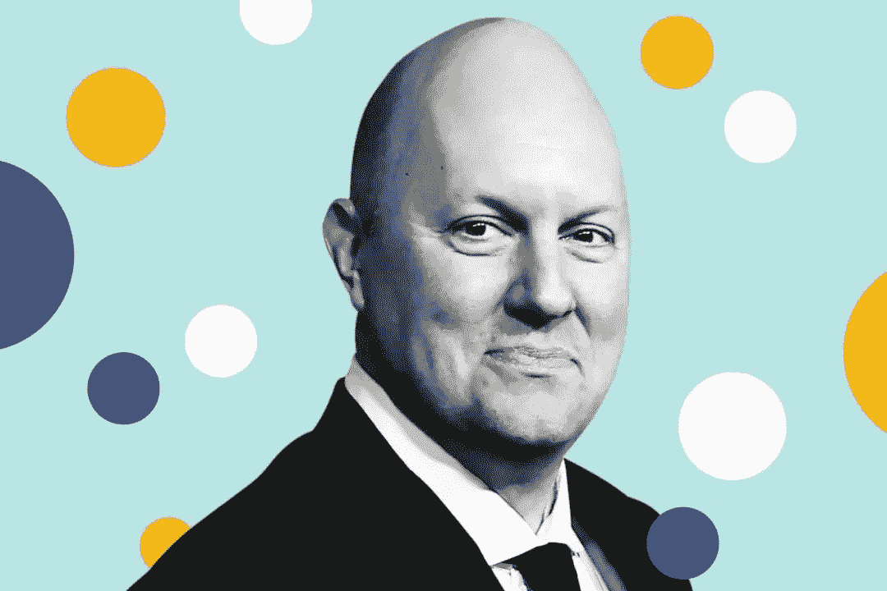

图片来源：Tayfun Coskun—Anadolu/Getty Images

无论人们如何看待马克·安德森（Marc Andreessen），他的言论总能引起关注。这位风险投资家是驱动全球经济的现代科技产业的重要缔造者之一，早在20世纪90年代初，他便参与创立了首个主流网页浏览器Netscape Navigator。2009年，他参与创立了风投公司安德森·霍洛维茨（简称a16z），该公司投资了爱彼迎（Airbnb）、Facebook、Stripe、GitHub和Lyft等一些在科技界知名度极高的公司。

目前公司管理的资产达440亿美元，并且正在向公开市场投资、财富管理和私募股权等领域扩张。安德森在2011年发表的一篇前瞻性文章《为什么软件正在吞噬世界》（Why Software Is Eating the World）扩大了他在科技圈外的影响力。然而，安德森最近的一些预测和主张，包括支持不受限制的发展人工智能和支持唐纳德·特朗普竞选总统等，都带有一种对抗性的语气，这种态度让这位互联网先驱在硅谷成为一位争议性人物。

# **39**

**查尔斯·科赫**

科氏公司（Koch Inc.）联席首席执行官兼董事长

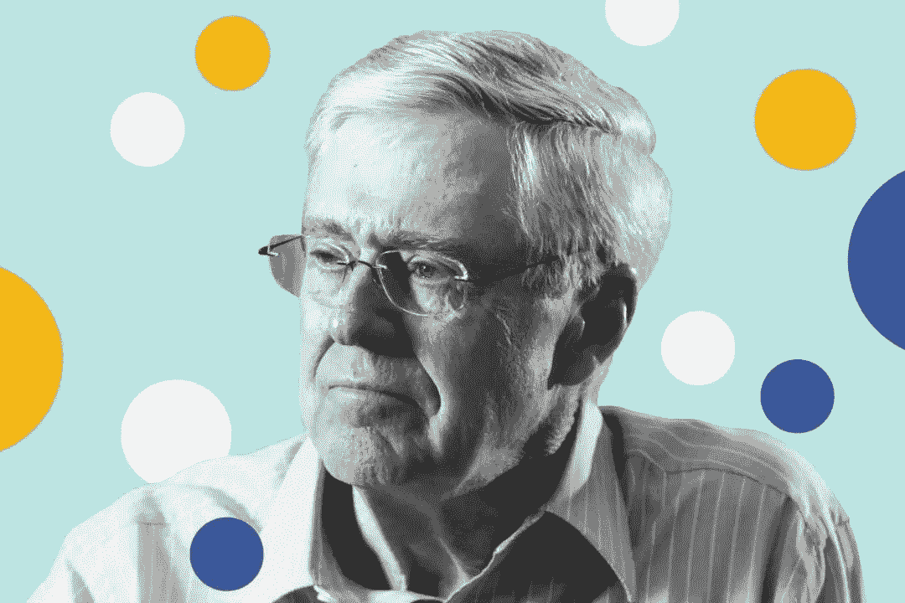

图片来源：Bo Rader—Wichita Eagle/Tribune News Service/Getty Images

查尔斯·科赫（Charles Koch） 长期担任科氏公司的董事长兼联席首席执行官。该工业集团的年收入约为1,250亿美元，是美国第二大私人公司。然而，在不同的人看来，他最有知名度的身份是自由市场的拥护者或者美国政治的颠覆者。查尔斯·科赫和已故兄弟大卫·科赫在过去几十年中致力于削弱政府监管，他们对美国公共政策和政治话语产生了无人能及的深远影响。

现年89岁的科赫最近首次在公司内设立了联席首席执行官，并培养儿子蔡斯·科赫作为未来的接班人。但老科赫并不准备退休。他的个人财富超过670亿美元。他强大的保守派捐赠网络在今年的美国大选中投入大量资金，试图影响地方选举结果。他还在今年领导科氏公司进行品牌重塑，以反映公司向多种技术领域扩展的转型。

# **40**

**魏哲家 （C.C. Wei）**

台积电（TSMC）首席执行官兼董事长

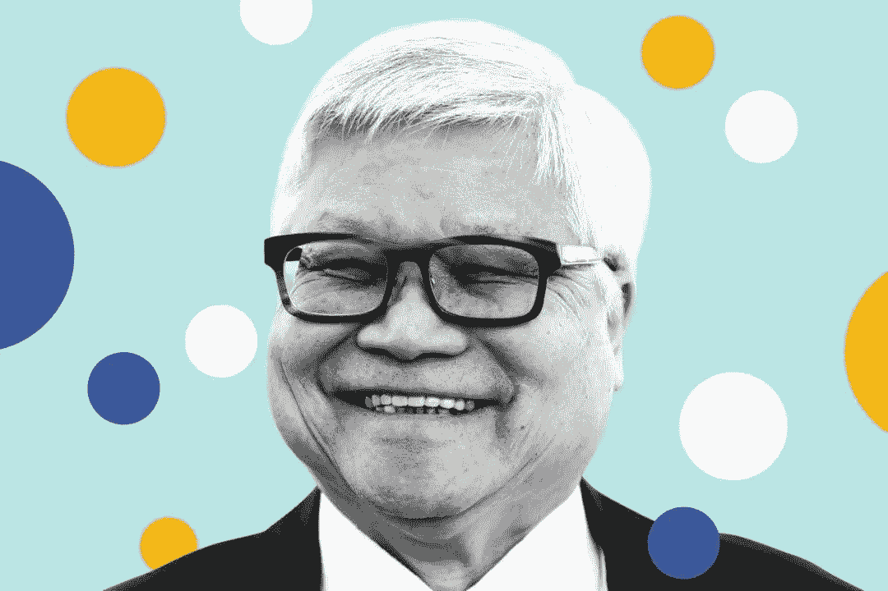

图片来源：Liesa Johannssen—Bloomberg/Getty Images

很少有公司重要到成为外交政策的议题，但台湾积体电路制造公司（Taiwan Semiconductor Manufacturing Co.）是一个例外。台积电是全球最大的芯片代工厂商和亚洲最有价值的公司，是苹果和英伟达等客户的主要供应商，也是唯一可以量产最先进芯片的公司。自今年6月起担任董事长的魏哲家，正在带领台积电迎接人工智能热潮，有望使公司2024年的营收再创新高。与此同时，随着各国政府纷纷向芯片制造商投入资金，以期实现供应链多元化（但可能成本更高），台积电正在美国、日本和德国投资建厂。

# **41**

**泰德·萨兰多斯和格雷格·彼得斯**

Netflix联席首席执行官

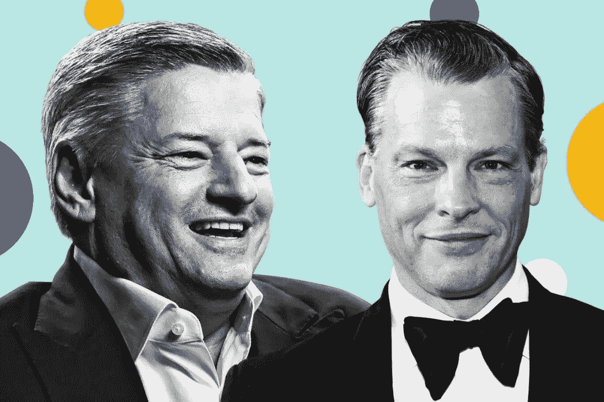

图片来源：Valerie Plesch—Bloomberg/Getty Images, Dan Steinberg—Variety/Penske Media/Getty Images

作为Netflix的联席首席执行官，泰德·萨兰多斯（Ted Sarandos）和格雷格·彼得斯（Greg Peters）组成了相当少见的管理搭档。但萨兰多斯早已习惯了与其他人共享舞台。这位前首席内容官从2020年至2023年期间，曾经与联合创始人里德·黑斯廷斯共同担任联席首席执行官。在黑斯廷斯退居幕后之后，由拥有多年首席运营官和首席产品官经验的彼得斯接任。

在他们的领导下，Netflix虽然因为打击密码共享的做法而引发了一些批评，但在竞争激烈的视频流媒体市场中仍然占据主导地位。公司最近的季度业绩超出华尔街预期，新增500万订阅用户，收入增长15%，达到98.3亿美元。展望未来，虽然公司在游戏领域遭遇了一些挫折，但公司正在投资体育赛事直播业务。

# **42**

**苏世民**

黑石集团首席执行官、董事长兼联合创始人

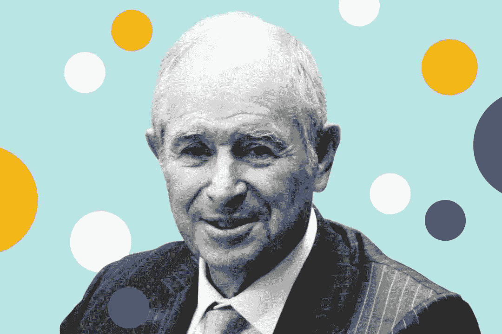

图片来源：Noriko Hayashi—Bloomberg/Getty Images

在苏世民（Stephen Schwarzman）的领导下，黑石集团（Blackstone）成为全球最大的另类投资公司。苏世民在黑石集团担任董事长、联合创始人兼首席执行官。创立于1985年的黑石集团的管理资产已经超过1.1万亿美元，并在2023年实现了80亿美元的收入。苏世民不仅是金融界的巨擘，还在人工智能领域具有重大影响力。作为人工智能技术的早期倡导者，他已经向人工智能教育和研究领域捐款约5亿美元。今年9月，黑石集团与亚太地区领先的数据中心平台AirTrunk签订了一份最终收购协议，交易总值达240亿美元。

# **43**

**布莱恩·切斯基**

爱彼迎（Airbnb）首席执行官兼联合创始人

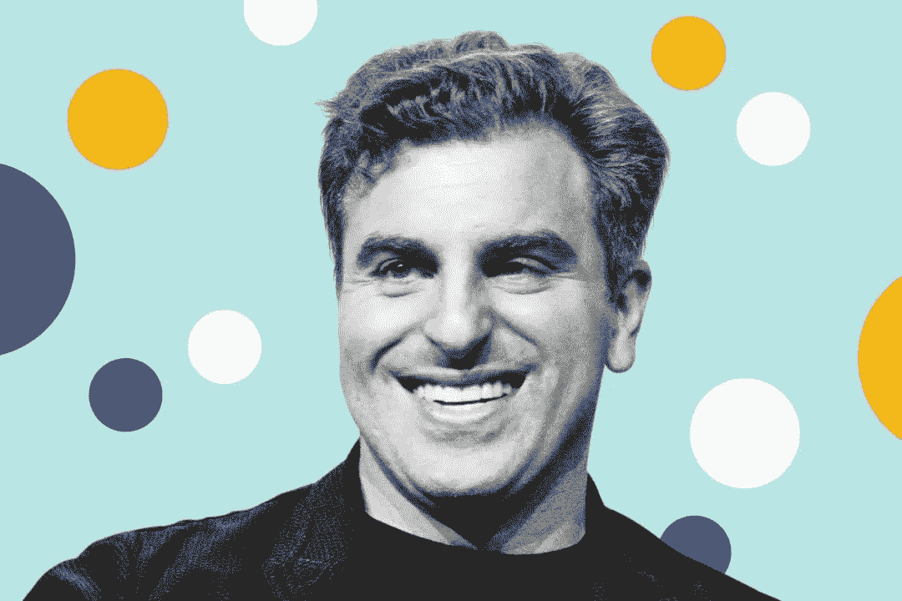

图片来源：Dustin Chambers—Bloomberg/Getty Images

布莱恩·切斯基（Brian Chesky） 于2007年参与创立了爱彼迎，如今作为首席执行官，他已经将这家提供“沙发客”服务的公司发展成颠覆旅行业的民宿巨头。爱彼迎的广泛欢迎，再加上切斯基善于与媒体打交道的能力，使他成为下一代企业家心目中的榜样。同时，爱彼迎正在抢走希尔顿（Hilton）和凯悦（Hyatt）等酒店业巨头的顾客，对它们构成了重大威胁。

切斯基当前的目标是拓展爱彼迎的业务，将其打造成一站式旅行平台。他的构想之一是推出一种服务，允许房主聘请专人代为管理房产。明年，爱彼迎将重新推出一个曾经被搁置的项目——向客户销售旅游活动和课程。

# **44**

**亚历克斯·卡普 **

Palantir Technologies首席执行官兼联合创始人

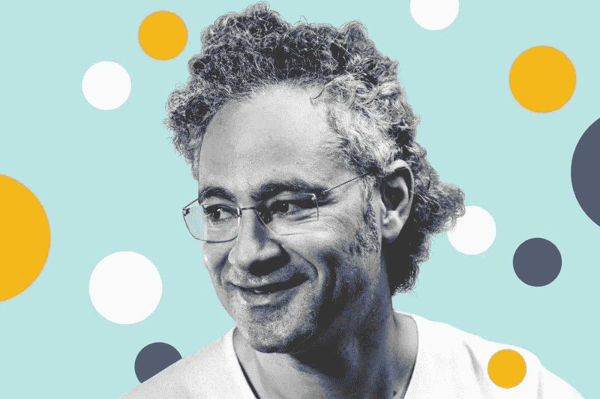

图片来源：David Paul Morris—Bloomberg/Getty Images

当其他公司都在思考人工智能投资如何才能获得回报时，Palantir Technologies公司的联合创始人兼首席执行官亚历克斯·卡普 （Alex Karp） 似乎已经找到了答案。这家人工智能数据分析公司在2023年实现盈利，并于9月被纳入标准普尔500指数，使其股价屡创新高。公司与政府机构特别是国家安全部门的长期合作关系，令其在地缘政治动荡加剧的时期占据了优势。

卡普拥有斯坦福大学（Stanford University）的哲学博士学位和法律学位。他从2003年创建Palantir Technologies公司以来一直担任首席执行官。他公开支持增强美国的军事实力，以及对抗敌对势力的坚定外交政策——这种世界观正好符合Palantir Technologies公司的商业利益。

# **45**

**亚西尔·鲁马扬**

公共投资基金（Public Investment Fund）总裁

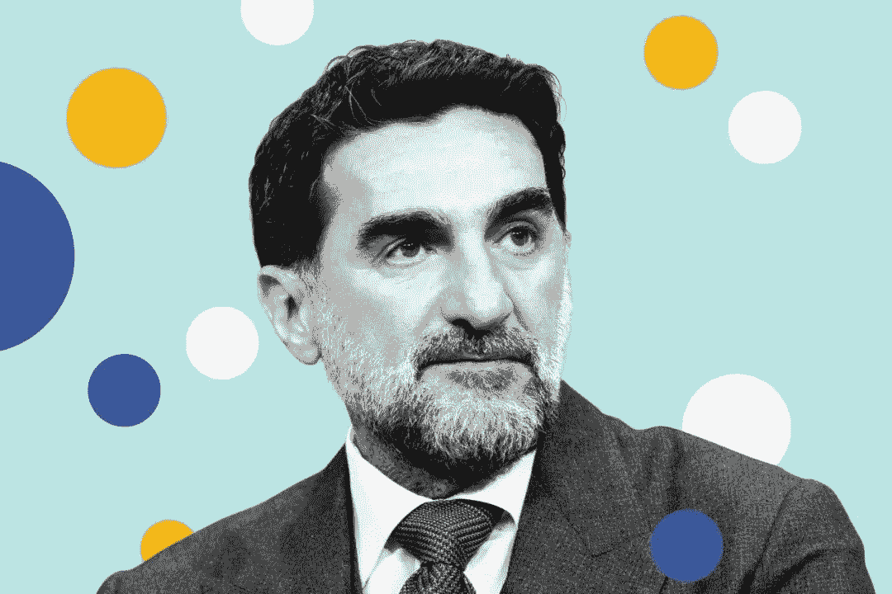

图片来源：Chris Ratcliffe—Bloomberg/Getty Images

亚西尔·鲁马扬（Yasir Al-Rumayyan） 因为担任沙特阿拉伯的主权财富基金公共投资基金的总裁而闻名。鲁马扬全权负责其运营。该基金是全球最大的主权财富基金之一，今年的管理资产超过9,250亿美元。鲁马扬同时还担任全球最有价值的上市公司、石油巨头沙特阿美（Saudi Aramco）的董事长。

公共投资基金是沙特摆脱石油依赖战略的核心，在鲁马扬的领导下，该基金成为美国一些最具颠覆性的公司的重要投资者，包括黑石集团、Uber和特斯拉等。公共投资基金当前正在人工智能领域加大投资力度，在今年2月创立了先进制造公司Alat，并于2021年创立了沙特人工智能公司（Saudi Company for Artificial Intelligence）。公共投资基金还在进一步拓展体育业务。2024年夏季，公共投资基金将其对英超俱乐部纽卡斯尔联队（Newcastle United）的持股比例提升至85%，鲁马扬同时担任该俱乐部主席。该基金还拥有沙特职业联赛的多个俱乐部，包括葡萄牙著名球星克里斯蒂亚诺·罗纳尔多担任队长的利雅得胜利队（Al-Nassr）。

# **46**

**乔纳森·格雷**

黑石集团总裁兼首席运营官

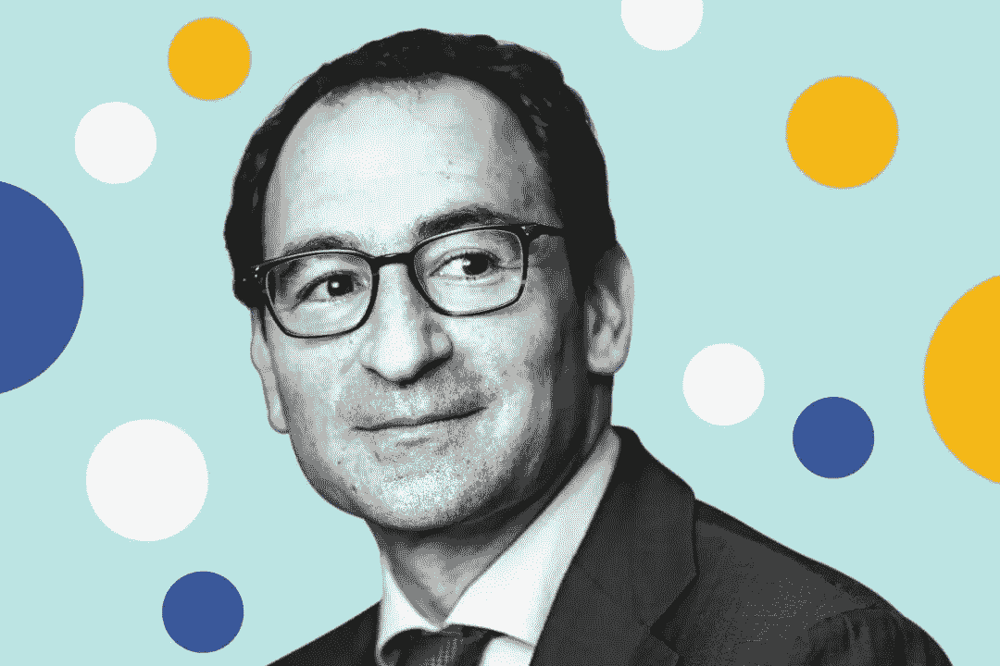

图片来源：Chris Ratcliffe—Bloomberg/Getty Images

1992年，22岁的乔纳森·“乔恩”·格雷（Jonathan Gray）以大学毕业生的身份加入黑石集团，之后一路晋升，成为公司的总裁兼首席运营官，并助力黑石成长为全球最大的另类投资公司。格雷最初在私募股权和并购部门担任分析师，后来成为黑石房地产（Blackstone Real Estate）的全球负责人，将该部门打造成全球最大的商业地产平台。目前，该部门管理着3,390亿美元投资者资本。格雷主持了黑石对希尔顿酒店的投资，为公司创造了140亿美元的利润。自2018年起担任总裁兼首席运营官的格雷，正在为黑石的未来奠定基础。

# **47**

**鲍勃·艾格**

迪士尼（Disney）首席执行官

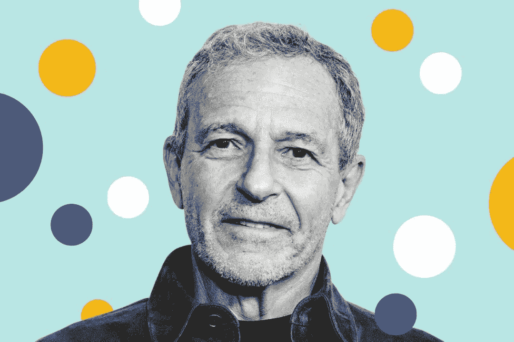

图片来源：Emma McIntyre—Getty Images

几年前，在担任迪士尼的首席执行官15年后，鲍勃·艾格（Bob Iger）曾经短暂退休，不久又重新出山。在他重新执掌公司期间，艾格取得了几项重要的成功。2023财年，迪士尼公布的营收为889亿美元，同比增幅超过7%。2024年第三季度，迪士尼的流媒体业务首次实现盈利，Disney+、ESPN+和Hulu的综合流媒体收入达到4,700万美元，相较去年同期的5.12亿美元亏损有了显著改善。今年，《头脑特工队2》（Inside Out 2）成为有史以来票房最高的动画电影。此外，艾格还结束了与股东激进人士纳尔逊·佩尔茨的纷争，后者一直在推动公司进行改革。

# **48**

**丹妮拉·阿莫迪和达里奥·阿莫迪**

Anthropic首席执行官兼联合创始人（达里奥）

Anthropic总裁兼联合创始人（丹妮拉）

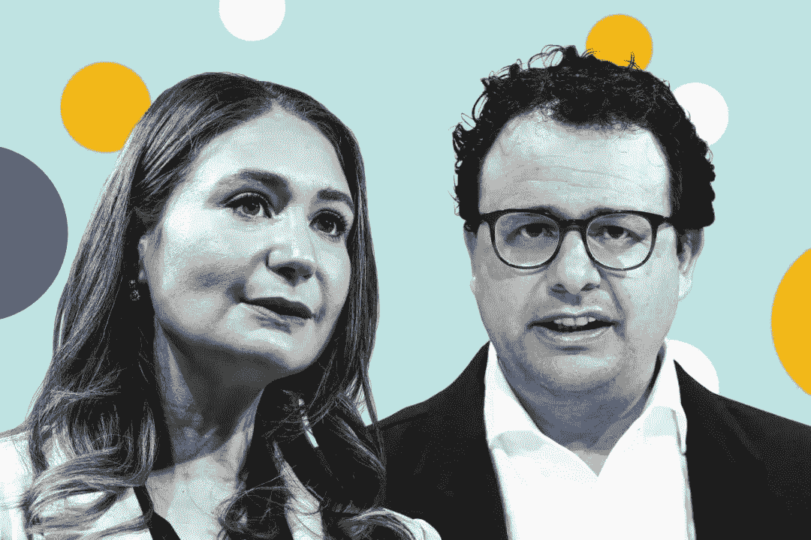

图片来源：David Paul Morris—Bloomberg/Getty Images, Chesnot—Getty Images

有资源训练最前沿生成式人工智能模型的公司并不多，而在美国，除了大型科技公司以外，只有OpenAI和Anthropic这两家公司具备这样的实力。达里奥（Dario Amodei）与丹妮拉·阿莫迪（Daniela Amodei）兄妹二人于2021年辞去了OpenAI的高管职位，创立了“人工智能安全和研究”公司Anthropic。据爆料他们之所以离职，是因为OpenAI在接受微软投资后改变了方向。

Anthropic自创立以来已经获得亚马逊40亿美元和谷歌20亿美元的投资。目前，阿莫迪兄妹和他们的团队正寻求新的融资，估值约400亿美元。Anthropic的Claude聊天机器人已经被认为是OpenAI和谷歌产品的有力竞争对手，公司最近也加大了向企业提供人工智能服务的力度，使竞争变得更加激烈。

# **49**

**拉里·芬克**

贝莱德（BlackRock）首席执行官兼董事长

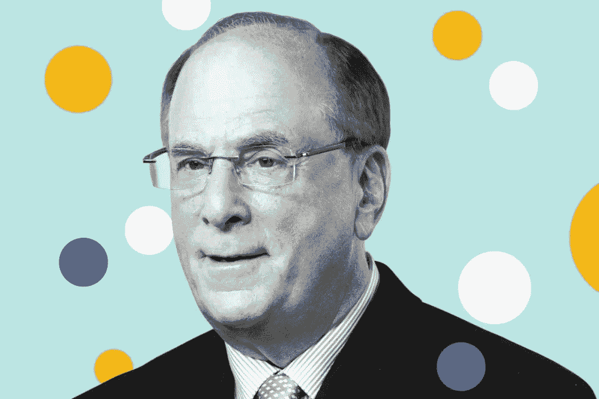

图片来源：Victor J.Blue—Bloomberg/Getty Images

作为华尔街真正的巨擘之一，拉里·芬克 （Larry Fink ）于1988年参与创建了贝莱德，并将其发展成全球最大的资产管理公司，管理资产超过11万亿美元，在全球数十个国家设立了分支机构。芬克在政界同样有影响力。他与希拉里·克林顿等资深民主党人士关系密切。他直言不讳应对气候变化和提升包容性等方面的问题。芬克今年已经72岁，有关接班人问题的讨论逐渐增多，但他目前依然稳居董事长和首席执行官的职位，掌控全局。

# **50**

**布莱恩·阿姆斯特朗**

Coinbase首席执行官兼创始人

图片来源：Victor J.Blue—Bloomberg/Getty Images

2012年，布莱恩·阿姆斯特朗（Brian Armstrong）创立Coinbase，作为反抗华尔街和华盛顿特区现有金融权力的加密货币运动的一部分。如今，这家初创公司已经上市，并成为迅速成熟的加密货币行业的旗舰品牌。同时，阿姆斯特朗还在其他领域发挥其影响力，例如投入超过5,000万美元（包括他个人和Coinbase的资金），以推动立法者制定更有利于加密货币的法规。他与硅谷最有影响力的网络关系密切，并追随该地区的一个最新趋势，向研究长寿的初创公司投资了数百万美元。阿姆斯特朗在2024年10月完婚，现在他依旧致力于其最初的愿景：利用区块链技术创建一个全新的经济和社会秩序。

# **51**

**安德鲁·威蒂**

联合健康集团首席执行官

图片来源：Al Drago—Bloomberg/Getty Images

2021年，安德鲁·威蒂  （Andrew Witty） 出任联合健康集团（UnitedHealth Group）的首席执行官，但他并不是第一次在医疗行业当高管。2008年至2017年，他曾经在业内领先的制药商葛兰素史克担任首席执行官。联合健康集团的收入稳步攀升，2023财年的收入达3,720亿美元，成为全球收入最高的医疗公司。在遭受严重网络攻击后，今年该公司一直备受关注，威蒂在美国国会作证时表示，“可能”有三分之一美国人的数据被盗。2012年，威蒂在英国被授予爵士头衔，2017年，他因为努力促进新加坡增长和发展而被授予新加坡荣誉市民称号。

# **52**

**山塔努·纳拉延**

Adobe董事长兼首席执行官

图片来源：SAJJAD HUSSAIN—AFP/Getty Images

Adobe的首席执行官山塔努·纳拉延 （Shantanu Narayen） 全力押注人工智能。持续多年对深度伪造技术（Deepfake）敲响警钟后，他开始让公司的创意客户群相信，生成式人工智能只会提供协助而不会抢走人类的工作。今年，Adobe在创意云服务套件中发布了100项全新人工智能功能，尽管大部分工具都包含在标准订阅价格中，不过即将推出的视频功能可能收取更高的价格。纳拉延于2007年就任首席执行官，带领Adobe将年收入从接手时的30亿美元增长到去年年底的190多亿美元。

# **53**

**约翰·克里森和帕特克·克里森**

Stripe首席执行官兼联合创始人（帕特里克）

Stripe总裁兼联合创始人（约翰）

图片来源：Jeenah Moon—Bloomberg,Getty Images, STRIPE

约翰·科里森（John Collison）和帕特里克·科里森（Patrick Collison）可以说都是神童。十几岁时，他们因为科技方面出众的天赋而在爱尔兰获奖。帕特里克19岁，约翰17岁时，两人就卖掉了第一家公司。开端不错，却低估了两人未来的潜力：自2010年以来，他们已经将Stripe打造为全世界最有价值的私营公司之一，估值达700亿美元。把Stripe称为支付公司有点过于简单，因为Stripe的规模和范围已经超越各业务的总和。2023年，Stripe处理的支付量超过1万亿美元。Stripe甚至有出版部门Stripe Press。科里森团队经历了一轮又一轮下跌和全球扩张，只有一个问题等待回答：Stripe到底何时上市？

# **54**

**肯·格里芬**

Citadel首席执行官兼创始人

图片来源：Bryan van der Beek—Bloomberg/Getty Images

1990年，肯·格里芬（Ken Griffin）创立对冲基金Citadel时规模仅有460万美元，他的祖母是初始投资人。如今他的净资产已经超过400亿美元，成为全世界排名前列的富翁。除了对冲基金，他还拥有包括Citadel证券公司（Citadel Securities）在内的庞大帝国，他在流动性和做市商领域的业务重新连接了全球市场的技术基础设施，还获得了红杉（Sequoia）和Paradigm等硅谷风投公司支持。除了称霸华尔街，格里芬在政治方面也是多面手，最近一个选举周期中，他花费数千万美元支持全美共和党候选人。

# **55**

**鲁洛夫·博塔**

红杉资本（Sequoia Capital）管理合伙人

图片来源： Jason Alden—Bloomberg/Getty Images

鲁洛夫·博塔 （Roelof Botha） 虽然不是红杉创始人，但俨然已经成这家硅谷传奇风投的代言人。（他的正式头衔是“负责人”。）博塔曾经是“PayPal黑手党”的成员，于2003年加入红杉，主导了对YouTube、Instagram和Square等公司极具眼光的投资。自从2022年7月博塔担任最高职位以来，他经历了一些关键时刻，包括拆分中国业务，以及对FTX灾难性押注后安抚投资者等。博塔还支持PayPal前同事兼南非同胞埃隆·马斯克，带领红杉协助马斯克收购推特，今年早些时候xAI的60亿美元融资也有参与。

# **56**

**王来春**

立讯精密董事长、总经理

图片来源：Courtesy of Luxshare

王 来春曾经为苹果公司的主要供应商富士康工作10年，2004年与兄弟共同创立了总部位于深圳的制造企业立讯精密。20年后，由于王来春的有力领导和对创新的专注，立讯精密已经成为苹果手表（Apple Watches）、AirPods、Vision Pros和iPhones的领先制造商，挑战富士康的主导地位——从很多方面来看，王来春是亚洲商界最具影响力的女性。2024年，立讯精密以上一年328亿美元的收入跻身《财富》世界500强榜单，排名第488位。

# **57**

**雷军**

小米首席执行官、董事长、创始人

图片来源：MICHAEL ZHANG—AFP/Getty Images

全球第三大手机制造商小米的创始人雷军一直将史蒂夫·乔布斯视为榜样。但现在雷军实现了苹果未达到的成就：造电动汽车。小米称，SU7于3月下旬发布，一个月内的销量超过7万辆，连福特的首席执行官吉姆·法利都赞不绝口。以智能手机闻名的小米预计，到11月电动汽车总交付量将超过10万辆。雷军表示，2021年小米被短暂列入美国贸易黑名单是转向造车的灵感。为什么小米能够在苹果失败的地方成功？因为雷军为了第一台样车投入100亿元（约合14.2亿美元），还有3,400名工程师。

# **58**

**达伦·伍兹**

埃克森美孚董事长兼首席执行官

图片来源：Artur Widak—NurPhoto/Getty Images

2017年，达伦·伍兹（Darren Woods）接任埃克森美孚（Exxon Mobil）的首席执行官。公司历史超过一个多世纪，用今年早些时候伍兹对《财富》杂志的话说，起家“基本上是制造煤油代替灯用鲸油”，后来为从飞机到汽车等各种机器提供动力。埃克森美孚一直承受放弃碳密集型能源的压力。几年前，一位维权投资者对埃克森美孚在替代能源方面进展缓慢提出质疑，还争取到几个董事会席位。批评人士表示该活动并未取得重大进展。伍兹在今年表示，董事会的变化“可能跟很多人想法不一样，其实对公司有利，强化了正在走的道路。”按照收入计算，这家美国最大的石油和天然气公司在2022年利润创下纪录，部分原因是俄罗斯入侵乌克兰以及随后的油价波动。伍兹在这家石油巨头从基层一路晋升，1992年担任规划分析师，后来担任副总裁和高级副总裁。

# **59**

**卡罗尔·托梅**

联合包裹运送服务公司（UPS）首席执行官

图片来源：Dustin Chambers—Bloomberg/Getty Images

卡罗尔·托梅（Carol Tomé）是美国怀俄明州人，新冠疫情爆发不久，于2020年出任全球航运和物流公司UPS首席执行官，此前她曾经在家得宝（Home Depot）担任首席财务官。由于UPS的核心业务面临亚马逊和联邦快递（FedFx）等公司的压力，托梅一直在努力实现收入来源多元化。例如，2024年9月，UPS收购了两家公司，她希望这两家公司可以协助UPS搭建医疗物流业务，从而配送需要温控储存和运输的物品。她预计两年内该业务的收入就能够翻一番，达到200亿美元。在托梅的领导下，UPS与美国邮政署（USPS）达成了一笔大金额交易，处理其大部分空运货物。最近，UPS还收购了销售退回技术提供商Happy Returns。

# **60**

**盖尔·布德罗 **

Elevance Health总裁兼首席执行官

图片来源：Taylor Hill—Getty Images

2017年，盖尔·布德罗 （Gail Boudreaux） 被任命为Elevance Health公司的总裁兼首席执行官，此前她曾经担任联合健康集团旗下UnitedHealthcare的首席执行官，并在Health Care Service Corp .和Aetna担任高管。尽管医疗补助（Medicaid）的重新认定导致一些客户失去了服务资格，2023年Elevance还是实现营业收入1700亿美元，同比增长9.3%。

2024年，布德罗带领公司扩张和多元化，从保险业扩展到医疗服务业，似乎已见成效：尽管Elevance的医保会员人数持续减少，但由于保费收益率提高以及子公司Carelon医疗服务增长，二季度该公司利润超过23亿美元。布德罗于2023年2月接替微软的萨蒂亚·纳德拉担任商业理事会（Business Council）的主席。商业理事会的成员均是大型企业的首席执行官，在该组织近90年的历史上，布德罗是第一位担任主席的女性。

# **61**

**曾毓群**

宁德时代董事长、总经理

图片来源：Paul Yueng—Bloomberg/Getty Images

乘着中国电动汽车的热潮，曾毓群成为世界电池之王。宁德时代制造的电动汽车电池产量超过全球总产量的三分之一。这家企业是特斯拉和丰田等全球汽车制造商供货商。2011年，曾毓群创立宁德时代，当时中国政府要求外国汽车制造商向本地公司转让技术，才能获得电动汽车补贴。现在，技术转让已然转向，福特和通用汽车等美国汽车制造商正在尝试批准宁德时代在美国本土生产电池。

# **62**

**唐唯实**

Stellantis首席执行官兼执行董事

图片来源：Massimo Di Vita—Mondadori Portfolio/Getty Images

Stellantis的首席执行官唐唯实（Carlos Tavares）自称“燃油车粉丝”，同事们认为他像一位“武士”，热爱打造具有竞争力的汽车品牌。这话挺有道理。在2014年唐唯实掌舵后，曾经帮助标致（Peugeot）的生产商PSA集团（PSA Group）扭转了濒临破产的命运。他的回报？就是挑战传奇的美国汽车市场。自2021年与菲亚特-克莱斯勒（Fiat-Chrysler）合并成立市值为2,040亿美元的全球巨头Stellantis以来，唐唯实除了负责欧洲的大品牌，也负责吉普（Jeep）和克莱斯勒品牌，获得了7,700多万美元的薪资。

这位葡萄牙籍首席执行官经常谈起汽车行业的“达尔文式”战斗，要想在2026年退休前扭转汽车制造商的命运前路艰难。Stellantis价格上涨不受欢迎之后，如今正在面临库存过剩问题，2024年上半年利润几乎腰斩，降至56亿美元。确认即将退休的同时，唐唯实也对Stellantis的高管层进行了彻底重组。

# **63**

**丰田章男**

丰田汽车公司（Toyota）董事长

图片来源：YUICHI YAMAZAK—AFP/Getty Images

2023年，丰田章男（Akio Toyoda）不再负责由祖父创立的丰田日常领导工作，但在这家在2023年销售全球第一的汽车制造商，他的影响力仍然巨大。他看好混合动力汽车而不是电动汽车，这一决策正带来红利。2023年，丰田销售了340万辆混合动力汽车，比2022年的260万辆大幅增长。尽管日本车企受一系列安全问题困扰，但2024财年，丰田的收入约为3120亿美元，同比增长14%。至于丰田章男，2009年他担任首席执行官时曾经告诉《财富》杂志，自己一直钟情于赛车，还有在工厂车间与丰田的员工并肩作战。

# **64**

**阿比盖尔·约翰逊**

富达投资董事长兼首席执行官

图片来源：Barry Chin—The Boston Globe/Getty Images

2014年，阿比盖尔·约翰逊（Abigail Johnson）接替父亲爱德华·“奈德”·约翰逊三世，在祖父创立总部位于波士顿的金融服务公司富达投资（Fidelity Investments）出任首席执行官。这位第三代首席执行官从不避讳在公司留下自己的印记。过去一年，约翰逊更换了高管，还领导富达推出产品帮雇主在退休账户中为员工偿还学生贷款提供匹配资金。2024年1月，该公司还推出了业内首批比特币交易所交易现货产品之一。2023年年末，富达将零售投资业务拆分为两个独立部门：经纪业务和财富管理部门。相关举措效果明显。尽管富达依旧是私人控股，不披露所有财务信息，但公司报告2023年收入达282亿美元，同比增长12%，创下历史新高。

# **65**

**叶鸿慕**

欧莱雅（L’Oréal）首席执行官

图片来源：Nathan Laine—Bloomberg/Getty Images

只要你去过药店，很可能就遇到过欧莱雅的产品。欧莱雅多彩的口红和粉底是化妆包里的必备物品。尽管担任欧莱雅的首席执行官才三年，叶鸿慕 （Nicolas Hieronimus） 却在公司已经工作了数十年。1987年，叶鸿慕开始担任产品经理，后来成为卡尼尔美宝莲（Garnier Maybelline）的英国分公司总经理。2023财年，该公司实现了445亿美元的收入，高于之前一年的402亿美元。叶鸿慕认为欧莱雅是一家“科技公司”，旗下还有电动口红和高级吹风机等产品。

# **66**

**塔森达·布朗·达克特**

美国教师保险和年金协会总裁兼首席执行官

图片来源：Paras Griffin—Getty Images

塔森达·布朗·达克特（Thasunda Brown Duckett）是目前领导《财富》美国500强的两位黑人女性首席执行官之一，2021年以来一直担任美国教师保险和年金协会（TIAA）的首席执行官，此前她在摩根大通工作。作为退休服务提供商美国教师保险和年金协会的掌舵人，达克特主张在退休储蓄和投资方面缩小种族财富差距。公司指出，美国教师保险和年金协会管理着1.3万亿美元资产（收入460亿美元），负责“数百万人和数千个机构”的退休储蓄；公司也从高等教育和非营利403(b)储蓄账户扩展到企业401(k)账户。

# **67**

**安娜·帕特里夏·博廷**

桑坦德银行（Banco Santander）执行主席

图片来源：Pablo Blazquez Dominguez—Getty Images

自2014年以来，安娜·博廷 （Ana Patricia Botín） 一直担任桑坦德银行的执行主席，是家族中领导这家西班牙银行的第四位成员。除了延续家族传统，她也是可口可乐（Coca-Cola）董事会和麻省理工学院（Massachusetts Institute of Technology）顾问委员会的成员。在执掌桑坦德银行的第二个十年开启时，她雄心勃勃地要扩大该银行在美国的业务，首先从数字消费产品入手。对该银行来说，欧洲央行（European Central Bank）设定的超低利率是一个挑战，自博廷接管以来，股价已经下跌约35%。不过该公司宣布2023年净利润达到创纪录的120亿美元，同比增长15%。

# **68**

**尼古拉·坦根**

挪威中央银行投资管理公司首席执行官

图片来源：Chris Ratcliffe—Bloomberg/Getty Images

尼古拉·坦根（Nicolai Tangen ） 是全球最大投资机构挪威中央银行投资管理公司（Norges Bank Investment Management）的首席执行官。迄今为止，管理1.6万亿美元的挪威银行投资管理基金已经投资8,859家公司，包括苹果、微软和雀巢（Nestlé）。如今他的权力和影响力远远超出金融市场，他的播客《In Good Company》在排行榜上屡获殊荣，曾经采访比尔·盖茨、埃隆·马斯克和大众公司的奥博穆等重量级人物。

# **69**

**尼尔·莫汉**

YouTube首席执行官

图片来源：Kevin Mazur/\—Getty Images/Made on YouTube 2024

2023年，尼尔·莫汉（Neal Mohan）从苏珊·沃西基的手中接过接力棒，被任命为YouTube的首席执行官，彼时他还名不见经传。然而在科技圈里，莫汉以精通广告闻名，稳健的风格和对内部流程的关注对YouTube的成功至关重要，他在YouTube担任产品和政策主管。在就任首席执行官后，莫汉加倍努力开发YouTube的短视频产品Shorts，与TikTok和Instagram Reels竞争，增加新的人工智能功能，还推出收入分成吸引创作者。与此同时，YouTube Music和Premium的订阅用户已经超过1亿，YouTube TV的付费用户也超过了800万。

# **70**

**鲁伯特·默多克**

新闻集团（News Corp.）创始人

图片来源：Victoria Jones—PA Images/Getty Images

过去70年，鲁伯特·默多克（Rupert Murdoch）打造出一个媒体帝国，对流行文化和美国政治话语的影响巨大。作为福克斯公司（Fox Corp.）的前联合主席和新闻集团的执行主席，2024年这位媒体巨头虽然已经年满93岁，但对强大的保守品牌福克斯新闻频道（Fox News）和《华尔街日报》（Wall Street Journal）等仍然有发言权；他的触角还延伸到了英国和澳大利亚，掌握主要的报纸和电视媒体。现在，默多克与子女就很多美国人视为福音的媒体未来控制权展开斗争，剧情堪比广受欢迎的美剧《继承》（Succession）。

# **71**

**黄碧娟**

华侨银行集团（OCBC）首席执行官

图片来源：Lam Yik—Bloomberg/Getty Images

1984年，黄碧娟 （Helen Wong ） 就已经开启职业生涯，在新加坡第二大银行华侨银行集团担任管理培训生。近40年后，华侨银行集团任命她为首席执行官，成为第一位执掌新加坡银行的女性。期间，黄碧娟曾经在汇丰（HSBC）连连晋升，最终成为大中华区首席执行官。由于大量财富流入新加坡，华侨银行集团蓬勃发展，2023年，该行的净利润达到创纪录的52亿美元。

# **72**

**拉里·埃里森**

甲骨文董事长兼联合创始人

图片来源：Phillip Faraone—Getty Images

拉里·埃里森（Larry Ellison）离任甲骨文的首席执行官已经有十年时间，距离他联合创立该家软件巨头也将近半个世纪。但哪怕这位80岁的亿万富翁身在夏威夷的私人岛屿上，在硅谷的影响力却丝毫不减。他仍然是数据库和云公司甲骨文的首席技术官兼执行董事长，过去一年里由于对生成式人工智能的需求年度业绩节节走高，埃里森超过2000亿美元的净资产又增加了140亿美元。埃里森在好莱坞也有一席之地，他的儿子大卫·埃里森斥资80亿美元收购了派拉蒙公司（Paramount），并担任首席执行官。老埃里森资助了该笔交易，不过派拉蒙最近澄清称大卫将有投票权。

# **73**

**梅洛迪·霍布森**

Ariel Investments总裁兼联席首席执行官

图片来源：Taylor Hill—Getty Images

在多家美国公司由于政治气候而远离多元、平等和包容（DEI）之际，梅洛迪·霍布森（Mellody Hobson）却依旧敞开大门，努力确保美国企业言行一致。自2019年以来，霍布森一直是美国第一家黑人共同基金公司Ariel Investments的联席首席执行官。霍布森从不回避代表权的重要性。2021年她在担任星巴克董事长时，就是《财富》美国500强中唯一的黑人女性董事长。

今年9月，星巴克调整首席执行官，由Chipotle 的布莱恩·尼科尔接替纳思瀚（Laxman Narasimhan），同时兼任星巴克董事长，霍布森就此离任。霍布森仍然是星巴克的董事，她介绍了尼科尔接任首席执行官一职，这一举荐风险很高，主要为了安抚受挫的股东以及围攻星巴克的激进投资者。霍布森还主张缩小美国的种族贫富差距。“多元化的环境效果最好。”今年早些时候她对《财富》杂志表示。霍布森努力在Ariel Alternatives旗下推出了“黑人项目”（Project Black），主要投资中型市场企业。30年前霍布森在Ariel Investments公司从实习生做起，截至2024年第三季度末，该公司管理资产规模为145亿美元。

# **74**

**维诺德·科斯拉**

Khosla Ventures管理合伙人、创始人

图片来源：David Paul Morris—Bloomberg/Getty Images

69岁的科斯拉（Vinod Khosla）是硅谷最有影响力的投资者之一。科斯拉来自印度，他1982年共同创立了Sun Microsystems，开发了一系列开源软件。之后他在风投公司Kleiner Perkins工作了18年，20世纪90年代投资了一些成功的光纤和互联网公司。更值得一提的是Juniper Networks，该公司于1999年上市，Kleiner Perkins的回报达到2,500倍。

2004年，科斯拉成立了自己的公司，投资医疗、可持续发展和人工智能初创公司。2019年，科斯拉进行了可能最大一笔押注，当时他的公司给OpenAI开出一张5,000万美元的支票。去年年底，OpenAI的董事会解雇了首席执行官萨姆·奥尔特曼，科斯拉也是第一批要求重新聘用奥尔特曼的人之一。最近，科斯拉因为预测大多数工作将被人工智能替代而广受关注。

# **75**

**马克·库班**

达拉斯小牛队前主要所有者、现小股东

图片来源：Christopher Willard—ABC/Getty Images

2023年，马克·库班（Mark Cuban）宣布出售达拉斯小牛队（Dallas Mavericks）的控股权，还有在第16季结束后离开真人秀节目《创智赢家》（Shark Tank），看似已经为60多岁退休打好了基础。然而，这位亿万富翁企业家在社会最棘手的两个领域加倍努力：医疗保健和政治。2024年上半年，库班麾下的在线药房初创公司Cost Plus Drugs开始生产处方药，刚开始主攻供应量较少的药物。该公司还在网上向消费者直接销售2,000多种药物，其中大部分是仿制药，价格低廉且透明。下半年，库班为美国副总统卡玛拉·哈里斯四处游说，为副总统的圈子提供了一些亲商善举。而且，他没有向哈里斯捐钱就实现了这一目标。这是一种特殊的权力。

# **76**

**乔治·库尔茨 **

CrowdStrike首席执行官兼创始人

图片来源：Lauren Justice—Bloomberg/Getty Images

今年8月，一次错误的软件更新导致全球网络中断，三周后CrowdStrike的首席执行官兼创始人乔治·库尔茨 （George Kurtz） 飞往美国拉斯维加斯，在全球最大的网络安全会议之一黑帽（Black Hat）大会上道歉。过去几个月里，库尔茨的多次道歉似乎颇有效果。很多客户和专家仍然认为CrowdStrike是最可靠、最有声誉的网络安全公司之一。数百万台Windows机器因为可怕的“蓝屏”而崩溃后，公司的股价暴跌，如今却已经慢慢回升，分析师认为股票会反弹。

2011年，库尔茨创立了CrowdStrike，他将危机公关当成新机会：在最近的一场会议中，他告诉观众，本次故障“推动公司转型”，增强了抵御网络威胁的能力。卡普拥有斯坦福大学（Stanford University）的哲学博士学位和法律学位。他从2003年创建Palantir Technologies公司以来一直担任首席执行官。他公开支持增强美国的军事实力，以及对抗敌对势力的坚定外交政策——这种世界观正好符合Palantir Technologies公司的商业利益。

# **77**

**毛文超**

📕首席执行官兼联合创始人

2013年，📕的首席执行官毛文超与瞿芳联合创办了公司，刚开始只是提供PDF格式的购物指南。但现在，社交媒体平台📕正在改变中国Z世代的购物和旅行习惯。品牌和意见领袖纷纷涌向这一融合Instagram照片、Tripadvisor旅游攻略、X的memes和亚马逊商城等功能的平台。📕的用户达到3亿——大多数是年轻人，多生活在城市，以女性居多。该应用程序也拓展到全球，在中国台湾、马来西亚、中国香港和新加坡等国家和地区活跃用户众多。

# **78**

**安蒙**

高通（Qualcomm）总裁兼首席执行官

图片来源：Stefan Wermuth—Bloomberg/Getty Images

长期以来，安蒙（Cristiano Amon）一直是高通的关键人物。他负责监督芯片巨头高通在4G和5G无线领域的工作，以及大获成功的骁龙（Snapdragon）系列移动处理器开发。不过自2021年出任首席执行官以来，这位巴西工程师终于让高通成为英特尔（Intel）和AMD等传统PC处理器公司强大的竞争对手，尤其是在人工智能热潮兴起之后。高通公司新推出的骁龙X芯片组采用了移动领域普遍应用的ARM架构，近几个月制造商开始销售的很多“人工智能电脑”中都已经采用。据报道，市值达到1,930亿美元的高通正在考虑收购陷入困境的英特尔。

# **79**

**孙正义**

软银集团首席执行官、董事长、创始人

图片来源：Tomohiro Ohsumi—Getty Images

孙正义（Masayoshi Son） 是一位大胆的日本企业家，1981年，他创建软银集团（SoftBank Group），不过更出名的是对其他公司颇具胆识的押注。孙正义最著名的战绩是2000年软银向阿里巴巴的2,000万美元投资，在去年软银出售大部分股份之前，这笔投资的回报达到720亿美元。不过，其他交易并没有如此成功。2017年，孙正义推出了1,000亿美元的软银愿景基金（SoftBank Vision Fund），向共享办公空间WeWork投资了数十亿美元，然而该公司于2023年申请破产。然后是英伟达。

2019年，软银出售了持有英伟达的股份，错过了当前人工智能热潮的巨大收益。今年6月，《财富》杂志报道称，如果软银仍然持有英伟达，价值就将超过1,600亿美元。今年，孙正义和软银似乎有所调整。OpenAI最近的66亿美元融资里，软银参与其中。软银支持的半导体设计公司Arm于2023年年底上市，股价自发行时的51美元已经上涨近两倍。

# **80**

**马化腾**

腾讯公司董事会主席兼首席执行官、联合创始人

图片来源：Visual China Group—Getty Images

马化腾是中国互联网中坚力量腾讯的联合创始人、董事会主席兼首席执行官。这家中国科技巨头运营着超级应用程序🛰️，月用户超过13亿。低调的马化腾将腾讯发展成为科技巨头，也是全世界最大的视频游戏公司之一，在Supercell、Riot、Epic Games和育碧（Ubisoft）等公司都持有股份。2024年至今，腾讯的股价已经上涨逾40%。

# **81**

**帕尔默·勒基**

Anduril创始人

图片来源：Kyle Grillot—Bloomberg/Getty Images

19岁时，帕尔默·勒基（Palmer Luckey）在父母的野营拖车上设计虚拟现实耳机并从此成名。Oculus点燃了虚拟现实热潮，2014年被Meta以20亿美元收购。从Meta颇受争议地解职后，勒基跟其他人共同创立了快速发展的国防科技公司Anduril，利用人工智能增强武器，主要被美国、英国、澳大利亚使用。

到2022年，乌克兰也开始使用。今年早些时候，Anduril的估值达到140亿美元，提升了勒基在全球舞台上的影响力，他也借此呼吁人们关注战争中使用人工智能的潜在风险和道德因素。在Anduril，勒基负责与微软合作为美国陆军开发战场头盔，对这位虚拟现实技术的明星来说，算得上回归本源。

# **82**

**拉里·卡尔普**

通用电气董事长兼首席执行官

图片来源：Ilya S. Savenok—Getty Images/GE

拉里·卡尔普（Larry Culp） 拯救了通用电气（General Electric）。2018年，随着股票的暴跌，董事们将目光投向了董事会成员、丹纳赫（Danaher）前首席执行官卡尔普，并让其担任通用电气的新首席执行官。他和董事们最终决定将这家受人尊敬的工业公司拆分成三部分。卡尔普在2024年完成了拆分，并成为以喷气发动机业务闻名的通用航空公司（GE Aerospace）的首席执行官。（GE Vernova主要生产发电设备，GE HealthCare生产成像设备和其他医疗技术。）通用电气的创始人是托马斯·爱迪生，尽管老一辈人为这家公司的倒闭感到十分痛惜，但拆分本身却是正确之举。当卡尔普担任首席执行官之时，通用电气的市值为980亿美元。最近，拆分后三家公司的总市值达到了3,300亿美元。

# **83**

**哈麦迪·乌鲁卡亚**

Chobani首席执行官、董事长、创始人

图片来源：Courtesy of Chobani

Chobani公司的首席执行官兼创始人哈麦迪·乌鲁卡亚（Hamdi Ulukaya）出身于乳制品行业。乌鲁卡亚成长于土耳其一个以养羊为生的库尔德奶农家庭。自1994年移民美国后，乌鲁卡亚在2005年利用美国小企业管理局（Small Business Administration）的贷款在纽约北部购买了一家酸奶厂，两年后开始销售酸奶。Chobani现今仍然是一家私营公司，乌鲁卡亚称公司的年增速在20%到25%之间，其个人净资产估计在25亿美元左右。乌鲁卡亚还拥有高端咖啡烘焙公司La Colombe，今年早些时候，他通过其家族理财室Shepherd Futures收购了总部位于旧金山的Anchor Brewing公司。乌鲁卡亚也是商界最有影响力的慈善家之一：Chobani公司在难民雇佣方面一直发挥着表率作用。乌鲁卡亚于2016年成立的非营利性机构Tent Partnership，如今已经与全美400家公司合作，开展类似工作。

# **84**

**陈嘉兴**

Y Combinator Management总裁兼首席执行官

图片来源：David Paul Morris—Bloomberg/Getty Images

陈嘉兴 （Garry Tan） 是硅谷著名加速器项目Y Combinator（YC）的执掌人，爱彼迎（Airbnb）、Instacart和Reddit等科技大拿都起步于该项目。自2023年年初担任首席执行官以来，陈嘉兴一直利用其平台——通常还有他在社交媒体上的知名度——来改造加速器，为创始人加油，并抨击地方官员，以重塑旧金山的政治生态。他在2022年资助了罢免旧金山地区检察官的活动，还帮助罢免了三名学校董事会成员。他会在X上定期发表评论，因为偶尔的极端化而出名。在YC，他敢于大刀阔斧地改革，比如赶走投资者、削减对初创企业的后期投资、将每年的加速器课程数量增加一倍，并将总部从加州山景城迁至旧金山。

# **85**

**李在镕**

三星电子（Samsung Electronics）执行主席

图片来源：SeongJoon Cho—Bloomberg/Getty Images

李在镕（Jay Y. Lee） 是三星电子的执行主席，也是韩国首富。他在很长一段时间里一直都在为掌权做准备，并在这家由他祖父创立的公司里成长、接受教育和训练，以接替他的父亲李健熙。即便在三星攀爬晋升阶梯之时，李在镕也经常被称为“三星继承人”。2014年，他的父亲因为心脏病发作而陷入昏迷，自此之后，他一直是公司事实上的领导人。然而，三星高层在2017年因为贿赂丑闻而受到牵连，并且该案涉及韩国前总统朴槿惠的腐败丑闻。

尽管李在镕曾经被拘留并入狱，但他在2022年获得了总统特赦，重返三星执掌公司。虽然三星是全球最大的存储芯片制造商，但它在最热门的市场领域——英伟达和各大人工智能先驱公司占据大量优势的人工智能芯片供应领域——已经落后于竞争对手。在向外部客户提供定制芯片的代工业务方面，三星亦不敌竞争对手台积电。虽然三星的股价因为公司被罚而承压，但自2017年以来已经翻了一番。

# **86**

**保罗·辛格**

埃利奥特管理公司（Elliott Management）

联席首席执行官、总裁、创始人

图片来源 ：Chris Ratcliffe—Bloomberg/Getty Images

对于《财富》美国500强的首席执行官来说，有一个人的电话可能没有人愿意接听。埃利奥特管理公司总裁、联席首席执行官保罗·辛格（Paul Singer）创建了华尔街首批对冲基金之一。近50年后，很多人认为管理着近700亿美元资产的埃利奥特公司是世界上最著名——也是最令人畏惧的——激进投资者。今年，辛格的公司瞄准了两个标志性品牌，帮助赶走了星巴克的首席执行官，并在美国西南航空公司（Southwest Airlines）发起代理权争夺战，导致该公司的董事长加里·凯利宣布退休，而埃利奥特公司则获得了五个董事会席位。其近期目标还包括三星、NRG Energy和阿根廷政府。据报道，辛格的净资产超过60亿美元，是一位知名的共和党捐赠者，也是以色列和性少数群体（LGTBQ）权利的支持者。

# **87**

**蔡崇信**

阿里巴巴集团董事会主席、创始人

图片来源：JOHN LAMPARSKI—AFP/Getty Images

蔡崇信 （Joe Tsai）  正在努力让中国电子商务巨头阿里巴巴重回增长之路。作为创始人马云的故交，蔡崇信于2023年9月成为阿里巴巴的董事会主席。当时，公司不仅面临着监管审查，同时还得应对来自拼多多等新参与者的激烈竞争。在蔡崇信的领导下，阿里巴巴暂停了公司重组计划，并对其核心零售部门的领导层进行了调整。蔡崇信还是香港英文报纸《南华早报》的董事会主席，该报于2015年被阿里巴巴收购。

蔡崇信与他的妻子吴明华一道，是美国职业篮球联赛（NBA）布鲁克林篮网队（Brooklyn Nets）和美国女子职业篮球联赛（WNBA）纽约自由人队（New York Liberty）的老板，后者在2024年赢得了该联赛的冠军。

# **88**

**詹姆斯·戴森**

戴森（Dyson）董事长、创始人

图片来源：Sebastian Reuter—Getty Images/Dyson

因为对创新的不懈追求而闻名的戴森创始人、董事长詹姆斯·戴森 （James Dyson） ，依然在重塑世人对家用科技的感观，包括吸尘器、干手器和护发用品。他的私营帝国在2023年创造了超过71亿英镑（约合93亿美元）的收入。然而公司并非一直一帆风顺，在过去一年中，公司经历了从供应链中断到材料成本上涨的动荡。然而，詹姆斯·戴森并未对此气馁，而是在研发方面加倍投入——自2021年以来，公司在技术研发方面花费了20亿英镑（约合26亿美元）。近年来，他决定将戴森总部迁至新加坡，并借此巩固戴森在亚洲诸多增长型市场中的地位，但这一决定仍然引发了争议。身价如今已逾200亿英镑（约合261亿美元）的戴森亦在为气候变化、清洁能源甚至农业发声，通过突破工程的极限来应对可持续发展挑战。

# **89**

**达莫拉·阿达莫雷肯**

红龙虾（Red Lobster）首席执行官

图片来源：Michelle Bruzzese—Red Lobster Seafood Co.

红龙虾在今年5月依据美国的《破产法》第11章（Chapter 11）申请了破产。几个月后，35岁的达莫拉·阿达莫雷 （Damola Adamolekun） 肯出任首席执行官，试图让这家举步维艰的海鲜连锁店起死回生。虽然他很年轻，但这并非是其第一次执掌餐饮公司。他曾经于2019年至2023年担任餐饮连锁公司华馆（P.F. Chang）的首席执行官。阿达莫雷肯此前曾经供职于鲍尔森对冲基金公司（Paulson & Co.）、德州太平洋集团（TPG）和高盛集团。谈到红龙虾，阿达莫雷肯说，他计划对业务进行“增量调整”，并希望借此留住婴儿潮一代忠实食客，同时吸引更年轻的消费群体。

# **90**

**奥博穆**

大众汽车（Volkswagen）董事长兼首席执行官

图片来源：Alexander Hassenstein—Getty Images

作为价值为3,480亿美元的汽车巨头大众汽车公司的首席执行官，奥博穆 （Oliver Blume） 始终处于忙碌状态。这位同时执掌豪华汽车制造商保时捷（Porsche）的负责人自2015年上任之后，因为帮助这家超跑巨头实现销售和利润的倍增而名声大噪。自2022年以来，他一直致力于将这家汽车制造商打造成欧洲最大的公司，并在这一过程中管理着大众全球65万名员工，加速兑现大众的电动化承诺，应对其中国竞争对手日益增长的威胁。

在上任两年之际，奥博穆的勇气将迎来真正的考验。有鉴于大众反复出现的盈利预警和不断下滑的营收，他开展了一项100亿欧元（约合110亿美元）的成本削减计划。由于投资者不断施压，要求削减大众德国员工、夺回失去的竞争力，同时考虑到他身兼大众和保时捷执掌者的双重身份，奥博穆希望自己的雷厉风行做派能够在为时已晚之前让这家汽车制造商摆脱困境。

# **91**

**迈克尔·布隆伯格**

彭博（Bloomberg）大股东、联合创始人

图片来源：Noam Galai—WireImage

迈克尔·布隆伯格 （Michael Bloomberg） 的职业生涯可谓是丰富多彩。他从所罗门兄弟公司（Salomon Brothers）起步，一路晋升成为公司普通合伙人。当1981年被解雇之时，他拿着自己的1,000万美元遣散费，创建了日后的彭博资讯（Bloomberg LP），专注于向华尔街提供金融资讯。该公司随后于1990年推出了彭博新闻业务（Bloomberg News）。布隆伯格本人也成为了全球最富有的人之一，但在2001年当选纽约市的市长后便退出了自己的事业，最终连任三届。在结束政府任职后，他重回彭博资讯的领导层。2020年，他再次涉足政坛，竞选美国总统，但中途退出。布隆伯格一直积极参与慈善事业，并为政治候选人提供了大量捐款。

# **92**

**张一鸣 **

字节跳动创始人

图片来源：Zheng Shuai—VCG/Getty Images

年仅41岁的张一鸣已经创立了全球最有价值的初创企业，最近的报道也将其列为中国首富。尽管在美国和印度尼西亚面临监管挑战，但字节跳动得益于在视频分享平台TikTok和抖音上取得的巨大成功，已经对世界各地的文化带来了深远影响。张一鸣于2021年卸任字节跳动首席执行官兼董事长，并将权力移交给梁汝波，后者目前身兼两职。不过，有消息称张一鸣依然参与公司决策。路透社透露，这位科技创始人仍旧持有大部分表决股份。

# **93**

**尚博远**

嘉吉公司（Cargill）董事会主席兼首席执行官

图片来源：Courtesy of Cargill, Inc.

嘉吉是美国最大的私营企业，年收入约1,600亿美元；如果它公布经审计的财务报表，那么其在《财富》美国500强榜单中的排名就应该在第21位左右。作为嘉吉公司的首席执行官，尚博远 （Brian Sikes） 所管理的这家公司是全球最大的商品贸易商以及全球食品供应链的关键参与者，俄乌冲突爆发后更是如此。

嘉吉的业务遍布70个国家，主要经营粮食和其他农产品。公司业务还包括很多非食品商品（能源、钢铁），旗下还有一家专注于食品的金融服务公司。尚博远于1991年大学毕业（专业：农业经济学）之后就开始了他的嘉吉职业生涯，在美国得克萨斯州普莱恩维尤的一家牛肉屠宰场工作。他于2023年1月就任嘉吉的首席执行官。

# **94**

**塔朗·艾明**

e.l.f. Beauty董事长兼首席执行官

图片来源：Patrick MacLeod—WWD/Penske Media/Getty Images

众所周知，初创公司很难撼动美容巨头的地位，但e.l.f. Beauty的首席执行官兼董事长塔朗·艾明（Tarang Amin）却做到了。在执掌这个美容品牌的十多年时间中，他通过销售品牌定位清晰的e.l.f.（代表眼睛、嘴唇、脸）眼影和唇彩，让全球竞争对手感到恐惧，因为在Instagram的化妆铁粉眼中，其产品价格远低于其他品牌。在他的领导下，该公司实现了惊人的连续22个季度销售增长。

2024财年，该公司总收入超过10亿美元，比上一年增长约77%。2023年，该公司同意以3.55亿美元的价格收购护肤品牌Naturium。艾明的职业生涯始于宝洁公司（Procter & Gamble），于20世纪90年代初重新推出潘婷（Pantene），目前也是J.M. Smucker公司的董事会成员。

# **95**

**凯瑟琳·麦格雷戈**

Engie首席执行官

图片来源：Courtesy of Microsoft

凯瑟琳·麦格雷戈（Catherine MacGregor）于2021年加入这家法国公用事业公司，担任首席执行官，继续在能源领域呼风唤雨。她曾经在TechnipFMC和斯伦贝谢公司（Schlumberger）担任高管，目前还是微软的独立董事。2023年，Engie集团实现了826亿欧元（约合923亿美元）的收入，较上一年有所下降。然而在今年8月，麦格雷戈和公司不顾欧洲市场价格的下降，上调了公司2024年指引。Engie集团的目标是到2045年实现碳中和，并努力减少其排放。由于氢能行业的疲软以及进展的缺乏，Engie将开发部分氢能项目的目标从2030年推迟到2035年。

# **96**

**约书亚·库什纳**

Thrive Capital首席执行官兼创始人

图片来源：Mackenzie Stroh

随着OpenAI知名度的飙升，约书亚·库什纳（Josh Kushner）的知名度也是水涨船高。其公司Thrive Capital已经领投了这家人工智能初创公司的多轮融资，而OpenAI目前的估值也达到了1,570亿美元。约书亚·库什纳是房地产开发商查尔斯·库什纳的儿子，也是特朗普的前高级顾问贾里德·库什纳的兄弟。

约书亚在十多年前创建了Thrive Capital。早期成功的投资包括Warby Parker、Twitch和Instagram；该公司还入股了GitHub、Stripe和金·卡戴珊的Skims。OpenAI的萨姆·奥尔特曼去年在接受《财富》杂志库什纳个人专栏采访时表示：“约书亚对高品质公司和创始人总是高度信任，他不太在乎其他投资者的想法。这让我感受到了满满的情谊。”

# **97**

**艾伯乐**

辉瑞公司（Pfizer）董事长兼首席执行官

图片来源：Dia Dipasupil—Getty Images

自2019年以来，辉瑞公司的首席执行官艾伯乐 （Albert Bourla） 带领公司度过了一场全球疫情，并迅速开发和部署了一种疫苗，其接种人群数量最终达到了数千万。仅这一举措就使辉瑞2021财年的收入增加了近一倍，达到约813亿美元。自那以后，该公司在减肥药物竞赛中不敌礼来公司和诺和诺德等竞争对手。受到2022年以来公司股价暴跌的影响，激进投资者对冲基金Starboard Value今年收购了辉瑞10亿美元的股份。不过，第三季度业绩的增长让艾伯乐获得了喘息的机会。

# **98**

**菲比·诺瓦科维奇**

通用动力董事长兼首席执行官

图片来源：Paul Morigi—Getty Images/Ovation

菲比·诺瓦科维奇 （Phebe Novakovic） 自2013年以来一直担任通用动力公司（General Dynamics）的董事长兼首席执行官。她成长于一名空军军官家庭，此前曾经效力于美国中央情报局（CIA）。诺瓦科维奇不喜抛头露面，但在过去的几年里，她带领这家航天和国防公司获得了多份重大合同。2022年，公司获得了美国陆军和海军超过10亿美元的订单。2024年，该公司签署了一份价值13亿美元的合同，向奥地利交付装甲车；并以9.22亿美元的价格中标，为美国中央司令部（U.S. Central Command）提供现代化的IT基础设施。通用动力公司以制造M1艾布拉姆斯坦克、湾流（Gulfstream）喷气式飞机和核潜艇而闻名。诺瓦科维奇是美国陆军协会（Association of the United States Army）董事会主席，也是摩根大通董事会成员。

# **99**

**弗朗索瓦-亨利·皮诺**

开云集团（Kering）董事长兼首席执行官

图片来源：Swan Gallet—WWD/Getty Images

弗朗索瓦-亨利·皮诺 （François-Henri Pinault）  于2005年接替其父亲，一直以来担任开云集团的董事长兼首席执行官，而他父亲则是这家奢侈品公司的创始人。多年来，该公司收购了包括古驰（Gucci）和巴黎世家（Balenciaga）在内的多个奢侈品牌。全球通胀的企高令该公司陷入困境，其股价自年初至今已经下跌约40%。然而，皮诺在今年早些时候表示，公司专注于长期价值，而且“比以往任何时候”都更有信心。

# **100**

**特里西娅·格里菲斯**

前进保险公司（Progressive）总裁兼首席执行官

图片来源：Courtesy of Progressive

当特里西娅·格里菲斯 （Tricia Griffith） 被任命为总裁兼首席执行官并于2016年入选董事会时，她已经在前进保险公司工作了近三十年。她于1988年加入该公司，担任初级理赔代表，后担任多个领导职务，包括首席人力资源官、理赔总裁和客户运营总裁。前进保险在2023年的收入较上一年增长了25%，这一趋势在2024年得以延续。该公司最近宣布在全美招聘1万多人。

今年8月，公司推出了全新的主题平台“向前迈进，享受生活”（Move Forward and Live Fully），重点关注各种社区倡议，包括向退伍军人捐赠翻新车辆、向小企业主捐款以及建造经济适用房。今年，格里菲斯带领一群有影响力的女商人投资个人基金，为克利夫兰市打造一支美国女子足球联赛球队。

<https://aigcreative.feishu.cn/sync/K4Gvd9vUQsy9Oubwqaeclu0Fnbg>