# 2024《财富》全球最具影响力的100位商界领袖，AI领域有哪些人物？

> 来源：[https://aigcreative.feishu.cn/docx/PZRwdusZOoGDExxP5lmctQ32nsh](https://aigcreative.feishu.cn/docx/PZRwdusZOoGDExxP5lmctQ32nsh)

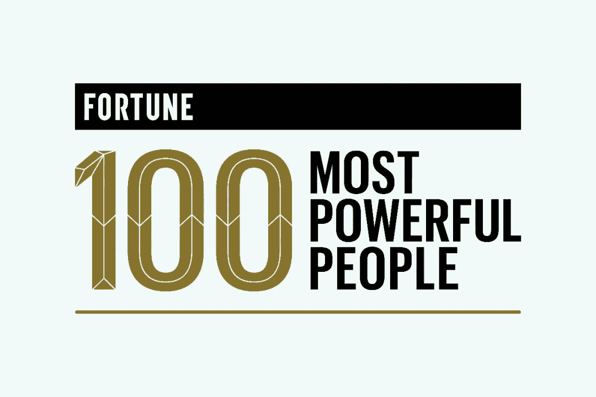

《财富》发布全球最具影响力的100位商界领袖。

这份榜单囊括了来自40个行业的领袖人物，年龄跨度从30多岁到90多岁，既包括知名的创始人和伟大公司的首席执行官，也包含了行业颠覆者和创新者。

上榜者中，有10位商界领袖来自中国的企业，他们创立或带领的企业不乏中国的科技巨头、新能源行业领跑者，以及影响年轻一代生活方式的新型社交媒体。

除了实现规模增长，这些商界领袖也正在打破行业和地域的壁垒，在全球市场扩大影响力。榜单上不包括已经不再活跃于商界的“化石级”亿万富翁，也没有政治人物、监管者或者二把手。

“最具影响力的商界领袖”榜单的上榜者都有一个共同的特质，那就是他们的言行和财富正在影响着他人的思想和行为。

人工智能（AI）正在快速成为科技和商业的核心动力。在《财富》全球最具影响力的100位商界领袖中，多位与AI深度关联的人物正在引领这场技术革命。

以下是AI领域的重要代表人物及其成就、挑战与未来展望，下面与【创意猎人】一起来看看：

## 01 埃隆·马斯克

特斯拉（Tesla）、太空探索技术公司（SpaceX）首席执行官兼创始人

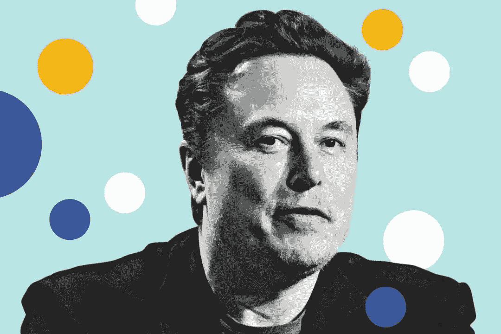

图片来源：FREDERIC J. BROWN—AFP/Getty Images

埃隆·马斯克（Elon Musk）虽然是特斯拉的首席执行官，但他的宏伟远景和工程直觉，却让他成为多个行业公认的领袖，尽管他有时会发表冷酷的言论，对员工会有苛刻的期待，这些都让他备受争议。今年秋季，太空探索技术公司（当前的估值为2,100亿美元）在测试其下一代“星舰”（Starship）火箭时，完成了一次历史性的工程壮举。他的另外一家公司Neuralink（估值为80亿美元）首次成功将脑机接口芯片植入人体，使一位瘫痪患者能够通过大脑来操控电脑鼠标。

然而，马斯克旗下的一些公司也经历了挫折，例如社交媒体平台X[前身为推特（Twitter）]面临的商业困境、Boring公司的员工在拉斯维加斯挖掘隧道时出现的安全问题，以及特斯拉自动驾驶软件的安全性正在接受联邦调查等。同时，马斯克在政治领域投入了更多的时间，他是唐纳德·特朗普竞选总统过程中最引人注目、捐款最多的支持者之一。

## 02 黄仁勋

英伟达（Nvidia）首席执行官兼创始人

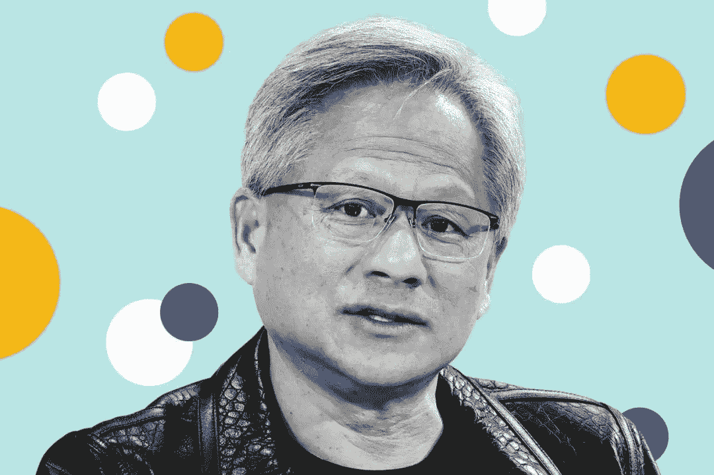

图片来源：Michael M. Santiago—Getty Images

在过去四十年间，黄仁勋（Jensen Huang）将英伟达从一家游戏显卡制造商，打造为人工智能热潮中举足轻重的公司之一。科技界的首席执行官们争相与爱穿皮夹克的黄仁勋会面，力求为他们的数据中心争取到英伟达珍贵的GPU芯片。与此同时，美国的拜登政府将这些芯片视为战略资产，限制中国获得英伟达最先进的产品。在黄仁勋的领导下，英伟达正“向上延伸”，从硬件业务拓展至直接向客户提供云计算服务和人工智能模型。黄仁勋设想了一种新范式：人工智能助手将成为我们与数字世界互动的主要接口，GPU将取代CPU（中央处理器）成为计算的核心驱动力。英伟达的市场主导地位使其股价暴涨至历史新高，市值突破了3万亿美元，跻身全球最有价值的公司之列。尽管有批评者质疑这种高估值的可持续性，但黄仁勋的影响力毋庸置疑。

## 03 萨蒂亚·纳德拉

微软（Microsoft）首席执行官兼董事长

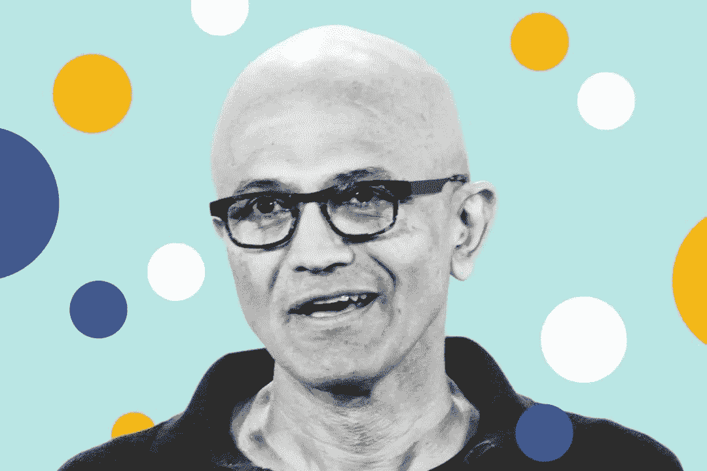

图片来源：JASON REDMOND—AFP/Getty Images

在执掌全球最大软件公司的十年间，萨蒂亚·纳德拉（Satya Nadella）成功推动微软完成了两次重大转型——从PC向云服务转型，再到如今的向人工智能转型。他颇有先见之明地提前投资OpenAI，让微软站上了科技巨头之巅，目前的市值达到3.1万亿美元。在他的领导下，微软的Azure云计算服务持续从亚马逊（Amazon）的AWS手中争夺市场份额，而微软的365商务办公软件套件在各行各业几乎无处不在。同时，微软旗下的GitHub Copilot已经成为软件开发者的必备工具。纳德拉并未止步不前，而是继续加大投入，增强微软的内部人工智能能力，同时在从自动驾驶汽车到量子计算等诸多领域，非常明智地对有潜力的初创公司进行投资。

纳德拉被认为是当今管理界最敏锐的战略家之一，他是极具魅力的领导者，并且富有同理心，《财富》美国500强公司的首席执行官、初创公司的创始人、投资者以及一些国家的总统和总理都深受他的影响。

## 06 蒂姆·库克

苹果（Apple）首席执行官

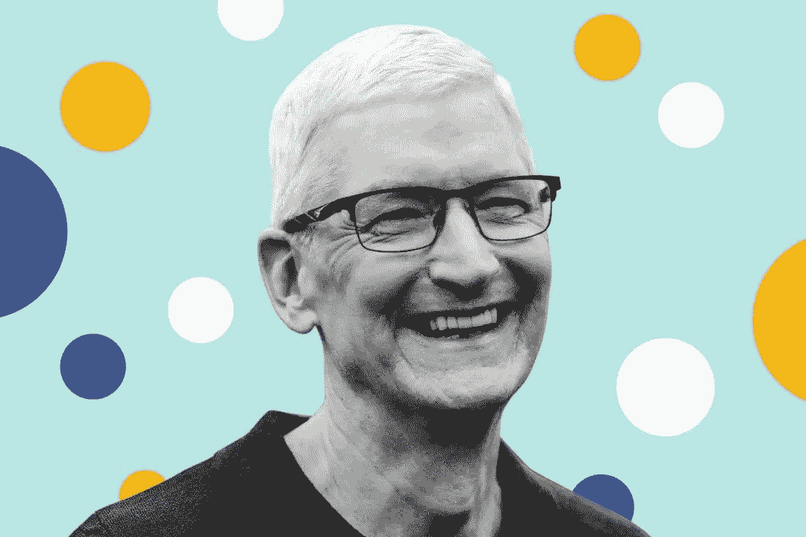

图片来源：Victor J. Blue—Bloomberg/Getty Images

在领导苹果公司的十余年间，首席执行官蒂姆·库克（Tim Cook）致力于在最畅销的产品iPhone手机的基础上，拓展公司的产品线。他取得了一些显著成就，包括推出了Apple Watch，并增强了云存储和音乐等在线服务业务。然而，他在其他方面的一些努力仍是进行时，比如今年推出的售价3,500美元的混合现实头戴设备Apple Vision Pro。此外，今年宣布的为新款iPhone手机整合人工智能（库克称之为Apple Intelligence）的计划也需要时间来实现。与此同时，iPhone手机在公司的业务中依然占据重要地位。投资者希望为最新和未来版本添加人工智能工具可以推动销售的增长，但中美之间日益加剧的贸易摩擦让这家公司在提升整体业务方面面临着更多的挑战。

## 07 马克·扎克伯格

Meta首席执行官、董事长兼创始人

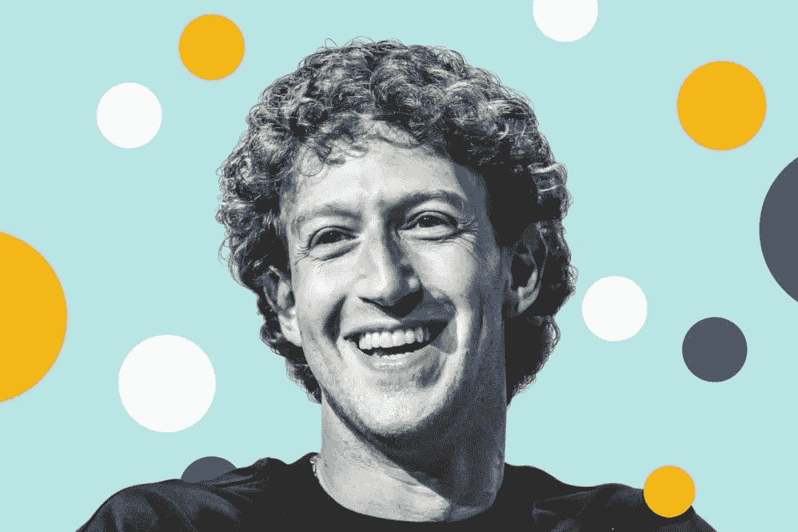

图片来源：David Paul Morris—Bloomberg/Getty Images

马克·扎克伯格（Mark Zuckerberg）有“重新创造”的天赋。这位Meta的掌门人褪去了昔日涂着防晒霜和留着凯撒式发型的书呆子形象，换上了设计师品牌的服装和金链子。与外表变化同样引人注目的是他带领公司实现了业务上的转型：在最初因为ChatGPT的崛起而措手不及之后，扎克伯格成功将Meta打造成蓬勃发展的生成式人工智能领域的领军者之一。

Meta推出的准开源大语言模型Llama被众多初创公司广泛采用，并为Meta旗下从Instagram和WhatsApp到备受欢迎的Meta Ray-Ban智能眼镜等一众产品的人工智能功能提供支持。尽管Meta因为社交媒体带来的社会问题而依旧面临批评，但公司通过收入的强劲增长（预计今年将增长20%，超过1,600亿美元）和严格的成本控制，重新赢得了投资者的信任。

## 08 萨姆·奥尔特曼

OpenAI首席执行官兼联合创始人

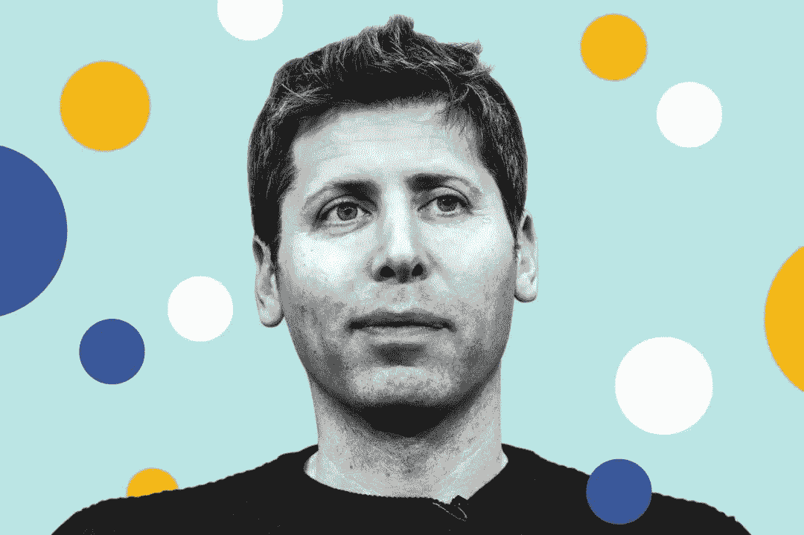

图片来源：Chris Ratcliffe—Bloomberg/Getty Images

萨姆·奥尔特曼（Sam Altman）已经成为人工智能热潮中的明星首席执行官。作为OpenAI的联合创始人兼首席执行官，奥尔特曼将一家曾经默默无闻的非营利研究实验室打造成了家喻户晓的品牌，当前的估值超过1,570亿美元，并且许多人认为它是自工业革命以来最重要的技术变革的引领者。其标志性产品ChatGPT每周吸引超过1亿用户，而其企业级产品更是广泛应用于多数《财富》美国500强公司。商界领袖和政府官员纷纷向奥尔特曼请教人工智能的未来影响，以及该技术所需要的巨额投资。

在2023年年底，奥尔特曼曾经被短暂解除职务，但迅速官复原职，这不仅彰显了他在OpenAI的不可或缺性，也突显了人工智能治理中的紧张关系。奥尔特曼仍然是一位颇具争议的人物，批评者认为他将产品发布置于安全考量和法律问题（例如版权）之上。另一些人则指出，他个人在科技初创公司中的数十亿美元投资构成了利益冲突，并担忧OpenAI每年烧掉数十亿美元的资金可能导致公司最终陷入困境。然而，无论人们爱他或憎他，奥尔特曼的影响力都不容忽视。

## 10 桑达尔·皮查伊

Alphabet（谷歌）首席执行官

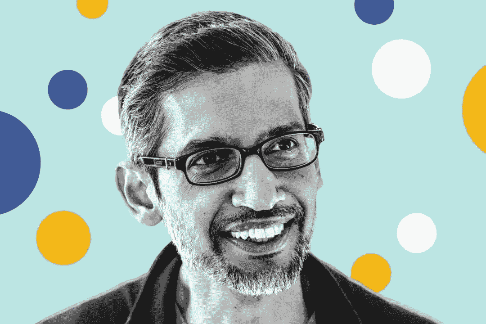

图片来源：David Paul Morris—Bloomberg/Getty Images

作为Alphabet公司的首席执行官，桑达尔·皮查伊（Sundar Pichai）领导的是全球最强大的科技巨头之一，公司旗下拥有谷歌（Google）、YouTube、安卓（Android）系统和Waymo自动驾驶汽车等顶尖业务，市值超过2万亿美元。皮查伊于2004年加入谷歌，之后逐步晋升，最终接替联合创始人拉里·佩奇担任最高职位。然而，他深知不能止步不前。反垄断监管机构正在迫切希望拆分这家公司（去年的利润为740亿美元），而生成式人工智能的兴起也可能削弱其主要利润来源——搜索广告业务。为此，皮查伊对公司的内部人工智能团队进行了多次重组。今年8月，他以27亿美元的价格获得了初创公司Character.AI的聊天机器人技术授权，并重新聘用了该公司的创始人（一位前谷歌员工）。

## 11 杰夫·贝佐斯

亚马逊（Amazon）董事长兼创始人

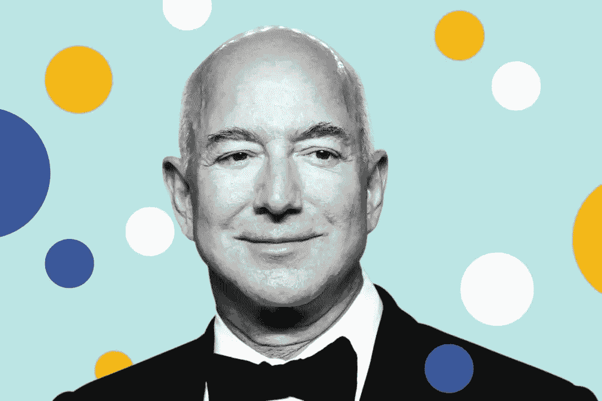

图片来源：MICHAEL TRAN—AFP/Getty Images

亚马逊的创始人杰夫·贝佐斯（Jeff Bezos）曾经作为公司内权力至高无上的首席执行官，执掌该零售巨头近三十年，如今他进入了人生的新阶段，监督旗下多家公司的首席执行官，包括亚马逊、蓝色起源（Blue Origin）火箭公司、《华盛顿邮报》（Washington Post）以及贝佐斯地球基金（Bezos Earth Fund）等。

蓝色起源在近两年内完成了首次载人航行，90岁的艾德·德怀特成为史上年龄最大的太空旅客；而规模高达100亿美元的地球基金则在持续投入资金以产生影响力，其中包括投入1亿美元用于支持由人工智能驱动的新气候解决方案。据彭博社（Bloomberg）估计，截至今年10月中旬，亚马逊的股价上涨了25%，使贝佐斯的财富攀升至2,120亿美元，仅次于太空竞赛的对手埃隆·马斯克。此外，贝佐斯还抽出时间在价值4亿美元的Koru号超级游艇上接待了全球知名名人，并造访了梵蒂冈，与教皇方济各会面。

## 22 比尔·盖茨

微软联合创始人

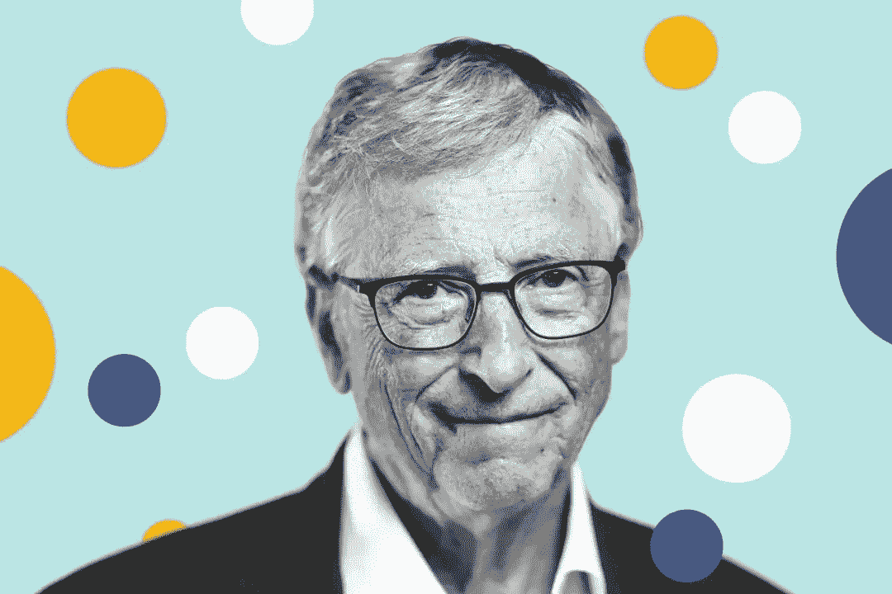

图片来源：Hollie Adams—Bloomberg/Getty Images

自2020年从微软董事会卸任以来，盖茨（Bill Gates）已经不再直接参与公司的事务。然而，作为21世纪大部分时间里的全球首富，他依然是微软最大的个人股东，这也为盖茨推动他重要的全球事业提供了持续的资源支持。盖茨基金会（Gates Foundation）是全球最受尊敬、资金实力最雄厚的慈善机构之一，该基金会致力于减少全球与疾病、农业和教育有关的不平等现象。他创办的Breakthrough Energy Ventures公司致力于开发气候解决方案。

此外，通过投资公司Cascade Investment，盖茨拥有四季酒店集团（Four Seasons）的多数股权，并被认为是美国最大的私人农场主。同时，他与前妻梅琳达·弗兰奇·盖茨及伯克希尔-哈撒韦的沃伦·巴菲特共同发起的“捐赠誓言”（Giving Pledge）项目，仍旧是推动富豪圈内慈善行动的重要力量。

## 24 马克·贝尼奥夫

赛富时首席执行官、董事长兼联合创始人

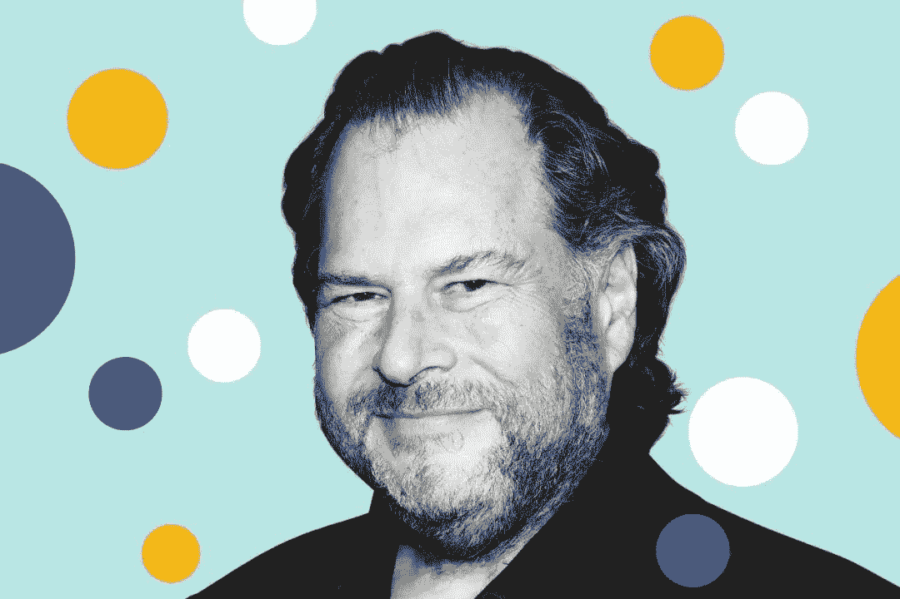

图片来源：Mike Coppola—Getty Images/TIME

赛富时（Salesforce）的首席执行官马克·贝尼奥夫（Marc Benioff）创立这家云计算先锋公司至今已经过去25年，当年他曾经宣称该公司代表了“软件的终结”。然而，在生成式人工智能时代，显然他并未停止大胆探索：今年，他带领公司完成了一次“重大转型”，推出了一个全新的人工智能代理平台Agentforce，并在公司于9月举行的年度Dreamforce大会上隆重亮相。贝尼奥夫对《财富》杂志表示，人工智能是“一场重大变革”，而赛富时要做到与时俱进。迄今为止，华尔街很满意赛富时的表现：在经过艰难的第一财季后，赛富时第二财季的业绩强势反弹，营收达到93.3亿美元，同比增长8%。投资者也很满意公司在Dreamforce大会上的表现，Agentforce发布后，赛富时的股价稳步上涨。

## 26 安迪·贾西

亚马逊首席执行官兼总裁

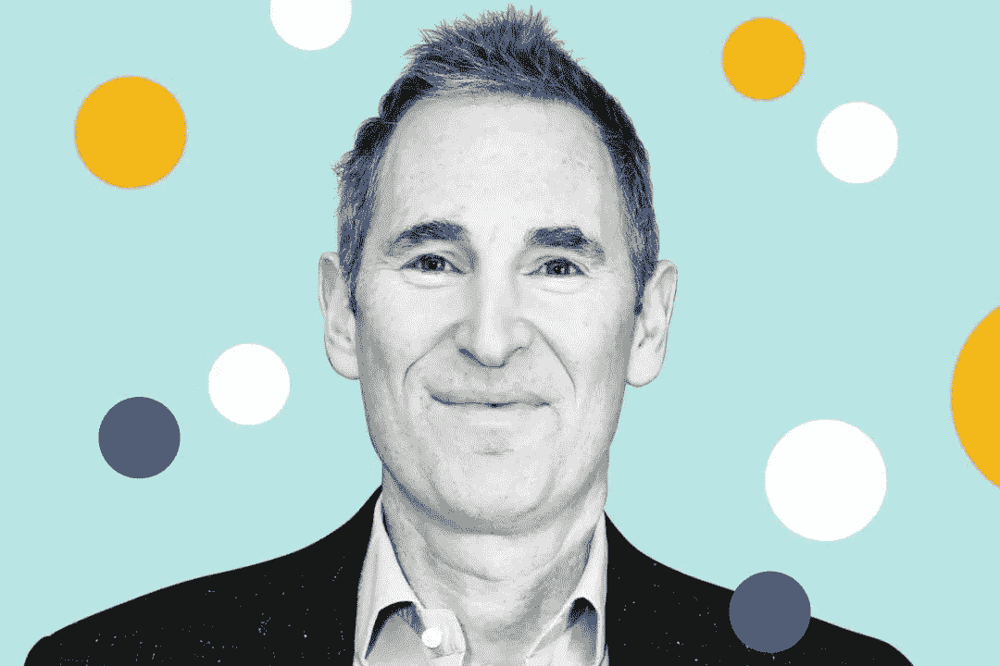

图片来源：Randy Shropshire—Getty Images/Vox Media

安迪·贾西（Andy Jassy）接替杰夫·贝佐斯担任亚马逊的首席执行官已经有三年时间，他似乎正在给亚马逊打上自己的烙印——他改造公司的措施并不仅限于大规模裁员。2024年，贾西的亚马逊在提升配送速度的同时，降低了服务购物客户的成本。此外，公司还通过一项价值200亿美元、为期11年的合同取得了NBA赛事的流媒体转播权，丰富了视频内容，并进一步强化了其500亿美元的广告业务。

同时，估值达千亿美元的AWS部门，在贾西的主持下完成了首席执行官的更替。生成式人工智能革命的爆发一度令AWS部门措手不及。再加上具有争议的每周五天返岗办公要求，亚马逊终于展现出贾西的个人管理风格。尽管部分员工对返岗政策表示抗议，但投资者似乎认可贾西的执行力与远见，推动亚马逊的市值在今年首次突破了2万亿美元。

## 33 谢尔盖·布林和拉里·佩奇

Alphabet（谷歌）联合创始人

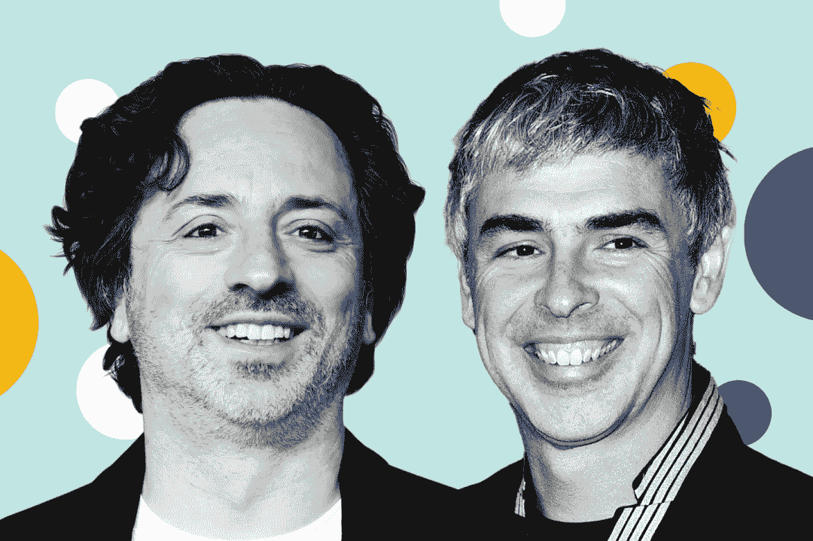

图片来源：MICHAEL TRAN—AFP/Getty Images, C Flanigan—FilmMagic

谷歌的联合创始人谢尔盖·布林（Sergey Brin）和拉里·佩奇（Larry Page）的净资产估计达到数千亿美元。他们原本能够在偏远的岛屿上悠闲度日，间或参加火人节（Burning Man），偶尔投资初创公司。然而，自从几年前两人淡出这家互联网搜索巨头及其母公司Alphabet的日常运营后，他们并未真正退休。布林重返谷歌总部，因为他迫切希望帮助谷歌的首席执行官在人工智能领域取得成功。

布林在9月的一次会议上表示：“作为一名计算机科学家，我从未见过如此令人兴奋的事情。”据报道，在谷歌以27亿美元让Character.AI的诺姆·萨泽尔回归公司一事中，布林发挥了关键作用。佩奇同样举足轻重——他坚定支持谷歌DeepMind的首席执行官戴密斯·哈萨比斯，并且在谷歌之外的科技投资中一直扮演着领导角色。鉴于他们的地位、强大的平台和雄厚的资本，可以预期在未来多年里，我们还会持续听到这对搭档的消息。

## 34 彼得·蒂尔

Palantir Technologies董事长兼联合创始人

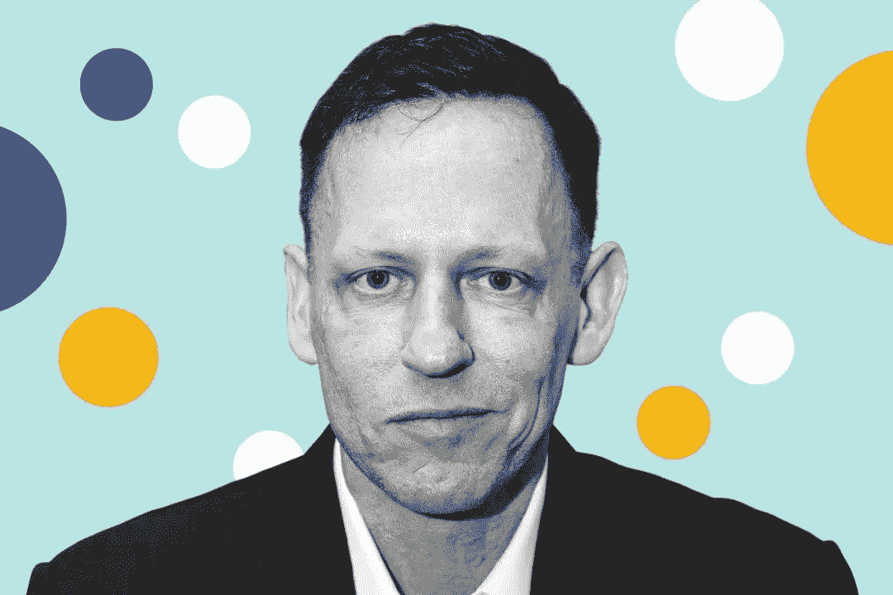

图片来源：Nordin Catic—Getty Images/The Cambridge Union

彼得·蒂尔（Peter Thiel）那无形的影响力堪称深远。就像他钟爱的J.R.R.·托尔金小说中的维拉一样（他已经用托尔金奇幻小说中的术语为六家公司命名），蒂尔神秘、强大，且令人难以捉摸。他担任董事长并与别人联合创立的Palantir Technologies公司非常神秘，该公司已经成为政府人工智能工作的首选供应商，估值接近1,000亿美元。他的Founders Fund投资来自各行各业的初创公司，比如帕尔默·拉基的Anduril Industries、汤姆·穆勒的Impulse Space和萨姆·奥尔特曼的OpenAI等。他的反大学教育的蒂尔奖学金（Thiel Fellowship）依旧是培育年轻企业家的另类平台。

除此之外，蒂尔在政治领域也颇具影响力。他毫不掩饰的自由意识保守主义立场，再加上他作为PayPal联合创始人和Facebook的第一批外部投资者获得的数十亿美元财富，为美国各地的右翼政治候选人提供了支持，包括特朗普的竞选伙伴JD·万斯。

## 35 萨弗拉·卡茨

甲骨文（Oracle）首席执行官

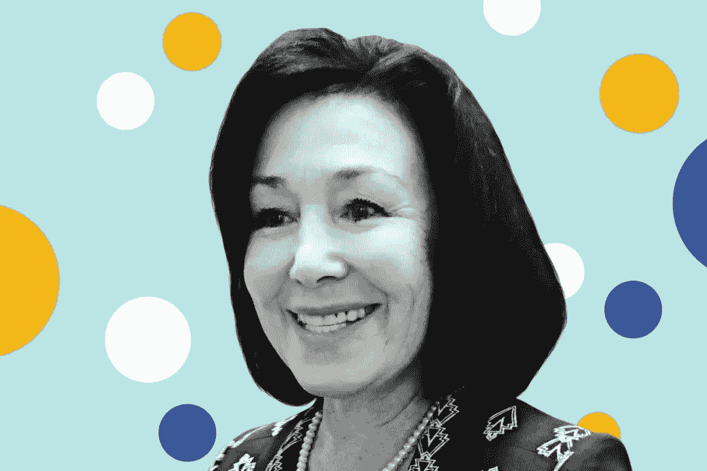

图片来源：Spencer Platt—Getty Images

作为硅谷的先锋企业，已经有47年历史的甲骨文在云计算领域一直落后于亚马逊、微软和谷歌，但于2019年担任甲骨文首席执行官的萨弗拉·卡茨（Safra Catz）很清楚，大公司并不打算弃用该公司在市场上领先的数据库软件。她通过与竞争对手合作，为客户提供在Microsoft Azure、Google Cloud和Amazon Web Services等平台上使用甲骨文产品的选择，帮助总部位于奥斯汀的甲骨文迎头赶上。今年9月，甲骨文公布的盈利超出预期，季度营收达到133亿美元（同比增长7%），之后公司与竞争对手的联盟关系引起了投资者的关注，令投资者兴奋不已；有多位分析师预计未来甲骨文将实现两位数增长。经过最近的一系列合作，卡茨对甲骨文在人工智能领域的前景同样充满信心，例如甲骨文与OpenAI合作，以提供额外的云基础设施，用于训练其人工智能模型。

## 36 苏姿丰

AMD首席执行官兼董事长

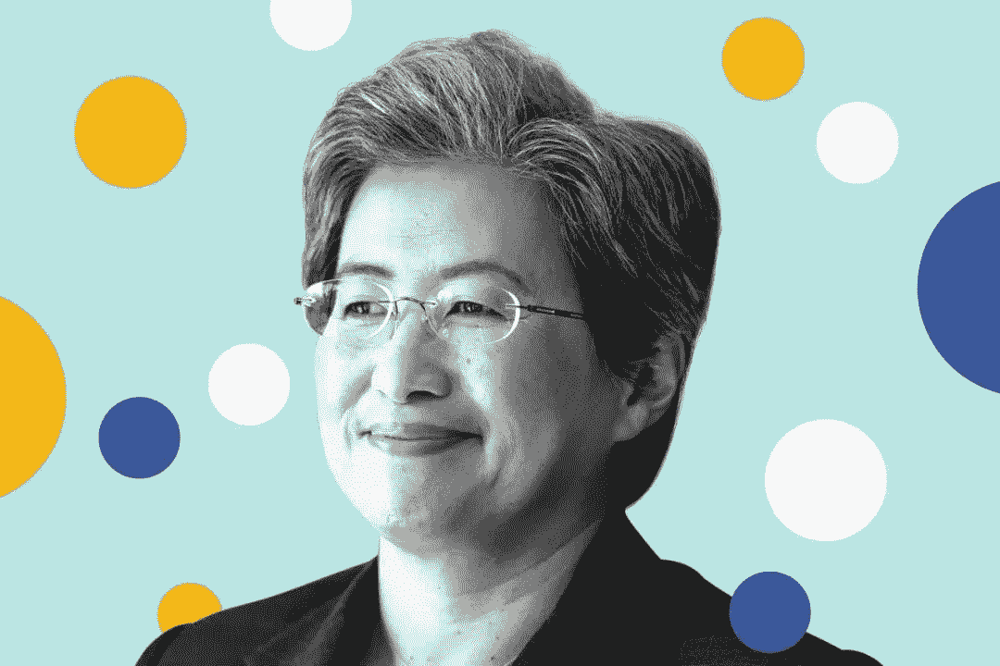

图片来源：Marlena Sloss—Bloomberg/Getty Images

# 苏姿丰（Lisa Su）

在AMD担任首席执行官的十年里，苏姿丰（Lisa Su）成功领导这家芯片制造商实现业务多元化，从PC微处理器业务扩展到游戏和高性能计算等关键领域。然而，目前最重要的战场在于数据中心人工智能芯片的竞争。毋庸置疑，英伟达在这一领域占据绝对优势，市场份额超过90%，但即便位列第二，也能够获得丰厚回报。AMD的首款Instinct MI300芯片在第二季度的销售额超过10亿美元，去年公司的收入达到227亿美元。AMD希望通过不断丰富产品线进一步增加公司收入。为增强挑战英伟达的实力，AMD今年还收购了芬兰的人工智能公司Silo。

# 38

## 马克·安德森

### 安德森·霍洛维茨公司普通合伙人兼联合创始人

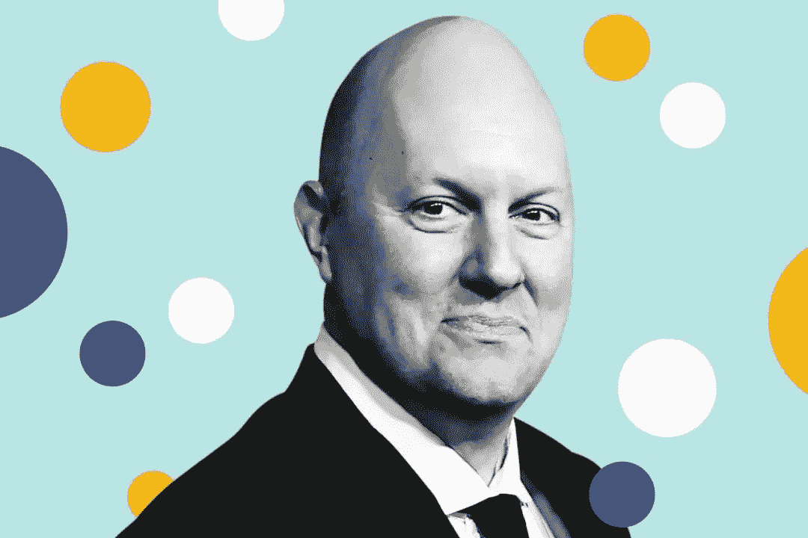

图片来源：Tayfun Coskun—Anadolu/Getty Images

无论人们如何看待马克·安德森（Marc Andreessen），他的言论总能引起关注。这位风险投资家是驱动全球经济的现代科技产业的重要缔造者之一，早在20世纪90年代初，他便参与创立了首个主流网页浏览器Netscape Navigator。2009年，他参与创立了风投公司安德森·霍洛维茨（简称a16z），该公司投资了爱彼迎（Airbnb）、Facebook、Stripe、GitHub和Lyft等一些在科技界知名度极高的公司。

目前公司管理的资产达440亿美元，并且正在向公开市场投资、财富管理和私募股权等领域扩张。安德森在2011年发表的一篇前瞻性文章《为什么软件正在吞噬世界》（Why Software Is Eating the World）扩大了他在科技圈外的影响力。然而，安德森最近的一些预测和主张，包括支持不受限制的发展人工智能和支持唐纳德·特朗普竞选总统等，都带有一种对抗性的语气，这种态度让这位互联网先驱在硅谷成为一位争议性人物。

# 40

## 魏哲家（C.C. Wei）

### 台积电（TSMC）首席执行官兼董事长

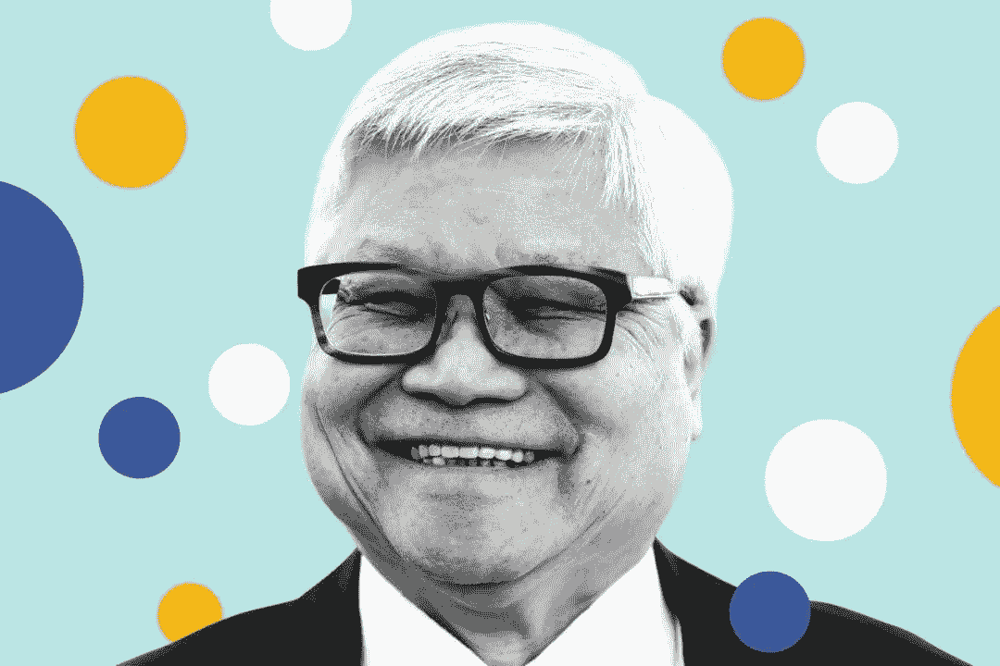

图片来源：Liesa Johannssen—Bloomberg/Getty Images

很少有公司重要到成为外交政策的议题，但台湾积体电路制造公司（Taiwan Semiconductor Manufacturing Co.）是一个例外。台积电是全球最大的芯片代工厂商和亚洲最有价值的公司，是苹果和英伟达等客户的主要供应商，也是唯一可以量产最先进芯片的公司。自今年6月起担任董事长的魏哲家，正在带领台积电迎接人工智能热潮，有望使公司2024年的营收再创新高。与此同时，随着各国政府纷纷向芯片制造商投入资金，以期实现供应链多元化（但可能成本更高），台积电正在美国、日本和德国投资建厂。

# 42

## 苏世民

### 黑石集团首席执行官、董事长兼联合创始人

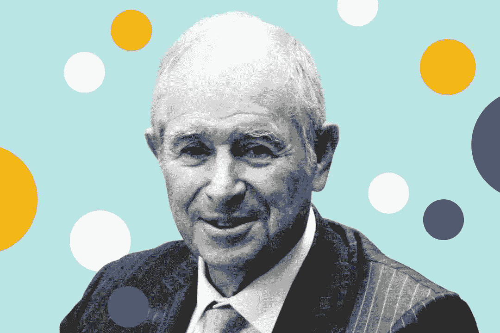

图片来源：Noriko Hayashi—Bloomberg/Getty Images

在苏世民（Stephen Schwarzman）的领导下，黑石集团（Blackstone）成为全球最大的另类投资公司。苏世民在黑石集团担任董事长、联合创始人兼首席执行官。创立于1985年的黑石集团的管理资产已经超过1.1万亿美元，并在2023年实现了80亿美元的收入。苏世民不仅是金融界的巨擘，还在人工智能领域具有重大影响力。作为人工智能技术的早期倡导者，他已经向人工智能教育和研究领域捐款约5亿美元。今年9月，黑石集团与亚太地区领先的数据中心平台AirTrunk签订了一份最终收购协议，交易总值达240亿美元。

# 44

## 亚历克斯·卡普

### Palantir Technologies首席执行官兼联合创始人

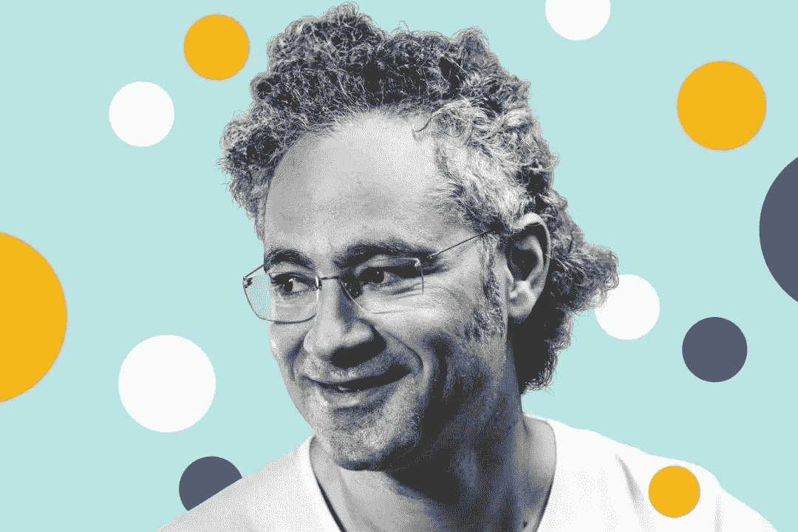

图片来源：David Paul Morris—Bloomberg/Getty Images

当其他公司都在思考人工智能投资如何才能获得回报时，Palantir Technologies公司的联合创始人兼首席执行官亚历克斯·卡普（Alex Karp）似乎已经找到了答案。这家人工智能数据分析公司在2023年实现盈利，并于9月被纳入标准普尔500指数，使其股价屡创新高。公司与政府机构特别是国家安全部门的长期合作关系，令其在地缘政治动荡加剧的时期占据了优势。

卡普拥有斯坦福大学（Stanford University）的哲学博士学位和法律学位。他从2003年创建Palantir Technologies公司以来一直担任首席执行官。他公开支持增强美国的军事实力，以及对抗敌对势力的坚定外交政策——这种世界观正好符合Palantir Technologies公司的商业利益。

# 45

## 亚西尔·鲁马扬

### 公共投资基金（Public Investment Fund）总裁

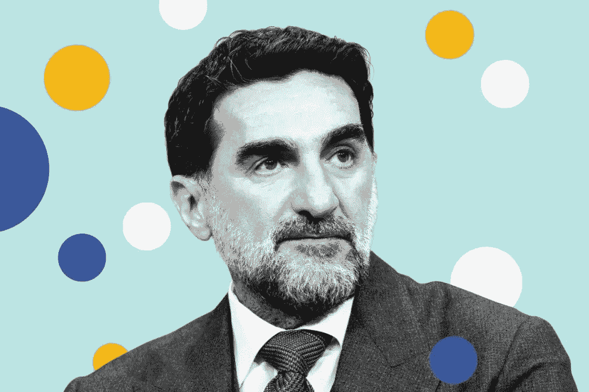

图片来源：Chris Ratcliffe—Bloomberg/Getty Images

亚西尔·鲁马扬（Yasir Al-Rumayyan）因为担任沙特阿拉伯的主权财富基金公共投资基金的总裁而闻名。鲁马扬全权负责其运营。该基金是全球最大的主权财富基金之一，今年的管理资产超过9,250亿美元。鲁马扬同时还担任全球最有价值的上市公司、石油巨头沙特阿美（Saudi Aramco）的董事长。

公共投资基金是沙特摆脱石油依赖战略的核心，在鲁马扬的领导下，该基金成为美国一些最具颠覆性的公司的重要投资者，包括黑石集团、Uber和特斯拉等。公共投资基金当前正在人工智能领域加大投资力度，在今年2月创立了先进制造公司Alat，并于2021年创立了沙特人工智能公司（Saudi Company for Artificial Intelligence）。公共投资基金还在进一步拓展体育业务。2024年夏季，公共投资基金将其对英超俱乐部纽卡斯尔联队（Newcastle United）的持股比例提升至85%，鲁马扬同时担任该俱乐部主席。该基金还拥有沙特职业联赛的多个俱乐部，包括葡萄牙著名球星克里斯蒂亚诺·罗纳尔多担任队长的利雅得胜利队（Al-Nassr）。

# 48

## 丹妮拉·阿莫迪和达里奥·阿莫迪

### Anthropic首席执行官兼联合创始人（达里奥）

### Anthropic总裁兼联合创始人（丹妮拉）

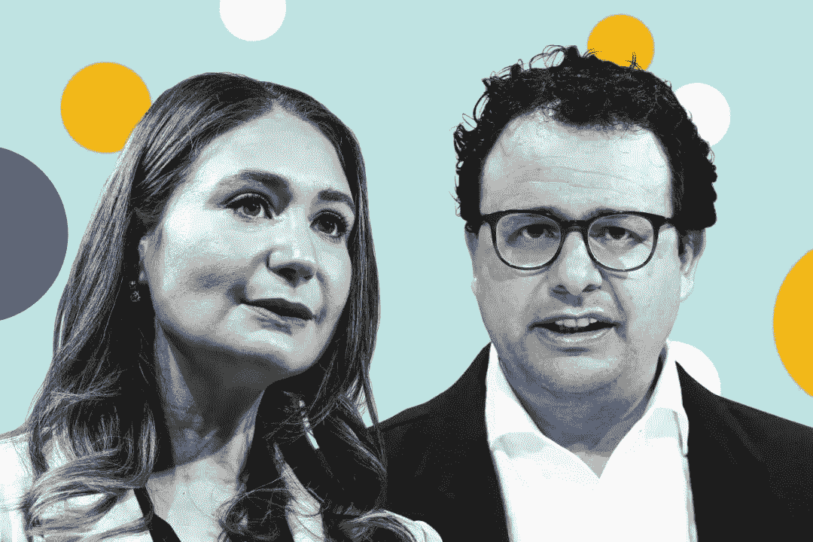

图片来源：David Paul Morris—Bloomberg/Getty Images, Chesnot—Getty Images

有资源训练最前沿生成式人工智能模型的公司并不多，而在美国，除了大型科技公司以外，只有OpenAI和Anthropic这两家公司具备这样的实力。达里奥（Dario Amodei）与丹妮拉·阿莫迪（Daniela Amodei）兄妹二人于2021年辞去了OpenAI的高管职位，创立了“人工智能安全和研究”公司Anthropic。据爆料他们之所以离职，是因为OpenAI在接受微软投资后改变了方向。

Anthropic自创立以来已经获得亚马逊40亿美元和谷歌20亿美元的投资。目前，阿莫迪兄妹和他们的团队正寻求新的融资，估值约400亿美元。Anthropic的Claude聊天机器人已经被认为是OpenAI和谷歌产品的有力竞争对手，公司最近也加大了向企业提供人工智能服务的力度，使竞争变得更加激烈。

# 52

## 山塔努·纳拉延

### Adobe董事长兼首席执行官

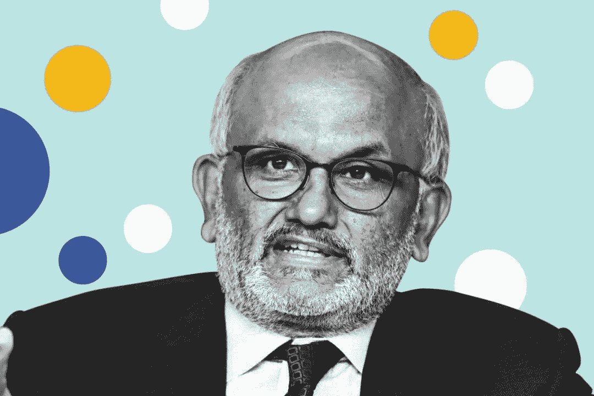

图片来源：SAJJAD HUSSAIN—AFP/Getty Images

Adobe的首席执行官山塔努·纳拉延（Shantanu Narayen）全力押注人工智能。持续多年对深度伪造技术（Deepfake）敲响警钟后，他开始让公司的创意客户群相信，生成式人工智能只会提供协助而不会抢走人类的工作。今年，Adobe在创意云服务套件中发布了100项全新人工智能功能，尽管大部分工具都包含在标准订阅价格中，不过即将推出的视频功能可能收取更高的价格。纳拉延于2007年就任首席执行官，带领Adobe将年收入从接手时的30亿美元增长到去年年底的190多亿美元。

# 55

## 鲁洛夫·博塔

### 红杉资本（Sequoia Capital）管理合伙人

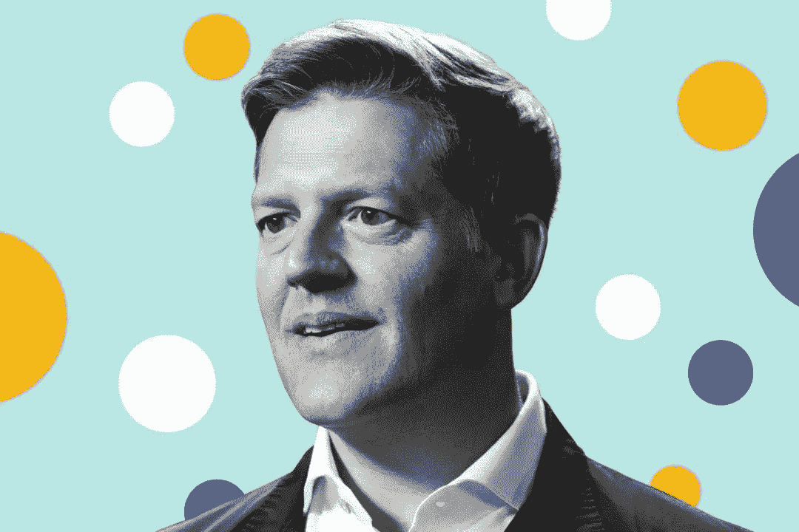

图片来源： Jason Alden—Bloomberg/Getty Images

鲁洛夫·博塔（Roelof Botha）虽然不是红杉创始人，但俨然已经成这家硅谷传奇风投的代言人。（他的正式头衔是“负责人”。）博塔曾经是“PayPal黑手党”的成员，于2003年加入红杉，主导了对YouTube、Instagram和Square等公司极具眼光的投资。自从2022年7月博塔担任最高职位以来，他经历了一些关键时刻，包括拆分中国业务，以及对FTX灾难性押注后安抚投资者等。博塔还支持PayPal前同事兼南非同胞埃隆·马斯克，带领红杉协助马斯克收购推特，今年早些时候xAI的60亿美元融资也有参与。

# 57

## 雷军

### 小米首席执行官、董事长、创始人

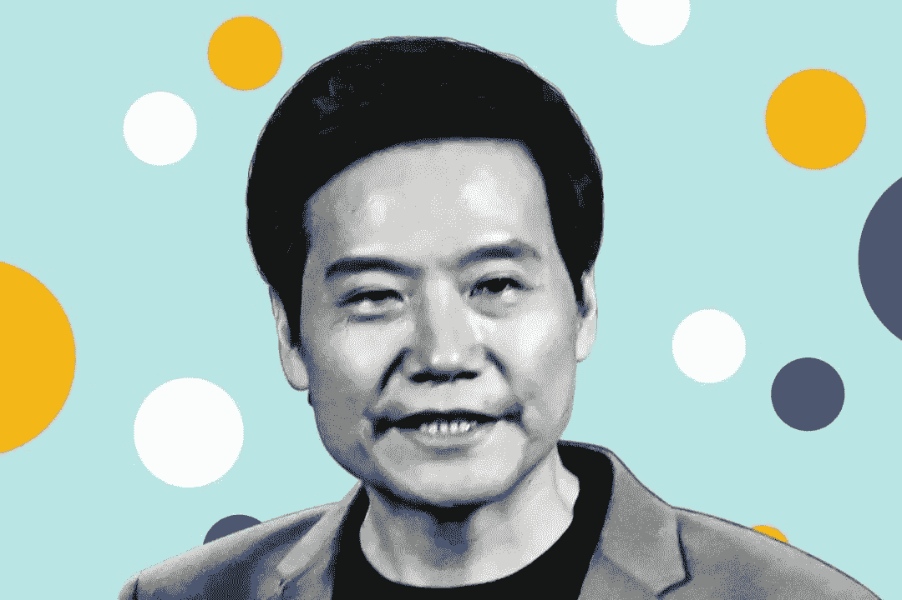

图片来源：MICHAEL ZHANG—AFP/Getty Images

全球第三大手机制造商小米的创始人雷军一直将史蒂夫·乔布斯视为榜样。但现在雷军实现了苹果未达到的成就：造电动汽车。小米称，SU7于3月下旬发布，一个月内的销量超过7万辆，连福特的首席执行官吉姆·法利都赞不绝口。以智能手机闻名的小米预计，到11月电动汽车总交付量将超过10万辆。雷军表示，2021年小米被短暂列入美国贸易黑名单是转向造车的灵感。为什么小米能够在苹果失败的地方成功？因为雷军为了第一台样车投入100亿元（约合14.2亿美元），还有3,400名工程师。

# 69

## 尼尔·莫汉

### YouTube首席执行官

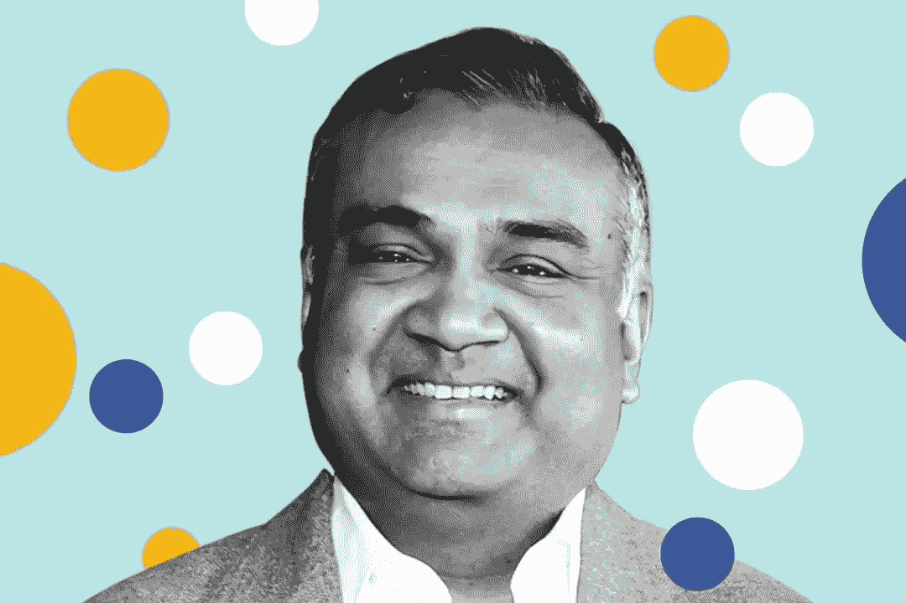

图片来源：Kevin Mazur/\—Getty Images/Made on YouTube 2024

2023年，尼尔·莫汉（Neal Mohan）从苏珊·沃西基的手中接过接力棒，被任命为YouTube的首席执行官，彼时他还名不见经传。然而在科技圈里，莫汉以精通广告闻名，稳健的风格和对内部流程的关注对YouTube的成功至关重要，他在YouTube担任产品和政策主管。在就任首席执行官后，莫汉加倍努力开发YouTube的短视频产品Shorts，与TikTok和Instagram Reels竞争，增加新的人工智能功能，还推出收入分成吸引创作者。与此同时，YouTube Music和Premium的订阅用户已经超过1亿，YouTube TV的付费用户也超过了800万。

# 72

## 拉里·埃里森

### 甲骨文董事长兼联合创始人

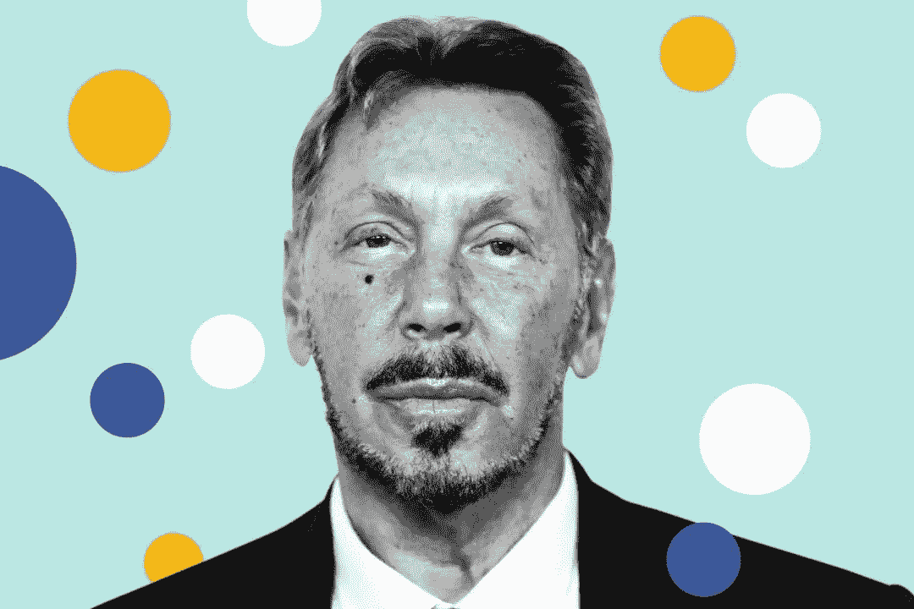

图片来源：Phillip Faraone—Getty Images

拉里·埃里森（Larry Ellison）离任甲骨文的首席执行官已经有十年时间，距离他联合创立该家软件巨头也将近半个世纪。但哪怕这位80岁的亿万富翁身在夏威夷的私人岛屿上，在硅谷的影响力却丝毫不减。他仍然是数据库和云公司甲骨文的首席技术官兼执行董事长，过去一年里由于对生成式人工智能的需求年度业绩节节走高，埃里森超过2000亿美元的净资产又增加了140亿美元。埃里森在好莱坞也有一席之地，他的儿子大卫·埃里森斥资80亿美元收购了派拉蒙公司（Paramount），并担任首席执行官。老埃里森资助了该笔交易，不过派拉蒙最近澄清称大卫将有投票权。

# 74

## 维诺德·科斯拉

### Khosla Ventures管理合伙人、创始人

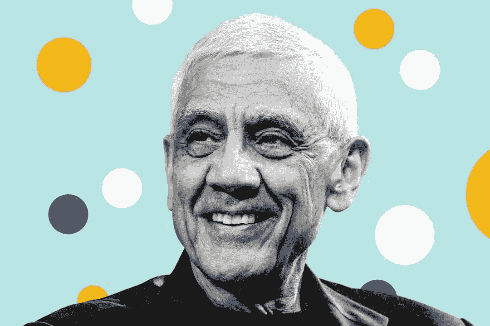

图片来源：David Paul Morris—Bloomberg/Getty Images

69岁的科斯拉（Vinod Khosla）是硅谷最有影响力的投资者之一。科斯拉来自印度，他1982年共同创立了Sun Microsystems，开发了一系列开源软件。之后他在风投公司Kleiner Perkins工作了18年，20世纪90年代投资了一些成功的光纤和互联网公司。更值得一提的是Juniper Networks，该公司于1999年上市，Kleiner Perkins的回报达到2,500倍。

2004年，科斯拉成立了自己的公司，投资医疗、可持续发展和人工智能初创公司。2019年，科斯拉进行了可能最大一笔押注，当时他的公司给OpenAI开出一张5,000万美元的支票。去年年底，OpenAI的董事会解雇了首席执行官萨姆·奥尔特曼，科斯拉也是第一批要求重新聘用奥尔特曼的人之一。最近，科斯拉因为预测大多数工作将被人工智能替代而广受关注。

# 78

## 安蒙

### 高通（Qualcomm）总裁兼首席执行官

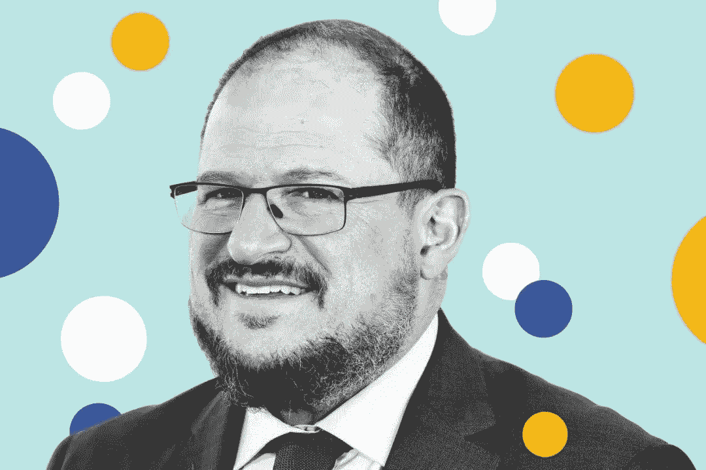

图片来源：Stefan Wermuth—Bloomberg/Getty Images

长期以来，安蒙（Cristiano Amon）一直是高通的关键人物。他负责监督芯片巨头高通在4G和5G无线领域的工作，以及大获成功的骁龙（Snapdragon）系列移动处理器开发。不过自2021年出任首席执行官以来，这位巴西工程师终于让高通成为英特尔（Intel）和AMD等传统PC处理器公司强大的竞争对手，尤其是在人工智能热潮兴起之后。高通公司新推出的骁龙X芯片组采用了移动领域普遍应用的ARM架构，近几个月制造商开始销售的很多人工智能电脑中都已经采用。据报道，市值达到1,930亿美元的高通正在考虑收购陷入困境的英特尔。

# 79

## 孙正义

### 软银集团首席执行官、董事长、创始人

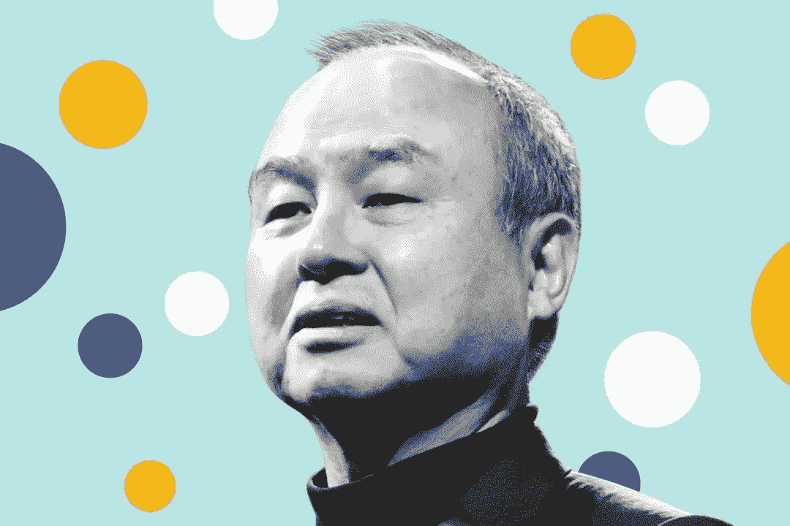

图片来源：Tomohiro Ohsumi—Getty Images

孙正义（Masayoshi Son）是一位大胆的日本企业家，1981年，他创建软银集团（SoftBank Group），不过更出名的是对其他公司颇具胆识的押注。孙正义最著名的战绩是2000年软银向阿里巴巴的2,000万美元投资，在去年软银出售大部分股份之前，这笔投资的回报达到720亿美元。不过，其他交易并没有如此成功。2017年，孙正义推出了1,000亿美元的软银愿景基金（SoftBank Vision Fund），向共享办公空间WeWork投资了数十亿美元，然而该公司于2023年申请破产。然后是英伟达。

2019年，软银出售了持有英伟达的股份，错过了当前人工智能热潮的巨大收益。今年6月，《财富》杂志报道称，如果软银仍然持有英伟达，价值就将超过1,600亿美元。今年，孙正义和软银似乎有所调整。OpenAI最近的66亿美元融资里，软银参与其中。软银支持的半导体设计公司Arm于2023年年底上市，股价自发行时的51美元已经上涨近两倍。

# 80

## 马化腾

### 腾讯公司董事会主席兼首席执行官、联合创始人

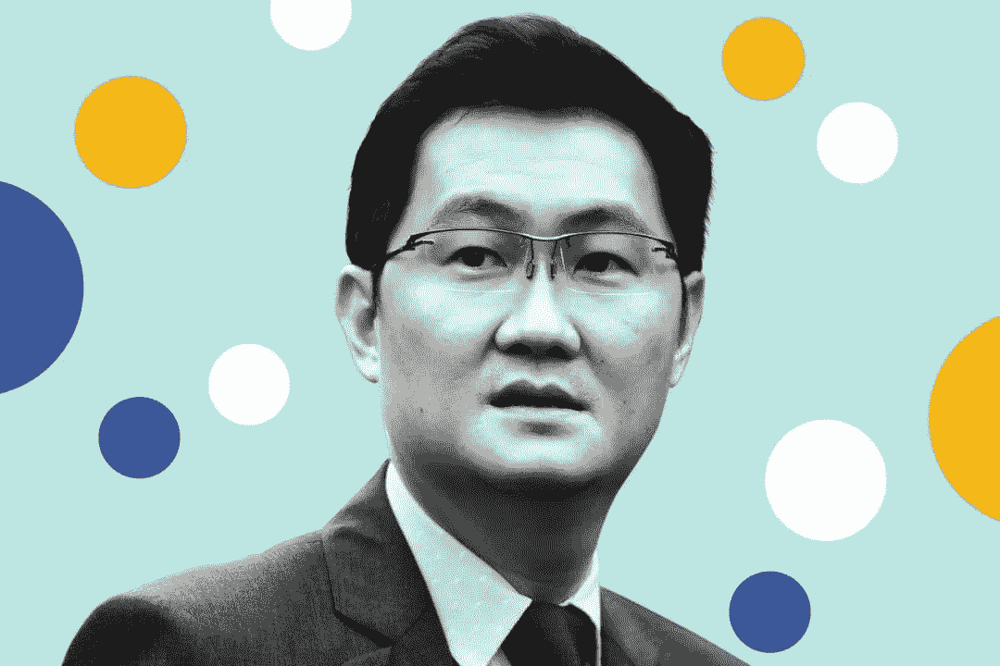

图片来源：Visual China Group—Getty Images

马化腾是中国互联网中坚力量腾讯的联合创始人、董事会主席兼首席执行官。这家中国科技巨头运营着超级应用程序🛰️，月用户超过13亿。低调的马化腾将腾讯发展成为科技巨头，也是全世界最大的视频游戏公司之一，在Supercell、Riot、Epic Games和育碧（Ubisoft）等公司都持有股份。2024年至今，腾讯的股价已经上涨逾40%。

# 84

## 陈嘉兴

### Y Combinator Management总裁兼首席执行官

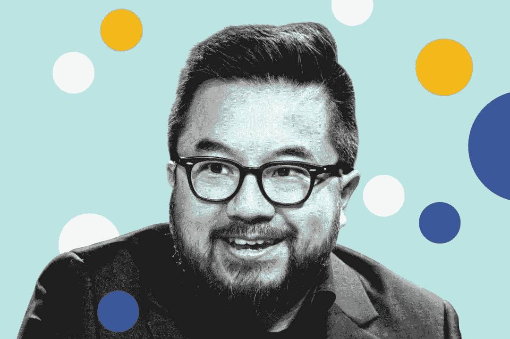

图片来源：David Paul Morris—Bloomberg/Getty Images

陈嘉兴（Garry Tan）是硅谷著名加速器项目Y Combinator（YC）的执掌人，爱彼迎（Airbnb）、Instacart和Reddit等科技大拿都起步于该项目。自2023年年初担任首席执行官以来，陈嘉兴一直利用其平台——通常还有他在社交媒体上的知名度——来改造加速器，为创始人加油，并抨击地方官员，以重塑旧金山的政治生态。他在2022年资助了罢免旧金山地区检察官的活动，还帮助罢免了三名学校董事会成员。他会在X上定期发表评论，因为偶尔的极端化而出名。在YC，他敢于大刀阔斧地改革，比如赶走投资者、削减对初创企业的后期投资、将每年的加速器课程数量增加一倍，并将总部从加州山景城迁至旧金山。

# 92

## 张一鸣

### 字节跳动创始人

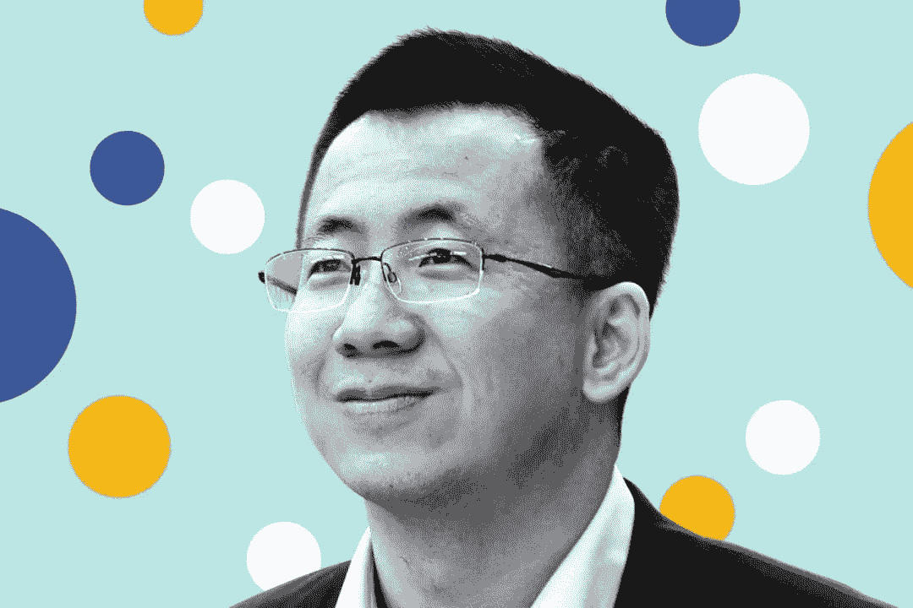

图片来源：Zheng Shuai—VCG/Getty Images

年仅41岁的张一鸣已经创立了全球最有价值的初创企业，最近的报道也将其列为中国首富。尽管在美国和印度尼西亚面临监管挑战，但字节跳动得益于在视频分享平台TikTok和抖音上取得的巨大成功，已经对世界各地的文化带来了深远影响。张一鸣于2021年卸任字节跳动首席执行官兼董事长，并将权力移交给梁汝波，后者目前身兼两职。不过，有消息称张一鸣依然参与公司决策。路透社透露，这位科技创始人仍旧持有大部分表决股份。

# 96

## 约书亚·库什纳

### Thrive Capital首席执行官兼创始人

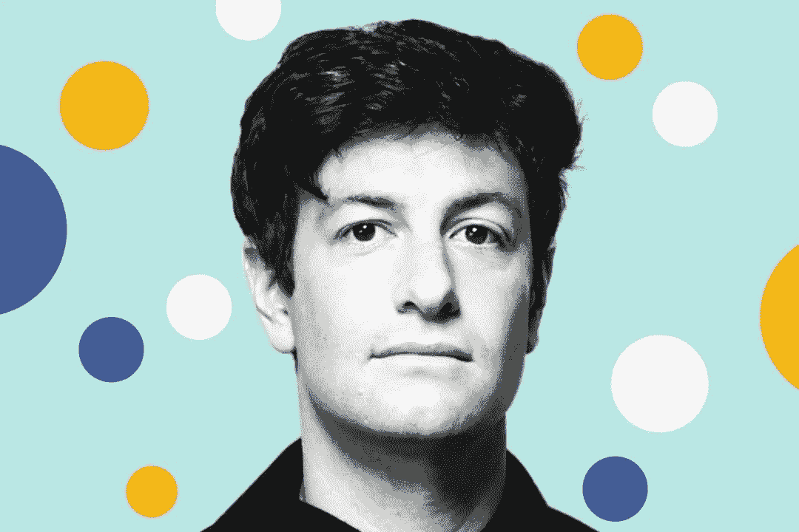

图片来源：Mackenzie Stroh

随着OpenAI知名度的飙升，约书亚·库什纳（Josh Kushner）的知名度也是水涨船高。其公司Thrive Capital已经领投了这家人工智能初创公司的多轮融资，而OpenAI目前的估值也达到了1,570亿美元。约书亚·库什纳是房地产开发商查尔斯·库什纳的儿子，也是特朗普的前高级顾问贾里德·库什纳的兄弟。

约书亚在十多年前创建了Thrive Capital。早期成功的投资包括Warby Parker、Twitch和Instagram；该公司还入股了GitHub、Stripe和金·卡戴珊的Skims。OpenAI的萨姆·奥尔特曼去年在接受《财富》杂志库什纳个人专栏采访时表示：“约书亚对高品质公司和创始人总是高度信任，他不太在乎其他投资者的想法。这让我感受到了满满的情谊。”

---

从《财富》榜单可以看出，AI领域的领导者正在塑造未来技术版图。他们不仅是技术先锋，更是商业战略家，为AI的全球化应用开辟了新天地。这些人物的努力不仅改变了企业格局，也在重新定义我们的生活方式。

`https://aigcreative.feishu.cn/sync/K4Gvd9vUQsy9Oubwqaeclu0Fnbg`
