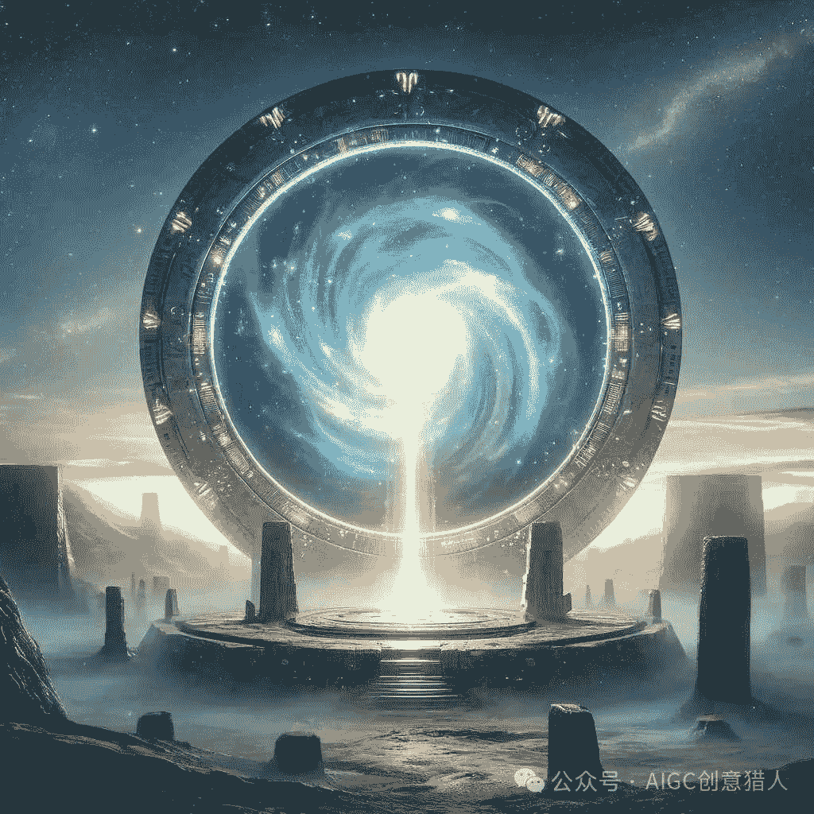
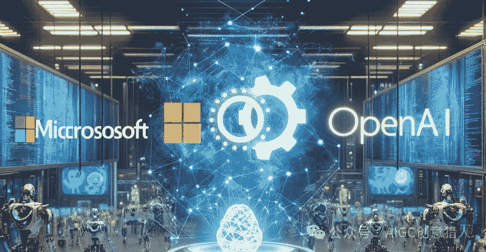
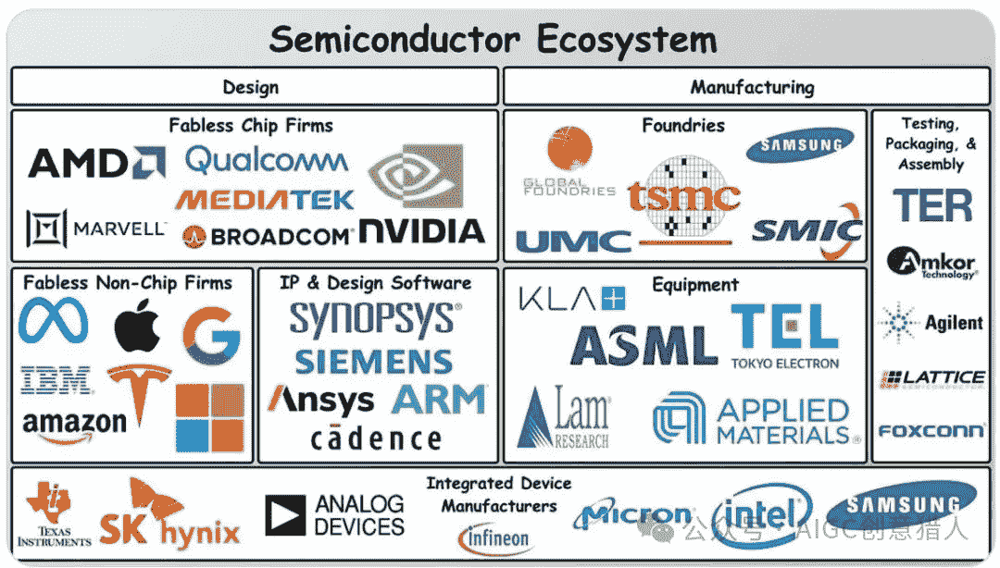
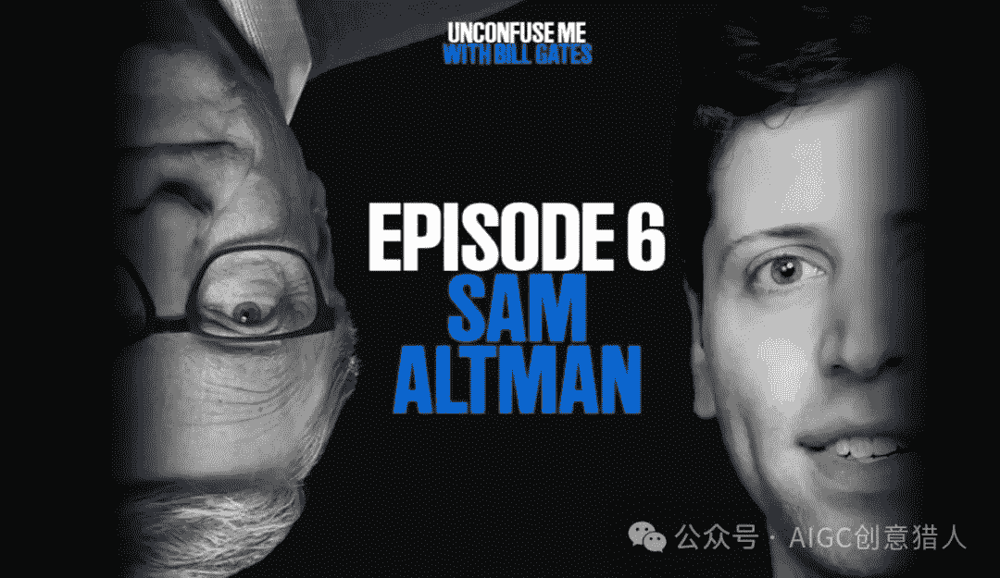

# 20230330-巨头野心：微软联手OpenAI打造"星际之门"，1000亿美元能否开启AI新纪元？

> 来源：[https://aigcreative.feishu.cn/docx/IjzhdBRQEoSs4nx1e3hcxAfSnJg](https://aigcreative.feishu.cn/docx/IjzhdBRQEoSs4nx1e3hcxAfSnJg)

> 链接：https://mp.weixin.qq.com/s/xfpa5mHwIo9H3hVzChmggw

近日，科技巨头微软与人工智能研究机构OpenAI正在谋划一个宏伟的计划，他们打算共同打造一台前所未有的人工智能超级计算机，名为“星际之门（Stargate）”。这个项目不仅是技术上的一次飞跃，更是对未来计算能力的一次大胆预测。

一台拥有数百万服务器芯片的超级计算机，它的计算能力将是现有最大数据中心的百倍。这听起来像是科幻小说中的情节，但微软和OpenAI正将这一梦想变为现实。

据悉，这个项目的投资规模可能高达1000亿美元，这是一个前所未有的数字，足以见证两家公司对未来科技发展的信心和决心。

微软与OpenAI的合作由来已久。早在2019年，微软就对OpenAI进行了初步投资，并为其打造了第一台包含数千个GPU的超级计算机。随着时间的推移，微软在该系统上的投入已经累计达到12亿美元。而现在，他们计划在未来两年内，向OpenAI提供配备数十万个GPU的服务器，以进一步支持其在人工智能领域的研究与开发工作。

“星际之门”项目的构想，是在一次偶然的讨论中诞生的。微软的高管们和OpenAI的首席执行官山姆·奥特曼（Sam Altman）在深入交流后，共同勾勒出了这个宏伟蓝图。他们相信，这台超级计算机将成为推动人工智能发展的强大引擎，为未来的科技创新提供无限可能。

然而，要实现这样一个宏伟的项目，面临的挑战也是巨大的。首先是资金问题，1000亿美元的投资规模，对于任何公司来说都不是一个小数目。其次是技术问题，如何在单个机架内集成更多的GPU，同时解决散热问题，以及如何连接数百万个GPU以快速处理大量数据，这些都是需要攻克的技术难题。

不过，微软和OpenAI似乎已经做好了准备。他们正在探讨利用核能等替代能源，以应对未来可能出现的能源挑战。奥特曼本人也曾表示，开发超级智能可能需要在能源领域取得重大突破。这不仅是技术上的创新，更是对未来能源问题的一次深刻思考。

“星际之门”项目的成功与否，将直接影响到OpenAI能否在超级智能领域取得颠覆性的突破。目前，OpenAI已经发布了多个版本的GPT模型，包括广受欢迎的ChatGPT。这些模型在语言理解和生成方面已经取得了显著的成果。但OpenAI并不满足于此，他们的目标是开发出更加先进的人工智能模型，能够自我改进，自我进化。

在这个过程中，微软的角色也不可忽视。作为OpenAI的合作伙伴，微软不仅提供了资金支持，还将OpenAI的技术整合到了自己的产品中。比如，微软的Office、Teams和必应搜索都已经开始使用OpenAI的人工智能技术，为用户提供更加智能的服务。

尽管“星际之门”项目还在早期阶段，但它已经引起了业界的广泛关注。专家们认为，这个项目不仅将推动人工智能技术的发展，还可能成为未来科技行业的一个新标杆。如果成功，它将为人工智能的发展提供强大的动力，开启一个全新的科技时代。

在这个充满未知的科技发现进程中，微软和OpenAI正携手前行，他们的目标是打造一个更加智能的未来。而“星际之门”项目，就是他们向这个目标迈出的坚实一步。让我们拭目以待，看看这个项目将如何改变我们的世界。

<https://aigcreative.feishu.cn/sync/K4Gvd9vUQsy9Oubwqaeclu0Fnbg>