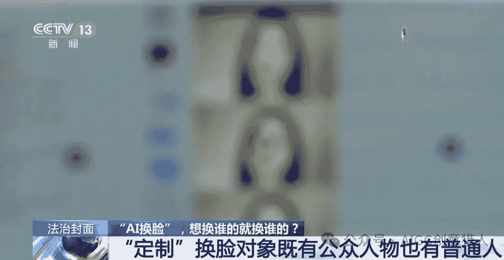

# 20240331-某男子用AI换脸技术制作传播淫秽视频获刑！警惕：避免“变脸”成为犯罪新工具

> 来源：[https://aigcreative.feishu.cn/docx/RRC3dFSaDokMlqx8VxEc0SfOnte](https://aigcreative.feishu.cn/docx/RRC3dFSaDokMlqx8VxEc0SfOnte)

> 链接：https://mp.weixin.qq.com/s/ZNy6Spp7GlAqBpXL94yLGQ

在这个日新月异的人工智能时代，AI换脸技术以其惊人的视觉变换能力，让我们的想象力突破了界限。

只需一张照片，你就能变身为电影中的英雄、历史中的人物，甚至是你梦想中的自己。然而，当这项技术落入不法之徒手中，它却变成了一种新型的犯罪工具，对社会的道德和法律秩序构成了严重挑战。

最近，杭州的虞某就因为利用AI换脸技术制作并传播淫秽视频，被法院判处了七年三个月的有期徒刑，并处罚金6万元。这个案例震惊了社会，也让我们不得不重新审视AI换脸技术的边界和潜在风险。

虞某的案件揭示了一个令人不安的现象：AI换脸技术正被一些人用于侵犯他人的肖像权和隐私权。他们不仅制作了涉及知名公众人物的换脸视频，甚至还提供了针对普通人的私人定制服务。这种行为不仅侵犯了他人的合法权益，更是对社会道德的公然挑衅。

法院的判决传递出一个明确的信号：技术的应用必须在法律和道德的框架内进行。技术的创新不应该成为侵犯他人权利的借口，更不能成为非法牟利的工具。这个案例也提醒我们，对于新兴技术的使用，我们必须保持警惕，防止技术被滥用。

然而，AI换脸技术本身并非洪水猛兽。在电影制作、游戏开发等领域，它有着广泛的正面应用。问题在于，我们如何正确引导技术的发展，如何制定有效的法律法规来规范技术的使用。技术人员和法律专家需要共同努力，一方面在开发新技术的同时，考虑到可能带来的社会影响，主动设置防护措施；另一方面，紧跟技术发展的步伐，及时制定和完善相关法律法规。

对于我们普通公众来说，保护个人隐私的重要性不言而喻。在这个数字化的时代，我们的每一次点击、每一次分享，都可能成为他人利用的素材。因此，我们应该谨慎对待个人隐私的保护，不要轻易将个人信息发布到互联网上。

AI换脸技术的未来发展充满了无限可能，但我们也不能忽视它所带来的挑战。只有社会各界共同努力，才能确保技术的健康、有序发展，让技术真正成为推动社会进步的力量。

让我们期待，在法律和道德的引导下，AI换脸技术能够在未来发挥出更多的正面价值，而不是成为犯罪的新工具。

<https://aigcreative.feishu.cn/sync/K4Gvd9vUQsy9Oubwqaeclu0Fnbg>