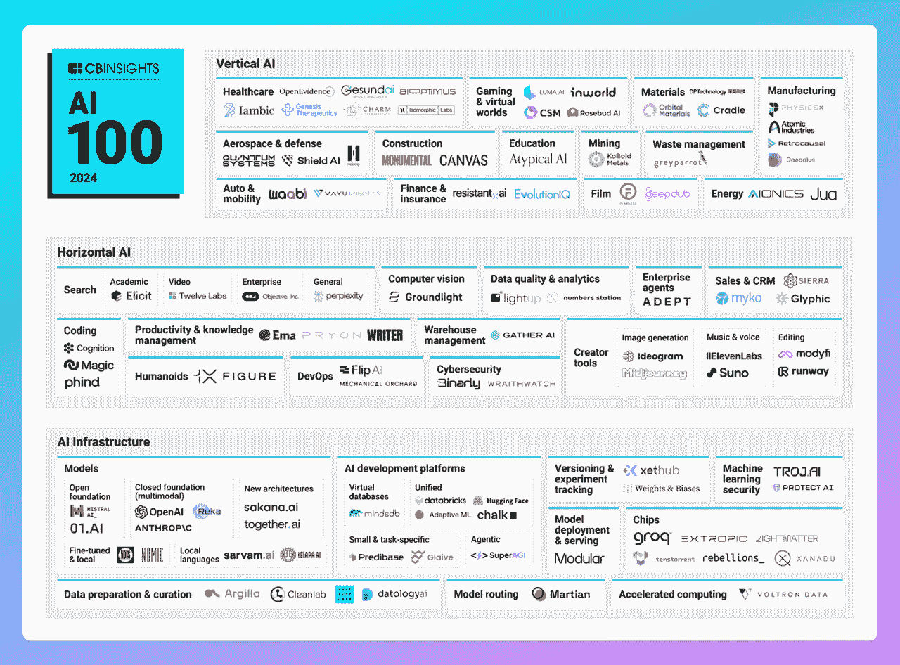
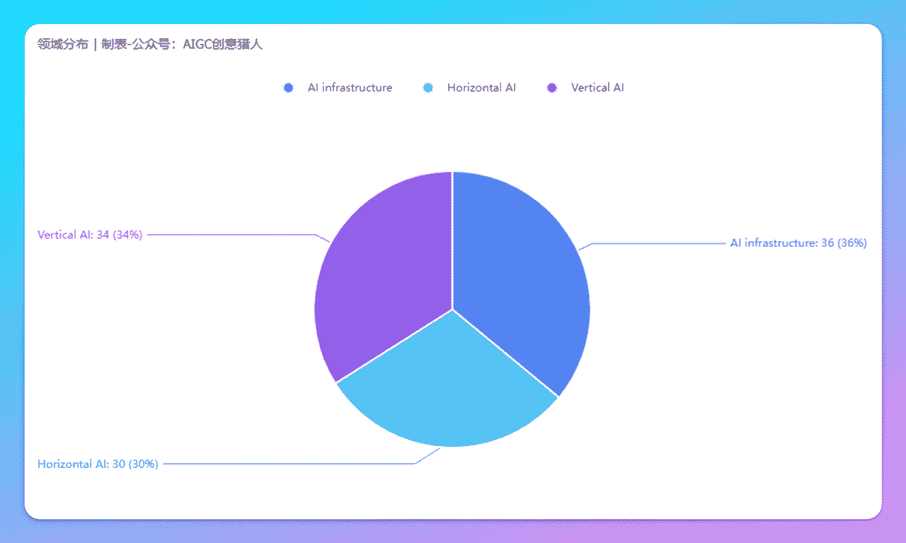
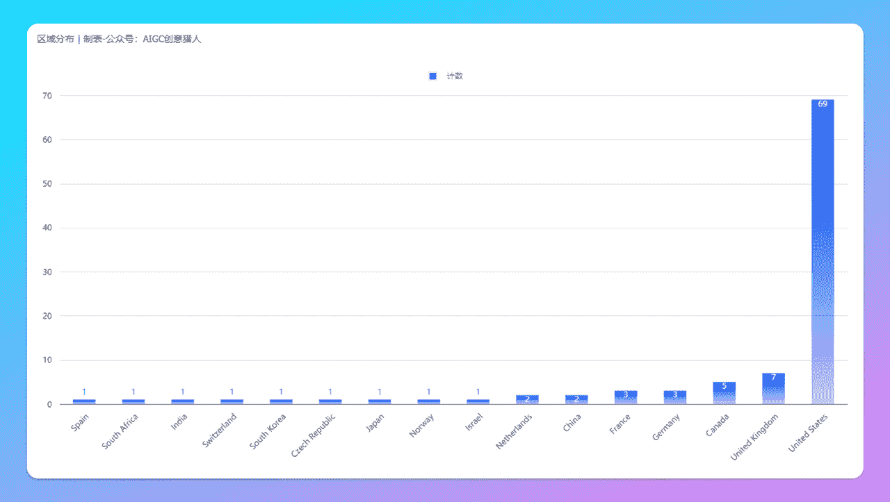
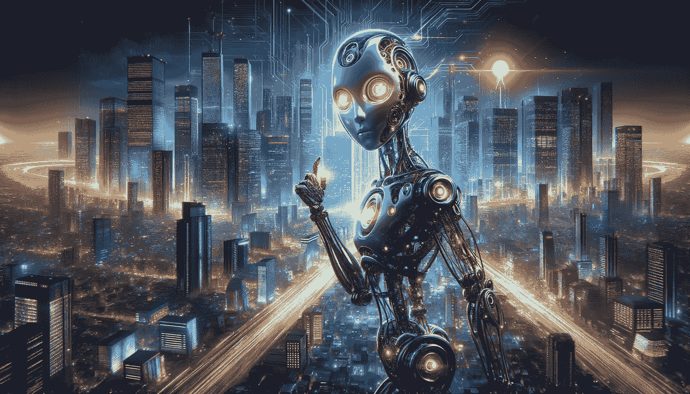
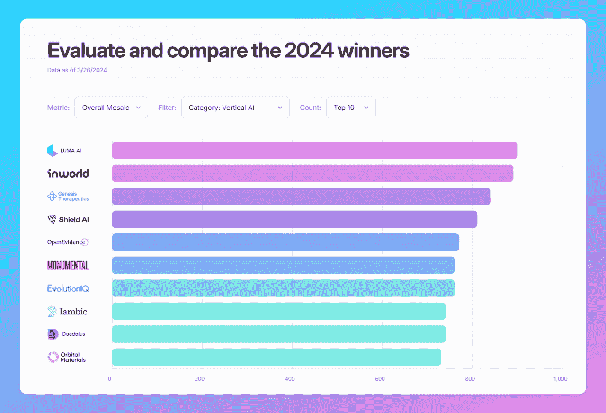
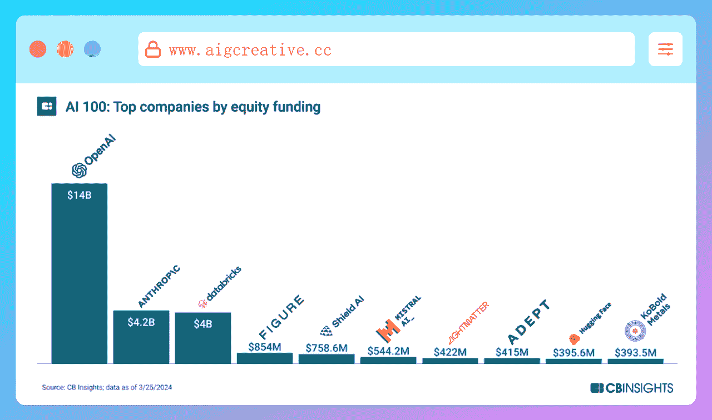
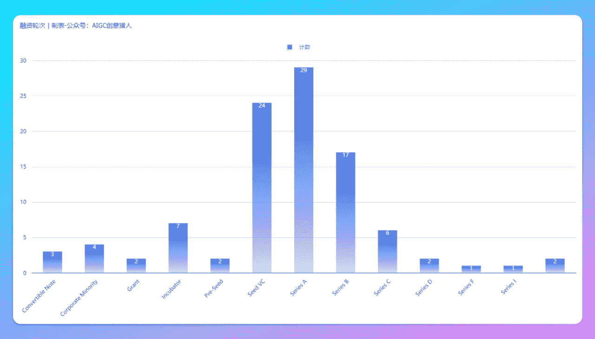
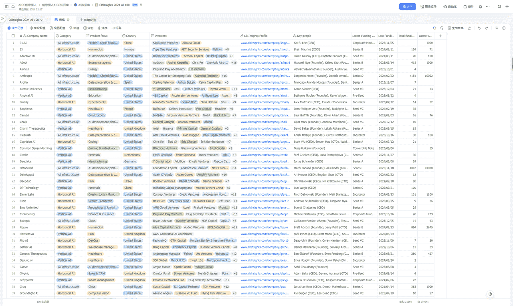

# 20240406-深度 | CB Insights评选出全球Top100顶尖AI企业：2024年的创新领航者

> 来源：[https://aigcreative.feishu.cn/docx/QaiRdm70Cokfzoxl0FlcZq3Xnof](https://aigcreative.feishu.cn/docx/QaiRdm70Cokfzoxl0FlcZq3Xnof)

2024年已经成为了一个AI技术大爆发的年份。近期，CB Insights发布了备受瞩目的“AI 100”榜单，揭示了全球范围内最值得关注的100家AI公司。

这些公司不仅在技术创新上引领潮流，更是在推动行业变革和社会发展上发挥着重要作用。AIGC创意猎人将深入探讨，全方位解读这些企业的核心竞争力和未来发展趋势。

### 精选标准：多元而严谨

CB Insights的研究团队通过综合考量包括交易活动、行业合作伙伴关系、团队实力、投资者实力、专利活动以及CB Insights独有的Mosaic得分等多项指标，精心挑选出了2024年全球范围内的AI 100强企业。此外，他们还深入分析了与软件买家的访谈记录，以及初创企业提交的分析师简报，确保评选结果的全面性和准确性。在AI基础设施、通用AI、垂直AI领域，上榜的AI企业数量大致相同。

### 企业概况：规模与多样性

在这份榜单中，通过整体数据，看到了来自16个国家的顶尖企业，它们分布在美国、法国、南非等不同地区，显示出AI技术的全球性和多元化。这些企业涉及的解决方案类别超过30种，从基础模型到仿人机器人，覆盖了AI领域的方方面面。

从图上可以看到，美国的AI企业数量占据了绝对的优势，而中国，只有两家AI企业上榜。

### 早期创业公司：未来的独角兽

特别值得一提的是，榜单中有68%的早期创业公司正在积极构建虚拟世界、自动化工厂等前沿项目。这些年轻的企业充满了创新活力，它们不仅在技术上取得了突破，也展现出了巨大的市场潜力。这些企业的成长轨迹，无疑将成为未来AI行业发展的重要参考。

### 技术革新：从基础到应用

在技术层面，AI 100强企业展现了从基础研究到实际应用的全方位能力。它们不仅在算法和模型的构建上有所创新，还在如何将这些技术应用到实际场景中展现了独到的见解和能力。无论是在医疗、教育、交通还是娱乐等领域，AI技术的应用都在不断深化和拓展，为我们的生活带来了极大的便利。

AI Infrastructure Top 10

### 行业合作：共创未来

AI 100强企业在行业合作方面也表现出色。它们与各行各业的领先企业建立了广泛的合作关系，共同探索AI技术在不同领域的应用可能。这种跨界合作不仅加速了AI技术的商业化进程，也为各行各业的数字化转型提供了强有力的支持。

Horizontal AI Top 10

Vertical AI Top 10

### 投资与市场：资本的助力

在资本市场方面，AI 100强企业同样吸引了大量的关注和投资。据统计，这些企业的中位融资额达到了3000万美元，中位估值更是高达3亿美元。这些资本的注入，不仅为这些企业提供了充足的研发和市场推广资源，也为整个AI行业的健康发展提供了坚实的基础。

### 未来无限可能

CB Insight 2024年的AI 100榜单为我们展示了一个充满活力和创新的AI行业。

这些公司不仅在技术上取得了突破，更在推动社会进步和改善人类生活方面发挥了重要作用。

随着AI技术的不断成熟和应用，有理由相信，未来的世界将会变得更加智能和美好。

[CBInsights 2024 AI 100](https://aigcreative.feishu.cn/wiki/OesmwymWoixUtskgjR8cM3AqnJh?from=from_copylink)op AI 100公司详情可见创意猎人AIGC知识库数据表：

<https://aigcreative.feishu.cn/sync/K4Gvd9vUQsy9Oubwqaeclu0Fnbg>