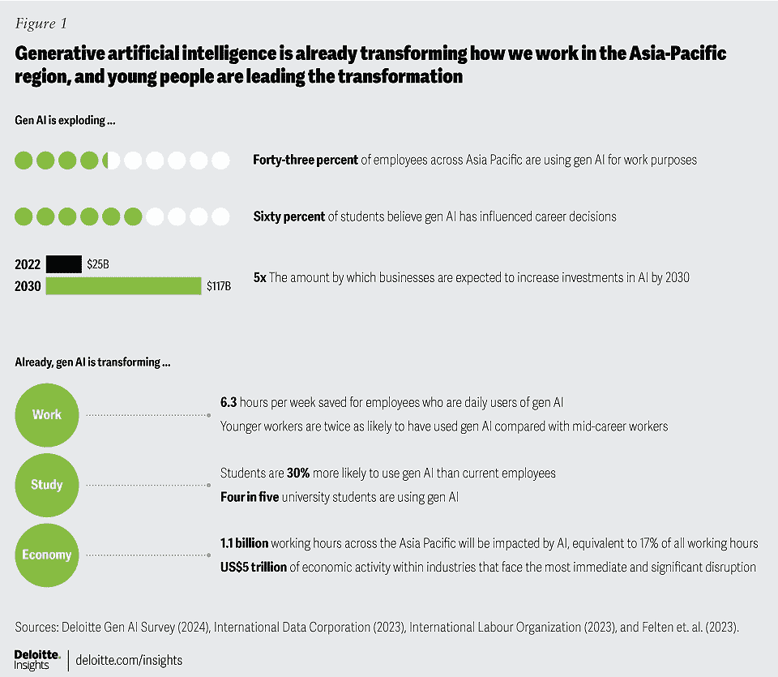
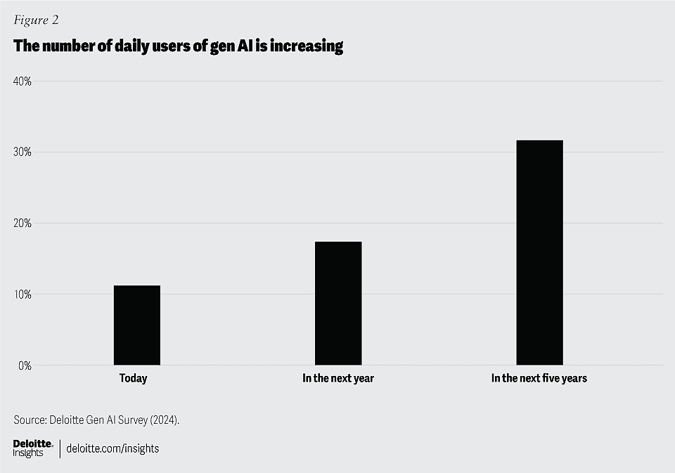
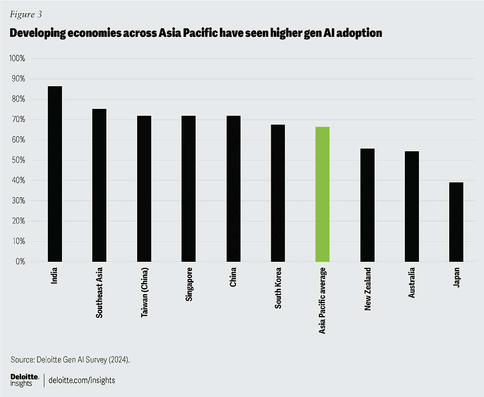
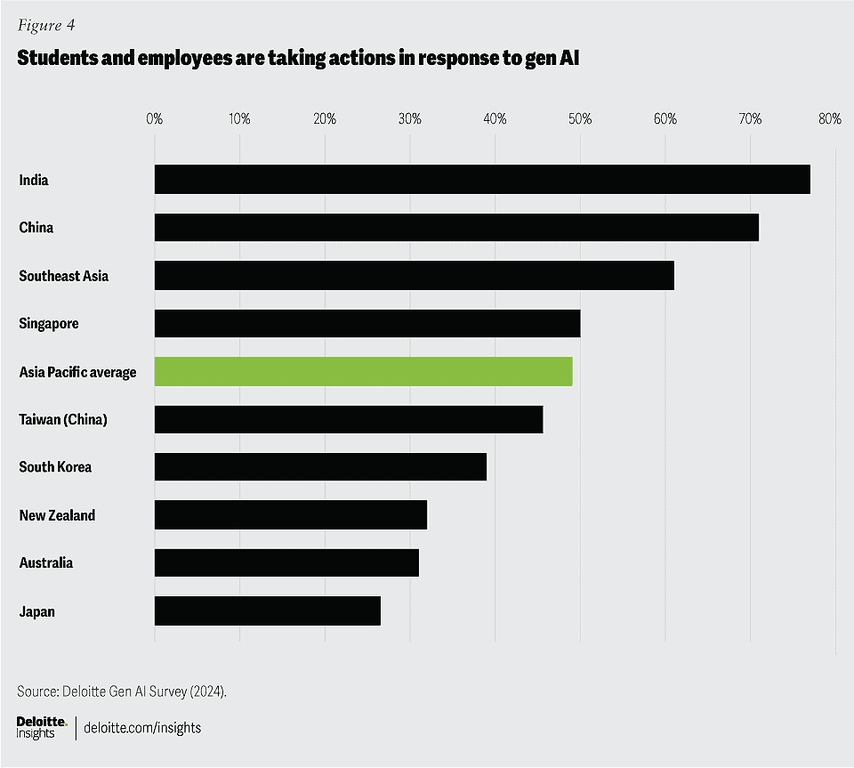
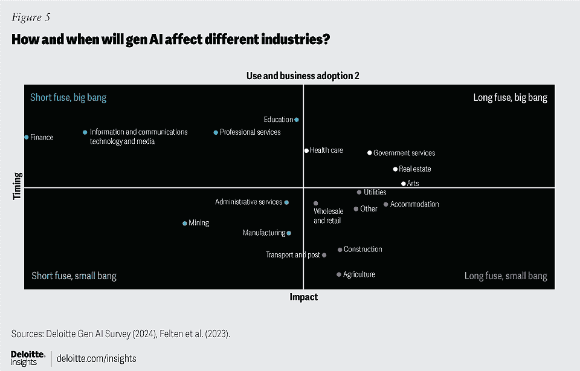
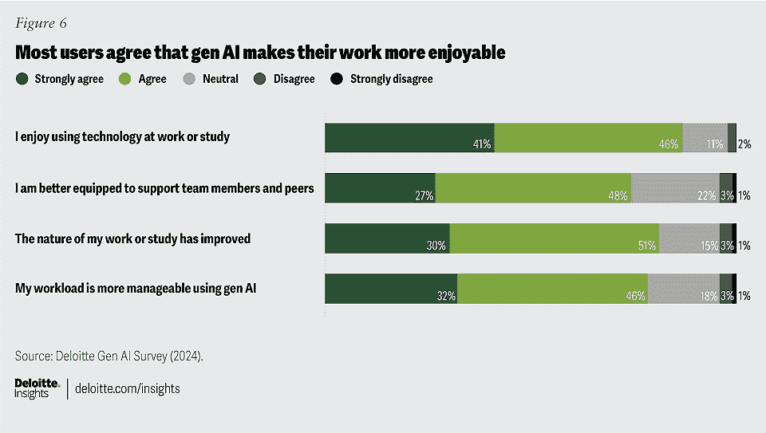

# 20240527-德勤：亚太年轻一代引领ChatGPT等生成式AI应用浪潮，企业被迫迎头赶上

> 来源：[https://aigcreative.feishu.cn/docx/KBT5dV4k1o8UoNxsmvOc6hRunKd](https://aigcreative.feishu.cn/docx/KBT5dV4k1o8UoNxsmvOc6hRunKd)

生成式AI技术正以前所未有的速度在亚太地区蔓延，而这场技术革命的推动者正是年轻的学生和员工。德勤最近发布的一份报告揭示了令人震惊的事实：亚太地区的大学生和年轻员工正在积极采用生成式AI，而许多企业则被迫迎头赶上。这一现象引发了对未来工作方式和经济格局的深刻思考。

## 年轻一代成为生成式AI先锋

在亚太地区，生成式AI的普及速度超乎想象。德勤的调查显示，81%的大学生和62%的员工正在使用这项技术，其中有43%的员工为了工作目的使用生成式AI。这一趋势在18至24岁的年轻员工中尤为明显，他们的使用率几乎是中年员工的两倍。

这些年轻人，或称“生成式AI一代”，从小就接触数字技术，他们对新技术的接受度和实验精神远高于其他年龄段。这种现象表明，早期的数字化教育和环境对他们的技术采用起到了关键作用。自德勤2023年发布《生成式AI一代：准备好了，我们来了！》报告以来，澳大利亚的工作场所中使用生成式AI的员工比例从32%增加到了38%。

生成式AI的快速普及与其技术的易用性密不可分。不同于传统的IT系统控制，生成式AI的传播主要依赖于开源社区，这些社区不断提高大语言模型的准确性和应用广度。开源平台如LangChain和Hugging Face，为用户提供了快速分享知识和解决问题的渠道，进一步推动了生成式AI的扩展。

## 发展中经济体领跑生成式AI赛道

令人意外的是，这一次技术革命的早期采用者并非传统上的发达经济体，而是中国、印度和东南亚等发展中经济体。德勤报告显示，发展中经济体的生成式AI用户比例比发达经济体高出30%。在印度，学生和员工使用生成式AI的可能性比亚太地区的平均水平高出30%，且日常使用率也显著高于澳大利亚和日本等发达国家。

这种差距部分归因于这些地区的“数字原住民”比例更高。例如，在印度接受调查的人中，近一半年龄在18到35岁之间，而在日本这一比例仅为30%。发展中经济体的年轻人对生成式AI表现出极大的兴趣和热情，超过一半的受访者对这一技术感到兴奋，而发达经济体中这一比例不到四分之一。

更重要的是，发展中经济体的年轻人不仅热衷于使用生成式AI，还积极采取行动来提升自己的技能，如研究生成式AI的基础知识、提升编程技能、与他人合作以及进行正式学习。在中国，71%的学生和员工采取了至少一种行动，而亚太地区的平均比例为49%，澳大利亚为31%。

## 企业被迫加速适应

尽管生成式AI的用户数量激增，但许多企业却在努力跟上这一趋势。德勤的报告指出，使用生成式AI工作的一半员工不认为管理层知道他们在使用它。企业在引入由技术供应商开发或定制的平台应用程序方面进展缓慢，导致他们必须追赶员工的技术步伐。

亚太地区的企业在生成式AI的投资方面也有所增加。国际数据公司（IDC）的数据显示，从2022年到2030年，AI投资预计将从250亿美元增加到1170亿美元。这一增长使AI成为新企业技术中部署速度最快的技术之一。然而，尽管投资不断增加，许多企业仍然落后于技术曲线。

德勤的调查显示，只有25%的员工认为他们的企业是早期采用者或创新者，而44%的高级商业领导者则认为他们的组织在生成式AI方面具有高或非常高的专业水平。这一差距反映了企业在生成式AI采用上的实际困境。

## 生成式AI带来的工作变革

生成式AI不仅改变了企业的技术格局，还对员工的工作方式产生了深远影响。德勤估计，生成式AI每年可能影响亚太地区近11亿小时的工作时间，这意味着17%的工作时间将受到这项技术的影响。这种影响可能表现为生成式AI自动化某些任务，或者增强任务的方式，使工人需要使用AI来完成任务。

调查显示，员工预计未来五年内，他们目前的任务中有61%将受到生成式AI的影响。这一技术将释放工人进行新任务，并创造以前未曾想象的新类型工作。虽然整体工作数量可能会继续增长，但某些职业和行业的工人在过渡期间将面临显著变化，可能需要支持和再培训。

## 改善工作效率与生活平衡

使用生成式AI的员工已经在工作和学习表现上体验到了显著改进。德勤的调查显示，80%的生成式AI用户表示它提高了他们完成任务的速度，平均每周节省6.3小时。这些时间可以用于完成其他任务或学习新技能，54%的员工利用节省的时间完成其他任务，45%则将时间投入到学习和技能发展中。

生成式AI还提高了员工学习新信息和生成新想法的能力。71%的生成式AI用户表示它提高了他们生成新想法的能力，67%的用户表示它提高了他们学习新技能的能力。更令人振奋的是，73%的用户表示生成式AI提高了他们输出的质量，65%的用户认为它提高了输出的准确性。

此外，生成式AI还显著改善了员工的工作满意度和生活平衡。41%的时间节省者认为这段时间改善了他们的工作/生活平衡。更多的时间花在创造性思维和增值任务上，使工作更加愉快。81%的生成式AI用户认为它改善了他们的工作或学习性质，67%的用户表示他们的满意度提高了。

## 企业应对生成式AI的策略

面对生成式AI的迅猛发展，企业需要制定有效的策略来应对这一技术变革。德勤的报告建议企业采取以下三项关键行动：

1.  制定并实施生成式AI战略：企业应专注于核心价值领域，避免将使用与价值混淆。在这个嘈杂的环境中，企业领导者应记住其自身业务战略中的愿景，并制定支持这一愿景的AI战略。首先考虑能够为客户和竞争对手区分业务的领域，并探索AI如何帮助提升企业的竞争优势。

1.  授权员工掌控他们的AI旅程：企业领导者需要授权员工在工作背景下有效地使用生成式AI。带有实际例子的短期培训课程，甚至是现实世界的案例研究，可以更有效地激发员工学习更多。此外，利用来自可信赖的合作伙伴和供应商的专业知识，将帮助确保员工获得最新信息。

1.  迭代开发数据基础设施和数据治理：企业需要确保他们的数据基础设施和治理设置能够实现他们所需的生成式AI使用案例。成功的生成式AI实施依赖于强大的数据治理，企业应优先考虑数据清理和质量改进，以推动负责任的AI使用。

生成式AI技术正在快速改变亚太地区的技术和经济格局，年轻一代成为这一浪潮的先锋力量。企业必须加速适应这一变革，通过制定有效的生成式AI战略、授权员工并迭代开发数据基础设施和治理，以迎接这一技术革命带来的挑战和机遇。只有这样，企业才能在这场技术竞赛中立于不败之地。

<https://aigcreative.feishu.cn/sync/K4Gvd9vUQsy9Oubwqaeclu0Fnbg>