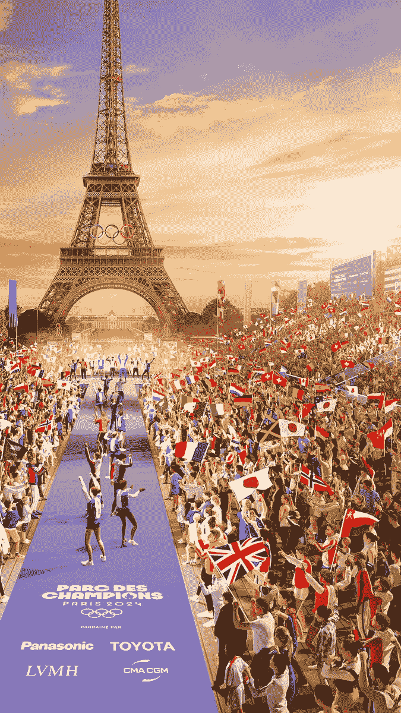
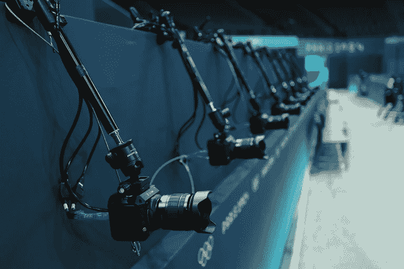
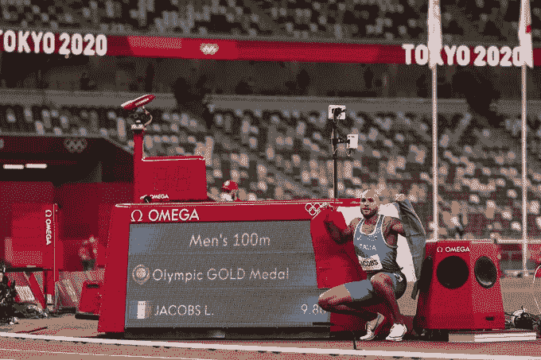
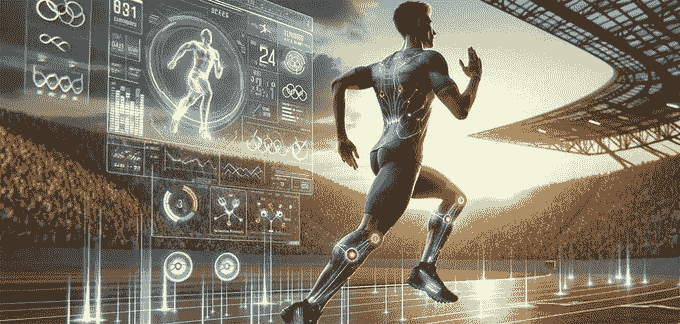

# 20240728-巴黎奥运会迎来AI时代：看AI如何重塑体育盛宴？

> 来源：[https://aigcreative.feishu.cn/docx/ELX3dy8Gwo2awRxio3gcbk6dnbg](https://aigcreative.feishu.cn/docx/ELX3dy8Gwo2awRxio3gcbk6dnbg)

随着2024年巴黎奥运会的盛大开幕，人工智能（AI）不再是幕后英雄，而是站在了聚光灯下，成为这场全球体育盛事的中心。

从赛场到观众席，AI技术的应用无处不在，彻底改变了我们体验奥运会的方式。

以下是AI在奥运会上的十大亮点，让我们一探究竟。

# AI驱动的摄像系统

首先，巴黎奥运会引入了AI驱动的摄像系统，为观众带来帧冻结慢动作回放，让每一个精彩瞬间都能被完美捕捉。这不仅仅是技术的展示，更是对运动员努力的尊重。

# AI生成定制个性视频

接着，个性化的观看体验成为可能。AI能够生成定制的每日精彩集锦，甚至模仿著名解说员的声音，为每位观众提供独一无二的奥运体验。这不仅提升了观赛的趣味性，也体现了AI在个性化服务上的无限潜力。

# AI创意生成

开幕式上的AI生成表演，将技术与自然的魅力完美融合，为观众带来了一场视觉盛宴。这不仅是对AI创造力的一次大胆尝试，也是对传统开幕式形式的一次革新。

# 全球人才搜寻

在全球范围内，AI技术正在帮助发掘体育人才。例如，国际奥委会在塞内加尔的试点项目，利用AI评估儿童的奥运潜力，展示了技术如何使精英体育更加民主化，同时在发展中国家发现隐藏的人才。

# AI宣传

AI在宣传方面的应用同样令人瞩目。巴黎奥运会的宣传材料就是由AI制作的，这不仅节省了人力物力，也展现了AI在创意产业的巨大潜力。

# AI助力人才发现

在人才发掘方面，英特尔的AI技术在法国国家体育场评估观众的身体特征，推荐适合的奥运项目，这在全球范围内可能发掘出未来的体育明星。

# 生物力学分析

生物力学分析是AI在体育训练中的另一个重要应用。

通过3D运动员追踪，运动员可以获得关于自己运动生物力学的深入见解，这不仅提高了训练方法，也推动了更激烈的竞争和新纪录的诞生。

# AI增强计时

AI增强的时间记录技术，如欧米茄公司所展示的，通过精确追踪运动员的动作，确保了比赛结果的准确性和详细的性能数据。

# AI数字助手AthleteGPT

运动员现在可以使用Athlete365应用程序中的24/7数字助手AthleteGPT，它能够回答有关场馆、日程和后勤的问题，帮助运动员专注于他们的表现。

# AI助力文化传播

最后，国际奥委会、阿里巴巴和阿里云联合推出了一部纪录片，庆祝过去一个世纪以来伟大的女性运动员。

这不仅是对女性运动员的致敬，也是对AI在文化传播中作用的一次展示。

AI在2024年巴黎奥运会的应用，不仅仅是技术的展示，更是对未来体育发展方向的一种预示。随着AI技术的不断进步，我们有理由相信，它将继续在体育领域发挥更大的作用，为运动员和观众带来更多的可能性和惊喜。

<https://aigcreative.feishu.cn/sync/K4Gvd9vUQsy9Oubwqaeclu0Fnbg>