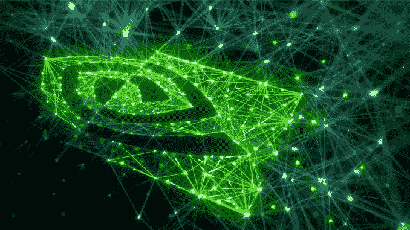
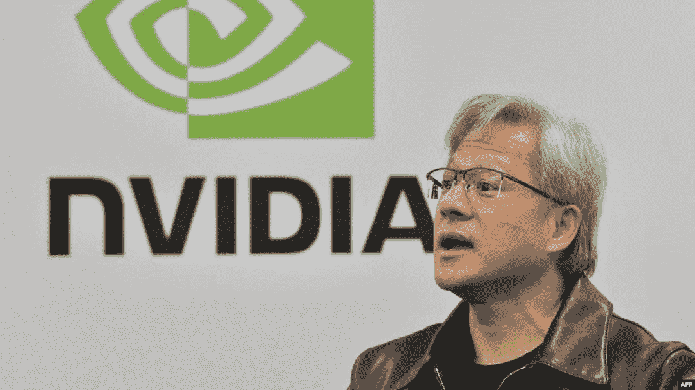
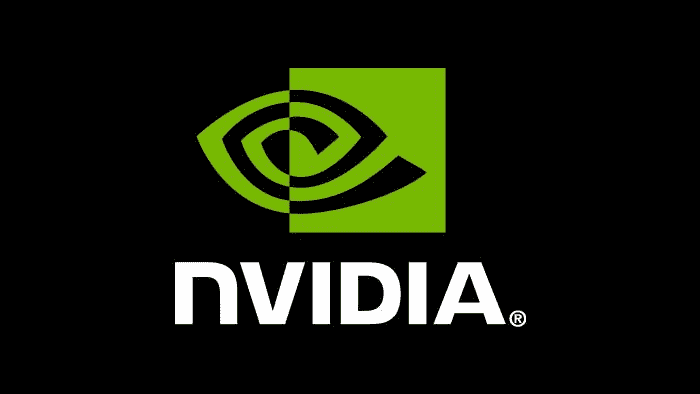

# 20241016-Nvidia悄悄发布“AI杀手锏”大模型，GPT-4都被秒成渣？

> 来源：[https://aigcreative.feishu.cn/docx/OPiEd4sCpoEbVVxmLCWcR22gn9f](https://aigcreative.feishu.cn/docx/OPiEd4sCpoEbVVxmLCWcR22gn9f)

在全球人工智能领域，战火正酣。就在大家还在讨论GPT-4和Claude 3.5的对垒时，Nvidia突然扔下了一颗重磅炸弹——悄然推出的Llama-3.1-Nemotron-70B-Instruct，打破了AI模型的性能天花板，强势超越目前市面上最顶尖的AI模型。

这次Nvidia没有高调宣传，也没有什么盛大发布会，但结果，却掀起了新一轮的行业震荡。

#### Nvidia的新武器：不仅硬件强，AI软件也不含糊

一直以来，Nvidia都是GPU领域的霸主，凭借其强悍的硬件能力推动了无数AI模型的计算性能。然而，这次的“Nemotron”模型表明，Nvidia已经不再满足于做硬件的幕后功臣，直接杀入了AI软件的核心战场。它不仅要卖显卡，还要在AI语言模型这个前沿领域里留下属于自己的名字。

Nvidia的新模型在多个AI评测中表现惊人：Arena Hard评测拿下85.0的高分，在AlpacaEval 2 LC中更是取得了57.6的优异成绩，甚至在专为衡量GPT-4性能的GPT-4-Turbo MT-Bench中也不遑多让，取得了8.98的高分。这些成绩不仅超过了OpenAI的GPT-4，连Anthropic的Claude 3.5也望尘莫及。

#### 一场静悄悄的技术革命

令人惊讶的是，Nvidia并没有为这款模型搞什么大张旗鼓的发布会，而是直接将其悄然上传到了Hugging Face平台。这个姿态看似低调，但背后是强烈的自信——这款模型的性能已足够让业内哗然。

Nvidia通过对Meta开源的Llama 3.1模型进行深度优化，结合了先进的训练技术——比如从人类反馈中进行强化学习（RLHF），让模型能够更贴近用户需求，给出更自然、更准确的回答。这种“强化”方式意味着Llama-3.1-Nemotron-70B不仅仅是算力怪兽，它还懂得如何在人类语境中更流畅、得体地回应问题。

比如，在一次展示中，当被问到“strawberry这个词中有几个‘r’？”时，模型给出了细致且准确的回答，展示出其对语言的细腻理解力。别看这是个简单问题，但这类细节在复杂的人机交互中极其重要，尤其在AI的“对齐性”上——也就是模型输出与用户需求的契合程度。

#### 企业的“新宠”：高效、强大且灵活

对于正在探索AI解决方案的企业来说，Nvidia的新模型无疑是一款极具吸引力的产品。它不仅性能卓越，还支持开源和定制化。Nvidia提供了免费的推理服务，企业可以通过兼容OpenAI API的接口轻松接入，开始自己的AI应用探索。

这意味着企业不再需要依赖复杂的Prompt设计或专用Token优化，这个模型本身就可以高效处理复杂任务。而这种灵活性对于企业来说至关重要，尤其是在定制化需求高的领域，比如客户服务、数据分析甚至自动报告生成。Nvidia的模型提供了更强的适应性，能够迅速融入各种业务场景中，帮助企业实现高效AI应用。

#### Nvidia的野心：从GPU之王到AI全能选手

Nvidia推出Llama-3.1-Nemotron-70B并非一次孤立的动作。事实上，Nvidia早在多模态模型NVLM 1.0系列发布时，就已经显露出它不仅仅满足于硬件领域的布局野心。这款具备72亿参数的NVLM-D-72B模型也同样瞄准了跨图像、文本处理的能力。

从硬件霸主到软件领军，Nvidia的路线愈发清晰：它要做AI领域的全能玩家，既能提供硬件，又能搭载高性能的软件解决方案。在此基础上，Nvidia将迫使其他技术巨头重新审视自己的研发战略，并可能引发新一轮的开源合作浪潮。

#### 挑战与未来：AI的“全栈”时代？

尽管Nvidia新模型的表现令人瞩目，但它仍有待在实际应用中证明自己。尤其是Nvidia自己也承认，这款模型在法律推理和数学计算等特定领域并未进行专门调优，企业在实际使用时仍需谨慎对待，确保在特定领域内的准确性。

接下来的几个月，将是Nvidia这款AI新武器的关键考验期。它能否从高分测试转化为真正实用的商业解决方案，将决定它在行业中的长期地位。无论如何，Nvidia已然扮演起了搅局者的角色，逼迫其他巨头加快创新步伐。

AI的战场从未如此激烈，而Nvidia正借着这股东风，成为AI领域的新“全栈”霸主。

<https://aigcreative.feishu.cn/sync/K4Gvd9vUQsy9Oubwqaeclu0Fnbg>