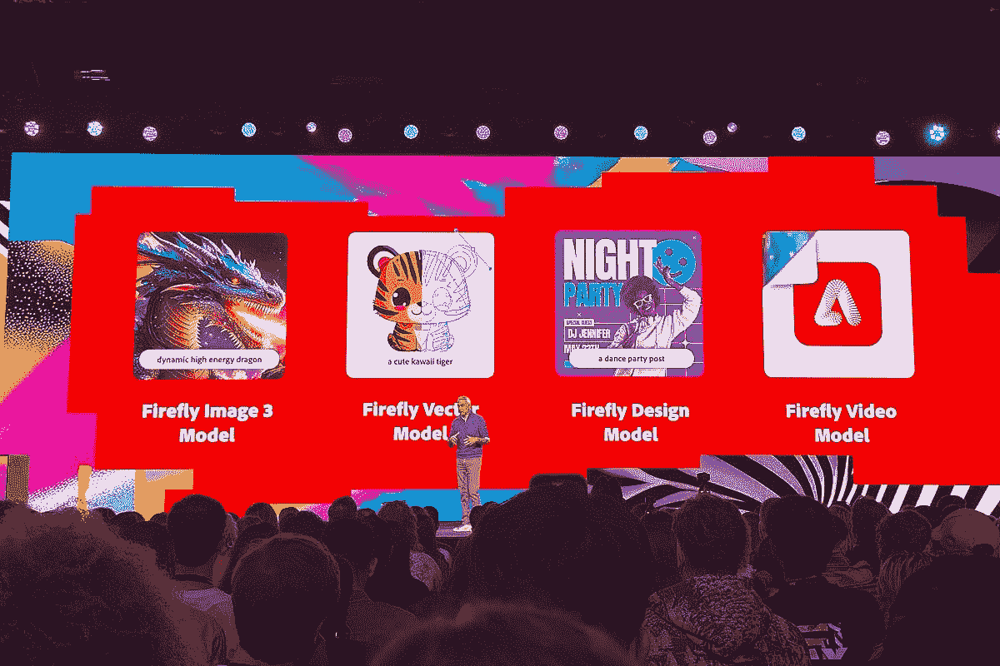
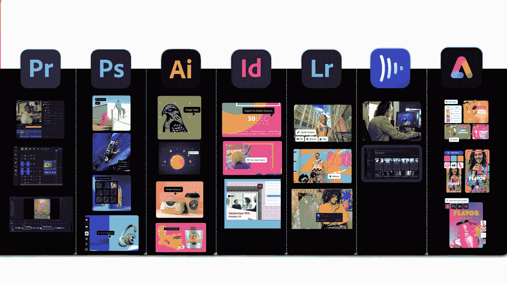

# 20241015-创意盛宴！Adobe MAX 2024给你从图像到视频的全新视界

> 来源：[https://aigcreative.feishu.cn/docx/ZLdVdwbQYoEKupxffGfctrQ0nTc](https://aigcreative.feishu.cn/docx/ZLdVdwbQYoEKupxffGfctrQ0nTc)

Adobe在AI视觉创作领域迈出了重要的一步。

一年一度的Adobe MAX 2024创意大会再次点燃创意之火，不少人形容这次大会是Adobe正式吹响创意工具革命的号角。对于设计师、创作者、视频制作者来说，这无疑是一场如狂风暴雨般的新功能大放送。尤其是，全新的Firefly视频模型的登场，是创意工具领域的重要突破。

## Firefly Video：从文本到视频的创作神器

最让人兴奋的莫过于Adobe推出的Firefly视频模型，这个号称“第一个为商业使用安全设计”的生成式AI视频模型，现在已经在Firefly网站上线公测。借助这个工具，用户只需输入文本或图像提示，就可以生成动态视频片段。还有各种摄像头控制功能，比如镜头角度、运动和变焦，让你不仅能生成视频，还能深度自定义每一帧画面。

而且，Firefly视频模型还紧密集成进了Premiere Pro，让视频编辑的过程变得像变魔术一般轻松。这种“生成扩展”功能，能够根据素材自动填补视频间的空隙，还能顺滑过渡，让人再也不需要担心手动剪辑带来的断片烦恼。可以说，Adobe正在降低视频制作的门槛，使得更多人可以轻松尝试视频创作。

## 全新AI创意工具Project Concept：重新定义创意流程

Adobe还推出了全新的AI创意工具——Project Concept，这个工具旨在彻底改变创意流程。它基于生成式AI功能，允许创作者通过文本提示快速完成设计。Project Concept支持图像和视频的生成，提供智能草图、一键风格转换、多素材合成，帮助创作者快速实验不同方案，大幅提升创作效率和创意自由度。同时，它还支持团队协作，成员可以基于同一概念进行不同方向的创意尝试。

Adobe强调，Project Concept和Firefly系列工具一样，致力于为创作者提供创意协作的最佳助手，而不是替代人类的创造力。同时，Adobe还特别关注负责任的AI应用，确保其生成式AI技术在安全、透明和道德的框架下进行开发与使用。通过这些工具，创作者可以将更多的精力放在创意本身，而不是繁琐的技术细节上，这对于创意工作者来说是一个重要的工具。

## Photoshop：创意迭代如有神助

这次大会上，Photoshop的更新也非常亮眼，尤其是Firefly’s Image 3模型，它的图像生成速度提高了四倍！Photoshop还新增了一个“生成工作区”功能，允许创作者同时进行创意迭代、头脑风暴和概念设计，这种高效、多线程的操作极大提升了设计师的工作效率。

此外，新增的“去干扰”功能也十分实用，任何你不想要的画面元素，只需轻轻一按，就能自动移除，再也不用手动P图半小时了。

## Illustrator：路径上的创意之旅

在Illustrator中，Firefly的矢量模型同样带来了新功能，比如“路径上的对象”功能，可以让用户在任意路径上附着、排列和移动对象，带来了更自由的创意体验。

此外，增强的图像追踪功能能够更快地将位图转换为矢量图，节省了大量的时间和精力。

## Adobe的AI创新是创作者的福音还是挑战？

随着这次MAX大会的更新，我们看到了Adobe在生成式AI上的全面布局，从视频、创意风暴、图像到矢量，几乎每一个创意领域都被Firefly覆盖。这些新工具无疑是创作者的福音，能大幅提高效率、解放双手，让人们可以将更多精力放在创意本身上。

但同时，这些功能也给专业创作者带来了新的挑战，毕竟AI能做的越来越多，也在逼迫创作者不断提升自己的创造性，以保持不可替代性。

回顾，Adobe MAX 2024向我们展示了创意世界的无限可能，未来的创作将变得更加普及，让更多人能够参与到创意实践中。

Adobe正在用技术让我们每个人的灵感都能被最大化地激发和实现，这无疑是一次创意工具的革命。

<https://aigcreative.feishu.cn/sync/K4Gvd9vUQsy9Oubwqaeclu0Fnbg>