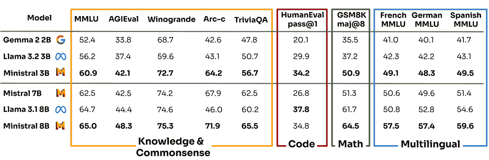
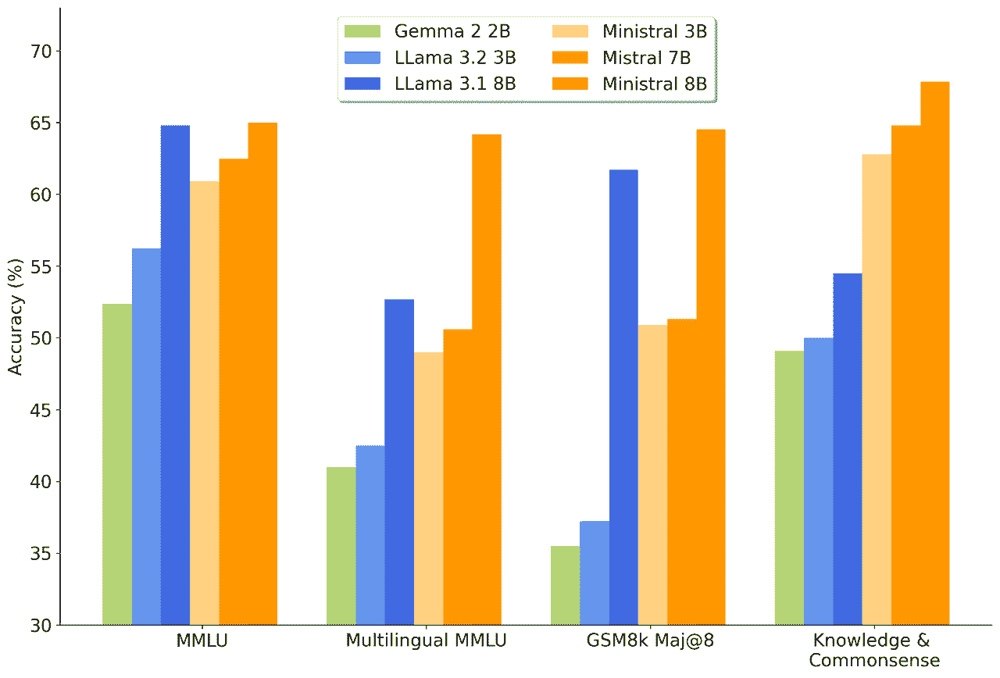

# 20241017-手机秒变“超级大脑”？Mistral AI小模型掀起AI革命！

> 来源：[https://aigcreative.feishu.cn/docx/ATzOdLnxpo3yr2xCN2cckXF8nPd](https://aigcreative.feishu.cn/docx/ATzOdLnxpo3yr2xCN2cckXF8nPd)

人工智能的世界正在被一家来自巴黎的科技公司彻底颠覆！这家公司叫做Mistral AI，它刚刚推出了两款新的语言模型，名为Ministral 3B和Ministral 8B。与那些动辄数百亿参数的庞然大物相比，它们的体积相对较小，但却表现得异常强大。

而最让人惊讶的是，这两款模型不需要依赖云端，能够在手机、笔记本电脑甚至物联网设备上运行！这意味着，未来我们不再需要高额的云计算费用和时刻在线的网络连接，AI就能随时随地为我们服务。

## AI不再依赖云端？这将彻底改变我们的生活方式

一直以来，AI技术大多依赖云计算，巨量的数据需要上传到云端服务器进行处理。这不仅耗时，还带来了隐私问题——毕竟谁都不希望自己的个人数据在网络上到处传输。Mistral AI这次的创新突破在于，它的语言模型能够“本地化”运行，也就是说，它们可以直接在设备上处理数据。这为AI的应用场景开辟了更多的可能性——无论是手机、笔记本电脑还是工厂的机器人，都能够在不联网的情况下高效做出智能决策。

举个例子，一台工厂的机器不再需要将数据传输到云端等待服务器做出反馈，它可以即时根据环境做出判断，节省了大量时间，同时也避免了数据泄露的风险。这种“边缘计算”的模式不仅提升了效率，还解决了很多人长期以来对数据隐私的顾虑。未来，AI将更加贴近我们的生活，无需繁琐的外部支撑，给我们提供更快速、更安全的服务。

## 小模型，大能量——不再是“以大为美”

别被模型的小体积骗了！虽然Ministral 3B只有30亿个参数，但它的性能竟然超过了Mistral早期的7B（70亿参数）模型，而它的大哥Ministral 8B更是表现优异，能够媲美谷歌和Meta（原Facebook）发布的那些动辄数百亿参数的巨型模型。

为什么这么小的模型可以有这么大的能量？关键在于Mistral AI开发了全新的“滑动窗口注意力机制”，让这些模型可以更高效地处理长篇文本。例如，Ministral 8B能够一次性处理128,000个词汇，相当于100页文档的长度。想象一下在医疗领域，当医生需要快速分析大段病历时，这种能力的优势就显而易见了。

## 环保当道，Mistral AI为AI减排

除了技术上的突破，Mistral AI还走在了环保的最前沿。如今，大家都知道大规模的AI模型需要巨大的计算资源，耗电量惊人。Mistral AI的小模型相对更高效，减少了对能源的消耗。这一点无论是对个人用户还是企业来说，都是一大福音。面对全球气候变暖，减少能耗成为了全行业的目标。Mistral AI顺势而为，用环保的方式为行业提供了一条可持续发展的道路。

## AI的未来：云端VS边缘，谁会赢？

Mistral AI的这一动作无疑给业界带来了震撼。一直以来，科技巨头们依赖庞大的云计算基础设施提供AI服务，但这次，Mistral AI的边缘计算模型让我们看到了另一种可能性。AI不一定非得依赖云端，完全可以“本地化”运行。这不禁引发了一个问题：在未来，AI是否会彻底摆脱云端，转而成为我们设备的一部分？

当然，边缘AI的发展并不意味着云计算会消失。Mistral AI的策略是“云+端”结合——也就是说，简单的任务可以由本地AI完成，而复杂的需求可以交给云端处理。这样的架构灵活多变，既满足了即时反应的需求，又保留了强大的后端支持。这种模式有望在未来成为主流。

## Mistral的启示：大小之争背后，AI的本质是什么？

Mistral AI的成功让我们重新审视了“大小”在AI领域的意义。过去，业界一直推崇“以大为美”，模型参数越多，处理能力越强。然而，Mistral AI告诉我们，小模型同样可以强大，甚至更加灵活和环保。这为AI行业的未来发展提供了新的方向：与其一味追求庞大，不如将效率、隐私和环境保护放在更重要的位置。

或许在不久的将来，AI不再是“高大上”的代名词，而是以灵活小巧、轻便高效为主流。届时，Mistral AI的革命性突破将被铭记为改变行业格局的一大步。

<https://aigcreative.feishu.cn/sync/K4Gvd9vUQsy9Oubwqaeclu0Fnbg>