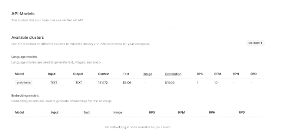
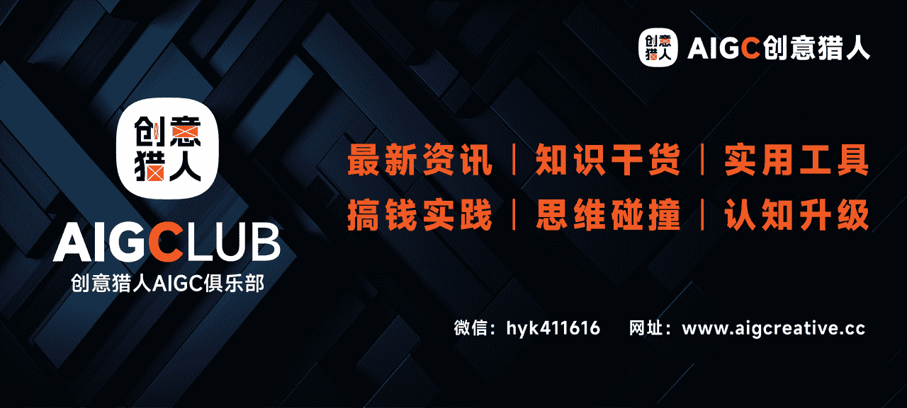

# 20241022-马斯克新动作：xAI开放API，Grok AI进入第三方接入新阶段

> 来源：[https://aigcreative.feishu.cn/docx/SkxxdhE86o5LaHxwLHLciontnZe](https://aigcreative.feishu.cn/docx/SkxxdhE86o5LaHxwLHLciontnZe)

埃隆·马斯克的 AI 公司 xAI 正式推出 Grok 语言模型的 API，开发者可将 Grok 集成到自家应用中，这标志着 AI 赛道迎来一位新锐强者。此次开放不仅让开发者获得了强大的语言模型支持，也显示出 xAI 对人工智能商业化和普及化的雄心。

# Grok AI：马斯克的野心之作

xAI 致力于打造能与 OpenAI 的 GPT、Anthropic 的 Claude 等相抗衡的 AI 产品，而 Grok 是其核心王牌。这次 API 开放不仅让 Grok 从 X 平台上的聊天机器人向外拓展，更旨在成为各类第三方应用中的语言 AI。马斯克希望通过 Grok 实现对语言模型市场的颠覆，以其独特的技术和集成能力加速 AI 在各个领域的应用。

Grok 具备强大的自然语言处理能力，能够在理解上下文、生成高质量文本和逻辑推理方面展现出色的表现。这使得它在客户服务、内容创作、商业分析等领域具有巨大的应用潜力。

# API开放：开发者的春天

Grok API 为开发者带来了新机遇。xAI 提供类似 OpenAI 和 Anthropic 的 SDK，开发者只需在 xAI 平台申请 API 密钥即可调用 Grok 功能。Grok 的集成流程简单而高效，无论是初创公司还是大型企业，都可以快速将 Grok 的能力融入到现有系统中，从而提升产品的智能化水平。定价方面，Grok-Beta 模型每百万输入 Tokens 5 美元，输出 Tokens 15 美元，相对 GPT-4 具有竞争力。

此外，Grok API 提供了详细的文档和技术支持，帮助开发者快速上手使用，减少了技术壁垒，让更多的开发者能够利用 AI 的力量来创新。

# 功能调用：为企业客户量身打造

xAI API 支持“功能调用”，让 Grok 能与外部数据库、搜索引擎等交互，实现更具上下文理解的输出，适用于客户支持、数据分析、信息抓取等精细化业务场景。这一功能的加入，使得 Grok 不仅限于回答简单的问题，还能执行复杂的任务，例如查询数据库、整合信息并生成深入的分析报告。

对于企业级客户来说，这无疑是一个强大的工具，能够显著提升自动化水平，减少人工介入。无论是客户服务机器人、智能助手，还是商业数据分析，Grok 的“功能调用”都能帮助企业更高效地处理繁琐任务，提升用户体验。

# Grok-2：马斯克的下一步棋

xAI 还发布了新模型 Grok-2 和适用于轻量级应用的 Grok-2 Mini，目前仅向 X 平台高级订阅用户开放测试，未来将向企业 API 用户全面开放。Grok-2 相较于 Beta 版本在处理速度、理解能力和输出质量上都有显著提升。

Grok-2 Mini 则面向资源受限的场景，能够在较低的计算资源下运行，同时保持出色的性能。这种灵活的产品组合让 xAI 能够满足不同规模和需求的企业，推动 AI 技术的普及和应用。

马斯克的策略是通过持续模型升级与开放，保持技术领先。这种快速迭代和持续创新的模式，显示出 xAI 在技术研发上的决心，也为市场竞争带来了新的压力。

# AI市场的价格战

Grok API 亲民的定价符合马斯克“普惠 AI”的理念，或将引发 AI 市场新一轮“价格战”。相比之下，许多竞争对手的 API 定价相对较高，这为 xAI 赢得了成本敏感型客户的关注。xAI 通过降低使用门槛，让更多的开发者和企业有机会尝试 AI 技术，这不仅有助于 xAI 自身的市场扩展，也推动了整个行业的普及化。

与此同时，Grok 的性能与价格优势也可能促使其他厂商调整策略，从而加剧 AI 领域的竞争。这种良性竞争有望带来更多技术突破和更优质的服务，最终让消费者受益。

# 结语：xAI 的未来

马斯克的目标是将 xAI 打造成 AI 领域的“特斯拉”，推动人工智能的大规模普及。从开放 Grok API 的举动来看，xAI 的进攻性显而易见。未来，xAI 能否与 OpenAI、Anthropic 差异化竞争并找到独特定位？这将是值得关注的焦点。

马斯克的愿景不仅仅是推出一款优秀的 AI 产品，更在于推动整个行业的进步，带来更为智能化的生活方式。对于开发者来说，Grok API 无疑是一个值得尝试的新选择，而对于企业来说，Grok 的开放意味着更多可能性和更高效的解决方案。一场 AI 新战役已经打响，xAI 能否成为其中的领导者，未来值得拭目以待。

