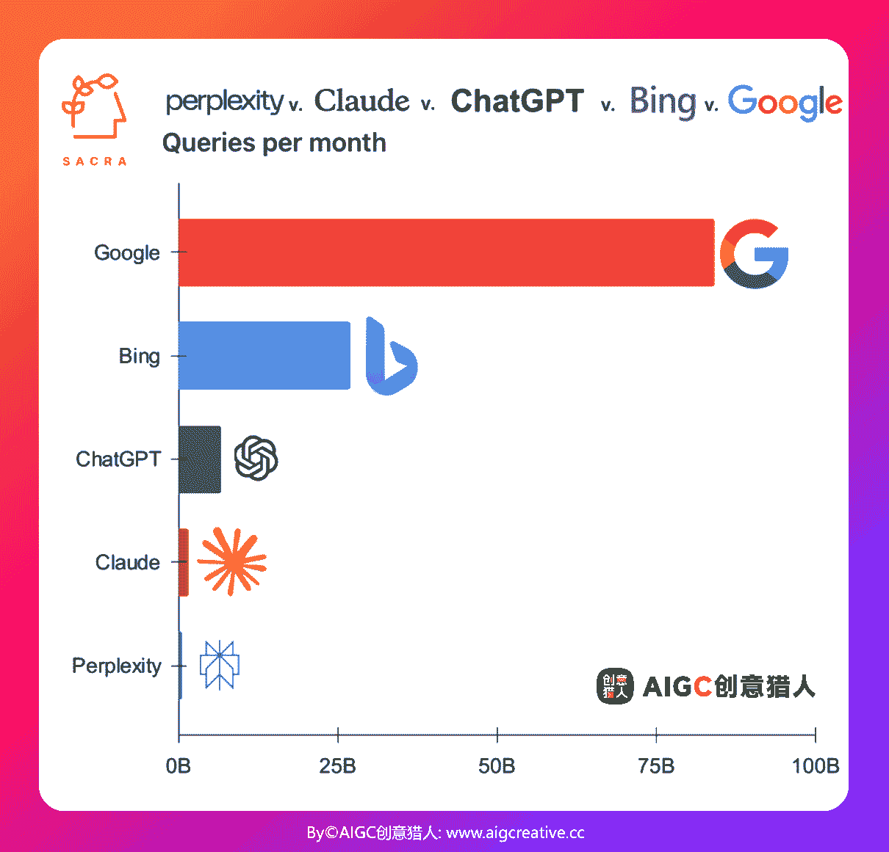
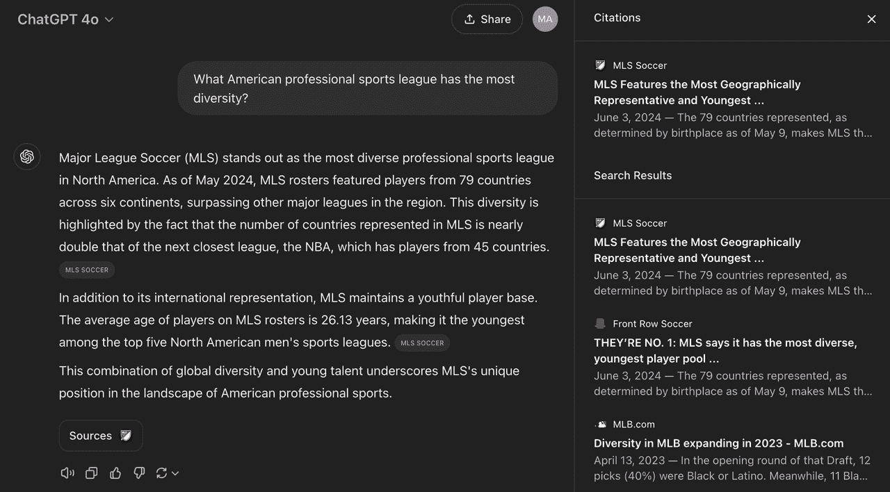

# 20241104-ChatGPT搜索能否撼动Google霸主地位？

> 来源：[https://aigcreative.feishu.cn/docx/DD6Rd4S5zoVVT8xXVkLcUCw0nah](https://aigcreative.feishu.cn/docx/DD6Rd4S5zoVVT8xXVkLcUCw0nah)

上周，OpenAI推出了备受瞩目的ChatGPT搜索功能，意图在搜索引擎市场上与Google一较高下。

这个新功能一出，就吸引了大量关注。业内对此高度期待，甚至有声音认为这是Google的终极挑战者。然而，深度体验后，你可能会发现它离“Google杀手”还有不小的距离。

#### 首次试用：从期待到失望的转变

许多人充满好奇地将ChatGPT搜索设置为默认引擎，期待它带来彻底不同的搜索体验。

ChatGPT的确在一些方面表现得令人惊喜，特别是面对那些需要深入思考的问题时，它能够提供高度总结的答案，还会附带链接，便于进一步查阅。然而，如果你打算用它来查一些日常生活中的简单问题，可能会大失所望。

例如，当查询“金州勇士比分”或“今天苹果发布财报了吗”这样的短语时，ChatGPT搜索的表现并不可靠：比分错误、信息滞后、甚至生成了无效的网页链接。用它来完成简单的导航类查询，比如天气、店铺营业时间或股票价格等，ChatGPT搜索显得不那么得心应手。这类简短查询恰恰是Google的拿手好戏，也是人们日常搜索需求的重头戏。

#### 短板凸显：短查询成为拦路虎

在与Google的较量中，ChatGPT搜索的一个致命弱点就是短查询。大多数人习惯性地在搜索框中敲入几个关键词，即能迅速找到所需信息。

而ChatGPT搜索却需要较为完整的问句，否则生成的回答往往偏离实际需求。这一差距的背后原因在于ChatGPT依赖于微软Bing，而Bing在搜索引擎界的精准度上本就逊色于Google。

此外，ChatGPT背后的大型语言模型更适合处理完整问题而非零散关键词。为解决这一问题，ChatGPT可能需要在处理短查询时做“重塑”，重新提问并生成合适的长问句，但现阶段这一技术显然还没能完全成熟。

#### 优势显现：面对复杂问题，ChatGPT出色完成任务

虽然ChatGPT搜索在短查询上失利，但面对一些复杂、需要深度思考的问题，它的表现颇为抢眼。

举个例子，当你想要了解“哪种美国职业体育联赛的多样性最强”时，ChatGPT搜索不仅能快速汇总多家网站的内容，还会提供清晰的答案和参考链接。在这种场景下，ChatGPT搜索几乎可以媲美人工的整理和总结，效率高、信息准确。这一点对于那些希望快速获得主题知识的用户来说，具有很高的吸引力。

#### Google依然不可替代，但未来值得期待

虽然ChatGPT搜索在一些场景下表现优异，但要真正取代Google似乎还不现实。Google的核心价值之一就在于它在广告和搜索引擎优化（SEO）主导的环境中，仍然能够快速准确地为用户提供导航和指引。

而ChatGPT搜索则主要填补了一些被传统搜索引擎忽视的需求——比如不想被无关广告干扰时、或者在需要详细答案的场合。

OpenAI显然意识到了这一点。公司表示，ChatGPT搜索目前确实难以满足那些简单导航类查询的需求，但未来将继续优化短查询体验。

尽管如此，短期内Google依然是大多数用户日常搜索的“门面”，而ChatGPT搜索更像是一个补充，用来挖掘和提炼信息的深度。

#### ChatGPT搜索并非“Google杀手”，而是另辟蹊径

目前看来，ChatGPT搜索并非Google的替代品，而是一个针对不同需求的创新产品。对于那些希望快速获得主题内容、避免广告干扰的用户而言，ChatGPT搜索提供了一种全新的选择。

但对于习惯于短查询和快速导航的用户，Google依然是更佳的选择。

在这个瞬息万变的搜索引擎战场上，ChatGPT搜索是否会成为下一个“Google杀手”还有待观察，但无论如何，它正在推动人们重新思考搜索引擎的可能性。

<https://aigcreative.feishu.cn/sync/K4Gvd9vUQsy9Oubwqaeclu0Fnbg>