# 20241112-深度：Gartner重磅发布2025十大战略技术趋势

> 来源：[https://aigcreative.feishu.cn/docx/PvGjdZsI7o3Ds9xeoCycAThrnOb](https://aigcreative.feishu.cn/docx/PvGjdZsI7o3Ds9xeoCycAThrnOb)

近日，Gartner重磅发布了《2025年10大战略技术趋势》研究报告。

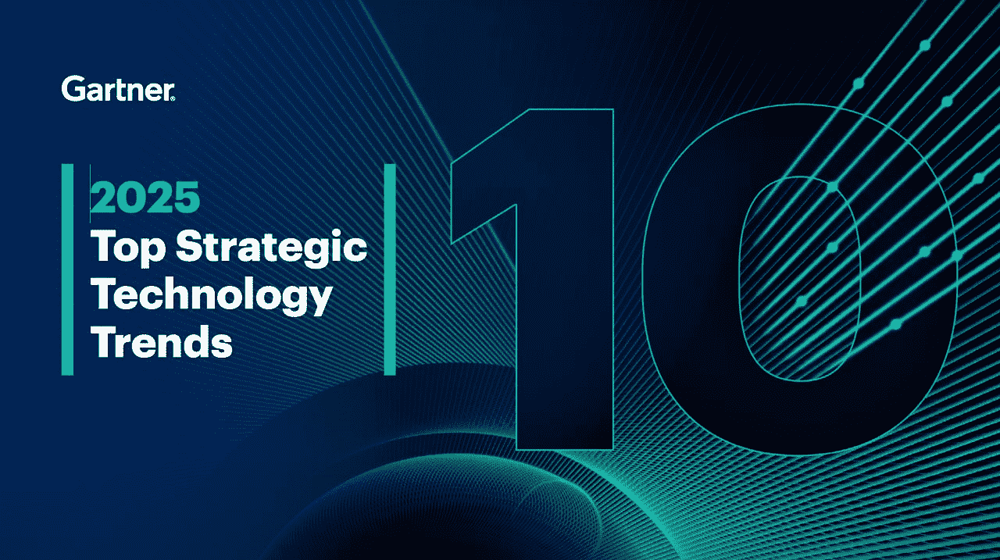

这份预测2025年的技术趋势报告，勾勒出了一个令人惊叹的未来。

这些趋势不仅会改变现有企业的商业模式，还会深刻影响我们的生活、工作甚至思维方式。

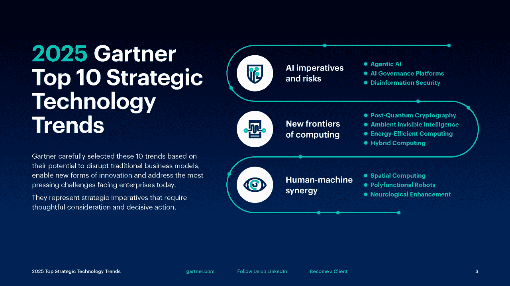

【创意猎人】深入分析Gartner提出的十大趋势后，我们发现，这不仅是技术的进步，更是社会运作方式的全面变革。下面一起来看看：

## Agentic AI：从助手到决策者，AI的进化之路

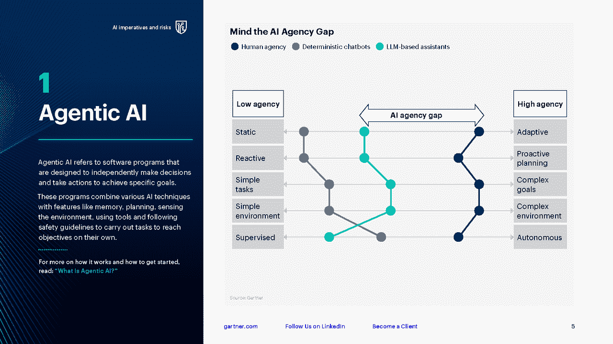

Agentic AI不同于以往的工具性AI，它不再被动响应指令，而是能够规划任务、分析环境并实现复杂目标。这种AI像一个拥有自主意识的智能体，能够在不依赖人类介入的情况下进行任务优化和多领域学习。例如，Agentic AI可以帮助企业开发自动化流程，像一个优秀的团队成员一样独立解决问题，在金融、制造和医疗领域初显身手。

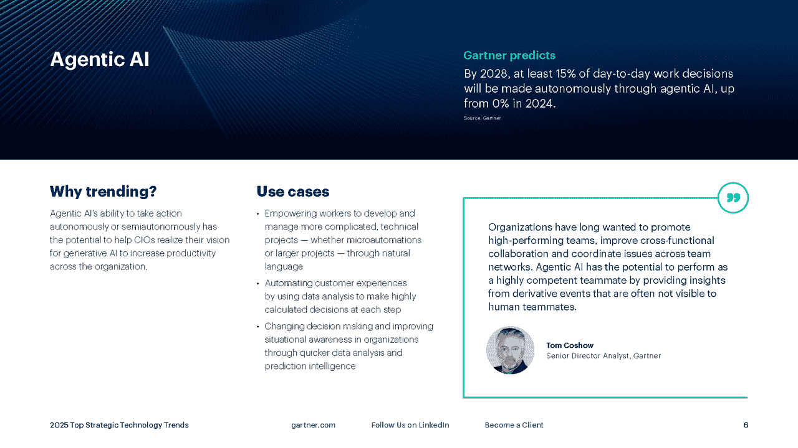

根据预测，到2028年，15%的日常工作决策将通过Agentic AI完成。这种能力的提升让企业拥有了前所未有的效率，但也带来了挑战：企业如何确保Agentic AI不偏离既定目标？如何避免系统失控或被恶意利用？Agentic AI的兴起对AI伦理、安全性以及治理能力提出了新的要求，未来的企业必须建立配套的管理体系，与AI协同发展。

## AI治理平台：让AI“听话”的必修课

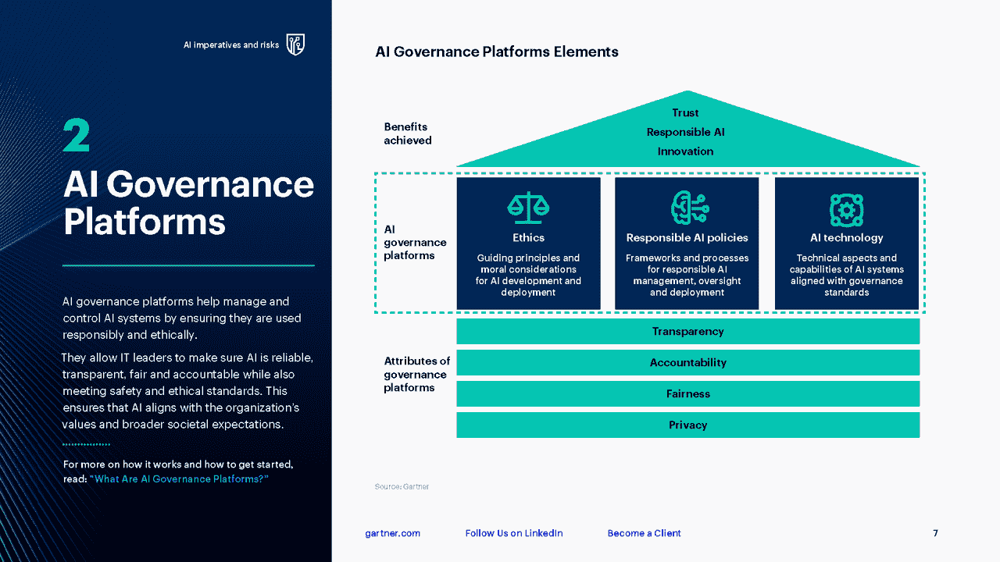

随着AI的广泛应用，技术带来的隐患正逐步显现。AI治理平台旨在解决这些问题，为企业提供了一套工具与框架，确保AI系统在透明、合规、可靠的环境中运行。例如，一家全球银行通过AI治理平台消除了信贷决策中的算法偏见，成功提升了客户满意度并降低了监管风险。

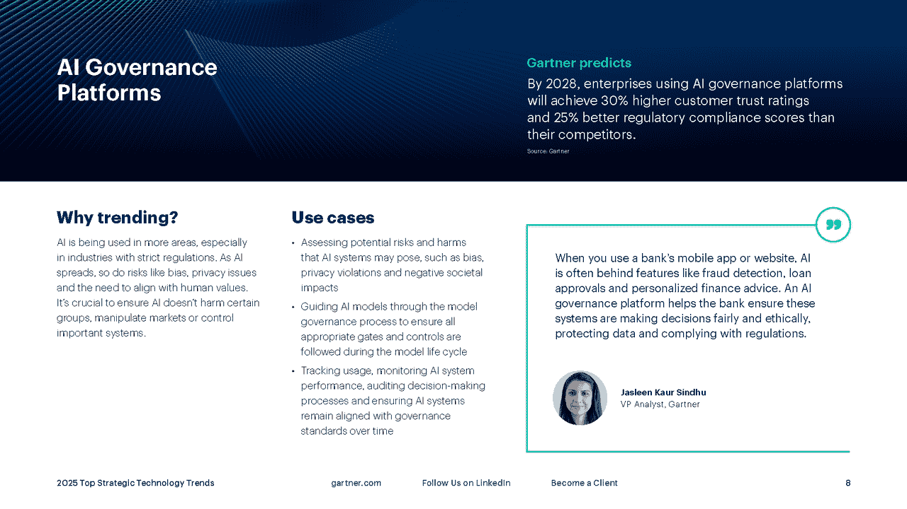

在这一背景下，AI治理平台的作用不可忽视。它不仅关系到企业能否通过可靠的AI赢得市场信任，还决定了能否避免巨额罚款和声誉危机。未来，AI治理将成为企业竞争中的重要战场，谁能更好地治理AI，谁就能占据市场的领先地位。

## 信息真伪保卫战：科技如何重建信任？

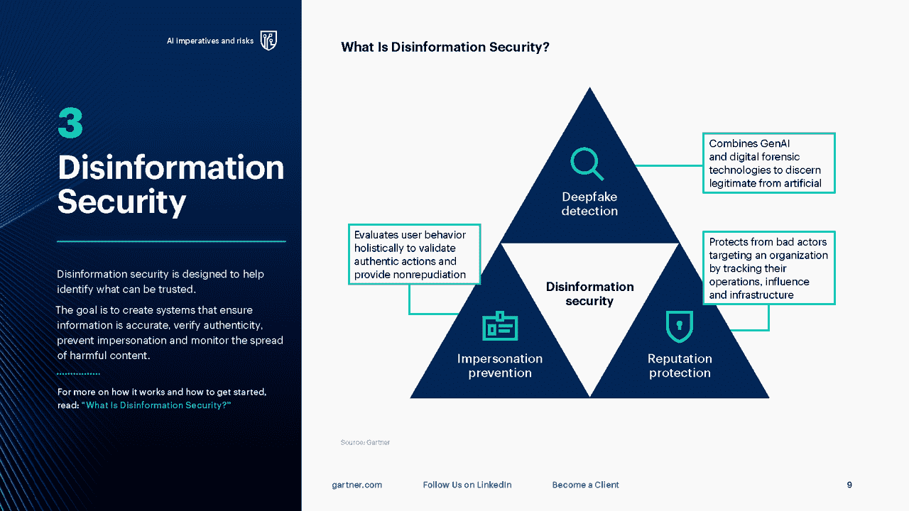

信息过载的时代，假新闻、深度伪造和虚假叙事层出不穷，企业和个人深受其害。Gartner提出的“信息安全”不仅仅是技术防护，它还包括从根本上识别和遏制虚假内容的能力。

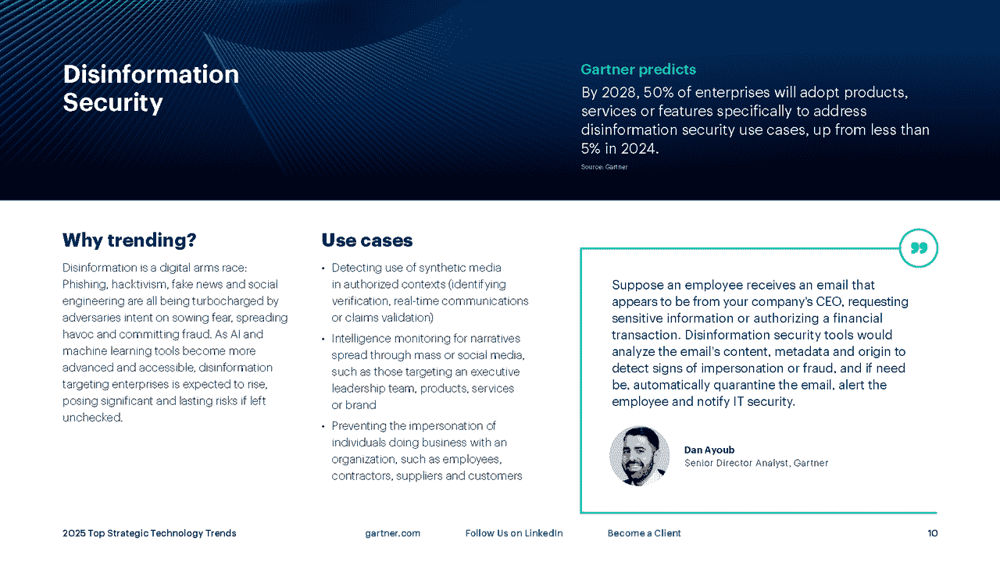

例如，某电商平台利用AI技术识别虚假评论和产品信息，大幅减少了用户投诉，提升了平台的公信力。而在医疗领域，AI也被用来甄别虚假健康信息，保护患者免受误导。这种防护措施未来不仅是企业内部的需求，更可能成为品牌和公众关系的重要组成部分，重建公众对科技和媒体的信任。

## **后量子加密：抵御未来的安全威胁**

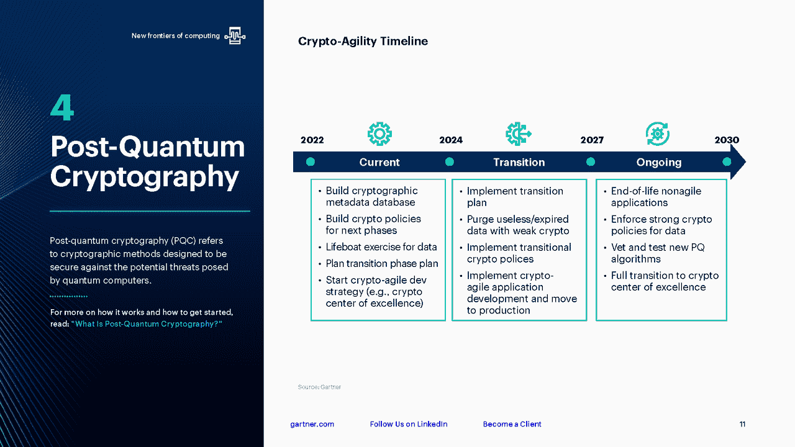

量子计算的崛起是一把双刃剑，它可能带来算力革命，但也威胁到传统加密技术的安全性。后量子加密（PQC）成为防御这一威胁的关键。它通过全新的算法设计，让敏感数据在量子计算时代依然无法被破解。

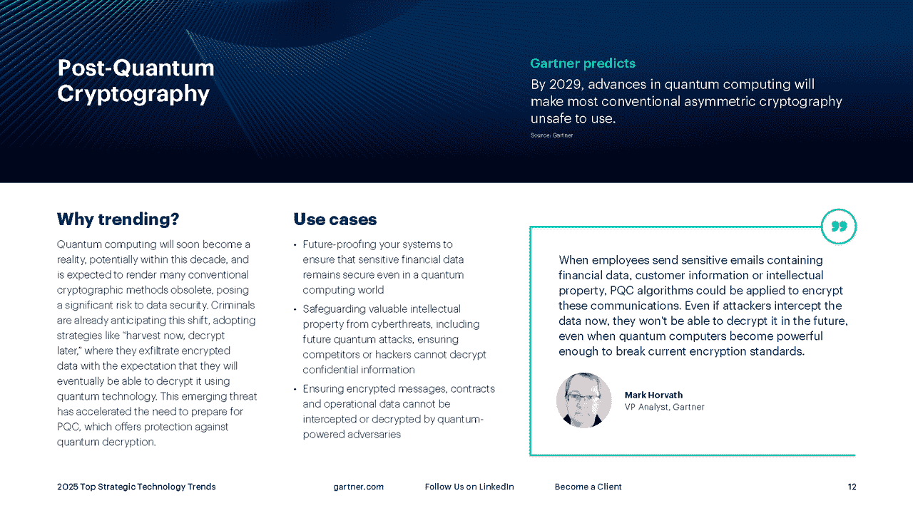

这并非杞人忧天——网络犯罪分子已经开始“提前备战”，窃取并储存加密数据，等待量子技术破解的那一天。因此，企业必须加速采用PQC技术，否则未来可能因数据泄露而付出惨痛代价。后量子加密的普及，将成为全球数字安全领域的关键里程碑。

## 环境感知智能：无处不在的“隐形科技”

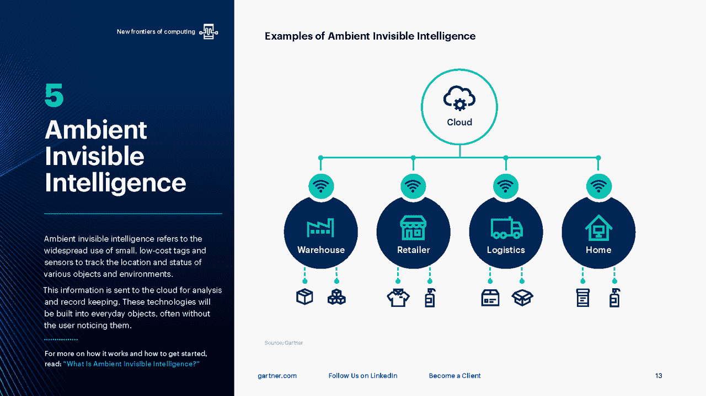

从超市货架到医疗设备，环境感知智能通过低成本传感器和智能标签实现物体状态的实时监控。这种技术正重塑供应链、零售和医疗行业。例如，某零售企业通过智能传感器分析顾客的购物行为，实时调整商品陈列和促销策略，成功提高了销售额。

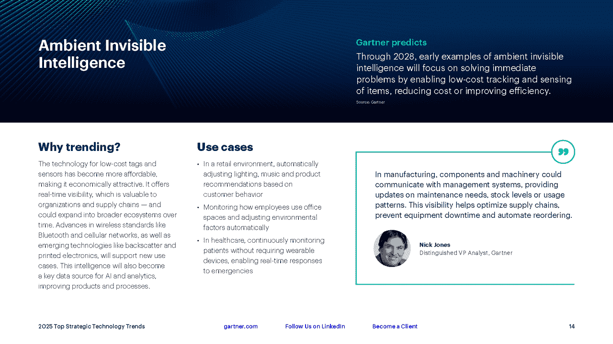

在医疗领域，环境感知智能通过非接触式传感器监测病人状态，实现对突发情况的快速响应。这种“隐形科技”正逐步融入我们的日常生活，不仅改变了企业的运营方式，也为普通消费者提供了更高效便捷的体验。

## **节能计算：绿色科技的新战场**

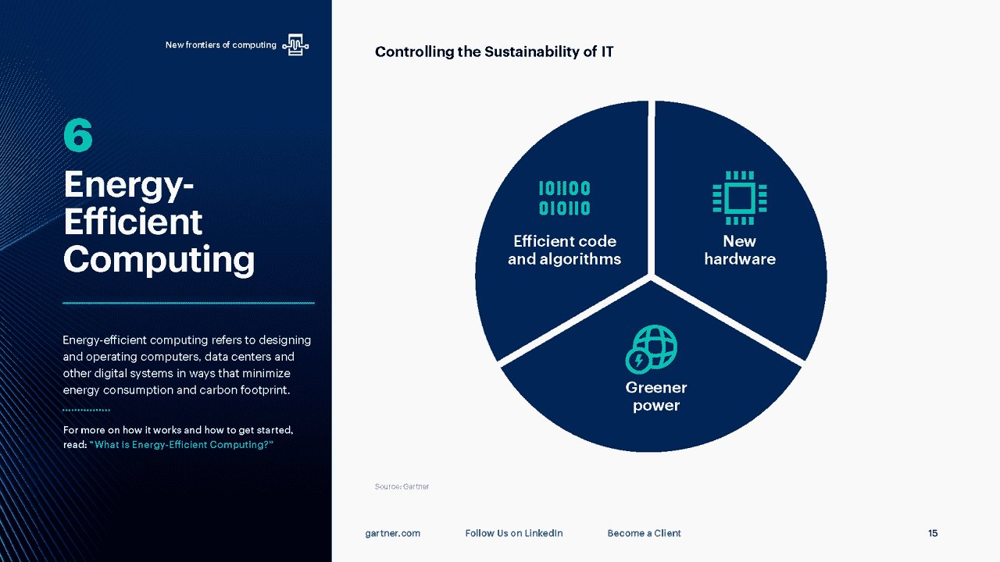

在碳中和压力下，科技行业正努力降低自身的碳足迹。节能计算技术不仅是企业履行社会责任的表现，更是节省运营成本的有效手段。例如，数据中心通过优化冷却系统和采用低能耗芯片，实现了能耗的大幅降低。

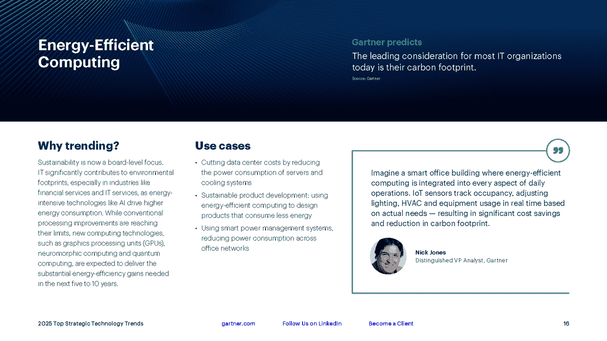

此外，绿色算法和神经形态计算的出现，为高效运算带来了新的可能性。节能计算不仅使企业的数字化转型更为环保，也使得每个普通消费者都能享受到“绿色科技”的红利。从智慧城市的节能交通系统，到家庭中的低能耗智能设备，绿色科技正成为未来生活的一部分。

## 混合计算：统筹多元技术的“大脑”

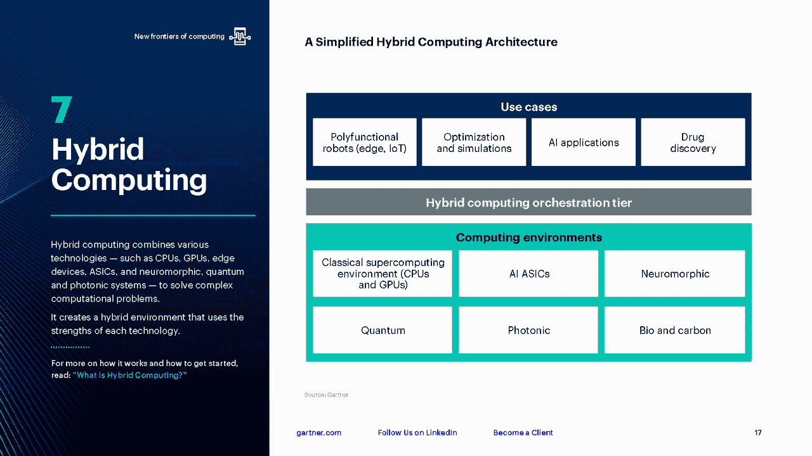

混合计算通过整合传统芯片、量子计算、神经形态芯片等多种技术，为复杂问题提供最优解。例如，一家制药公司利用混合计算加速新药研发，极大缩短了从实验到上市的周期。

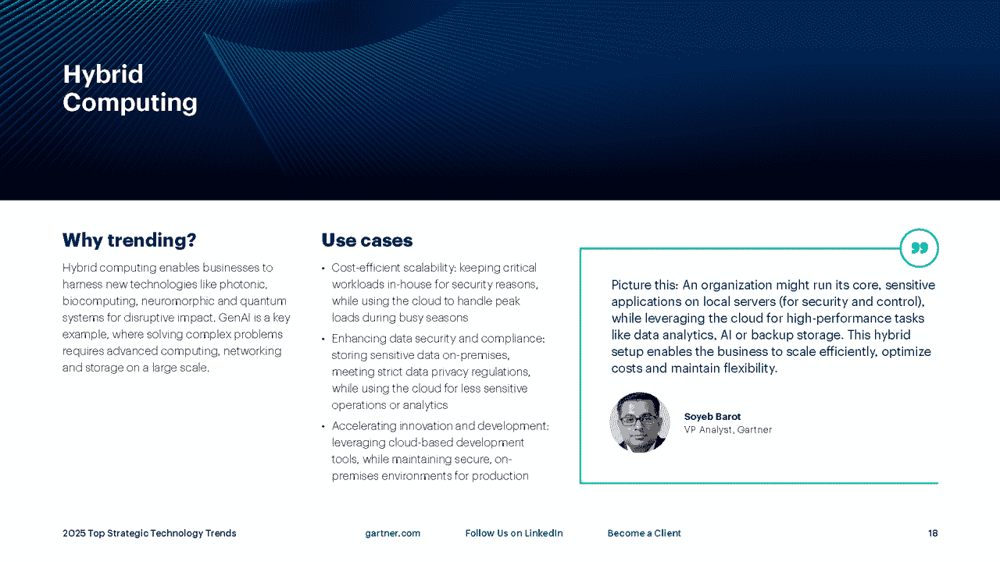

这种计算模式不仅仅是技术叠加，更是一种系统性的优化，能够根据具体需求选择最适合的计算方式，从而大幅提升研发效率并降低成本。混合计算的普及将为更多行业带来突破性创新，帮助企业在技术变革中掌握主动权。

## **空间计算：现实与数字的深度融合**

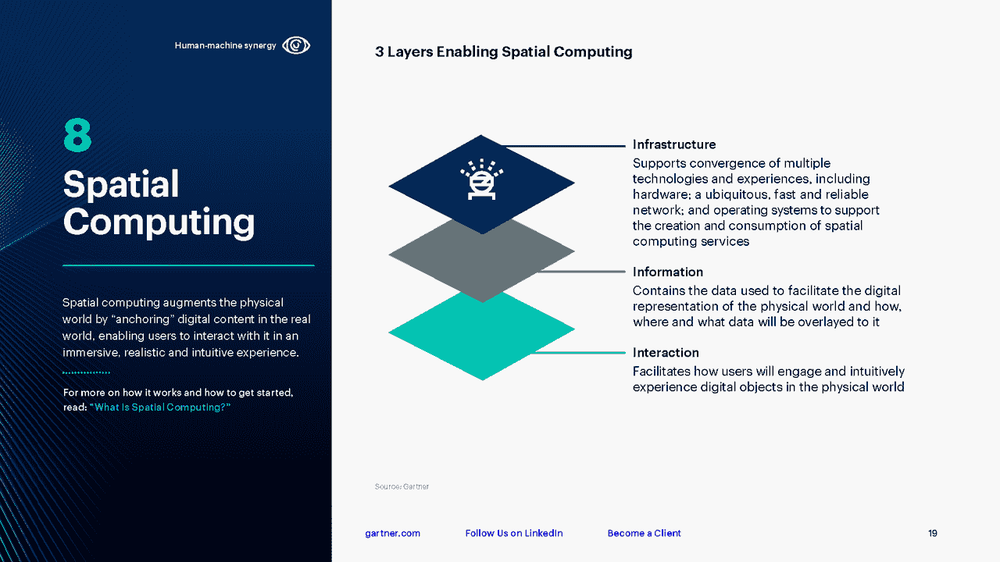

通过增强现实（AR）和混合现实（MR），空间计算将数字世界无缝嵌入物理空间。例如，家装公司可以为客户提供沉浸式的虚拟设计体验，直接看到装修完成后的效果，大幅提升客户满意度。

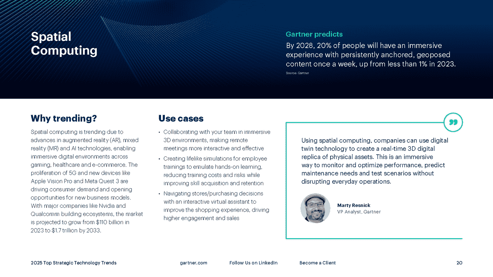

在制造业中，企业可以利用数字孪生技术实时监控工厂设备的运行状态，提前预测可能的故障，降低停机损失。这种现实与数字的融合，不仅使得生产效率大大提升，也为员工和客户带来了更直观的体验和更高的透明度。

## **多功能机器人：全能工人的崛起**

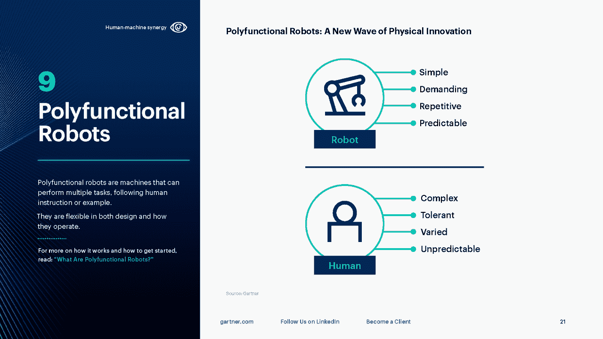

机器人不再是流水线上的单一角色，它们开始具备执行多任务的能力。例如，某电商仓库引入多功能机器人，这些机器人可以同时完成拣货、包装和运输，大幅提升了工作效率。

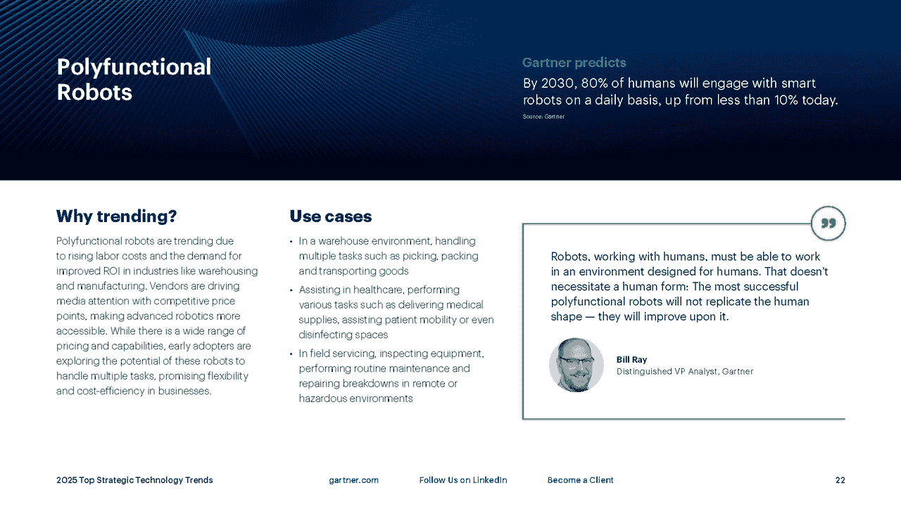

在医疗、建筑等高风险领域，多功能机器人更能有效减少人类的工作负担，同时提高安全性和精度。随着技术的发展和成本的下降，这些机器人将在更多领域普及，成为日常工作的得力助手。

## **神经增强：认知边界的重塑**

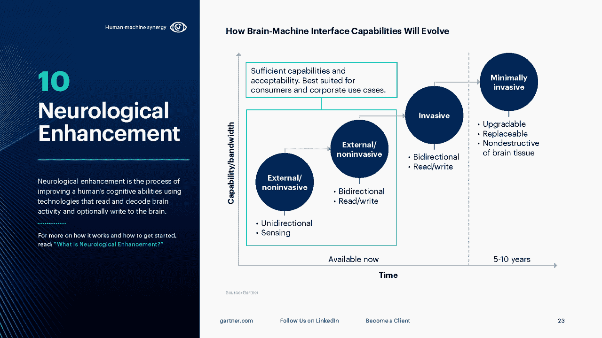

神经增强技术通过脑机接口改善认知能力，正在改变我们对人类潜力的定义。例如，在教育领域，神经增强可以根据学生的脑电波实时调整教学内容，实现个性化教学。而在工作场景中，这项技术可以帮助员工快速适应新任务，提升工作效率。

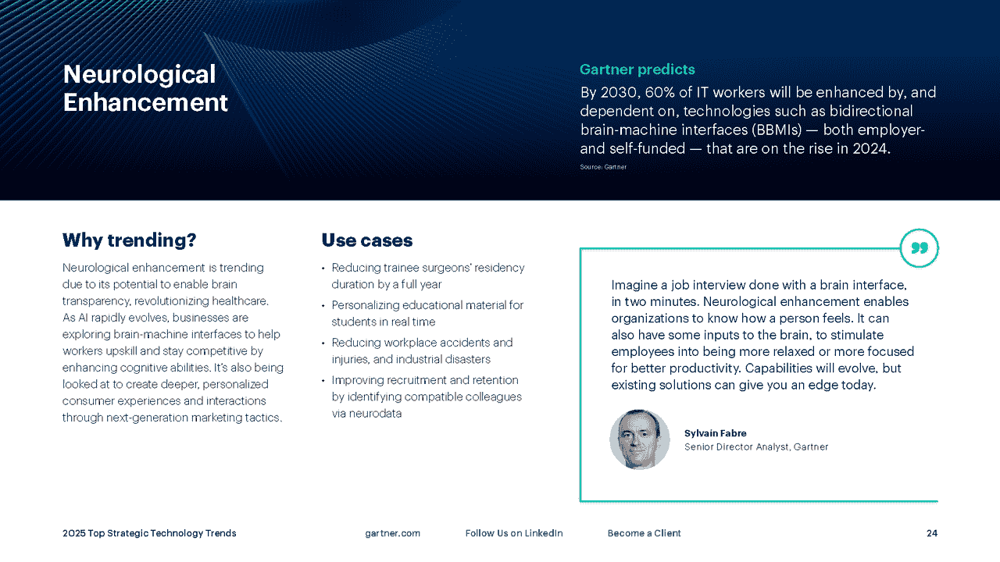

尽管这一技术尚处于起步阶段，但它的潜力已经引发了广泛关注。未来，神经增强可能成为人类与AI协作的关键纽带，帮助我们突破自身的认知极限，迎接更多的挑战和机遇。

## **科技浪潮的背后：危与机并存**

每一项新技术都伴随着风险与挑战。如何在快速发展的同时，确保伦理与安全？

如何平衡技术创新与社会责任？这是所有企业和个人需要共同面对的问题。技术是一把钥匙，它可以打开通往未来的大门，但也可能引发意想不到的后果。

对于2025年即将到来的科技浪潮，

我们要做的不仅是拥抱它，

更要为它做好准备。

<https://aigcreative.feishu.cn/sync/K4Gvd9vUQsy9Oubwqaeclu0Fnbg>