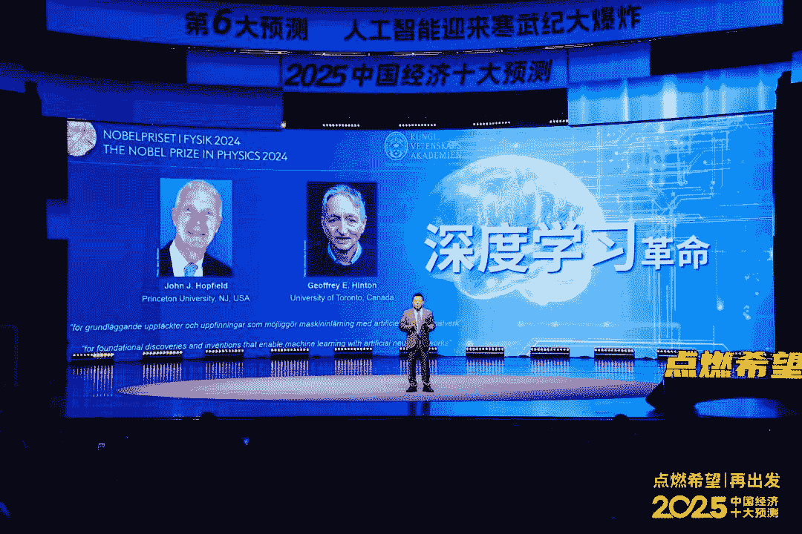
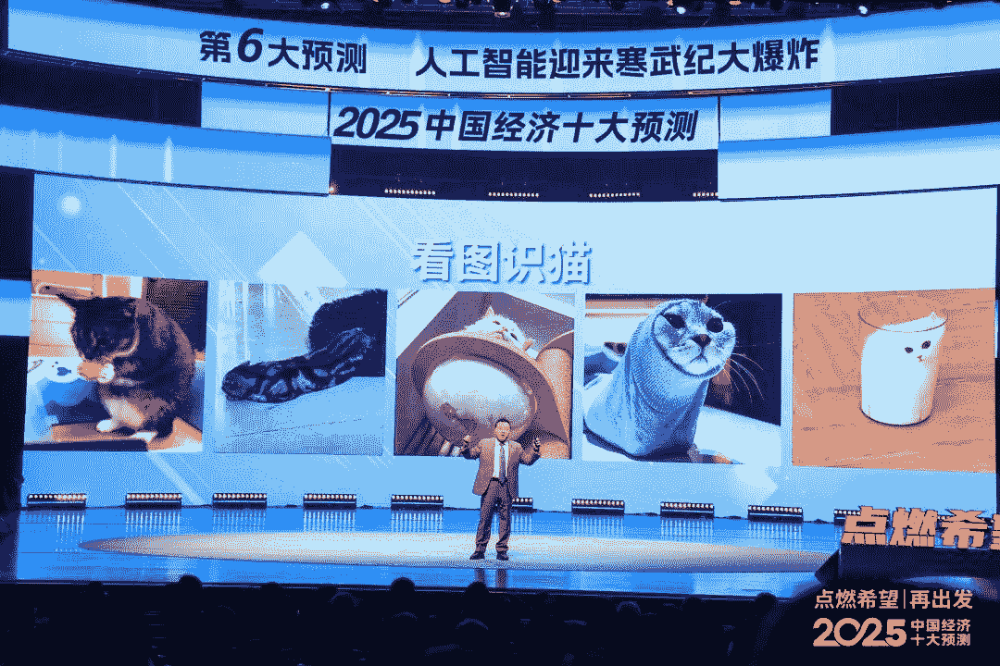
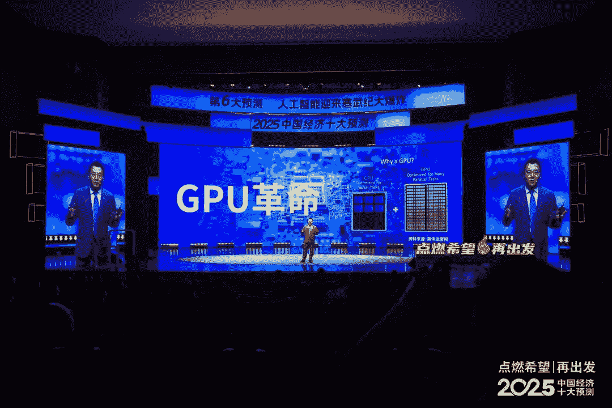
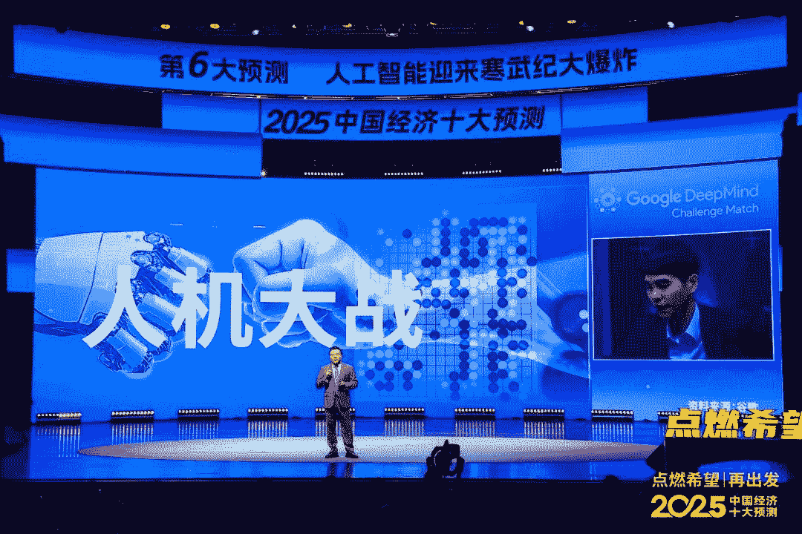
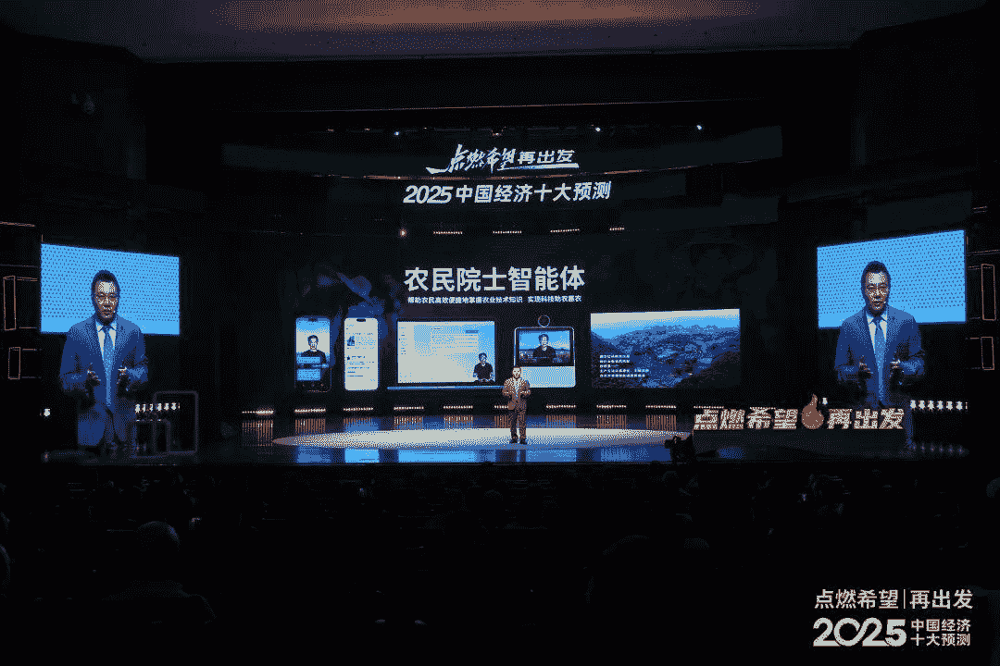
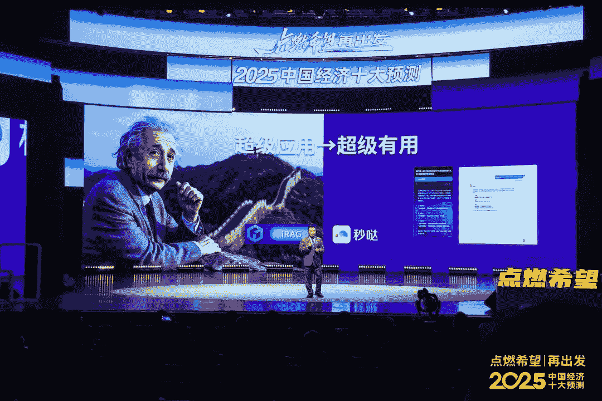
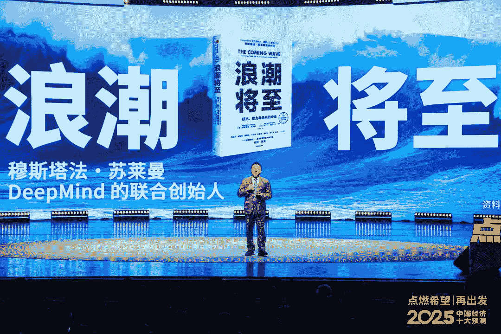
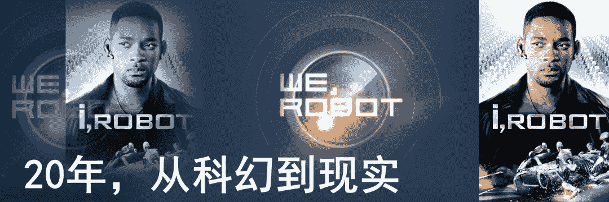

# 20241226-任泽平2025年度演讲预测：AI迎来寒武纪大爆炸，超级应用呼之欲出

> 来源：[https://aigcreative.feishu.cn/docx/ZROfdMhfcoBVPGx9Z1qc4EoTn5c](https://aigcreative.feishu.cn/docx/ZROfdMhfcoBVPGx9Z1qc4EoTn5c)

近日，任泽平博士在其2025年度演讲中提出了“2025年中国经济的十大预测”，涉及新周期与新时代的机遇、全球降息周期、第四次科技革命、中国经济刺激政策、企业全球化、人工智能发展、新能源革命、消费趋势变化、后房地产时代以及老龄化少子化挑战。

演讲强调顺应新趋势、把握新机遇，以乐观主义精神面对变化，预测中国经济将迎接新周期和新机遇，可谓是干货满满。

以下是任泽平提出的2025中国经济的十大预测：

第一大预测-这是一个新周期、新时代，顺应新趋势，把握新机遇，勇敢再出发，一切发生皆有利于我。

第二大预测-全球开启降息周期，特朗普2.0搅动全球，世界经济增长分化，制度经济学为各国发展带来希望。

第三大预测-第四次科技革命如火如荼，人工智能、新能源、商业航天、低空经济、生物制造出现重大突破。

第四大预测-中国拉开大规模刺激经济的序幕，提振信心，全力拼经济，大力发展新基建、新质生产力。

第五大预测-企业从出口到出海，从红海到蓝海，全球化本质上是本土化，踏上征程，走向世界。

第六大预测-人工智能迎来寒武纪大爆炸，图像识别、人形机器人、AI助手、AI消费电子、AI科研超级应用呼之欲出。

第七大预测-新能源革命加速前进，汽车出海、智能驾驶、固态电池、储能、氢能酝酿新机遇。

第八大预测-消费回归以人为本，线下零售重拾人间烟火，兴趣消费打动年轻人，文化消费、国潮出海风头正劲。

第九大预测-迈向后房地产时代，促进市场止跌回稳，调整和分化是未来主要趋势，人口向都市圈城市群集聚。

第十大预测-应对老龄化少子化，抓住银发经济机遇，提振生育率，重视儿童早期发展。

以下部分内容为**第六大预测，重点**关于人工智能部分的精彩内容：

# 结论：**人工智能迎来寒武纪大爆炸，图像识别、人形机器人、AI 助手**、AI消费电子、AI科研超级应用呼之欲出

诸位，AI正在改变人类历史进程。一些企业正在引领新趋势，英伟达市值突破3万亿美元，最新的芯片一发布就被抢购一空。OpenAI发布了SearchGPT，要直接颠覆搜索引擎行业。特斯拉推出没有方向盘的汽车，国内文心一言、抖音豆包们火遍全网。

谁会成为下一个英伟达？如何抓住AI浪潮的新机遇？ 让我们先从深度学习革命讲起。

大家知道今年的诺贝尔物理学奖颁给了什么领域吗？对，人工智能。两位获奖者，左边的是约翰·霍普菲尔德，物理学家，1982年发明了霍普菲尔德神经网络，让机器拥有了记忆能力。

右边是杰弗里·辛顿，传奇的计算机科学家，在前者的成果上发展出了深度学习，坚持研究神经网络路线长达50年，用图形处理GPU加速了AI时代到来。这两位科学家为人工智能革命做出了杰出贡献。

我们先来做个著名的小游戏， **“看图识猫” **，诺奖得主就是通过这个游戏，突破了AI发展30年的瓶颈。这五张图中，一共有几只猫。我相信，在坐的各位100%都能拿答对。这五只都是猫，有像老鼠的猫、也有像蛇的猫，还有液体猫。

各位在今天之前，有见过上面几只猫的照片吗？没有。那为什么大家能正确识别呢？因为见过其他的猫，大脑帮我们归纳了猫的特征。学习特征，就是我们人类智能的来源。人工智能也是如此，本质就是特征和学习。

12年前，谷歌参加了一场找猫的比赛，也是计算机视觉的比赛：将上百万个含有猫的视频作为学习样本，交给机器去观察学习猫的特征。世界上最早的AI之一——“谷歌猫”，用了16000块CPU，准确率有74%。但是，当年的冠军仅仅用了4块英伟达的GPU，就达到了84%的准确率。

是的，当年的冠军就是辛顿团队，今年获得了诺贝尔物理学奖，他对AI界做出了突破性的贡献。辛顿最早意识到GPU在AI学习领域的潜力，并且进行了探索。

今天英伟达成为全球市值最大的公司，但12年前，英伟达芯片在科技大厂的眼里只是玩具， 辛顿带领两个学生，用了四块GPU，实现了更高效、更准确、成本更低的AI训练，轰动了学术和产业界。

为什么GPU比CPU更厉害？CPU是个通才，能够串联执行各种各样的任务。GPU的通用性不如CPU，但是强项在于并行计算。一块CPU就好比1位数学家，GPU好比1万个小学生。

AI训练就像刚才识别万亿张图片，1个数学家的速度肯定不如上万个小学生，数学家虽然擅长解决复杂的问题，但在大规模简单任务上不如上万个小学生同时进行。从那之后，AI界意识到了GPU作为算力工具，可以突破深度学习的瓶颈，全球科技大厂就开始了抢人才、买团队、囤芯片。

快速发展的十年里，AI先后在电子游戏、棋类运动上击败人类。2016年，阿尔法狗大比分战胜世界围棋冠军，震惊全球。Deep Mind团队采用深度学习，在GPU算力支持下，仅仅用了两年时间训练。在短短几年内，AI学习的速度超乎想象。

# 2025年将是AI超级应用元年。

我把AI的超级应用归为4大类：

## **第一类超级应用是智能体。**

**比如AI智能体也可以像人一样、拥有一个物理的**躯体，能感知、能互动，成为具身智能体。

**智能驾驶汽车就是典型代表， **特斯拉最新的RoboCab已经进化到了不用方向盘，百度萝卜快跑现在跑在多个城市的公开道路上。这是和以往最大的不同，从解放双手双脚，到解放大脑，已经成为现实。但智能驾驶还不是终点。

现在我们看到的智能驾驶，很大程度上是在为人形机器人铺路。人形机器人和以往的机器人有什么不同？以往的，比如工业机器人，扫地机器人，装货机器人，都是在特定领域完成特定任务。但人形机器人不一样，可以像人一样学习各种技能，胜任各种任务。  比如，特斯拉在10月发布会展示的人形机器人，功能强大，可以在发布会现场当酒保，也可以在电池工厂打工。

还有一种门槛低的智能体，每个人都能做、都能用，比如由百度和朱**有勇院士团队共同打造**的首个农业智能体， “农民院士智能体” ，基于文心大模型，以对话的方式模拟朱院士与用户之间进行问答。村民可以随时提问旱地稻种植条件、培育技术等实际生产问题，促进科技助农惠农。

## 第二类AI超级应用是专业大模型。

我做了一个硅基分身，请他来给大家讲讲专业大模型。

renzeping.ai:专业大模型将超能力带给各行各业。大家还记得今年春节刷屏的 Sora 大模型吗?一键生成视频，让人真假难辨，Sora 就是视频领域的专业大模型，让人人都能通过 AI 制作动画和建模。

未来电影和广告的制作成本将会大幅缩减，扔进一部小说，产出一部大片，或许在不远的将来变成现实。一夜间改变一个行业，这样的变革也在其他领域酝酿。

## 第三类超级应用是AI 消费电子。

再请我的硅基分身讲讲 AI消费电子。

renzeping.ai: 比如苹果的 Vision Pro，Meta 的智能眼镜，都是用 AI构建虚拟世界与现实桥梁。还有联想的 AI PC，手机领域各大厂商齐上大模型，AI 让全球消费电子焕然一新，未来肯定也还将孕育出更多颠覆式产品与体验。

这是硅基智能为我定制的硅基分身，不仅外形像我，还训练了我的知识库，能实时解答财经问题，还能理解感知对话的情绪，欢迎大家来renzeping.ai和我聊天！其实，硅基分身也是AI超级应用，让每个人都能分身有术。 比如家长可以定制自己的硅基分身，陪伴孩子一起学习，实时解答孩子的问题。未来硅基分身将重新定义知识分享和个人影响力的边界。

## **第四类超级应用是AI科研。**

帮助人类突破科研的边界，推动社会的进步。

中国是仿制药大国，创新药和世界有差距，主要是因为创新药研发失败率极高，一般需要花费10亿元，周期10年，成功率仅10%。现在有研究证明，如果用AI发现靶点、筛选化合物可以大幅提高成功率，并且缩短研发周期40%到60%。

像老年痴呆、渐冻症甚至癌症这些困扰社会几个世纪的疑难杂症，以后都可能靠AI来解决。有人说，再过十年，人类的寿命在科技助力下将大大延长，活到120岁都不再是梦想。

AI超级应用爆发还有个前提，就是消除大模型的幻觉。百度今年发布了一项新的图片生成技术——iRAG，用检索增强的方法，消除图片的“机器味”，提高文生图的准确性和实用性。有了准确性，AI的应用空间才能打开。

AI时代，不仅要超级应用，更要打造数百万的“超级有用”，形成庞大丰富的AI应用生态，让每个普通人都能参与到AI浪潮中。比如，百度今年还发布了一款无代码工具“秒哒”，不用写一行代码，说话就能开发应用，大幅降低了AI应用的开发门槛。

**前段时间，De**epMind 的联合创始人穆斯塔法·苏莱曼出版了 《浪潮将至》 ，我读后深受启发。 未来人工智能将带来深刻变革，比如，智能驾驶、药物研发、智能机器人、智能助手、智能搜索，人类生产生活的所有领域都将被人工智能改变。但是，也带来智能病毒研发、智能网络攻击、智能机器人武器化、大规模失业等一系列重大挑战。

未来会从人工智能，进化到通用人工智能，超级智能吗？深度学习技术的快速进步会导致超越人类的智慧出现吗？随着人工智能的寒武纪大爆发，人类如何趋利避害在新技术革命浪潮中生存下来？这都是摆在人类面前的问题。

穆斯塔法·苏莱曼认为人工智能引领的这波技术浪潮有令人担忧的4个特征：

1） **非对称性 **——技术的高度非对称影响，使得你不必力量相当、规模相当地进行对抗，新技术会使那些看似强大的势力暴露出难以想象的弱点和破绽。

比如，配备了人工智能技术的廉价无人机，可以实现人脸识别、自动武器瞄准，而摧毁这样几百美元的无人机却需要几百万美元的导弹，如果有几千几万这样的无人机群出现，这种战争将完全是非对称的，现代战争的形态完全被改变。

2） **超级进化性 **——这些技术以惊人的速度迭代改进。未来有没有可能通过人工智能研发出一种可以自我进化的病毒，导致全球大流行病。有没有可能通过人工智能研发出一种快速学习的网络病毒，进行大规模网络攻击，或者高效运转的量子计算机，导致全球的加密基础设施形同虚设。

3） **通用性 **——它们能够服务于多种不同的目的。人工智能药物研发，既可以用于攻克疾病，也可以用于制造大流行病的病毒。 深度学习可以管理交通流量，模拟核聚变反应，开发清洁能源，优化航线，研发新材料，推进基因编码，帮助智能制造。人工智能还能够帮助管理零售库存，提供PPT写作建议，诊断疾病。我们在工厂、写字楼、医院、学校、家庭等等所有领域都会遇到人工智能。

4） **自主性 **——与其他技术相比，这些技术越来越展现出一定程度的自主性。高阶版的智能驾驶展现出了强大的自主性，能够自主应对路况。战胜了世界围棋冠军李世石的阿尔法狗也展现了强大的自主性，其中有名的第37步妙棋就不是来自人类指导，而是阿尔法狗自行发掘的策略。

人工智能的这种自主性将会催生很多新奇且难以预料的后果。 正是这些特征相互交织，使得技术潜在的收益巨大，但也可能威胁到人类安全甚至全球秩序。比如虚假信息制造机器，人工智能制造的虚假视频和图片完全可以以假乱真，进行网络诈骗或者抹黑他人。

比如在总统大选前，制造候选人种族歧视的虚假视频在网上疯传，就有可能干扰选举。本来就“造谣一张嘴，辟谣跑断腿”，如果再加上用人工智能造谣和传播，以后网络世界你很难保证你看到的哪些是真的，哪些是假的。

发展AI，安全第一。大家还记得10月特斯拉发布会的标题吗？叫“We Robot”，20年前有一部经典科幻片，I Robot，讲的是机器人产生自我意识，对抗人类，最后与人类和平相处的故事。

**AI浪潮将至，什么是决胜因素？算法**、算力、数据，还是科学家和企业家精神？ 回到今年诺贝尔奖，辛顿当时选择的AI路线叫“深度学习”，由于当时算力条件不够，数据规模太小，AI界的权威全是深度学习反对者。

坐了30多年冷板凳的辛顿，在2012年时选择用GPU证明深度学习价值，那时他已经65岁了，没有人确切知道这条道路能否成功。 同样是全球的新股王——英伟达，也是在前些年业界普遍反对投资深度学习的时候， 黄仁勋ALL IN 人工智能，ALL IN GPU，战胜CPU时代的霸主英特尔，重塑英伟达，把一家小公司带到了全球市值第一，成为新的王者，GPU点燃了人工智能的火花。

《英伟达之道》描述了黄仁勋的创业精神： 以光速工作，扁平化组织，坦诚沟通，聚焦GPU，抓住人工智能机遇，第一性原理，以及喊出了“我更强！我更快！你们无法打败我！”敢于面对不确定性，对信念坚定不移，正是这种科学家和企业家精神推动了科技进步。

<https://aigcreative.feishu.cn/sync/K4Gvd9vUQsy9Oubwqaeclu0Fnbg>