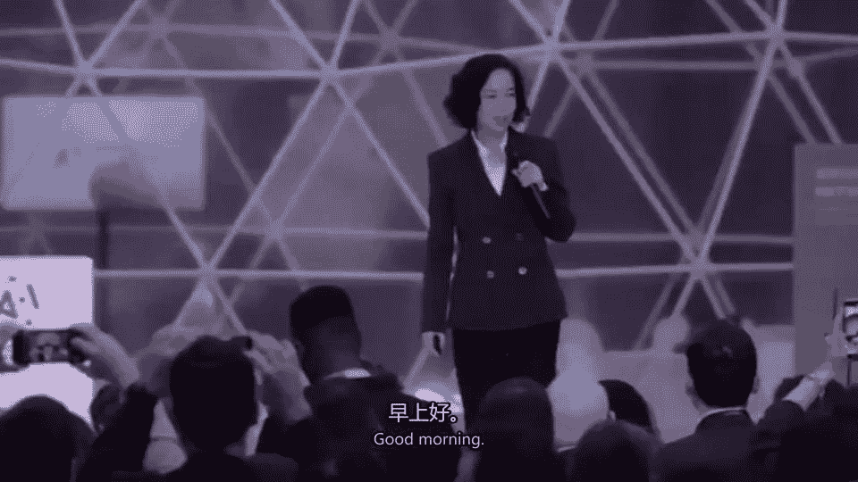

# 20250213-李飞飞巴黎AI峰会开幕式完整演讲：人工智能的未来，从感知到行动，构建以人为本的AI

> 来源：[https://aigcreative.feishu.cn/docx/O8c3dCD2ooF9nDxSVG2cozGKnUg](https://aigcreative.feishu.cn/docx/O8c3dCD2ooF9nDxSVG2cozGKnUg)

[X2Twitter.com_DtmUY3dJpWZ7MrD0_720p.mp4](https://internal-api-drive-stream.feishu.cn/space/api/box/stream/download/all/HBN8bh7pFo0ZxzxeK4xc26ZXnkc)

Good morning, everyone. I'm waiting for my slides to load. I hope you're having a great time on this beautiful morning in Paris. Could I please have my slides? Okay, thank you so much.

I'm truly honored and excited to be here with all of you today, delivering this opening speech. I look forward to engaging in some of the most action-packed discussions and possibly even groundbreaking decisions.

For many of us, AI is often framed as a story of technology shaping the modern world—a story of the future. That’s why we are all here. But for me, it is also a story that reaches far into the very origins of our existence, beginning half a billion years ago. At that time, the concept of sight did not yet exist. Eyes had not evolved, and not a single living thing had ever seen the world. All life remained in darkness.

Of course, unpacking half a billion years of history in just ten minutes is quite a challenge, so here’s the TL;DR: The moment evolution endowed simple creatures with the ability to sense and react to their surroundings, an arms race in evolution began. What started as a passive experience—the simple act of letting in light—soon became much richer and far more active. The nervous system evolved, sight turned into insight, seeing became understanding, understanding led to action, and these developments gave rise to intelligence, reshaping life on Earth forever.

Fast forward to today, half a billion years later, human intelligence has allowed our species to imagine, innovate, and shape the way we work and live in unprecedented ways. But we are no longer satisfied with nature’s gift of intelligence alone. Our curiosity now urges us to create machines that are as intelligent as we are—if not more so. And thus, the quest for AI began.

This journey formally started in the mid-20th century. Alan Turing, a great British mathematician, was so ahead of his time that even before computers existed, he was already contemplating the philosophy of endowing them with cognitive abilities rivaling our own. To me, his writings have always been a challenge—a dare to humanity to be bold enough to imagine thinking machines. That same spirit of curiosity and ambition gripped early computer scientists in America, who not only convened the first research project to explore thinking machines but also coined the term "artificial intelligence" itself during the Dartmouth AI Summer Workshop in 1956. They optimistically believed that in two months, they could unravel the mystery of intelligence. Perhaps they were a little too ambitious. Today, we are 820 months into that two-month project, but we have made remarkable progress.

One common misconception about AI is that it is simply a matter of computing and engineering. In reality, AI has always been a multidisciplinary pursuit, combining technology, cognitive science, and neuroscience. The modern AI era we are living in today is the result of three profoundly important and distinctive advancements:

1. Perceptual Algorithms – The study of how living creatures, including humans, make sense of the world. Decades after Alan Turing’s pioneering work, neurophysiologists Hubel and Wiesel provided insights into the hierarchical structure of neural processing in the mammalian visual cortex, earning them a Nobel Prize and revolutionizing our understanding of vision. Psychologists like Frank Rosenblatt built the first neural network prototypes, which later inspired pioneers like Geoff Hinton and Yoshua Bengio to develop deep learning architectures.

1. Cognitive Science & Data – Cognitive scientists have shown that our brains are not isolated systems but rather machines locked in the darkness of our skulls, learning from the world through every sight, touch, and sound from birth. This realization led my collaborators and me to hypothesize that AI, like humans, would benefit from vast amounts of data. This inspired the creation of ImageNet, the first large-scale training dataset for AI, igniting a global trend in leveraging big data for AI advancements.

1. Computational Power – None of these breakthroughs would have been possible without the rise of computational power. The evolution of computer architecture, beginning with the von Neumann model, led to the first microprocessors in the 1970s. Interestingly, it was the video game industry that pushed the raw speed of computing into overdrive. The demand for better graphics led to the development of Graphics Processing Units (GPUs), which turned out to be the missing puzzle piece that enabled deep learning algorithms to process vast amounts of data at an unprecedented scale.

By 2012, these three elements—algorithms, data, and compute—converged, leading to a pivotal moment in AI. My lab’s work in the ImageNet Challenge demonstrated, for the first time, that machines could understand and describe images with remarkable accuracy. What once seemed like science fiction became reality, setting off a rapid succession of AI breakthroughs.

Now, over a decade later, we are still exploring the implications of these advancements. AI is no longer just an academic curiosity—it is now the focus of industry leaders, entrepreneurs, policymakers, and society as a whole. We are in the first true era of AI, with explosive growth in AI-related degrees, investments, and startups.

In the last few years, AI took another staggering leap forward with the advent of large language models. These models scaled all three key AI components—algorithms, data, and compute—further than ever before. Transformers, trained on the vast resources of the internet, powered by immense computing infrastructure, have led to an explosion of AI capabilities. We now take for granted that AI can converse fluently in natural language, answer complex questions, and generate sophisticated images, music, and videos.

But AI’s future is not limited to language intelligence. We are entering a new chapter, one where AI moves beyond passive observation to active participation in the real world. AI-powered robotics, spatial intelligence, and embodied intelligence are now enabling machines to create, understand, and interact in 3D spaces, both digital and physical. These advancements raise profound questions: How will AI change our relationship with the world? What will it help us create and discover?

With this immense power comes responsibility. If AI is to become not only thinking machines but also doing machines, we must ensure that it serves humanity in a way that aligns with our values. This is why I advocate human-centered AI, built on three core principles:

1. **Dignity** – AI should enhance human autonomy, particularly for the most vulnerable. For example, my lab has developed robotic arms controlled purely by brain signals, allowing paralyzed individuals to regain agency in their daily lives.

1. **Agency** – AI should augment human capabilities rather than replace them. Instead of displacing jobs, AI can assist in creativity, healthcare, and scientific discovery, empowering people to do more.

1. **Community** – AI should foster collaboration rather than division. Instead of being driven by sensationalism and ideological debates, AI governance should be based on scientific rigor and pragmatic policies. An inclusive AI ecosystem—where academia, entrepreneurs, open-source communities, and the public sector contribute—is essential to ensuring AI serves the greater good.

# 以人为本的人工智能开幕演讲

## 开场与致谢

Seventy-five years ago, Alan Turing dared humanity to imagine thinking machines. Today, we have taken that challenge to a level he could not have foreseen. The advances in AI are breathtaking, but it is time for a new kind of challenge. Instead of merely asking whether we can build AI, let’s ask how we can build AI as a force for good.

So today, I dare all of us to build human-centered AI.

Thank you.

大家早上好！我正在等待幻灯片加载，希望你们在这个美丽的巴黎早晨过得愉快。可以请工作人员帮我加载幻灯片吗？好的，非常感谢。

我非常荣幸和激动能在这里为大家发表开幕演讲。我期待着与大家展开一些最具影响力的讨论，甚至可能做出一些具有突破性的决定。

## 人工智能的演进历程

对许多人来说，人工智能通常被视为塑造现代世界的科技故事——一个关于未来的故事。这也是我们今天齐聚于此的原因。然而，在我看来，这个故事远不止关乎未来，它还追溯至我们生命的起源，始于五亿年前。那时，视觉尚未出现，眼睛尚未进化，世界上没有任何生物能够看见光明，所有生命都在黑暗中生存。

当然，在短短十分钟内回顾五亿年的历史是不可能的，所以这里是精要总结：当进化赋予最简单的生物感知和对环境做出反应的能力时，一场进化竞赛就此拉开帷幕。最初，生物只是被动地接受光线，但随着神经系统的进化，视觉转变为洞察力，看见变成了理解，理解推动了行动，而这一切最终催生了智能，并从此永远改变了地球上的生命形态。

时至今日，五亿年后，人类智能已使我们能够想象、创新，并以前所未有的方式塑造我们的生活和工作方式。但我们不再满足于仅仅拥有自然赋予的智能，我们的好奇心促使我们创造与我们一样聪明，甚至比我们更聪明的机器。因此，人工智能的探索应运而生。

这一旅程正式始于20世纪中叶。英国数学家阿兰·图灵远见卓识，在计算机尚未诞生之前，他就已经在思考如何赋予机器类似人类的认知能力。对我而言，他的著作一直在向人类提出挑战——敢不敢像他一样，大胆地想象“会思考的机器”？这种探索精神感染了当时的计算机科学家们，他们不仅发起了首个研究“思维机器”的项目，还在1956年的达特茅斯人工智能夏季研讨会上创造了“人工智能”这一术语。他们乐观地认为，在短短两个月内就能破解智能的奥秘。也许他们有些过于乐观了。今天，我们已经进入这个两个月项目的第820个月，但我们确实取得了重大进展。

人们普遍误以为人工智能仅仅是计算机科学和工程学的产物。事实上，它一直以来都是一门跨学科的学科，结合了技术、认知科学和神经科学。我们如今所处的人工智能时代，是三项关键突破的结果：

1. **感知算法** —— 研究生物（包括人类）如何感知世界。阿兰·图灵之后的几十年，神经生理学家戴维·休伯尔和托斯登·维瑟尔首次揭示了哺乳动物视觉皮层的分层结构，并因此获得了诺贝尔奖。这一发现彻底改变了我们对视觉系统的理解。心理学家弗兰克·罗森布拉特随后构建了最早的神经网络原型，这项工作激励了杰弗里·辛顿、约书亚·本吉奥等人工智能先驱开发更复杂的深度学习模型。

2. **认知科学与数据** —— 认知科学家们发现，我们的大脑并不是孤立存在的，而是被困在颅骨的黑暗中，依赖感官所提供的信息进行学习。从这一发现出发，我和我的研究团队提出假设，认为人工智能也可以受益于海量数据的训练。于是，我们创建了 ImageNet，这是第一个大规模的人工智能训练数据集，并在全球范围内引发了“人工智能大数据”研究热潮。

3. **计算能力** —— 这一切的发展都离不开计算能力的提升。从冯·诺依曼架构的提出，到20世纪70年代的第一批微处理器，再到90年代因电子游戏产业的推动而快速发展的图形处理单元（GPU），这些技术为深度学习模型处理海量数据提供了前所未有的计算能力。

2012年，这三大要素——算法、数据和计算能力——共同促成了一次人工智能的突破性飞跃。在 ImageNet 挑战赛上，我的研究团队证明了，人工智能首次可以准确理解和描述数百万张图像。这一能力曾被视为科幻小说中的幻想，如今却成为现实，引发了接下来一系列快速发展的人工智能技术。

## 大语言模型与人工智能新阶段

十多年后的今天，我们仍在探索人工智能的影响。人工智能已不再只是学术研究的课题，而成为商业领袖、创业者、政策制定者以及整个社会关注的焦点。我们正处于人工智能的第一个真正时代，其增长速度和影响力无可比拟。

近年来，人工智能又迈出了令人震惊的一步——**大语言模型**的诞生。这些模型在算法、数据和计算能力上进一步扩展，Transformer 架构的训练数据几乎涵盖了整个互联网，并由最先进的计算芯片提供支持。其结果是，我们现在习以为常的自然语言对话、复杂问题解答，甚至图像、音乐和视频的生成。

但人工智能的未来并不止于语言智能。我们正在进入一个新阶段——人工智能将不再仅仅是被动观察者，而是能够主动与现实世界互动的参与者。人工智能机器人、空间智能和具身智能正在帮助机器理解和与真实世界互动。这些技术带来了深刻的问题：人工智能将如何改变我们与世界的关系？它将帮助我们创造和发现什么？

## 以人为本的人工智能：三大核心原则

随着人工智能能力的增长，我们必须确保它符合人类价值观。因此，我倡导构建 “以人为本的人工智能”，基于以下三大核心原则：

1. **尊严（Dignity）** —— 人工智能应提升人类的自主能力，尤其是帮助最脆弱的群体。例如，我的研究团队开发了一种由脑电波控制的机器人手臂，使瘫痪患者能够恢复基本的生活自理能力。

2. **自主性（Agency）** —— 人工智能应增强而非取代人类能力。与其担心人工智能取代工作，不如思考如何利用它来辅助创造力、医疗和科学研究。

3. **社区（Community）** —— 人工智能应促进合作，而非加剧社会分裂。我们应摒弃炒作和意识形态争论，以科学方法和实用主义态度来制定人工智能治理政策。

## 结语与挑战

75年前，阿兰·图灵鼓励人类想象“会思考的机器”。今天，我们已将这一挑战推向了他难以想象的高度。人工智能的技术进步令人惊叹，但现在是时候提出一个新的挑战——不仅仅问我们是否能创造人工智能，而是问如何让人工智能成为推动人类福祉的力量。

所以，今天，我向大家发出挑战——让我们共同打造“以人为本的人工智能”！

谢谢大家！

<https://aigcreative.feishu.cn/sync/K4Gvd9vUQsy9Oubwqaeclu0Fnbg>
