# 20250309-a16z最新AI全球榜单：ChatGPT王者归来狂揽4亿用户，DeepSeek强劲来袭

> 来源：[https://aigcreative.feishu.cn/docx/FRyVdqAaMorxkfxHlH9cip9bnQg](https://aigcreative.feishu.cn/docx/FRyVdqAaMorxkfxHlH9cip9bnQg)

近日，硅谷顶级风投公司Andreessen Horowitz（a16z）发布了最新一期的《全球生成式AI消费级应用TOP100》。

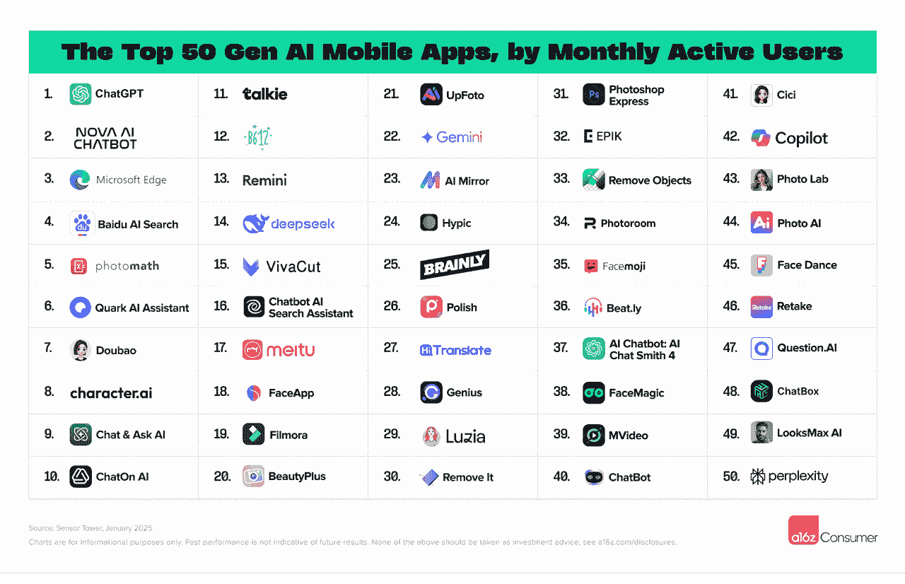

作为AI界的风向标，这份榜单曝光了不少引人注目的趋势，其中最重磅的莫过于：曾经陷入增长瓶颈的ChatGPT，再次掀起了一场惊人的“翻盘战”，活跃用户竟然暴涨到每周4亿人次！

原本不少人还在怀疑，ChatGPT的神话是不是已经到头，谁知道OpenAI一个“大招”，竟让它重回巅峰。

到底发生了什么？

## 一次更新，ChatGPT从“对话框”变成了万能“神队友”

造成这一轮爆发式增长的幕后推手，就是OpenAI最新的GPT-4o。

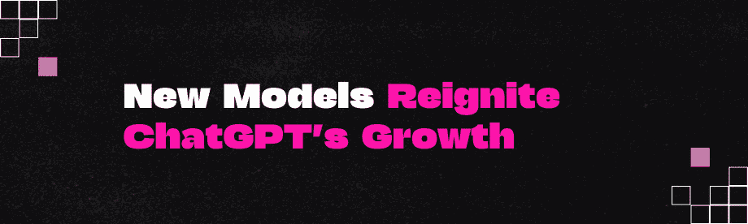

这个版本被称为“史上最强多模态大模型”，集成了文字、图像、语音甚至视频理解等多种能力。也就是说，现在你不仅可以通过键盘打字提问，还能拍一张图片、发一段语音，甚至直接和它实时语音聊天，ChatGPT都能给出又快又准的回复。

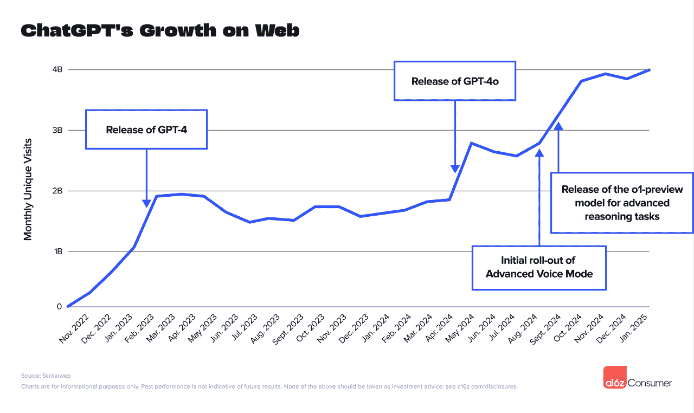

以前ChatGPT被人诟病“知识只停留在文字层面”，现在不仅能看图识物，甚至还能直接用语音侃天，真正实现了跨越式的用户体验升级。

对用户而言，这种AI与人类日常交流方式几乎没什么差别，谁还愿意放弃这样一个24小时待命、永不疲倦的万能小助手呢？

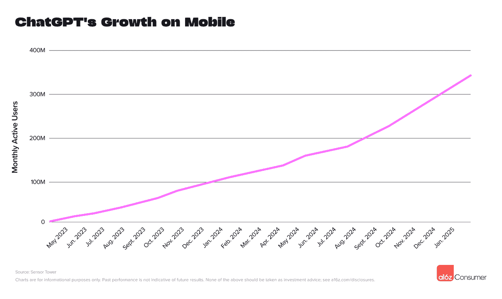

这轮技术上的重大跃迁，让ChatGPT摆脱了用户疲劳期，不但老用户回来了，新用户也被迅速圈粉，掀起新一波的使用狂潮。

## 突然冒出来的“黑马”DeepSeek，到底什么来头？

然而，AI界从来不缺搅局者。

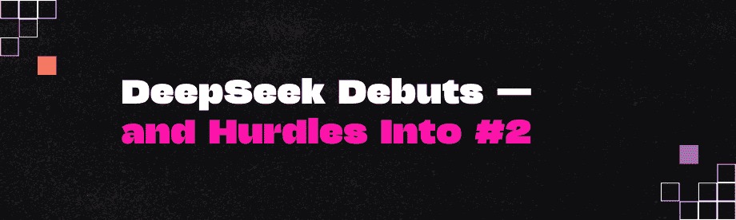

榜单中突然冒出了一款名为DeepSeek的产品，1月刚一亮相，就火速攀升为ChatGPT最强劲的挑战者之一。

DeepSeek到底凭什么吸引用户眼球呢？

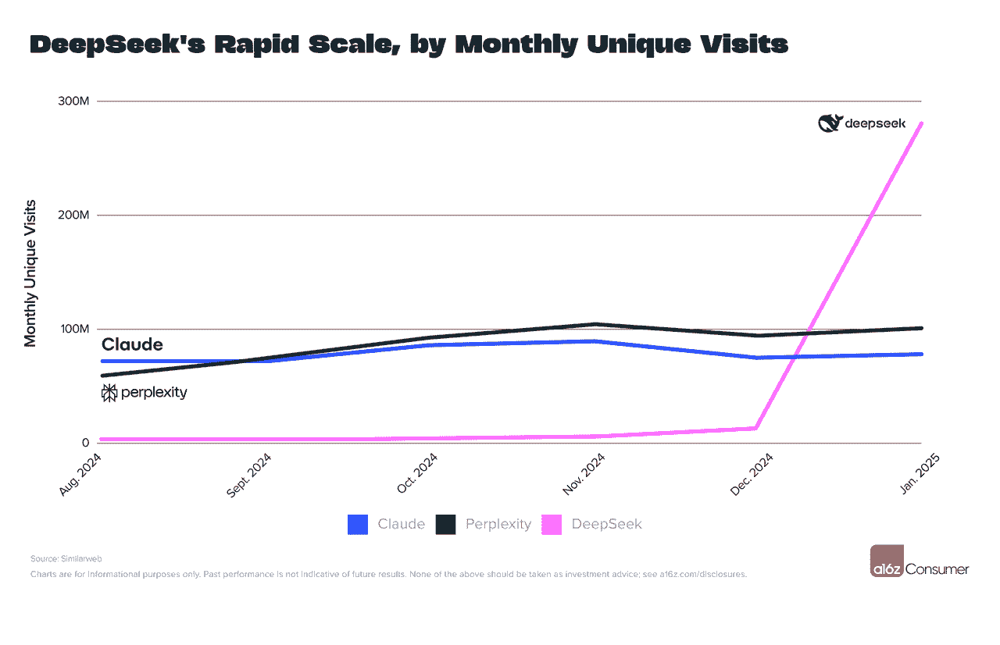

原来，这款AI聊天应用背后藏着一群华人科学家和前OpenAI工程师组成的精英团队。

相比ChatGPT，DeepSeek在严肃知识场景下的表现更强，比如医学、科研甚至法律领域的高难度问答，DeepSeek可以给出近似专家级别的精准答案，短短几个月内迅速成为高校师生和科研人员的“新宠”。

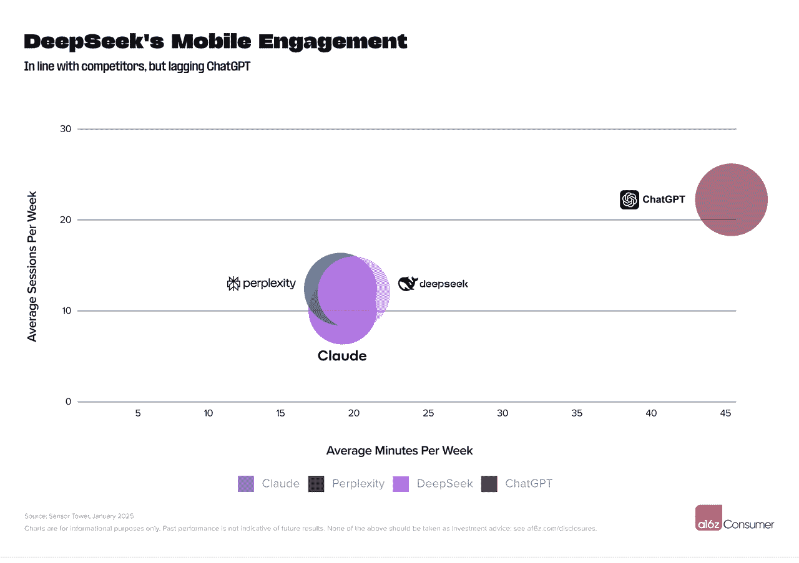

更有趣的是，DeepSeek并不把自己视作简单的聊天机器人，而是直接定位于“专业知识的超级助理”，它的崛起不仅意味着ChatGPT一家独大的局面正在被打破，更说明生成式AI正在逐步进入垂直专业化、精细化的竞争阶段。

## 视频AI狂飙，“人人导演”时代真的来了

除了聊天机器人领域的硝烟四起，AI视频生成技术也真正进入了爆发期。

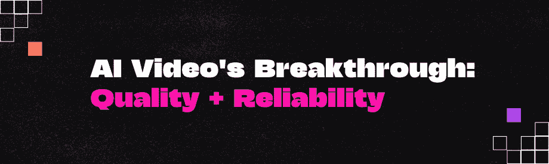

从前，AI生成的视频总让人觉得怪怪的，似乎离真正的“能用”还有一段距离。然而，今年技术的发展超乎想象——AI生成的视频已经可以轻松以假乱真。

现在，只要你动动手指，输入几句简单的描述，AI就能自动帮你制作出高质量的短片。无论是企业宣传片、创意广告，甚至是娱乐短视频，AI视频生成技术都能搞定。

这也意味着，视频创作再也不只是专业人士和影视团队的专属，普通人甚至“0基础”的小白用户也能快速上手。

这种前所未有的便利性，使AI视频工具迅速成为热门应用，短视频领域正在经历一场前所未有的AI革命。

## “氛围编程”：人人都能参与AI创作的时代来了

本次报告还首次提出了一个新概念：“Vibecoding”（氛围编程）。

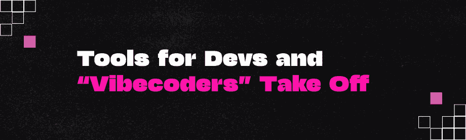

它的出现折射出了一个关键趋势——AI不再只是程序员和技术大神们的专属工具，而是真正开始走向每一个普通用户。

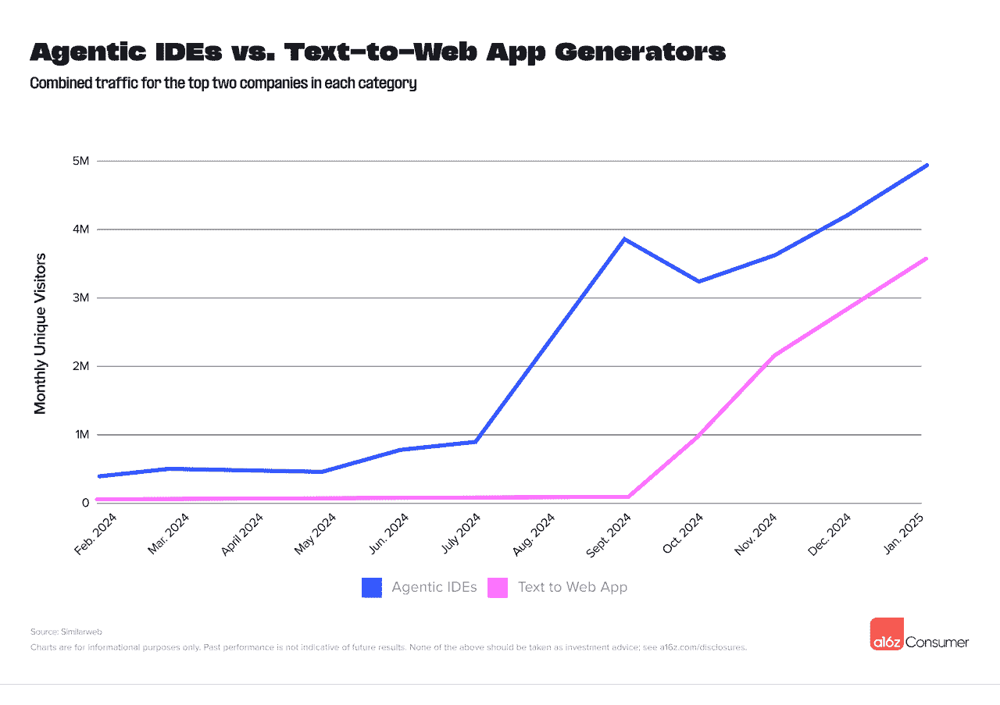

过去，想让AI生成一些满意的内容，用户还得绞尽脑汁写提示词、设置参数，像一场精英人士才懂的游戏；但如今，新的创作模式越来越强调“随心所欲”：你只需稍作提示，AI就能理解你的意图，“主动”创作出超乎预期的好内容。

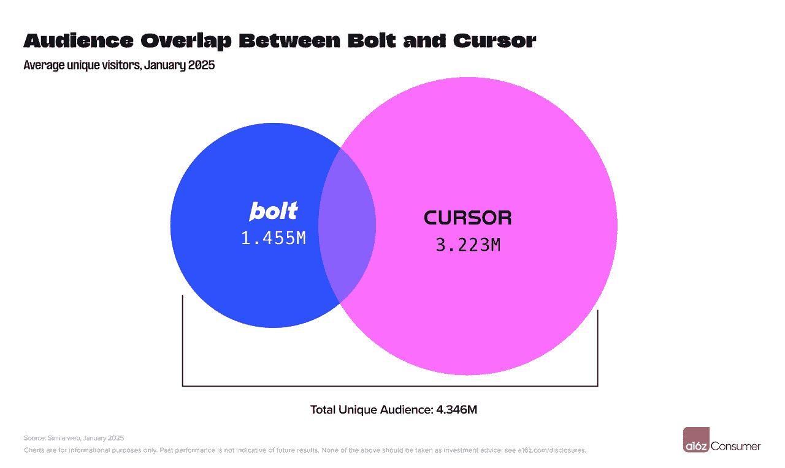

这种AI普及化的趋势，让生成式AI从一个复杂、枯燥的高门槛领域，变成了“随便一试就上瘾”的创意天堂。

“氛围编程”彻底拉低了AI的入门门槛，使得学生、职场人士、甚至中老年人群都能轻松享受AI带来的创作乐趣。

## 下一批AI爆款藏在哪里？神秘的“悬崖榜”给出答案

此外，a16z还首次推出了名为“悬崖榜”（Brink List）的新玩法，提前预测下一轮即将爆发的AI应用。

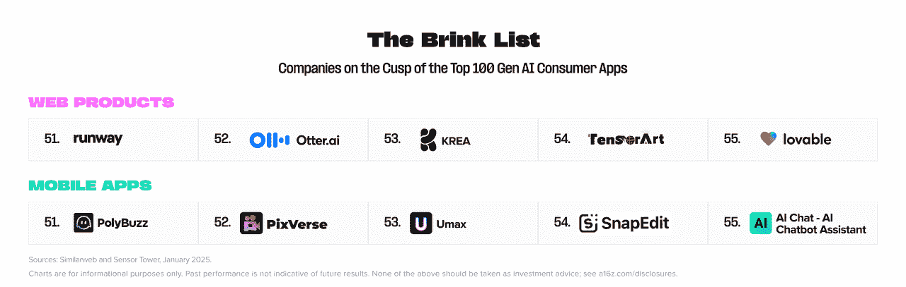

这个榜单特别选出了五款即将冲入全球AI百强榜单的应用，被业内人士戏称为“下一个AI爆款预备役”。

这些应用涉及视频创作、教育学习、互动游戏甚至AI驱动的社交平台，正在悄悄积累用户量，随时可能“临门一脚”，晋升为下一个爆款。这也预示着2025年的AI市场竞争，将比任何时候都更激烈、更好玩、更具悬念。

## 写在最后：生成式AI争夺战的未来格局

纵观整份榜单，我们会发现生成式AI的发展正处于一个关键的转折点：技术正快速成熟，从最初的“新奇玩具”逐步成为人人都用得起、用得惯的日常工具。

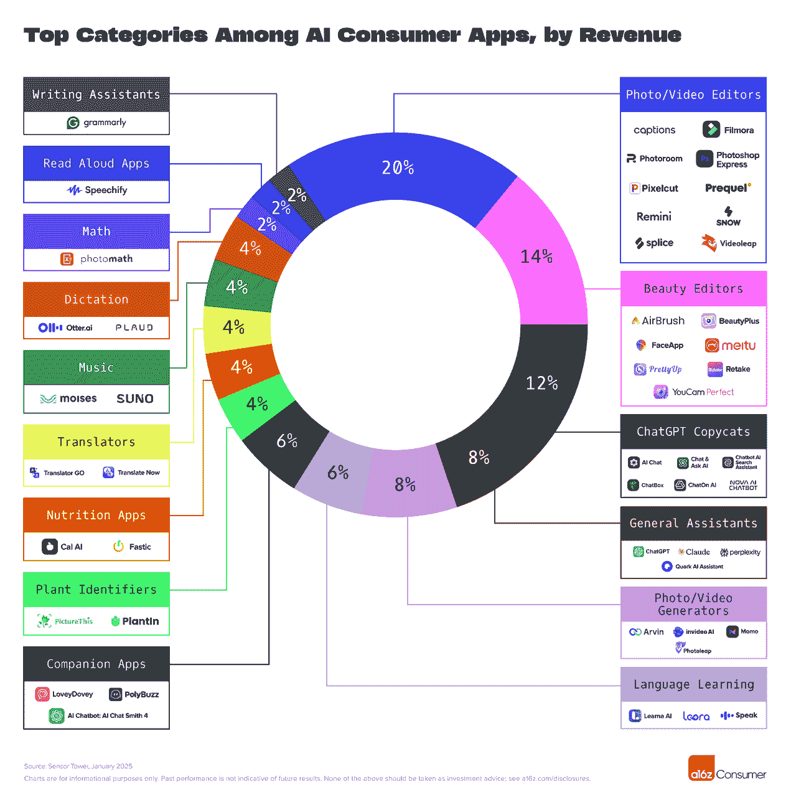

更重要的是，AI的竞争门槛已经不再单纯是技术上的领先，而是更强调产品体验、精准定位，以及如何真正融入人们的日常工作和生活。

对普通用户而言，这意味着我们即将进入一个“随时随地、万物皆可AI”的时代，AI将从一项“高科技”逐步变成和手机、电脑一样寻常的工具。

ChatGPT的王者归来只是开头，DeepSeek、AI视频创作、氛围编程乃至更多新玩家的不断涌现，意味着一场全球规模的AI大战才刚刚拉开序幕。

2025年，将会更加精彩！

我们拭目以待！

<https://aigcreative.feishu.cn/sync/K4Gvd9vUQsy9Oubwqaeclu0Fnbg>

# 知识库动态