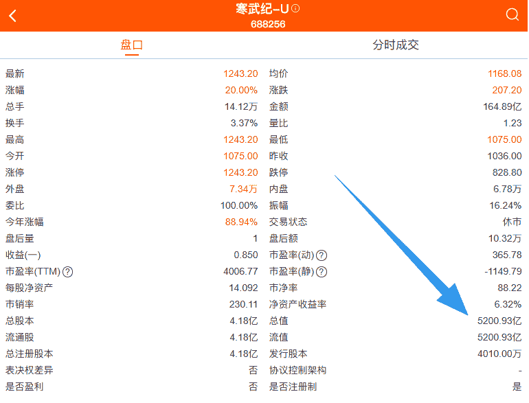
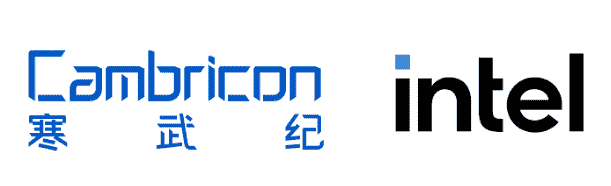
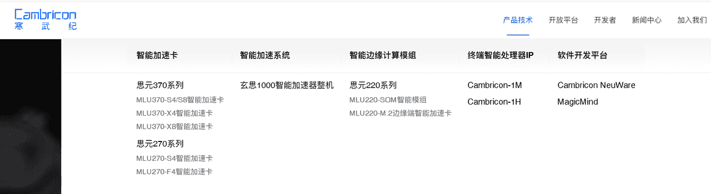
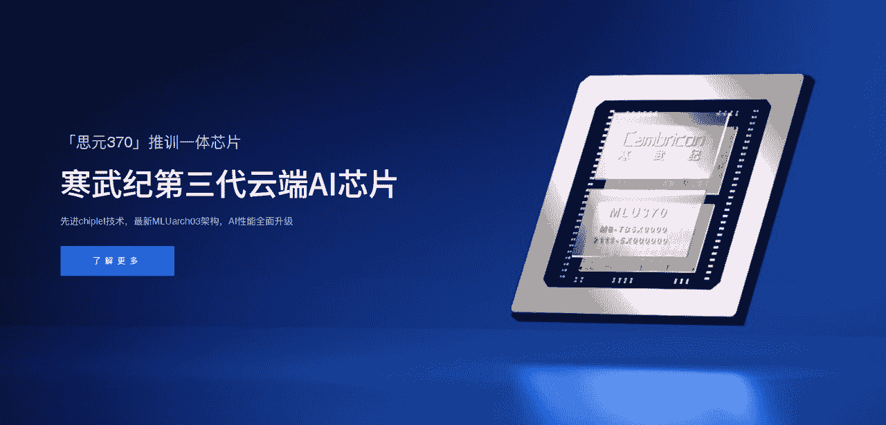
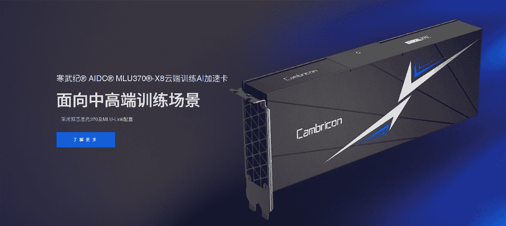
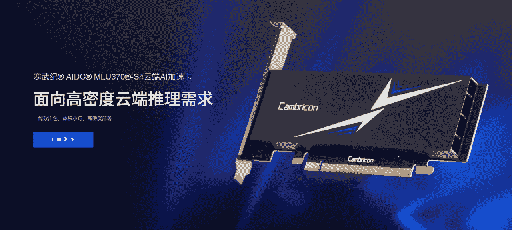
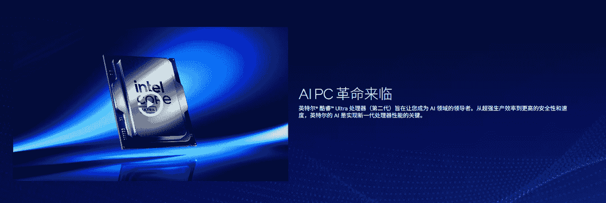
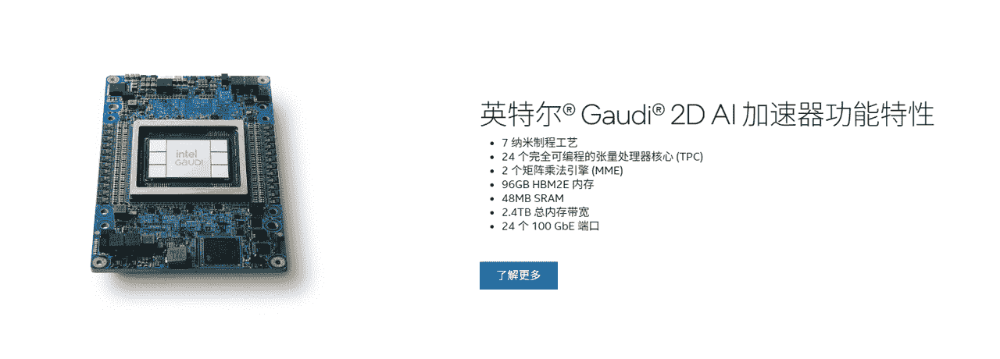
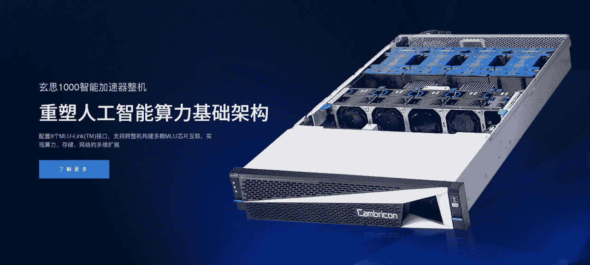

# 20250824-DeepSeek彻底引爆！寒武纪市值快要赶上英特尔了！

> 来源：[https://aigcreative.feishu.cn/docx/IuxHdkXFhol9GDxciDxcFUfOnMg](https://aigcreative.feishu.cn/docx/IuxHdkXFhol9GDxciDxcFUfOnMg)

自生成式AI爆发以来，发展到现在，竞争进入白热化阶段，甚至还有点魔幻了。

近日，一条新闻直接给我干懵了：AI芯片公司寒武纪的市值，再来1~2个涨停板，就快要摸到英特尔了！

这恐怕就是AI浪潮下的魔幻现实吧。

这事儿放几年前，你跟我说，我肯定觉得你喝多了。

一个还在努力盈利的国内公司，去跟一个定义了个人电脑时代、几十年家底的半导体巨头比市值？开什么玩笑。

但现在，这事儿就这么发生了。

很多人第一反应就是“泡沫”，或者“A股特色，别太当真”。

一开始我也这么想，但仔细扒了扒背后的东西，发现这事儿远没那么简单。

# 01.

### 一个靠“故事”，一个在“赌命”

咱们先说说寒武纪。

你要是光看财务报表，那估值简直没法看。

市盈率一度干到3000倍，啥概念？

就是说，按它现在的赚钱速度，你投一笔钱进去，理论上得等三千年才能回本……这已经不是投资了，这是要把寒武纪的股票传给后代当传家宝了。

所以，市场给寒武纪定价，压根就没看它现在赚多少钱。

大家买的是个啥？

买的是一个“故事”，一个极具想象力的未来。

这个故事有两条主线：

第一条，是AI浪潮。这个不用多说了吧，现在谁不聊AI谁就落伍了。

算力就是新时代的石油，而寒武纪，就是那个在国内被寄予厚望的“石油勘探队”。

第二条，也是更关键的一条，叫“国产替代”。

说白了，因为众所周知的原因，英伟达那些最顶级的AI芯片，我们现在是想买也买不到。

那国内这么多AI公司、这么多数据中心嗷嗷待哺的算力需求怎么办？总不能干等着吧。

这时候，像寒武纪这样的国内选手，就从“备胎”一下子成了“全村的希望”。

所以你看，给寒武纪的估值逻辑，其实特别简单粗暴：在一个因为外部限制而形成的、巨大的、受保护的“专属赛场”里，它被认为是头号种子选手。

大家赌的不是它现在能不能打，而是坚信它将来一定能拿下这个赛场。

它的股价里，至少有一半，甚至更多，是“地缘政治溢价”和“民族情感溢价”。

这东西，没法用传统的计算器去算。

那回头再看英特尔这边，简直是另一个画风。

如果说寒武纪是在风口上被吹起来的，那英特尔就像一个曾经的重量级拳王，现在正一身是汗地在健身房里疯狂砸钱，试图找回巅峰状态。

它不是在讲故事，它是在“赌命”。

这几年英特尔的日子有多难，大家有目共睹。

CPU市场被AMD追着打，先进制程工艺被台积电甩在身后，更要命的是，在最重要的AI加速器市场，被英伟达打得几乎找不着北。

为了翻盘，英特尔搞了个叫“IDM 2.0”的计划，简单说就是：自家芯片要自己造，还要重拾荣光。

同时，也放下身段，把一部分订单给台积电。

最狠的是，还要开个“芯片代工厂”，帮别人造芯片，直接跟台积电抢生意。

这个计划听起来很宏大，但每一步都是在烧钱，烧掉的是天文数字的钱。

财报上动不动就几十亿甚至上百亿美元的亏损，裁员的消息也是一波接一波。

所以，市场给英特尔的定价，是一种“概率”的定价。

它在赌英特尔这场豪赌，到底有多大胜算？

从现在这个不温不火的股价来看，显然，大部分人心里是没底的，疑虑重重。

# 02.

### 赛道不同，怎么比？

聊到这儿，你可能就明白了。

这两家公司，虽然都在芯片这个行业里，但他们玩的根本不是同一场游戏。

英特尔是在一个开放的、全球化的“无限制格斗”赛场上，跟英伟达、AMD、台积电这些顶级高手贴身肉搏。

它必须证明自己是全世界最能打的那一个，才能赢得投资者的心。

它的产品，比如Gaudi AI加速器，是直接拿到国际舞台上跟英伟达的H100掰手腕的，输赢很直观。

而寒武纪呢？

它是在一个有“特殊规则”的“国内锦标赛”里比赛。

因为最强的对手（英伟达）被禁赛了，它的任务就变成了：只要能赢过国内的其他选手（比如华为昇腾），成为这个赛区的第一名，就够了。

它不需要是“世界最好”，只需要是“我们能买到的最好”。

这个逻辑一理顺，那个惊人的市值差距，似乎就好理解一些了。

说实话，寒武纪的软肋也很明显。

比如，客户太集中，基本上就是靠几个大项目活着，这饭碗端得稳不稳，得打个问号。

还有它的软件生态NeuWare，跟英伟达那个经营了十几年的CUDA生态比，还像个小学生。

在开放市场里，这几乎是致命的。

但有意思的地方就在这。

外部的制裁，反而像一堵墙，帮它把最大的敌人挡在了外面（就像当年禁止谷歌入华背景下的百度），也间接逼着国内所有的开发者，不得不去适应它这个还不太好用的生态。

这感觉就像，本来你家门口路不好走，但通往隔壁繁华大道的桥突然断了，你没办法，只能硬着头皮把你家门口这条路给修好、走顺。

# 03.

所以，这事儿到底怎么看？

我觉得，寒武纪的这个市值，它既是“预兆”，也是“泡沫”。

说它是“预兆”，是因为它预示着一个全球科技“双轨制”时代的到来。

以后可能真的会有两套平行的技术生态，各玩各的。

在咱们这个生态里，龙头企业的估值逻辑，会跟外面完全不一样。

说它是“泡沫”，是因为它现在的身价，确实远远透支了它作为一个商业公司的实际表现。

它更多地是承载了一种期望，一种信念。

这种信念能持续多久，最终还是要看它能不能把技术真正转化为实打实的、多元化的商业成功。

毕竟，光靠“故事”和“情怀”，是没法永远在牌桌上玩下去的。

而英特尔呢，它的挑战就是，能不能在把钱烧完之前，把当年吹过的牛都实现。

一旦它的先进工艺追上来，代工业务真的抢到了大客户，那这个“昔日王者”的能量，依然是核弹级别的。

所以啊，寒武纪和英特尔市值的这次“亲密接触”，可能只是一个短暂的瞬间。

但它背后反映出的这个分化的世界，以及两种截然不同的生存法则，恐怕会在未来很长一段时间里，继续上演。

不知道你怎么看？评论区可以聊聊。

<https://aigcreative.feishu.cn/sync/K4Gvd9vUQsy9Oubwqaeclu0Fnbg>

# 知识库动态